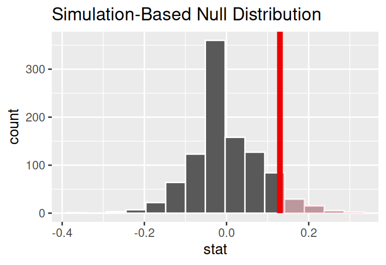
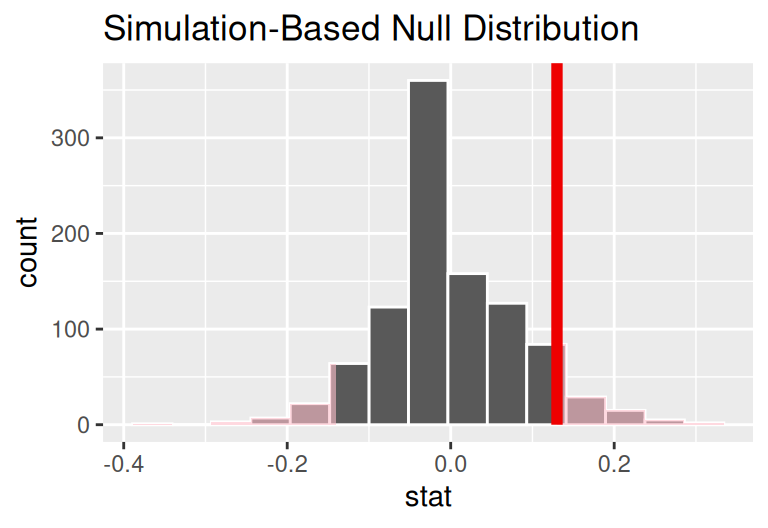
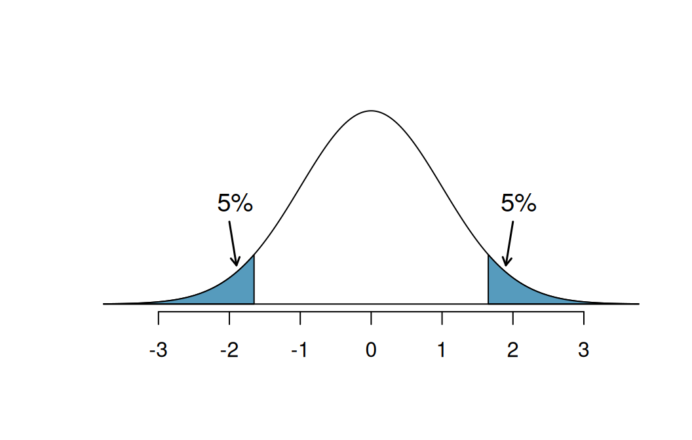

## 1. Giới thiệu: Khi phương pháp đúng vẫn dẫn đến kết luận sai

Kiểm định giả thuyết thống kê là một công cụ suy luận chặt chẽ, song bản chất của nó không phải là một chiếc chìa khóa vạn năng đảm bảo tính đúng đắn tuyệt đối. Ngay cả khi nhà phân tích tuân thủ chuẩn xác mọi quy chuẩn toán học, từ việc phát biểu giả thuyết không bị lệch lạc cho đến tính toán $p\text{-value}$ chuẩn xác bằng mô phỏng máy tính, kết luận rút ra từ dữ liệu mẫu ngẫu nhiên vẫn luôn tiềm ẩn xác suất mắc sai lầm.

Nguyên nhân cốt lõi nằm ở chỗ: Ta buộc phải đưa ra một phán quyết mang tính nhị phân (chấp nhận duy trì hay bác bỏ giả thuyết không $H_0$) dựa trên một mẫu dữ liệu chỉ mang tính đại diện và luôn chứa đựng biến thiên ngẫu nhiên. Tình huống này hoàn toàn tương đồng với một phiên tòa xét xử hình sự:

- Giả thuyết không $H_0$: Bị cáo hoàn toàn vô tội (nguyên tắc suy đoán vô tội).
- Giả thuyết đối $H_A$: Bị cáo thực sự có tội.
- Bồi thẩm đoàn chỉ có hai phán quyết: Tuyên có tội (bác bỏ $H_0$) hoặc tuyên vô tội / không đủ bằng chứng kết tội (không bác bỏ $H_0$).

Trong hệ thống tư pháp, một người vô tội có thể bị kết án oan, hoặc một kẻ phạm tội thực sự có thể được tha bổng do thiếu chứng cứ. Điểm ưu việt của thống kê học so với phiên tòa thông thường là: Khuôn khổ toán học cho phép ta **định lượng và kiểm soát chủ động xác suất xảy ra các sai lầm này ngay từ khâu thiết kế nghiên cứu**.

---

## 2. Hai loại sai lầm thống kê (Statistical Errors)

Trong kiểm định giả thuyết thống kê, ta đặt lên bàn cân hai giả thuyết đối nghịch: Giả thuyết không $H_0$ và giả thuyết đối $H_A$. Kết quả của kiểm định dẫn đến hai hành động: Bác bỏ $H_0$ (nếu $p\text{-value} < \alpha$) hoặc không đủ bằng chứng bác bỏ $H_0$ (nếu $p\text{-value} \ge \alpha$). 

Khi đối chiếu quyết định thống kê với chân lý khách quan trong tự nhiên, ta thu được bốn tình huống khả dĩ:

| Chân lý khách quan | Phán quyết: Bác bỏ $H_0$ | Phán quyết: Không bác bỏ $H_0$ |
| :--- | :--- | :--- |
| **$H_0$ thực sự đúng** | **Sai lầm loại I** (Dương tính giả) Xác suất $= \alpha$ | **Quyết định đúng đắn** (Độ đặc hiệu) Xác suất $= 1 - \alpha$ |
| **$H_A$ thực sự đúng** | **Quyết định đúng đắn** (Lực kiểm định) Xác suất $= 1 - \beta$ | **Sai lầm loại II** (Âm tính giả) Xác suất $= \beta$ |

### Sai lầm loại I (Type I Error / False Positive)

- **Định nghĩa**: Là hành vi bác bỏ giả thuyết không $H_0$ trong khi $H_0$ thực sự đúng trong tự nhiên.
- **Tên gọi khác**: Dương tính giả (False Positive) hoặc cảnh báo nhầm.
- **Ẩn dụ phòng xử án**: Tòa án tuyên bị cáo có tội và kết án tù, trong khi người này hoàn toàn vô tội.
- **Xác suất xảy ra**: Ký hiệu là $\alpha$ (chính là mức ý nghĩa của kiểm định).

### Sai lầm loại II (Type II Error / False Negative)

- **Định nghĩa**: Là hành vi không bác bỏ giả thuyết không $H_0$ trong khi thực chất giả thuyết đối $H_A$ mới là sự thật.
- **Tên gọi khác**: Âm tính giả (False Negative) hoặc bỏ sót hiệu ứng.
- **Ẩn dụ phòng xử án**: Tòa án tuyên trả tự do cho bị cáo vì thiếu bằng chứng, mặc dù người này thực chất là kẻ phạm tội.
- **Xác suất xảy ra**: Ký hiệu là $\beta$.

### Đánh đổi tất yếu giữa hai loại sai lầm

Nếu ta muốn giảm thiểu sai lầm loại I trong tòa án (tức là không bao giờ kết án oan người vô tội), ta buộc phải nâng chuẩn mực chứng cứ lên cực cao: Phải có bằng chứng video sắc nét, ADN trùng khớp tuyệt đối, nhiều nhân chứng chứng kiến. Khi chuẩn mực bị đẩy lên quá khắt khe, hầu hết tội phạm tinh vi sẽ không đủ bằng chứng để kết tội, dẫn đến sai lầm loại II tăng vọt (bỏ lọt tội phạm).

Ngược lại, nếu ta muốn hạ thấp sai lầm loại II (tức là kiên quyết không bỏ sót bất kỳ kẻ phạm tội nào), ta sẽ hạ thấp chuẩn mực chứng cứ: Chỉ cần một nghi vấn nhỏ là kết án. Hậu quả tất yếu là số lượng người vô tội bị kết án oan (sai lầm loại I) sẽ tăng vọt.

> [!IMPORTANT] Quy luật đánh đổi:
> Với một dung lượng mẫu cố định, việc giảm xác suất sai lầm loại này tất yếu sẽ kéo theo sự gia tăng xác suất sai lầm loại kia. Cách duy nhất để đồng thời giảm cả hai loại sai lầm là **thu thập thêm dữ liệu (tăng kích thước mẫu $n$)**.

---

## 3. Mức ý nghĩa $\alpha$ và tiêu chuẩn bằng chứng

Ngưỡng xác suất dùng để đưa ra phán quyết bác bỏ $H_0$ được gọi là **mức ý nghĩa** (Significance level), ký hiệu là $\alpha$. Khi $p\text{-value} < \alpha$, ta tuyên bố kết quả quan sát được có ý nghĩa thống kê (statistically significant) và bác bỏ $H_0$.

Theo quy ước truyền thống do Ronald Fisher đề xuất vào thập niên 1920, giá trị $\alpha = 0.05$ thường được chọn làm mặc định. Tuy nhiên, mức ý nghĩa này hoàn toàn không phải là một hằng số bất biến của tự nhiên; nó phải được cân nhắc và điều chỉnh linh hoạt tùy thuộc vào tổn thất thực tế của từng loại sai lầm:

- **Khi nào nên chọn mức ý nghĩa rất nhỏ ($\alpha = 0.01$ hoặc $\alpha = 0.001$)?**
  - Khi cái giá phải trả của sai lầm loại I là cực kỳ đắt đỏ hoặc gây nguy hiểm tính mạng.
  - Ví dụ: Cấp phép một loại thuốc mới có độc tính cao hoặc triển khai dự án đầu tư hàng chục tỷ đô la có nguy cơ phá sản. Khi đó, ta đòi hỏi bằng chứng ủng hộ $H_A$ phải vượt trội hoàn toàn trước khi quyết định bác bỏ $H_0$.
- **Khi nào có thể chấp nhận mức ý nghĩa nới lỏng hơn ($\alpha = 0.10$)?**
  - Khi cái giá phải trả của sai lầm loại II nghiêm trọng hơn nhiều so với sai lầm loại I.
  - Ví dụ: Hệ thống sàng lọc chẩn đoán sớm ung thư giai đoạn đầu hoặc cảnh báo rò rỉ khí độc trong hầm mỏ. Nếu báo động nhầm (sai lầm loại I), cơ sở chỉ mất chi phí xét nghiệm lại; nhưng nếu bỏ sót một ca bệnh hiểm nghèo hoặc bỏ sót rò rỉ khí độc (sai lầm loại II), hậu quả sẽ là tử vong. Do đó, ta sẵn sàng chấp nhận mức $\alpha$ cao hơn để tối đa hóa độ nhạy phát hiện.

---

## 4. Nghiên cứu thực nghiệm: Thuốc làm tan huyết khối sau hô hấp nhân tạo (CPR)

Để thấy rõ cơ chế vận hành của sai lầm thống kê, hãy cùng phân tích một nghiên cứu y khoa thực tế về hiệu quả của thuốc làm tan huyết khối đối với bệnh nhân ngừng tim.

Hô hấp nhân tạo (CPR) là biện pháp ép tim ngoài lồng ngực khẩn cấp khi người bệnh bị ngừng tim đột ngột ngoài bệnh viện. Dù cứu sống nhiều nạn nhân, các động tác ép tim thô bạo thường gây ra các chấn thương nội tạng và dập mô kín. Khi bệnh nhân được đưa đến bệnh viện cấp cứu, các bác sĩ đứng trước một quyết định sinh tử: Liệu có nên tiêm thuốc làm tan huyết khối (blood thinner) để khơi thông động mạch vành hay không?

- Một mặt, thuốc làm tan huyết khối giúp thông mạch máu nuôi tim, tăng cơ hội sống sót.
- Mặt khác, thuốc lại làm mất khả năng đông máu tự nhiên, có thể gây xuất huyết nội tạng trầm trọng từ chính các vết thương dập do CPR trước đó, dẫn đến tử vong nhanh hơn.

### Dữ liệu thử nghiệm lâm sàng

Thử nghiệm ngẫu nhiên có đối chứng được tiến hành trên $90$ bệnh nhân được đưa vào viện sau khi thực hiện CPR. Các bệnh nhân được phân ngẫu nhiên vào hai nhóm:
- Nhóm đối chứng (Control): Không sử dụng thuốc làm tan huyết khối ($n_C = 50$).
- Nhóm can thiệp (Treatment): Có sử dụng thuốc làm tan huyết khối ($n_T = 40$).

Biến số kết cục là việc bệnh nhân có sống sót qua 24 giờ đầu tiên hay không. Kết quả ghi nhận tại bệnh viện như sau:

| Phân nhóm bệnh nhân | Tử vong | Sống sót | Tổng số | Tỉ lệ sống sót quan sát ($\hat{p}$) |
| :--- | :--- | :--- | :--- | :--- |
| **Nhóm đối chứng (Control)** | 39 | 11 | 50 | $\hat{p}_C = \frac{11}{50} = 0.22$ ($22\%$) |
| **Nhóm can thiệp (Treatment)** | 26 | 14 | 40 | $\hat{p}_T = \frac{14}{40} = 0.35$ ($35\%$) |
| **Tổng cộng** | 65 | 25 | 90 | $\hat{p}_{\text{chung}} = \frac{25}{90} \approx 0.278$ |

Chênh lệch tỉ lệ sống sót quan sát được giữa hai nhóm là:
$$\hat{p}_T - \hat{p}_C = 0.35 - 0.22 = +0.13 \quad (13\%)$$

Con số $+13\%$ thoạt nhìn có vẻ là một tín hiệu khả quan. Nhưng liệu chênh lệch này có thực sự phản ánh tác động dược lý của thuốc, hay nó chỉ là một biến động ngẫu nhiên thuần túy do quá trình phân nhóm ngẫu nhiên trên cỡ mẫu nhỏ?

### Thiết lập giả thuyết và nguyên tắc kiểm định hai phía

Vì thuốc có thể vừa có tiềm năng cứu mạng vừa có nguy cơ gây xuất huyết dẫn đến tử vong, ta bắt buộc phải mở rộng nhận thức đối với cả hai chiều biến thiên:

$$\begin{aligned}
H_0 &: p_T - p_C = 0 \quad (\text{Thuốc không làm thay đổi tỉ lệ sống sót}) \\
H_A &: p_T - p_C \neq 0 \quad (\text{Thuốc có tác động làm thay đổi tỉ lệ sống sót})
\end{aligned}$$

Nếu giả thuyết không $H_0$ là đúng, nhãn dán "Có dùng thuốc" hay "Không dùng thuốc" không có bất kỳ ý nghĩa sinh học nào. Ta có thể mô phỏng phân phối giả thuyết không bằng cách xáo trộn ngẫu nhiên (permutation) $90$ hồ sơ bệnh nhân (gồm 25 người sống và 65 người chết) vào hai nhóm kích thước 40 và 50, lặp lại $1{,}000$ lần.

*Hình 20.1: Phân phối giả thuyết không của chênh lệch tỉ lệ $\hat{p}_T - \hat{p}_C$. Diện tích đuôi phải ứng với các giá trị $\ge 0.13$ chiếm tỉ lệ $0.131$ (tức $13.1\%$).*

Trong Hình 20.1, diện tích đuôi phải tương ứng với các giá trị chênh lệch $\ge +0.13$ là $0.131$. Tuy nhiên, đây **chưa phải là $p\text{-value}$ hoàn chỉnh của bài toán**!

Định nghĩa chuẩn mực của $p\text{-value}$ là xác suất quan sát được kết quả cực đoan bằng hoặc hơn kết quả thực tế dưới giả định $H_0$ đúng. Trong kiểm định hai phía ($H_A: p_T - p_C \neq 0$), một kết quả chênh lệch $\le -0.13$ (tức nhóm dùng thuốc có tỉ lệ sống sót thấp hơn nhóm đối chứng từ $13\%$ trở lên do biến chứng xuất huyết) cũng cung cấp bằng chứng chống lại $H_0$ mạnh mẽ không kém gì kết quả $+0.13$.

*Hình 20.2: Trực quan hóa $p\text{-value}$ hai phía. Ta lấy diện tích của cả hai phần đuôi cách xa 0 ít nhất một khoảng $0.13$ ở cả hai chiều.*

Để tính $p\text{-value}$ cho kiểm định hai phía trên phân phối đối xứng hoặc gần đối xứng, ta lấy diện tích của một đuôi nhân đôi:
$$p\text{-value} = 2 \times 0.131 = 0.262$$

Vì $p\text{-value} = 0.262 > \alpha = 0.05$, ta kết luận: **Chưa đủ bằng chứng thống kê để bác bỏ giả thuyết không**. Mức chênh lệch $13\%$ hoàn toàn có thể xuất hiện do ngẫu nhiên thuần túy với xác suất lên tới hơn $26\%$. Nghiên cứu chưa thể khẳng định thuốc làm tan huyết khối mang lại lợi ích sống còn cho bệnh nhân.

---

## 5. Cạm bẫy đổi kiểm định sau khi xem dữ liệu: Nhân đôi sai lầm loại I

Một sai sót phương pháp luận vô cùng phổ biến là việc nhà nghiên cứu chuyển đổi tùy tiện từ kiểm định hai phía sang kiểm định một phía sau khi đã quan sát dữ liệu.

Hãy hình dung tình huống sau: Một nhà nghiên cứu ban đầu quan sát thấy $\hat{p}_T - \hat{p}_C = +0.13 > 0$. Nhận thấy diện tích đuôi phải là $0.131$ (hoặc nếu dữ liệu cho đuôi phải là $0.03$), nếu họ dùng kiểm định hai phía thì $p = 2 \times 0.03 = 0.06 > 0.05$ (không đạt ý nghĩa thống kê). Do muốn công bố kết quả thành công, họ liền "đổi ý" và phát biểu lại giả thuyết đối thành kiểm định một phía:
$$H_A: p_T - p_C > 0$$
Khi đó, họ chỉ tính diện tích một đuôi phải ($p = 0.03 < 0.05$) và vội vã tuyên bố phát hiện có ý nghĩa thống kê!

Hậu quả toán học của hành vi này là gì?

*Hình 20.3: Nguy cơ nhân đôi sai lầm loại I khi chọn hướng kiểm định một phía dựa trên chiều quan sát được của dữ liệu.*

Quan sát Hình 20.3:
1. Nếu chênh lệch mẫu rơi vào vùng dương, nhà nghiên cứu chọn đuôi phải với mức ý nghĩa $5\%$.
2. Nếu chênh lệch mẫu rơi vào vùng âm, nhà nghiên cứu lại chọn đuôi trái với mức ý nghĩa $5\%$.
3. Tổng xác suất bác bỏ nhầm $H_0$ khi $H_0$ thực sự đúng trên thực tế sẽ là:
   $$\alpha_{\text{thực tế}} = 5\% + 5\% = 10\%$$

> [!CAUTION] Bài học phương pháp luận tối thượng:
> Việc "đổi phe" hoặc chọn giả thuyết một phía sau khi đã nhìn thấy dữ liệu sẽ làm **tăng gấp đôi xác suất mắc sai lầm loại I** so với mức công bố danh nghĩa ($\alpha = 0.05$). Giả thuyết nghiên cứu và chiều kiểm định bắt buộc phải được xác định và đóng băng trước khi tiếp xúc với dữ liệu (Pre-registration).

---

## 6. Lực kiểm định (Statistical Power) và Cỡ mẫu

Khi lập kế hoạch cho một nghiên cứu thực nghiệm, các nhà khoa học luôn phải dung hòa hai áp lực trái ngược:
1. Cần thu thập đủ dữ liệu để phát hiện ra hiệu ứng thực sự nếu nó tồn tại.
2. Chi phí thu thập dữ liệu (ngân sách, thời gian, số lượng động vật thí nghiệm, sức khỏe của người bệnh) có hạn và cần được tối thiểu hóa.

Để giải quyết bài toán tối ưu này, thống kê học đưa ra khái niệm **Lực kiểm định** (Statistical Power).

### Khái niệm Lực kiểm định

- **Định nghĩa**: Lực kiểm định là xác suất bác bỏ thành công giả thuyết không $H_0$ khi giả thuyết đối $H_A$ thực sự đúng.
- **Mối liên hệ toán học**: Vì sai lầm loại II có xác suất là $\beta$ (bỏ sót $H_A$ khi $H_A$ đúng), nên lực kiểm định chính là biến cố bù của sai lầm loại II:
  $$\text{Power} = 1 - \beta = P(\text{Bác bỏ } H_0 \mid H_A \text{ đúng})$$

### Ba yếu tố quyết định lực kiểm định

Lực kiểm định của một bài toán phụ thuộc chặt chẽ vào ba thông số:
1. **Kích thước hiệu ứng thực tế (Effect Size)**: Nếu một loại thuốc giảm tỉ lệ tử vong từ $50\%$ xuống $10\%$ (hiệu ứng khổng lồ), ta chỉ cần cỡ mẫu rất nhỏ cũng dễ dàng phát hiện ra. Nhưng nếu thuốc chỉ giảm từ $50\%$ xuống $48\%$, ta cần một mẫu cực lớn mới có thể phân biệt được tín hiệu đó với nhiễu ngẫu nhiên.
2. **Kích thước mẫu ($n$)**: Cỡ mẫu càng lớn, sai số chuẩn của đại lượng thống kê càng thu hẹp lại, phân phối mẫu dưới $H_0$ và dưới $H_A$ càng tách rời nhau rõ rệt, giúp đẩy lực kiểm định lên cao.
3. **Mức ý nghĩa lựa chọn ($\alpha$)**: Việc nới lỏng $\alpha$ (ví dụ từ $0.01$ lên $0.05$) mở rộng miền bác bỏ, giúp tăng lực kiểm định (nhưng đổi lại là tăng rủi ro sai lầm loại I).

### Đạo đức khoa học trong thiết kế cỡ mẫu

Xét ví dụ thử nghiệm thuốc ức chế khối u trên chuột bạch:
- **Nếu nghiên cứu có lực kiểm định quá thấp (Underpowered Study)**: Chẳng hạn cỡ mẫu chỉ có 10 con chuột, dẫn đến lực kiểm định chỉ đạt $15\%$. Điều này có nghĩa là ngay cả khi thuốc có tác dụng thật, có tới $85\%$ khả năng nghiên cứu sẽ kết luận "không thấy hiệu ứng". Hàng chục con chuột bị hi sinh vô ích mà không mang lại đóng góp tri thức nào cho y học. Thiết kế này bị coi là vi phạm đạo đức nghiên cứu.
- **Nếu nghiên cứu lạm dụng cỡ mẫu quá mức**: Dùng tới 100,000 con chuột để đạt lực kiểm định $99.999\%$. Việc này gây lãng phí khổng lồ về tài chính và sinh mạng động vật một cách không cần thiết, trong khi một cỡ mẫu 300 con có thể đã đạt lực kiểm định chuẩn mực $80\%$ hoặc $90\%$.

> [!TIP] Nguyên tắc đọc hiểu nghiên cứu:
> "Sự vắng mặt của bằng chứng không đồng nghĩa với bằng chứng của sự vắng mặt" (*Absence of evidence is not evidence of absence*). Khi một nghiên cứu đưa ra kết luận $p\text{-value} > 0.05$ (không bác bỏ $H_0$), câu hỏi phản biện đầu tiên cần đặt ra là: **Cỡ mẫu của nghiên cứu này có đủ lớn để đảm bảo lực kiểm định tin cậy hay không?**

---

## 7. Mở rộng tư duy: Bẫy so sánh bội (Multiple Testing) và Hiệu chỉnh Bonferroni

Khi phân tích dữ liệu hiện đại, đặc biệt trong thời đại Big Data, tin sinh học và trí tuệ nhân tạo, các nhà phân tích thường không chỉ kiểm định một giả thuyết đơn lẻ mà kiểm định hàng trăm, thậm chí hàng triệu giả thuyết đồng thời (ví dụ: So sánh biểu hiện của $20{,}000$ gen giữa người bệnh và người khỏe mạnh).

Điều gì sẽ xảy ra nếu ta vẫn áp dụng ngưỡng $\alpha = 0.05$ cho từng phép thử riêng lẻ?

Giả sử ta thực hiện $m$ phép thử độc lập và trong thực tế toàn bộ $m$ giả thuyết không $H_0$ đều đúng (tức hoàn toàn không có gen nào liên quan đến bệnh):
- Xác suất một phép thử đưa ra kết luận đúng (không bác bỏ $H_0$) là:
  $$P(\text{Đúng}) = 1 - \alpha = 1 - 0.05 = 0.95$$
- Xác suất để **cả $m$ phép thử đều không mắc sai lầm** là:
  $$P(\text{Cả } m \text{ phép thử đều đúng}) = (1 - \alpha)^m = 0.95^m$$
- Do đó, xác suất để có **ít nhất một kết luận dương tính giả** (Family-Wise Error Rate - FWER) là:
  $$P(\text{Ít nhất một sai lầm loại I}) = 1 - (1 - \alpha)^m = 1 - 0.95^m$$

Hãy nhìn vào bảng số liệu dưới đây:

| Số lượng phép thử ($m$) | Xác suất có ít nhất một dương tính giả |
| :--- | :--- |
| **1** | $1 - 0.95^1 = 5.00\%$ |
| **5** | $1 - 0.95^5 \approx 22.62\%$ |
| **10** | $1 - 0.95^{10} \approx 40.13\%$ |
| **20** | $1 - 0.95^{20} \approx 64.15\%$ |
| **50** | $1 - 0.95^{50} \approx 92.31\%$ |
| **100** | $1 - 0.95^{100} \approx 99.41\%$ |

Chỉ với 20 phép thử độc lập hoàn toàn ngẫu nhiên, xác suất bắt gặp một kết quả "có ý nghĩa thống kê giả mạo" đã lên tới hơn $64\%$! Hiện tượng này được gọi là **vấn nạn so sánh bội** (Multiple Comparisons Problem) hay việc đào bới dữ liệu để săn lùng $p\text{-value}$ (*p-hacking* / *Data Dredging*).

### Giải pháp: Hiệu chỉnh Bonferroni (Bonferroni Correction)

Để kiểm soát tỉ lệ sai lầm loại I tích lũy trên toàn bộ họ phép thử ở mức mong muốn $\alpha_{\text{mục tiêu}}$ (ví dụ $0.05$), giải pháp cổ điển và khắt khe nhất là chia nhỏ ngưỡng ý nghĩa cho số lượng phép thử $m$:

$$\alpha_{\text{Bonferroni}} = \frac{\alpha}{m}$$

Ví dụ: Nếu thực hiện $m = 20$ phép thử, ngưỡng để tuyên bố ý nghĩa thống kê của mỗi phép thử riêng lẻ không còn là $0.05$ nữa mà phải là:
$$\alpha_{\text{Bonferroni}} = \frac{0.05}{20} = 0.0025$$

---

## 8. Tóm tắt bài học

- Kiểm định giả thuyết là một quy trình ra quyết định nhị phân có kiểm soát rủi ro, nhưng không thể loại trừ hoàn toàn sai số ngẫu nhiên.
- **Sai lầm loại I ($\alpha$)**: Bác bỏ $H_0$ khi $H_0$ đúng (Dương tính giả). Được kiểm soát bằng mức ý nghĩa $\alpha$.
- **Sai lầm loại II ($\beta$)**: Không bác bỏ $H_0$ khi $H_A$ đúng (Âm tính giả).
- **Lực kiểm định ($1 - \beta$)**: Khả năng phát hiện hiệu ứng thực. Tăng lên khi tăng cỡ mẫu $n$ hoặc khi hiệu ứng thực tế lớn.
- Luôn mặc định kiểm định hai phía. Việc chuyển sang kiểm định một phía sau khi đã nhìn thấy dữ liệu sẽ làm nhân đôi xác suất sai lầm loại I thực tế.
- Trong các bài toán kiểm định nhiều giả thuyết đồng thời, bắt buộc phải sử dụng các kỹ thuật hiệu chỉnh mức ý nghĩa như Bonferroni để phòng ngừa bẫy so sánh bội.

---

## Tài liệu tham khảo

1. Çetinkaya-Rundel, M., & Hardin, J. (2021). *Introduction to Modern Statistics* (1st ed.). OpenIntro Project.
2. Fisher, R. A. (1925). *Statistical Methods for Research Workers*. Oliver and Boyd, Edinburgh.
3. Cohen, J. (1988). *Statistical Power Analysis for the Behavioral Sciences* (2nd ed.). Lawrence Erlbaum Associates.
4. Gelman, A., & Loken, E. (2014). The statistical crisis in science: Data-dependent analysis (a "garden of forking paths") explains why many statistically significant findings don't hold up. *American Scientist*, 102(6), 460–465.

## Bài tập tự luyện

### Bài tập 1: Ma trận sai lầm và lực kiểm định trong kiểm định công nghiệp

Một tập đoàn sản xuất pin xe điện thiết lập quy trình kiểm tra chất lượng tự động trước khi đóng gói xuất xưởng. Giả thuyết kiểm định được đặt ra cho mỗi lô pin như sau:
- $H_0$: Lô pin đạt chuẩn chất lượng an toàn (tỉ lệ lỗi cell pin $\le 0.001$).
- $H_A$: Lô pin không đạt chuẩn an toàn, có nguy cơ quá nhiệt gây cháy nổ (tỉ lệ lỗi $> 0.001$).

**Yêu cầu:**
1. Hãy mô tả cụ thể bản chất của Sai lầm loại I và Sai lầm loại II trong bối cảnh thực tế này.
2. Giả sử hậu quả của một vụ cháy nổ xe điện là sự đe dọa sinh mạng người dùng và thiệt hại hàng tỷ USD tiền bồi thường, trong khi chi phí tiêu hủy một lô pin đạt chuẩn bị kết luận nhầm là vài ngàn USD. Ban quản lý chất lượng nên điều chỉnh mức ý nghĩa $\alpha$ theo hướng tăng lên hay giảm đi? Hãy giải thích dựa trên mối quan hệ đánh đổi giữa $\alpha$ và $\beta$.
3. Định nghĩa lực kiểm định (Statistical Power) trong bài toán này và nêu phương án duy nhất để nâng cao lực kiểm định mà không làm tăng nguy cơ sai lầm loại I.

::: details Lời giải chi tiết
**1. Mô tả hai loại sai lầm trong bối cảnh kiểm định pin:**
- **Sai lầm loại I (Dương tính giả)**: Là việc bác bỏ $H_0$ khi $H_0$ thực sự đúng. Cụ thể: Lô pin thực tế hoàn toàn đạt chuẩn an toàn, nhưng quy trình kiểm tra lại kết luận lô pin bị lỗi và yêu cầu dừng xuất xưởng hoặc tiêu hủy. Hậu quả: Doanh nghiệp chịu thiệt hại tài chính do tiêu hủy hàng đạt chuẩn và chậm tiến độ giao hàng.
- **Sai lầm loại II (Âm tính giả)**: Là việc không bác bỏ $H_0$ khi $H_A$ thực sự đúng. Cụ thể: Lô pin thực tế bị lỗi cell nguy hiểm, nhưng quy trình kiểm tra lại không phát hiện ra và cho phép xuất xưởng ra thị trường. Hậu quả: Pin lắp lên xe điện có nguy cơ bốc cháy trong quá trình vận hành, đe dọa tính mạng khách hàng, kéo theo các vụ kiện tụng pháp lý và hủy hoại danh tiếng của thương hiệu.

**2. Điều chỉnh mức ý nghĩa $\alpha$:**
- So sánh tổn thất thực tế: Hậu quả của Sai lầm loại II (cháy nổ, mất mạng người, thiệt hại hàng tỷ USD) nghiêm trọng hơn gấp bội so với Sai lầm loại I (chi phí tiêu hủy vài ngàn USD).
- Do đó, ưu tiên sống còn của doanh nghiệp là **giảm thiểu tối đa xác suất sai lầm loại II ($\beta \to 0$)**, tức là tối đa hóa độ nhạy phát hiện lỗi của hệ thống.
- Vì tồn tại sự đánh đổi giữa $\alpha$ và $\beta$ khi cỡ mẫu cố định, để kéo $\beta$ xuống mức cực thấp, ban quản lý nên **chủ động tăng mức ý nghĩa $\alpha$** (chẳng hạn nâng từ $\alpha = 0.01$ lên $\alpha = 0.10$ hoặc $0.15$). Khi đó, chỉ cần một dấu hiệu nghi vấn nhỏ, hệ thống sẽ lập tức báo động và chặn lô pin lại để kiểm tra thủ công.

**3. Lực kiểm định và giải pháp cải thiện:**
- Lực kiểm định là xác suất hệ thống phát hiện chính xác và bác bỏ lô pin khi lô pin đó thực sự bị lỗi nguy hiểm:
  $$\text{Power} = 1 - \beta = P(\text{Bác bỏ } H_0 \mid \text{Lô pin lỗi})$$
- Để tăng lực kiểm định ($1 - \beta \uparrow$) mà **không phải đánh đổi bằng việc tăng sai lầm loại I ($\alpha$)**, phương án duy nhất là **thu thập thêm thông tin bằng cách tăng cỡ mẫu kiểm tra $n$** (ví dụ: Tăng số lượng cell pin được quét cảm biến trong mỗi lô hoặc tăng thời lượng đo chu kỳ nạp xả mô phỏng).
:::

---

### Bài tập 2: Phân tích kiểm định một phía và nguy cơ nhân đôi sai lầm loại I

Một nhóm nghiên cứu muốn đánh giá một loại thuốc mới nhằm giảm nồng độ cholesterol xấu (LDL) trong máu so với giả dược. 

**Yêu cầu:**
1. Hãy phát biểu giả thuyết không $H_0$ và giả thuyết đối $H_A$ cho kiểm định hai phía. Tại sao trong y học, kiểm định hai phía luôn được khuyến nghị làm chuẩn mực ban đầu?
2. Giả sử sau khi thu thập dữ liệu trên 100 bệnh nhân, nhóm nghiên cứu nhận thấy nồng độ LDL trung bình ở nhóm dùng thuốc giảm nhiều hơn nhóm đối chứng. Một thành viên đề xuất: *"Dữ liệu thực tế rõ ràng cho thấy thuốc làm giảm cholesterol, vậy ta hãy đổi sang kiểm định một phía với $H_A: \mu_{\text{thuốc}} < \mu_{\text{đối chứng}}$ để thu được $p\text{-value}$ nhỏ hơn một nửa, giúp bài báo dễ được nghiệm thu hơn."* Hãy phân tích sai lầm phương pháp luận của đề xuất trên và giải thích tại sao hành vi này làm nhân đôi xác suất sai lầm loại I.

::: details Lời giải chi tiết
**1. Phát biểu giả thuyết và lý do mặc định kiểm định hai phía:**
- Đặt $\mu_T$ là nồng độ LDL trung bình của nhóm dùng thuốc và $\mu_C$ là của nhóm đối chứng.
- Giả thuyết kiểm định hai phía:
  $$\begin{aligned}
  H_0 &: \mu_T - \mu_C = 0 \quad (\text{Thuốc không làm thay đổi nồng độ LDL}) \\
  H_A &: \mu_T - \mu_C \neq 0 \quad (\text{Thuốc làm thay đổi nồng độ LDL})
  \end{aligned}$$
- Lý do kiểm định hai phía là chuẩn mực: Mọi loại dược phẩm đều tiềm ẩn tác dụng phụ khôn lường. Thuốc mới có thể giúp giảm cholesterol, nhưng cũng hoàn toàn có khả năng gây rối loạn chuyển hóa khiến cholesterol tăng cao đột biến. Nhà khoa học cần duy trì thái độ khách quan và cởi mở với dữ liệu ở cả hai chiều biến thiên, không được thiên kiến chỉ đón nhận chiều kết quả mong đợi.

**2. Phân tích sai lầm phương pháp luận khi đổi kiểm định sau khi thấy dữ liệu:**
- Đề xuất trên là một hình thức ngụy tạo thống kê (*p-hacking* sơ khai).
- Cơ chế nhân đôi sai lầm loại I:
  - Nếu nhà nghiên cứu cho phép mình nhìn dữ liệu trước rồi mới chọn chiều kiểm định một phía, thì quy tắc ra quyết định thực tế của họ là:
    - Khi $\bar{X}_T - \bar{X}_C < 0$, họ dùng kiểm định một phía đuôi trái với mức ý nghĩa $5\%$.
    - Nếu dữ liệu rơi vào chiều ngược lại $\bar{X}_T - \bar{X}_C > 0$, họ lại dùng kiểm định một phía đuôi phải với mức ý nghĩa $5\%$.
  - Dưới giả thuyết không $H_0$ đúng (thuốc hoàn toàn vô tác dụng), xác suất để dữ liệu rơi vào vùng bác bỏ ở đuôi trái là $5\%$, và rơi vào vùng bác bỏ ở đuôi phải cũng là $5\%$.
  - Vì hai biến cố này xung khắc nhau, tổng xác suất để nhà nghiên cứu bác bỏ nhầm $H_0$ là:
    $$\alpha_{\text{thực tế}} = 5\% + 5\% = 10\%$$
- Kết luận: Việc đổi sang kiểm định một phía sau khi xem dữ liệu đã làm xác suất dương tính giả thực tế tăng gấp đôi so với mức $\alpha = 0.05$ công bố danh nghĩa, vi phạm nghiêm trọng tính minh bạch của phương pháp khoa học.
:::

---

### Bài tập 3: Vấn nạn so sánh bội trong phân tích hệ gen (Genomics)

Trong một công trình nghiên cứu di truyền học ung thư, các nhà khoa học tiến hành đo mức độ biểu hiện của $m = 50$ gen độc lập giữa một nhóm gồm 100 bệnh nhân ung thư và 100 người khỏe mạnh. Đối với từng gen, một kiểm định giả thuyết được thực hiện với mức ý nghĩa chuẩn $\alpha = 0.05$:
- $H_{0, i}$: Gen thứ $i$ không có sự khác biệt về mức độ biểu hiện giữa hai nhóm ($i = 1, 2, \dots, 50$).
- $H_{A, i}$: Gen thứ $i$ có sự khác biệt về mức độ biểu hiện.

**Yêu cầu:**
1. Giả sử trong thực tế, không có bất kỳ gen nào trong số 50 gen này thực sự liên quan đến bệnh ung thư (nghĩa là cả 50 giả thuyết không $H_{0, i}$ đều đúng). Hãy tính xác suất để có ít nhất một gen bị kết luận nhầm là có liên quan đến ung thư (xuất hiện ít nhất một sai lầm loại I).
2. Hãy nêu nguyên lý của hiệu chỉnh Bonferroni và xác định ngưỡng ý nghĩa $\alpha_{\text{Bonferroni}}$ cần áp dụng cho từng phép thử để kiểm soát xác suất xuất hiện sai lầm loại I trên toàn bộ nghiên cứu ở mức $0.05$.

::: details Lời giải chi tiết
**1. Tính xác suất xuất hiện ít nhất một dương tính giả:**
- Với mỗi gen thứ $i$, vì $H_{0, i}$ đúng, xác suất kiểm định đưa ra kết luận chính xác (không bác bỏ $H_{0, i}$) với mức $\alpha = 0.05$ là:
  $$P(\text{Đúng trên gen } i) = 1 - \alpha = 1 - 0.05 = 0.95$$
- Do 50 phép thử được giả định là độc lập, xác suất để cả 50 phép thử đều đưa ra kết luận chính xác (không có bất kỳ sai lầm loại I nào) là:
  $$P(\text{Cả 50 phép thử đều đúng}) = (0.95)^{50} \approx 0.0769 \quad (7.69\%)$$
- Do đó, xác suất để có ít nhất một gen bị kết luận sai là có liên quan đến ung thư (xuất hiện ít nhất một dương tính giả) là:
  $$P(\text{Ít nhất một sai lầm loại I}) = 1 - (0.95)^{50} \approx 1 - 0.0769 = 0.9231 \quad (92.31\%)$$
- Nhận xét: Dù không có bất kỳ gen nào thực sự gây bệnh, nghiên cứu vẫn có tới $92.31\%$ xác suất đưa ra ít nhất một kết luận sai lầm mang tính giật gân nếu không có biện pháp hiệu chỉnh.

**2. Hiệu chỉnh Bonferroni:**
- **Nguyên lý**: Để đảm bảo xác suất xuất hiện ít nhất một sai lầm loại I trên toàn bộ họ 50 phép thử không vượt quá ngưỡng trần $\alpha_{\text{tổng}} = 0.05$, phương pháp Bonferroni chia đều ngưỡng ý nghĩa cho tổng số lượng phép thử $m$:
  $$\alpha_{\text{Bonferroni}} = \frac{\alpha_{\text{tổng}}}{m}$$
- **Áp dụng số học**: Với $m = 50$ và $\alpha_{\text{tổng}} = 0.05$:
  $$\alpha_{\text{Bonferroni}} = \frac{0.05}{50} = 0.001$$
- Kết luận: Một gen chỉ được tuyên bố là có ý nghĩa thống kê nếu giá trị $p\text{-value}$ riêng lẻ của nó nhỏ hơn $0.001$. Kỹ thuật này giúp loại bỏ gần như toàn bộ các phát hiện giả mạo phát sinh từ việc kiểm định đồng thời nhiều biến số.
:::

