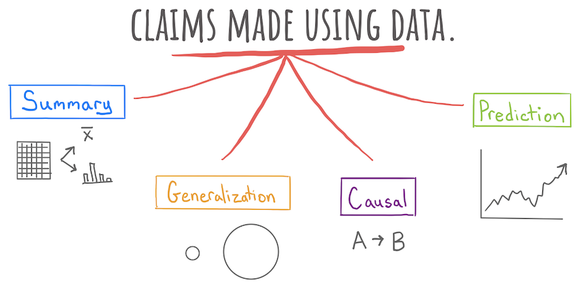
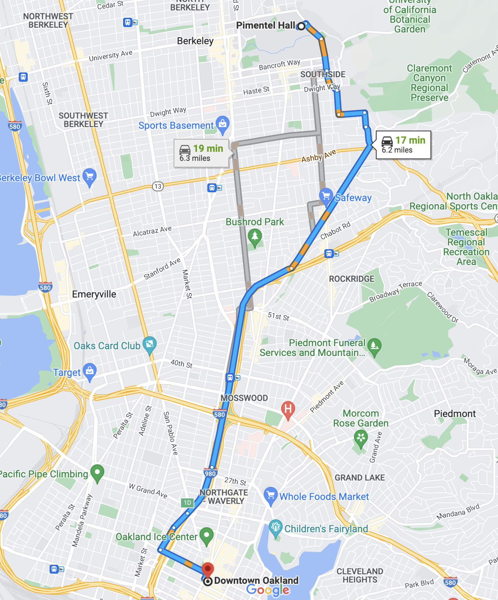

---

course: xac-suat-thong-ke

lecture: 21-dinh-nghia-nhan-qua

section: lecture

title: "Định nghĩa tính nhân quả & Mô hình kết quả tiềm năng"

prerequisites: ["ket-luan-nhan-qua"]

lessonStatus: ready

description: "Mô hình kết quả tiềm năng (Potential Outcomes Framework), bài toán cơ bản của suy luận nhân quả, hiệu ứng can thiệp trung bình ATE và thiên lệch lựa chọn."

---

## 1. Giới thiệu: Ba cấp độ khẳng định tri thức trong khoa học dữ liệu

Trong toàn bộ tiến trình phân tích dữ liệu, câu hỏi mà chúng ta đặt ra cho thế giới thường được chia thành ba cấp độ tăng dần về độ sâu và mức độ phức tạp:

*Hình 21.1: Ba tầng bậc khẳng định trong khoa học dữ liệu: Khẳng định mô tả, khẳng định suy rộng và khẳng định nhân quả.*

1. **Khẳng định mô tả (Descriptive Claim)**: Trả lời câu hỏi: *“Dữ liệu chúng ta đang nắm giữ mang những đặc điểm gì?”* (Ví dụ: Tỉ lệ sinh viên có việc làm sau tốt nghiệp trong mẫu khảo sát là $85\%$).

2. **Khẳng định suy rộng (Generalization Claim)**: Trả lời câu hỏi: *“Đặc điểm của mẫu dữ liệu này có thể mở rộng cho toàn bộ tổng thể hay không?”* (Ví dụ: Với độ tin cậy $95\%$, khoảng từ $81\%$ đến $89\%$ sinh viên toàn trường sẽ tìm được việc làm).

3. **Khẳng định nhân quả (Causal Claim)**: Trả lời câu hỏi sâu sắc nhất: *“Liệu sự thay đổi ở biến số giải thích $A$ có trực tiếp tạo ra sự biến đổi ở biến kết cục $B$ hay không?”* (Ví dụ: Liệu tấm bằng đại học có phải là *nguyên nhân trực tiếp* giúp sinh viên tìm được việc làm tốt, hay những người tìm được việc tốt vốn dĩ đã có năng lực xuất sắc từ trước?).

Trong đời sống thường nhật, chúng ta sử dụng ngôn ngữ nhân quả liên tục: *“Tôi uống một viên thuốc giảm đau và cơn đau đầu đã thuyên giảm”*, *“Nhờ có bằng đại học danh tiếng, cô ấy mới ứng tuyển thành công vào tập đoàn đa quốc gia”*. Tuy nhiên, làm thế nào để chúng ta định nghĩa một cách chặt chẽ và toán học khái niệm **nguyên nhân** và **kết quả**?

---

## 2. Thử nghiệm tư duy: Ai đã gây ra cái chết của tù nhân?

Để thấy rõ sự phức tạp khi phân định ranh giới nhân quả, hãy cùng xem xét một tình huống thực nghiệm tư duy kinh điển được nhà khoa học máy tính Judea Pearl đưa ra:

> **Kịch bản**: Một tù nhân bị kết án tử hình trước đội hành quyết. Để việc thi hành án diễn ra, một chuỗi sự kiện bắt buộc phải xảy ra theo đúng quy trình:

> 1. Đầu tiên, quan tòa ban hành lệnh hành quyết.

> 2. Lệnh hành quyết được chuyển tới đại úy chỉ huy. Đại úy phát tín hiệu lệnh bắn tới hai người lính trong đội hành quyết (Lính 1 và Lính 2).

> 3. Cả hai người lính đều là những xạ thủ thiện xạ và tuyệt đối tuân lệnh: Họ chỉ nổ súng khi có hiệu lệnh từ đại úy, và chỉ cần một trong hai người bắn trúng, tù nhân chắc chắn sẽ tử vong.

>

> Thực tế diễn ra: Quan tòa ra lệnh, đại úy phát tín hiệu, cả hai người lính cùng bóp cò đồng thời và tù nhân tử vong.

**Câu hỏi**: Ai là nguyên nhân thực sự gây ra cái chết của tù nhân?

- A. Quan tòa

- B. Đại úy chỉ huy

- C. Người lính số 1

- D. Người lính số 2

Nếu nhìn theo trực giác cảm tính, ta có thể nghĩ cả bốn người đều có phần trách nhiệm. Nhưng nếu phân tích theo chuỗi logic nghiêm ngặt, ranh giới nhân quả sẽ phụ thuộc hoàn toàn vào cách ta định nghĩa: **Một hành động được coi là nguyên nhân khi nào?**

---

## 3. Định nghĩa nhân quả phản thực tế có điều kiện (Conditional Counterfactual)

Khái niệm nhân quả hiện đại trong khoa học bắt nguồn từ một trực giác logic sâu sắc: So sánh thế giới thực tế với một thế giới giả định chưa từng xảy ra.

Nguồn gốc sớm nhất của lối tư duy này xuất hiện trong trước tác của nhà sử học Hy Lạp cổ đại Thucydides khi ông ghi chép về trận sóng thần tàn phá thị trấn Orobiae sau một cơn địa chấn dữ dội:

> *“Nguyên nhân của hiện tượng này, theo tôi, phải bắt nguồn từ chính trận động đất. Tại nơi chấn động mạnh nhất, nước biển bị đẩy lùi rồi đột ngột ập trở lại với sức mạnh gấp bội, gây nên trận ngập lụt kinh hoàng. **Nếu không có trận động đất, tôi không thấy làm sao một tai họa như vậy có thể xảy ra**.”*

Nhiều thế kỷ sau, triết gia Scotland David Hume đã đúc kết nguyên lý này thành một định nghĩa triết học bất hủ:

> *“Một vật là nguyên nhân của vật khác khi: Nếu vật thứ nhất không tồn tại, vật thứ hai sẽ không bao giờ xuất hiện.”*

Cả hai phát biểu trên đều dựa vào việc tưởng tượng một thế giới trái ngược với thực tế khách quan đã diễn ra. Trong logic học và thống kê học, khái niệm này được gọi là **sự kiện phản thực tế** (Counterfactual).

### Định nghĩa Phản thực tế (Counterfactual)

- **Khái niệm**: Là mệnh đề hoặc kịch bản mô tả những gì đã không xảy ra trong thế giới thực, hoặc trái ngược với dữ kiện thực tế.

### Định nghĩa Nguyên nhân (Causality)

- **Quy chuẩn**: Ta khẳng định **“Biến cố $A$ gây ra biến cố $B$”** nếu và chỉ nếu: Trong một thế giới song song nơi biến cố $A$ không xảy ra, thì biến cố $B$ cũng sẽ không xảy ra.

Áp dụng định nghĩa này để giải mã bài toán đội hành quyết ở trên:

- **Xét quan tòa**: Nếu quan tòa không ra lệnh, đại úy sẽ không phát lệnh, hai người lính không bắn, và tù nhân vẫn còn sống. Do đó, **quan tòa là nguyên nhân** gây ra cái chết của tù nhân.

- **Xét đại úy**: Nếu đại úy không phát tín hiệu, hai người lính không nổ súng và tù nhân vẫn còn sống. Do đó, **đại úy là nguyên nhân** gây ra cái chết của tù nhân.

- **Xét người lính số 1**: Giả sử lính số 1 không bắn súng. Vì lính số 2 vẫn nhận lệnh và bắn trúng đích độc lập, tù nhân vẫn tử vong! Như vậy, việc lính số 1 không bắn không làm thay đổi kết cục của tù nhân. Theo định nghĩa phản thực tế có điều kiện, xét trên phương diện cá nhân độc lập, **lính số 1 không phải là nguyên nhân quyết định duy nhất**. Lập luận tương tự áp dụng cho lính số 2.

Ví dụ này cho thấy phép thử bỏ một hành động rồi xem kết quả có đổi hay không có thể không nhận diện được từng tác nhân khi nhiều hành động đều đủ gây ra kết quả. Cần phân biệt câu hỏi của mô hình nhân quả với việc quy trách nhiệm.

---

## 4. Thách thức căn bản của suy luận nhân quả

Nhà khoa học máy tính Judea Pearl từng phát biểu một nhận định sâu sắc:

> *“Counterfactuals have a particularly problematic relationship with data because data are, by definition, facts.”*

> *(Các sự kiện phản thực tế có mối quan hệ đầy nghịch lý với dữ liệu, bởi lẽ dữ liệu theo đúng định nghĩa là những sự thật đã diễn ra.)*

Từ nguyên của từ “datum” trong tiếng Latinh mang ý nghĩa là “một điều đã xảy ra, một sự thật”. Ngược lại, “counterfactual” có nghĩa là “trái với sự thật”. Để chứng minh tuyệt đối một mối quan hệ nhân quả trên một cá thể, ta buộc phải quan sát được đồng thời hai điều:

1. Dữ liệu thực tế diễn ra khi cá thể đó nhận can thiệp.

2. Dữ liệu phản thực tế diễn ra khi chính cá thể đó không nhận can thiệp trong cùng một điều kiện hoàn cảnh.

### Bảng dữ liệu hai thế giới lý tưởng

Hãy hình dung trong một thế giới song song lý tưởng, để kiểm tra xem liệu việc tốt nghiệp đại học danh tiếng (biến can thiệp $T$) có phải là nguyên nhân giúp bạn An tìm được việc làm tốt (biến kết cục $Y$) hay không, ta có thể quan sát bảng dữ liệu sau:

| Cá thể | Tốt nghiệp đại học ($T$) | Có việc làm tốt ($Y$) | Bản chất quan sát |
| :--- | :--- | :--- | :--- |
| **An** | Có ($T=1$) | Có ($Y=1$) | Thế giới thực tế đã diễn ra |
| **An** | Không ($T=0$) | Không ($Y=0$) | Thế giới phản thực tế (chưa từng xảy ra) |

Trong bảng dữ liệu lý tưởng này, hai dòng quan sát thuộc về cùng một người: Có cùng chỉ số IQ, cùng tính cách, cùng hoàn cảnh gia đình, cùng năng lực ban đầu. Sự khác biệt duy nhất là một phiên bản của An đi học đại học, còn phiên bản kia thì không. Khi kết cục việc làm thay đổi giữa hai phiên bản, ta có bằng chứng đanh thép $100\%$ rằng: Tấm bằng đại học chính là nguyên nhân trực tiếp giúp An có việc làm tốt.

*Hình 21.2: Minh họa tác phẩm "The Road Not Taken" của Robert Frost. Khi một cá thể đã chọn bước đi trên một ngả đường, ngả đường còn lại vĩnh viễn trở thành miền phản thực tế không thể quan sát.*

### Mô hình kết quả tiềm năng (Potential Outcomes Framework)

Được phát triển bởi nhà thống kê học Donald Rubin, mô hình kết quả tiềm năng định nghĩa:

- Với mỗi cá thể $i$, tồn tại hai **kết quả tiềm năng**:

  - $Y_i(1)$: Kết cục của cá thể $i$ nếu nhận can thiệp ($T_i = 1$).

  - $Y_i(0)$: Kết cục của cá thể $i$ nếu không nhận can thiệp ($T_i = 0$).

- **Hiệu ứng can thiệp cá thể (Individual Treatment Effect - ITE)**:

$$
\tau_i = Y_i(1) - Y_i(0)
$$

> [!IMPORTANT] Bài toán cơ bản của suy luận nhân quả (Fundamental Problem of Causal Inference):

> Với mỗi cá thể $i$, ta **chỉ có thể quan sát được duy nhất một trong hai kết quả tiềm năng**:

>

$$
Y_i^{\text{obs}} = T_i Y_i(1) + (1 - T_i) Y_i(0)
$$

> Kết quả tiềm năng còn lại $Y_i(1 - T_i)$ vĩnh viễn bị khuyết thiếu (Missing Data). Do đó, hiệu ứng can thiệp trên từng cá thể riêng lẻ $\tau_i$ là đại lượng không bao giờ có thể tính toán trực tiếp được từ dữ liệu quan sát.

*Hình 21.3: Ba lộ trình tiềm năng trên ứng dụng bản đồ Google Maps. Ứng dụng dự báo các kết quả tiềm năng (16 phút, 19 phút, 20 phút), nhưng khi bạn chọn tuyến đường 16 phút, bạn không bao giờ thu thập được dữ liệu thực tế của hai tuyến đường còn lại.*

---

## 5. Từ cấp độ cá thể đến cấp độ quần thể: Hiệu ứng can thiệp trung bình (ATE)

Vì không thể quay ngược thời gian để quan sát cả hai trạng thái trên cùng một người, các nhà khoa học chuyển dịch mục tiêu: Thay vì tìm kiếm hiệu ứng nhân quả trên từng cá thể riêng biệt, ta ước lượng **Hiệu ứng can thiệp trung bình** (Average Treatment Effect - ATE) trên một nhóm hoặc toàn bộ quần thể.

### Định nghĩa Hiệu ứng can thiệp trung bình (ATE)

- **Khái niệm**: Là kỳ vọng toán học của hiệu ứng can thiệp trên toàn bộ các cá thể trong quần thể:

$$
\begin{aligned}
\text{ATE} &= \mathbb{E}[Y(1) - Y(0)] \\
&= \mathbb{E}[Y(1)] - \mathbb{E}[Y(0)]
\end{aligned}
$$

Phát biểu cấp độ quần thể chuyển trọng tâm từ một cá nhân sang quy luật chung:

- **Phát biểu cá thể**: *“An tìm được việc làm tốt vì bạn ấy tốt nghiệp đại học.”* (Không thể kiểm chứng trực tiếp).

- **Phát biểu quần thể**: *“Việc tốt nghiệp đại học trung bình giúp nâng cao xác suất tìm kiếm việc làm tốt cho các ứng viên.”* (Có thể kiểm chứng được thông qua ATE).

### Ví dụ minh họa ước lượng ATE trên mẫu 6 sinh viên

Xét dữ liệu của 6 sinh viên, trong đó 3 người tốt nghiệp đại học ($T=1$) và 3 người không tốt nghiệp ($T=0$):

| Sinh viên | Tốt nghiệp đại học ($T$) | Có việc làm tốt ($Y$) |
| :--- | :--- | :--- |
| **An** | Có ($T=1$) | Có ($Y=1$) |
| **Bình** | Có ($T=1$) | Không ($Y=0$) |
| **Chi** | Có ($T=1$) | Có ($Y=1$) |
| **Dũng** | Không ($T=0$) | Không ($Y=0$) |
| **Hà** | Không ($T=0$) | Không ($Y=0$) |
| **Linh** | Không ($T=0$) | Có ($Y=1$) |

Từ bảng dữ liệu quan sát này, ta tính tỉ lệ có việc làm tốt ở mỗi nhóm:

- Tỉ lệ ở nhóm tốt nghiệp: $\hat{p}_T = \frac{2}{3} \approx 0.67$ ($67\%$).

- Tỉ lệ ở nhóm không tốt nghiệp: $\hat{p}_C = \frac{1}{3} \approx 0.33$ ($33\%$).

Ước lượng tự nhiên cho hiệu ứng can thiệp trung bình là chênh lệch tỉ lệ mẫu:

$$
\begin{aligned}
\hat{\text{ATE}} &= \hat{p}_T - \hat{p}_C \\
&= \frac{2}{3} - \frac{1}{3} \\
&= +\frac{1}{3} \\
&\approx 33.3\%
\end{aligned}
$$

Con số $+33.3\%$ cho thấy nhóm tốt nghiệp có tỉ lệ việc làm cao hơn nhóm không tốt nghiệp. Tuy nhiên, liệu ước lượng này có thực sự phản ánh mối quan hệ nhân quả khách quan hay không?

---

## 6. Cạm bẫy so sánh ngây thơ và Thiên lệch lựa chọn (Selection Bias)

Một ước lượng chênh lệch trung bình đơn thuần chỉ trở thành bằng chứng nhân quả đáng tin cậy nếu **hai nhóm so sánh thực sự tương đồng về mọi mặt ngoại trừ biến can thiệp**. Nếu hai nhóm có sự khác biệt sẵn có ngay từ đầu, ước lượng sẽ bị bóp méo nghiêm trọng.

Hãy xem xét một ví dụ thực tế đầy kịch tính về việc lựa chọn phương tiện di chuyển từ Berkeley sang San Francisco giữa hai lựa chọn: Đi tàu điện ngầm (BART) hoặc tự lái xe hơi.

### Thế giới giả định: Khi ta biết trọn vẹn cả hai kết quả tiềm năng

Giả sử trong một thế giới toàn tri, ta biết chính xác thời gian di chuyển (phút) của 4 hành khách dưới cả hai phương án:

| Hành khách | Thời gian đi Xe hơi $Y(0)$ | Thời gian đi Tàu điện $Y(1)$ | Hiệu ứng cá thể $\tau_i = Y(1) - Y(0)$ |
| :--- | :--- | :--- | :--- |
| **Maria** | 35 | 28 | $28 - 35 = -7$ (Tàu nhanh hơn 7 phút) |
| **Phan** | 30 | 32 | $32 - 30 = +2$ (Tàu chậm hơn 2 phút) |
| **An** | 40 | 55 | $55 - 40 = +15$ (Tàu chậm hơn 15 phút) |
| **Minh** | 30 | 40 | $40 - 30 = +10$ (Tàu chậm hơn 10 phút) |

Từ bảng số liệu toàn tri này, ta tính toán các giá trị kỳ vọng thực sự:

- Thời gian trung bình nếu tất cả cùng đi tàu điện:

$$
\begin{aligned}
\mathbb{E}[Y(1)] &= \frac{28 + 32 + 55 + 40}{4} \\
&= \frac{155}{4} \\
&= 38.75 \text{ min}
\end{aligned}
$$

- Thời gian trung bình nếu tất cả cùng đi xe hơi:

$$
\begin{aligned}
\mathbb{E}[Y(0)] &= \frac{35 + 30 + 40 + 30}{4} \\
&= \frac{135}{4} \\
&= 33.75 \text{ min}
\end{aligned}
$$

- **Hiệu ứng can thiệp trung bình thực sự (True ATE)**:

$$
\begin{aligned}
\text{ATE} &= \mathbb{E}[Y(1)] - \mathbb{E}[Y(0)] \\
&= 38.75 - 33.75 \\
&= +5.0 \text{ min}
\end{aligned}
$$

Kết luận khách quan: Trung bình trên 4 người này, **việc đi tàu điện ngầm làm thời gian di chuyển tăng thêm 5 phút so với lái xe hơi**.

### Thế giới thực tế: Khi hành khách tự do lựa chọn phương tiện

Trong đời sống thực tế, con người luôn hành động có chủ đích:

- Maria và Phan sống ngay cạnh ga tàu điện, nên họ quyết định đi tàu điện.

- An và Minh sống xa ga tàu nhưng nhà gần đường cao tốc, nên họ chọn lái xe hơi.

Dữ liệu thực tế mà nhà phân tích thu thập được trong bảng khảo sát sẽ bị khuyết thiếu các giá trị phản thực tế:

| Hành khách | Thời gian đi Xe hơi quan sát | Thời gian đi Tàu điện quan sát | Phương tiện lựa chọn |
| :--- | :--- | :--- | :--- |
| **Maria** | ? *(Phản thực tế)* | 28 | Tàu điện |
| **Phan** | ? *(Phản thực tế)* | 32 | Tàu điện |
| **An** | 40 | ? *(Phản thực tế)* | Xe hơi |
| **Minh** | 30 | ? *(Phản thực tế)* | Xe hơi |

Nếu một nhà phân tích thiếu kinh nghiệm thực hiện so sánh ngây thơ (Naive Comparison) giữa hai nhóm:

- Thời gian trung bình của nhóm đi tàu điện: $\bar{Y}_{\mathrm{train}} = \frac{28 + 32}{2} = 30.0 \text{ min}$.

- Thời gian trung bình của nhóm lái xe hơi: $\bar{Y}_{\mathrm{bus}} = \frac{40 + 30}{2} = 35.0 \text{ min}$.

- Ước lượng ngây thơ thu được:

$$
\begin{aligned}
\widehat{\mathrm{ATE}}_{\mathrm{naive}} &= \bar{Y}_{\mathrm{train}} - \bar{Y}_{\mathrm{bus}} \\
&= 30.0 - 35.0 \\
&= -5.0 \text{ min}
\end{aligned}
$$

> [!CAUTION] Sự đảo ngược đáng kinh ngạc của dấu hiệu ứng:

> - Hiệu ứng nhân quả thực sự: Mức $\text{ATE} = +5.0$ phút (Tàu điện làm chậm hơn 5 phút).

> - Ước lượng từ dữ liệu quan sát ngây thơ: Mức $\widehat{\mathrm{ATE}}_{\mathrm{naive}} = -5.0$ phút (Tàu điện làm nhanh hơn 5 phút!).

>

> Dấu của hiệu ứng đã bị đảo ngược hoàn toàn $180^\circ$! Nguyên nhân là do **Thiên lệch lựa chọn** (Selection Bias): Nhóm chọn đi tàu vốn dĩ sống ở vị trí thuận lợi hơn nhóm chọn đi xe hơi. Khoảng cách địa lý từ nhà đến ga tàu chính là một **biến gây nhiễu** (Confounder) làm sai lệch bản chất nhân quả của bài toán.

---

## 7. Tóm tắt bài học

- Mối quan hệ nhân quả được định nghĩa thông qua **mệnh đề phản thực tế có điều kiện**: Biến cố $A$ gây ra $B$ nếu trong một thế giới giả định nơi $A$ không xảy ra, thì $B$ cũng sẽ không xảy ra.

- **Bài toán cơ bản của suy luận nhân quả**: Ta chỉ có thể quan sát được một trong hai kết quả tiềm năng $Y_i(1)$ hoặc $Y_i(0)$ cho mỗi cá thể. Hiệu ứng can thiệp cá thể $\tau_i = Y_i(1) - Y_i(0)$ là đại lượng vĩnh viễn không thể quan sát đồng thời.

- Để vượt qua rào cản này, khoa học dữ liệu tập trung vào ước lượng **Hiệu ứng can thiệp trung bình (ATE)** trên quy mô quần thể.

- Việc lấy hiệu số trung bình ngây thơ trên dữ liệu quan sát tự nhiên thường dẫn đến kết luận sai lệch nghiêm trọng do sự xuất hiện của thiên lệch lựa chọn và các biến gây nhiễu.

- Để ước lượng ATE một cách chuẩn xác, ta cần những phương pháp thiết kế nghiên cứu đặc thù: Thử nghiệm ngẫu nhiên có đối chứng (Randomized Experiments) hoặc các kỹ thuật ghép cặp (Matching) trong nghiên cứu quan sát.

---

## Tài liệu tham khảo

1. Pearl, J., & Mackenzie, D. (2018). *The Book of Why: The New Science of Cause and Effect*. Basic Books.

2. Rubin, D. B. (1974). Estimating causal effects of treatments in randomized and nonrandomized studies. *Journal of Educational Psychology*, 66(5), 688–701.

3. Holland, P. W. (1986). Statistics and causal inference. *Journal of the American Statistical Association*, 81(396), 945–960.

4. Hume, D. (1748). *An Enquiry Concerning Human Understanding*. A. Millar, London.

## Bài tập tự luyện

::: exercise Bài tập 1: Đồ thị nhân quả và phân tích phản thực tế

Xét tình huống đội hành quyết được mô tả trong bài giảng:

- Quan tòa ($J$) ra lệnh hành quyết ($J = 1$).

- Đại úy ($C$) tiếp nhận lệnh và ra hiệu lệnh bắn ($C = 1$).

- Hai người lính độc lập ($S_1$ và $S_2$) nổ súng ($S_1 = 1, S_2 = 1$).

- Tù nhân tử vong ($D = 1$) nếu $S_1 = 1$ hoặc $S_2 = 1$.

**Yêu cầu:**

1. Hãy vẽ sơ đồ quan hệ nhân quả (Causal Graph) biểu diễn dòng tác động từ quan tòa đến cái chết của tù nhân.

2. Áp dụng định nghĩa phản thực tế có điều kiện: Hãy giải thích tại sao xét trên phương diện từng cá nhân độc lập, việc lính số 1 nổ súng không thỏa mãn định nghĩa là nguyên nhân duy nhất gây ra cái chết của tù nhân.

3. Giả sử người lính số 2 bị kẹt đạn nên súng không nổ ($S_2 = 0$). Trong tình huống mới này, hành động của người lính số 1 có trở thành nguyên nhân gây ra cái chết của tù nhân theo định nghĩa phản thực tế hay không? Hãy lập luận chặt chẽ.

:::

::: solution

**1. Sơ đồ quan hệ nhân quả:**

- Quan hệ nhân quả có thể biểu diễn qua đồ thị có hướng (Directed Acyclic Graph - DAG) như sau:

$$
J \longrightarrow C \rightrightarrows \begin{matrix} S_1 \\ S_2 \end{matrix} \rightrightarrows D
$$

- Giải thích:

  - Nút $J$ (Quan tòa) truyền tín hiệu trực tiếp đến nút $C$ (Đại úy): $C = J$.

  - Nút $C$ truyền tín hiệu song song đến hai nút $S_1$ và $S_2$: Quy tắc $S_1 = C$ và $S_2 = C$.

  - Hai nút $S_1$ và $S_2$ cùng hội tụ về nút kết cục $D$ (Tử vong): $D = S_1 \lor S_2$ (hàm logic OR).

**2. Phân tích phản thực tế của người lính số 1 trong tình huống ban đầu:**

- Theo định nghĩa phản thực tế có điều kiện: Hành động nổ súng của lính số 1 ($S_1 = 1$) là nguyên nhân gây ra cái chết của tù nhân ($D = 1$) nếu trong một thế giới giả định nơi lính số 1 không nổ súng ($S_1 = 0$), tù nhân sẽ không tử vong ($D = 0$).

- Tuy nhiên, trong kịch bản ban đầu, đại úy đã phát tín hiệu ($C = 1$) nên lính số 2 cũng nổ súng ($S_2 = 1$).

- Khi xét thế giới phản thực tế nơi lính số 1 không bắn ($S_1 = 0$), vì lính số 2 vẫn bắn trúng đích ($S_2 = 1$), kết cục của tù nhân vẫn là tử vong ($D = 0 \lor 1 = 1$).

- Vì kết cục của tù nhân không thay đổi khi lính số 1 rút lại hành động, xét theo định nghĩa phản thực tế thuần túy, hành động của riêng lính số 1 không phải là nguyên nhân quyết định duy nhất gây ra cái chết của tù nhân.

**3. Phân tích tình huống khi súng lính số 2 bị kẹt đạn ($S_2 = 0$):**

- Trong kịch bản này, trạng thái của hệ thống là $S_2 = 0$. Kết cục tử vong của tù nhân hoàn toàn phụ thuộc vào lính số 1: $D = S_1 \lor 0 = S_1$.

- Thực tế diễn ra: Lính số 1 nổ súng ($S_1 = 1$) và tù nhân tử vong ($D = 1$).

- Xét thế giới phản thực tế: Nếu lính số 1 không nổ súng ($S_1 = 0$), vì súng lính số 2 bị kẹt ($S_2 = 0$), không có phát đạn nào bắn ra, nên tù nhân sẽ không tử vong ($D = 0$).

- Kết luận: Khi súng của lính số 2 bị kẹt, hành động của lính số 1 **trở thành nguyên nhân trực tiếp** gây ra cái chết của tù nhân theo đúng định nghĩa phản thực tế có điều kiện.

:::

---

::: exercise Bài tập 2: Mô hình kết quả tiềm năng và Đảo ngược dấu hiệu ứng

Một công ty công nghệ thử nghiệm hai giao diện thanh toán: Giao diện A (truyền thống, $T=0$) và Giao diện B (tinh gọn một chạm, $T=1$). Biến kết cục $Y$ là thời gian hoàn tất đơn hàng (tính bằng giây). Trong một nghiên cứu thử nghiệm trên 4 khách hàng, bảng kết quả tiềm năng toàn tri (biết trước cả hai trạng thái) được ghi nhận như sau:

| Khách hàng | $Y(0)$ (Giao diện A) | $Y(1)$ (Giao diện B) |
| :--- | :--- | :--- |
| **Khách hàng 1** | 45 | 30 |
| **Khách hàng 2** | 50 | 40 |
| **Khách hàng 3** | 60 | 55 |
| **Khách hàng 4** | 70 | 65 |

**Yêu cầu:**

1. Hãy tính hiệu ứng can thiệp cá thể $\tau_i = Y_i(1) - Y_i(0)$ cho từng khách hàng và tính Hiệu ứng can thiệp trung bình thực sự ($\text{ATE}$) của việc chuyển từ giao diện A sang giao diện B. Giao diện B giúp tiết kiệm thời gian trung bình bao nhiêu giây?

2. Giả sử trong thực tế, khách hàng tự do lựa chọn giao diện: Khách hàng 1 và 2 (vốn am hiểu công nghệ) chọn giao diện B, trong khi Khách hàng 3 và 4 (người lớn tuổi, ít dùng ứng dụng) chọn giao diện A. Hãy lập bảng dữ liệu quan sát thực tế và tính toán ước lượng hiệu ứng can thiệp ngây thơ $\widehat{\mathrm{ATE}}_{\mathrm{naive}} = \bar{Y}_B - \bar{Y}_A$.

3. So sánh giá trị ước lượng ngây thơ với ATE thực sự và giải thích nguyên nhân gây ra sự sai lệch.

:::

::: solution

**1. Tính hiệu ứng can thiệp cá thể và ATE thực sự:**

- Hiệu ứng cá thể cho từng khách hàng:

  - $\tau_1=30 - 45 = -15$ giây.

  - $\tau_2=40 - 50 = -10$ giây.

  - $\tau_3=55 - 60 = -5$ giây.

  - $\tau_4=65 - 70 = -5$ giây.

- Hiệu ứng can thiệp trung bình thực sự:

$$
\begin{aligned}
\mathrm{ATE}&=\frac{\tau_1+\tau_2+\tau_3+\tau_4}{4} \\
&=\frac{-15-10-5-5}{4} \\
&=-8{,}75\ \mathrm s.
\end{aligned}
$$

- Hoặc tính thông qua kỳ vọng:

$$
\begin{aligned}
&\mathbb{E}[Y(1)] = \frac{30 + 40 + 55 + 65}{4} \\
&= \frac{190}{4} \\
&= 47.5 \text{ s} \\
&\mathbb{E}[Y(0)] = \frac{45 + 50 + 60 + 70}{4} \\
&= \frac{225}{4} \\
&= 56.25 \text{ s} \\
&\text{ATE} = 47.5 - 56.25 \\
&= -8.75 \text{ s}
\end{aligned}
$$

- Kết luận: Giao diện B thực sự giúp khách hàng tiết kiệm trung bình $8.75$ giây so với giao diện A.

**2. Bảng dữ liệu quan sát thực tế và ước lượng ngây thơ:**

- Do khách hàng tự chọn:

  - Khách hàng 1: Quan sát $Y_1(1) = 30$ giây.

  - Khách hàng 2: Quan sát $Y_2(1) = 40$ giây.

  - Khách hàng 3: Quan sát $Y_3(0) = 60$ giây.

  - Khách hàng 4: Quan sát $Y_4(0) = 70$ giây.

- Thời gian trung bình quan sát được ở nhóm dùng giao diện B:

$$
\bar{Y}_B = \frac{30 + 40}{2} = 35.0 \text{ s}
$$

- Thời gian trung bình quan sát được ở nhóm dùng giao diện A:

$$
\bar{Y}_A = \frac{60 + 70}{2} = 65.0 \text{ s}
$$

- Ước lượng ngây thơ:

$$
\begin{aligned}
\widehat{\mathrm{ATE}}_{\mathrm{naive}} &= \bar{Y}_B - \bar{Y}_A \\
&= 35.0 - 65.0 \\
&= -30.0 \text{ s}
\end{aligned}
$$

**3. So sánh và giải thích sai lệch:**

- So sánh: Ước lượng ngây thơ cho rằng giao diện B giúp tiết kiệm tới $30.0$ giây, trong khi hiệu ứng thực sự chỉ là $8.75$ giây (bị phóng đại lên gấp hơn 3.4 lần!).

- Giải thích: Sai lệch này xuất phát từ **Thiên lệch lựa chọn** (Selection Bias). Nhóm chọn giao diện B vốn là những người am hiểu công nghệ, thao tác điện thoại rất nhanh ngay từ đầu (nếu dùng giao diện A thì họ cũng chỉ mất trung bình 47.5 giây). Ngược lại, nhóm chọn giao diện A là người lớn tuổi thao tác chậm chạp (mất trung bình 65 giây). Sự khác biệt ban đầu về kỹ năng công nghệ giữa hai nhóm đã hòa lẫn vào hiệu ứng của giao diện, khiến phép so sánh ngây thơ bị bóp méo nghiêm trọng.

:::

---

::: exercise Bài tập 3: Thiên lệch lựa chọn trong chương trình đào tạo nghề

Một nghiên cứu xã hội học muốn đánh giá tác động của một khóa đào tạo kỹ năng lập trình miễn phí kéo dài 6 tháng ($T = 1$) đối với mức lương khởi điểm ($Y$, đơn vị: Triệu VNĐ/tháng) của các bạn trẻ vừa tốt nghiệp phổ thông.

Nghiên cứu thu thập dữ liệu quan sát từ 200 thanh niên, trong đó 100 người tự nguyện đăng ký tham gia khóa học ($T = 1$) và 100 người không tham gia ($T = 0$). Kết quả sau 1 năm cho thấy:

- Nhóm tham gia khóa học có mức lương trung bình là 18 triệu VNĐ/tháng.

- Nhóm không tham gia có mức lương trung bình là 11 triệu VNĐ/tháng.

- Nhóm nghiên cứu tuyên bố: *“Khóa học kỹ năng lập trình là nguyên nhân trực tiếp làm tăng mức lương của thanh niên thêm 7 triệu VNĐ/tháng.”*

**Yêu cầu:**

1. Hãy chỉ ra ít nhất hai yếu tố biến gây nhiễu tiềm ẩn có thể dẫn tới thiên lệch lựa chọn trong nghiên cứu quan sát này.

2. Dưới góc độ của mô hình kết quả tiềm năng, tại sao việc nhóm thanh niên tự nguyện đăng ký tham gia khóa học lại vi phạm giả định cần thiết để phép so sánh hiệu số trung bình phản ánh đúng ATE?

3. Để có thể đưa ra kết luận nhân quả không bị thiên lệch, các nhà nghiên cứu cần thiết kế lại quy trình phân bổ học viên vào khóa học như thế nào?

:::

::: solution

**1. Các biến gây nhiễu tiềm ẩn:**

- **Động lực học tập và tính kiên trì**: Những thanh niên chủ động nộp đơn đăng ký một khóa học khó khăn kéo dài 6 tháng thường là những người có ý chí tự giác, ham học hỏi và quyết tâm cải thiện cuộc sống cao hơn. Ngay cả khi không tham gia khóa học này, phẩm chất cá nhân đó cũng sẽ giúp họ tìm được những công việc có thu nhập tốt hơn.

- **Năng lực tư duy logic ban đầu**: Những người quan tâm đến lập trình thường đã có thiên hướng hoặc nền tảng tư duy toán học và logic tốt hơn mức trung bình, giúp họ có lợi thế cạnh tranh tự nhiên trên thị trường lao động.

**2. Vi phạm giả định của mô hình kết quả tiềm năng:**

- Trong mô hình kết quả tiềm năng, để hiệu số trung bình quan sát $\bar{Y}_T - \bar{Y}_C$ ước lượng không chệch cho $\text{ATE}$, ta cần giả định hai nhóm có kết quả tiềm năng cơ bản như nhau nếu cùng ở trạng thái không can thiệp, tức là:

$$
\mathbb{E}[Y(0) \mid T = 1] = \mathbb{E}[Y(0) \mid T = 0]
$$

- Do thanh niên tự nguyện lựa chọn ($Self-selection$), nhóm tham gia ($T = 1$) có mức kỳ vọng cơ sở $\mathbb{E}[Y(0) \mid T = 1]$ cao hơn hẳn nhóm không tham gia (họ có ý chí và năng lực tốt hơn, nên nếu không học khóa này họ vẫn kiếm được mức lương cao hơn nhóm $T = 0$).

- Sự chênh lệch ban đầu này (gọi là Thiên lệch lựa chọn - Selection Bias) đã cộng dồn vào hiệu ứng thực của khóa học, làm phóng đại con số chênh lệch lên 7 triệu VNĐ/tháng.

**3. Thiết kế lại nghiên cứu chuẩn mực:**

- Để triệt tiêu thiên lệch lựa chọn, các nhà nghiên cứu cần triển khai một **Thử nghiệm ngẫu nhiên có đối chứng** (Randomized Controlled Trial - RCT):

  - Bước 1: Tuyển mộ một danh sách gồm các ứng viên có nguyện vọng học.

  - Bước 2: Sử dụng quy trình bốc thăm ngẫu nhiên (hoặc thuật toán sinh số ngẫu nhiên) để chia danh sách ứng viên thành hai nhóm:

    - Nhóm can thiệp ($T = 1$): Được nhận vào học khóa đào tạo miễn phí.

    - Nhóm đối chứng ($T = 0$): Được đưa vào danh sách chờ và chưa tham gia khóa học trong giai đoạn này.

  - Khi phân nhóm ngẫu nhiên đúng thiết kế, các yếu tố có trước cân bằng theo kỳ vọng. Chênh lệch trung bình là ước lượng tác động trung bình của việc được phân vào khóa học, với sai số lấy mẫu. Cần thêm giả thiết nhất quán, không có ảnh hưởng chéo và xử lý đúng tình trạng không tuân thủ hoặc bỏ theo dõi.

:::

