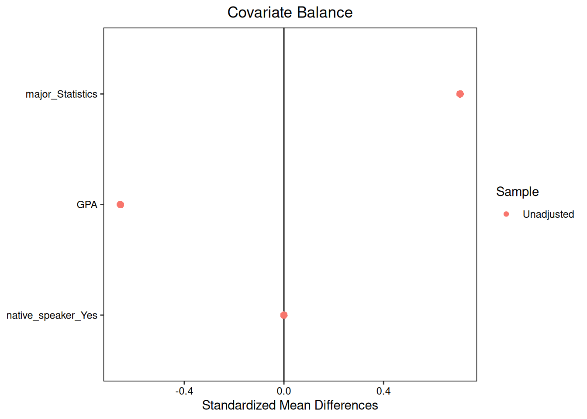
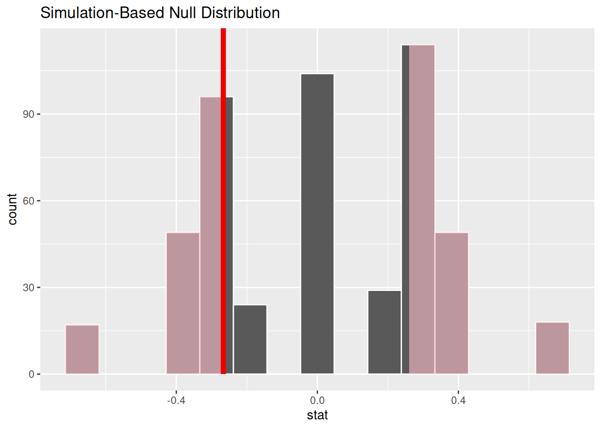

## 1. Giới thiệu: Chuẩn vàng của suy luận nhân quả

Trong bài học trước, chúng ta đã tiếp cận rào cản lớn nhất của suy luận nhân quả: Không bao giờ có thể quan sát đồng thời cả hai kết quả tiềm năng $Y_i(1)$ và $Y_i(0)$ trên cùng một cá thể. Khi con người tự do đưa ra quyết định trong thế giới thực, sự xuất hiện của **thiên lệch lựa chọn** (Selection Bias) khiến phép so sánh hiệu số trung bình ngây thơ thường dẫn tới những kết luận sai lệch nghiêm trọng.

Để vượt qua thách thức mang tính bản thể luận này, các nhà thống kê học đã phát triển một phương pháp thực nghiệm có sức mạnh to lớn: **Thử nghiệm ngẫu nhiên có đối chứng** (Randomized Controlled Trial - RCT). 

Trong khoa học thực nghiệm, một câu danh ngôn nổi tiếng khẳng định:
> *“Tương quan không đồng nghĩa với nhân quả... trừ phi mối tương quan đó được tìm thấy trong một thử nghiệm ngẫu nhiên có đối chứng được thiết kế chuẩn mực.”*

Tại sao thử nghiệm ngẫu nhiên lại sở hữu uy lực mạnh mẽ đến vậy? Câu trả lời nằm ở các nguyên lý thiết kế thực nghiệm chặt chẽ giúp tạo lập một nhóm đối chứng đóng vai trò như bản sao phản thực tế hoàn hảo của nhóm can thiệp.

---

## 2. Bốn nguyên lý cốt lõi của thiết kế thực nghiệm

Một thử nghiệm khoa học được định nghĩa là tình huống mà ở đó **nhà nghiên cứu chủ động can thiệp**, gán các đối tượng hoặc đơn vị nghiên cứu vào các điều kiện thí nghiệm khác nhau. Để một thử nghiệm lâm sàng hoặc thử nghiệm công nghệ (A/B Testing) đạt chuẩn mực suy luận nhân quả, bốn nguyên lý sau bắt buộc phải được thỏa mãn:

### Nguyên lý 1: Nhóm đối chứng (Control)

- **Danh từ (Nhóm đối chứng)**: Là một nhóm đối tượng không nhận can thiệp mới, đóng vai trò làm hệ quy chiếu so sánh nhằm làm nổi bật hiệu ứng của nhóm can thiệp (Treatment Group).
- **Động từ (Kiểm soát)**: Là tập hợp các hành động của nhà nghiên cứu nhằm triệt tiêu mọi yếu tố ngoại cảnh gây nhiễu, đảm bảo rằng sự khác biệt duy nhất giữa hai nhóm chỉ là yếu tố can thiệp mà ta đang quan tâm.

Khi thiết kế một thử nghiệm, việc lựa chọn bản chất của nhóm đối chứng quyết định trực tiếp câu hỏi nghiên cứu mà bạn đang giải quyết:
- Xét bài toán thực tế: Liệu việc sinh viên đọc tài liệu học tập dưới định dạng tệp PDF có giúp hiểu sâu kiến thức hơn định dạng trang web tương tác hay không?
- Câu hỏi đặt ra: *“Hiểu sâu hơn... cái gì?”* Hiểu sâu hơn so với việc không đọc tài liệu? Hay hiểu sâu hơn so với việc chỉ nghe giảng trên lớp?
- Nếu mục tiêu là so sánh giữa hai phương thức tiếp cận tài liệu, ta gán nhóm đọc trang web làm nhóm đối chứng ($C$) và nhóm đọc PDF làm nhóm can thiệp ($T$). Một sự điều chỉnh nhỏ trong việc định nghĩa nhóm đối chứng sẽ thay đổi hoàn toàn ý nghĩa học thuật của kết luận rút ra.

### Nguyên lý 2: Phân nhóm ngẫu nhiên (Random Assignment)

- **Khái niệm**: Là cơ chế phân chia đối tượng vào nhóm can thiệp hoặc nhóm đối chứng bằng một quy trình ngẫu nhiên hoàn toàn khách quan (như tung đồng xu, bốc thăm hoặc dùng hàm sinh số ngẫu nhiên của máy tính), trong đó mọi cá thể đều có xác suất được chọn vào mỗi nhóm ngang nhau.

Hãy hình dung điều gì sẽ xảy ra nếu ta phân nhóm dựa trên các tiêu chí thuận tiện:
- Ta gán toàn bộ các lớp học buổi sáng đọc tài liệu PDF, còn các lớp học buổi chiều đọc trên trang web.
- Rủi ro xuất hiện: Sinh viên đăng ký học buổi sáng thường là những người dậy sớm, có tính kỷ luật cao và chăm chỉ hơn sinh viên lớp buổi chiều. Nếu điểm thi của nhóm PDF cao hơn, liệu đó là do định dạng PDF hay do đức tính chăm chỉ của sinh viên lớp sáng?
- Ta trao quyền cho giảng viên tự chọn định dạng: Giảng viên chọn trang web có thể là người am hiểu công nghệ và có phương pháp sư phạm hiện đại hơn. Sự vượt trội về điểm số sẽ bị pha tạp bởi năng lực của giảng viên.

Cơ chế phân nhóm ngẫu nhiên triệt tiêu toàn bộ các mối nghi vấn trên: Khi phân bổ ngẫu nhiên, quy luật xác suất đảm bảo rằng tỉ lệ sinh viên chăm chỉ, sinh viên thông minh hay sinh viên có giảng viên giỏi sẽ được phân bố **cân bằng đồng đều trên cả hai nhóm** trên mức trung bình.

### Nguyên lý 3: Lặp lại thực nghiệm (Replication)

- **Khái niệm**: Là việc bố trí nhiều đối tượng nghiên cứu trong cả hai nhóm (cỡ mẫu đủ lớn), đồng thời thực hiện lại thử nghiệm nhiều lần độc lập để xác minh tính nhất quán của kết quả.

Phân nhóm ngẫu nhiên chỉ đảm bảo sự cân bằng các đặc tính *trên mức trung bình kỳ vọng*. Nếu kích thước mẫu quá nhỏ (ví dụ chỉ có 4 sinh viên, trong đó 2 người chăm chỉ), hoàn toàn có thể xảy ra tình huống ngẫu nhiên hi hữu khiến cả 2 người chăm chỉ cùng rơi vào nhóm PDF. Khi cỡ mẫu tăng lên 800 sinh viên (trong đó có 400 người chăm chỉ), xác suất để toàn bộ 400 người này cùng rơi vào một nhóm là gần như bằng $0$. Quy luật số lớn (Law of Large Numbers) bảo vệ thử nghiệm khỏi các biến động ngẫu nhiên bất lợi.

### Nguyên lý 4: Kỹ thuật làm mù (Blinding) và Hiệu ứng giả dược (Placebo Effect)

Trong các nghiên cứu trên con người (đặc biệt là y học và tâm lý học), tâm lý kỳ vọng của người tham gia có thể tạo ra những thay đổi sinh lý thực sự:
- **Hiệu ứng giả dược (Placebo Effect)**: Một bệnh nhân khi biết mình được uống viên thuốc mới đắt tiền có thể cảm thấy lạc quan, giảm bớt căng thẳng và cơ thể tự hồi phục tốt hơn, dù viên thuốc thực chất chỉ chứa đường.
- **Làm mù đơn (Single-blind)**: Bệnh nhân không được biết mình đang nhận thuốc thật hay thuốc giả (Placebo). Cả hai nhóm đều uống viên thuốc có hình dạng, màu sắc và mùi vị giống hệt nhau.
- **Làm mù đôi (Double-blind)**: Cả bệnh nhân lẫn bác sĩ / điều dưỡng viên trực tiếp điều trị đều không biết ai thuộc nhóm can thiệp và ai thuộc nhóm đối chứng. Quy trình này ngăn ngừa việc bác sĩ vô tình dành nhiều sự quan tâm, chăm sóc tận tụy hơn cho những bệnh nhân mà họ biết đang dùng thuốc thật.

---

## 3. Hiệp biến (Covariates) và Sự cân bằng hiệp biến

Trong quá trình thực hiện một nghiên cứu thực nghiệm, ngoài biến can thiệp ($T$) và biến kết cục ($Y$), chúng ta thường thu thập thêm nhiều thông tin cá nhân khác của đối tượng.

### Khái niệm Hiệp biến (Covariate)

- **Định nghĩa**: Hiệp biến là các biến số được đo lường, ghi nhận hoặc đã định hình **trước thời điểm tiến hành can thiệp**.
- **Tính chất quyết định**: Vì hiệp biến tồn tại trước can thiệp, chúng **không bao giờ bị ảnh hưởng hay thay đổi bởi can thiệp**.

Xét dữ liệu của 6 sinh viên tham gia thử nghiệm so sánh hiệu quả định dạng tài liệu học tập (PDF so với Trang web):

| Sinh viên | Nhóm can thiệp | Mức độ hiểu bài ($Y$) | Chuyên ngành | Điểm GPA tích lũy | Ngôn ngữ mẹ đẻ tiếng Anh |
| :--- | :--- | :--- | :--- | :--- | :--- |
| **Evelyn** | PDF | Sâu sắc | Thống kê | 3.81 | Có |
| **Grace** | PDF | Sơ sài | Kinh tế | 3.63 | Không |
| **Juan** | PDF | Sâu sắc | Kinh tế | 3.20 | Có |
| **Alex** | Trang web | Sâu sắc | Thống kê | 2.85 | Không |
| **Monica** | Trang web | Sơ sài | Kinh tế | 3.19 | Có |
| **Sriya** | Trang web | Sơ sài | Thống kê | 3.80 | Có |

Trong bảng dữ liệu này, chuyên ngành học, điểm GPA tích lũy và ngôn ngữ mẹ đẻ đều được xác định trước khi sinh viên bắt đầu đọc tài liệu. Do đó, đây là các **hiệp biến** (Covariates). Trái lại, mức độ hiểu bài sau khóa học là biến kết cục ($Y$).

### Khái niệm Cân bằng hiệp biến (Covariate Balance)

- **Định nghĩa**: Một hiệp biến được gọi là **cân bằng** nếu phân phối thực nghiệm của nó ở nhóm can thiệp tương đồng với phân phối thực nghiệm của nó ở nhóm đối chứng.
- Nếu phân phối giữa hai nhóm có sự khác biệt rõ rệt, ta nói hiệp biến đó bị **mất cân bằng** (Imbalanced).

Tại sao sự cân bằng hiệp biến lại đóng vai trò sinh tử? Sinh viên có điểm GPA tích lũy cao thường là những người có năng lực tự học tốt, do đó họ nhiều khả năng sẽ hiểu bài sâu sắc bất kể tài liệu được trình bày dưới dạng PDF hay trang web. Nếu bằng một sự ngẫu nhiên nào đó, nhóm PDF tập trung nhiều sinh viên có GPA cao hơn nhóm trang web, thì kết quả hiểu bài vượt trội của nhóm PDF có thể bắt nguồn từ chính năng lực GPA chứ không phải do định dạng tệp.

Cơ chế phân nhóm ngẫu nhiên đảm bảo rằng, trên trung bình, **mọi hiệp biến (dù đo lường được hay tiềm ẩn chưa đo lường được) đều sẽ tự động cân bằng giữa hai nhóm**.

---

## 4. Đo lường sự cân bằng: Chênh lệch trung bình chuẩn hóa (SMD)

Để định lượng mức độ cân bằng của một hiệp biến liên tục $x$ giữa nhóm can thiệp và nhóm đối chứng, các nhà nghiên cứu sử dụng đại lượng **Chênh lệch trung bình chuẩn hóa** (Standardized Mean Difference - SMD):

$$\text{SMD}(x) = \frac{\bar{x}_{\text{treatment}} - \bar{x}_{\text{control}}}{s_{\text{pooled}}}$$

Trong đó, độ lệch chuẩn gộp $s_{\text{pooled}}$ được tính bằng căn bậc hai của trung bình hai phương sai mẫu:
$$s_{\text{pooled}} = \sqrt{\frac{s_{\text{treatment}}^2 + s_{\text{control}}^2}{2}}$$

### Ý nghĩa toán học của SMD

- Tử số đo lường khoảng cách tuyệt đối giữa trung bình của hai nhóm: $\bar{x}_T - \bar{x}_C$.
- Mẫu số đóng vai trò chuẩn hóa đưa chênh lệch về thang đo không thứ nguyên (tương tự như điểm chuẩn $Z$). Nhờ đó, ta có thể so sánh trực tiếp mức độ cân bằng giữa các hiệp biến có đơn vị hoàn toàn khác nhau (ví dụ: So sánh độ cân bằng của GPA trên thang điểm 4 với tuổi tác tính bằng năm hay thu nhập tính bằng triệu đồng).
- **Quy chuẩn đánh giá thực tế**:
  - $|\text{SMD}| \le 0.1$: Cân bằng rất tốt (mức chuẩn mực trong các thử nghiệm lâm sàng).
  - $0.1 < |\text{SMD}| \le 0.25$: Cân bằng chấp nhận được.
  - $|\text{SMD}| > 0.25$: Hiệp biến bị mất cân bằng đáng kể, cần cẩn trọng khi diễn giải kết quả nhân quả.

### Tính toán SMD cho biến GPA trên mẫu 6 sinh viên

Áp dụng công thức vào dữ liệu GPA của 6 sinh viên ở bảng trên:
- **Nhóm can thiệp (PDF)**: $x_T = \{3.81, 3.63, 3.20\}$.
  - Trung bình mẫu: $\bar{x}_T = \frac{3.81 + 3.63 + 3.20}{3} \approx 3.547$.
  - Phương sai mẫu: $s_T^2 \approx 0.098$.
- **Nhóm đối chứng (Trang web)**: $x_C = \{2.85, 3.19, 3.80\}$.
  - Trung bình mẫu: $\bar{x}_C = \frac{2.85 + 3.19 + 3.80}{3} \approx 3.280$.
  - Phương sai mẫu: $s_C^2 \approx 0.232$.
- **Độ lệch chuẩn gộp**:
  $$s_{\text{pooled}} = \sqrt{\frac{0.098 + 0.232}{2}} = \sqrt{0.165} \approx 0.406$$
- **Chênh lệch trung bình chuẩn hóa**:
  $$\text{SMD} = \frac{3.547 - 3.280}{0.406} = \frac{+0.267}{0.406} \approx +0.66$$

Giá trị $\text{SMD} \approx +0.66$ cho thấy có sự chênh lệch đáng kể về điểm GPA giữa hai nhóm (nhóm PDF có GPA cao hơn nhóm trang web hơn 0.65 lần độ lệch chuẩn). Điều này hoàn toàn dễ hiểu vì cỡ mẫu chỉ có vỏn vẹn 6 người.

---

## 5. Trực quan hóa cân bằng bằng biểu đồ Love Plot

Để có cái nhìn tổng quan về mức độ cân bằng của toàn bộ các hiệp biến trong nghiên cứu (bao gồm cả biến định lượng và biến định tính), nhà thống kê Thomas Love đã đề xuất dạng biểu đồ mang tên **Love Plot**.

*Hình 22.1: Biểu đồ Love Plot biểu diễn giá trị SMD của ba hiệp biến: Chuyên ngành Kinh tế, GPA và Ngôn ngữ mẹ đẻ tiếng Anh trên cùng một trục số chuẩn hóa.*

Quan sát Hình 22.1:
- Trục hoành biểu diễn giá trị $\text{SMD}$ từ âm sang dương, với đường thẳng đứng tại vị trí $0$ đại diện cho sự cân bằng tuyệt đối.
- Mỗi hiệp biến được biểu diễn bằng một điểm tròn:
  - Biến chuyên ngành Kinh tế (`major_Economics`): Có $\text{SMD} < 0$, nghĩa là nhóm trang web có tỉ lệ sinh viên ngành kinh tế cao hơn nhóm PDF.
  - Biến GPA: Lệch sang phía dương ($\text{SMD} \approx +0.66$).
  - Biến ngôn ngữ mẹ đẻ (`native_speaker_Yes`): Nằm lệch sang phía âm.
- Biểu đồ Love Plot cho phép nhà phân tích phát hiện ngay những biến số nào đang bị lệch nghiêm trọng khỏi ngưỡng an toàn trước khi tiến hành phân tích tác động can thiệp.

---

## 6. Kiểm định tính độc lập của phân nhóm ngẫu nhiên

Khi nhận thấy một hiệp biến có giá trị $|\text{SMD}|$ lớn, câu hỏi đặt ra là: Liệu sự chênh lệch đó có vượt quá mức biến thiên ngẫu nhiên bình thường của một quy trình phân nhóm ngẫu nhiên hay không?

Để trả lời, ta có thể thực hiện một **kiểm định hoán vị ngẫu nhiên** (Permutation Test) đối với chính hiệp biến đó:
- Giả thuyết không $H_0$: Việc gán nhóm hoàn toàn độc lập với hiệp biến GPA (phân nhóm ngẫu nhiên hoạt động hoàn hảo).
- Giả thuyết đối $H_A$: Có mối liên hệ phụ thuộc giữa việc gán nhóm và điểm GPA.

*Hình 22.2: Phân phối giả thuyết không của chênh lệch GPA qua mô phỏng hoán vị. Đường kẻ thẳng đứng đánh dấu chênh lệch quan sát được ($0.27$). Giá trị $p\text{-value}$ hai phía là $0.396$.*

Kết quả mô phỏng trên Hình 22.2 cho thấy giá trị $p\text{-value} = 0.396 > 0.05$. Như vậy, mặc dù $\text{SMD} = 0.66$ trông có vẻ lớn, mức chênh lệch $0.27$ điểm GPA hoàn toàn nằm trong biên độ biến động ngẫu nhiên bình thường khi ta bốc thăm ngẫu nhiên một mẫu cực nhỏ gồm 6 người.

> [!TIP] Ứng dụng thực tiễn của việc kiểm tra cân bằng hiệp biến:
> Trong thực tế vận hành thử nghiệm, kiểm tra cân bằng hiệp biến là chiếc "phanh an toàn" giúp phát hiện các sự cố quy trình. Ví dụ: Nếu nhà nghiên cứu dự định sắp xếp ngẫu nhiên bảng tính danh sách bệnh nhân nhưng vô tình lại nhầm sang sắp xếp theo thứ tự độ tuổi, thì kiểm định cân bằng độ tuổi sẽ lập tức cho ra $p\text{-value} < 0.001$, cảnh báo sự cố kỹ thuật trước khi thuốc được phát ra!

---

## 7. Tóm tắt bài học

- **Thử nghiệm ngẫu nhiên có đối chứng (RCT)** là chuẩn vàng để suy luận nhân quả nhờ vào việc tạo lập nhóm đối chứng làm đại diện phản thực tế tin cậy cho nhóm can thiệp.
- Bốn nguyên tắc trụ cột của RCT bao gồm: **Nhóm đối chứng**, **Phân nhóm ngẫu nhiên**, **Lặp lại thực nghiệm** và **Kỹ thuật làm mù (mù đơn, mù đôi)**.
- **Hiệp biến (Covariates)** là các đặc trưng được đo lường trước khi can thiệp diễn ra và không bao giờ bị ảnh hưởng bởi can thiệp.
- Cơ chế phân nhóm ngẫu nhiên giúp cân bằng mọi hiệp biến (cả quan sát được và tiềm ẩn) trên mức trung bình.
- **Chênh lệch trung bình chuẩn hóa (SMD)** và **biểu đồ Love Plot** là các công cụ định lượng chuẩn tắc để đánh giá mức độ cân bằng hiệp biến trước khi phân tích kết quả nghiên cứu.

---

## Tài liệu tham khảo

1. Fisher, R. A. (1935). *The Design of Experiments*. Oliver and Boyd, Edinburgh.
2. Stuart, E. A. (2010). Matching methods for causal inference: A review and a look forward. *Statistical Science*, 25(1), 1–21.
3. Austin, P. C. (2009). Balance diagnostics for comparing the distribution of baseline covariates between treatment groups in propensity-score matched samples. *Statistics in Medicine*, 28(25), 3083–3107.
4. Love, T. (2002). Displaying covariate balance in observational studies. *Presentation at the Joint Statistical Meetings*, New York.

## Bài tập tự luyện

### Bài tập 1: Tính toán SMD và đánh giá cân bằng trong thử nghiệm A/B Testing

Một công ty thương mại điện tử triển khai thử nghiệm A/B để đánh giá tác động của thuật toán gợi ý sản phẩm mới ($T=1$) so với thuật toán cũ ($T=0$) lên doanh thu mua hàng của người dùng. Trước khi kích hoạt thuật toán, nhóm kỹ sư dữ liệu đo lường hiệp biến $x$ là **Số đơn hàng đã mua trong 6 tháng qua** của người dùng ở hai nhóm:
- Nhóm can thiệp (Thuật toán mới): Quy mô $n_T = 100$ người dùng, có số đơn hàng trung bình $\bar{x}_T = 8.5$ đơn, độ lệch chuẩn mẫu $s_T = 3.2$ đơn.
- Nhóm đối chứng (Thuật toán cũ): Quy mô $n_C = 100$ người dùng, có số đơn hàng trung bình $\bar{x}_C = 8.1$ đơn, độ lệch chuẩn mẫu $s_C = 2.8$ đơn.

**Yêu cầu:**
1. Hãy tính độ lệch chuẩn gộp $s_{\text{pooled}}$ và Chênh lệch trung bình chuẩn hóa $\text{SMD}(x)$.
2. Dựa trên quy chuẩn đánh giá lâm sàng và khoa học dữ liệu, hiệp biến số đơn hàng có được coi là cân bằng tốt giữa hai nhóm hay không?
3. Giả sử sau khi kết thúc thử nghiệm, nhóm can thiệp đạt doanh thu trung bình cao hơn nhóm đối chứng có ý nghĩa thống kê. Tại sao việc chứng minh hiệp biến lịch sử mua hàng cân bằng trước thử nghiệm lại củng cố vững chắc cho kết luận nhân quả của thuật toán mới?

::: details Lời giải chi tiết
**1. Tính toán độ lệch chuẩn gộp và SMD:**
- Phương sai của hai nhóm:
  - $s_T^2 = (3.2)^2 = 10.24$
  - $s_C^2 = (2.8)^2 = 7.84$
- Độ lệch chuẩn gộp:
  $$s_{\text{pooled}} = \sqrt{\frac{s_T^2 + s_C^2}{2}} = \sqrt{\frac{10.24 + 7.84}{2}} = \sqrt{\frac{18.08}{2}} = \sqrt{9.04} \approx 3.0067 \text{ orders}$$
- Chênh lệch trung bình chuẩn hóa:
  $$\text{SMD}(x) = \frac{\bar{x}_T - \bar{x}_C}{s_{\text{pooled}}} = \frac{8.5 - 8.1}{3.0067} = \frac{0.4}{3.0067} \approx +0.133$$

**2. Đánh giá mức độ cân bằng:**
- Giá trị $|\text{SMD}| \approx 0.133$ nằm trong khoảng $0.1 < |\text{SMD}| \le 0.25$.
- Theo chuẩn mực khoa học dữ liệu, mức chênh lệch này là chấp nhận được, cho thấy phân phối lịch sử mua sắm của người dùng ở hai nhóm khá tương đồng và không có sự sai lệch nghiêm trọng nào phát sinh trong quá trình điều hướng lưu lượng truy cập ngẫu nhiên.

**3. Ý nghĩa đối với khẳng định nhân quả:**
- Số đơn hàng trong quá khứ là hiệp biến quan trọng phản ánh thói quen chi tiêu và mức độ gắn bó của khách hàng. Nếu nhóm can thiệp vô tình gom nhiều "khách hàng thân thiết" hơn, doanh thu tăng vọt có thể chỉ là do khách hàng vốn đã chi tiêu hào phóng từ trước.
- Khi ta chứng minh được lịch sử mua hàng đã được cân bằng đồng đều giữa hai nhóm trước khi thử nghiệm bắt đầu, ta đã loại trừ được biến gây nhiễu này. Sự vượt trội về doanh thu sau đó có thể được khẳng định chắc chắn là do tác động thúc đẩy thực sự của thuật toán gợi ý sản phẩm mới.
:::

---

### Bài tập 2: Cơ chế làm mù đôi và hiệu ứng giả dược trong thử nghiệm y học

Một hãng dược phẩm tiến hành thử nghiệm lâm sàng ngẫu nhiên có đối chứng để kiểm tra hiệu quả của một loại thuốc xịt mũi mới giúp giảm triệu chứng viêm mũi dị ứng theo mùa. 

**Yêu cầu:**
1. Hãy mô tả cách thiết kế một nhóm đối chứng sử dụng giả dược (Placebo) đạt chuẩn cho thử nghiệm này.
2. Giải thích cơ chế bảo vệ của quy trình **làm mù đơn** (Single-blind) và **làm mù đôi** (Double-blind) trong việc ngăn ngừa sai lệch đánh giá hiệu quả thuốc.
3. Nếu một bác sĩ biết rõ bệnh nhân nào đang dùng thuốc thật và bệnh nhân nào đang dùng giả dược, sự thiên lệch trong hành vi của bác sĩ có thể làm sai lệch kết quả nghiên cứu như thế nào?

::: details Lời giải chi tiết
**1. Thiết kế nhóm đối chứng giả dược đạt chuẩn:**
- Để đảm bảo tính tương đương, bệnh nhân trong nhóm đối chứng ($C$) sẽ được cung cấp một chai thuốc xịt mũi có bao bì, nhãn mác, hình dáng, màu sắc, áp lực vòi xịt và mùi hương giống hệt thuốc thật, nhưng dung dịch bên trong chỉ là nước muối sinh lý vô hại không chứa hoạt chất dược lý.
- Liều lượng và hướng dẫn sử dụng (xịt 2 lần mỗi ngày vào buổi sáng và tối) được quy định đồng nhất cho cả hai nhóm.

**2. Cơ chế bảo vệ của làm mù đơn và làm mù đôi:**
- **Làm mù đơn**: Bệnh nhân không biết mình thuộc nhóm nào. Kỹ thuật này giúp kiểm soát triệt để hiệu ứng giả dược: Mọi bệnh nhân đều có niềm tin tâm lý và kỳ vọng hồi phục như nhau. Bất kỳ sự thuyên giảm triệu chứng vượt trội nào ở nhóm can thiệp so với nhóm giả dược sẽ phản ánh tác dụng hóa lý thực sự của hoạt chất.
- **Làm mù đôi**: Cả bệnh nhân và đội ngũ y bác sĩ trực tiếp thăm khám đều không biết mã định danh thuốc của bệnh nhân. Kỹ thuật này ngăn ngừa cả hiệu ứng giả dược từ người bệnh lẫn sự thiên vị vô thức trong hành vi chẩn đoán và chăm sóc của nhân viên y tế.

**3. Nguy cơ khi bác sĩ không được làm mù:**
- **Thiên lệch trong chăm sóc (Performance Bias)**: Bác sĩ khi biết bệnh nhân dùng giả dược có thể có xu hướng dặn dò kỹ lưỡng hơn, khuyên bệnh nhân đeo khẩu trang cẩn thận hơn hoặc kê thêm các biện pháp hỗ trợ khác vì lo sợ bệnh nhân không khỏi, hoặc ngược lại, dành nhiều sự quan tâm và ân cần hơn cho nhóm dùng thuốc thật.
- **Thiên lệch trong đo lường kết cục (Detection / Measurement Bias)**: Khi bệnh nhân mô tả các triệu chứng còn mơ hồ (ví dụ: *"Hôm nay tôi thấy đỡ ngạt mũi một chút"*), nếu bác sĩ biết người này dùng thuốc thật, họ có xu hướng ghi nhận kết quả theo hướng tích cực, còn nếu biết dùng giả dược, họ có thể ghi nhận là triệu chứng chưa cải thiện rõ rệt. Những thiên lệch vô thức này sẽ bóp méo hoàn toàn tính khách quan của dữ liệu thử nghiệm.
:::

---

### Bài tập 3: Kiểm tra cân bằng hiệp biến để phát hiện sự cố gán nhóm

Một nhóm nghiên cứu tiến hành thử nghiệm một phương pháp học trực tuyến tương tác mới ($T=1$) so với phương pháp đọc bài giảng tĩnh ($T=0$) trên 200 học sinh. Họ dự định gán ngẫu nhiên 100 học sinh vào mỗi nhóm. 

Trước khi khóa học bắt đầu, họ tính toán Chênh lệch trung bình chuẩn hóa cho ba hiệp biến đo trước khóa học:
- Điểm kiểm tra Toán đầu vào: $\text{SMD} = -0.04$
- Điểm kiểm tra Văn đầu vào: $\text{SMD} = +0.02$
- Tuổi của học sinh: $\text{SMD} = +1.45$

**Yêu cầu:**
1. Hãy nhận xét về giá trị SMD của ba hiệp biến trên. Hiệp biến nào có dấu hiệu bất thường nghiêm trọng?
2. Hãy suy đoán một sự cố kỹ thuật hoặc lỗi thao tác thực tế có thể đã xảy ra trong quy trình phân nhóm của nhóm nghiên cứu dẫn đến sự mất cân bằng cực đoan này.
3. Nếu nhóm nghiên cứu bỏ qua biểu đồ Love Plot và tiếp tục chạy khóa học rồi so sánh kết quả học tập giữa hai nhóm, sai lầm phương pháp luận nào sẽ xảy ra?

::: details Lời giải chi tiết
**1. Nhận xét về giá trị SMD:**
- Điểm Toán ($\text{SMD} = -0.04$) và Điểm Văn ($\text{SMD} = +0.02$) đều có $|\text{SMD}| \le 0.1$, thể hiện sự cân bằng hoàn hảo giữa hai nhóm đúng như kỳ vọng của một quy trình phân nhóm ngẫu nhiên chuẩn mực.
- Tuy nhiên, hiệp biến Tuổi học sinh có $\text{SMD} = +1.45$ là một con số khổng lồ (vượt xa ngưỡng an toàn $0.25$). Mức chênh lệch này tương đương với việc nhóm can thiệp có độ tuổi trung bình già hơn nhóm đối chứng tới gần 1.5 lần độ lệch chuẩn, một biến cố gần như không bao giờ có thể xảy ra do ngẫu nhiên thuần túy trên mẫu $n = 200$.

**2. Suy đoán sự cố thao tác thực tế:**
- Một kịch bản rất phổ biến trong thực tế: Người phụ trách dữ liệu đã mở bảng tính Excel chứa danh sách học sinh và thực hiện thao tác sắp xếp (Sort).
- Họ có thể đã vô tình sắp xếp danh sách học sinh theo thứ tự ngày tháng năm sinh (từ lớn tuổi đến nhỏ tuổi), sau đó chia đôi danh sách: Gán 100 học sinh nửa trên vào nhóm $T=1$ và 100 học sinh nửa dưới vào nhóm $T=0$.
- Do thao tác gán nhóm bị gắn chặt với độ tuổi, toàn bộ học sinh lớn tuổi nhất trường đã bị dồn vào nhóm can thiệp, trong khi các học sinh trẻ tuổi hơn bị dồn vào nhóm đối chứng!

**3. Hậu quả phương pháp luận nếu không kiểm tra cân bằng:**
- Độ tuổi là hiệp biến chi phối mạnh mẽ đến sự trưởng thành về nhận thức, khả năng tập trung và kỹ năng tự học của học sinh phổ thông.
- Nếu tiếp tục thử nghiệm, nhóm học sinh lớn tuổi ($T=1$) chắc chắn sẽ đạt kết quả học tập vượt trội so với nhóm học sinh nhỏ tuổi ($T=0$), không phải vì phương pháp tương tác mới ưu việt hơn, mà đơn giản vì họ lớn tuổi và chín chắn hơn.
- Thử nghiệm sẽ đưa ra kết luận nhân quả sai lầm nghiêm trọng (ngụy biện nhân quả do biến gây nhiễu tuổi tác). Biểu đồ Love Plot và việc kiểm tra SMD trước thử nghiệm đóng vai trò cứu cánh giúp nhóm nghiên cứu phát hiện lỗi gán nhóm ngay lập tức và tiến hành phân nhóm ngẫu nhiên lại từ đầu trước khi lãng phí công sức và tài nguyên.
:::

