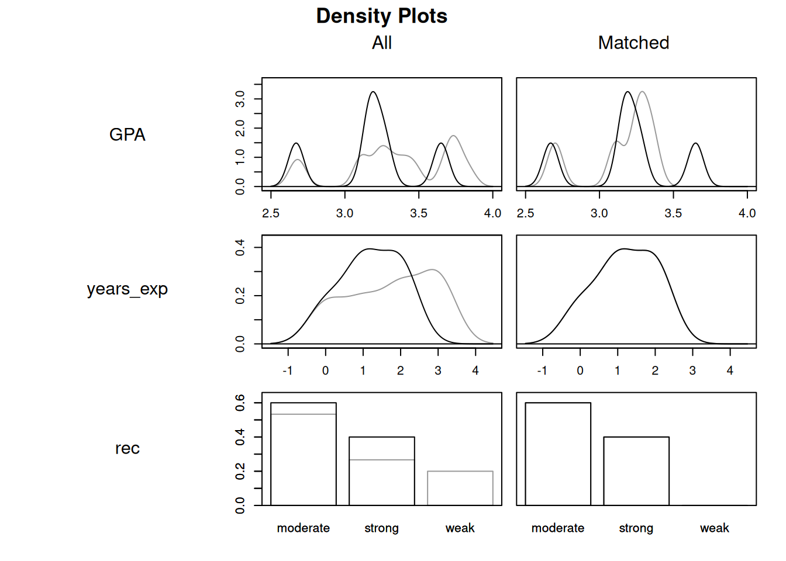
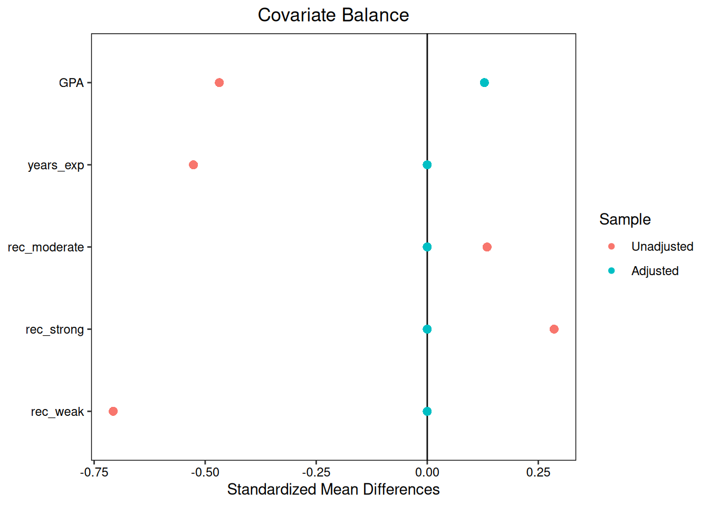

---

course: xac-suat-thong-ke

lecture: 23-tac-dong-nhan-qua-nghien-cuu-quan-sat

section: lecture

title: "Tác động nhân quả trong nghiên cứu quan sát & Phương pháp ghép cặp (Matching)"

prerequisites: ["ket-luan-nhan-qua"]

lessonStatus: ready

description: "Thí nghiệm tự nhiên (Natural Experiments), phương pháp ghép cặp tối ưu (Matching), Nghịch lý Simpson và biến gây nhiễu tiềm ẩn."

---

## 1. Giới thiệu: Khi thử nghiệm ngẫu nhiên là bất khả thi

Thử nghiệm ngẫu nhiên có đối chứng (RCT) là tiêu chuẩn vàng để xác lập mối quan hệ nhân quả vì cơ chế gán ngẫu nhiên tạo tính độc lập giữa việc phân nhóm và kết quả tiềm năng. Cân bằng các đặc điểm có trước là tính chất theo kỳ vọng, không phải sự giống hệt nhau của hai mẫu hữu hạn. Tuy nhiên, trong đại đa số các lĩnh vực như kinh tế học, xã hội học, dịch tễ học và chính sách công, việc triển khai một thử nghiệm ngẫu nhiên thường gặp phải những rào cản đạo đức và thực tiễn không thể vượt qua:

- Ta không thể gán ngẫu nhiên một nhóm người hút 2 bao thuốc lá mỗi ngày trong suốt 20 năm để xem họ có mắc ung thư phổi hay không.

- Ta không thể chia ngẫu nhiên các quốc gia thành hai nhóm: Một nhóm áp dụng chế độ dân chủ và một nhóm áp dụng chế độ độc tài để đo lường tăng trưởng kinh tế.

- Ta không thể bắt buộc các bậc phụ huynh ly hôn hoặc cho con bỏ học cấp ba để đánh giá tác động tới tâm lý trẻ em.

Trong những tình huống này, nguồn dữ liệu duy nhất mà chúng ta có thể tiếp cận là **nghiên cứu quan sát** (Observational Studies), tức là bối cảnh mà nhà nghiên cứu chỉ đóng vai trò người ghi nhận dữ liệu thụ động mà không có quyền can thiệp vào quy trình phân bổ can thiệp.

Làm thế nào để chúng ta có thể rút ra những kết luận nhân quả vững chắc từ dữ liệu quan sát tự nhiên? Hai chiến lược mạnh mẽ nhất bao gồm: Tìm kiếm **thí nghiệm tự nhiên** và áp dụng kỹ thuật **ghép cặp đối chứng** (Matching).

---

## 2. Thí nghiệm tự nhiên (Natural Experiments / Quasi-experiments)

Đôi khi, thế giới thực hoặc các định chế xã hội vận hành theo những cơ chế ngẫu nhiên hóa tự nhiên ngoài ý muốn của nhà nghiên cứu. Những tình huống như vậy được gọi là **thí nghiệm tự nhiên** (Natural Experiment hoặc Quasi-experiment).

### Định nghĩa Thí nghiệm tự nhiên

- **Khái niệm**: Là một nghiên cứu quan sát trong đó nhà nghiên cứu không trực tiếp can thiệp phân nhóm, nhưng quy trình gán can thiệp trong thế giới thực diễn ra hoàn toàn độc lập với các hiệp biến của đối tượng, tương tự như một thử nghiệm ngẫu nhiên giả định.

### Nghiên cứu thực nghiệm: Quyết định thổi phạt của trọng tài tại giải bóng rổ NBA

Liệu người đánh giá có xu hướng thiên vị những người cùng chủng tộc với mình hay không? Vào giữa thập niên 2000, hai nhà kinh tế học Joseph Price và Justin Wolfers đã tiếp cận dữ liệu của 12 mùa giải bóng rổ chuyên nghiệp nhà nghề Mỹ (NBA) để kiểm tra giả thuyết này. Họ muốn biết: Liệu tỉ lệ thổi phạt của trọng tài đối với cầu thủ có thay đổi tùy thuộc vào việc trọng tài và cầu thủ có cùng chủng tộc hay không?

*Hình 23.1: Các trọng tài NBA đưa ra hàng chục quyết định thổi phạt trong từng trận đấu. Liệu có tồn tại thiên vị chủng tộc vô thức trong các phán quyết tốc độ cao?*

Theo quy định nội bộ của ban tổ chức giải NBA:

- Việc phân công tổ trọng tài 3 người cho từng trận đấu trong mùa giải chính thức là "hoàn toàn tùy ý" (completely arbitrary).

- Ban tổ chức không xem xét thành tích hay thành phần chủng tộc của hai đội bóng thi đấu.

- Mỗi trọng tài chỉ bắt từ 70 đến 75 trận/năm, không được bắt quá 9 trận cho cùng một đội, và không được bắt 2 trận tại cùng một thành phố trong vòng 14 ngày.

Những ràng buộc hành chính này đồng nghĩa với việc: Sự kết hợp giữa tổ trọng tài và cầu thủ trên sân thi đấu mang tính **ngẫu nhiên giả định** (quasi-random), độc lập với năng lực hay phong cách chơi của cầu thủ.

### Kiểm tra tính cân bằng hiệp biến của thí nghiệm tự nhiên

Để đánh giá tính hợp lý của giả thiết phân công trọng tài không liên quan đến đặc trưng trận đấu, nghiên cứu sử dụng kiểm định cân bằng hiệp biến. Không bác bỏ một kiểm định cân bằng không chứng minh tính độc lập. Các giá trị trình bày trong bảng đã được làm tròn:

| Hiệp biến của trận đấu | Giá trị $p\text{-value}$ từ kiểm định cân bằng |

| :--- | :--- |

| **Năm thi đấu (Year)** | $0.00$ |

| **Số cầu thủ da đen xuất phát (Đội chủ nhà)** | $0.75$ |

| **Số cầu thủ da đen xuất phát (Đội khách)** | $0.72$ |

| **Số lượng khán giả đến sân (Attendance)** | $0.49$ |

| **Đội chủ nhà đã hết cơ hội vào Playoff** | $0.94$ |

| **Đội khách đã hết cơ hội vào Playoff** | $0.81$ |

Giá trị ghi 0,00 ở biến năm thi đấu là kết quả làm tròn, không phải xác suất bằng 0. Các kiểm định còn lại chưa cho bằng chứng chống lại giả thuyết cân bằng ở những hiệp biến đã xét. Kết quả ấy không bảo đảm cân bằng ở mọi đặc điểm hoặc loại trừ biến gây nhiễu chưa đo.

Nhờ tính chất ngẫu nhiên giả định này, nghiên cứu có thể ước lượng hiệu ứng can thiệp trung bình tương tự như một RCT. Kết quả phát hiện một tác động thiên vị có ý nghĩa thống kê:

- Cầu thủ thi đấu trước tổ trọng tài có cùng chủng tộc với mình **chịu tỉ lệ phạm lỗi thấp hơn $4\%$**.

- Đồng thời, họ **ghi nhiều hơn trung bình $2.5\%$ số điểm** trong trận đấu.

> [!NOTE] Sức mạnh của sự minh bạch khoa học:

> Khi so sánh các giai đoạn, phải phân biệt việc không phát hiện tác động có ý nghĩa thống kê với kết luận tác động bằng 0. Muốn giải thích thay đổi theo thời gian bằng sự chú ý của truyền thông, cần một thiết kế nhận diện và các giả thiết riêng.

---

## 3. Ý tưởng đối chứng tương đồng: Từ cặp sinh đôi đến kỹ thuật Ghép cặp (Matching)

Thí nghiệm tự nhiên là những cơ hội hiếm hoi trong thế giới thực. Trong đa số các nghiên cứu quan sát thông thường, việc lựa chọn can thiệp hoàn toàn do đối tượng tự quyết định (Self-selection), dẫn đến sự mất cân bằng hiệp biến nghiêm trọng.

Làm thế nào để tìm ra bản sao phản thực tế khi ta không có cơ chế ngẫu nhiên?

### Nghiên cứu trên các cặp sinh đôi cùng trứng (Identical Twins)

Hãy nhớ lại cuộc tranh luận lịch sử giữa các tập đoàn thuốc lá và giới y khoa vào thế kỷ 20. Khi các bác sĩ tuyên bố hút thuốc lá gây ung thư phổi, ngành công nghiệp thuốc lá phản bác: *“Có thể có một loại gen tiềm ẩn khiến một người vừa dễ nghiện thuốc lá, vừa dễ phát triển tế bào ung thư phổi. Hút thuốc chỉ là triệu chứng đi kèm chứ không phải nguyên nhân!”*

Để bác bỏ luận điểm này mà không vi phạm y đức, các nhà nghiên cứu vùng Bắc Âu (Nordic Twin Study) đã theo dõi hàng ngàn **cặp sinh đôi cùng trứng** (Identical Twins). Sinh đôi cùng trứng có cấu trúc di truyền ADN giống nhau $100\%$ và lớn lên trong cùng một môi trường gia đình. Khi theo dõi các cặp sinh đôi bất hòa về thói quen hút thuốc (người này hút thuốc nhưng người kia thì không), các nhà khoa học nhận thấy người hút thuốc có tỉ lệ mắc ung thư phổi cao vượt trội. Nhờ sự tương đồng sinh học gần như tuyệt đối, người anh em sinh đôi không hút thuốc đóng vai trò làm bản sao phản thực tế lý tưởng cho người hút thuốc.

### Kỹ thuật Ghép cặp (Matching) tổng quát

Trong phần lớn các tập dữ liệu thực tế, ta không có sẵn các cặp sinh đôi. Kỹ thuật **Ghép cặp** (Matching) mở rộng ý tưởng này cho toàn bộ tập dữ liệu: Với mỗi cá thể ở nhóm can thiệp ($T=1$), ta lùng sục trong nhóm đối chứng ($T=0$) để tìm ra một cá thể có các đặc điểm hiệp biến tương đồng nhất.

Khoảng cách sai khác giữa cá thể can thiệp $i$ và cá thể đối chứng $j$ trên $k$ hiệp biến được đo lường bằng **Khoảng cách Euclid** (Euclidean Distance):

$$
d_{ij} = \sqrt{\sum_{\ell=1}^k (x_{\ell i} - x_{\ell j})^2}
$$

Trong trường hợp chỉ có $k=1$ hiệp biến, công thức thu về giá trị khoảng cách tuyệt đối thông thường: $d_{ij} = |x_{1i} - x_{1j}|$.

Sau khi tính toán ma trận khoảng cách giữa các cá thể, thuật toán **Ghép cặp tối ưu** (Optimal Matching) giải bài toán tối ưu hóa tổ hợp để ghép từng đơn vị can thiệp với một đơn vị đối chứng sao cho tổng khoảng cách toàn cục là nhỏ nhất, đồng thời loại bỏ các cá thể đối chứng thừa không tương đồng.

---

## 4. Đánh giá chất lượng ghép cặp: Phân phối hiệp biến và Biểu đồ Love Plot

Xét một tập dữ liệu gồm $5$ sinh viên tốt nghiệp đại học danh tiếng (nhóm can thiệp $T=1$) và $15$ sinh viên không tốt nghiệp (nhóm đối chứng $T=0$), với ba hiệp biến: Điểm GPA, số năm kinh nghiệm làm việc và chất lượng thư giới thiệu. Thuật toán ghép cặp tối ưu sẽ chọn ra $5$ sinh viên đối chứng gần gũi nhất để tạo thành $5$ cặp ghép tương đồng, và loại bỏ $10$ sinh viên đối chứng lệch chuẩn.

*Hình 23.2: Đường mật độ phân phối của các hiệp biến trước ghép cặp (bên trái) và sau ghép cặp (bên phải). Đường màu đen đại diện cho nhóm can thiệp, đường màu xám đại diện cho nhóm đối chứng.*

Quan sát Hình 23.2:

- **Trước khi ghép cặp (bên trái)**: Phân phối của điểm GPA, số năm kinh nghiệm và chất lượng thư giới thiệu giữa hai nhóm có sự phân kỳ rõ rệt (hai đường cong lệch nhau).

- **Sau khi ghép cặp (bên phải)**: Hai đường cong mật độ gần như áp sát và trùng khít lên nhau, chứng minh rằng quá trình ghép cặp đã đưa hai nhóm về cùng một hệ quy chiếu xuất phát điểm.

*Hình 23.3: Biểu đồ Love Plot so sánh Chênh lệch trung bình chuẩn hóa (SMD) trước ghép cặp (vòng tròn) và sau ghép cặp (hình tam giác).*

Quan sát Hình 23.3:

- Trước khi ghép cặp, các hiệp biến có giá trị $|\text{SMD}|$ rất lớn (dao động từ $0.4$ đến gần $1.0$), thể hiện sự mất cân bằng nghiêm trọng.

- Sau khi áp dụng thuật toán ghép cặp tối ưu, toàn bộ các điểm tam giác đều co cụm lại sát đường số $0$ ($|\text{SMD}| \approx 0$). Bằng cách loại bỏ những đối tượng ngoại lai, ta đã tái tạo thành công một mẫu nghiên cứu cân bằng tương tự như một thử nghiệm lâm sàng.

---

## 5. Hiểm họa Biến gây nhiễu tiềm ẩn (Unobserved Confounding)

Dù kỹ thuật ghép cặp rất mạnh mẽ, nó vẫn tồn tại một điểm yếu cốt tử so với thử nghiệm ngẫu nhiên có đối chứng:

> [!WARNING] Giới hạn lớn nhất của nghiên cứu quan sát:

> Kỹ thuật ghép cặp chỉ có thể cân bằng **những hiệp biến mà chúng ta thu thập và đo lường được ($X$)**. Nó hoàn toàn bất lực trước những **biến gây nhiễu tiềm ẩn không quan sát được ($U$)**.

Hãy hình dung trong nghiên cứu tốt nghiệp đại học và mức lương:

- Ta ghép cặp hai sinh viên có cùng điểm GPA, cùng số năm kinh nghiệm và cùng trường cấp ba.

- Nhưng điều gì sẽ xảy ra nếu những sinh viên quyết định học đại học có **đam mê nghiên cứu và định hướng nghề nghiệp rõ ràng**, còn những người không học đại học lại có sở thích chơi nhạc và mơ ước trở thành nghệ sĩ tự do?

- Đam mê nghề nghiệp và ý chí cá nhân là những biến số tâm lý tiềm ẩn không được ghi lại trong bảng điểm. Nếu biến tiềm ẩn này vừa thúc đẩy sinh viên học đại học, vừa giúp họ kiếm được việc làm lương cao, thì kết luận nhân quả từ nghiên cứu ghép cặp vẫn sẽ bị bóp méo (Omitted Variable Bias).

Trong một thử nghiệm ngẫu nhiên, các đặc điểm có trước cân bằng theo kỳ vọng. Với nghiên cứu quan sát ghép cặp, việc diễn giải nhân quả đòi hỏi giả thiết không còn nhiễu sau khi điều kiện hóa theo các hiệp biến đã chọn.

Ngoài ra, cần tính nhất quán giữa can thiệp được định nghĩa và kết quả quan sát, cùng giả thiết không có ảnh hưởng chéo phù hợp với bài toán. Điều kiện **chồng lấp** yêu cầu mỗi nhóm cần so sánh có xác suất nhận can thiệp và đối chứng dương tại những giá trị hiệp biến thuộc tổng thể mục tiêu. Ghép cặp không tạo được đối chứng cho vùng dữ liệu hoàn toàn thiếu một nhóm.

---

## 6. Nghịch lý Simpson (Simpson's Paradox): Khi bức tranh toàn cảnh đánh lừa trực giác

Một trong những biểu hiện kịch tính nhất của biến gây nhiễu trong nghiên cứu quan sát là **Nghịch lý Simpson** (Simpson's Paradox): Hiện tượng một xu hướng hay mối tương quan xuất hiện đồng nhất trong mọi phân nhóm nhỏ, nhưng lại **bị đảo ngược hoàn toàn khi gộp chung dữ liệu lại**.

### Nghiên cứu y khoa kinh điển: Hai phương pháp điều trị sỏi thận

Một nghiên cứu nổi tiếng của Charig và cộng sự (1986) so sánh tỉ lệ chữa khỏi bệnh nhân sỏi thận giữa hai phương pháp:

- Phương pháp A: Phẫu thuật mở truyền thống (Open Surgery).

- Phương pháp B: Nội soi tán sỏi qua da (Percutaneous Nephrolithotomy).

Dữ liệu quan sát trên 700 bệnh nhân được phân loại theo kích thước sỏi:

| Phân nhóm kích thước sỏi | Phương pháp A (Phẫu thuật mở) | Phương pháp B (Nội soi tán sỏi) | So sánh hiệu quả |

| :--- | :--- | :--- | :--- |

| **Sỏi nhỏ ($< 2\text{ cm}$)** | $\frac{81}{87} \approx 93.1\%$ | $\frac{234}{270} \approx 86.7\%$ | **Phương pháp A vượt trội ($93.1\% > 86.7\%$)** |

| **Sỏi lớn ($\ge 2\text{ cm}$)** | $\frac{192}{263} \approx 73.0\%$ | $\frac{55}{80} \approx 68.8\%$ | **Phương pháp A vượt trội ($73.0\% > 68.8\%$)** |

| **Tổng thể gộp chung** | $\frac{273}{350} \approx 78.0\%$ | $\frac{289}{350} \approx 82.6\%$ | **Phương pháp B vượt trội ($82.6\% > 78.0\%$)!** |

### Giải mã nghịch lý

Làm sao một phương pháp có thể vừa chữa sỏi nhỏ tốt hơn, vừa chữa sỏi lớn tốt hơn, nhưng khi tính tổng thể lại có tỉ lệ thành công thấp hơn?

Bí mật nằm ở **mức độ nghiêm trọng của bệnh nhân** (biến gây nhiễu kích thước sỏi):

1. Phương pháp A là phẫu thuật mở xâm lấn, nên các bác sĩ thường chỉ định nó cho những ca bệnh nặng, sỏi lớn, phức tạp ($263 / 350 = 75.1\%$ bệnh nhân của nhóm A là sỏi lớn, nơi tỉ lệ thành công cơ bản thấp).

2. Phương pháp B là nội soi nhẹ nhàng, nên các bác sĩ ưu tiên chỉ định cho những ca bệnh nhẹ, sỏi nhỏ ($270 / 350 = 77.1\%$ bệnh nhân của nhóm B là sỏi nhỏ, nơi tỉ lệ thành công cơ bản rất cao).

Khi gộp dữ liệu ngây thơ mà không kiểm soát kích thước sỏi, nhóm A bị kéo tụt tỉ lệ thành công do phải gánh đa số các ca bệnh hiểm nghèo. Kích thước sỏi đóng vai trò là biến gây nhiễu chi phối cả việc chỉ định điều trị lẫn khả năng phục hồi của bệnh nhân.

---

## 7. Tóm tắt bài học

- Nghiên cứu quan sát là phương thức duy nhất khả thi khi các thử nghiệm ngẫu nhiên bị ngăn cản bởi rào cản đạo đức hoặc chi phí thực tế.

- **Thí nghiệm tự nhiên (Natural Experiments)** tận dụng các quy trình phân bổ ngẫu nhiên giả định trong thực tế xã hội để ước lượng hiệu ứng can thiệp không chệch.

- **Kỹ thuật Ghép cặp (Matching)** sử dụng khoảng cách Euclid để tìm kiếm các đơn vị đối chứng tương đồng nhất về mặt hiệp biến, giúp cân bằng phân phối giữa hai nhóm.

- Đồ thị mật độ và **biểu đồ Love Plot** là các công cụ trực quan hóa hữu hiệu để xác minh sự cải thiện cân bằng trước và sau khi ghép cặp.

- Nghiên cứu quan sát luôn đứng trước rủi ro của **biến gây nhiễu tiềm ẩn** (Unobserved Confounding) và **Nghịch lý Simpson**. Việc phân tầng dữ liệu hoặc ghép cặp là bắt buộc để tránh những kết luận nhân quả sai lầm.

---

## Tài liệu tham khảo

1. Price, J., & Wolfers, J. (2010). Racial discrimination among NBA referees. *The Quarterly Journal of Economics*, 125(4), 1859–1887.

2. Pope, D. G., Price, J., & Wolfers, J. (2018). Awareness reduces racial bias. *Management Science*, 64(11), 4988–4995.

3. Charig, C. R., Webb, D. R., Payne, S. R., & Wickham, J. E. (1986). Comparison of treatment of renal calculi by open surgery, percutaneous nephrolithotomy, and extracorporeal shockwave lithotripsy. *British Medical Journal*, 292(6524), 879–882.

4. Rosenbaum, P. R., & Rubin, D. B. (1983). The central role of the propensity score in observational studies for causal effects. *Biometrika*, 70(1), 41–55.

## Bài tập tự luyện

::: exercise Bài tập 1: Tính toán khoảng cách Euclid và ghép cặp láng giềng gần nhất

Trong một nghiên cứu quan sát đánh giá tác động của chương trình học bổng tài năng ($T=1$) đối với điểm thi chuẩn hóa sau đại học, nhà nghiên cứu thu thập dữ liệu của một ứng viên nhận học bổng ($T_1$) và ba ứng viên không nhận học bổng ($C_1, C_2, C_3$). Ba hiệp biến chuẩn hóa đo lường trước chương trình gồm: Điểm GPA đại học ($x_1$), Số năm kinh nghiệm làm việc ($x_2$) và Điểm bài kiểm tra tư duy đầu vào ($x_3$):

| Ứng viên | Nhóm | $x_1$ (GPA) | $x_2$ (Số năm kinh nghiệm) | $x_3$ (Điểm tư duy) |

| :--- | :--- | :--- | :--- | :--- |

| **$T_1$** | Nhận học bổng | 3.5 | 2.0 | 80.0 |

| **$C_1$** | Đối chứng | 3.4 | 2.0 | 82.0 |

| **$C_2$** | Đối chứng | 3.0 | 3.0 | 75.0 |

| **$C_3$** | Đối chứng | 3.8 | 1.0 | 90.0 |

**Yêu cầu:**

1. Hãy tính khoảng cách Euclid giữa ứng viên can thiệp $T_1$ và từng ứng viên đối chứng ($C_1, C_2, C_3$).

2. Theo quy tắc ghép cặp láng giềng gần nhất (Nearest Neighbor Matching), ứng viên đối chứng nào sẽ được lựa chọn để ghép cặp với $T_1$?

3. Tại sao trong thực tế, các nhà khoa học dữ liệu luôn khuyến nghị chuẩn hóa (Z-score) các hiệp biến trước khi tính khoảng cách Euclid? Nếu không chuẩn hóa, biến số nào trong ba biến trên sẽ chi phối gần như toàn bộ kết quả khoảng cách?

:::

::: solution

**1. Tính toán khoảng cách Euclid:**

- Khoảng cách giữa $T_1$ và $C_1$:

Lấy hiệu từng tọa độ tương ứng của hai đối tượng, rồi tính khoảng cách Euclid:

$$
\begin{aligned}
&\delta_1=0{,}1,\quad\delta_2=0, \\
&\delta_3=-2, \\
&d(T_1,C_1)=\sqrt{\delta_1^2+\delta_2^2+\delta_3^2} \\
&=\sqrt{4{,}01}\approx2{,}0025.
\end{aligned}
$$

- Khoảng cách giữa $T_1$ và $C_2$:

Lấy hiệu từng tọa độ tương ứng của hai đối tượng, rồi tính khoảng cách Euclid:

$$
\begin{aligned}
&\delta_1=0{,}5,\quad\delta_2=-1, \\
&\delta_3=5, \\
&d(T_1,C_2)=\sqrt{\delta_1^2+\delta_2^2+\delta_3^2} \\
&=\sqrt{26{,}25}\approx5{,}1235.
\end{aligned}
$$

- Khoảng cách giữa $T_1$ và $C_3$:

Lấy hiệu từng tọa độ tương ứng của hai đối tượng, rồi tính khoảng cách Euclid:

$$
\begin{aligned}
&\delta_1=-0{,}3,\quad\delta_2=1, \\
&\delta_3=-10, \\
&d(T_1,C_3)=\sqrt{\delta_1^2+\delta_2^2+\delta_3^2} \\
&=\sqrt{101{,}09}\approx10{,}0544.
\end{aligned}
$$

**2. Lựa chọn cặp ghép tối ưu:**

- So sánh ba khoảng cách tính toán được:

$$
\begin{aligned}
d(T_1, C_1) &\approx 2{,}0025 \\
&< d(T_1, C_2) \approx 5{,}1235 \\
&< d(T_1, C_3) \approx 10{,}0544
\end{aligned}
$$

- Ứng viên đối chứng $C_1$ có khoảng cách sai khác nhỏ nhất đối với $T_1$. Do đó, $C_1$ sẽ được chọn làm cặp ghép láng giềng gần nhất cho $T_1$. Hai ứng viên $C_2$ và $C_3$ sẽ bị loại bỏ khỏi mẫu phân tích.

**3. Tầm quan trọng của việc chuẩn hóa hiệp biến:**

- Quan sát thang đo của ba biến số: Biến GPA dao động trong khoảng từ $0$ đến $4$ (chênh lệch chỉ vài phần mười đơn vị), biến kinh nghiệm dao động từ $0$ đến vài năm, trong khi biến điểm tư duy dao động từ $0$ đến $100$ (chênh lệch hàng chục đơn vị).

- Nếu không chuẩn hóa, bình phương chênh lệch điểm tư duy $(x_{3i} - x_{3j})^2$ sẽ có độ lớn hàng chục hoặc hàng trăm đơn vị, hoàn toàn lấn át và triệt tiêu ảnh hưởng của GPA và kinh nghiệm. Khi đó, khoảng cách Euclid thực chất chỉ phản ánh sự sai khác về điểm tư duy.

- Chuẩn hóa (đưa các biến về trung bình bằng $0$ và độ lệch chuẩn bằng $1$) là bắt buộc để đảm bảo mọi hiệp biến đều đóng góp trọng số bình đẳng vào thước đo khoảng cách tương đồng.

:::

---

::: exercise Bài tập 2: Phân tích nghịch lý Simpson trong đánh giá phương pháp giảng dạy

Một trường đại học thử nghiệm hai phương pháp giảng dạy môn Xác suất Thống kê: Phương pháp tương tác nhóm (Phương pháp X) và Phương pháp thuyết giảng truyền thống (Phương pháp Y). Dữ liệu tỉ lệ sinh viên đạt điểm A được thống kê theo hai khối ngành: Khối ngành Kỹ thuật và Khối ngành Kinh tế như sau:

- **Khối ngành Kỹ thuật**:

  - Phương pháp X: 80 trên 100 sinh viên đạt điểm A ($80\%$).

  - Phương pháp Y: 180 trên 250 sinh viên đạt điểm A ($72\%$).

- **Khối ngành Kinh tế**:

  - Phương pháp X: 120 trên 300 sinh viên đạt điểm A ($40\%$).

  - Phương pháp Y: 30 trên 100 sinh viên đạt điểm A ($30\%$).

**Yêu cầu:**

1. Hãy so sánh tỉ lệ đạt điểm A giữa Phương pháp X và Phương pháp Y trong từng khối ngành riêng biệt. Phương pháp nào cho kết quả tốt hơn ở mỗi khối?

2. Hãy tính tỉ lệ sinh viên đạt điểm A gộp chung toàn trường cho Phương pháp X và Phương pháp Y. Phương pháp nào có tỉ lệ đạt điểm A tổng thể cao hơn?

3. Giải thích tại sao Nghịch lý Simpson lại xảy ra trong bài toán này và chỉ rõ biến gây nhiễu chi phối kết quả.

:::

::: solution

**1. So sánh tỉ lệ điểm A trong từng khối ngành:**

- **Khối ngành Kỹ thuật**:

  - Tỉ lệ phương pháp X: $\frac{80}{100} = 0.80$ ($80\%$).

  - Tỉ lệ phương pháp Y: $\frac{180}{250} = 0.72$ ($72\%$).

  - Kết luận: Phương pháp X vượt trội hơn phương pháp Y ở khối Kỹ thuật ($80\% > 72\%$).

- **Khối ngành Kinh tế**:

  - Tỉ lệ phương pháp X: $\frac{120}{300} = 0.40$ ($40\%$).

  - Tỉ lệ phương pháp Y: $\frac{30}{100} = 0.30$ ($30\%$).

  - Kết luận: Phương pháp X cũng vượt trội hơn phương pháp Y ở khối Kinh tế ($40\% > 30\%$).

**2. Tính tỉ lệ điểm A gộp chung toàn trường:**

- **Phương pháp X**:

  - Tổng số sinh viên đạt điểm A: $80 + 120 = 200$ sinh viên.

  - Tổng số sinh viên tham gia: $100 + 300 = 400$ sinh viên.

  - Tỉ lệ điểm A chung: $\hat{p}_X = \frac{200}{400} = 0.50$ ($50.0\%$).

- **Phương pháp Y**:

  - Tổng số sinh viên đạt điểm A: $180 + 30 = 210$ sinh viên.

  - Tổng số sinh viên tham gia: $250 + 100 = 350$ sinh viên.

  - Tỉ lệ điểm A chung: $\hat{p}_Y = \frac{210}{350} = 0.60$ ($60.0\%$).

- Kết luận: Khi gộp chung, Phương pháp Y lại có tỉ lệ điểm A cao hơn Phương pháp X ($60\% > 50\%$)!

**3. Giải thích nguyên nhân nghịch lý Simpson:**

- Nghịch lý Simpson xảy ra do sự xuất hiện của **Khối ngành** đóng vai trò là một biến gây nhiễu chi phối không đồng đều:

  - Sinh viên khối Kỹ thuật có nền tảng toán học tốt hơn, nên tỉ lệ đạt điểm A ở khối này vốn dĩ rất cao ở cả hai phương pháp ($72\% - 80\%$).

  - Sinh viên khối Kinh tế gặp khó khăn hơn với môn học này, nên tỉ lệ đạt điểm A thấp hơn hẳn ở cả hai phương pháp ($30\% - 40\%$).

- Sự mất cân bằng trong phân bổ:

  - Phần lớn sinh viên học Phương pháp X lại nằm ở khối Kinh tế ($300 / 400 = 75\%$), nơi tỉ lệ điểm A vốn dĩ rất thấp, kéo tụt điểm trung bình gộp của Phương pháp X xuống.

  - Trái lại, phần lớn sinh viên học Phương pháp Y lại nằm ở khối Kỹ thuật ($250 / 350 \approx 71.4\%$), nơi điểm số vốn dĩ rất cao, đẩy điểm trung bình gộp của Phương pháp Y lên cao giả tạo.

- Bài học: Khi đánh giá hiệu quả phương pháp giảng dạy, ban giám hiệu bắt buộc phải phân tích theo từng phân nhóm chuyên ngành hoặc áp dụng phương pháp ghép cặp để tránh bị đánh lừa bởi dữ liệu tổng hợp ngây thơ.

:::

---

::: exercise Bài tập 3: Biến gây nhiễu tiềm ẩn trong nghiên cứu thể thao và tuổi thọ

Một nghiên cứu quan sát trên 5,000 người trưởng thành theo dõi thói quen tập luyện thể hình tại phòng gym ($T = 1$: Tập gym ít nhất 4 buổi/tuần, còn $T = 0$: Không tập gym). Dữ liệu theo dõi trong 20 năm cho thấy nhóm người tập gym có tỉ lệ mắc bệnh tim mạch thấp hơn $30\%$ và tuổi thọ trung bình cao hơn 5 năm so với nhóm không tập gym.

Nhóm nghiên cứu đã thực hiện ghép cặp tối ưu trên các hiệp biến quan sát được gồm: Tuổi tác, Giới tính, Chỉ số khối cơ thể (BMI) ban đầu và Mức thu nhập hàng tháng.

**Yêu cầu:**

1. Hãy nêu một biến gây nhiễu tiềm ẩn không quan sát được ($U$) có thể tồn tại trong nghiên cứu này và giải thích tại sao biến số đó có thể bóp méo kết luận nhân quả ngay cả khi đã ghép cặp hoàn hảo trên các hiệp biến quan sát.

2. Tại sao một thử nghiệm ngẫu nhiên có đối chứng (RCT) lại có thể giải quyết triệt để vấn đề biến gây nhiễu tiềm ẩn mà phương pháp ghép cặp không thể làm được?

3. Nếu nhóm nghiên cứu muốn kiểm tra độ nhạy của kết luận đối với biến gây nhiễu tiềm ẩn (Sensitivity Analysis), câu hỏi nghiên cứu họ cần đặt ra là gì?

:::

::: solution

**1. Biến gây nhiễu tiềm ẩn không quan sát được:**

- **Biến số đề xuất**: *Ý thức chăm sóc sức khỏe toàn diện* hoặc *Lối sống kỷ luật cá nhân* ($U$).

- **Cơ chế bóp méo**:

  - Những người có ý thức giữ gìn sức khỏe cao thường là những người chủ động duy trì việc tập gym đều đặn ($U \to T$).

  - Đồng thời, chính những người này cũng có xu hướng ăn uống lành mạnh (ăn nhiều rau xanh, hạn chế rượu bia, không hút thuốc lá), ngủ đủ giấc và thường xuyên đi khám sức khỏe định kỳ ($U \to Y$).

  - Vì "ý thức chăm sóc sức khỏe" là một đặc điểm tâm lý hành vi khó đo lường chính xác và không có trong bảng số liệu khảo sát, phương pháp ghép cặp không thể cân bằng được yếu tố này.

  - Hậu quả: Tuổi thọ cao hơn và tỉ lệ bệnh tim thấp hơn của nhóm tập gym có thể phần lớn bắt nguồn từ chế độ ăn uống khoa học và giấc ngủ điều độ của họ, chứ không đơn thuần chỉ do việc nâng tạ tại phòng gym.

**2. Sức mạnh vượt trội của RCT so với Ghép cặp:**

- Phương pháp ghép cặp (Matching) hoạt động dựa trên cơ chế điều kiện hóa: Nó chỉ có thể ghép cặp và cân bằng những gì đã được đo lường ($X$). Đối với những biến tiềm ẩn ($U$), ghép cặp hoàn toàn bất lực.

- Ngược lại, trong một thử nghiệm ngẫu nhiên (RCT), việc phân bổ đối tượng vào nhóm tập gym hay không tập gym được quyết định hoàn toàn bằng thuật toán ngẫu nhiên (bốc thăm).

- Vì phép gán ngẫu nhiên không phụ thuộc vào ý chí hay tính cách của đối tượng, các biến tiềm ẩn như ý thức sức khỏe, gen di truyền hay chế độ dinh dưỡng vô thức đều sẽ được **phân bổ đồng đều giữa hai nhóm trên mức trung bình**. Nhờ đó, phân nhóm ngẫu nhiên đúng thiết kế xử lý cơ chế tự chọn nhóm liên quan đến cả đặc điểm chưa đo. Vẫn phải kiểm tra tuân thủ, mất theo dõi và ảnh hưởng chéo giữa đối tượng.

**3. Phân tích độ nhạy (Sensitivity Analysis):**

- Trong phân tích độ nhạy đối với biến gây nhiễu tiềm ẩn (như phân tích Rosenbaum Bounds), câu hỏi đặt ra là:

  *“Một biến gây nhiễu tiềm ẩn $U$ chưa được đo lường cần phải có mối liên hệ mạnh mẽ đến mức độ nào (tác động lên xác suất nhận can thiệp và biến kết cục lớn gấp bao nhiêu lần) thì mới có thể làm đảo lộn kết luận nhân quả hoặc làm triệt tiêu mức chênh lệch tuổi thọ 5 năm quan sát được?”*

- Nếu biến tiềm ẩn phải có tác động cực kỳ phi thực tế (ví dụ: Phải làm tăng gấp 5 lần nguy cơ tử vong) mới xóa bỏ được hiệu ứng, ta có thể tự tin rằng kết luận nhân quả về lợi ích của việc tập gym là tương đối vững chắc (robust).

:::

