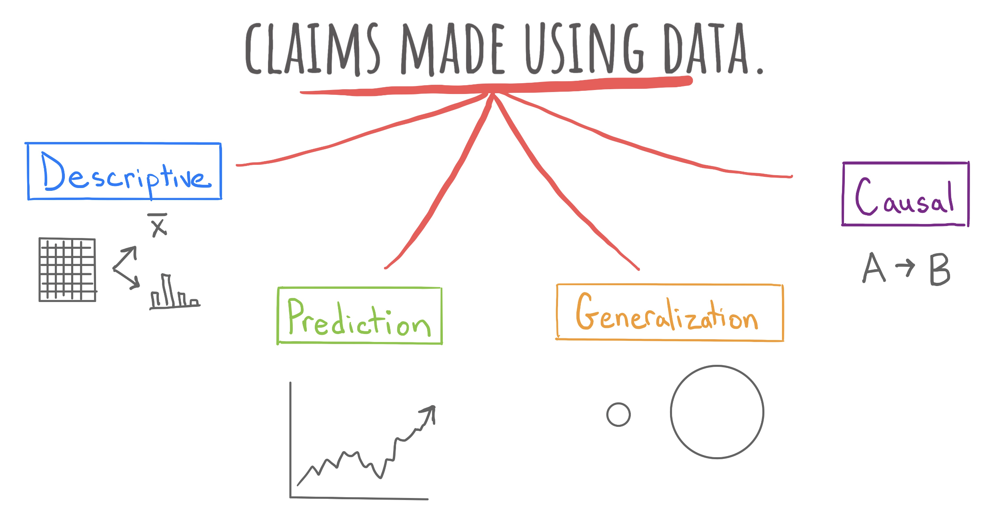
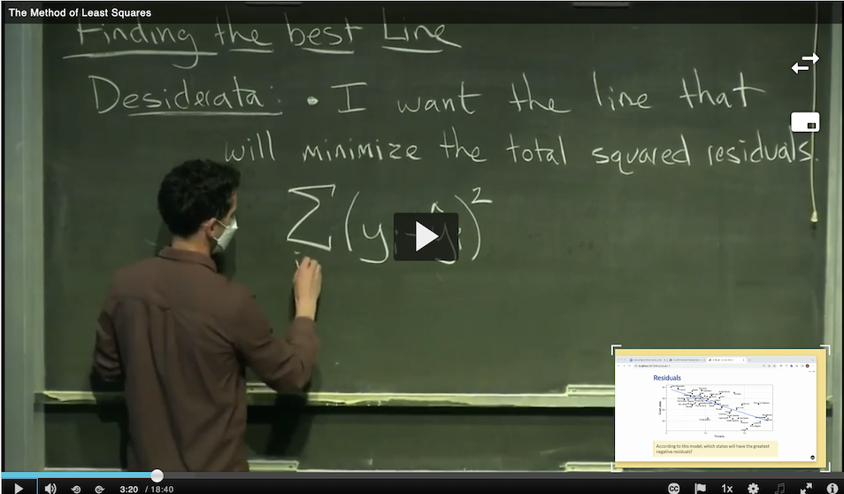

## 1. Giới thiệu: Chuyển giao sang bài toán dự báo

Trong suốt hành trình đã qua, chúng ta đã tiếp cận ba cấp độ phân tích dữ liệu: Bắt đầu từ việc mô tả các mẫu hình trong quá khứ (khẳng định mô tả), kiểm tra xem các mẫu hình đó có thể mở rộng cho toàn bộ tổng thể hay không (khẳng định suy rộng), và đi sâu tìm hiểu xem liệu một biến số có phải là nguyên nhân trực tiếp thúc đẩy biến số kia hay không (khẳng định nhân quả).

Giờ đây, chúng ta bước vào chương cuối cùng của khoa học dữ liệu: **Bài toán dự báo (Prediction)**.

*Hình 24.1: Bốn tầng bậc khẳng định tri thức trong khoa học dữ liệu: Khẳng định mô tả, khẳng định suy rộng, khẳng định nhân quả và khẳng định dự báo.*

Hãy cùng quan sát đồ thị theo dõi Chỉ số Giá Tiêu dùng (CPI) được công bố trên các phương tiện truyền thông:

*Hình 24.2: Biến động của Chỉ số Giá Tiêu dùng (CPI) theo thời gian. Từ dữ liệu quá khứ, làm sao để dự phóng tương lai?*

Từ đồ thị này, bốn khẳng định khác nhau có thể được phát biểu:
1. *“Chỉ số Giá Tiêu dùng đã tăng $8.3\%$ trong tháng 4.”* (Khẳng định mô tả).
2. *“Chỉ số giá tiêu dùng trên toàn cầu cũng tăng trong tháng 4.”* (Khẳng định suy rộng).
3. *“Chỉ số CPI tăng $8.3\%$ là do tác động của gián đoạn chuỗi cung ứng toàn cầu.”* (Khẳng định nhân quả).
4. *“Chỉ số CPI nhiều khả năng sẽ tiếp tục tăng trong suốt mùa hè tới.”* (Khẳng định dự báo).

Khẳng định thứ tư là một **dự báo**: Ta tận dụng cấu trúc toán học của các dữ liệu đã biết trong quá khứ để ước lượng giá trị của một quan sát mà ta mới chỉ nắm giữ thông tin một phần. Vào giữa mùa hè, ta biết rõ ngày tháng là 15 tháng 7 (tọa độ $x$), nhưng giá trị lạm phát tương ứng (tọa độ $y$) là bao nhiêu?

Toàn bộ cuộc cách mạng của Trí tuệ nhân tạo (AI) và Học máy (Machine Learning) ngày nay (từ chẩn đoán y khoa, xe tự hành cho đến các mô hình ngôn ngữ lớn) về bản chất đều xoay quanh các thuật toán dự báo. Tuy nhiên, đằng sau sự phức tạp của các mạng nơ-ron hàng tỷ tham số là những nguyên lý toán học nền tảng bắt đầu từ **Phương pháp bình phương bé nhất**.

---

## 2. Hai thành phần cốt lõi và Phân loại bài toán dự báo

Để thiết lập một bài toán dự báo, hai câu hỏi nền tảng bắt buộc phải được trả lời:

### Biến phản hồi (Response Variable)

- **Định nghĩa**: Là biến số mục tiêu mà mô hình cần dự đoán giá trị.
- **Tên gọi khác**: Biến phụ thuộc (Dependent Variable) hoặc kết cục (Outcome). Ký hiệu là $y$, hoặc $Y$ khi được xem như một biến ngẫu nhiên.

### Biến dự báo / Đặc trưng (Predictor Variables / Features)

- **Định nghĩa**: Là tập hợp các biến số đã biết được sử dụng làm dữ liệu đầu vào để dự đoán biến phản hồi.
- **Tên gọi khác**: Biến độc lập (Independent Variables) hoặc đặc trưng (Features). Ký hiệu là $x_1, x_2, \dots, x_p$.

Dựa trên bản chất của biến phản hồi $y$ trong phân loại dữ liệu, bài toán dự báo được chia thành hai họ mô hình chính:

| Tiêu chí | Bài toán Hồi quy (Regression) | Bài toán Phân loại (Classification) |
| :--- | :--- | :--- |
| **Bản chất biến phản hồi $y$** | **Biến định lượng liên tục** (Số thực) | **Biến định tính rời rạc** (Nhãn danh mục) |
| **Mục tiêu dự đoán** | Dự đoán một giá trị số đo lường cụ thể | Dự đoán một nhãn danh mục hoặc xác suất thuộc nhóm |
| **Ví dụ thực tế 1** | Dự báo chỉ số CPI hoặc tỉ lệ lạm phát ($y \in \mathbb{R}$) | Dự báo nền kinh tế có rơi vào suy thoái hay không ($y \in \{\text{Có}, \text{Không}\}$) |
| **Ví dụ thực tế 2** | Dự báo giá bán của một căn nhà (triệu USD) | Dự báo thư điện tử là thư rác hay thư hợp lệ |
| **Ví dụ thực tế 3** | Dự báo nhiệt độ ngày mai tại Hà Nội ($^\circ\text{C}$) | Xe tự hành phân loại vật thể phía trước là người đi bộ hay chướng ngại vật tĩnh |

Trong phạm vi của môn học, chúng ta tập trung vào hai mô hình chuẩn mực đại diện cho hai họ bài toán này: **Hồi quy Tuyến tính Bình phương bé nhất** cho bài toán hồi quy, và **Hồi quy Logistic** cho bài toán phân loại.

---

## 3. Mô hình Hồi quy Tuyến tính Bội

Mô hình hồi quy tuyến tính giả định rằng giá trị kỳ vọng của biến phản hồi $y$ có thể được biểu diễn dưới dạng một hàm số tuyến tính của $p$ biến dự báo $x_1, x_2, \dots, x_p$:

$$\hat{y} = b_0 + b_1 x_1 + b_2 x_2 + \dots + b_p x_p$$

Trong đó:
- $b_0$ là **hệ số chặn** (Intercept): Giá trị dự báo của $y$ khi tất cả các đặc trưng $x_1, \dots, x_p$ đều bằng $0$.
- $b_1, b_2, \dots, b_p$ là các **hệ số hồi quy** (Slope Coefficients): Cho biết mức thay đổi kỳ vọng của $\hat{y}$ khi biến dự báo tương ứng tăng thêm một đơn vị, với điều kiện giữ cố định tất cả các biến dự báo còn lại.

Trong Phần II, chúng ta đã dùng mô hình hồi quy để *mô tả* cấu trúc của tập dữ liệu hiện có. Trong bài toán dự báo, ta đưa vào một quan sát hoàn toàn mới trong tương lai $x^* = (x_1^*, \dots, x_p^*)$ để tính toán giá trị dự báo $\hat{y}^*$.

Nhưng câu hỏi cốt tử là: **Làm thế nào để tìm ra các hệ số $b_0, b_1, \dots, b_p$ tối ưu nhất từ dữ liệu lịch sử?**

---

## 4. Phương pháp Bình phương bé nhất (Ordinary Least Squares - OLS)

*Hình 24.3: Đường hồi quy OLS là đường thẳng duy nhất tối thiểu hóa tổng diện tích các hình vuông biểu diễn bình phương phần dư theo phương thẳng đứng.*

Với mỗi điểm dữ liệu quan sát $(x_i, y_i)$, sự sai lệch giữa giá trị thực tế $y_i$ và giá trị dự báo từ mô hình $\hat{y}_i$ được gọi là **phần dư** (Residual):

$$e_i = y_i - \hat{y}_i = y_i - (b_0 + b_1 x_{1i} + \dots + b_p x_{pi})$$

### Hàm tổn thất Tổng bình phương phần dư (RSS)

Để đánh giá mức độ sai lệch của toàn bộ mô hình trên toàn bộ $n$ quan sát, ta định nghĩa hàm tổn thất **Tổng bình phương phần dư** (Residual Sum of Squares - RSS):

$$\text{RSS}(b_0, b_1, \dots, b_p) = \sum_{i=1}^n e_i^2 = \sum_{i=1}^n \left(y_i - \hat{y}_i\right)^2 = \sum_{i=1}^n \left(y_i - (b_0 + b_1 x_{1i} + \dots + b_p x_{pi})\right)^2$$

### Tại sao lại bình phương phần dư thay vì lấy giá trị tuyệt đối $|e_i|$?

1. **Khử dấu triệt tiêu**: Nếu chỉ lấy tổng các phần dư $\sum e_i$, các sai số dương và âm sẽ triệt tiêu lẫn nhau, khiến một đường thẳng dự báo tồi tệ vẫn có thể có tổng sai số bằng $0$. Bình phương đảm bảo mọi sai lệch đều mang giá trị không âm.
2. **Khả vi trơn tru (Smooth Differentiability)**: Hàm số bậc hai $f(u) = u^2$ có đạo hàm trơn tru và liên tục ở mọi nơi ($f'(u) = 2u$), trong khi hàm trị tuyệt đối $|u|$ có điểm gấp khúc không khả vi tại $u = 0$. Tính khả vi trơn tru cho phép ta áp dụng giải tích vi tích phân để tìm nghiệm cực trị một cách dễ dàng.
3. **Cơ chế phạt nặng sai số lớn**: Bình phương phần dư trừng phạt rất nặng những điểm dữ liệu bị dự báo sai lệch lớn (sai số 4 đơn vị bị phạt $16$, trong khi sai số 2 đơn vị chỉ bị phạt $4$).
4. **Mối liên hệ với Phân phối chuẩn**: Dưới giả định sai số ngẫu nhiên tuân theo phân phối chuẩn Gauss $\varepsilon \sim \mathcal{N}(0, \sigma^2)$, nghiệm tối thiểu hóa RSS hoàn toàn trùng khớp với nghiệm của phương pháp Ước lượng hợp lý cực đại (Maximum Likelihood Estimation - MLE).

---

## 5. Hai con đường tìm hệ số tối ưu OLS

Để tìm tập hệ số $(b_0, b_1, \dots, b_p)$ làm cho $\text{RSS}$ đạt giá trị nhỏ nhất, khoa học máy tính và thống kê cung cấp hai con đường:

### Con đường 1: Nghiệm giải tích tường minh (Analytical Solution via Calculus)

Vì $\text{RSS}$ là một hàm lồi bậc hai theo các hệ số, điểm cực tiểu toàn cục đạt được khi toàn bộ các đạo hàm riêng bậc nhất bằng $0$:

$$\frac{\partial \text{RSS}}{\partial b_0} = 0, \quad \frac{\partial \text{RSS}}{\partial b_1} = 0, \quad \dots, \quad \frac{\partial \text{RSS}}{\partial b_p} = 0$$

Trong trường hợp hồi quy tuyến tính đơn biến ($y = b_0 + b_1 x$), việc giải hệ hai phương trình đạo hàm riêng này dẫn tới nghiệm giải tích kinh điển:

$$\begin{aligned}
&b_1 = \frac{\sum_{i=1}^n (x_i - \bar{x})(y_i - \bar{y})}{\sum_{i=1}^n (x_i - \bar{x})^2} = r \cdot \frac{s_y}{s_x}\\
&b_0 = \bar{y} - b_1 \bar{x}
\end{aligned}$$

Trong đó:
- $r$ là hệ số tương quan tuyến tính Pearson giữa $x$ và $y$.
- $s_x$ và $s_y$ là độ lệch chuẩn của $x$ và $y$.
- $\bar{x}$ và $\bar{y}$ là trung bình mẫu của $x$ và $y$.

> [!IMPORTANT] Hai tính chất hình học bất biến của đường hồi quy OLS:
> 1. Đường hồi quy luôn đi qua điểm trọng tâm mẫu $(\bar{x}, \bar{y})$.
> 2. Tổng đại số của các phần dư luôn bằng chính xác số $0$:
>    $$\sum_{i=1}^n e_i = \sum_{i=1}^n (y_i - \hat{y}_i) = 0$$

### Con đường 2: Thuật toán tối ưu hóa số trị lặp (Algorithmic Numerical Optimization)

Khi số lượng biến dự báo $p$ lên tới hàng ngàn hoặc hàng triệu biến (như trong xử lý ảnh, gen hoặc mô hình ngôn ngữ), việc giải phương trình giải tích thông qua nghịch đảo ma trận $(X^T X)^{-1}$ có độ phức tạp thuật toán lên tới $\mathcal{O}(p^3)$, gây quá tải bộ nhớ và bất khả thi về mặt tính toán.

Thay vào đó, ta sử dụng các **thuật toán tối ưu hóa số trị lặp**:

1. **Thuật toán Gradient Descent (Hạ độ dốc)**:
   - Là thuật toán tối ưu hóa quan trọng nhất của toàn bộ Trí tuệ nhân tạo hiện đại.
   - Nguyên lý: Bắt đầu từ một bộ trọng số ban đầu $b^{(0)}$. Tại mỗi bước lặp $t$, ta tính gradient (vector đạo hàm riêng) của hàm tổn thất $\nabla \text{RSS}(b^{(t)})$ và di chuyển các trọng số ngược chiều gradient một khoảng tỉ lệ với tốc độ học (Learning Rate $\eta$):
     $$b^{(t+1)} = b^{(t)} - \eta \cdot \nabla \text{RSS}(b^{(t)})$$
   - Thuật toán di chuyển dần dần xuống đáy của "thung lũng tổn thất" cho đến khi hội tụ về nghiệm tối ưu.
2. **Thuật toán Nelder-Mead (Đơn hình Simplex)**:
   - Phương pháp tìm kiếm hình học không đòi hỏi tính đạo hàm, thường được dùng cho các bài toán tối ưu phi tuyến kích thước nhỏ.

---

## 6. Tóm tắt bài học

- **Bài toán dự báo** sử dụng cấu trúc toán học của các đặc trưng đã biết để ước lượng giá trị của biến phản hồi cho các quan sát mới.
- Dự báo được phân chia thành **Hồi quy** (biến phản hồi là số thực liên tục) và **Phân loại** (biến phản hồi là nhãn danh mục rời rạc).
- **Phương pháp bình phương bé nhất (OLS)** xác định đường hồi quy tối ưu bằng cách tối thiểu hóa hàm tổn thất Tổng bình phương phần dư (RSS).
- Việc bình phương phần dư giúp khử dấu triệt tiêu, tạo hàm khả vi trơn tru và gắn kết tự nhiên với phân phối chuẩn Gauss.
- Nghiệm OLS có thể được tìm thấy bằng **công thức giải tích đạo hàm** trong các bài toán đơn giản, hoặc bằng các **thuật toán tối ưu hóa số trị như Gradient Descent** trong học máy hiện đại quy mô lớn.

---

## Tài liệu tham khảo

1. Legendre, A. M. (1805). *Nouvelles méthodes pour la détermination des orbites des comètes*. Firmin Didot, Paris.
2. Gauss, C. F. (1809). *Theoria motus corporum coelestium in sectionibus conicis solem ambientium*. Perthes et Besser, Hamburg.
3. James, G., Witten, D., Hastie, T., & Tibshirani, R. (2021). *An Introduction to Statistical Learning: with Applications in R* (2nd ed.). Springer.
4. Smialek, J. (2022, May 11). Consumer Prices are Still Climbing Rapidly. *The New York Times*.

## Bài tập tự luyện

### Bài tập 1: Nhận diện và phân loại bài toán dự báo trong thực tế

Hãy phân loại các bài toán ứng dụng sau đây vào hai họ bài toán: **Hồi quy (Regression)** hoặc **Phân loại (Classification)**. Với mỗi bài toán, hãy chỉ rõ biến phản hồi $y$ và các biến dự báo $x$:

1. Một hệ thống định giá sách tự động của trang thương mại điện tử Amazon tính toán mức giá bán đề xuất của một cuốn sách dựa trên khối lượng trang, số trang, thể loại sách và loại bìa (bìa cứng hay bìa mềm).
2. Nhóm kỹ sư của hãng xe tự hành Waymo xây dựng mô hình cảm biến quang học lidar để xác định xem hình ảnh trước đầu xe là một chiếc xe thật đang lưu thông hay chỉ là ảo ảnh phản chiếu từ cửa kính tòa nhà.
3. Trung tâm dự báo khí tượng thủy văn dự đoán lượng mưa trong 24 giờ tới (tính bằng milimét) dựa trên độ ẩm không khí, áp suất khí quyển, nhiệt độ mặt đất và tốc độ gió.
4. Hội đồng tuyển sinh đại học dự đoán liệu một thí sinh trúng tuyển có xác nhận nhập học hay không dựa trên điểm thi đầu vào, tỉnh thành nơi cư trú và mức thu nhập gia đình.

::: details Lời giải chi tiết
**1. Hệ thống định giá sách của Amazon:**
- **Loại bài toán**: Bài toán Hồi quy (Regression).
- **Biến phản hồi $y$**: Mức giá bán đề xuất của cuốn sách (biến định lượng liên tục, đơn vị: USD hoặc VNĐ).
- **Biến dự báo $x$**: Khối lượng sách ($x_1$, gram), số trang ($x_2$), thể loại ($x_3$, biến định tính), loại bìa ($x_4$, nhị phân: Bìa cứng hoặc bìa mềm).

**2. Hệ thống cảm biến xe tự hành Waymo:**
- **Loại bài toán**: Bài toán Phân loại (Classification).
- **Biến phản hồi $y$**: Nhãn định tính nhị phân của vật cản ($y \in \{\text{Xe thật}, \text{Ảo ảnh phản chiếu}\}$).
- **Biến dự báo $x$**: Tọa độ phản xạ chùm tia lidar, mật độ điểm mây lidar, cường độ xung phản xạ, vector vận tốc chuyển động tương đối.

**3. Dự báo lượng mưa của trung tâm khí tượng:**
- **Loại bài toán**: Bài toán Hồi quy (Regression).
- **Biến phản hồi $y$**: Lượng mưa tích lũy trong 24 giờ (biến định lượng liên tục không âm, đơn vị đo: Milimét).
- **Biến dự báo $x$**: Độ ẩm không khí ($x_1$, $\%$), áp suất ($x_2$, hPa), nhiệt độ ($x_3$, $^\circ\text{C}$), tốc độ gió ($x_4$, km/h).

**4. Dự đoán xác nhận nhập học của hội đồng tuyển sinh:**
- **Loại bài toán**: Bài toán Phân loại (Classification).
- **Biến phản hồi $y$**: Trạng thái xác nhận nhập học của thí sinh ($y \in \{\text{Có nhập học}, \text{Không nhập học}\}$).
- **Biến dự báo $x$**: Điểm thi chuẩn hóa ($x_1$), khoảng cách địa lý từ nhà đến trường ($x_2$, km), phân vị thu nhập gia đình ($x_3$).
:::

---

### Bài tập 2: Tính toán giải tích OLS và kiểm chứng các tính chất hình học

Xét một tập dữ liệu nhỏ gồm $n = 5$ quan sát về thời gian ôn tập ($x$, tính bằng giờ) và điểm kiểm tra ($y$, thang điểm 10):

| Quan sát $i$ | $x_i$ (Giờ ôn tập) | $y_i$ (Điểm kiểm tra) |
| :--- | :--- | :--- |
| **1** | 1 | 2 |
| **2** | 2 | 3 |
| **3** | 3 | 5 |
| **4** | 4 | 7 |
| **5** | 5 | 8 |

**Yêu cầu:**
1. Hãy tính trung bình mẫu $\bar{x}$ và $\bar{y}$.
2. Áp dụng công thức giải tích bình phương bé nhất, tính toán hệ số góc $b_1$ và hệ số chặn $b_0$. Viết phương trình đường hồi quy tuyến tính OLS $\hat{y} = b_0 + b_1 x$.
3. Tính toán các giá trị dự báo $\hat{y}_i$ và phần dư $e_i = y_i - \hat{y}_i$ cho từng quan sát. Kiểm chứng tính chất $\sum_{i=1}^5 e_i = 0$ và tính Tổng bình phương phần dư (RSS).
4. Dự báo điểm kiểm tra của một sinh viên dành ra $x^* = 4.5$ giờ ôn tập.

::: details Lời giải chi tiết
**1. Tính trung bình mẫu:**
- Trung bình của $x$:
  $$\bar{x} = \frac{1 + 2 + 3 + 4 + 5}{5} = \frac{15}{5} = 3.0 \text{ giờ}$$
- Trung bình của $y$:
  $$\bar{y} = \frac{2 + 3 + 5 + 7 + 8}{5} = \frac{25}{5} = 5.0 \text{ điểm}$$

**2. Tính toán hệ số góc $b_1$ và hệ số chặn $b_0$:**
- Ta lập bảng tính các đại lượng độ lệch:

| $i$ | $x_i - \bar{x}$ | $y_i - \bar{y}$ | $(x_i - \bar{x})^2$ | $(x_i - \bar{x})(y_i - \bar{y})$ |
| :--- | :--- | :--- | :--- | :--- |
| **1** | $1 - 3 = -2$ | $2 - 5 = -3$ | $(-2)^2 = 4$ | $(-2) \times (-3) = 6$ |
| **2** | $2 - 3 = -1$ | $3 - 5 = -2$ | $(-1)^2 = 1$ | $(-1) \times (-2) = 2$ |
| **3** | $3 - 3 = 0$ | $5 - 5 = 0$ | $0^2 = 0$ | $0 \times 0 = 0$ |
| **4** | $4 - 3 = +1$ | $7 - 5 = +2$ | $(+1)^2 = 1$ | $(+1) \times (+2) = 2$ |
| **5** | $5 - 3 = +2$ | $8 - 5 = +3$ | $(+2)^2 = 4$ | $(+2) \times (+3) = 6$ |
| **Tổng** | **$0$** | **$0$** | **$10$** | **$16$** |

- Hệ số góc $b_1$:
  $$b_1 = \frac{\sum (x_i - \bar{x})(y_i - \bar{y})}{\sum (x_i - \bar{x})^2} = \frac{16}{10} = 1.6$$
- Hệ số chặn $b_0$:
  $$b_0 = \bar{y} - b_1 \bar{x} = 5.0 - (1.6 \times 3.0) = 5.0 - 4.8 = 0.2$$
- Phương trình đường hồi quy OLS:
  $$\hat{y} = 0.2 + 1.6 x$$

**3. Tính giá trị dự báo, phần dư và RSS:**
- Bảng phần dư:

| $i$ | $x_i$ | $y_i$ | $\hat{y}_i = 0.2 + 1.6 x_i$ | $e_i = y_i - \hat{y}_i$ | $e_i^2$ |
| :--- | :--- | :--- | :--- | :--- | :--- |
| **1** | 1 | 2 | $0.2 + 1.6(1) = 1.8$ | $2 - 1.8 = +0.2$ | $0.04$ |
| **2** | 2 | 3 | $0.2 + 1.6(2) = 3.4$ | $3 - 3.4 = -0.4$ | $0.16$ |
| **3** | 3 | 5 | $0.2 + 1.6(3) = 5.0$ | $5 - 5.0 = 0.0$ | $0.00$ |
| **4** | 4 | 7 | $0.2 + 1.6(4) = 6.6$ | $7 - 6.6 = +0.4$ | $0.16$ |
| **5** | 5 | 8 | $0.2 + 1.6(5) = 8.2$ | $8 - 8.2 = -0.2$ | $0.04$ |
| **Tổng** | | | | **$0.0$** | **$0.40$** |

- Kiểm chứng tổng phần dư:
  $$\sum_{i=1}^5 e_i = (+0.2) + (-0.4) + 0.0 + (+0.4) + (-0.2) = 0.0$$
- Tổng bình phương phần dư:
  $$\text{RSS} = 0.04 + 0.16 + 0.00 + 0.16 + 0.04 = 0.40$$

**4. Dự báo điểm số cho $x^* = 4.5$ giờ:**
- Điểm dự báo:
  $$\hat{y}^* = 0.2 + 1.6(4.5) = 0.2 + 7.2 = 7.4 \text{ điểm}$$
:::

---

### Bài tập 3: Mô phỏng thuật toán Gradient Descent cho bài toán tối ưu RSS

Vẫn với tập dữ liệu gồm 5 quan sát ở Bài tập 2, giả sử ta không dùng công thức giải tích mà sử dụng thuật toán tối ưu hóa số trị Gradient Descent để tìm các hệ số $b_0$ và $b_1$. 

Hàm tổn thất RSS được định nghĩa là:
$$\text{RSS}(b_0, b_1) = \sum_{i=1}^n (y_i - (b_0 + b_1 x_i))^2$$

**Yêu cầu:**
1. Hãy tính đạo hàm riêng của $\text{RSS}$ theo $b_0$ và theo $b_1$ dưới dạng biểu thức liên hệ với phần dư $e_i = y_i - \hat{y}_i$.
2. Giả sử ta khởi tạo các hệ số ban đầu là $b_0^{(0)} = 0.0$ và $b_1^{(0)} = 1.0$. Hãy tính vector gradient tại điểm xuất phát:
   $$\nabla \text{RSS}(b_0^{(0)}, b_1^{(0)}) = \left( \frac{\partial \text{RSS}}{\partial b_0}, \frac{\partial \text{RSS}}{\partial b_1} \right)$$
3. Với tốc độ học (Learning Rate) $\eta = 0.01$, hãy thực hiện một bước cập nhật của thuật toán Gradient Descent để tìm bộ hệ số mới $(b_0^{(1)}, b_1^{(1)})$. Nhận xét về hướng di chuyển của các hệ số so với nghiệm giải tích tối ưu $(0.2, 1.6)$.

::: details Lời giải chi tiết
**1. Đạo hàm riêng của hàm tổn thất RSS:**
- Áp dụng quy tắc đạo hàm hàm hợp cho tổng:
  $$\begin{aligned}
  &\frac{\partial \text{RSS}}{\partial b_0} = \sum_{i=1}^n 2(y_i - (b_0 + b_1 x_i)) \cdot (-1) = -2 \sum_{i=1}^n (y_i - \hat{y}_i) = -2 \sum_{i=1}^n e_i\\
  &\frac{\partial \text{RSS}}{\partial b_1} = \sum_{i=1}^n 2(y_i - (b_0 + b_1 x_i)) \cdot (-x_i) = -2 \sum_{i=1}^n x_i (y_i - \hat{y}_i) = -2 \sum_{i=1}^n x_i e_i
  \end{aligned}$$

**2. Tính toán gradient tại điểm khởi tạo $b_0^{(0)} = 0.0, b_1^{(0)} = 1.0$:**
- Tại điểm khởi tạo, đường thẳng mô hình là $\hat{y}_i^{(0)} = 0.0 + 1.0 x_i = x_i$.
- Tính phần dư và các số hạng tích lũy cho từng điểm:
  - Điểm 1 ($x_1 = 1, y_1 = 2$): $\hat{y}_1 = 1 \implies e_1 = 2 - 1 = +1$, $x_1 e_1 = 1 \times 1 = 1$.
  - Điểm 2 ($x_2 = 2, y_2 = 3$): $\hat{y}_2 = 2 \implies e_2 = 3 - 2 = +1$, $x_2 e_2 = 2 \times 1 = 2$.
  - Điểm 3 ($x_3 = 3, y_3 = 5$): $\hat{y}_3 = 3 \implies e_3 = 5 - 3 = +2$, $x_3 e_3 = 3 \times 2 = 6$.
  - Điểm 4 ($x_4 = 4, y_4 = 7$): $\hat{y}_4 = 4 \implies e_4 = 7 - 4 = +3$, $x_4 e_4 = 4 \times 3 = 12$.
  - Điểm 5 ($x_5 = 5, y_5 = 8$): $\hat{y}_5 = 5 \implies e_5 = 8 - 5 = +3$, $x_5 e_5 = 5 \times 3 = 15$.
- Tổng các phần dư:
  $$
\begin{aligned}
    &\sum_{i=1}^5 e_i = 1 + 1 + 2 + 3 + 3 = 10\\
    &\sum_{i=1}^5 x_i e_i = 1 + 2 + 6 + 12 + 15 = 36
\end{aligned}
$$
- Thành phần gradient:
  $$
\begin{aligned}
    &\frac{\partial \text{RSS}}{\partial b_0} = -2 \times 10 = -20.0\\
    &\frac{\partial \text{RSS}}{\partial b_1} = -2 \times 36 = -72.0
\end{aligned}
$$
- Vector gradient: $\nabla \text{RSS} = (-20.0, -72.0)$.

**3. Cập nhật hệ số với tốc độ học $\eta = 0.01$:**
- Công thức cập nhật Gradient Descent:
  $$b^{(1)} = b^{(0)} - \eta \cdot \nabla \text{RSS}(b^{(0)})$$
- Cập nhật hệ số chặn $b_0$:
  $$b_0^{(1)} = b_0^{(0)} - \eta \cdot \left(\frac{\partial \text{RSS}}{\partial b_0}\right) = 0.0 - 0.01 \times (-20.0) = 0.0 + 0.20 = 0.20$$
- Cập nhật hệ số góc $b_1$:
  $$b_1^{(1)} = b_1^{(0)} - \eta \cdot \left(\frac{\partial \text{RSS}}{\partial b_1}\right) = 1.0 - 0.01 \times (-72.0) = 1.0 + 0.72 = 1.72$$
- Bộ hệ số sau bước 1: $(b_0^{(1)}, b_1^{(1)}) = (0.20, 1.72)$.
- **Nhận xét**: Hệ số góc đã tăng từ $1.0$ lên $1.72$, vượt qua điểm $1.6$ và sẽ được kéo dần về trạng thái cân bằng trong các bước lặp tiếp theo. Hệ số chặn $b_0$ tăng chính xác từ $0.0$ lên $0.20$. Thuật toán đang di chuyển rất nhanh về vùng lân cận của nghiệm tối ưu OLS $(0.2, 1.6)$.
:::

