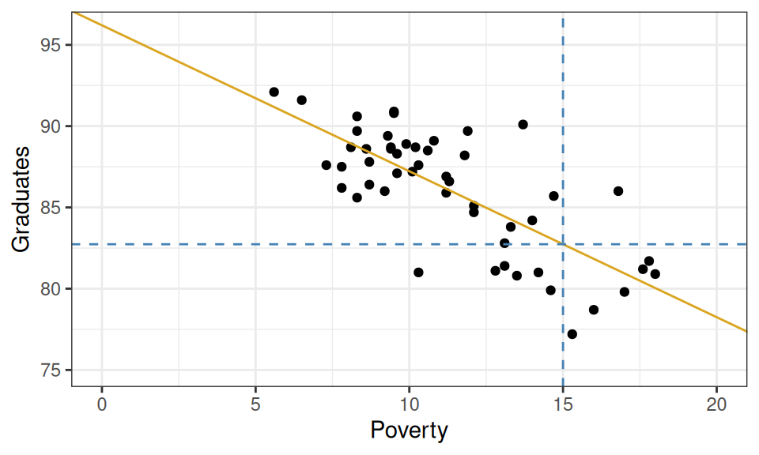
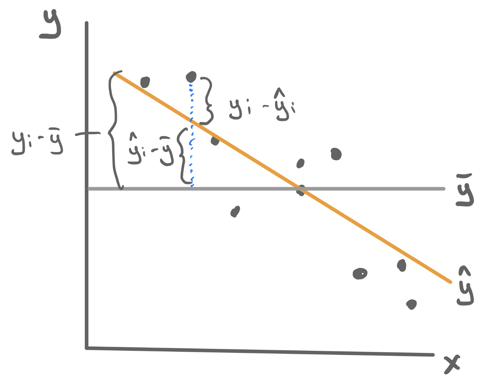
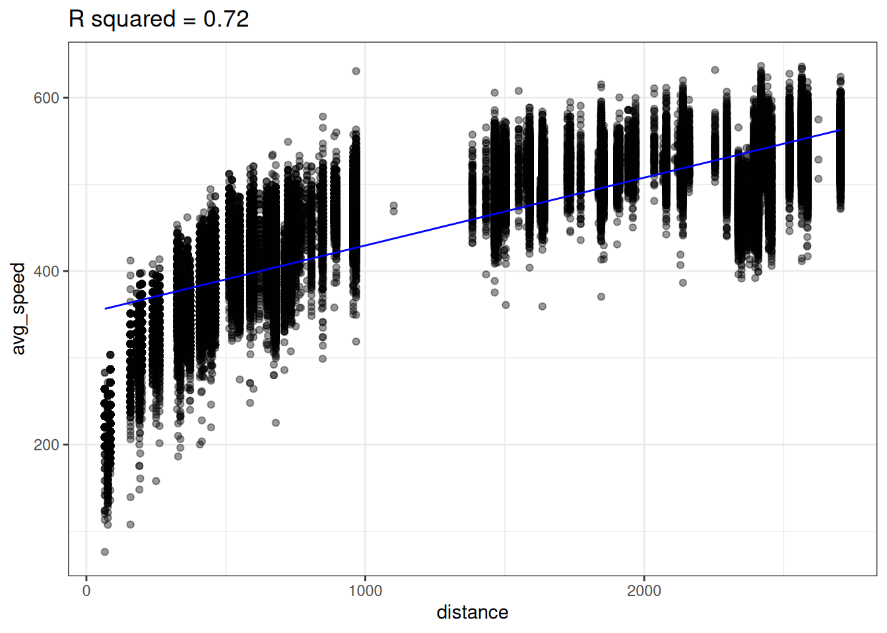
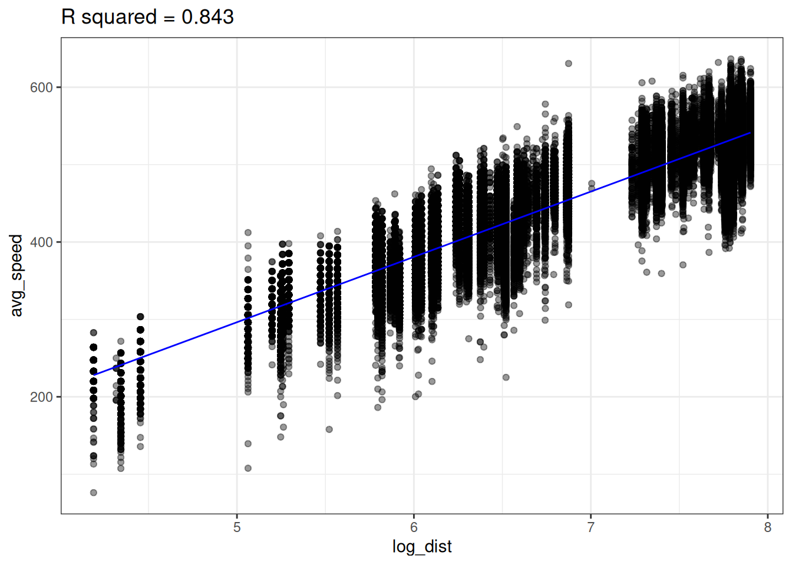
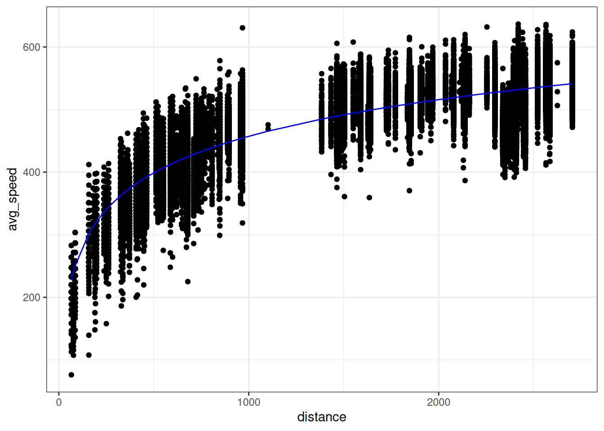
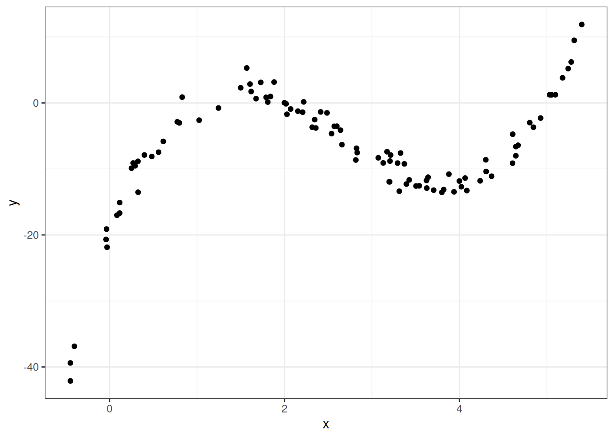

## 1. Giới thiệu: Đánh giá chất lượng của một cỗ máy dự báo

Trong bài học trước, chúng ta đã chế tạo cỗ máy dự báo đầu tiên: Một đường thẳng hồi quy tối thiểu hóa tổng bình phương phần dư (OLS). Sau khi đã khớp mô hình với dữ liệu quan sát, ta có thể dễ dàng trả lời những câu hỏi dự phóng trong tương lai.

Xét bài toán thực tế: Dự đoán tỉ lệ tốt nghiệp trung học phổ thông ($y$, tính bằng $\%$) của một bang dựa trên tỉ lệ hộ nghèo ($x$, tính bằng $\%$). Mô hình hồi quy OLS khớp được phương trình:
$$\hat{y} = 96.2 - 0.89 x$$

*Hình 25.1: Đường hồi quy dự đoán tỉ lệ tốt nghiệp trung học từ tỉ lệ hộ nghèo cấp bang.*

Nếu một bang có tỉ lệ nghèo là $15\%$, mô hình sẽ đưa ra dự báo:
$$\hat{y} = 96.2 - 0.89(15) = 82.85\%$$

Câu hỏi then chốt đặt ra cho nhà khoa học dữ liệu là: **Mức dự đoán $82.85\%$ này tốt đến đâu?** 

Chúng ta không thể chờ đợi tương lai để kiểm chứng độ chính xác tuyệt đối của từng điểm dự báo đơn lẻ. Tuy nhiên, chúng ta hoàn toàn có thể đo lường xem mô hình đã nắm bắt và giải thích được bao nhiêu phần cấu trúc biến thiên trong tập dữ liệu quá khứ. 

Bài học này tập trung vào hai vấn đề cốt lõi:
1. Làm thế nào để định lượng chất lượng khớp dữ liệu của một mô hình dự báo?
2. Những chiến lược nào có thể giúp cải thiện độ chính xác của các dự báo đó?

---

## 2. Đo lường năng lực giải thích: Hệ số xác định $R^2$ (R-squared)

Để đánh giá chất lượng dự báo của mô hình $\hat{y}$, ta cần so sánh nó với một mô hình cơ sở ngây thơ nhất (Baseline Model): Mô hình không dùng bất kỳ biến dự báo $x$ nào, mà chỉ dự đoán mọi quan sát bằng giá trị trung bình mẫu $\bar{y}$.

*Hình 25.2: Phân rã biến thiên của hệ số xác định $R^2$: Tổng biến thiên toàn phần (TSS) bằng tổng bình phương giải thích được (SSR) cộng với tổng bình phương phần dư chưa giải thích (RSS).*

### Định lý phân rã phương sai (ANOVA Decomposition)

Trong mô hình hồi quy tuyến tính OLS có chứa hệ số chặn, tổng biến thiên của biến phản hồi $y$ quanh giá trị trung bình được phân rã thành hai thành phần trực giao:

$$\text{TSS} = \text{SSR} + \text{RSS}$$

1. **Tổng biến thiên toàn phần (Total Sum of Squares - TSS)**:
   - Đo lường mức độ phân tán tự nhiên của biến phản hồi $y$ quanh giá trị trung bình $\bar{y}$ khi chưa có mô hình:
     $$\text{TSS} = \sum_{i=1}^n (y_i - \bar{y})^2$$
2. **Tổng bình phương do hồi quy giải thích (Sum of Squares due to Regression - SSR)**:
   - Đo lường phần biến thiên mà đường hồi quy $\hat{y}$ đã nắm bắt và giải thích thành công:
     $$\text{SSR} = \sum_{i=1}^n (\hat{y}_i - \bar{y})^2$$
3. **Tổng bình phương phần dư (Residual Sum of Squares - RSS)**:
   - Đo lường phần sai số còn lại mà mô hình chưa thể giải thích được:
     $$\text{RSS} = \sum_{i=1}^n (y_i - \hat{y}_i)^2$$

### Định nghĩa Hệ số xác định $R^2$

- **Khái niệm**: Hệ số $R^2$ là tỉ lệ phần trăm tổng biến thiên của biến phản hồi $y$ được giải thích bởi mô hình hồi quy:
  $$R^2 = \frac{\text{SSR}}{\text{TSS}} = 1 - \frac{\text{RSS}}{\text{TSS}}$$

### Các tính chất toán học của $R^2$

- **Miền giá trị**: $R^2$ luôn nhận giá trị nằm trong đoạn $[0, 1]$ đối với mô hình OLS có hệ số chặn.
- **Khi $R^2 \approx 1$**: Phần dư $\text{RSS} \approx 0$. Đường hồi quy đi qua hầu hết các điểm dữ liệu, mô hình có năng lực dự báo thực nghiệm rất cao.
- **Khi $R^2 \approx 0$**: $\text{RSS} \approx \text{TSS}$. Biến dự báo $x$ không cung cấp thêm bất kỳ thông tin hữu ích nào so với việc đoán mò bằng $\bar{y}$.
- **Trong hồi quy đơn biến**: Giá trị $R^2$ chính bằng bình phương của hệ số tương quan Pearson: $R^2 = (r_{xy})^2$.
- Trong ví dụ về tỉ lệ nghèo và tốt nghiệp ở trên: Mô hình đạt $R^2 = 0.56$, đồng nghĩa với việc tỉ lệ hộ nghèo giải thích được $56\%$ biến thiên của tỉ lệ tốt nghiệp giữa các bang.

---

## 3. Chiến lược cải thiện 1: Bổ sung thêm biến dự báo

Một mục tiêu tự nhiên trong tối ưu hóa mô hình là tìm kiếm cỗ máy dự báo có giá trị $R^2$ cao nhất có thể. Chiến lược trực diện đầu tiên là đưa thêm các biến dự báo mới vào phương trình hồi quy.

Xét tập dữ liệu gồm $168$ nhà hàng Ý tại New York từ cẩm nang ẩm thực ZAGAT. Mục tiêu là dự báo giá trung bình của một bữa ăn (`price`, tính bằng USD). Ta có bốn biến dự báo tiềm năng: Điểm chất lượng món ăn (`food`), Điểm trang trí không gian (`decor`), Điểm dịch vụ phục vụ (`service`), và Vị trí địa lý (`geo`: Phía đông hay phía tây Đại lộ số 5).

Ta xây dựng bốn mô hình hồi quy lồng nhau với số lượng biến tăng dần:
- Mô hình $m_1$: `price ~ food`
- Mô hình $m_2$: `price ~ food + geo`
- Mô hình $m_3$: `price ~ food + geo + decor`
- Mô hình $m_4$: `price ~ food + geo + decor + service`

Kết quả tính toán giá trị $R^2$ cho từng mô hình như sau:

| Mô hình | Các biến dự báo đưa vào | Không gian hình học | Giá trị $R^2$ |
| :--- | :--- | :--- | :--- |
| **$m_1$** | `food` | Đường thẳng đơn trong không gian 2D | $0.3932$ ($39.3\%$) |
| **$m_2$** | `food + geo` | Hai đường thẳng song song trong 2D | $0.3988$ ($39.9\%$) |
| **$m_3$** | `food + geo + decor` | Hai mặt phẳng song song trong không gian 3D | $0.6279$ ($62.8\%$) |
| **$m_4$** | `food + geo + decor + service` | Hai siêu phẳng song song trong không gian 4D | $0.6279$ ($62.8\%$) |

> [!IMPORTANT] Định lý về tính đơn điệu của $R^2$:
> Khi ta bổ sung thêm bất kỳ biến dự báo nào vào mô hình hồi quy tuyến tính OLS, **giá trị $R^2$ trên tập dữ liệu mẫu không bao giờ giảm đi**, mà chỉ có thể tăng lên hoặc giữ nguyên:
> $$R^2_{m+1} \ge R^2_m$$
> Nguyên nhân: Phương pháp OLS luôn tối thiểu hóa RSS. Trong trường hợp xấu nhất khi biến mới hoàn toàn vô dụng, thuật toán OLS chỉ việc gán hệ số của biến đó bằng $0$, giữ nguyên mức RSS cũ.

---

## 4. Chiến lược cải thiện 2: Biến đổi phi tuyến (Non-linear Transformations)

Trong tự nhiên và kinh tế, các mối liên hệ hiếm khi tuân theo dạng đường thẳng tuyệt đối. Khi đám mây điểm biểu diễn một đường cong uốn lượn, việc ép buộc một đường thẳng cứng nhắc sẽ dẫn tới sai số dự báo lớn.

Xét dữ liệu vận tốc bay trung bình (`avg_speed`, dặm/giờ) theo quãng đường bay (`distance`, dặm) của các chuyến bay thương mại:

*Hình 25.3: Khớp đường hồi quy tuyến tính đơn biến giữa vận tốc bay và quãng đường bay. Đường thẳng không nắm bắt được xu hướng uốn cong ở cự ly ngắn.*

Quan sát Hình 25.3:
- Ở các chuyến bay ngắn ($< 500$ dặm), vận tốc tăng rất nhanh theo cự ly vì máy bay dành phần lớn thời gian cất cánh và hạ cánh.
- Ở các chuyến bay dài ($> 1{,}500$ dặm), vận tốc đạt trần hành trình ổn định và đường biểu diễn thoải dần. Mối liên hệ có dạng hàm lõm (quy luật lợi tức giảm dần).
- Đường hồi quy tuyến tính đơn giản chỉ đạt $R^2 = 0.720$.

### Biến đổi Logarit

Để uốn nắn dữ liệu, ta áp dụng phép biến đổi logarit tự nhiên lên biến cự ly:
$$\text{log\_dist} = \ln(\text{distance})$$

*Hình 25.4: Sau khi biến đổi logarit cho biến dự báo trên trục hoành, mối liên hệ giữa vận tốc và log(cự ly) trở nên thẳng tắp một cách hoàn hảo.*

Sau khi biến đổi, mô hình OLS mới đạt được phương trình:
$$\widehat{\text{avg\_speed}} = b_0 + b_1 \cdot \ln(\text{distance})$$

Giá trị $R^2$ tăng vọt từ $0.720$ lên **$0.843$** ($84.3\%$ biến thiên vận tốc được giải thích)!

*Hình 25.5: Khi chuyển phương trình dự báo ngược trở lại hệ tọa độ cự ly ban đầu, đường dự báo trở thành một đường cong mượt mà ôm sát lấy dữ liệu thực tế.*

Mô hình này vừa là **tuyến tính** (đối với biến chuyển đổi $\ln(x)$), vừa là **phi tuyến** (đối với biến gốc $x$). Nhờ tính linh hoạt này, cỗ máy OLS có thể xử lý dễ dàng các dạng hàm phi tuyến phức tạp trong thực tế.

---

## 5. Chiến lược cải thiện 3: Hồi quy Đa thức (Polynomial Regression)

Đôi khi dữ liệu có nhiều điểm uốn sóng mà một hàm logarit hay căn bậc hai đơn giản không thể mô tả trọn vẹn. Trong trường hợp đó, **đa thức bậc cao** là công cụ đắc lực tiếp theo.

Một hàm đa thức bậc $d$ có dạng tổng quát:
$$\hat{y} = c_0 + c_1 x + c_2 x^2 + c_3 x^3 + \dots + c_d x^d$$

Trong đó, số nguyên dương $d$ là bậc của đa thức (số mũ lớn nhất của $x$).

*Hình 25.6: Đường hồi quy đa thức bậc 3 ($d=3$) uốn lượn linh hoạt nắm bắt trọn vẹn hai điểm uốn của dữ liệu thực nghiệm.*

Phương trình dự báo của mô hình bậc 3 trên Hình 25.6 là:
$$\hat{y} = -20.086 + 34.669 x - 16.352 x^2 + 2.042 x^3$$

Mặc dù đường cong dự báo uốn lượn phi tuyến theo $x$, mô hình này **vẫn là một mô hình tuyến tính đối với các tham số $c_0, c_1, c_2, c_3$** (Linear in parameters). Do đó, ta vẫn áp dụng nguyên vẹn thuật toán OLS bằng cách coi $x_1 = x, x_2 = x^2, x_3 = x^3$ như các biến dự báo độc lập thông thường.

> [!CAUTION] Mầm mống của cạm bẫy:
> Nếu tiếp tục tăng bậc đa thức lên $d = 10$ hay $d = 20$, đường cong sẽ uốn lượn qua từng điểm dữ liệu đơn lẻ và đẩy $R^2 \to 1.0$. Tuy nhiên, liệu cỗ máy uốn lượn ngoằn ngoèo đó có dự báo tốt cho những quan sát mới trong tương lai hay không? Câu hỏi này sẽ được chúng ta giải mã ở bài học tiếp theo về **Hiện tượng quá khớp (Overfitting)**.

---

## 6. Tóm tắt bài học

- **Hệ số xác định $R^2$** đo lường tỉ lệ phần trăm biến thiên của biến phản hồi $y$ được giải thích bởi mô hình:
  $$R^2 = \frac{\text{SSR}}{\text{TSS}} = 1 - \frac{\text{RSS}}{\text{TSS}}$$
- Định lý phân rã phương sai: $\text{TSS} = \text{SSR} + \text{RSS}$.
- Ba chiến lược gia tăng năng lực dự báo của mô hình:
  1. **Bổ sung thêm biến dự báo**: Giúp tăng diện tích thông tin đầu vào ($R^2$ không bao giờ giảm).
  2. **Biến đổi phi tuyến (Log, căn bậc hai)**: Biến các mối quan hệ cong có lợi tức giảm dần thành quan hệ tuyến tính thẳng hàng.
  3. **Hồi quy Đa thức**: Cung cấp các đường cong linh hoạt để khớp các dạng mẫu hình phức tạp.
- Tối đa hóa $R^2$ trên tập dữ liệu mẫu là một mục tiêu tốt nhưng cần đi kèm sự cẩn trọng đối với rủi ro mô hình trở nên quá phức tạp.

---

## Tài liệu tham khảo

1. Wright, S. (1921). Correlation and causation. *Journal of Agricultural Research*, 20(7), 557–585.
2. Box, G. E., & Cox, D. R. (1964). An analysis of transformations. *Journal of the Royal Statistical Society: Series B (Methodological)*, 26(2), 211–243.
3. James, G., Witten, D., Hastie, T., & Tibshirani, R. (2021). *An Introduction to Statistical Learning: with Applications in R* (2nd ed.). Springer.

## Bài tập tự luyện

### Bài tập 1: Tính toán phân rã phương sai ANOVA và hệ số $R^2$

Một nhà phân tích dữ liệu xây dựng mô hình hồi quy tuyến tính đơn biến $\hat{y} = 0.2 + 1.6 x$ trên một tập dữ liệu gồm $n = 5$ quan sát. Bảng số liệu thực tế $y_i$, giá trị dự báo $\hat{y}_i$ và phần dư $e_i$ được ghi nhận như sau:

| Quan sát $i$ | $x_i$ | Giá trị thực tế $y_i$ | Giá trị dự báo $\hat{y}_i$ | Phần dư $e_i = y_i - \hat{y}_i$ |
| :--- | :--- | :--- | :--- | :--- |
| **1** | 1 | 2 | 1.8 | $+0.2$ |
| **2** | 2 | 3 | 3.4 | $-0.4$ |
| **3** | 3 | 5 | 5.0 | $0.0$ |
| **4** | 4 | 7 | 6.6 | $+0.4$ |
| **5** | 5 | 8 | 8.2 | $-0.2$ |

**Yêu cầu:**
1. Hãy tính giá trị trung bình mẫu $\bar{y}$.
2. Tính Tổng biến thiên toàn phần (TSS), Tổng bình phương do hồi quy giải thích (SSR) và Tổng bình phương phần dư (RSS). Kiểm chứng hệ thức $\text{TSS} = \text{SSR} + \text{RSS}$.
3. Tính hệ số xác định $R^2$ của mô hình và nêu ý nghĩa thực tiễn của con số này.

::: details Lời giải chi tiết
**1. Tính giá trị trung bình mẫu $\bar{y}$:**
$$\bar{y} = \frac{2 + 3 + 5 + 7 + 8}{5} = \frac{25}{5} = 5.0$$

**2. Tính các thành phần tổng bình phương:**
- **Tổng biến thiên toàn phần (TSS)**:
  $$
\begin{aligned}
\text{TSS} &= \sum_{i=1}^5 (y_i - \bar{y})^2 \\
&= (2 - 5)^2 + (3 - 5)^2 + (5 - 5)^2 + (7 - 5)^2 + (8 - 5)^2 \\
&= (-3)^2 + (-2)^2 + 0^2 + (+2)^2 + (+3)^2 \\
&= 9 + 4 + 0 + 4 + 9 = 26.0
\end{aligned}
$$
- **Tổng bình phương phần dư (RSS)**:
  $$
\begin{aligned}
\text{RSS} &= \sum_{i=1}^5 e_i^2 = \sum_{i=1}^5 (y_i - \hat{y}_i)^2 \\
&= (+0.2)^2 + (-0.4)^2 + (0.0)^2 + (+0.4)^2 + (-0.2)^2 \\
&= 0.04 + 0.16 + 0.00 + 0.16 + 0.04 = 0.40
\end{aligned}
$$
- **Tổng bình phương do hồi quy giải thích (SSR)**:
  $$
\begin{aligned}
\text{SSR} &= \sum_{i=1}^5 (\hat{y}_i - \bar{y})^2 \\
&= (1.8 - 5.0)^2 + (3.4 - 5.0)^2 + (5.0 - 5.0)^2 + (6.6 - 5.0)^2 + (8.2 - 5.0)^2 \\
&= (-3.2)^2 + (-1.6)^2 + 0^2 + (+1.6)^2 + (+3.2)^2 \\
&= 10.24 + 2.56 + 0.00 + 2.56 + 10.24 = 25.60
\end{aligned}
$$
- **Kiểm chứng hệ thức phân rã**:
  $$\text{SSR} + \text{RSS} = 25.60 + 0.40 = 26.0 = \text{TSS}$$
  Hệ thức phân rã phương sai hoàn toàn chính xác.

**3. Tính hệ số xác định $R^2$:**
- Công thức:
  $$R^2 = 1 - \frac{\text{RSS}}{\text{TSS}} = 1 - \frac{0.40}{26.0} = \frac{25.60}{26.0} \approx 0.9846 \quad (98.46\%)$$
- **Ý nghĩa thực tiễn**: Mô hình hồi quy tuyến tính với biến thời gian ôn tập giải thích được tới $98.46\%$ tổng biến thiên của điểm thi. Phần dư chưa giải thích được chỉ chiếm vỏn vẹn $1.54\%$, chứng minh mô hình khớp rất tốt với dữ liệu quan sát.
:::

---

### Bài tập 2: Mô hình biến đổi logarit và độ co giãn trong kinh tế

Một nhà kinh tế học nghiên cứu mối liên hệ giữa tiền lương hàng tháng ($y$, tính bằng triệu VNĐ) và số năm kinh nghiệm làm việc ($x$, năm) trên một mẫu người lao động. Nhận thấy tiền lương tăng nhanh ở những năm đầu rồi thoải dần theo thời gian, tác giả xây dựng mô hình hồi quy bán logarit (Log-linear Model):
$$\ln(y) = 2.30 + 0.08 x$$

**Yêu cầu:**
1. Hãy giải thích ý nghĩa kinh tế học của hệ số góc $b_1 = 0.08$ đối với tốc độ tăng trưởng tiền lương khi người lao động tích lũy thêm một năm kinh nghiệm.
2. Dự báo mức lương hàng tháng của một người lao động có $x^* = 5$ năm kinh nghiệm và một người có $x^* = 10$ năm kinh nghiệm (lấy giá trị làm tròn đến 2 chữ số thập phân).
3. Tại sao trong tài chính và kinh tế học, biến đổi logarit thường xuyên được áp dụng cho các biến số như thu nhập, giá cổ phiếu hay quy mô doanh số?

::: details Lời giải chi tiết
**1. Ý nghĩa kinh tế học của hệ số góc $b_1 = 0.08$:**
- Lấy vi phân hai vế của phương trình $\ln(y) = b_0 + b_1 x$:
  $$\frac{dy}{y} = b_1 dx \implies \frac{\Delta y}{y} \approx b_1 \Delta x$$
- Khi số năm kinh nghiệm tăng thêm 1 năm ($\Delta x = 1$), phần trăm thay đổi của tiền lương xấp xỉ bằng:
  $$\frac{\Delta y}{y} \approx 0.08 = 8\%$$
- Kết luận: Cứ tích lũy thêm một năm kinh nghiệm làm việc, mức lương trung bình của người lao động tăng thêm khoảng $8\%$ (tăng trưởng theo tỉ lệ phần trăm nhân tử thay vì một khoản tiền cố định).

**2. Dự báo mức lương:**
- Với người có $x^* = 5$ năm kinh nghiệm:
  $$
\begin{aligned}
\ln(\hat{y}) &= 2.30 + 0.08(5) = 2.30 + 0.40 = 2.70 \\
\hat{y} &= e^{2.70} \approx 14.88 \text{ million VND/month}
\end{aligned}
$$
- Với người có $x^* = 10$ năm kinh nghiệm:
  $$
\begin{aligned}
\ln(\hat{y}) &= 2.30 + 0.08(10) = 2.30 + 0.80 = 3.10 \\
\hat{y} &= e^{3.10} \approx 22.20 \text{ million VND/month}
\end{aligned}
$$

**3. Lý do biến đổi logarit phổ biến trong kinh tế:**
- **Phân phối lệch phải (Right-skewed Distribution)**: Các biến số tài chính như thu nhập hay giá nhà thường có đuôi phân phối lệch phải rất dài (đa số thu nhập ở mức trung bình, nhưng có một số ít triệu phú có thu nhập khổng lồ). Phép biến đổi logarit kéo các giá trị ngoại lai về gần tâm, giúp phân phối trở nên đối xứng và chuẩn hơn.
- **Quan hệ nhân tử và phần trăm**: Trong thực tế, các quyết định kinh tế và đàm phán lương thường dựa trên tỉ lệ phần trăm tăng trưởng (ví dụ: Tăng lương $10\%$/năm) hơn là một khoản tiền cộng thêm cố định. Biến đổi logarit biến mối quan hệ hàm mũ $y = A e^{b x}$ thành hàm bậc nhất $\ln(y) = \ln(A) + b x$, cho phép áp dụng cỗ máy hồi quy tuyến tính OLS một cách tự nhiên.
:::

---

### Bài tập 3: Cạm bẫy gia tăng $R^2$ khi thêm biến dự báo ngẫu nhiên

Một nhà phân tích dữ liệu đang cố gắng dự báo doanh thu của một chuỗi cửa hàng bán lẻ. Ban đầu, mô hình chỉ sử dụng biến diện tích mặt bằng ($x_1$) và đạt $R^2 = 0.65$.

Nhằm mục đích đẩy $R^2$ lên cao hơn để báo cáo ban giám đốc, nhà phân tích liền tạo thêm 10 biến số giả ngẫu nhiên bằng cách gieo xúc xắc và tung đồng xu độc lập (không hề liên quan gì đến hoạt động kinh doanh) và đưa cả 10 biến này vào mô hình hồi quy. Kết quả cho thấy $R^2$ trên tập dữ liệu tăng từ $0.65$ lên $0.71$.

**Yêu cầu:**
1. Dưới góc độ toán học của phương pháp OLS, tại sao việc thêm các biến ngẫu nhiên vô nghĩa lại làm $R^2$ tăng từ $0.65$ lên $0.71$ mà không bao giờ làm giảm $R^2$?
2. Mô hình có 11 biến với $R^2 = 0.71$ có thực sự mang lại dự báo tốt hơn cho các cửa hàng mới mở trong năm tới so với mô hình ban đầu chỉ có 1 biến ($R^2 = 0.65$) hay không? Giải thích rõ nguyên nhân.
3. Để khắc phục nhược điểm này của $R^2$, các nhà thống kê thường sử dụng chỉ số nào để phạt các mô hình lạm dụng quá nhiều biến số?

::: details Lời giải chi tiết
**1. Giải thích toán học về sự gia tăng của $R^2$:**
- Phương pháp OLS tìm kiếm các hệ số $b_j$ bằng cách giải bài toán tối thiểu hóa hàm tổng bình phương phần dư RSS trên không gian các hệ số.
- Khi bổ sung thêm 10 biến số mới, không gian tìm kiếm tham số được mở rộng từ 2 chiều $(b_0, b_1)$ lên 12 chiều $(b_0, b_1, \dots, b_{11})$.
- Do tính biến thiên ngẫu nhiên trong mẫu quan sát hữu hạn, 10 biến số này sẽ có những mối tương quan ngẫu nhiên nhỏ tình cờ với biến doanh thu. Thuật toán OLS sẽ "chớp lấy" những tương quan ngẫu nhiên này để uốn nắn các hệ số nhằm ép nhỏ tổng bình phương phần dư $\text{RSS}$ xuống thấp hơn một chút.
- Vì $\text{RSS}$ giảm trong khi $\text{TSS}$ không đổi, công thức $R^2 = 1 - \frac{\text{RSS}}{\text{TSS}}$ bắt buộc phải tăng lên.

**2. Đánh giá năng lực dự báo trong tương lai:**
- Mô hình 11 biến **chắc chắn sẽ dự báo tồi tệ hơn** trên các cửa hàng mới mở trong tương lai!
- **Nguyên nhân**: Mức tăng $0.06$ của $R^2$ hoàn toàn là "nhiễu ngẫu nhiên giả mạo" (Noise) chứ không phản ánh bất kỳ quy luật kinh tế thực sự nào. Khi triển khai mô hình sang các cửa hàng mới trong tương lai, những tương quan ngẫu nhiên từ việc gieo xúc xắc sẽ không còn đúng nữa, khiến các giá trị dự báo bị sai lệch trầm trọng. Đây chính là biểu hiện kinh điển của hiện tượng quá khớp (Overfitting).

**3. Giải pháp thay thế: Hệ số xác định hiệu chỉnh (Adjusted $R^2$):**
- Để ngăn ngừa việc lạm dụng thêm biến số vô tội vạ, các nhà thống kê sử dụng **$R^2$ hiệu chỉnh** ($R^2_{\text{adj}}$):
  $$R^2_{\text{adj}} = 1 - \left( \frac{\text{RSS}}{\text{TSS}} \right) \cdot \left( \frac{n - 1}{n - p - 1} \right)$$
- Trong đó $n$ là cỡ mẫu và $p$ là số lượng biến dự báo. Khi đưa thêm một biến mới vào mô hình ($p$ tăng), mẫu số $(n - p - 1)$ bị thu hẹp lại, tạo ra một khoản "tiền phạt". Nếu biến mới không giúp giảm $\text{RSS}$ đủ nhiều để bù đắp cho khoản phạt này, giá trị $R^2_{\text{adj}}$ sẽ lập tức sụt giảm, cảnh báo nhà phân tích rằng biến số đó là thừa thãi.
:::

