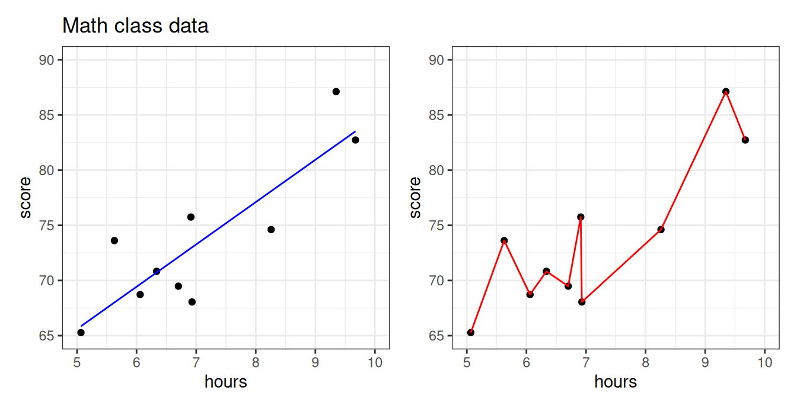
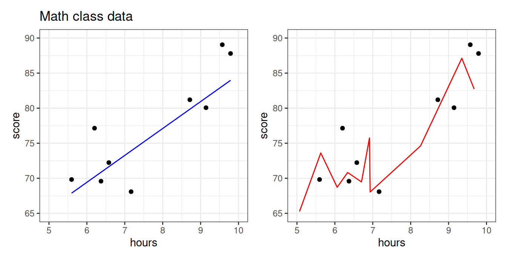
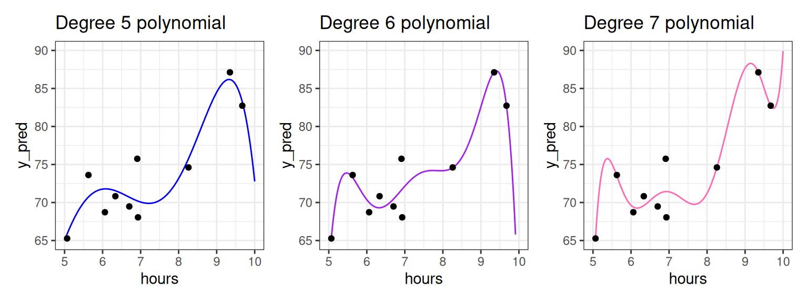
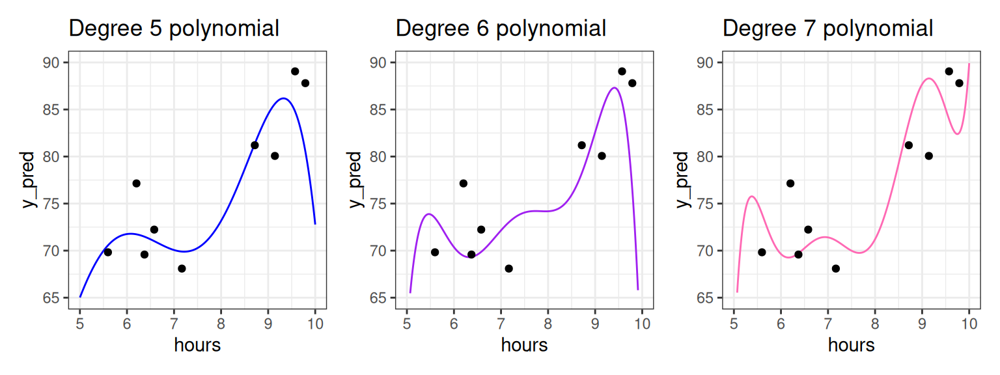
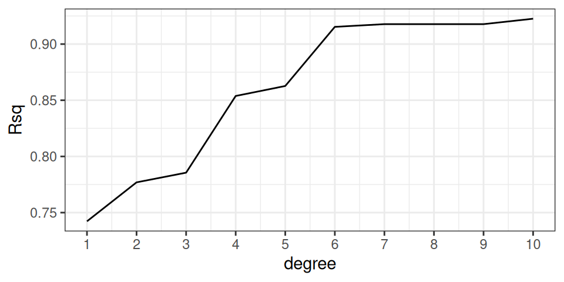

<div class="lecture-notes-content">

## 1. Giới thiệu: Sự nguy hiểm khi học vẹt dữ liệu

Khi xây dựng một mô hình dự báo, mục tiêu tối thượng của chúng ta không phải là giải thích hoàn hảo những gì đã xảy ra trong quá khứ, mà là **dự báo chính xác những quan sát mới chưa từng xuất hiện**. Một mô hình ghi nhớ từng chi tiết vụn vặt của dữ liệu quan sát được thường thất bại thảm hại khi đối mặt với thực tế mới.

Hãy quan sát dữ liệu thực nghiệm về mối liên hệ giữa số giờ tự học mỗi tuần ($x$) và điểm số bài thi toán ($y$) của sinh viên. Cả hai biểu đồ dưới đây đều biểu diễn cùng một tập dữ liệu gồm $10$ sinh viên, nhưng áp dụng hai mô hình dự báo hoàn toàn khác biệt:



*Hình 26.1: Dữ liệu điểm thi toán theo số giờ ôn tập. Đường màu xanh là mô hình hồi quy tuyến tính đơn giản; đường màu đỏ là mô hình đa thức bậc cao lượn sóng uốn éo qua từng điểm dữ liệu.*

Quan sát Hình 26.1 và đặt ra các câu hỏi bản chất sau:

1. **Tính hợp lý thực tế**: Liệu có hợp lý khi một sinh viên học $6.7$ giờ đạt điểm rất cao, nhưng học $6.8$ giờ điểm số lại tụt dốc thẳng đứng?
2. **Quy luật tự nhiên**: Liệu việc học thêm thời gian có khiến điểm thi suy giảm nghiêm trọng như các hõm sâu của đường cong màu đỏ không?

Rõ ràng, mô hình màu xanh mang tính thực tế và vững chắc hơn: Thời gian học nhiều hơn nhìn chung đem lại điểm thi cao hơn một cách nhất quán. Ngược lại, đường cong màu đỏ dường như đã **"quá nghiêm túc"** với từng điểm dữ liệu cá biệt. Nó cố gắng uốn lượn để đi qua chính xác từng điểm mẫu, vô tình hấp thụ cả những nhiễu ngẫu nhiên vốn không mang tính quy luật.

Hậu quả của sự khác biệt này lộ rõ khi chúng ta tiếp nhận thêm một nhóm sinh viên mới từ cùng khóa học và dùng cả hai mô hình để dự báo điểm số của họ:



*Hình 26.2: Các điểm màu đỏ biểu thị nhóm sinh viên mới (chưa từng được dùng để khớp mô hình). Đường xanh vẫn bám sát xu hướng chung rất tốt, trong khi đường đỏ mắc sai số khổng lồ.*

Đường màu xanh chứng minh khả năng tổng quát hóa xuất sắc: Dù chưa từng nhìn thấy nhóm sinh viên mới, nó vẫn đưa ra các dự báo xấp xỉ rất sát. Trái lại, mô hình màu đỏ hoàn toàn bất lực. Vì quá phụ thuộc vào từng tọa độ của nhóm sinh viên đầu tiên, nó hoàn toàn mất phương hướng khi các điểm dữ liệu mới chỉ cần lệch đi một chút.

Trong khoa học dữ liệu và thống kê học, ta kết luận rằng mô hình màu đỏ đã bị **quá khớp (Overfitting)**.

::: info ĐỊNH NGHĨA HỌC THUẬT: HIỆN TƯỢNG QUÁ KHỚP (OVERFITTING)
**Hiện tượng quá khớp (Overfitting)** là trạng thái khi một mô hình dự báo hoạt động cực kỳ chính xác trên tập dữ liệu được dùng để huấn luyện (ước lượng tham số), nhưng lại đưa ra dự báo rất tồi trên dữ liệu mới chưa từng thấy.
:::

---

## 2. Quá khớp với hàm đa thức bậc cao

Nguyên nhân phổ biến nhất dẫn đến hiện tượng quá khớp là việc áp dụng một mô hình có độ phức tạp quá lớn so với dung lượng và cấu trúc thực tế của dữ liệu.

Mô hình màu đỏ ở trên được tạo ra bằng cách khớp một đa thức bậc cao. Hàm đa thức có tính linh hoạt rất lớn: Bậc của đa thức càng cao thì đường cong càng có nhiều điểm uốn, cho phép nó vặn xoắn phức tạp để đi qua các điểm dữ liệu.

Hãy quan sát quá trình tăng dần bậc đa thức từ bậc 1 (tuyến tính) lên bậc 3, bậc 5 và bậc 7:



*Hình 26.3: Độ uốn lượn của đường hồi quy tăng dần theo bậc đa thức trên tập dữ liệu ban đầu.*

Khi bậc đa thức càng cao, đường cong càng áp sát từng điểm dữ liệu. Nếu xét theo hệ số xác định $R^2$ trên tập dữ liệu huấn luyện này:
- Mô hình bậc 7 sẽ có giá trị $R^2$ cao hơn mô hình bậc 5 và bậc 3.
- Một đa thức bậc $(n-1)$ đi qua trọn vẹn $n$ điểm dữ liệu phân biệt sẽ có $R^2 = 1$ tuyệt đối (nội suy hoàn hảo).

Do đó, nếu chỉ nhìn vào $R^2$ trên tập dữ liệu hiện có, người phân tích thiếu kinh nghiệm sẽ vội vàng kết luận rằng mô hình bậc 7 là mô hình tốt nhất!

Bây giờ, hãy thử nghiệm năng lực dự báo của cả 3 mô hình này trên nhóm sinh viên mới chưa từng nhìn thấy:



*Hình 26.4: Thử thách trên tập dữ liệu mới. Bậc đa thức càng cao, sai số dự báo trên dữ liệu mới càng bùng nổ dữ dội.*

Kết quả trên Hình 26.4 cho thấy một sự thật phũ phàng:
- Đối với sinh viên học khoảng $5.5$ giờ, mô hình bậc 3 và bậc 5 đưa ra dự báo khá hợp lý.
- Mô hình bậc 7 lại bị võng sâu xuống dưới và dự báo sai lệch nghiêm trọng.
- Mô hình màu đỏ uốn lượn dữ dội ở Hình 26.1 thực chất là một đa thức bậc 20. Sai số của nó trên tập dữ liệu mới lớn tới mức không thể chấp nhận được.

---

## 3. Nghịch lý hệ số xác định $R^2$ trên tập huấn luyện

Biểu đồ dưới đây thể hiện giá trị $R^2$ của các mô hình đa thức theo bậc đa thức tăng dần:



*Hình 26.5: Hệ số $R^2$ trên tập dữ liệu huấn luyện tăng đơn điệu theo bậc đa thức.*

Đồ thị trên chỉ ra một quy luật toán học tất yếu: **Hệ số $R^2$ trên tập dữ liệu dùng để khớp mô hình luôn luôn tăng (hoặc giữ nguyên) khi độ phức tạp của mô hình tăng lên**.

Nguyên nhân toán học nằm ở bài toán tối ưu bình phương bé nhất: Không gian tham số của đa thức bậc cao luôn bao hàm toàn bộ không gian tham số của đa thức bậc thấp hơn. Do đó, tổng bình phương phần dư $\text{RSS}_{\text{train}}$ bắt buộc phải giảm hoặc giữ nguyên:

$$
\begin{aligned}
&\text{RSS}_{\text{train}}(\text{Bậc } d+1) \le \text{RSS}_{\text{train}}(\text{Bậc } d)\\
&\implies R^2_{\text{train}}(\text{Bậc } d+1) \ge R^2_{\text{train}}(\text{Bậc } d)
\end{aligned}
$$

Điều này dẫn đến một nghịch lý nguy hiểm: Mô hình có $R^2$ cao nhất trên tập dữ liệu sẵn có lại là mô hình dự báo kém nhất trên thực tế.

Hơn nữa, quan sát Hình 26.5 ta thấy: Sau bậc 3, giá trị $R^2$ hầu như tăng rất ít. Lượng tăng thêm nhỏ bé này không phản ánh năng lực dự báo quy luật thực tế, mà chỉ phản ánh việc mô hình đang "cố học vẹt" những sai số ngẫu nhiên của mẫu dữ liệu cụ thể.

Vậy phải chăng chúng ta nên từ bỏ việc đánh giá mô hình? Không. Thay vào đó, chúng ta cần thay đổi căn bản quy trình làm việc.

---

## 4. Quy trình Huấn luyện và Kiểm thử (Train-Test Split)

Để ngăn chặn hiện tượng quá khớp, nguyên tắc vàng trong học máy và thống kê dự báo là:

::: tip NGUYÊN TẮC VÀNG VỀ ĐÁNH GIÁ MÔ HÌNH
**Tuyệt đối không bao giờ ước lượng hệ số mô hình và đánh giá năng lực dự báo của mô hình trên cùng một tập dữ liệu.**
:::

Thay vì dồn toàn bộ dữ liệu vào việc khớp mô hình, chúng ta chủ động chia tập dữ liệu thành hai tập con tách biệt hoàn toàn:

1. **Tập huấn luyện (Training Set)**: Tập hợp các quan sát được dùng để khớp mô hình (ước lượng các hệ số hồi quy $b_0, b_1, \dots$).
2. **Tập kiểm thử (Testing Set)**: Tập hợp các quan sát hoàn toàn độc lập, được giữ kín trong suốt quá trình xây dựng mô hình, và chỉ được mang ra để đánh giá sai số dự báo thực tế.

Sơ đồ phân chia ngẫu nhiên $80\% - 20\%$ trên một bảng dữ liệu gồm $10$ quan sát và $3$ biến dự báo được minh họa cụ thể dưới đây:

| Thứ tự | $y$ (Điểm thi) | $x_1$ (Giờ học) | $x_2$ (Số bài tập) | $x_3$ (Điểm danh) | Phân bổ tập dữ liệu |
| :---: | :---: | :---: | :---: | :---: | :---: |
| 1 | 78 | 4.2 | 12 | 0.95 | **Tập huấn luyện (Train)** |
| 2 | 62 | 2.5 | 8 | 0.80 | **Tập kiểm thử (Test)** |
| 3 | 85 | 5.8 | 15 | 1.00 | **Tập huấn luyện (Train)** |
| 4 | 91 | 7.1 | 18 | 0.90 | **Tập huấn luyện (Train)** |
| 5 | 74 | 3.9 | 11 | 0.85 | **Tập huấn luyện (Train)** |
| 6 | 69 | 3.1 | 9 | 0.75 | **Tập kiểm thử (Test)** |
| 7 | 88 | 6.4 | 16 | 0.95 | **Tập huấn luyện (Train)** |
| 8 | 82 | 5.0 | 14 | 0.90 | **Tập huấn luyện (Train)** |
| 9 | 95 | 8.2 | 20 | 1.00 | **Tập huấn luyện (Train)** |
| 10 | 70 | 3.5 | 10 | 0.85 | **Tập huấn luyện (Train)** |

*Bảng 26.1: Minh họa phân chia tập dữ liệu theo tỷ lệ 8:2. Tám quan sát được phân bổ vào tập Train để huấn luyện hệ số; hai quan sát được giữ lại làm tập Test.*

### Các nguyên tắc phân chia dữ liệu thực nghiệm:
- **Tỷ lệ phân chia thông dụng**: Thông thường là $80\% - 20\%$ hoặc $70\% - 30\%$. Với các tập dữ liệu lớn hàng trăm nghìn dòng, tỷ lệ tập test có thể chỉ cần $10\%$ hoặc thậm chí $5\%$.
- **Lấy mẫu ngẫu nhiên (Randomization)**: Việc phân chia bắt buộc phải thực hiện ngẫu nhiên để đảm bảo phân phối của các biến dự báo và biến mục tiêu ở hai tập là đồng nhất, tránh tình trạng tập test bị lệch một cách có hệ thống.
- **Tính độc lập nghiêm ngặt**: Không để bất kỳ thông tin nào của tập test lọt vào quá trình huấn luyện (tránh hiện tượng Rò rỉ dữ liệu - Data Leakage).

---

## 5. Thước đo sai số: MSE và RMSE

Hệ số $R^2$ là một chỉ số thuận tiện trong hồi quy tuyến tính, nhưng nó có hạn chế là mang tính tương đối và phụ thuộc vào phương sai toàn phần của mẫu. Để đánh giá sai số dự báo trực tiếp trên tập kiểm thử, các nhà khoa học dữ liệu sử dụng **Sai số toàn phương trung bình (Mean Squared Error - MSE)**.

Gọi $y_i$ là giá trị thực tế của biến mục tiêu trong tập kiểm thử gồm $n_{\text{test}}$ quan sát, và $\hat{y}_i$ là giá trị do mô hình dự báo tương ứng:

$$
\text{MSE}_{\text{test}} = \frac{1}{n_{\text{test}}} \sum_{i=1}^{n_{\text{test}}} (y_i - \hat{y}_i)^2
$$

Đối với mô hình hồi quy bình phương bé nhất, MSE chính là tổng bình phương phần dư chia cho số quan sát:

$$
\text{MSE} = \frac{\text{RSS}}{n}
$$

### Căn bậc hai sai số toàn phương trung bình (RMSE)
Vì MSE tính theo bình phương sai số, đơn vị đo lường của nó bị lũy thừa hai (ví dụ: $\text{điểm}^2$ hoặc $\text{USD}^2$), gây khó khăn cho việc giải thích trực giác.

Do đó, người ta sử dụng **RMSE (Root Mean Squared Error)** bằng cách lấy căn bậc hai của MSE:

$$
\text{RMSE} = \sqrt{\text{MSE}} = \sqrt{\frac{1}{n} \sum_{i=1}^n (y_i - \hat{y}_i)^2}
$$

Tương tự như mối quan hệ giữa độ lệch chuẩn và phương sai, RMSE đưa sai số về cùng đơn vị đo lường tự nhiên của biến mục tiêu ban đầu. Ví dụ: Nếu $\text{RMSE} = 3.5\text{ điểm}$, ta có thể hiểu trực giác rằng các dự báo của mô hình trung bình lệch khoảng $3.5$ điểm so với kết quả thi thực tế.

---

## 6. Đánh đổi Độ chệch - Phương sai (Bias - Variance Tradeoff)

Bản chất sâu xa của hiện tượng quá khớp được giải thích thông qua **sự đánh đổi giữa Độ chệch và Phương sai** trong lý thuyết học thống kê.

Sai số dự báo kỳ vọng trên một điểm dữ liệu mới $x_0$ với giá trị thực tế $y_0 = f(x_0) + \epsilon$ (với sai số ngẫu nhiên $\epsilon \sim (0, \sigma^2)$) có thể phân rã thành ba thành phần độc lập:

$$
\begin{aligned}
&\mathbb{E}\left[(y_0 - \hat{f}(x_0))^2\right] \\
&\quad = \underbrace{\left[\text{Bias}(\hat{f}(x_0))\right]^2}_{\text{Độ chệch bình phương}} + \underbrace{\text{Var}(\hat{f}(x_0))}_{\text{Phương sai mô hình}} + \underbrace{\sigma^2}_{\text{Nhiễu không thể giảm}}
\end{aligned}
$$

Trong đó:
- **Độ chệch (Bias)**: Sai số hệ thống bắt nguồn từ việc mô hình quá đơn giản, không đủ sức nắm bắt quy luật bản chất của thực tế (gây ra **chưa khớp - Underfitting**).
- **Phương sai (Variance)**: Mức độ nhạy cảm của mô hình đối với những biến động ngẫu nhiên trong tập huấn luyện. Mô hình có phương sai cao sẽ thay đổi dữ dội khi được huấn luyện trên một mẫu dữ liệu khác (gây ra **quá khớp - Overfitting**).
- **Nhiễu bất khả quy ($\sigma^2$)**: Sai số ngẫu nhiên nội tại của hiện tượng tự nhiên, không một mô hình toán học nào có thể xóa bỏ.

```
Sai số
  ^
  |        Sai số trên tập kiểm thử (Test Error)
  |           \                     /
  |            \    Điểm tối ưu    /
  |             \      (V)        /   <-- Quá khớp (Overfitting)
  |              \_______________/        (Variance cao)
  |              /               \
  |  Chưa khớp  /                 \
  |  (Bias cao)/                   \-- Sai số tập huấn luyện (Train Error)
  +---------------------------------------------------->
               Mô hình đơn giản       Mô hình phức tạp
```

*Sơ đồ 26.1: Sự đánh đổi giữa độ chệch và phương sai. Điểm cân bằng tối ưu đạt được khi tổng sai số trên tập kiểm thử là nhỏ nhất.*

---

## 7. Cạm bẫy Rò rỉ dữ liệu (Data Leakage)

Một sai sót thường gặp trong các dự án phân tích dữ liệu thực tế là **rò rỉ dữ liệu (Data Leakage)**: Thông tin từ tập kiểm thử vô tình bị rò rỉ vào quá trình huấn luyện mô hình.

### Các dạng rò rỉ dữ liệu kinh điển:
1. **Chuẩn hóa dữ liệu trước khi phân chia**: Tính giá trị trung bình $\bar{x}$ và độ lệch chuẩn $s_x$ trên toàn bộ tập dữ liệu rồi mới chia train/test. Khi đó, mô hình trong tập train đã gián tiếp "biết trước" phân phối của tập test.
2. **Chọn lọc biến dự báo trên toàn bộ mẫu**: Sử dụng kiểm định tương quan hoặc phân tích hồi quy trên toàn bộ dữ liệu để chọn ra các biến có $p$-value nhỏ, sau đó mới chia train/test.
3. **Dữ liệu chuỗi thời gian phân chia ngẫu nhiên**: Trong dữ liệu tài chính hoặc thời tiết, nếu chia ngẫu nhiên thay vì cắt theo mốc thời gian, mô hình sẽ dùng dữ liệu của "ngày mai" để dự báo giá của "hôm nay".

::: important QUY TRÌNH CHUẨN ĐỂ TRÁNH RÒ RỈ DỮ LIỆU
Mọi bước tiền xử lý dữ liệu (tính trung bình, điền khuyết, co giãn thang đo, chọn biến) chỉ được phép học tham số từ **tập huấn luyện (Training Set)**, sau đó áp dụng chính xác các tham số này lên **tập kiểm thử (Testing Set)**.
:::

---

## 8. Hướng dẫn thực hành: R và Python

### Triển khai quy trình Train-Test trong R

```r
library(tidyverse)

# 1. Đọc dữ liệu và cố định hạt giống ngẫu nhiên
set.seed(42)

# 2. Phân chia tập dữ liệu ngẫu nhiên tỷ lệ 80 - 20
data_split <- math_data %>%
  mutate(id = row_number())

train_data <- data_split %>%
  slice_sample(prop = 0.8)

test_data <- data_split %>%
  anti_join(train_data, by = "id")

# 3. Khớp mô hình trên tập huấn luyện
model_simple <- lm(score ~ hours, data = train_data)
model_poly   <- lm(score ~ poly(hours, degree = 7, raw = TRUE), data = train_data)

# 4. Dự báo trên tập kiểm thử
predictions <- test_data %>%
  mutate(
    pred_simple = predict(model_simple, newdata = test_data),
    pred_poly   = predict(model_poly, newdata = test_data)
  )

# 5. Đánh giá RMSE trên tập kiểm thử
metrics <- predictions %>%
  summarize(
    rmse_simple = sqrt(mean((score - pred_simple)^2)),
    rmse_poly   = sqrt(mean((score - pred_poly)^2))
  )

print(metrics)
```

### Triển khai quy trình Train-Test trong Python

```python
import numpy as np
import pandas as pd
from sklearn.model_selection import train_test_split
from sklearn.linear_model import LinearRegression
from sklearn.preprocessing import PolynomialFeatures
from sklearn.metrics import mean_squared_error

# 1. Phân chia tập dữ liệu 80/20
X_train, X_test, y_train, y_test = train_test_split(
    X, y, test_size=0.2, random_state=42
)

# 2. Khớp mô hình hồi quy tuyến tính đơn giản
lin_reg = LinearRegression().fit(X_train, y_train)
y_pred_lin = lin_reg.predict(X_test)

# 3. Khớp mô hình đa thức bậc 7
poly = PolynomialFeatures(degree=7)
X_train_poly = poly.fit_transform(X_train)
X_test_poly = poly.transform(X_test)  # Chỉ áp dụng transform trên tập kiểm thử

poly_reg = LinearRegression().fit(X_train_poly, y_train)
y_pred_poly = poly_reg.predict(X_test_poly)

# 4. Đánh giá RMSE
rmse_lin = np.sqrt(mean_squared_error(y_test, y_pred_lin))
rmse_poly = np.sqrt(mean_squared_error(y_test, y_pred_poly))

print(f"RMSE Tuyến tính: {rmse_lin:.4f}")
print(f"RMSE Đa thức bậc 7: {rmse_poly:.4f}")
```

---

## 9. Tóm tắt bài học

1. **Bản chất của hiện tượng quá khớp**: Xảy ra khi mô hình quá phức tạp, học thuộc lòng các nhiễu ngẫu nhiên trong dữ liệu mẫu khiến năng lực dự báo trên dữ liệu thực tế bị phá hủy.
2. **Quy luật $R^2$ đơn điệu**: Hệ số xác định $R^2$ trên tập huấn luyện luôn tăng khi thêm biến hoặc tăng bậc đa thức, do đó nó không thể phản ánh chất lượng dự báo thực tế.
3. **Quy trình phân chia Train/Test**: Huấn luyện hệ số mô hình trên tập huấn luyện và chỉ đánh giá năng lực dự báo trên tập kiểm thử độc lập.
4. **Thước đo MSE và RMSE**: Cung cấp thước đo định lượng khách quan về độ lệch trung bình giữa giá trị dự báo và thực tế trên cùng một thang đo đơn vị.
5. **Cân bằng Bias-Variance**: Mục tiêu cốt lõi của người làm dữ liệu là tìm ra điểm cân bằng tối ưu giữa độ chệch và phương sai nhằm cực tiểu hóa tổng sai số trên tập kiểm thử.

---

## Tài liệu tham khảo

1. James, G., Witten, D., Hastie, T., & Tibshirani, R. (2021). *An Introduction to Statistical Learning: with Applications in R* (2nd ed.). Springer.
2. Stoyanov, N., & Adhikari, A. (2026). *Understanding the World with Data: Overfitting and Validation*. UC Berkeley STAT 20 Course Notes.
3. Hastie, T., Tibshirani, R., & Friedman, J. (2009). *The Elements of Statistical Learning: Data Mining, Inference, and Prediction* (2nd ed.). Springer.

</div>

<div class="lecture-exercises-content">

## Bài tập tự luyện có lời giải chi tiết

### Bài tập 1: Tính toán định lượng sai số MSE và RMSE giữa hai mô hình

Một nhà nghiên cứu thu thập dữ liệu về số giờ ôn tập ($x$) và điểm thi ($y$). Dữ liệu được phân chia thành hai tập như sau:

- **Tập huấn luyện (Training Set)** gồm 4 quan sát:
  $$(1.0, 3.0), \quad (2.0, 4.0), \quad (3.0, 7.0), \quad (4.0, 8.0)$$
- **Tập kiểm thử (Testing Set)** gồm 2 quan sát độc lập:
  $$(0.5, 2.0), \quad (4.5, 9.0)$$

Nhà nghiên cứu xem xét hai mô hình dự báo sau:
- **Mô hình 1 (Tuyến tính OLS)**: Phương trình dự báo là $\hat{y} = 1.8x + 1.0$.
- **Mô hình 2 (Đa thức bậc 3 nội suy)**: Phương trình dự báo là:
  $$\hat{y} = -\frac{2}{3}x^3 + 5x^2 - \frac{28}{3}x + 8$$

**Yêu cầu:**
1. Tính $\text{MSE}_{\text{train}}$ cho cả Mô hình 1 và Mô hình 2 trên tập huấn luyện. Mô hình nào khớp tốt hơn trên dữ liệu huấn luyện?
2. Tính $\text{MSE}_{\text{test}}$ và $\text{RMSE}_{\text{test}}$ cho cả hai mô hình trên tập kiểm thử.
3. Phân tích hiện tượng quá khớp được thể hiện qua các con số định lượng trên.

::: details Lời giải chi tiết
**Bước 1: Tính toán sai số trên tập huấn luyện**

Với **Mô hình 1** ($\hat{y} = 1.8x + 1.0$):
- Tại $x_1 = 1.0$: $\hat{y}_1 = 2.8$, phần dư $e_1 = 3.0 - 2.8 = 0.2 \implies e_1^2 = 0.04$.
- Tại $x_2 = 2.0$: $\hat{y}_2 = 4.6$, phần dư $e_2 = 4.0 - 4.6 = -0.6 \implies e_2^2 = 0.36$.
- Tại $x_3 = 3.0$: $\hat{y}_3 = 6.4$, phần dư $e_3 = 7.0 - 6.4 = 0.6 \implies e_3^2 = 0.36$.
- Tại $x_4 = 4.0$: $\hat{y}_4 = 8.2$, phần dư $e_4 = 8.0 - 8.2 = -0.2 \implies e_4^2 = 0.04$.

Tổng bình phương phần dư và sai số trung bình tập huấn luyện:
$$
\begin{aligned}
    &\text{RSS}_{\text{train}} = 0.04 + 0.36 + 0.36 + 0.04 = 0.80\\
    &\text{MSE}_{\text{train}}(\text{Mô hình 1}) = \frac{0.80}{4} = 0.20
\end{aligned}
$$

Với **Mô hình 2** ($\hat{y} = -\frac{2}{3}x^3 + 5x^2 - \frac{28}{3}x + 8$):
- Tại $x_1 = 1.0$: $\hat{y}_1 = 3.0 \implies e_1 = 0$.
- Tại $x_2 = 2.0$: $\hat{y}_2 = 4.0 \implies e_2 = 0$.
- Tại $x_3 = 3.0$: $\hat{y}_3 = 7.0 \implies e_3 = 0$.
- Tại $x_4 = 4.0$: $\hat{y}_4 = 8.0 \implies e_4 = 0$.

Vì đa thức bậc 3 đi qua chính xác cả 4 điểm dữ liệu huấn luyện, ta có:
$$
\text{MSE}_{\text{train}}(\text{Mô hình 2}) = 0.00
$$

Trên tập huấn luyện, Mô hình 2 khớp hoàn hảo tuyệt đối ($100\%$).

**Bước 2: Đánh giá trên tập kiểm thử**

Tập kiểm thử gồm hai quan sát mới: $(0.5, 2.0)$ và $(4.5, 9.0)$.

Với **Mô hình 1** ($\hat{y} = 1.8x + 1.0$):
- Tại $x = 0.5$: $\hat{y} = 1.8(0.5) + 1.0 = 1.9$.
  Phần dư: $e_{\text{test}, 1} = 0.1 \implies e^2 = 0.01$.
- Tại $x = 4.5$: $\hat{y} = 1.8(4.5) + 1.0 = 9.1$.
  Phần dư: $e_{\text{test}, 2} = -0.1 \implies e^2 = 0.01$.

Sai số kiểm thử của Mô hình 1:
$$
\begin{aligned}
    &\text{MSE}_{\text{test}}(\text{Mô hình 1}) = \frac{0.01 + 0.01}{2} = 0.01\\
    &\text{RMSE}_{\text{test}}(\text{Mô hình 1}) = \sqrt{0.01} = 0.10
\end{aligned}
$$

Với **Mô hình 2** (Đa thức bậc 3):
- Tại $x = 0.5$:
  $$
  \hat{y} = -\frac{2}{3}(0.125) + 5(0.25) - \frac{28}{3}(0.5) + 8 = 4.5
  $$
  Phần dư: $e_{\text{test}, 1} = -2.5 \implies e^2 = 6.25$.
- Tại $x = 4.5$:
  $$
  \hat{y} = -\frac{2}{3}(91.125) + 5(20.25) - \frac{28}{3}(4.5) + 8 = 6.5
  $$
  Phần dư: $e_{\text{test}, 2} = 2.5 \implies e^2 = 6.25$.

Sai số kiểm thử của Mô hình 2:
$$
\begin{aligned}
    &\text{MSE}_{\text{test}}(\text{Mô hình 2}) = \frac{6.25 + 6.25}{2} = 6.25\\
    &\text{RMSE}_{\text{test}}(\text{Mô hình 2}) = \sqrt{6.25} = 2.50
\end{aligned}
$$

**Bước 3: Nhận xét và kết luận bản chất**

Bảng so sánh tổng hợp:

| Chỉ số đánh giá | Mô hình 1 (Tuyến tính) | Mô hình 2 (Đa thức bậc cao) |
| :--- | :---: | :---: |
| $\text{MSE}_{\text{train}}$ | $0.20$ | $\mathbf{0.00}$ |
| $\text{MSE}_{\text{test}}$ | $\mathbf{0.01}$ | $6.25$ |
| $\text{RMSE}_{\text{test}}$ | $\mathbf{0.10}$ | $2.50$ |

**Kết luận**:
- Trên tập huấn luyện, Mô hình 2 đạt sai số bằng $0$, tạo ấn tượng rằng đây là mô hình hoàn hảo.
- Tuy nhiên trên tập kiểm thử, sai số của Mô hình 2 bùng nổ gấp $625$ lần so với Mô hình 1 ($\text{MSE}$ tăng từ $0.01$ lên $6.25$).
- Độ lệch dự báo trung bình ($\text{RMSE}$) của mô hình đa thức lên tới $2.50$, trong khi mô hình tuyến tính chỉ lệch $0.10$.
- Đây là minh chứng định lượng sinh động cho hiện tượng quá khớp: Mô hình quá linh hoạt đã ghi nhớ cả những dao động ngẫu nhiên thay vì học quy luật tổng quát.
:::

---

### Bài tập 2: Phân tích sự đánh đổi Độ chệch - Phương sai và Hành vi của sai số

Một kỹ sư dữ liệu huấn luyện $5$ mô hình hồi quy với độ phức tạp tăng dần (từ mô hình tuyến tính đơn giản đến các đa thức bậc $2, 4, 8, 16$) trên cùng một tập dữ liệu $1000$ mẫu. Kỹ sư ghi nhận sai số $\text{RMSE}_{\text{train}}$ và $\text{RMSE}_{\text{test}}$ thu được trong bảng sau:

| Mô hình | Bậc đa thức | $\text{RMSE}_{\text{train}}$ | $\text{RMSE}_{\text{test}}$ |
| :---: | :---: | :---: | :---: |
| M1 | 1 | 8.42 | 8.56 |
| M2 | 2 | 5.21 | 5.34 |
| M3 | 4 | 4.85 | 4.98 |
| M4 | 8 | 3.12 | 6.87 |
| M5 | 16 | 1.05 | 15.42 |

**Yêu cầu:**
1. Hãy xác định mô hình nào đang bị **chưa khớp (Underfitting)** và mô hình nào đang bị **quá khớp (Overfitting)**.
2. Mô hình nào là lựa chọn tối ưu nhất để triển khai dự báo trong thực tế? Giải thích căn cứ quyết định.
3. Giải thích biến thiên của thành phần Độ chệch (Bias) và Phương sai (Variance) khi chuyển dịch từ mô hình M1 đến M5.

::: details Lời giải chi tiết
**Bước 1: Nhận diện hiện tượng chưa khớp và quá khớp**

1. **Hiện tượng chưa khớp (Underfitting)**:
   - Thể hiện rõ nhất ở **Mô hình M1**: Cả sai số huấn luyện ($\text{RMSE}_{\text{train}} = 8.42$) và sai số kiểm thử ($\text{RMSE}_{\text{test}} = 8.56$) đều ở mức rất cao so với các mô hình bậc 2 và bậc 4.
   - Nguyên nhân: Giả định tuyến tính quá cứng nhắc, không đủ linh hoạt để mô tả độ cong phi tuyến của hiện tượng thực tế.

2. **Hiện tượng quá khớp (Overfitting)**:
   - Bắt đầu xuất hiện ở **Mô hình M4** và bùng phát nghiêm trọng ở **Mô hình M5**.
   - Ở M5, $\text{RMSE}_{\text{train}}$ giảm sâu xuống $1.05$ (khớp rất sát dữ liệu mẫu), nhưng $\text{RMSE}_{\text{test}}$ lại vọt lên $15.42$ (gấp gần 15 lần sai số huấn luyện).
   - Khoảng chênh lệch lớn giữa $\text{RMSE}_{\text{test}}$ và $\text{RMSE}_{\text{train}}$ là dấu hiệu nhận biết đặc trưng của việc mô hình học vẹt nhiễu ngẫu nhiên.

**Bước 2: Lựa chọn mô hình tối ưu**

Mô hình tối ưu nhất để triển khai là **Mô hình M3 (Bậc 4)**:
- Tiêu chí lựa chọn mô hình dự báo luôn là **cực tiểu hóa sai số trên tập kiểm thử** ($\text{RMSE}_{\text{test}}$ thấp nhất).
- Mô hình M3 đạt $\text{RMSE}_{\text{test}} = 4.98$, là mức sai số kiểm thử thấp nhất trong tất cả các mô hình.
- Đồng thời, độ chênh lệch giữa sai số kiểm thử và sai số huấn luyện của M3 rất nhỏ ($4.98 - 4.85 = 0.13$), chứng tỏ mô hình có tính ổn định và năng lực tổng quát hóa cao.

**Bước 3: Phân tích sự đánh đổi Độ chệch - Phương sai**

- **Từ M1 đến M3 (Tăng độ phức tạp hợp lý)**:
  - Độ chệch (Bias) giảm mạnh nhờ mô hình linh hoạt hơn, cho phép bám sát quy luật phi tuyến tiềm ẩn.
  - Phương sai (Variance) tăng nhẹ nhưng vẫn nằm trong tầm kiểm soát.
  - Kết quả: Tổng sai số dự báo trên tập kiểm thử giảm đều từ $8.56$ xuống $4.98$.
- **Từ M3 đến M5 (Độ phức tạp vượt ngưỡng tối ưu)**:
  - Độ chệch tiếp tục giảm nhẹ (thể hiện qua $\text{RMSE}_{\text{train}}$ tiếp tục hạ xuống $1.05$).
  - Tuy nhiên, Phương sai tăng bùng nổ vì các hệ số đa thức bậc cao cực kỳ nhạy cảm với các điểm dữ liệu cá biệt.
  - Kết quả: Sự gia tăng phương sai lấn át hoàn toàn mức giảm độ chệch, khiến tổng sai số kiểm thử tăng vọt từ $4.98$ lên $15.42$. M3 chính là điểm đáy (sweet spot) của đường cong sai số kiểm thử.
:::

---

### Bài tập 3: Phát hiện lỗi rò rỉ dữ liệu (Data Leakage) và Thiết kế quy trình chuẩn

Một nhóm phân tích xây dựng mô hình dự báo giá nhà đất dựa trên diện tích, số phòng và khoảng cách tới trung tâm. Quy trình thực hiện của nhóm như sau:

> *"Bước 1: Chúng tôi tính giá trị trung bình $\mu$ và độ lệch chuẩn $\sigma$ của biến diện tích trên toàn bộ 10,000 căn nhà, sau đó chuẩn hóa biến diện tích về thang đo chuẩn $z = \frac{x - \mu}{\sigma}$.*  
> *Bước 2: Chúng tôi loại bỏ các quan sát ngoại lai có giá nhà vượt quá 3 lần độ lệch chuẩn tính trên toàn bộ mẫu.*  
> *Bước 3: Chúng tôi chia ngẫu nhiên 10,000 quan sát đã được xử lý thành tập Train (8,000 mẫu) và tập Test (2,000 mẫu).*  
> *Bước 4: Khớp mô hình hồi quy trên tập Train và báo cáo RMSE trên tập Test."*

**Yêu cầu:**
1. Hãy chỉ ra ít nhất hai lỗi rò rỉ dữ liệu (Data Leakage) nghiêm trọng trong quy trình trên.
2. Giải thích vì sao những lỗi này làm cho kết quả đánh giá trên tập kiểm thử trở nên lạc quan thái quá (không đáng tin cậy).
3. Hãy viết lại các bước theo đúng quy trình chuẩn hóa dữ liệu chuẩn mực để loại trừ hoàn toàn rò rỉ dữ liệu.

::: details Lời giải chi tiết
**Bước 1: Nhận diện hai lỗi rò rỉ dữ liệu nghiêm trọng**

1. **Rò rỉ qua khâu chuẩn hóa thang đo (Feature Scaling Leakage)**:
   - Nhóm nghiên cứu đã tính $\mu$ và $\sigma$ trên toàn bộ $10,000$ mẫu trước khi phân chia train/test.
   - Khi đó, các giá trị của tập kiểm thử đã tham gia vào việc định hình nên giá trị trung bình $\mu$ và độ lệch chuẩn $\sigma$. Tập huấn luyện đã gián tiếp "biết trước" phân bố của tập kiểm thử.

2. **Rò rỉ qua khâu loại bỏ ngoại lai (Outlier Filtering Leakage)**:
   - Ngưỡng xác định ngoại lai được tính trên toàn thể $10,000$ mẫu. Việc loại bỏ các quan sát trên toàn bộ tập dữ liệu trước khi phân tách khiến dữ liệu tập kiểm thử bị sàng lọc phi tự nhiên.
   - Trong thực tế vận hành, dữ liệu mới xuất hiện trong tương lai không thể được "gạn lọc trước" bằng thông tin của toàn bộ quá khứ và tương lai gộp lại.

**Bước 2: Tác hại của kết quả đánh giá lạc quan thái quá**

- Khi thông tin của tập kiểm thử rò rỉ vào tập huấn luyện, mô hình được hưởng lợi thế bất công: Nó đã được "nhìn thấy" một phần bức tranh toàn cảnh của tập kiểm thử.
- Sai số $\text{RMSE}_{\text{test}}$ thu được sẽ thấp hơn thực tế một cách giả tạo. Khi mô hình được đưa vào môi trường sản xuất thực tế (nơi dữ liệu khách hàng mới hoàn toàn chưa từng được gộp chung để tính $\mu, \sigma$), sai số thực tế sẽ tăng đột biến, gây tổn thất cho việc ra quyết định.

**Bước 3: Thiết kế lại quy trình chuẩn mực**

Quy trình chuẩn mực không rò rỉ dữ liệu gồm các bước sau:

- **Bước 1: Phân tách dữ liệu ngay từ đầu**:
  Chia ngẫu nhiên toàn bộ $10,000$ quan sát thành tập Train ($8,000$ dòng) và tập Test ($2,000$ dòng). Khóa chặt tập Test, không đụng tới trong suốt các bước tiền xử lý và huấn luyện.
- **Bước 2: Học các tham số tiền xử lý DUY NHẤT trên tập Train**:
  - Tính $\mu_{\text{train}}$ và $\sigma_{\text{train}}$ của biến diện tích chỉ từ $8,000$ quan sát của tập Train.
  - Xác định ngưỡng ngoại lai và xử lý ngoại lai chỉ áp dụng đối với $8,000$ quan sát của tập Train.
- **Bước 3: Chuẩn hóa tập Train**:
  Biến đổi các biến trong tập Train bằng $\mu_{\text{train}}$ và $\sigma_{\text{train}}$:
  $$z_{\text{train}} = \frac{x_{\text{train}} - \mu_{\text{train}}}{\sigma_{\text{train}}}$$
- **Bước 4: Khớp mô hình trên tập Train đã xử lý**:
  Ước lượng các hệ số hồi quy $b_0, b_1, \dots$ hoàn toàn trên tập Train.
- **Bước 5: Áp dụng chuyển đổi và đánh giá trên tập Test**:
  - Dùng chính $\mu_{\text{train}}$ và $\sigma_{\text{train}}$ đã lưu ở Bước 2 để chuẩn hóa tập Test:
    $$z_{\text{test}} = \frac{x_{\text{test}} - \mu_{\text{train}}}{\sigma_{\text{train}}}$$
  - Đưa $z_{\text{test}}$ vào mô hình để dự báo $\hat{y}_{\text{test}}$ và tính $\text{RMSE}_{\text{test}}$.
:::

</div>
