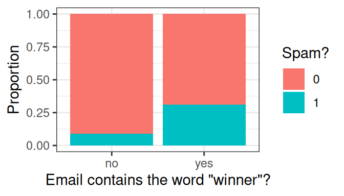
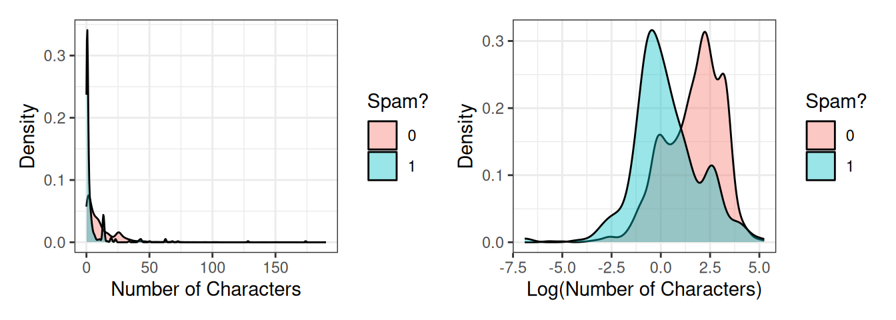
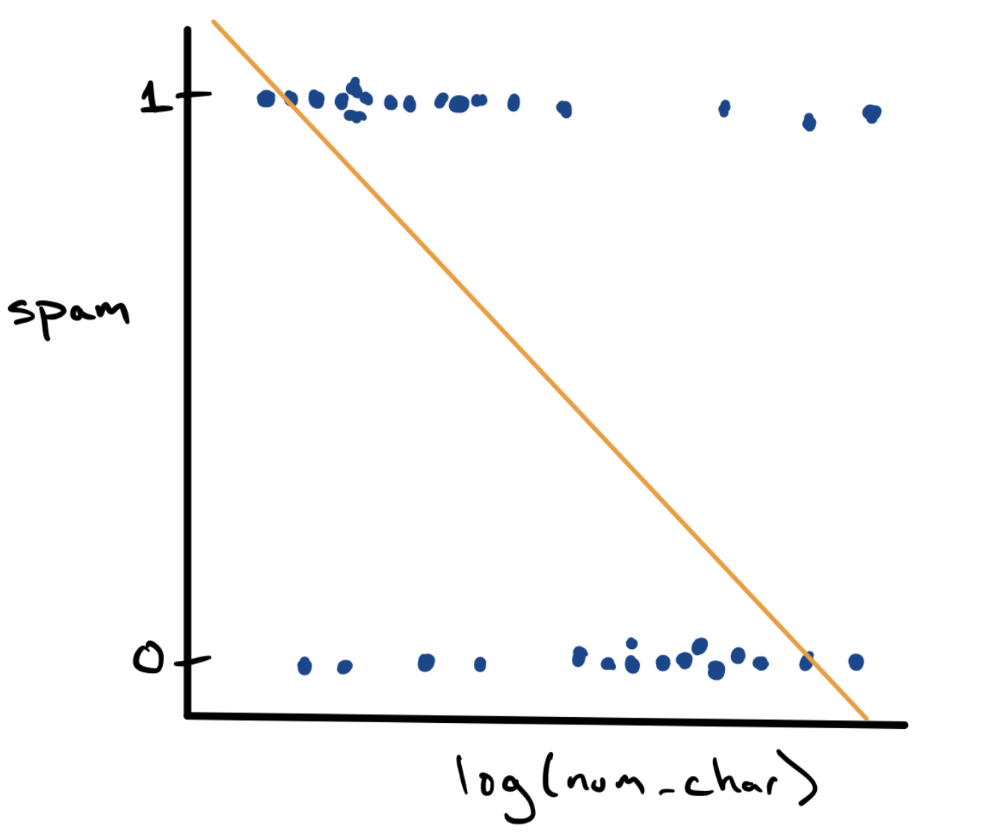
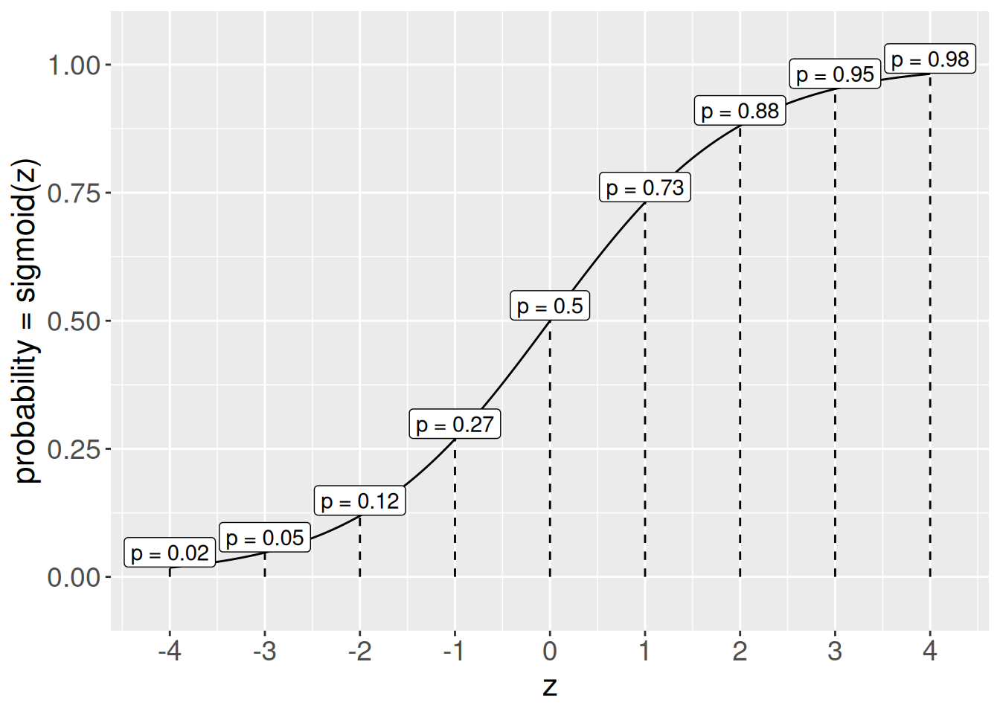
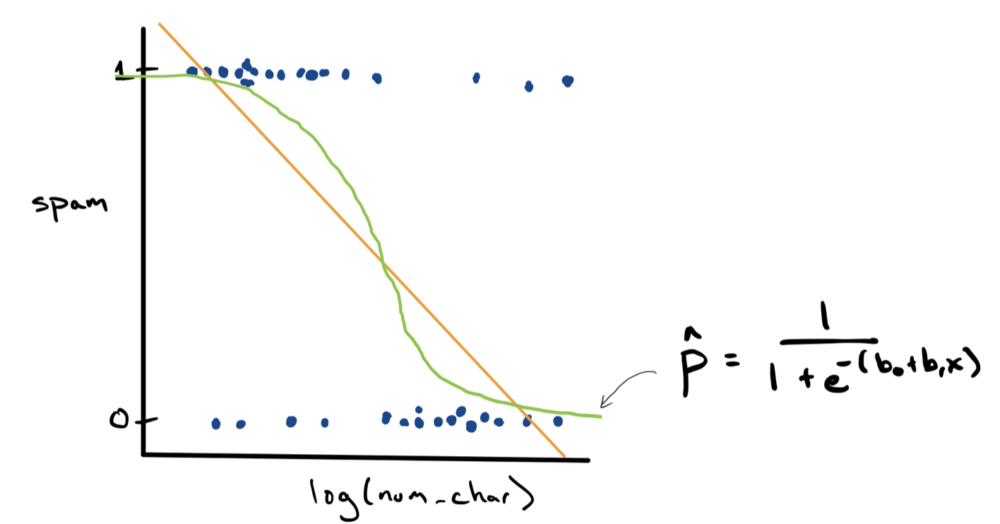

<div class="lecture-notes-content">

## 1. Giới thiệu: Từ bài toán hồi quy đến bài toán phân loại

Trong các bài giảng trước, chúng ta đã xây dựng quy trình bốn bước chuẩn mực để kiến tạo một mô hình dự báo hồi quy (Regression):

1. **Xác định dạng toán học của mô hình**: Sử dụng hàm tuyến tính kết hợp các biến đổi phi tuyến và đa thức.
2. **Lựa chọn thước đo tối ưu**: Sử dụng tổng bình phương phần dư ($\text{RSS}$), hệ số xác định ($R^2$) hoặc sai số toàn phương trung bình ($\text{MSE}$).
3. **Ước lượng tham số trên tập huấn luyện**: Tìm các hệ số $b_0, b_1, \dots$ nhằm cực tiểu hóa hàm tổn thất trên dữ liệu huấn luyện.
4. **Đánh giá năng lực dự báo trên tập kiểm thử**: Đo lường sai số $\text{RMSE}_{\text{test}}$ hoặc $R^2_{\text{test}}$ trên dữ liệu kiểm thử độc lập.

Quy trình bốn bước này là nền tảng cốt lõi của khoa học dự báo hiện đại. Tuy nhiên, trong vô số bài toán thực tế, biến mục tiêu cần dự báo không phải là một đại lượng định lượng liên tục (như giá nhà, điểm thi hay nồng độ hóa chất), mà là một **biến định tính phân loại (Categorical Response)**.

Đặc biệt phổ biến là bài toán **phân loại nhị phân (Binary Classification)**, trong đó biến mục tiêu chỉ nhận một trong hai trạng thái đối lập:
- Y khoa: Bệnh nhân có mắc bệnh hiểm nghèo hay không ($1 = \text{Dương tính}, 0 = \text{Âm tính}$).
- Tài chính: Giao dịch thẻ tín dụng là hợp lệ hay gian lận ($1 = \text{Gian lận}, 0 = \text{Hợp lệ}$).
- Tiếp thị số: Khách hàng truy cập có bấm vào đường dẫn quảng cáo hay không ($1 = \text{Bấm}, 0 = \text{Không}$).
- Công nghệ thông tin: Một bức thư điện tử gửi đến là thư rác hay thư thông thường ($1 = \text{Thư rác}, 0 = \text{Thư hợp lệ}$).

---

## 2. Bài toán thực tế: Thiết kế bộ lọc thư rác (Spam Filter)

Thư rác điện tử (Spam Email) là các thông điệp không mong muốn được gửi hàng loạt tới hộp thư của người dùng. Một bộ lọc thư rác là một cỗ máy phân loại tự động: Dựa vào các đặc trưng nội dung và siêu dữ liệu của bức thư, mô hình phải đưa ra quyết định xem thư đó có phải là thư rác hay không.

Xét tập dữ liệu thực nghiệm gồm $3,921$ bức thư điện tử được thu thập liên tục trong vòng một tháng. Mỗi bức thư là một đơn vị quan sát với biến mục tiêu nhị phân `spam`:
- $y = 1$: Bức thư là thư rác.
- $y = 0$: Bức thư là thư hợp lệ (thư thường).

Cùng với biến mục tiêu là hàng loạt biến dự báo tiềm năng ghi nhận các đặc trưng cấu trúc của thư:
- `to_multiple`: Thư có được gửi đồng thời cho nhiều người nhận hay không ($1 = \text{Có}, 0 = \text{Không}$).
- `cc`: Số lượng người được gửi kèm bản sao (CC).
- `winner`: Nội dung thư có xuất hiện từ "winner" (người chiến thắng) hay không.
- `num_char`: Tổng số ký tự trong bức thư (tính theo đơn vị nghìn ký tự).
- `attach`: Số lượng tệp đính kèm.
- `dollar`: Số lần xuất hiện ký hiệu tiền tệ trong văn bản.

### Phân tích khám phá dữ liệu (EDA)

Liệu sự xuất hiện của từ "winner" có phải là dấu hiệu chắc chắn để nhận diện thư rác? Hãy quan sát biểu đồ thanh chuẩn hóa phân bố tỷ lệ thư rác theo biến `winner`:



*Hình 27.1: Biểu đồ thanh chuẩn hóa. Khoảng 30% thư chứa từ "winner" là thư rác, trong khi chỉ có khoảng 10% thư không chứa từ này là thư rác.*

Quan sát Hình 27.1, ta nhận thấy:
- Thư chứa từ "winner" có khả năng là thư rác cao gấp 3 lần thư không chứa từ này.
- Tuy nhiên, phần lớn các bức thư chứa từ "winner" (khoảng $70\%$) vẫn là thư hợp lệ thông thường!
- Do đó, nếu áp dụng một quy tắc cứng nhắc: *"Cứ thấy từ winner là đánh dấu thư rác"*, chúng ta sẽ mắc sai lầm nghiêm trọng khi xóa nhầm phần lớn thư quan trọng của người dùng.

Tiếp theo, hãy khảo sát độ dài của bức thư qua biến `num_char` (số nghìn ký tự):



*Hình 27.2: Đồ thị bên trái biểu diễn phân bố mật độ ban đầu của biến num_char (bị lệch phải dữ dội). Đồ thị bên phải biểu diễn phân bố sau khi lấy logarit tự nhiên log(num_char).*

Đồ thị logarit bên phải cho thấy: Thư rác có xu hướng ngắn hơn đáng kể so với thư hợp lệ thông thường. Tuy nhiên, hai đường phân bố vẫn có phần giao thoa rất lớn.

Một biến đơn lẻ không bao giờ là "viên đạn bạc" giải quyết trọn vẹn bài toán. Chúng ta cần kết hợp đồng thời sức mạnh của nhiều biến dự báo vào một mô hình toán học thống nhất.

---

## 3. Vì sao Hồi quy tuyến tính OLS thất bại trong phân loại?

Hãy thử áp dụng mô hình hồi quy tuyến tính bình phương bé nhất quen thuộc để dự đoán biến `spam` theo biến $\text{log\_num\_char}$:

$$\hat{y} = b_0 + b_1 x$$



*Hình 27.3: Đồ thị phân tán với các điểm dữ liệu chỉ nhận giá trị 0 hoặc 1. Đường thẳng OLS màu vàng cắt qua dữ liệu nhưng tạo ra các dự báo vô nghĩa.*

Hình 27.3 bộc lộ hai khuyết tật nghiêm trọng của hồi quy tuyến tính:

1. **Vấn đề giải thích giá trị dự báo**: Khi mô hình dự báo $\hat{y} = 0.71$, con số này mang ý nghĩa gì khi thực tế chỉ có nhãn $0$ hoặc $1$?
   - Lối thoát tự nhiên là diễn giải $\hat{y}$ như một ước lượng xác suất: $\hat{p} = P(y = 1 \mid x) = 0.71$ (xác suất bức thư là thư rác bằng $71\%$).
2. **Sự vi phạm tiên đề xác suất**: Đường thẳng tuyến tính $b_0 + b_1 x$ kéo dài vô tận về hai phía.
   - Khi bức thư có độ dài rất lớn ($x$ lớn), đường thẳng dự báo $\hat{p} < 0$.
   - Khi bức thư cực ngắn ($x$ rất nhỏ), đường thẳng có thể dự báo $\hat{p} > 1$.
   - **Xác suất bắt buộc phải nằm trong đoạn $[0, 1]$**. Một mô hình dự báo xác suất âm hoặc vượt quá $100\%$ là hoàn toàn vô lý về mặt toán học.

Để giải quyết triệt để khuyết tật này, chúng ta cần một hàm toán học có khả năng "uốn cong" đường thẳng, nén toàn bộ trục số thực $(-\infty, +\infty)$ vào khoảng xác suất hợp lệ $(0, 1)$.

---

## 4. Hàm Logistic (Sigmoid) và Phương trình Hồi quy Logistic

Hàm số toán học chuẩn mực được sử dụng rộng rãi nhất cho mục đích này là **hàm Logistic chuẩn (Standard Logistic Function)**, thường được gọi là **hàm Sigmoid**:

$$
f(z) = \frac{1}{1 + e^{-z}} = \frac{e^z}{1 + e^z}
$$

Trong đó đại lượng $z \in (-\infty, +\infty)$ là chỉ số tuyến tính tổng hợp từ các biến dự báo.



*Hình 27.4: Đồ thị hàm Sigmoid f(z). Hàm số tăng đơn điệu, đối xứng qua điểm uốn (0, 0.5) và tiệm cận ngang tại 0 và 1.*

### Bảng trực giác giá trị của hàm Sigmoid:

| $z$ (Chỉ số tuyến tính) | Công thức tính toán | Giá trị $f(z)$ | Trực giác xác suất |
| :---: | :---: | :---: | :---: |
| $-\infty$ | $\frac{1}{1 + e^{\infty}} = \frac{1}{\infty}$ | $0.00$ | Biến cố gần như chắc chắn không xảy ra |
| $-2.0$ | $\frac{1}{1 + e^{2}} = \frac{1}{1 + 7.389}$ | $\approx 0.119$ | Xác suất xảy ra thấp ($11.9\%$) |
| $-1.0$ | $\frac{1}{1 + e^{1}} = \frac{1}{1 + 2.718}$ | $\approx 0.269$ | Xác suất xảy ra tương đối thấp ($26.9\%$) |
| $0.0$ | $\frac{1}{1 + e^{0}} = \frac{1}{1 + 1}$ | $0.500$ | Điểm cân bằng: Hai kết quả có cơ hội ngang nhau |
| $+1.0$ | $\frac{1}{1 + e^{-1}} = \frac{1}{1 + 0.368}$ | $\approx 0.731$ | Xác suất xảy ra cao ($73.1\%$) |
| $+2.0$ | $\frac{1}{1 + e^{-2}} = \frac{1}{1 + 0.135}$ | $\approx 0.881$ | Xác suất xảy ra rất cao ($88.1\%$) |
| $+\infty$ | $\frac{1}{1 + e^{-\infty}} = \frac{1}{1 + 0}$ | $1.00$ | Biến cố gần như chắc chắn xảy ra |

*Bảng 27.1: Bảng giá trị đối chiếu của hàm Sigmoid qua các ngưỡng chỉ số $z$.*

### Mô hình Hồi quy Logistic (Logistic Regression)

Bằng cách đặt chỉ số tuyến tính là tổ hợp của các biến dự báo:

$$
z = b_0 + b_1 x_1 + b_2 x_2 + \dots + b_p x_p
$$

Mô hình hồi quy logistic dự báo xác suất biến cố $y = 1$ xảy ra thông qua phương trình:

$$
\hat{p} = P(y = 1 \mid x_1, \dots, x_p) = \frac{1}{1 + e^{-\left(b_0 + b_1 x_1 + \dots + b_p x_p\right)}}
$$



*Hình 27.5: Đường cong hồi quy logistic màu xanh lá cây uốn lượn hình chữ S, luôn nằm nghiêm ngặt trong khoảng (0, 1) và mô tả hoàn hảo xu hướng suy giảm xác suất spam khi độ dài thư tăng lên.*

---

## 5. Tỷ số cơ hội (Odds) và Hàm liên kết Logit

Để thấu hiểu sâu sắc bản chất đại số của hồi quy logistic, chúng ta cần tìm hiểu hai khái niệm xác suất quan trọng: **Cơ hội (Odds)** và **Log-odds (Logit)**.

### 1. Cơ hội (Odds)
Trong ngôn ngữ thống kê học, cơ hội ($\text{Odds}$) của một biến cố là tỷ số giữa xác suất biến cố đó xảy ra ($p$) và xác suất biến cố đó không xảy ra ($1 - p$):

$$
\text{Odds} = \frac{p}{1 - p}
$$

- Nếu $p = 0.5 \implies \text{Odds} = \frac{0.5}{0.5} = 1$ (cơ hội $1:1$, hai bên cân bằng).
- Nếu $p = 0.8 \implies \text{Odds} = \frac{0.8}{0.2} = 4$ (cơ hội $4:1$, khả năng xảy ra gấp 4 lần không xảy ra).
- Nếu $p = 0.2 \implies \text{Odds} = \frac{0.2}{0.8} = 0.25$ (cơ hội $1:4$).
- Miền giá trị của $\text{Odds}$ trải dài từ $0$ đến $+\infty$.

### 2. Hàm Logit (Log-odds)
Khi lấy logarit tự nhiên của $\text{Odds}$, ta thu được hàm **Logit**:

$$
\text{logit}(p) = \ln(\text{Odds}) = \ln\left(\frac{p}{1 - p}\right)
$$

Biến đổi phương trình hồi quy logistic:

$$
\begin{aligned}
&p = \frac{1}{1 + e^{-z}}\\
&\iff 1 + e^{-z} = \frac{1}{p}\\
&\iff e^{-z} = \frac{1 - p}{p}\\
&\iff e^z = \frac{p}{1 - p} = \text{Odds}\\
&\iff z = \ln\left(\frac{p}{1 - p}\right)
\end{aligned}
$$

Như vậy, mô hình hồi quy logistic thực chất là một mô hình tuyến tính đối với **log-odds**:

$$
\ln\left(\frac{p}{1 - p}\right) = b_0 + b_1 x_1 + \dots + b_p x_p
$$

### 3. Ý nghĩa tham số và Tỷ số cơ hội (Odds Ratio - OR)
Xét trường hợp một biến dự báo $x_1$:
- Khi $x_1$ tăng thêm $1$ đơn vị, đại lượng log-odds tăng thêm đúng một lượng $b_1$.
- Do đó, cơ hội ($\text{Odds}$) sẽ được nhân với một thừa số $e^{b_1}$:

$$
\text{Odds}_{\text{mới}} = \text{Odds}_{\text{cũ}} \times e^{b_1}
$$

Đại lượng $\text{OR} = e^{b_1}$ được gọi là **Tỷ số cơ hội (Odds Ratio)**:
- Nếu $b_1 > 0 \implies \text{OR} > 1$: Biến dự báo làm tăng khả năng xảy ra biến cố.
- Nếu $b_1 < 0 \implies \text{OR} < 1$: Biến dự báo làm giảm khả năng xảy ra biến cố.
- Nếu $b_1 = 0 \implies \text{OR} = 1$: Biến dự báo không có mối liên hệ với biến mục tiêu.

---

## 6. Đánh giá sai số phân loại và Ma trận nhầm lẫn

Sau khi tính được xác suất $\hat{p}_i$, làm thế nào để đưa ra quyết định phân loại dứt khoát $\hat{y}_i \in \{0, 1\}$?
Ta thiết lập một **ngưỡng quyết định (Decision Threshold)** $p^*$ (mặc định thông thường là $p^* = 0.5$):

$$
\hat{y}_i = \begin{cases}
1 & \text{nếu } \hat{p}_i \ge p^* \\
0 & \text{nếu } \hat{p}_i < p^*
\end{cases}
$$

Khi đối chiếu giữa nhãn dự báo $\hat{y}$ và nhãn thực tế $y$, ta thu được bảng phân loại $2 \times 2$ gọi là **Ma trận nhầm lẫn (Confusion Matrix)**:

| Nhãn thực tế ($y$) \ Nhãn dự báo ($\hat{y}$) | Dự báo là Dương tính ($\hat{y} = 1$) | Dự báo là Âm tính ($\hat{y} = 0$) |
| :--- | :---: | :---: |
| **Thực tế Dương tính ($y = 1$)** | **Dương tính thật (True Positive - TP)** | **Âm tính giả (False Negative - FN)**<br>*(Sai lầm Loại II)* |
| **Thực tế Âm tính ($y = 0$)** | **Dương tính giả (False Positive - FP)**<br>*(Sai lầm Loại I)* | **Âm tính thật (True Negative - TN)** |

*Bảng 27.2: Cấu trúc của Ma trận nhầm lẫn.*

### Hai loại sai lầm trong bài toán thực tế:
1. **Dương tính giả (False Positive - FP)**: Dự báo là $1$ nhưng thực tế là $0$.
   - Trong bộ lọc thư rác: Một bức thư quan trọng của đối tác bị mô hình gán nhầm là thư rác và đẩy vào thùng rác. Hậu quả là người dùng bị lỡ thông tin sống còn.
2. **Âm tính giả (False Negative - FN)**: Dự báo là $0$ nhưng thực tế là $1$.
   - Trong bộ lọc thư rác: Thư rác quảng cáo lọt qua bộ lọc và xuất hiện trong hộp thư đến. Hậu quả chỉ là người dùng thấy hơi phiền toái.

Rõ ràng, **cái giá của sai lầm FP lớn hơn rất nhiều so với FN**. Vì vậy, trong thực tế, các kỹ sư Gmail thường nâng ngưỡng quyết định lên mức cao (ví dụ $p^* = 0.8$ hoặc $0.9$) để chắc chắn rằng chỉ những thư có xác suất spam cực cao mới bị chặn, giảm thiểu tối đa rủi ro mất thư quan trọng.

### Các thước đo đánh giá chất lượng mô hình:

1. **Tỷ lệ phân loại sai (Misclassification Rate - MCR)**:
   $$\text{MCR} = \frac{\text{FP} + \text{FN}}{\text{Tổng số quan sát}} = 1 - \text{Accuracy}$$
2. **Độ chính xác toàn phần (Accuracy)**:
   $$\text{Accuracy} = \frac{\text{TP} + \text{TN}}{\text{Tổng số quan sát}}$$
3. **Độ nhạy (Sensitivity hay Recall)**: Khả năng phát hiện đúng các trường hợp dương tính thực tế:
   $$\text{Sensitivity} = \frac{\text{TP}}{\text{TP} + \text{FN}}$$
4. **Độ đặc hiệu (Specificity)**: Khả năng nhận diện đúng các trường hợp âm tính thực tế:
   $$\text{Specificity} = \frac{\text{TN}}{\text{TN} + \text{FP}}$$

---

## 7. Hướng dẫn thực hành: R và Python

### Triển khai Hồi quy Logistic trong R

```r
library(tidyverse)
library(openintro)

# 1. Chuẩn bị dữ liệu và chia train/test
set.seed(42)
email_clean <- email %>%
  mutate(
    log_num_char = log(num_char),
    spam = as.numeric(as.character(spam))
  )

train_data <- email_clean %>% slice_sample(prop = 0.8)
test_data  <- email_clean %>% anti_join(train_data, by = "time")

# 2. Huấn luyện mô hình hồi quy Logistic bằng glm()
model_logistic <- glm(
  spam ~ log_num_char + winner + to_multiple,
  data = train_data,
  family = binomial(link = "logit")
)

summary(model_logistic)

# 3. Dự báo xác suất trên tập kiểm thử
test_data <- test_data %>%
  mutate(
    pred_prob = predict(model_logistic, newdata = test_data, type = "response"),
    pred_class = if_else(pred_prob >= 0.5, 1, 0)
  )

# 4. Tính toán Ma trận nhầm lẫn và MCR
conf_mat <- table(Actual = test_data$spam, Predicted = test_data$pred_class)
print(conf_mat)

mcr <- mean(test_data$spam != test_data$pred_class)
print(paste("Tỷ lệ phân loại sai MCR:", round(mcr, 4)))
```

### Triển khai Hồi quy Logistic trong Python

```python
import numpy as np
import pandas as pd
from sklearn.model_selection import train_test_split
from sklearn.linear_model import LogisticRegression
from sklearn.metrics import confusion_matrix, classification_report

# 1. Phân chia tập huấn luyện và kiểm thử
X_train, X_test, y_train, y_test = train_test_split(
    X, y, test_size=0.2, random_state=42, stratify=y
)

# 2. Huấn luyện mô hình
clf = LogisticRegression(solver="lbfgs")
clf.fit(X_train, y_train)

# 3. Dự báo xác suất và nhãn
y_prob = clf.predict_proba(X_test)[:, 1]
y_pred = (y_prob >= 0.5).astype(int)

# 4. Đánh giá chất lượng
cm = confusion_matrix(y_test, y_pred)
print("Ma trận nhầm lẫn:")
print(cm)
print(classification_report(y_test, y_pred))
```

---

## 8. Tóm tắt bài học

1. **Bản chất của phân loại nhị phân**: Dự báo một biến định tính nhận hai giá trị đối lập ($0$ và $1$).
2. **Khuyết tật của OLS**: Đường thẳng hồi quy tuyến tính vi phạm tiên đề xác suất khi dự báo giá trị âm hoặc lớn hơn $1$.
3. **Cơ chế hàm Sigmoid**: Hàm $f(z) = \frac{1}{1 + e^{-z}}$ chuyển đổi linh hoạt chỉ số tuyến tính $z$ thành xác suất hợp lệ trong khoảng $(0, 1)$.
4. **Hàm liên kết Logit và Odds Ratio**: Mô hình thiết lập mối quan hệ tuyến tính giữa các biến dự báo và log-odds. Hệ số $e^{b_j}$ biểu thị mức nhân của tỷ số cơ hội khi biến dự báo tăng thêm $1$ đơn vị.
5. **Ma trận nhầm lẫn và Đánh đổi ngưỡng quyết định**: Việc lựa chọn ngưỡng phân loại $p^*$ phụ thuộc vào sự cân nhắc thiệt hại giữa sai lầm Dương tính giả (FP) và Âm tính giả (FN).

---

## Tài liệu tham khảo

1. Hosmer, D. W., Lemeshow, S., & Sturdivant, R. X. (2013). *Applied Logistic Regression* (3rd ed.). John Wiley & Sons.
2. Diez, D. M., Çetinkaya-Rundel, M., & Barr, C. D. (2019). *OpenIntro Statistics* (4th ed.). OpenIntro.
3. James, G., Witten, D., Hastie, T., & Tibshirani, R. (2021). *An Introduction to Statistical Learning: with Applications in R*. Springer.
4. Stoyanov, N., & Adhikari, A. (2026). *Understanding the World with Data: Logistic Regression*. UC Berkeley STAT 20 Course Notes.

</div>

<div class="lecture-exercises-content">

## Bài tập tự luyện có lời giải chi tiết

### Bài tập 1: Tính toán xác suất dự báo, Odds và Phân loại theo ngưỡng

Một nhóm nghiên cứu huấn luyện mô hình hồi quy logistic để dự báo khả năng một bức thư điện tử là thư rác ($y = 1$) dựa trên hai biến:
- $x_1$: Số lần xuất hiện ký hiệu tiền tệ trong thư.
- $x_2$: Biến chỉ thị thư được gửi từ người quen trong danh bạ ($1 = \text{Người quen}, 0 = \text{Người lạ}$).

Phương trình hàm logit ước lượng được là:
$$
\ln\left(\frac{p}{1 - p}\right) = -2.5 + 0.8 x_1 - 1.2 x_2
$$

Xét hai bức thư mới đến cần phân loại:
- **Thư A**: Chứa $4$ ký hiệu tiền tệ và gửi từ người lạ ($x_1 = 4, x_2 = 0$).
- **Thư B**: Chứa $1$ ký hiệu tiền tệ và gửi từ người quen ($x_1 = 1, x_2 = 2$ giả định điểm tương tác quen biết).

**Yêu cầu:**
1. Tính chỉ số tuyến tính $z$, cơ hội ($\text{Odds}$) và xác suất dự báo $\hat{p}$ cho cả Thư A và Thư B.
2. Nếu hệ thống áp dụng ngưỡng quyết định mặc định $p^* = 0.5$, Thư A và Thư B sẽ được phân loại là thư rác hay thư hợp lệ?
3. Nếu người dùng muốn bảo vệ tối đa hộp thư và đặt ngưỡng khắt khe $p^* = 0.7$, kết quả phân loại của Thư A sẽ thay đổi như thế nào?

::: details Lời giải chi tiết
**Bước 1: Tính toán cho Thư A**

Với Thư A ($x_1 = 4, x_2 = 0$):
- Chỉ số tuyến tính $z_A$:
  $$z_A = -2.5 + 0.8(4) - 1.2(0) = -2.5 + 3.2 = 0.70$$
- Cơ hội ($\text{Odds}_A$):
  $$\text{Odds}_A = e^{z_A} = e^{0.70} \approx 2.0138$$
- Xác suất dự báo $\hat{p}_A$:
  $$\hat{p}_A = \frac{1}{1 + e^{-0.70}} = \frac{1}{1 + 0.4966} \approx 0.6682$$

Như vậy, mô hình dự báo xác suất Thư A là thư rác đạt $66.82\%$.

**Bước 2: Tính toán cho Thư B**

Với Thư B ($x_1 = 1, x_2 = 2$):
- Chỉ số tuyến tính $z_B$:
  $$z_B = -2.5 + 0.8(1) - 1.2(2) = -2.5 + 0.8 - 2.4 = -4.10$$
- Cơ hội ($\text{Odds}_B$):
  $$\text{Odds}_B = e^{-4.10} \approx 0.0166$$
- Xác suất dự báo $\hat{p}_B$:
  $$\hat{p}_B = \frac{1}{1 + e^{4.10}} = \frac{1}{1 + 60.3403} \approx 0.0163$$

Như vậy, xác suất Thư B là thư rác chỉ là $1.63\%$.

**Bước 3: Phân loại theo ngưỡng quyết định**

1. **Với ngưỡng mặc định $p^* = 0.5$**:
   - Thư A: Có $\hat{p}_A = 0.6682 \ge 0.5 \implies$ Phân loại là **Thư rác ($\hat{y} = 1$)**.
   - Thư B: Có $\hat{p}_B = 0.0163 < 0.5 \implies$ Phân loại là **Thư hợp lệ ($\hat{y} = 0$)**.
2. **Với ngưỡng khắt khe $p^* = 0.7$**:
   - Thư A: Vì $\hat{p}_A = 0.6682 < 0.7$, Thư A sẽ **không bị coi là thư rác** và được chuyển vào Hộp thư đến thông thường ($\hat{y} = 0$).
   - Nhận xét: Việc nâng ngưỡng quyết định giúp ngăn chặn tình trạng Thư A bị chặn nhầm nếu như mức độ chắc chắn chưa vượt quá $70\%$.
:::

---

### Bài tập 2: Giải thích ý nghĩa của Hệ số hồi quy và Tỷ số cơ hội (Odds Ratio)

Một mô hình hồi quy logistic dự báo khả năng một khách hàng thanh toán nợ đúng hạn ($y = 1$) có phương trình ước lượng:

$$
\ln\left(\frac{p}{1 - p}\right) = b_0 + 0.69315 \cdot x_1 - 0.40546 \cdot x_2
$$

Trong đó:
- $x_1$: Biến chỉ thị khách hàng có thu nhập ổn định ($1 = \text{Có}, 0 = \text{Không}$).
- $x_2$: Số lượng khoản vay quá hạn trong lịch sử tín dụng.

Biết rằng $\ln(2) \approx 0.69315$ và $\ln(1.5) \approx 0.40546$.

**Yêu cầu:**
1. Tính Tỷ số cơ hội ($\text{OR}$) của biến $x_1$. Giải thích ý nghĩa thực tế của con số này đối với khả năng thanh toán nợ của khách hàng.
2. Giả sử một khách hàng ban đầu có xác suất trả nợ đúng hạn là $p_{\text{cũ}} = 0.20$. Nếu khách hàng này có thêm nguồn thu nhập ổn định ($x_1$ chuyển từ $0$ lên $1$, các yếu tố khác không đổi), xác suất trả nợ đúng hạn mới $p_{\text{mới}}$ sẽ là bao nhiêu?
3. Vì sao mức tăng của xác suất ($p_{\text{mới}} - p_{\text{cũ}}$) không bằng hằng số $b_1 = 0.69315$?

::: details Lời giải chi tiết
**Bước 1: Tính toán và giải thích Tỷ số cơ hội của biến $x_1$**

Hệ số của biến $x_1$ là $b_1 = 0.69315$. Tỷ số cơ hội tương ứng:
$$
\text{OR}_1 = e^{b_1} = e^{0.69315} = e^{\ln(2)} = 2.0
$$

**Ý nghĩa thực tế**:
Giữ nguyên các yếu tố khác không đổi, một khách hàng có thu nhập ổn định sẽ có **cơ hội thanh toán nợ đúng hạn cao gấp 2 lần** (tăng $100\%$) so với một khách hàng không có thu nhập ổn định.

**Bước 2: Tính toán xác suất mới $p_{\text{mới}}$**

Ban đầu, xác suất trả nợ của khách hàng là $p_{\text{cũ}} = 0.20$.
- Tính cơ hội ban đầu ($\text{Odds}_{\text{cũ}}$):
  $$
  \text{Odds}_{\text{cũ}} = \frac{p_{\text{cũ}}}{1 - p_{\text{cũ}}} = \frac{0.20}{1 - 0.20} = \frac{0.20}{0.80} = 0.25
  $$
- Khi có thêm thu nhập ổn định, cơ hội mới nhân với $\text{OR}_1 = 2.0$:
  $$
  \text{Odds}_{\text{mới}} = \text{Odds}_{\text{cũ}} \times 2.0 = 0.25 \times 2.0 = 0.50
  $$
- Chuyển đổi từ $\text{Odds}_{\text{mới}}$ về xác suất mới $p_{\text{mới}}$:
  $$
  p_{\text{mới}} = \frac{\text{Odds}_{\text{mới}}}{1 + \text{Odds}_{\text{mới}}} = \frac{0.50}{1 + 0.50} = \frac{0.50}{1.50} = \frac{1}{3} \approx 0.3333
  $$

Như vậy, xác suất trả nợ tăng từ $20\%$ lên xấp xỉ $33.33\%$.

**Bước 3: Bản chất phi tuyến của xác suất trong hồi quy logistic**

Hệ số $b_1 = 0.69315$ là mức thay đổi tuyến tính đối với **log-odds** ($\ln(\text{Odds})$), chứ không phải là mức thay đổi tuyến tính đối với bản thân xác suất $p$.

Do mối quan hệ giữa xác suất $p$ và biến dự báo $x$ đi qua hàm số Sigmoid phi tuyến hình chữ S, mức thay đổi thực tế của xác suất ($\Delta p$) phụ thuộc vào điểm xuất phát ban đầu của $p$:
- Nếu $p$ ở gần $0$ hoặc $1$, độ dốc của hàm Sigmoid rất nhỏ nên xác suất biến động chậm.
- Nếu $p$ ở quanh vùng $0.5$, độ dốc đạt cực đại và xác suất thay đổi nhạy bén nhất.
- Đây chính là ưu điểm vượt trội giúp hồi quy logistic không bao giờ đẩy xác suất vượt quá miền $[0, 1]$.
:::

---

### Bài tập 3: Thiết lập Ma trận nhầm lẫn và Tối ưu hóa Ngưỡng quyết định

Một ngân hàng thương mại thử nghiệm mô hình hồi quy logistic để phát hiện giao dịch gian lận trên tập kiểm thử gồm $1,000$ giao dịch, trong đó có $100$ giao dịch gian lận thực tế ($y = 1$) và $900$ giao dịch hợp lệ ($y = 0$).

Khi áp dụng ngưỡng quyết định mặc định $p^* = 0.5$, mô hình phân loại được:
- $80$ giao dịch gian lận được phát hiện chính xác.
- $20$ giao dịch gian lận bị bỏ sót (báo là hợp lệ).
- $50$ giao dịch hợp lệ bị gắn cờ nhầm là gian lận.
- $850$ giao dịch hợp lệ được xác định chính xác.

Sau đó, ngân hàng thử nghiệm ngưỡng nghiêm ngặt $p^* = 0.8$ nhằm giảm phiền hà cho khách hàng hợp lệ, kết quả thu được:
- Phát hiện chính xác $60$ giao dịch gian lận.
- Chỉ còn $10$ giao dịch hợp lệ bị gắn cờ nhầm.

**Yêu cầu:**
1. Lập Ma trận nhầm lẫn cho cả hai trường hợp ngưỡng ($p^* = 0.5$ và $p^* = 0.8$).
2. Tính Tỷ lệ phân loại sai ($\text{MCR}$), Độ nhạy ($\text{Sensitivity}$) và Độ đặc hiệu ($\text{Specificity}$) ở mỗi ngưỡng.
3. Phân tích bài toán đánh đổi trong thực tế: Ngân hàng nên chọn ngưỡng nào nếu chi phí xử lý khiếu nại của khách hàng bị khóa thẻ oan là rất lớn so với tổn thất gian lận?

::: details Lời giải chi tiết
**Bước 1: Lập Ma trận nhầm lẫn**

**Trường hợp 1: Ngưỡng $p^* = 0.5$**

| Thực tế \ Dự báo | Dự báo Gian lận ($\hat{y} = 1$) | Dự báo Hợp lệ ($\hat{y} = 0$) | Tổng cộng |
| :--- | :---: | :---: | :---: |
| **Gian lận thật ($y = 1$)** | $\text{TP} = 80$ | $\text{FN} = 20$ | $100$ |
| **Hợp lệ thật ($y = 0$)** | $\text{FP} = 50$ | $\text{TN} = 850$ | $900$ |
| **Tổng cộng** | $130$ | $870$ | $1,000$ |

**Trường hợp 2: Ngưỡng $p^* = 0.8$**

Với ngưỡng $p^* = 0.8$:
- $\text{TP} = 60 \implies \text{FN} = 100 - 60 = 40$.
- $\text{FP} = 10 \implies \text{TN} = 900 - 10 = 890$.

| Thực tế \ Dự báo | Dự báo Gian lận ($\hat{y} = 1$) | Dự báo Hợp lệ ($\hat{y} = 0$) | Tổng cộng |
| :--- | :---: | :---: | :---: |
| **Gian lận thật ($y = 1$)** | $\text{TP} = 60$ | $\text{FN} = 40$ | $100$ |
| **Hợp lệ thật ($y = 0$)** | $\text{FP} = 10$ | $\text{TN} = 890$ | $900$ |
| **Tổng cộng** | $70$ | $930$ | $1,000$ |

**Bước 2: Tính toán các chỉ số đánh giá**

Tại ngưỡng $p^* = 0.5$:
- Tỷ lệ phân loại sai:
  $$\text{MCR} = \frac{\text{FP} + \text{FN}}{\text{Tổng số}} = \frac{50 + 20}{1000} = \frac{70}{1000} = 7.0\%$$
- Độ nhạy (Sensitivity):
  $$\text{Sensitivity} = \frac{\text{TP}}{\text{TP} + \text{FN}} = \frac{80}{100} = 80.0\%$$
- Độ đặc hiệu (Specificity):
  $$\text{Specificity} = \frac{\text{TN}}{\text{TN} + \text{FP}} = \frac{850}{900} \approx 94.44\%$$

Tại ngưỡng $p^* = 0.8$:
- Tỷ lệ phân loại sai:
  $$\text{MCR} = \frac{\text{FP} + \text{FN}}{\text{Tổng số}} = \frac{10 + 40}{1000} = \frac{50}{1000} = 5.0\%$$
- Độ nhạy (Sensitivity):
  $$\text{Sensitivity} = \frac{\text{TP}}{\text{TP} + \text{FN}} = \frac{60}{100} = 60.0\%$$
- Độ đặc hiệu (Specificity):
  $$\text{Specificity} = \frac{\text{TN}}{\text{TN} + \text{FP}} = \frac{890}{900} \approx 98.89\%$$

**Bước 3: Phân tích bài toán đánh đổi thực tế**

Bảng so sánh tổng hợp giữa hai ngưỡng:

| Chỉ số đánh giá | Ngưỡng mặc định ($p^* = 0.5$) | Ngưỡng nghiêm ngặt ($p^* = 0.8$) |
| :--- | :---: | :---: |
| Số ca khóa thẻ oan ($\text{FP}$) | $50$ ca | $\mathbf{10\text{ ca}}$ *(Giảm 80%)* |
| Số ca gian lận lọt lưới ($\text{FN}$) | $\mathbf{20\text{ ca}}$ | $40$ ca |
| Tỷ lệ phân loại sai ($\text{MCR}$) | $7.0\%$ | $\mathbf{5.0\%}$ |
| Độ đặc hiệu ($\text{Specificity}$) | $94.44\%$ | $\mathbf{98.89\%}$ |
| Độ nhạy ($\text{Sensitivity}$) | $\mathbf{80.0\%}$ | $60.0\%$ |

**Kết luận và khuyến nghị nghiệp vụ**:
- Khi chi phí xử lý khiếu nại và nguy cơ khách hàng bỏ dịch vụ do bị khóa thẻ oan ($\text{FP}$) là rất lớn, ngân hàng **nên chọn ngưỡng $p^* = 0.8$**.
- Mặc dù độ nhạy giảm từ $80\%$ xuống $60\%$ (chấp nhận để lọt thêm $20$ ca gian lận), nhưng số khách hàng chân chính bị khóa thẻ oan giảm mạnh từ $50$ xuống chỉ còn $10$ người, đồng thời tỷ lệ phân loại sai toàn phần giảm xuống mức tối ưu $5.0\%$.
- Việc điều chỉnh ngưỡng quyết định phản ánh triết lý quản trị rủi ro thực tế: Ngưỡng tối ưu không nhất thiết là $0.5$, mà là ngưỡng cân bằng tốt nhất giữa các tổn thất nghiệp vụ.
:::

</div>
