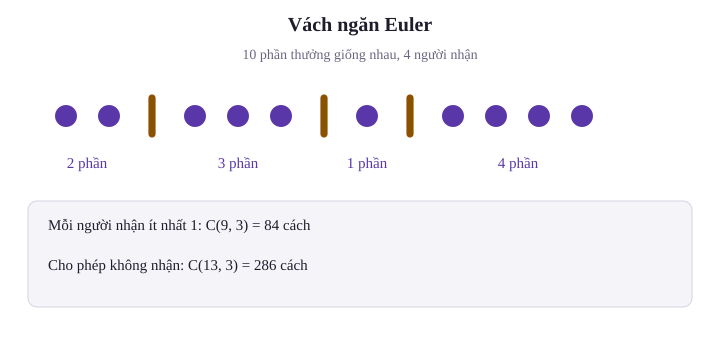
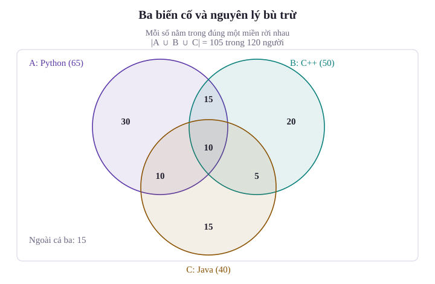

Làm thế nào để tính xác suất của một biến cố khi số lượng phần tử trong không gian mẫu lên đến hàng triệu, hoặc khi kết quả phép thử không còn là những điểm rời rạc mà lấp đầy một miền liên tục trong không gian? Trong các bài học trước, ta đã làm quen với các quy tắc xác suất cơ bản dựa trên bảng đếm tần số mẫu và không gian hữu hạn đơn giản. Tuy nhiên, để giải quyết các bài toán kỹ thuật phức tạp như phân tích hiệu năng thuật toán, định cỡ hàng đợi mạng hay bài toán va chạm trong đồ họa máy tính, ta cần một hệ thống công cụ giải tích tổ hợp và hình học chặt chẽ hơn.

Bài học này trang bị các quy tắc đếm nâng cao, phương pháp chia kẹo Euler (Stars and Bars), nguyên lý bù trừ cho nhiều biến cố, mô hình xác suất hình học và tính chất giải tích sâu sắc của độ đo Kolmogorov: Tính $\sigma$-cộng tính và tính liên tục của xác suất.

---

## 1. Các quy tắc đếm nâng cao và tổ hợp lặp

Mọi bài toán xác suất cổ điển trên không gian mẫu đồng khả năng đều quy về việc đếm số phần tử: $P(A) = \frac{|A|}{|\Omega|}$. Khi không gian mẫu $\Omega$ trở nên đồ sộ, việc liệt kê thủ công là bất khả thi. Ta cần các nguyên lý đếm cấu trúc.

### Quy tắc nhân và quy tắc cộng

Xét một phép thử gồm $k$ giai đoạn liên tiếp:
- Nếu giai đoạn 1 có $n_1$ cách thực hiện, và với mỗi phương án đã chọn ở giai đoạn 1 đều có đúng $n_2$ cách tiếp nối ở giai đoạn 2, tiếp tục như vậy cho đến giai đoạn $k$ có đúng $n_k$ cách tiếp nối, thì toàn bộ quy trình có tổng cộng:

$$
\begin{aligned}
N &= n_1 \times n_2 \times \dots \times n_k \\
&= \prod_{i=1}^k n_i.
\end{aligned}
$$

Lưu ý rằng quy tắc nhân trong giải tích tổ hợp chỉ đòi hỏi số lượng nhánh lựa chọn ở mỗi bước tiếp theo là như nhau đối với mọi phương án đã chọn trước đó, chứ không phụ thuộc vào khái niệm độc lập ngẫu nhiên trong xác suất.

- Nếu một nhiệm vụ có thể thực hiện theo một trong $k$ phương án rời nhau (không có phương án nào trùng lặp), phương án $i$ có $m_i$ cách thực hiện, thì tổng số cách thực hiện nhiệm vụ là:

$$
\begin{aligned}
M &= m_1 + m_2 + \dots + m_k \\
&= \sum_{i=1}^k m_i.
\end{aligned}
$$

### Hoán vị, chỉnh hợp và tổ hợp

Từ tập hợp $n$ phần tử phân biệt, ta có ba cấu trúc chọn cơ bản:
1. **Hoán vị (Permutation)**: Số cách sắp xếp thứ tự cả $n$ phần tử:

$$
\begin{aligned}
P_n &= n! \\
&= n \times (n-1) \times \dots \times 2 \times 1.
\end{aligned}
$$

2. **Chỉnh hợp chập $k$ (Arrangement)**: Chọn $k$ phần tử có phân biệt thứ tự từ $n$ phần tử ($0 \le k \le n$):

$$
\begin{aligned}
A_n^k &= \frac{n!}{(n-k)!} \\
&= n(n-1)\dots(n-k+1).
\end{aligned}
$$

3. **Tổ hợp chập $k$ (Combination)**: Chọn $k$ phần tử không phân biệt thứ tự từ $n$ phần tử:

$$
C_n^k = \binom{n}{k} = \frac{n!}{k!(n-k)!}.
$$

Ở đây, $n$ và $k$ là số nguyên với $0 \le k \le n$, và quy ước $0! = 1$.

### Tổ hợp lặp và phương pháp vách ngăn (Stars and Bars)

Một bài toán thực tế thường gặp trong kỹ thuật: Ta cần phân chia $k$ vật phẩm đồng nhất (không phân biệt) vào $n$ nhóm phân biệt. Đây là bài toán tìm số nghiệm nguyên của phương trình:

$$
x_1 + x_2 + \dots + x_n = k.
$$

Có hai trường hợp tiêu chuẩn cần phân biệt rõ ràng:
- **Trường hợp mỗi nhóm có ít nhất 1 phần tử**: Khi $k \ge n \ge 1$, giữa $k$ vật phẩm xếp thẳng hàng có $k - 1$ khe trống. Ta cần đặt $n - 1$ vách ngăn vào $k - 1$ khe này. Số cách phân chia là:

$$
N = \binom{k - 1}{n - 1}.
$$

Nếu $k < n$ thì không có cách phân chia thỏa mãn. Điều kiện mỗi nhóm nhận ít nhất một vật phẩm được viết là $x_i \ge 1$ với mọi $i = 1, \dots, n$.

- **Trường hợp mỗi nhóm có thể nhận 0 phần tử ($x_i \ge 0, \forall i$)**: Tổng số vị trí gồm $k$ vật phẩm và $n - 1$ vách ngăn là $k + n - 1$. Chọn $n - 1$ vị trí cho vách ngăn. Số cách phân chia là:

$$
\begin{aligned}
N &= \binom{k + n - 1}{k} \\
&= \binom{k + n - 1}{n - 1}.
\end{aligned}
$$

::: example Ví dụ 1: Phân phối tài nguyên máy chủ
Giả sử một hệ thống điều phối cụm gồm 4 máy chủ ứng dụng ($n = 4$). Hệ thống cần phân bổ 10 tác vụ tính toán giống hệt nhau ($k = 10$) tới các máy chủ.

1. Tìm số cách phân bổ nếu mỗi máy chủ phải nhận ít nhất 1 tác vụ.
2. Tìm số cách phân bổ nếu cho phép máy chủ rảnh rỗi (nhận 0 tác vụ).

*Lời giải:*
1. Áp dụng công thức nghiệm nguyên dương với $k = 10, n = 4$:

$$
\begin{aligned}
N_1 &= \binom{10 - 1}{4 - 1} \\
&= \binom{9}{3} \\
&= \frac{9 \times 8 \times 7}{3 \times 2 \times 1} \\
&= 84.
\end{aligned}
$$

2. Áp dụng công thức nghiệm không âm với $k = 10, n = 4$:

$$
\begin{aligned}
N_2 &= \binom{10 + 4 - 1}{10} \\
&= \binom{13}{3} \\
&= \frac{13 \times 12 \times 11}{3 \times 2 \times 1} \\
&= 286.
\end{aligned}
$$

:::

---

## 2. Nguyên lý bù trừ cho ba biến cố và dạng tổng quát

Khi tính xác suất của hợp các biến cố không xung khắc, việc cộng đơn thuần $P(A) + P(B)$ sẽ làm tăng gấp đôi phần giao $P(A \cap B)$. Để mở rộng ra 3 biến cố hoặc $n$ biến cố bất kỳ, ta cần nguyên lý bù trừ (Inclusion-Exclusion Principle).

### Công thức cho 3 biến cố

Với 3 biến cố bất kỳ $A, B, C$ trong cùng một không gian mẫu $\Omega$, ta đặt:
- $S_1 = P(A) + P(B) + P(C)$ là tổng xác suất của các biến cố đơn lẻ.
- $S_2$ là tổng xác suất của 3 phần giao đôi: $P(A \cap B) + P(A \cap C) + P(B \cap C)$.
- $S_3 = P(A \cap B \cap C)$ là xác suất của phần giao ba.

Khi đó, xác suất của hợp ba biến cố được viết gọn thành:

$$
P(A \cup B \cup C) = S_1 - S_2 + S_3.
$$

Cơ chế bù trừ diễn ra theo 3 nhịp logic:
1. Cộng xác suất đơn lẻ $S_1$: Miền giao của hai biến cố bị đếm 2 lần, miền tâm $A \cap B \cap C$ bị đếm 3 lần.
2. Trừ đi các giao đôi $S_2$: Các miền giao đôi được bù về đúng 1 lần, nhưng miền tâm bị trừ 3 lần, dẫn đến bị triệt tiêu hoàn toàn (đếm 0 lần).
3. Cộng lại miền tâm $S_3$: Miền tâm được khôi phục về đúng 1 lần duy nhất.

### Dạng tổng quát cho n biến cố

Với $n$ biến cố $A_1, A_2, \dots, A_n$, đặt $S_k$ là tổng xác suất của mọi giao chập $k$ biến cố phân biệt:

$$
S_k = \sum_{|I| = k} P\left( \bigcap_{i \in I} A_i \right).
$$

Trong đó tổng lấy trên mọi tập chỉ số con $I \subseteq \{1, \dots, n\}$ có đúng $k$ phần tử. Chẳng hạn, với ba biến cố, $S_2$ chính là ba số hạng giao đôi đã khai triển ở trên. Khi đó xác suất của biến cố hợp được xác định qua công thức bù trừ:

$$
P\left( \bigcup_{i=1}^n A_i \right) = \sum_{k=1}^n (-1)^{k-1} S_k.
$$

Tổng đan dấu này khi khai triển có dạng: $S_1 - S_2 + S_3 - \dots + (-1)^{n-1} S_n$.

::: example Ví dụ 2: Khảo sát kỹ năng lập trình sinh viên
Giả sử trong một đợt khảo sát học tập với 120 sinh viên công nghệ thông tin tại trường đại học:
- 65 sinh viên thành thạo Python ($A$), 50 sinh viên thành thạo C++ ($B$), 40 sinh viên thành thạo Java ($C$).
- 25 sinh viên thành thạo cả Python và C++ ($A \cap B$).
- 20 sinh viên thành thạo cả Python và Java ($A \cap C$).
- 15 sinh viên thành thạo cả C++ và Java ($B \cap C$).
- 10 sinh viên thành thạo cả 3 ngôn ngữ ($A \cap B \cap C$).

1. Tính số sinh viên thành thạo ít nhất một trong ba ngôn ngữ.
2. Chọn ngẫu nhiên một sinh viên trong nhóm khảo sát. Tính xác suất sinh viên này chỉ thành thạo đúng một ngôn ngữ duy nhất.

*Lời giải:*
1. Áp dụng nguyên lý bù trừ cho số phần tử. Đặt:

$$
\begin{aligned}
S_1 &= |A| + |B| + |C| \\
&= 65 + 50 + 40 \\
&= 155.
\end{aligned}
$$

$$
\begin{aligned}
S_2 &= |A \cap B| + |A \cap C| + |B \cap C| \\
&= 25 + 20 + 15 \\
&= 60.
\end{aligned}
$$

$$
S_3 = |A \cap B \cap C| = 10.
$$

Số sinh viên thành thạo ít nhất một trong ba ngôn ngữ là:

$$
\begin{aligned}
|A \cup B \cup C| &= S_1 - S_2 + S_3 \\
&= 155 - 60 + 10 \\
&= 105 \text{ sinh viên}.
\end{aligned}
$$

Số sinh viên không thành thạo ngôn ngữ nào trong ba ngôn ngữ trên là $120 - 105 = 15$ sinh viên.

2. Để tìm số sinh viên chỉ thành thạo đúng một ngôn ngữ, ta bóc tách từng miền riêng rẽ:
- Chỉ thành thạo Python: $65 - 25 - 20 + 10 = 30$ sinh viên.
- Chỉ thành thạo C++: $50 - 25 - 15 + 10 = 20$ sinh viên.
- Chỉ thành thạo Java: $40 - 20 - 15 + 10 = 15$ sinh viên.

Tổng số sinh viên chỉ thành thạo đúng 1 ngôn ngữ là $30 + 20 + 15 = 65$ sinh viên. Xác suất cần tìm:

$$
P = \frac{65}{120} = \frac{13}{24} \approx 0{,}5417.
$$

:::

---

## 3. Xác suất hình học

Trên một đoạn thẳng, miền phẳng hay khối không gian, đếm số điểm không còn cho một tỷ số xác suất có nghĩa. Các miền con khác độ dài hoặc diện tích có thể cùng chứa vô hạn không đếm được điểm. Ta cần mô tả cách phân bố xác suất theo độ đo hình học.

### Định nghĩa độ đo hình học

Giả sử $\Omega$ là một miền đo được trong $\mathbb{R}^n$, với $0 < \mu(\Omega) < \infty$ (độ dài, diện tích hoặc thể tích). Nếu điểm ngẫu nhiên phân phối đều trên miền này, thì xác suất rơi vào miền con đo được $A \subseteq \Omega$ là:

$$
P(A) = \frac{\mu(A)}{\mu(\Omega)}.
$$

![Hình 28.3: Bài toán cuộc hẹn ngẫu nhiên trên không gian mẫu hình vuông [0, 60] x [0, 60] và dải miền gặp gỡ |x - y| <= 15.](img/co-dien-refined/hinh-28-3-xac-suat-hinh-hoc-gap-go.svg)

::: example Ví dụ 3: Bài toán cuộc hẹn ngẫu nhiên
Hai người bạn An và Bình hẹn gặp nhau tại quán cà phê trong khoảng thời gian từ 12h00 đến 13h00 (60 phút). Thời điểm đến của mỗi người là ngẫu nhiên và phân phối đều độc lập trong khoảng thời gian này. Người đến trước chỉ đợi người kia tối đa 15 phút, nếu quá 15 phút mà người kia chưa tới thì sẽ rời đi. Tính xác suất để hai người gặp được nhau.

*Lời giải:*
Gọi $x$ và $y$ lần lượt là thời điểm đến của An và Bình tính bằng phút kể từ 12h00 ($0 \le x \le 60, 0 \le y \le 60$). Không gian mẫu là hình vuông:

$$
\Omega = [0, 60] \times [0, 60].
$$

Diện tích của không gian mẫu là $\mu(\Omega) = 60 \times 60 = 3600 \text{ phút}^2$.

Hai người gặp nhau khi và chỉ khi khoảng cách thời điểm đến không vượt quá 15 phút:

$$
A = \{ (x, y) \in \Omega : |x - y| \le 15 \}.
$$

Biến cố đối $A^c$ (hai người không gặp nhau) tương đương với $|x - y| > 15$, tức là $y - x > 15$ hoặc $x - y > 15$. Miền $A^c$ gồm hai tam giác vuông bằng nhau ở hai góc đối diện của hình vuông $\Omega$:
- Tam giác thứ nhất: $y - x > 15$ với các đỉnh $(0, 15), (0, 60), (45, 60)$, có hai cạnh góc vuông độ dài $60 - 15 = 45$.
- Tam giác thứ hai: $x - y > 15$ với các đỉnh $(15, 0), (60, 0), (60, 45)$, có hai cạnh góc vuông độ dài 45.

Tổng diện tích của miền không gặp nhau:

$$
\begin{aligned}
\mu(A^c) &= 2 \times \left( \frac{1}{2} \times 45 \times 45 \right) \\
&= 2025 \text{ phút}^2.
\end{aligned}
$$

Diện tích của miền gặp nhau $A$:

$$
\begin{aligned}
\mu(A) &= \mu(\Omega) - \mu(A^c) \\
&= 3600 - 2025 \\
&= 1575 \text{ phút}^2.
\end{aligned}
$$

Xác suất để hai người gặp nhau:

$$
\begin{aligned}
P(A) &= \frac{\mu(A)}{\mu(\Omega)} \\
&= \frac{1575}{3600} \\
&= \frac{7}{16} \\
&= 0{,}4375.
\end{aligned}
$$

:::

---

## 4. Tính sigma-cộng tính và tính liên tục của độ đo xác suất

Trên không gian vô hạn, tính cộng xác suất cho một số hữu hạn biến cố chưa đủ để xử lý giới hạn. Ta cần tính cộng tính đếm được ($\sigma$-additivity), một tiên đề của độ đo xác suất.

### Tiên đề sigma-cộng tính

Nếu $A_1, A_2, A_3, \dots$ là một dãy vô hạn đếm được các biến cố đôi một xung khắc ($A_i \cap A_j = \emptyset, \forall i \ne j$), thì:

$$
P\left( \bigcup_{i=1}^\infty A_i \right) = \sum_{i=1}^\infty P(A_i).
$$

Vế phải là chuỗi $P(A_1) + P(A_2) + P(A_3) + \dots$. Điều kiện đôi một xung khắc bảo đảm không kết quả nào bị đếm lặp.

### Định lý tính liên tục của xác suất

Từ tiên đề $\sigma$-cộng tính, ta suy ra một hệ quả nền tảng: Độ đo xác suất là một hàm liên tục đối với các phép lấy giới hạn tập hợp.

::: proof Chứng minh tính liên tục từ dưới (Continuity from Below)
Xét dãy biến cố tăng $A_1 \subseteq A_2 \subseteq A_3 \subseteq \dots$ và đặt $A = \lim_{n \to \infty} A_n = \bigcup_{n=1}^\infty A_n$. Ta chứng minh:

$$
\lim_{n \to \infty} P(A_n) = P(A).
$$

*Lập luận:*
Ta phân rã tập $A$ thành hợp của các lát tập hợp đôi một rời nhau bằng cách đặt: $C_1 = A_1$, và $C_k = A_k \setminus A_{k-1}$ với mọi $k \ge 2$. Rõ ràng các tập $C_k$ đôi một xung khắc và với mọi $n \ge 1$:

$$
A_n = \bigcup_{k=1}^n C_k.
$$

Vì các lát rời nhau, tính cộng hữu hạn cho:

$$
P(A_n) = \sum_{k=1}^n P(C_k).
$$

Hơn nữa, $A = \bigcup_{k=1}^\infty C_k$. Áp dụng tiên đề $\sigma$-cộng tính:

$$
\begin{aligned}
P(A) &= \sum_{k=1}^\infty P(C_k) \\
&= \lim_{n \to \infty} \sum_{k=1}^n P(C_k) \\
&= \lim_{n \to \infty} P(A_n).
\end{aligned}
$$

Đẳng thức được chứng minh hoàn tất.
:::

Hoàn toàn tương tự, với dãy biến cố giảm $B_1 \supseteq B_2 \supseteq B_3 \supseteq \dots$ và đặt $B = \lim_{n \to \infty} B_n = \bigcap_{n=1}^\infty B_n$, ta có tính liên tục từ trên (Continuity from Above):

$$
\lim_{n \to \infty} P(B_n) = P(B).
$$

::: example Ví dụ 4: Ứng dụng tính liên tục để xác định xác suất tại một điểm
Chọn ngẫu nhiên một số thực trong khoảng mở $(0, 1)$ với phân phối đều. Chứng minh rằng xác suất để chọn trúng một điểm cụ thể $x_0 \in (0, 1)$ luôn bằng 0.

*Lời giải:*
Xét điểm cố định bất kỳ $x_0 \in (0, 1)$. Chọn số nguyên $n_0$ đủ lớn để $1/n_0$ nhỏ hơn khoảng cách từ $x_0$ đến cả hai đầu mút. Với mỗi $n \ge n_0$, xét khoảng mở:

$$
B_n = \left( x_0 - \frac{1}{n}, x_0 + \frac{1}{n} \right).
$$

Dãy khoảng này giảm dần và giao của toàn bộ dãy chỉ gồm điểm $x_0$:

$$
\bigcap_{n=n_0}^\infty B_n = \{x_0\}.
$$

Độ dài của khoảng $B_n$ là $\mu(B_n) = \frac{2}{n}$. Xác suất tương ứng:

$$
P(B_n) = \frac{2}{n}.
$$

Áp dụng định lý tính liên tục từ trên của xác suất:

$$
\begin{aligned}
P(\{x_0\}) &= \lim_{n \to \infty} P(B_n) \\
&= \lim_{n \to \infty} \frac{2}{n} = 0.
\end{aligned}
$$

Kết quả này giải thích vì sao trong phân phối liên tục, xác suất tại một điểm đơn lẻ luôn bằng 0 dù điểm đó hoàn toàn có thể xảy ra.
:::

---

## 5. Tóm tắt bài học

- **Quy tắc đếm tổ hợp**: Quy tắc nhân áp dụng khi số lượng lựa chọn ở mỗi bước tiếp theo không đổi đối với mọi nhánh đã chọn trước đó. Quy tắc cộng áp dụng cho các phương án rời nhau. Phương pháp vách ngăn (Stars and Bars) là công cụ giải bài toán chia phần thưởng và nghiệm nguyên của tổng.
- **Nguyên lý bù trừ**: Khắc phục sai số đếm lặp khi tính xác suất của hợp các biến cố không xung khắc thông qua tổng luân phiên giữa các giao đơn $S_1$, giao đôi $S_2$ và giao ba $S_3$: $P(A \cup B \cup C) = S_1 - S_2 + S_3$.
- **Xác suất hình học**: Thay thế phép đếm số phần tử bằng tỉ số độ đo (chiều dài, diện tích, thể tích) khi không gian mẫu là liên tục và đồng khả năng: $P(A) = \mu(A) / \mu(\Omega)$.
- **Tính liên tục của độ đo xác suất**: Hệ quả trực tiếp từ tiên đề $\sigma$-cộng tính của Kolmogorov, đảm bảo phép lấy xác suất giao hoán được với phép lấy giới hạn của dãy biến cố đơn điệu tăng hoặc giảm.

---

## Tài liệu tham khảo

- Penn State University, [STAT 414: Counting Techniques](https://online.stat.psu.edu/stat414/Lesson03).
- MIT OpenCourseWare, [18.05: Calendar, Class 1 Counting và Class 2 Probability Basics](https://ocw.mit.edu/courses/18-05-introduction-to-probability-and-statistics-spring-2022/pages/calendar/).
- Joseph K. Blitzstein và Jessica Hwang, [Introduction to Probability, bản điện tử do tác giả cung cấp](https://probabilitybook.net/).

Hệ thống bài tập rèn luyện kỹ thuật đếm tổ hợp nâng cao, nguyên lý bù trừ, xác suất hình học và tính liên tục của độ đo xác suất kèm lời giải chi tiết.

## Bài tập rèn luyện xác suất cổ điển và hình học

::: exercise Bài tập 1: Phân phối đơn hàng tại quầy giải khát
Một nhóm 8 sinh viên đi mua đồ uống tại một quầy giải khát có phục vụ 5 loại đồ uống khác nhau. Giả sử quầy có đủ số lượng cho mọi loại. Có bao nhiêu đơn đặt hàng khác nhau đối với số lượng từng loại đồ uống được chọn?
:::
::: solution Lời giải
Đây là bài toán tổ hợp lặp: Cần phân chia $k = 8$ đồ uống vào $n = 5$ loại khác nhau, cho phép một số loại có thể không được chọn ($x_i \ge 0$). Áp dụng công thức vách ngăn:

$$
\begin{aligned}
N &= \binom{k + n - 1}{k} \\
&= \binom{8 + 5 - 1}{8} \\
&= \binom{12}{4} \\
&= \frac{12 \times 11 \times 10 \times 9}{4 \times 3 \times 2 \times 1} \\
&= 495.
\end{aligned}
$$

:::

::: exercise Bài tập 2: Hoán vị lặp từ vựng thống kê
Có bao nhiêu cách sắp xếp tất cả các chữ cái của từ `STATISTICS` thành một hàng ngang?
:::
::: solution Lời giải
Từ `STATISTICS` có tổng cộng 10 chữ cái, trong đó có sự lặp lại:
- Chữ cái `S` xuất hiện 3 lần.
- Chữ cái `T` xuất hiện 3 lần.
- Chữ cái `A` xuất hiện 1 lần.
- Chữ cái `I` xuất hiện 2 lần.
- Chữ cái `C` xuất hiện 1 lần.

Áp dụng công thức hoán vị lặp:

$$
\begin{aligned}
P &= \frac{10!}{3! \times 3! \times 1! \times 2! \times 1!} \\
&= \frac{3628800}{6 \times 6 \times 1 \times 2 \times 1} \\
&= \frac{3628800}{72} \\
&= 50400 \text{ cách}.
\end{aligned}
$$

:::

::: exercise Bài tập 3: Thí sinh thi tuyển và nguyên lý bù trừ
Giả sử một kỳ thi thử nghiệm có 200 thí sinh tham gia ba môn thi: Toán, Lý, Hóa. Kết quả ghi nhận:
- 100 thí sinh đạt điểm giỏi môn Toán, 80 thí sinh môn Lý, 70 thí sinh môn Hóa.
- 40 thí sinh giỏi cả Toán và Lý, 30 thí sinh giỏi cả Toán và Hóa, 25 thí sinh giỏi cả Lý và Hóa.
- 15 thí sinh giỏi cả 3 môn.

Chọn ngẫu nhiên một thí sinh trong danh sách. Tính xác suất thí sinh đó không đạt điểm giỏi ở bất kỳ môn thi nào.
:::
::: solution Lời giải
Gọi $T, L, H$ lần lượt là tập hợp các thí sinh đạt điểm giỏi môn Toán, Lý, Hóa. Áp dụng nguyên lý bù trừ để tính số thí sinh giỏi ít nhất 1 môn. Đặt:

$$
\begin{aligned}
S_1 &= |T| + |L| + |H| \\
&= 100 + 80 + 70 \\
&= 250.
\end{aligned}
$$

$$
\begin{aligned}
S_2 &= |T \cap L| + |T \cap H| + |L \cap H| \\
&= 40 + 30 + 25 \\
&= 95.
\end{aligned}
$$

$$
S_3 = |T \cap L \cap H| = 15.
$$

Số thí sinh giỏi ít nhất một môn:

$$
\begin{aligned}
|T \cup L \cup H| &= S_1 - S_2 + S_3 \\
&= 250 - 95 + 15 \\
&= 170 \text{ thí sinh}.
\end{aligned}
$$

Số thí sinh không đạt điểm giỏi ở môn nào là $200 - 170 = 30$ thí sinh. Xác suất chọn ngẫu nhiên được thí sinh không đạt giỏi môn nào:

$$
P = \frac{30}{200} = \frac{3}{20} = 0{,}15 = 15\%.
$$

:::

::: exercise Bài tập 4: Bài toán bẻ gãy que gỗ (Broken Stick Problem)
Một que gỗ thẳng dài 1 mét được đánh dấu tại hai điểm độc lập, mỗi điểm có phân phối đều trên chiều dài que, rồi bẻ tại hai điểm đó. Tính xác suất để ba đoạn que gỗ tạo thành sau khi bẻ có thể ghép lại thành một hình tam giác.
:::
::: solution Lời giải
Gọi vị trí của hai điểm bẻ que gỗ tính từ đầu que là $x$ và $y$ ($0 \le x \le 1, 0 \le y \le 1$). Không gian mẫu là hình vuông đơn vị $\Omega = [0, 1] \times [0, 1]$ có diện tích $\mu(\Omega) = 1$.

Do vai trò đối xứng của $x$ và $y$, ta xét trường hợp $x < y$ (chiếm nửa diện tích hình vuông nằm phía trên đường phân giác $y = x$). Khi đó ba đoạn que gỗ có độ dài lần lượt là:

$$
a = x, \quad b = y - x, \quad c = 1 - y.
$$

Để ba đoạn thẳng ghép thành tam giác, độ dài mỗi đoạn phải nhỏ hơn tổng hai đoạn còn lại, đồng nghĩa với việc mỗi đoạn phải nhỏ hơn nửa chu vi (tức $< 0{,}5$):

$$
\begin{aligned}
&0 < x < 0{,}5, \\
&0{,}5 < y < x + 0{,}5.
\end{aligned}
$$

Miền này trong mặt phẳng $Oxy$ là một tam giác có ba đỉnh: $(0, 0{,}5)$, $(0{,}5, 0{,}5)$, $(0{,}5, 1)$. Diện tích của tam giác này là:

$$
S_1 = \frac{1}{2} \times 0{,}5 \times 0{,}5 = \frac{1}{8}.
$$

Tương tự, trong trường hợp $y < x$, ta cũng thu được một miền tam giác đối xứng có diện tích $S_2 = \frac{1}{8}$. Tổng diện tích miền tạo thành tam giác:

$$
\begin{aligned}
\mu(A) &= S_1 + S_2 \\
&= \frac{1}{8} + \frac{1}{8} \\
&= \frac{1}{4}.
\end{aligned}
$$

Xác suất cần tìm:

$$
\begin{aligned}
P &= \frac{\mu(A)}{\mu(\Omega)} \\
&= \frac{1/4}{1} \\
&= \frac{1}{4} \\
&= 0{,}25.
\end{aligned}
$$

:::

::: exercise Bài tập 5: Tính liên tục của dãy biến cố thu hẹp
Cho dãy biến cố $B_n = \left[ 0, \frac{1}{n} \right]$ xác định trên không gian mẫu $\Omega = [0, 1]$ với độ đo độ dài Lebesgue chuẩn hóa. Xác định tập giới hạn $B = \lim_{n \to \infty} B_n$ và kiểm chứng định lý tính liên tục từ trên của xác suất.
:::
::: solution Lời giải
Dãy tập hợp $B_n$ là dãy giảm ngặt theo quan hệ bao hàm:

$$
B_1 \supset B_2 \supset B_3 \supset \dots \supset B_n
$$

với các tập đầu tiên là $B_1 = [0, 1]$, $B_2 = [0, 0{,}5]$, $B_3 = [0, 1/3]$.

Tập giới hạn là giao của toàn bộ họ tập hợp:

$$
B = \bigcap_{n=1}^\infty B_n = \{0\}.
$$

Xác suất của từng biến cố $B_n$:

$$
\begin{aligned}
P(B_n) &= \mu(B_n) \\
&= \frac{1}{n} - 0 \\
&= \frac{1}{n}.
\end{aligned}
$$

Theo định lý tính liên tục từ trên:

$$
\begin{aligned}
P(B) &= P\left( \bigcap_{n=1}^\infty B_n \right) \\
&= \lim_{n \to \infty} P(B_n) \\
&= \lim_{n \to \infty} \frac{1}{n} \\
&= 0.
\end{aligned}
$$

Mặt khác, độ dài của tập hợp gồm một điểm $\{0\}$ là 0, do đó $P(\{0\}) = 0$. Đẳng thức giới hạn hoàn toàn thỏa mãn.
:::

