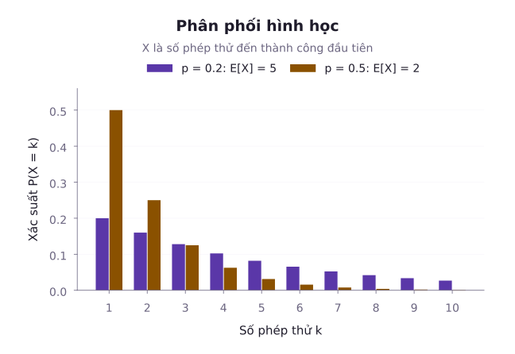
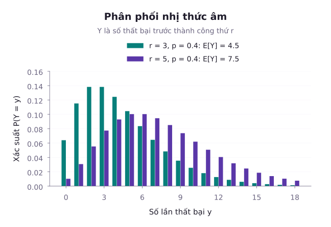
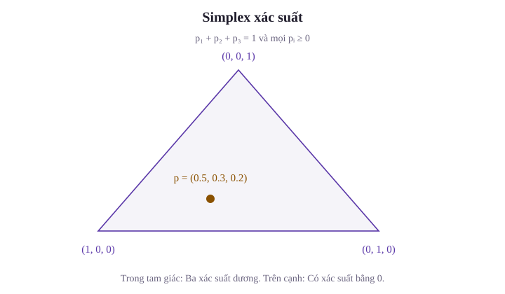

Phân phối Bernoulli mô tả một phép thử có hai kết quả. Phân phối Nhị thức đếm số thành công trong $n$ phép thử Bernoulli độc lập cùng tham số. Phân phối Poisson lại mô tả số sự kiện trong một khoảng thời gian hoặc không gian cố định, theo giả thiết sự kiện xảy ra độc lập với tốc độ không đổi.

Tuy nhiên, trong nhiều bài toán kỹ thuật thực tế, số lượng phép thử không hề cố định trước. Một kỹ sư kiểm thử phần mềm phải chạy kiểm thử liên tục cho đến khi tìm thấy lỗi đầu tiên mới dừng lại. Một thuật toán truyền tin mạng phải gửi lại gói tin cho đến khi nhận được tín hiệu xác nhận thành công. Hay trong bài toán phân loại văn bản nhiều lớp (Multiclass Classification), mỗi tài liệu được phân loại vào đúng một trong các nhóm chủ đề rời nhau và vét cạn, thay vì chỉ có hai kết quả nhị phân đạt hoặc không đạt. Những bài toán này đòi hỏi các phân phối xác suất rời rạc mở rộng: Phân phối Geometric, phân phối Negative Binomial và phân phối Multinomial.

---

## 1. Phân phối Geometric và hai quy ước đếm

Xét một chuỗi các phép thử Bernoulli độc lập, mỗi phép thử có xác suất thành công là $p \in (0, 1)$ và xác suất thất bại là $q = 1 - p$. Biến ngẫu nhiên Geometric mô tả quy luật thời điểm dừng (Stopping time) của chuỗi phép thử.

Trong giáo trình lý thuyết xác suất và các thư viện tính toán khoa học quốc tế (như SciPy hay R), tồn tại hai quy ước định nghĩa phân phối Geometric. Người học cần phân biệt chính xác hai quy ước này để không nhầm lẫn khi áp dụng:

### Quy ước 1: Đếm tổng số lần thử đến khi thành công lần đầu

Gọi $X$ là số lần thử cần thực hiện cho đến khi thu được thành công đầu tiên.
- **Tập giá trị (Support)**: $X \in \{1, 2, 3, \dots\}$.
- **Hàm khối xác suất (PMF)**: Biến cố $\{X = k\}$ có xác suất:

$$
P(X = k) = (1 - p)^{k-1} p
$$

với mọi $k = 1, 2, 3, \dots$.

- **Hàm phân phối tích lũy (CDF)**: Xác suất cần không quá $k$ lần thử:

$$
\begin{aligned}
F_X(k) &= P(X \le k) \\
&= 1 - P(X > k) \\
&= 1 - (1 - p)^k.
\end{aligned}
$$

- **Kỳ vọng và phương sai**:

$$
E[X] = \frac{1}{p}, \quad \mathrm{Var}(X) = \frac{1 - p}{p^2}.
$$

::: derivation Khai triển chi tiết kỳ vọng của phân phối Geometric
Để tính $E[X] = \sum_{k=1}^\infty k (1-p)^{k-1} p$, ta xuất phát từ chuỗi hình học với $|q| < 1$:

$$
\begin{aligned}
1 + q + q^2 + \dots &= \sum_{k=0}^\infty q^k \\
&= \frac{1}{1-q}.
\end{aligned}
$$

Lấy đạo hàm cả hai vế theo $q$:

$$
\begin{aligned}
\sum_{k=1}^\infty k q^{k-1} &= \frac{d}{dq}\left( \frac{1}{1 - q} \right) \\
&= \frac{1}{(1 - q)^2}.
\end{aligned}
$$

Thay $q = 1 - p$ vào, ta được:

$$
\begin{aligned}
E[X] &= p \sum_{k=1}^\infty k (1 - p)^{k-1} \\
&= p \times \frac{1}{(1 - (1 - p))^2} \\
&= p \times \frac{1}{p^2} \\
&= \frac{1}{p}.
\end{aligned}
$$

:::

### Quy ước 2: Đếm số lần thất bại trước khi thành công lần đầu

Gọi $Y$ là số lần thất bại xảy ra trước khi có thành công đầu tiên. Rõ ràng $Y = X - 1$.
- **Tập giá trị**: $Y \in \{0, 1, 2, \dots\}$.
- **Hàm khối xác suất**:

$$
P(Y = k) = (1 - p)^k p
$$

với mọi $k = 0, 1, 2, \dots$.

- **Kỳ vọng và phương sai**:

$$
\begin{aligned}
E[Y] &= E[X - 1] = \frac{1 - p}{p}, \\
\mathrm{Var}(Y) &= \mathrm{Var}(X) = \frac{1 - p}{p^2}.
\end{aligned}
$$

### Tính chất không nhớ (Memoryless Property)

Với biến $X$ đếm số lần thử, tính không nhớ nói rằng sau $s$ lần thất bại, xác suất cả $t$ lần thử tiếp theo vẫn thất bại bằng xác suất thất bại trong $t$ lần đầu:

$$
P(X > s + t \mid X > s) = P(X > t)
$$

với mọi số nguyên $s, t \ge 0$. Trong các phân phối không suy biến trên số nguyên dương có đuôi dương ở mọi ngưỡng hữu hạn, tính chất này đặc trưng cho phân phối Geometric.

::: example Ví dụ 1: Kiểm thử hệ thống tự động
Một kịch bản kiểm thử tự động phát hiện được lỗi bảo mật tiềm ẩn trong một gói mã nguồn với xác suất $p = 0{,}2$ trong mỗi lần chạy độc lập.

1. Theo quy ước 1, tính xác suất để hệ thống phát hiện lỗi ở đúng lần chạy thứ 4.
2. Tính số lần chạy kỳ vọng để tìm thấy lỗi đầu tiên.
3. Nếu hệ thống đã chạy 3 lần mà chưa phát hiện lỗi, tính xác suất cả 2 lần chạy tiếp theo vẫn chưa phát hiện được lỗi.

*Lời giải:*
1. Gọi $X$ là số lần chạy đến khi phát hiện lỗi đầu tiên ($X \in \{1, 2, \dots\}$). Xác suất phát hiện lỗi ở đúng lần thứ 4:

$$
\begin{aligned}
P(X = 4) &= (0{,}8)^3 \times 0{,}2 \\
&= 0{,}512 \times 0{,}2 \\
&= 0{,}1024.
\end{aligned}
$$

2. Số lần chạy kỳ vọng:

$$
E[X] = \frac{1}{p} = \frac{1}{0{,}2} = 5 \text{ lần}.
$$

3. Biến cố đã chạy 3 lần thất bại là $X > 3$. Cả hai lần chạy tiếp theo đều thất bại nghĩa là $X > 5$. Áp dụng tính không nhớ:

$$
\begin{aligned}
P(X > 5 \mid X > 3) &= P(X > 2) \\
&= (0{,}8)^2 \\
&= 0{,}64 = 64\%.
\end{aligned}
$$

:::

---

## 2. Phân phối Negative Binomial (Nhị thức âm)

Nếu phân phối Geometric đếm số lần thử đến khi có 1 thành công đầu tiên, thì phân phối **Negative Binomial** tổng quát hóa bài toán: Đếm số lần thử hoặc số lần thất bại để thu được đúng $r$ lần thành công ($r \ge 1$ là số nguyên cố định).

### Định nghĩa và hàm khối xác suất

Gọi $Y$ là số lần thất bại trước khi đạt được đúng $r$ lần thành công trong chuỗi phép thử Bernoulli độc lập có tham số thành công $p$.
- **Tập giá trị**: $Y \in \{0, 1, 2, \dots\}$.
- **Cơ chế suy diễn hàm PMF**: Để có đúng $y$ lần thất bại trước lần thành công thứ $r$, tổng số phép thử đã thực hiện là $y + r$. Trong đó:
  - Lần thử cuối cùng (lần thứ $y + r$) bắt buộc phải là một lần thành công.
  - Trong $y + r - 1$ lần thử trước đó, phải có đúng $r - 1$ lần thành công và $y$ lần thất bại.
  Số cách chọn vị trí cho $y$ lần thất bại là $\binom{y + r - 1}{y}$. Do đó:

$$
P(Y = y) = \binom{y + r - 1}{y} p^r q^y
$$

với $q = 1 - p$ và $y = 0, 1, 2, \dots$.

### Biểu diễn tổng của các biến Geometric độc lập

Một tính chất cấu trúc quan trọng: Biến $Y$ có thể phân rã thành tổng của $r$ biến ngẫu nhiên Geometric độc lập cùng phân phối:

$$
Y = Y_1 + Y_2 + \dots + Y_r,
$$

trong đó $Y_1$ là số thất bại trước thành công thứ nhất, $Y_2$ là số thất bại giữa thành công thứ nhất và thành công thứ hai, và cứ thế đến $Y_r$. Mỗi $Y_i \stackrel{\text{iid}}{\sim} \mathrm{Geom}(p)$ (theo quy ước đếm thất bại). Từ tính chất cộng tính kỳ vọng và phương sai của các biến độc lập:

$$
\begin{aligned}
E[Y] &= \sum_{i=1}^r E[Y_i] \\
&= r \times \frac{1 - p}{p} \\
&= \frac{r(1 - p)}{p}.
\end{aligned}
$$

$$
\begin{aligned}
\mathrm{Var}(Y) &= \sum_{i=1}^r \mathrm{Var}(Y_i) \\
&= r \times \frac{1 - p}{p^2} \\
&= \frac{r(1 - p)}{p^2}.
\end{aligned}
$$

::: example Ví dụ 2: Kiểm soát chất lượng dây chuyền
Giả sử các sản phẩm trên dây chuyền độc lập về tình trạng lỗi, mỗi sản phẩm có xác suất lỗi $0{,}05$. Một quy trình kiểm tra chất lượng sẽ dừng lại và hiệu chuẩn lại máy móc khi phát hiện đúng $r = 3$ sản phẩm lỗi.

1. Tính số lượng sản phẩm đạt chuẩn kỳ vọng được kiểm tra trước khi dây chuyền phải dừng lại.
2. Tính phương sai và độ lệch chuẩn của số sản phẩm đạt chuẩn kiểm tra được.

*Lời giải:*
Xem việc tìm thấy sản phẩm lỗi là một "thành công" trong bài toán tìm lỗi, với tham số $p = 0{,}05$. Gọi $Y$ là số sản phẩm đạt chuẩn (tương ứng với số lần không lỗi) trước khi gặp sản phẩm lỗi thứ $r = 3$. Khi đó $Y \sim \mathrm{NegBin}(r = 3, p = 0{,}05)$.

1. Số sản phẩm đạt chuẩn kỳ vọng:

$$
\begin{aligned}
E[Y] &= \frac{r(1 - p)}{p} \\
&= \frac{3 \times 0{,}95}{0{,}05} \\
&= 57.
\end{aligned}
$$

Số sản phẩm đạt chuẩn kỳ vọng được kiểm tra là 57 sản phẩm.

2. Phương sai của số sản phẩm đạt chuẩn:

$$
\begin{aligned}
\mathrm{Var}(Y) &= \frac{r(1 - p)}{p^2} \\
&= \frac{2{,}85}{0{,}0025} \\
&= 1140.
\end{aligned}
$$

Phương sai là $1140 \text{ sản phẩm}^2$. Độ lệch chuẩn: $\sigma_Y = \sqrt{1140} \approx 33{,}76$ sản phẩm.
:::

---

## 3. Phân phối Multinomial (Phân phối Đa thức)

Phân phối Nhị thức (Binomial) mô tả phép thử chỉ có 2 kết quả khả dĩ. Khi mỗi phép thử độc lập có thể dẫn đến một trong $m$ kết quả phân loại rời nhau và vét cạn ($m \ge 3$), phân phối Nhị thức được tổng quát hóa thành **phân phối Multinomial**.

### Hàm khối xác suất đồng thời

Thực hiện $n$ phép thử độc lập. Mỗi phép thử rơi vào một trong $m$ nhóm phân loại với xác suất tương ứng $p_1, p_2, \dots, p_m$ thỏa mãn:

$$
\begin{aligned}
&p_i \ge 0 \quad (\forall i = 1, \dots, m), \\
&\sum_{i=1}^m p_i = p_1 + \dots + p_m = 1.
\end{aligned}
$$

Gọi $\mathbf{X} = (X_1, \dots, X_m)$ là vector số lần kết quả rơi vào từng nhóm sau $n$ phép thử, thỏa mãn $\sum_{i=1}^m X_i = n$. Hàm PMF đồng thời tại $\mathbf{k} = (k_1, \dots, k_m)$ là:

$$
P(\mathbf{X} = \mathbf{k}) = \frac{n!}{k_1! \dots k_m!} p_1^{k_1} \dots p_m^{k_m},
$$

với mọi bộ số nguyên không âm $k_i \ge 0$ thỏa mãn $\sum_{i=1}^m k_i = n$.

### Phân phối lề và cấu trúc hiệp phương sai

- **Phân phối lề (Marginal Distribution)**: Nếu chỉ quan tâm đến một nhóm $X_i$ duy nhất và gom tất cả các nhóm còn lại thành "không phải nhóm $i$", thì $X_i \sim \mathrm{Bin}(n, p_i)$ có:

$$
\begin{aligned}
E[X_i] &= n p_i, \\
\mathrm{Var}(X_i) &= n p_i (1 - p_i).
\end{aligned}
$$

- **Hiệp phương sai âm giữa các nhóm**: Vì tổng số phép thử cố định $\sum_{i=1}^m X_i = n$, nên nếu một nhóm xuất hiện nhiều hơn kỳ vọng thì các nhóm khác buộc phải bị giảm đi. Cụ thể, hiệp phương sai giữa hai nhóm phân biệt ($i \ne j$) không dương:

$$
\mathrm{Cov}(X_i, X_j) = -n p_i p_j \le 0.
$$

Dấu âm là nghiêm ngặt khi $n > 0$ và cả $p_i, p_j$ đều dương. Nếu một nhóm có xác suất bằng 0 thì số đếm nhóm đó luôn bằng 0, nên hiệp phương sai bằng 0.

::: example Ví dụ 3: Phân loại dữ liệu văn bản
Giả sử một mô hình trí tuệ nhân tạo phân loại các bài báo thu thập được vào đúng một trong 3 chủ đề rời nhau và vét cạn: Kinh tế ($p_1 = 0{,}5$), Thể thao ($p_2 = 0{,}3$) và Công nghệ ($p_3 = 0{,}2$). Giả sử các chủ đề của $n = 10$ bài báo độc lập và có cùng các xác suất trên.

1. Tính xác suất để trong 10 bài báo có đúng 5 bài Kinh tế, 3 bài Thể thao và 2 bài Công nghệ.
2. Tính hiệp phương sai giữa số bài báo Kinh tế và số bài báo Thể thao.

*Lời giải:*
1. Đặt $P$ là xác suất cần tìm. Áp dụng công thức PMF của phân phối Multinomial:

$$
\begin{aligned}
P &= \frac{10!}{5! 3! 2!} (0{,}5)^5 (0{,}3)^3 (0{,}2)^2 \\
&= 2520 \times (3{,}375 \times 10^{-5}) \\
&= 0{,}08505 \approx 8{,}51\%.
\end{aligned}
$$

2. Hiệp phương sai giữa $X_1$ và $X_2$:

$$
\begin{aligned}
\mathrm{Cov}(X_1, X_2) &= -n p_1 p_2 \\
&= -10 \times 0{,}5 \times 0{,}3 \\
&= -1{,}5.
\end{aligned}
$$

Dấu âm thể hiện rõ: Khi số lượng bài báo Kinh tế trong mẫu tăng lên, số lượng bài báo Thể thao có xu hướng bị chèn ép giảm xuống do giới hạn tổng mẫu $n = 10$.
:::

---

## 4. Ứng dụng: Bài toán người thu thập phiếu thưởng (Coupon Collector Problem)

Một ứng dụng kinh điển của phân phối Geometric trong việc phân tích thời điểm dừng thuật toán là bài toán thu thập phiếu thưởng (Coupon Collector Problem).

Giả sử có $N$ loại phiếu thưởng khác nhau. Các lần mua độc lập. Mỗi lần, ta nhận một trong $N$ loại phiếu với xác suất bằng nhau là $1/N$. Cần mua bao nhiêu sản phẩm để thu thập đủ cả $N$ loại phiếu thưởng?

::: example Ví dụ 4: Tính toán kỳ vọng bài toán Coupon Collector với $N = 3$ loại thẻ
Một trò chơi trực tuyến phát hành 3 loại thẻ hiếm ($N = 3$). Mỗi lần mở hòm đồ ngẫu nhiên, người chơi nhận được 1 thẻ với xác suất $1/3$ cho mỗi loại. Gọi $T$ là tổng số lần mở hòm cần thiết để sở hữu đủ cả 3 loại thẻ. Tính kỳ vọng và phương sai của $T$.

*Lời giải:*
Gọi $T_1$ là số lần mở để có loại thẻ đầu tiên (hiển nhiên $T_1 = 1$).
Sau khi đã có 1 loại thẻ, còn 2 loại chưa có. Xác suất nhận được loại thẻ mới ở mỗi lần mở tiếp theo là $p_2 = 2/3$. Số lần mở thêm $T_2$ để có loại thẻ thứ hai tuân theo phân phối Geometric: $T_2 \sim \mathrm{Geom}(p_2 = 2/3)$.
Sau khi đã có 2 loại thẻ, chỉ còn 1 loại chưa có. Xác suất nhận được loại thẻ cuối cùng ở mỗi lần mở là $p_3 = 1/3$. Số lần mở thêm $T_3$ tuân theo phân phối Geometric: $T_3 \sim \mathrm{Geom}(p_3 = 1/3)$.
Tổng số lần mở hòm là $T = T_1 + T_2 + T_3$. Các khoảng chờ này độc lập vì kết quả ở những lần mở chưa thực hiện độc lập với quá khứ. Hơn nữa, xác suất có thẻ mới chỉ phụ thuộc số loại đã có. Theo tính tuyến tính của kỳ vọng:

$$
\begin{aligned}
E[T] &= E[T_1] + E[T_2] + E[T_3] \\
&= 1 + \frac{3}{2} + 3 = 5{,}5.
\end{aligned}
$$

Số lần mở hòm kỳ vọng để có đủ cả 3 loại thẻ là $5{,}5$ lần.

Phương sai của $T$ bằng tổng các phương sai thành phần:

$$
\begin{aligned}
\mathrm{Var}(T) &= 0 + \frac{1 - 2/3}{(2/3)^2} + \frac{1 - 1/3}{(1/3)^2} \\
&= \frac{3}{4} + 6 \\
&= 6{,}75.
\end{aligned}
$$

:::

---

## 5. Tóm tắt bài học

- **Phân phối Geometric**: Mô hình hóa số lần thử $X \in \{1, 2, \dots\}$ hoặc số thất bại $Y = X-1$ trước thành công đầu tiên trong chuỗi Bernoulli độc lập cùng tham số $p$. Phân phối có tính không nhớ với quy ước ngưỡng tương ứng.
- **Phân phối Negative Binomial**: Đếm số lần thất bại trước khi đạt được đúng $r$ lần thành công. Phân phối là tổng của $r$ biến Geometric độc lập với kỳ vọng $r(1-p)/p$ và phương sai $r(1-p)/p^2$.
- **Phân phối Multinomial**: Mở rộng phân phối Nhị thức khi mỗi phép thử có $m \ge 3$ kết quả phân loại rời nhau và vét cạn. Các phân phối lề là phân phối Nhị thức. Hiệp phương sai giữa hai nhóm phân biệt không dương và âm nghiêm ngặt khi cả hai xác suất nhóm đều dương và $n > 0$.
- **Thời điểm dừng**: Phân phối Geometric là nền tảng giải quyết các bài toán thời gian chờ và bài toán thu thập phiếu thưởng (Coupon Collector).

---

## Tài liệu tham khảo

- Penn State University, [STAT 504: Introduction to Discrete Data](https://online.stat.psu.edu/stat504/Lesson01), các mục Negative Binomial Distribution và Multinomial Distribution.
- Penn State University, [STAT 414: Introduction to Probability Theory](https://online.stat.psu.edu/stat414/index), phần Geometric and Negative Binomial Distributions.
- Joseph K. Blitzstein và Jessica Hwang, [Introduction to Probability](https://probabilitybook.net/), phân phối Geometric, Nhị thức âm và bài toán thu thập phiếu.

Hệ thống bài tập rèn luyện các phân phối rời rạc nâng cao gồm Geometric, Negative Binomial và Multinomial kèm lời giải chi tiết.

## Bài tập rèn luyện phân phối rời rạc mở rộng

::: exercise Bài tập 1: Gieo xúc xắc chờ mặt 6 chấm
Tung một con xúc xắc 6 mặt cân đối và đồng chất liên tục cho đến khi xuất hiện mặt 6 điểm thì dừng lại. Gọi $X$ là tổng số lần tung. Tính xác suất để phải tung nhiều hơn 4 lần mới xuất hiện mặt 6 điểm đầu tiên.
:::
::: solution Lời giải
Xác suất xuất hiện mặt 6 điểm ở mỗi lần tung là $p = 1/6$. Biến ngẫu nhiên $X$ tuân theo phân phối Geometric $X \sim \mathrm{Geom}(p = 1/6)$. Biến cố $\{X > 4\}$ đồng nghĩa với việc trong 4 lần tung đầu tiên, không có lần nào xuất hiện mặt 6 điểm:

$$
\begin{aligned}
P(X > 4) &= (1 - p)^4 \\
&= \left( \frac{5}{6} \right)^4 \\
&= \frac{625}{1296} \\
&\approx 0{,}4823.
\end{aligned}
$$

:::

::: exercise Bài tập 2: Ký kết hợp đồng bảo hiểm
Giả sử quyết định của các khách hàng độc lập và mỗi người đồng ý ký thỏa thuận với xác suất $p = 0{,}25$. Để hoàn thành chỉ tiêu tháng, nhân viên này cần chốt được đúng $r = 2$ hợp đồng. Tính xác suất nhân viên này chốt được hợp đồng thứ hai ở đúng khách hàng thứ 5.
:::
::: solution Lời giải
Gọi $X$ là số khách hàng gặp đến khi có hợp đồng thứ hai. Để $X = 5$, trong 4 khách hàng đầu tiên phải có đúng 1 người đồng ý (và 3 người từ chối), đồng thời khách hàng thứ 5 phải đồng ý. Áp dụng công thức phân phối Negative Binomial:

$$
\begin{aligned}
P(X = 5) &= \binom{5 - 1}{2 - 1} p^2 (1 - p)^{5 - 2} \\
&= \binom{4}{1} (0{,}25)^2 (0{,}75)^3.
\end{aligned}
$$

Khai triển số học:

$$
\begin{aligned}
P(X = 5) &= 4 \times \frac{1}{16} \times \frac{27}{64} \\
&= \frac{27}{256} \\
&\approx 0{,}1055.
\end{aligned}
$$

:::

::: exercise Bài tập 3: Rút bi có hoàn lại với nhiều màu sắc
Một hộp chứa 5 viên bi đỏ, 3 viên bi xanh và 2 viên bi vàng (tổng cộng 10 viên bi). Ta rút ngẫu nhiên có hoàn lại 6 lần liên tiếp. Tính xác suất để rút được đúng 3 viên bi đỏ, 2 viên bi xanh và 1 viên bi vàng.
:::
::: solution Lời giải
Do mỗi lần rút có hoàn lại, xác suất rút trúng mỗi màu ở từng lần là cố định và các lần rút độc lập:
- Xác suất bi đỏ: $p_1 = 5/10 = 0{,}5$.
- Xác suất bi xanh: $p_2 = 3/10 = 0{,}3$.
- Xác suất bi vàng: $p_3 = 2/10 = 0{,}2$.

Tổng số lần rút là $n = 6$. Số lượng bi mỗi loại tương ứng là $k_1 = 3, k_2 = 2, k_3 = 1$. Áp dụng công thức phân phối Multinomial:

$$
\begin{aligned}
P &= \frac{6!}{3! 2! 1!} (0{,}5)^3 (0{,}3)^2 (0{,}2) \\
&= 60 \times 0{,}00225 \\
&= 0{,}135 = 13{,}5\%.
\end{aligned}
$$

:::

::: exercise Bài tập 4: Chứng minh tính chất không nhớ giải tích
Chứng minh bằng giải tích tính chất không nhớ của phân phối Geometric:

$$
P(X > s + t \mid X > s) = P(X > t)
$$

với mọi $s, t \in \mathbb{N}^*$, trong đó $X \sim \mathrm{Geom}(p)$ với $P(X = k) = (1 - p)^{k-1} p$.
:::
::: solution Lời giải
Trước hết, ta tính xác suất đuôi $P(X > k)$:

$$
\begin{aligned}
P(X > k) &= \sum_{j=k+1}^\infty (1 - p)^{j-1} p \\
&= p \sum_{t=0}^\infty (1 - p)^{k + t} \\
&= p (1 - p)^k \sum_{t=0}^\infty (1 - p)^t.
\end{aligned}
$$

Tổng cấp số nhân lùi vô hạn bằng $\frac{1}{1 - (1 - p)} = \frac{1}{p}$, do đó:

$$
\begin{aligned}
P(X > k) &= p (1 - p)^k \times \frac{1}{p} \\
&= (1 - p)^k.
\end{aligned}
$$

Đặt biến cố $A = \{X > s + t\}$ và $B = \{X > s\}$. Vì $s, t \ge 1$ nên $A \subset B$, suy ra $A \cap B = A$. Theo công thức xác suất có điều kiện:

$$
\begin{aligned}
P(A \mid B) &= \frac{P(A)}{P(B)} \\
&= \frac{(1 - p)^{s + t}}{(1 - p)^s} \\
&= (1 - p)^t \\
&= P(X > t).
\end{aligned}
$$

Đẳng thức được chứng minh hoàn tất.
:::

::: exercise Bài tập 5: Hiệp phương sai âm của phân phối Multinomial
Cho vector ngẫu nhiên $(X_1, X_2, X_3)$ có phân phối Multinomial với tham số $(n, p_1, p_2, p_3)$. Chứng minh rằng biến ngẫu nhiên tổng $S = X_1 + X_2$ tuân theo phân phối Nhị thức $\mathrm{Bin}(n, p_1 + p_2)$. Sử dụng kết quả này để kiểm chứng lại công thức hiệp phương sai $\mathrm{Cov}(X_1, X_2) = -n p_1 p_2$.
:::
::: solution Lời giải
Mỗi phép thử có 3 kết quả với xác suất $p_1, p_2, p_3$. Ta gộp hai kết quả 1 và 2 thành một biến cố chung "thuộc nhóm 1 hoặc nhóm 2", có xác suất xảy ra là $p_{12} = p_1 + p_2$, và biến cố đối "thuộc nhóm 3" có xác suất $p_3 = 1 - p_{12}$.

Khi đó, $S = X_1 + X_2$ chính là số lần xuất hiện biến cố gộp trong $n$ phép thử độc lập. Do đó $S \sim \mathrm{Bin}(n, p_1 + p_2)$, suy ra:

$$
\mathrm{Var}(S) = n (p_1 + p_2)(1 - p_1 - p_2).
$$

Đặt $V_1 = \mathrm{Var}(X_1)$, $V_2 = \mathrm{Var}(X_2)$ và $C_{12} = \mathrm{Cov}(X_1, X_2)$. Theo công thức phương sai của tổng hai biến ngẫu nhiên:

$$
\mathrm{Var}(S) = V_1 + V_2 + 2C_{12}.
$$

Trong đó $X_1 \sim \mathrm{Bin}(n, p_1)$ và $X_2 \sim \mathrm{Bin}(n, p_2)$ có:

$$
\begin{aligned}
V_1 &= n p_1 (1 - p_1), \\
V_2 &= n p_2 (1 - p_2).
\end{aligned}
$$

Suy ra:

$$
\begin{aligned}
2C_{12} &= \mathrm{Var}(S) - V_1 - V_2 \\
&= -2n p_1 p_2.
\end{aligned}
$$

Chia cả hai vế cho 2, ta thu được $\mathrm{Cov}(X_1, X_2) = -n p_1 p_2$. Công thức hiệp phương sai âm được kiểm chứng hoàn toàn chính xác.
:::

