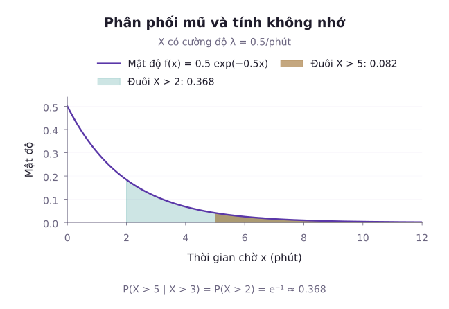
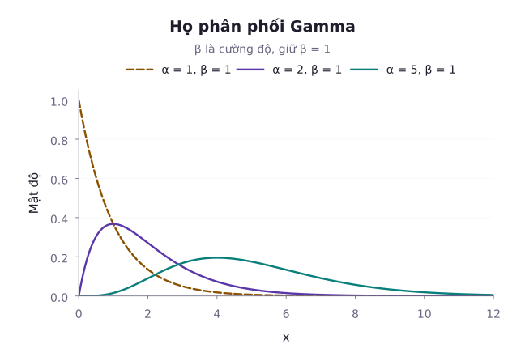
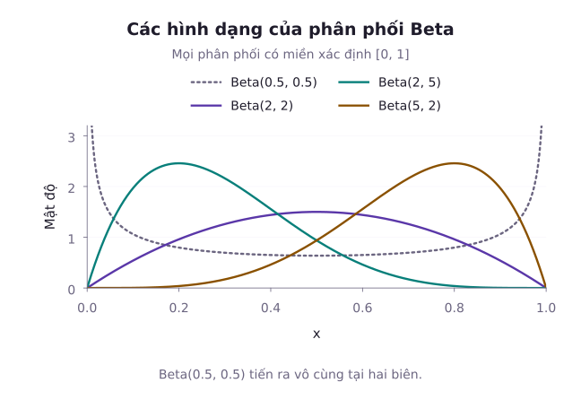

Ở Bài 14, ta đã làm quen với khái niệm hàm mật độ xác suất và phân phối Chuẩn (Gauss) vốn đóng vai trò trung tâm khi mô tả các đại lượng bị tác động bởi vô số sai số ngẫu nhiên nhỏ cộng dồn. Tuy nhiên, thế giới thực không chỉ có những đường cong chuông đối xứng:
- Tuổi thọ của linh kiện điện tử hoặc thời gian chờ đợi giữa hai cuộc gọi thường có tính chất bất đối xứng: Phần lớn hỏng sớm hoặc đến nhanh, nhưng có những trường hợp tồn tại rất lâu (phân phối Exponential).
- Tổng thời gian chờ đợi để nhận đủ $k$ gói tin hoặc hoàn thành một chuỗi $k$ công đoạn nối tiếp (phân phối Gamma).
- Tỷ lệ phần trăm, xác suất trúng cử hoặc hiệu suất thuật toán luôn bị chặn ngặt trong khoảng $[0, 1]$ (phân phối Beta).
- Thu nhập cá nhân, lưu lượng truy cập mạng hoặc nồng độ hạt bụi mịn biến thiên trên thang hàm mũ (phân phối Lognormal).

Bài học này xây dựng cơ sở giải tích tích phân vững chắc cho các phân phối liên tục nâng cao, thiết lập cầu nối toán học giữa hàm Gamma, hàm Beta và các bài toán độ tin cậy trong kỹ thuật.

---

## 1. Bản chất hàm mật độ xác suất và tích phân chuẩn hóa

Trong bài này, ta xét các biến ngẫu nhiên có hàm mật độ, còn gọi là các biến liên tục tuyệt đối. Xác suất được phân bố trên các khoảng, và xác suất tại một điểm bất kỳ $x_0$ bằng 0: $P(X = x_0) = 0$. Một tập giá trị không đếm được, tự nó, chưa bảo đảm sự tồn tại của mật độ.

### Hàm mật độ xác suất (PDF) và điều kiện chuẩn hóa

Hàm số $f(x)$ là hàm mật độ xác suất (Probability Density Function) của biến ngẫu nhiên liên tục $X$ nếu thỏa mãn hai điều kiện tiên đề:
1. Tính không âm: $f(x) \ge 0, \forall x \in \mathbb{R}$.
2. Điều kiện chuẩn hóa tổng xác suất: Tích phân suy rộng trên toàn bộ trục số thực phải bằng 1:

$$
\int_{-\infty}^\infty f(x) \, dx = 1.
$$

Xác suất để $X$ rơi vào khoảng $[a, b]$ chính là diện tích hình thang cong dưới đồ thị hàm mật độ:

$$
P(a \le X \le b) = \int_a^b f(x) \, dx.
$$

### Hàm phân phối tích lũy (CDF)

Hàm phân phối tích lũy $F(x)$ đo lường xác suất tích lũy từ $-\infty$ đến $x$:

$$
\begin{aligned}
F(x) &= P(X \le x) \\
&= \int_{-\infty}^x f(t) \, dt.
\end{aligned}
$$

Theo định lý cơ bản của giải tích, tại mọi điểm $x$ mà $f(x)$ liên tục, đạo hàm của hàm tích lũy chính là hàm mật độ:

$$
f(x) = F'(x) = \frac{d}{dx} F(x).
$$

---

## 2. Phân phối Exponential và tính chất không nhớ

Phân phối Exponential là mô hình liên tục cơ bản nhất để mô tả thời gian chờ đợi giữa các sự kiện trong một quá trình Poisson có tốc độ trung bình $\lambda > 0$ (đơn vị: Sự kiện trên một đơn vị thời gian).

### Hàm mật độ và hàm tích lũy

Biến ngẫu nhiên $X \sim \mathrm{Exp}(\lambda)$ có:
- **Hàm mật độ (PDF)**:

$$
f(x) = \begin{cases} \lambda e^{-\lambda x}, & x \ge 0, \\ 0, & x < 0. \end{cases}
$$

- **Hàm tích lũy (CDF)**:

$$
\begin{aligned}
F(x) &= \int_0^x \lambda e^{-\lambda t} \, dt \\
&= 1 - e^{-\lambda x} \quad (x \ge 0).
\end{aligned}
$$

- **Xác suất đuôi (Survival function)**:

$$
P(X > x) = 1 - F(x) = e^{-\lambda x}
$$

với mọi $x \ge 0$.

- **Kỳ vọng và phương sai**:

$$
\mathbb{E}[X] = \frac{1}{\lambda}, \quad \mathrm{Var}(X) = \frac{1}{\lambda^2}.
$$

### Tính chất không nhớ (Memoryless Property)

Xét biến ngẫu nhiên liên tục không âm $X$, hữu hạn hầu chắc chắn và có $P(X > s) > 0$ với mọi $s > 0$. Biến này có tính không nhớ nếu với mọi $s, t > 0$:

$$
P(X > s + t \mid X > s) = P(X > t).
$$

::: proof Chứng minh tính chất không nhớ hai chiều
1. **Chiều thuận**: Giả sử $X \sim \mathrm{Exp}(\lambda)$. Đặt $A = \{X > s + t\}$ và $B = \{X > s\}$. Vì $s, t > 0$ nên $A \subset B$, suy ra $A \cap B = A$. Khi đó:

$$
\begin{aligned}
P(A \mid B) &= \frac{P(A)}{P(B)} \\
&= \frac{e^{-\lambda(s+t)}}{e^{-\lambda s}} \\
&= e^{-\lambda t} \\
&= P(X > t).
\end{aligned}
$$

2. **Chiều nghịch**: Giả sử biến ngẫu nhiên liên tục $X \ge 0$ thỏa mãn $P(X > s+t \mid X > s) = P(X > t)$. Đặt $g(t) = P(X > t)$.
   Điều kiện trở thành: Biểu thức $\frac{g(s+t)}{g(s)} = g(t)$, hay $g(s+t) = g(s)g(t)$ với mọi $s, t > 0$.
   Vì $g(t) > 0$, đặt $h(t) = -\ln g(t)$. Khi đó $h(s+t) = h(s)+h(t)$ và $h$ không giảm. Với số hữu tỉ dương $r$, tính cộng cho $h(r) = r h(1)$. Xấp xỉ một số thực bằng hai dãy hữu tỉ từ dưới và từ trên, tính đơn điệu cho $h(t) = \lambda t$ với $\lambda = h(1)$.
   Do $X$ hữu hạn hầu chắc chắn, $g(t)$ tiến về 0 khi $t$ tăng vô hạn, nên $\lambda > 0$. Vì vậy $g(t) = e^{-\lambda t}$.
   Do đó, phân phối Exponential là phân phối xác suất liên tục duy nhất sở hữu tính chất không nhớ.
:::

::: example Ví dụ 1: Thời gian phục vụ tại quầy thanh toán
Giả sử thời gian xử lý giao dịch cho một khách hàng tại quầy thanh toán tự động tuân theo phân phối Exponential với thời gian phục vụ trung bình là 2 phút (tức tốc độ $\lambda = 1/2 = 0{,}5$ khách/phút).

1. Tính xác suất một khách hàng cần thời gian thanh toán nhiều hơn 3 phút.
2. Nếu biết một khách hàng đã đứng tại quầy được 2 phút mà chưa xong, tính xác suất người đó cần thêm ít nhất 3 phút nữa (tổng thời gian vượt quá 5 phút).

*Lời giải:*
Gọi $X$ là thời gian thanh toán ($X \sim \mathrm{Exp}(\lambda = 0{,}5)$).
1. Xác suất thời gian thanh toán vượt quá 3 phút:

$$
\begin{aligned}
P(X > 3) &= e^{-0{,}5 \times 3} \\
&= e^{-1{,}5} \\
&\approx 0{,}2231.
\end{aligned}
$$

2. Do tính chất không nhớ của phân phối Exponential:

$$
\begin{aligned}
P(X > 5 \mid X > 2) &= P(X > 3) \\
&= e^{-1{,}5} \\
&\approx 0{,}2231.
\end{aligned}
$$

Khoảng thời gian 2 phút đã trôi qua không làm thay đổi phân phối thời gian chờ đợi tiếp theo.
:::

---

## 3. Phân phối Gamma và hàm Gamma Euler

Khi chờ sự kiện thứ $k$ của một quá trình Poisson đồng nhất, với $k$ nguyên dương, ta cộng $k$ khoảng chờ Exponential độc lập. Tổng đó có phân phối **Gamma** với tham số hình dạng $\alpha = k$. Họ Gamma còn được mở rộng tới mọi $\alpha > 0$ bằng hàm Gamma Euler. Với $\alpha$ không nguyên, không diễn giải $\alpha$ là số sự kiện.

### Hàm Gamma Euler

Hàm Gamma Euler $\Gamma(\alpha)$ được định nghĩa bằng tích phân suy rộng:

$$
\Gamma(\alpha) = \int_0^\infty x^{\alpha - 1} e^{-x} \, dx, \quad \alpha > 0.
$$

Các tính chất giải tích quan trọng của hàm Gamma:
- Công thức truy hồi tích phân từng phần: $\Gamma(\alpha + 1) = \alpha \Gamma(\alpha)$.
- Với số nguyên dương $n \in \mathbb{N}^*$: $\Gamma(n) = (n - 1)!$.
- Giá trị đặc biệt: $\Gamma(1) = 0! = 1$ và $\Gamma(1/2) = \sqrt{\pi}$.

### Định nghĩa phân phối Gamma

Biến ngẫu nhiên $X \sim \mathrm{Gamma}(\alpha, \lambda)$ với tham số hình dạng $\alpha > 0$ và tham số tốc độ $\lambda > 0$ có hàm mật độ:

$$
f(x) = \begin{cases} \frac{\lambda^\alpha}{\Gamma(\alpha)} x^{\alpha - 1} e^{-\lambda x}, & x > 0, \\ 0, & x \le 0. \end{cases}
$$

### Tính chất mômen và tổng biến độc lập

- Kỳ vọng và phương sai:

$$
\mathbb{E}[X] = \frac{\alpha}{\lambda}, \quad \mathrm{Var}(X) = \frac{\alpha}{\lambda^2}.
$$

- **Tính cộng tính**: Nếu $X_1 \sim \mathrm{Gamma}(\alpha_1, \lambda)$ và $X_2 \sim \mathrm{Gamma}(\alpha_2, \lambda)$ độc lập và có cùng tham số tốc độ $\lambda$, thì:

$$
X_1 + X_2 \sim \mathrm{Gamma}(\alpha_1 + \alpha_2, \lambda).
$$

- **Phân phối Erlang**: Khi tham số $\alpha = k$ là một số nguyên dương, phân phối Gamma được gọi là phân phối Erlang, chính là tổng của $k$ biến ngẫu nhiên Exponential độc lập cùng phân phối $\mathrm{Exp}(\lambda)$.

::: example Ví dụ 2: Thời gian chờ nhận gói dữ liệu mạng
Giả sử một máy chủ trung tâm nhận các gói dữ liệu từ cảm biến IoT theo quá trình Poisson với tốc độ trung bình $\lambda = 2$ gói/giây. Gọi $T$ là thời gian cần thiết tính từ lúc khởi động cho đến khi máy chủ nhận đủ $\alpha = 4$ gói tin.

1. Xác định phân phối của $T$, tính thời gian kỳ vọng và độ lệch chuẩn.
2. Tính xác suất để máy chủ nhận đủ 4 gói tin trong vòng không quá 1,5 giây: $P(T \le 1{,}5)$.

*Lời giải:*
1. Đại lượng $T$ là tổng của 4 biến ngẫu nhiên $\mathrm{Exp}(\lambda = 2)$ độc lập, do đó $T \sim \mathrm{Gamma}(\alpha = 4, \lambda = 2)$.
   Thời gian kỳ vọng:

$$
\mathbb{E}[T] = \frac{\alpha}{\lambda} = \frac{4}{2} = 2{,}0 \text{ giây}.
$$

   Phương sai và độ lệch chuẩn:

$$
\mathrm{Var}(T) = \frac{\alpha}{\lambda^2} = \frac{4}{2^2} = 1{,}0.
$$

Độ lệch chuẩn: $\sigma_T = \sqrt{1{,}0} = 1{,}0$ giây.

2. Biến cố nhận đủ 4 gói tin trong vòng 1,5 giây $\{T \le 1{,}5\}$ tương đương với việc số gói tin $N(1{,}5)$ đến trong 1,5 giây phải đạt ít nhất 4 gói.
   Vì $N(1{,}5)\sim\mathrm{Poisson}(3)$:

$$
\begin{aligned}
P(T \le 1{,}5) &= P(N(1{,}5) \ge 4) \\
&= 1 - \sum_{k=0}^3 \frac{3^k e^{-3}}{k!}.
\end{aligned}
$$

   Đặt $S_3 = \sum_{k=0}^3 \frac{3^k e^{-3}}{k!}$. Khai triển từng số hạng:

$$
\begin{aligned}
S_3 &= e^{-3} (1 + 3 + 4{,}5 + 4{,}5) \\
&= 13 e^{-3} \\
&\approx 0{,}6472.
\end{aligned}
$$

   Vậy xác suất cần tìm là:

$$
\begin{aligned}
P(T \le 1{,}5) &= 1 - S_3 \\
&\approx 1 - 0{,}6472 \\
&= 0{,}3528 = 35{,}28\%.
\end{aligned}
$$

:::

---

## 4. Phân phối Beta và vai trò trong suy luận Bayesian

Khi một đại lượng bị giới hạn trong $[0, 1]$, một mô hình có mật độ trên toàn trục số có thể gán xác suất ra ngoài miền hợp lệ. **Phân phối Beta** là một lựa chọn linh hoạt cho các tỷ lệ liên tục trong khoảng này. Tỷ lệ từ một mẫu hữu hạn lại là biến rời rạc, nên cần phân biệt hai tình huống.

### Hàm Beta Euler và hàm mật độ

Hàm Beta Euler $B(\alpha, \beta)$ được định nghĩa với $\alpha, \beta > 0$:

$$
B(\alpha, \beta) = \int_0^1 x^{\alpha - 1} (1 - x)^{\beta - 1} \, dx.
$$

Mối liên hệ giữa hàm Beta và hàm Gamma:

$$
B(\alpha, \beta) = \frac{\Gamma(\alpha)\Gamma(\beta)}{\Gamma(\alpha + \beta)}.
$$

Biến ngẫu nhiên $X \sim \mathrm{Beta}(\alpha, \beta)$ có hàm mật độ xác suất trên đoạn $[0, 1]$:

$$
f(x) = \frac{1}{B(\alpha, \beta)} x^{\alpha - 1} (1 - x)^{\beta - 1}
$$

với $0 < x < 1$, và $f(x) = 0$ ngoài khoảng này. Giá trị mật độ tại hai đầu mút có thể quy ước tùy ý vì không làm thay đổi xác suất.

### Các đặc trưng số

- Kỳ vọng:

$$
\mathbb{E}[X] = \frac{\alpha}{\alpha + \beta}.
$$

- Phương sai:

$$
\mathrm{Var}(X) = \frac{\alpha \beta}{(\alpha + \beta)^2 (\alpha + \beta + 1)}.
$$

- Yếu vị (Mode): Khi $\alpha > 1, \beta > 1$, điểm cực đại của mật độ là:

$$
\mathrm{Mode}(X) = \frac{\alpha - 1}{\alpha + \beta - 2}.
$$

Phân phối Beta là tiên nghiệm liên hợp của mô hình Nhị thức. Cụ thể, giả sử $\theta \sim \mathrm{Beta}(\alpha, \beta)$ và khi biết $\theta$, các phép thử Bernoulli độc lập, cùng có xác suất thành công $\theta$. Sau $k$ thành công trong $n$ phép thử, hậu nghiệm là $\mathrm{Beta}(\alpha + k, \beta + n - k)$.

::: example Ví dụ 3: Đánh giá tỷ lệ nhấp chuột quảng cáo
Giả sử một chuyên gia tiếp thị số mô hình hóa tỷ lệ nhấp chuột của một mẫu quảng cáo trực tuyến bằng phân phối $\mathrm{Beta}(\alpha = 3, \beta = 7)$.

1. Tính tỷ lệ nhấp chuột kỳ vọng và phương sai của tỷ lệ này.
2. Tìm tỷ lệ tại đó mật độ xác suất đạt cực đại (Mode).

*Lời giải:*
1. Tỷ lệ nhấp chuột kỳ vọng:

$$
\begin{aligned}
\mathbb{E}[\theta] &= \frac{\alpha}{\alpha + \beta} \\
&= \frac{3}{3 + 7} \\
&= 0{,}30 = 30\%.
\end{aligned}
$$

   Phương sai:

$$
\begin{aligned}
\mathrm{Var}(\theta) &= \frac{3 \times 7}{(3 + 7)^2 \times (3 + 7 + 1)} \\
&= \frac{21}{1100} \\
&\approx 0{,}0191.
\end{aligned}
$$

   Độ lệch chuẩn tương ứng: $\sigma_\theta = \sqrt{21/1100} \approx 0{,}1382$.
2. Yếu vị của phân phối:

$$
\begin{aligned}
\mathrm{Mode}(\theta) &= \frac{\alpha - 1}{\alpha + \beta - 2} \\
&= \frac{2}{8} = 0{,}25 = 25\%.
\end{aligned}
$$

:::

---

## 5. Phân phối Weibull và Lognormal

Bên cạnh Gamma và Beta, hai phân phối liên tục khác thường xuyên xuất hiện trong kỹ thuật độ tin cậy và kinh tế học là Weibull và Lognormal:

### Phân phối Weibull và hàm tỷ lệ hỏng hóc

Phân phối Weibull có tham số hình dạng $k > 0$ và tham số thang đo $\lambda > 0$. Ở mục này, $\lambda$ là thang thời gian, khác với tham số tốc độ của Exponential ở trên:

$$
f(t) = \frac{k}{\lambda} \left( \frac{t}{\lambda} \right)^{k - 1} e^{-(t/\lambda)^k}, \quad t > 0.
$$

Mật độ bằng 0 khi $t < 0$. Hàm tỷ lệ hỏng hóc tại $t > 0$ là tốc độ hỏng có điều kiện trên một đơn vị thời gian, khi biết thiết bị còn hoạt động đến $t$:

$$
\begin{aligned}
h(t) &= \frac{f(t)}{1 - F(t)} \\
&= \frac{k}{\lambda} \left( \frac{t}{\lambda} \right)^{k - 1}.
\end{aligned}
$$

- Khi $k = 1$: $h(t) = 1/\lambda$ là hằng số (chính là phân phối Exponential không nhớ).
- Khi $k > 1$: $h(t)$ tăng theo thời gian (hiện tượng hao mòn, lão hóa của linh kiện cơ khí).
- Khi $k < 1$: $h(t)$ giảm theo thời gian (mô hình sàng lọc linh kiện có khiếm khuyết sớm).

### Phân phối Lognormal

Biến ngẫu nhiên $Y > 0$ tuân theo phân phối Lognormal nếu logarit tự nhiên của nó tuân theo phân phối Chuẩn với $\sigma > 0$:

$$
X = \ln(Y) \sim \mathcal{N}(\mu, \sigma^2).
$$

Hàm mật độ của $Y$ trên miền $y > 0$:

$$
f_Y(y) = \frac{1}{y \sigma \sqrt{2\pi}} e^{-\frac{(\ln y - \mu)^2}{2\sigma^2}}.
$$

- **Trung vị**: $\mathrm{Med}(Y) = e^\mu$.
- **Kỳ vọng**: $\mathbb{E}[Y] = e^{\mu + \sigma^2 / 2}$.

Vì $\sigma^2 > 0$, kỳ vọng luôn lớn hơn trung vị: $\mathbb{E}[Y] > \mathrm{Med}(Y)$. Trong một mô hình thu nhập Lognormal, các giá trị ở đuôi phải kéo kỳ vọng lên trên trung vị. Mức chênh lệch phụ thuộc vào $\sigma$, và việc áp dụng mô hình cho một quần thể cụ thể cần được kiểm tra bằng dữ liệu.

::: example Ví dụ 4: Phân tích thu nhập Lognormal
Gọi $Y$ là số đo thu nhập hàng tháng tính bằng triệu đồng. Giả sử $\ln Y$ có phân phối Chuẩn với $\mu = 3$ và $\sigma = 0{,}5$. Hai tham số này thuộc thang logarit của số đo thu nhập.

1. Tính mức thu nhập trung vị.
2. Tính mức thu nhập kỳ vọng và giải thích sự chênh lệch.

*Lời giải:*
1. Mức thu nhập trung vị:

$$
\begin{aligned}
\mathrm{Med}(Y) &= e^\mu \\
&= e^3 \\
&\approx 20{,}0855 \text{ triệu đồng}.
\end{aligned}
$$

Theo mô hình, xác suất thu nhập thấp hơn trung vị là $50\%$, và xác suất cao hơn cũng là $50\%$. Tỷ lệ thực nghiệm trong một mẫu hữu hạn có thể khác các giá trị này.
2. Mức thu nhập kỳ vọng:

$$
\begin{aligned}
\mathbb{E}[Y] &= e^{\mu + \sigma^2 / 2} \\
&= e^{3{,}125} \\
&\approx 22{,}7599.
\end{aligned}
$$

Thu nhập kỳ vọng là khoảng 22,76 triệu đồng. Thu nhập bình quân (22,76 triệu) cao hơn thu nhập trung vị (20,09 triệu) khoảng 2,67 triệu đồng. Sự chênh lệch này phát sinh do một số ít chuyên gia có thu nhập đột biến ở đuôi bên phải kéo số trung bình lên cao, trong khi giá trị trung vị phản ánh chính xác vị trí phân đôi của quần thể.
:::

---

## Tóm tắt bài học

- **Hàm mật độ liên tục**: Thỏa mãn tính không âm và tích phân chuẩn hóa toàn cục bằng 1. Xác suất tại từng điểm đơn lẻ bằng 0.
- **Phân phối Exponential**: Mô hình chuẩn cho thời gian chờ đợi giữa hai biến cố Poisson và có tính chất không nhớ hai chiều đặc trưng.
- **Phân phối Gamma**: Có hình dạng $\alpha > 0$ và tốc độ $\lambda > 0$. Khi $\alpha$ nguyên dương, đây là thời gian chờ sự kiện thứ $\alpha$ trong quá trình Poisson. Các biến Gamma độc lập cùng tốc độ có tính cộng tham số hình dạng.
- **Phân phối Beta**: Mô hình hóa các đại lượng liên tục trên đoạn $[0, 1]$. Phân phối này còn là phân phối tiên nghiệm liên hợp cho phép thử Nhị thức trong thống kê Bayesian.
- **Weibull và Lognormal**: Hai mô hình ứng dụng trong phân tích độ tin cậy cơ khí và kinh tế lượng.

---

## Tài liệu tham khảo

- Penn State University, [STAT 414: Introduction to Probability Theory](https://online.stat.psu.edu/stat414/index), phần Exponential, Gamma and Chi-Square Distributions và Transformations of Two Random Variables.
- MIT OpenCourseWare, [18.05: Calendar](https://ocw.mit.edu/courses/18-05-introduction-to-probability-and-statistics-spring-2022/pages/calendar/), Class 5b về biến liên tục và Class 15 về Beta và tiên nghiệm liên hợp.
- Joseph K. Blitzstein và Jessica Hwang, [Introduction to Probability](https://probabilitybook.net/), các phân phối liên tục và tính không nhớ.

Hệ thống bài tập rèn luyện kỹ năng tính toán tích phân hàm mật độ, vận dụng tính chất không nhớ và phân tích các phân phối liên tục nâng cao.

## Bài tập rèn luyện: Phân phối liên tục mở rộng

::: exercise Bài tập 1
Tuổi thọ hoạt động liên tục của một loại vi cảm biến tuân theo phân phối Exponential với tỷ lệ hỏng hóc $\lambda = 0{,}001$ giờ$^{-1}$. Tính thời gian hoạt động trung vị $t_{0{,}5}$ (tức thời điểm mà xác suất cảm biến còn hoạt động đúng bằng 50%).
:::
::: solution Lời giải
Thời gian trung vị $t_{0{,}5}$ thỏa mãn phương trình:

$$
\begin{aligned}
1 - e^{-\lambda t_{0{,}5}} &= 0{,}5 \\
\iff e^{-\lambda t_{0{,}5}} &= 0{,}5.
\end{aligned}
$$

Lấy logarit tự nhiên hai vế:

$$
\begin{aligned}
-\lambda t_{0{,}5} &= -\ln(2) \\
\implies t_{0{,}5} &= \frac{\ln(2)}{\lambda}.
\end{aligned}
$$

Thay số với $\lambda = 0{,}001$:

$$
t_{0{,}5} = \frac{0{,}693147}{0{,}001} \approx 693{,}15 \text{ giờ}.
$$

:::

::: exercise Bài tập 2
Sử dụng các tính chất giải tích của hàm Gamma Euler để tính chính xác các giá trị:
1. $\Gamma(5)$.
2. $\Gamma(5/2)$.
:::
::: solution Lời giải
1. Với số nguyên dương $n = 5$:

$$
\Gamma(5) = (5 - 1)! = 4! = 24.
$$

2. Sử dụng công thức truy hồi $\Gamma(\alpha + 1) = \alpha \Gamma(\alpha)$ và $\Gamma(1/2) = \sqrt{\pi}$:

$$
\begin{aligned}
\Gamma(5/2) &= \frac{3}{2} \Gamma(3/2) \\
&= \frac{3}{2} \times \frac{1}{2} \Gamma(1/2) \\
&= \frac{3}{4} \sqrt{\pi} \\
&\approx 1{,}3293.
\end{aligned}
$$

:::

::: exercise Bài tập 3
Cho biến ngẫu nhiên $X \sim \mathrm{Beta}(2, 2)$.
1. Viết biểu thức giải tích của hàm mật độ xác suất $f(x)$ trên $[0, 1]$.
2. Tính xác suất để $X$ nhận giá trị trong khoảng $[0{,}25; 0{,}75]$.
:::
::: solution Lời giải
1. Ta tính hằng số chuẩn hóa Beta:

$$
\begin{aligned}
B(2, 2) &= \frac{\Gamma(2)\Gamma(2)}{\Gamma(4)} \\
&= \frac{1! \times 1!}{3!} \\
&= \frac{1}{6}.
\end{aligned}
$$

Do đó, hàm mật độ xác suất trên đoạn $[0, 1]$ là:

$$
\begin{aligned}
f(x) &= \frac{1}{B(2, 2)} x(1 - x) \\
&= 6(x - x^2) \quad (0 \le x \le 1).
\end{aligned}
$$

2. Xác suất trên khoảng $[0{,}25; 0{,}75]$:

$$
\begin{aligned}
P &= \int_{1/4}^{3/4} 6(x - x^2) \, dx \\
&= \left[ 3x^2 - 2x^3 \right]_{1/4}^{3/4}.
\end{aligned}
$$

Giá trị tại hai cận:
- Tại cận trên $x = 3/4$: $F(3/4) = 27/32 = 0{,}84375$.
- Tại cận dưới $x = 1/4$: $F(1/4) = 5/32 = 0{,}15625$.

Hiệu số:

$$
\begin{aligned}
P &= \frac{27}{32} - \frac{5}{32} \\
&= \frac{11}{16} = 68{,}75\%.
\end{aligned}
$$

:::

::: exercise Bài tập 4
Phân tích ý nghĩa vật lý của hàm tỷ lệ hỏng hóc $h(t) = \frac{k}{\lambda} (t/\lambda)^{k-1}$ của phân phối Weibull trong ba trường hợp $k < 1$, $k = 1$ và $k > 1$. Nêu một ví dụ thực tế tương ứng cho mỗi trường hợp.
:::
::: solution Lời giải
Hàm $h(t)$ là một tốc độ, không phải xác suất. Với khoảng thời gian ngắn $\Delta t$, xác suất hỏng trong khoảng đó khi biết thiết bị sống đến $t$ xấp xỉ $h(t)\Delta t$. Vì vậy $h(t)$ có đơn vị nghịch đảo thời gian:
- **Trường hợp $k = 1$**: Hàm $h(t) = 1/\lambda$ là hằng số không phụ thuộc thời gian. Thiết bị không có hiện tượng lão hóa hay ghi nhớ quá khứ. Ví dụ mô hình hóa: Tuổi thọ của hạt nhân phóng xạ có tốc độ phân rã không đổi.
- **Trường hợp $k > 1$**: Số mũ $k - 1 > 0$, dẫn đến $h(t)$ tăng ngặt theo thời gian. Thiết bị càng dùng lâu thì nguy cơ hỏng hóc càng cao. Ví dụ: Sự mài mòn của lốp xe ô tô, ổ bi cơ khí hoặc pin lithium-ion sau nhiều chu kỳ sạc.
- **Trường hợp $k < 1$**: Số mũ $k - 1 < 0$, dẫn đến $h(t)$ giảm dần theo thời gian. Các cá thể có khiếm khuyết bẩm sinh sẽ hỏng hóc ngay trong giai đoạn đầu, các cá thể sống sót qua giai đoạn này sẽ hoạt động ổn định hơn. Ví dụ mô hình hóa: Thời gian hỏng của một lô linh kiện có khiếm khuyết sớm được sàng lọc qua giai đoạn chạy rà.
:::

::: exercise Bài tập 5
Sử dụng tích phân hàm Gamma Euler để tính mômen gốc bậc 4 của biến ngẫu nhiên phân phối Chuẩn chuẩn tắc: $\mathbb{E}[Z^4]$ với $Z \sim \mathcal{N}(0, 1)$.
:::
::: solution Lời giải
Theo định nghĩa kỳ vọng:

$$
\mathbb{E}[Z^4] = \int_{-\infty}^\infty z^4 \frac{1}{\sqrt{2\pi}} e^{-z^2 / 2} \, dz.
$$

Do hàm dưới dấu tích phân là hàm chẵn:

$$
\mathbb{E}[Z^4] = \frac{2}{\sqrt{2\pi}} \int_0^\infty z^4 e^{-z^2 / 2} \, dz.
$$

Đổi biến $u = z^2 / 2 \implies z^2 = 2u$ và $z \, dz = du \implies dz = \frac{du}{\sqrt{2u}}$. Thay vào tích phân:

$$
\begin{aligned}
\mathbb{E}[Z^4] &= \frac{2}{\sqrt{2\pi}} \int_0^\infty (2u)^2 e^{-u} \frac{du}{\sqrt{2u}} \\
&= \frac{4}{\sqrt{\pi}} \int_0^\infty u^{5/2 - 1} e^{-u} \, du \\
&= \frac{4}{\sqrt{\pi}} \Gamma(5/2).
\end{aligned}
$$

Theo kết quả của Bài tập 2, $\Gamma(5/2) = \frac{3}{4}\sqrt{\pi}$. Thay vào biểu thức:

$$
\mathbb{E}[Z^4] = \frac{4}{\sqrt{\pi}} \times \frac{3}{4}\sqrt{\pi} = 3.
$$

Kết quả này giải thích vì sao độ nhọn chuẩn hóa (kurtosis) của phân phối Chuẩn được chọn làm mốc tham chiếu bằng 3.
:::

