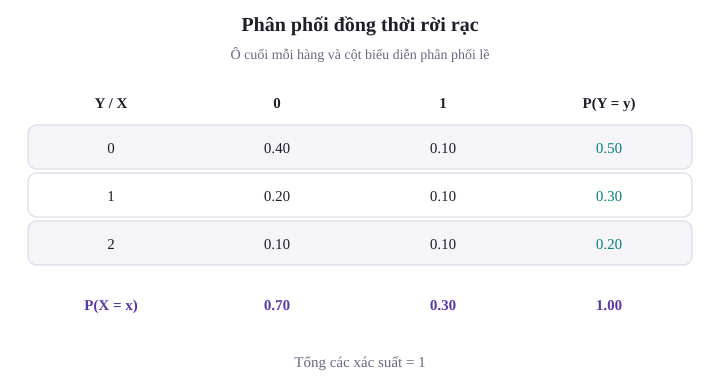
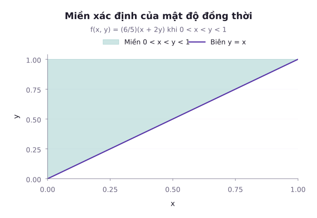
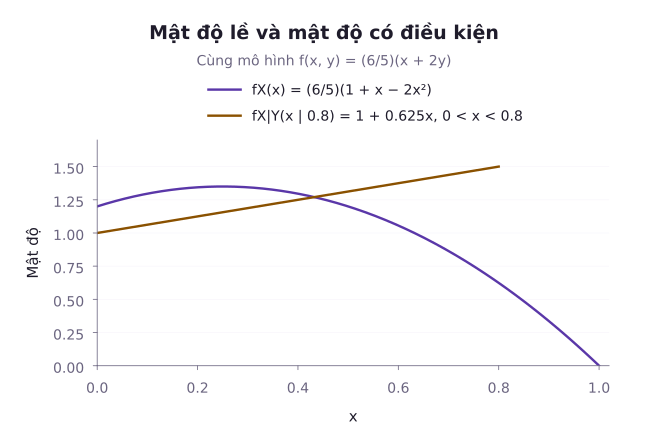

Trong hầu hết các bài toán khoa học dữ liệu và kỹ thuật, các biến số hiếm khi xuất hiện đơn độc:
- Khi phân tích hiệu năng của một máy chủ, ta không thể chỉ quan sát riêng lẻ tỷ lệ tải CPU mà phải đặt song song cùng mức chiếm dụng bộ nhớ RAM và lưu lượng mạng.
- Khi chẩn đoán bệnh lý, bác sĩ phải đồng thời xem xét huyết áp tâm thu và nồng độ cholesterol của bệnh nhân.
- Khi điều khiển xe tự hành, hệ thống phải theo dõi đồng thời vị trí $x, y$ và vận tốc $v$ của các chướng ngại vật xung quanh.

Một tập hợp gồm nhiều biến ngẫu nhiên cùng được định nghĩa trên một không gian mẫu $\Omega$ được gọi là một **vector ngẫu nhiên** (Random Vector). Để phân tích mối quan hệ tương hỗ và quy luật biến thiên của chúng, ta cần công cụ **phân phối xác suất đồng thời** (Joint Distribution). Bài học này làm rõ cách xây dựng bảng phân phối đồng thời rời rạc, hàm mật độ đồng thời liên tục trên các miền phi chữ nhật, cách trích xuất phân phối lề, phân phối có điều kiện và tiêu chuẩn độc lập trong giải tích nhiều biến.

---

## 1. Vector ngẫu nhiên rời rạc và bảng phân phối đồng thời

Xét hai biến ngẫu nhiên rời rạc $X$ và $Y$ cùng xác định trên không gian mẫu $\Omega$.

### Hàm khối xác suất đồng thời (Joint PMF)

Hàm khối xác suất đồng thời của vector ngẫu nhiên $(X, Y)$ được định nghĩa là:

$$
p_{X,Y}(x, y) = P(X = x, Y = y).
$$

Hàm này thỏa mãn hai điều kiện tiên đề:
1. $p_{X,Y}(x, y) \ge 0$ với mọi cặp giá trị $(x, y)$.
2. Tổng toàn bộ xác suất trên mọi điểm khả dĩ bằng 1:

$$
\sum_{x \in S_X} \sum_{y \in S_Y} p_{X,Y}(x,y) = 1.
$$

Ở đây, $S_X$ và $S_Y$ là các tập giá trị có thể nhận của hai biến. Mỗi tổng trong cộng các ô trên cùng một hàng, rồi tổng ngoài cộng tất cả các hàng. Ví dụ dưới đây khai triển các tổng này bằng một bảng sáu ô.

### Phân phối lề (Marginal PMF)

Nếu chỉ muốn tìm quy luật phân phối riêng của từng biến số $X$ mà không quan tâm đến giá trị cụ thể của $Y$, ta thực hiện phép cộng dồn trên tất cả các giá trị khả dĩ của $Y$:

$$
\begin{aligned}
p_X(x) &= P(X = x) \\
&= \sum_y p_{X,Y}(x, y).
\end{aligned}
$$

Hoàn toàn tương tự, phân phối lề của $Y$ thu được bằng cách cộng dồn theo các giá trị của $X$:

$$
\begin{aligned}
p_Y(y) &= P(Y = y) \\
&= \sum_x p_{X,Y}(x, y).
\end{aligned}
$$

### Phân phối có điều kiện (Conditional PMF)

Khi đã biết trước biến $X$ nhận giá trị cụ thể $x$ (với điều kiện $p_X(x) > 0$), phân phối xác suất có điều kiện của biến $Y$ được tính bằng định nghĩa xác suất có điều kiện:

$$
\begin{aligned}
p_{Y \mid X}(y \mid x) &= P(Y = y \mid X = x) \\
&= \frac{p_{X,Y}(x, y)}{p_X(x)}.
\end{aligned}
$$

Hàm này là một hàm phân phối xác suất hợp lệ theo biến $y$, nghĩa là: $\sum_y p_{Y \mid X}(y \mid x) = 1$.

::: example Ví dụ 1: Phân tích nhật ký sự cố hệ thống máy chủ
Giả sử một hệ thống máy chủ ghi nhận số lượng sự cố phần cứng $X \in \{0, 1\}$ và số lượng sự cố phần mềm $Y \in \{0, 1, 2\}$ xảy ra trong mỗi ca trực. Bảng phân phối xác suất đồng thời $p_{X,Y}(x, y)$ được thống kê như sau:

| Sự cố phần cứng ($X$) \ Sự cố phần mềm ($Y$) | $Y = 0$ | $Y = 1$ | $Y = 2$ |
| :---: | :---: | :---: | :---: |
| **$X = 0$** | 0,40 | 0,20 | 0,10 |
| **$X = 1$** | 0,10 | 0,10 | 0,10 |

1. Tìm phân phối xác suất lề của biến cố phần cứng $X$ và biến cố phần mềm $Y$.
2. Nếu biết ca trực vừa qua đã xảy ra sự cố phần cứng ($X = 1$), tính phân phối có điều kiện của số lỗi phần mềm $Y$.
3. Hai biến ngẫu nhiên $X$ và $Y$ có độc lập với nhau hay không?

*Lời giải:*
1. **Phân phối lề của $X$**:
   - $P(X=0)=0{,}70$, bằng $0{,}40+0{,}20+0{,}10$.
   - $P(X=1)=0{,}30$, bằng $0{,}10+0{,}10+0{,}10$.

   **Phân phối lề của $Y$**:
   - $P(Y=0)=0{,}50$, bằng $0{,}40+0{,}10$.
   - $P(Y=1)=0{,}30$, bằng $0{,}20+0{,}10$.
   - $P(Y=2)=0{,}20$, bằng $0{,}10+0{,}10$.

   Kiểm tra tổng xác suất: $0{,}50 + 0{,}30 + 0{,}20 = 1{,}00$.
2. **Phân phối có điều kiện của $Y$ khi biết $X = 1$**:
   Vì $P(X = 1) = 0{,}30 > 0$, áp dụng công thức $P(Y = y \mid X = 1) = \frac{P(X = 1, Y = y)}{P(X = 1)}$:
   - $P(Y = 0 \mid X = 1) = \frac{0{,}10}{0{,}30} = \frac{1}{3}$.
   - $P(Y = 1 \mid X = 1) = \frac{0{,}10}{0{,}30} = \frac{1}{3}$.
   - $P(Y = 2 \mid X = 1) = \frac{0{,}10}{0{,}30} = \frac{1}{3}$.

   Khi xảy ra sự cố phần cứng, cả ba mức độ lỗi phần mềm đều có khả năng xuất hiện ngang nhau (phân phối đều rời rạc).
3. **Kiểm tra tính độc lập**:
   Hai biến ngẫu nhiên rời rạc $X$ và $Y$ độc lập khi và chỉ khi $p(x, y) = p_X(x) p_Y(y)$ với mọi cặp $(x, y)$.
   Xét cặp $(X = 0, Y = 0)$:
   - Xác suất đồng thời: $P(X = 0, Y = 0) = 0{,}40$.
   - Tích hai xác suất lề: $P(X = 0) P(Y = 0) = 0{,}35$ (tính từ $0{,}70 \times 0{,}50$).

   Vì $0{,}40 \ne 0{,}35$, hai biến ngẫu nhiên $X$ và $Y$ không độc lập. Sự xuất hiện của lỗi phần cứng cung cấp thêm thông tin làm thay đổi xác suất xuất hiện lỗi phần mềm.
:::

---

## 2. Vector ngẫu nhiên liên tục và hàm mật độ đồng thời

Sau đây, ta giả sử cặp $(X,Y)$ có mật độ đồng thời trên $\mathbb{R}^2$. Khi đó xác suất rơi vào một miền đo được $D$ được tính bằng tích phân hai lớp. Hai biến có mật độ lề chưa chắc có mật độ đồng thời, chẳng hạn cặp $(X,X)$ chỉ nằm trên đường chéo.

### Hàm mật độ đồng thời (Joint PDF)

Hàm số $f_{X,Y}(x, y)$ là hàm mật độ xác suất đồng thời nếu thỏa mãn:
1. $f_{X,Y}(x, y) \ge 0, \forall (x, y) \in \mathbb{R}^2$.
2. Điều kiện chuẩn hóa thể tích toàn cục:

$$
\iint_{\mathbb{R}^2} f_{X,Y}(x, y) \, dx \, dy = 1.
$$

Xác suất để $(X, Y)$ rơi vào miền $D$:

$$
P((X, Y) \in D) = \iint_D f(x, y) \, dA.
$$

### Mật độ lề (Marginal PDF)

Tương tự như trường hợp rời rạc, muốn tìm hàm mật độ của một biến đơn lẻ, ta lấy tích phân qua toàn bộ biến còn lại:

$$
\begin{aligned}
&f_X(x) = \int_{-\infty}^\infty f_{X,Y}(x, y) \, dy, \\
&f_Y(y) = \int_{-\infty}^\infty f_{X,Y}(x, y) \, dx.
\end{aligned}
$$

### Mật độ có điều kiện (Conditional PDF)

Tại các giá trị $x$ mà $0 < f_X(x) < \infty$, một phiên bản mật độ có điều kiện được tính bằng:

$$
f_{Y \mid X}(y \mid x) = \frac{f_{X,Y}(x, y)}{f_X(x)}.
$$

Đây không phải phép chia cho $P(X=x)$, vì xác suất đó bằng 0. Công thức xác định mật độ có điều kiện với hầu hết các giá trị $x$ theo phân phối của $X$. Hàm này thỏa mãn tính chuẩn hóa: $\int_{-\infty}^\infty f_{Y \mid X}(y \mid x) \, dy = 1$.

---

## 3. Tích phân trên miền phi chữ nhật và kỹ thuật đổi cận Fubini

Một bước cần chú ý khi tính xác suất đồng thời là xác định cận tích phân trên miền không phải hình chữ nhật $[a, b] \times [c, d]$ mà là các miền phụ thuộc như hình tam giác, hình tròn hay hình thang. Khi dùng các lát cắt dọc hoặc ngang, cận trong thường phụ thuộc biến ngoài. Với hàm mật độ không âm, định lý Tonelli cho phép đổi thứ tự tích phân. Với hàm có thể đổi dấu, định lý Fubini áp dụng khi tích phân trị tuyệt đối hữu hạn.

::: example Ví dụ 2: Hàm mật độ trên miền tam giác
Cho vector ngẫu nhiên liên tục $(X, Y)$ có hàm mật độ đồng thời trên miền $0 \le x \le y \le 1$:

$$
f(x, y) = c(x + 2y)
$$

(và $f(x, y) = 0$ ở các miền còn lại).

1. Xác định hằng số chuẩn hóa $c$.
2. Tìm hàm mật độ lề $f_X(x)$ và $f_Y(y)$.
3. Tìm hàm mật độ có điều kiện $f_{X \mid Y}(x \mid y)$ và tính kỳ vọng có điều kiện $\mathbb{E}[X \mid Y = y]$.

*Lời giải:*
1. **Tìm hằng số $c$**:
   Miền giá trị khả dĩ là tam giác giới hạn bởi $x = 0, y = 1$ và đường thẳng $y = x$.
   Ta thiết lập tích phân hai lớp (cắt theo lát dọc $y$ chạy từ $x$ đến 1, rồi cho $x$ chạy từ 0 đến 1):

$$
\begin{aligned}
I &= \int_0^1 \left[ \int_x^1 (x + 2y) \, dy \right] dx \\
&= \int_0^1 \left[ xy + y^2 \right]_x^1 dx \\
&= \int_0^1 (1 + x - 2x^2) \, dx \\
&= \left[ x + \frac{x^2}{2} - \frac{2x^3}{3} \right]_0^1 = \frac{5}{6}.
\end{aligned}
$$

   Điều kiện chuẩn hóa đòi hỏi $c \times I = 1$, suy ra $c \times \frac{5}{6} = 1$, do đó $c = \frac{6}{5} = 1{,}2$.
2. **Tìm các hàm mật độ lề**:
   - **Mật độ lề $f_X(x)$**: Với mỗi $x \in [0, 1]$, biến $y$ bị chặn dưới bởi đường $y = x$ và chặn trên bởi $y = 1$:

$$
\begin{aligned}
f_X(x) &= \int_x^1 \frac{6}{5}(x + 2y) \, dy \\
&= \frac{6}{5}(1 + x - 2x^2)
\end{aligned}
$$

   (với $0 \le x \le 1$).
   - **Mật độ lề $f_Y(y)$**: Với mỗi $y \in [0, 1]$, biến $x$ chạy từ 0 đến $y$ (cắt theo lát ngang):

$$
\begin{aligned}
f_Y(y) &= \int_0^y \frac{6}{5}(x + 2y) \, dx \\
&= \frac{6}{5} \left[ \frac{x^2}{2} + 2xy \right]_0^y \\
&= 3y^2
\end{aligned}
$$

   (với $0 \le y \le 1$). Kiểm tra tính chuẩn hóa: $\int_0^1 3y^2 \, dy = [y^3]_0^1 = 1$.
3. **Mật độ có điều kiện và kỳ vọng có điều kiện**:
   Tại mỗi giá trị $y \in (0, 1]$, hàm mật độ có điều kiện của $X$ khi biết $Y = y$ là:

$$
\begin{aligned}
f_{X \mid Y}(x \mid y) &= \frac{f(x, y)}{f_Y(y)} \\
&= \frac{\frac{6}{5}(x + 2y)}{3y^2} \\
&= \frac{2(x + 2y)}{5y^2}
\end{aligned}
$$

   (với $0 \le x \le y$). Kỳ vọng có điều kiện $\mathbb{E}[X \mid Y = y]$:

$$
\begin{aligned}
\mathbb{E}[X \mid Y = y] &= \int_0^y x \frac{2(x + 2y)}{5y^2} \, dx \\
&= \frac{2}{5y^2} \left[ \frac{x^3}{3} + x^2 y \right]_0^y \\
&= \frac{2}{5y^2} \left( \frac{4y^3}{3} \right) \\
&= \frac{8}{15} y.
\end{aligned}
$$

   Kỳ vọng có điều kiện là một hàm tuyến tính theo $y$: $\mathbb{E}[X \mid Y = y] = \frac{8}{15} y \approx 0{,}533 y$.
:::

---

## 4. Tiêu chuẩn độc lập của hai biến ngẫu nhiên liên tục

Khái niệm độc lập của hai biến ngẫu nhiên đòi hỏi thông tin về biến này không làm thay đổi bất kỳ đặc tính xác suất nào của biến kia.

### Định lý tiêu chuẩn độc lập

Giả sử $(X,Y)$ có mật độ đồng thời. Hai biến độc lập khi và chỉ khi:

$$
f_{X,Y}(x,y) = f_X(x)f_Y(y)
$$

hầu khắp nơi trên toàn mặt phẳng $\mathbb{R}^2$. “Hầu khắp nơi” nghĩa là có thể bỏ qua một tập có diện tích bằng 0. Khi kiểm tra, phải dùng cả phần mật độ bằng 0 ngoài miền đã cho.

Nếu một phiên bản mật độ lề dương trên các tập $S_X$ và $S_Y$, thì mật độ tích dương trên tích Descartes $S_X \times S_Y$, bỏ qua các tập có độ đo bằng 0. Các tập $S_X$ và $S_Y$ có thể rời rạc thành nhiều khoảng. Vì vậy, độc lập không đòi hỏi miền dương là một hình chữ nhật liền khối.

Ngược lại, chỉ tách được biểu thức đại số trên một miền con chưa đủ. Chẳng hạn, mật độ dương trên toàn miền tam giác nhưng bằng 0 ở nửa còn lại của hình vuông không thể bằng tích hai mật độ lề dương trên cả hình vuông.

Một cách kiểm tra tương đương là viết mật độ trên toàn mặt phẳng thành $g(x)h(y)$ với hai hàm không âm và tích phân dương, hữu hạn. Khi chuẩn hóa từng hàm, ta thu được chính hai mật độ lề.

::: example Ví dụ 3: Kiểm tra tính độc lập
Xét hai hàm mật độ đồng thời sau:
1. $f_1(x, y) = 4xy$ trên hình vuông đơn vị.
2. $f_2(x, y) = 2$ trên tam giác $x \ge 0$, $y \ge 0$, $x+y \le 1$.

Cả hai mật độ đều bằng 0 ngoài miền tương ứng.

*Lời giải:*
1. Với $f_1(x, y)$: Miền xác định là hình vuông $[0, 1] \times [0, 1]$ (dạng tích Descartes). Hàm số phân rã được thành: $f_1(x, y) = (2x)(2y) = g(x)h(y)$. Do đó $X$ và $Y$ độc lập.
2. Với $f_2(x, y)$: Hàm số $f_2(x, y) = 2$ là một hằng số, nhưng miền xác định là tam giác $x + y \le 1$. Khi biết $Y = 0{,}9$, biến $X$ chỉ có thể nhận giá trị trong $[0; 0{,}1]$. Trong khi đó, nếu $Y = 0{,}1$, biến $X$ có thể nhận giá trị trong $[0; 0{,}9]$. Vì miền biến thiên của $X$ bị phụ thuộc vào $Y$, hai biến $X$ và $Y$ không độc lập.
:::

---

## Tóm tắt bài học

- **Vector ngẫu nhiên và phân phối đồng thời**: Cung cấp mô hình toán học toàn diện để theo dõi nhiều biến số ngẫu nhiên cùng lúc. Phân phối lề thu được bằng cách lấy tổng (rời rạc) hoặc tích phân (liên tục) qua các biến còn lại.
- **Phân phối có điều kiện**: Chuẩn hóa lát cắt của phân phối đồng thời khi biết trước giá trị của một biến: $f_{Y \mid X}(y \mid x) = \frac{f(x, y)}{f_X(x)}$.
- **Miền phi chữ nhật**: Khi miền xác định có biên ràng buộc chéo, cận tích phân bắt buộc phải là hàm của biến kia. Thứ tự lấy tích phân Fubini quyết định độ phức tạp của bài toán tính toán.
- **Tiêu chuẩn độc lập**: Với cặp có mật độ đồng thời, độc lập tương đương với $f_{X,Y}(x,y) = f_X(x)f_Y(y)$ hầu khắp nơi trên toàn mặt phẳng. Tập mà mật độ dương là tích của hai tập giá trị lề, bỏ qua tập có độ đo bằng 0, và không nhất thiết là một hình chữ nhật liền khối.

---

## Tài liệu tham khảo

- Penn State University, [STAT 414: Distributions of Two Discrete Random Variables](https://online.stat.psu.edu/stat414/Lesson17).
- MIT OpenCourseWare, [18.05: Calendar, Class 7 Joint Distributions: Independence, Covariance, and Correlation](https://ocw.mit.edu/courses/18-05-introduction-to-probability-and-statistics-spring-2022/pages/calendar/).
- Joseph K. Blitzstein và Jessica Hwang, [Introduction to Probability](https://probabilitybook.net/), phân phối đồng thời và có điều kiện.

Hệ thống bài tập rèn luyện kỹ năng phân tích bảng phân phối đồng thời rời rạc, thiết lập tích phân trên miền phi chữ nhật và kiểm tra tiêu chuẩn độc lập.

## Bài tập rèn luyện: Vector ngẫu nhiên và phân phối đồng thời

::: exercise Bài tập 1
Cho vector ngẫu nhiên liên tục $(X, Y)$ có phân phối đều trên miền tam giác $D = \{ (x, y) : x \ge 0, y \ge 0, x + y \le 1 \}$.
1. Viết biểu thức hàm mật độ đồng thời $f_{X,Y}(x, y)$.
2. Tìm hàm mật độ lề $f_X(x)$.
3. Xác định hàm mật độ có điều kiện $f_{Y \mid X}(y \mid x)$ và nêu nhận xét về phân phối này.
:::
::: solution Lời giải
1. Diện tích của tam giác vuông $D$ là:

$$
\mu(D) = \frac{1}{2} \times 1 \times 1 = \frac{1}{2}.
$$

Do $(X, Y)$ phân phối đều trên $D$, hàm mật độ đồng thời trên $D$ là:

$$
f_{X,Y}(x, y) = \frac{1}{\mu(D)} = 2
$$

(và $f_{X,Y}(x, y) = 0$ khi $(x, y) \notin D$).

2. Với mỗi $x \in [0, 1]$, từ điều kiện $x + y \le 1$ và $y \ge 0$, ta có $0 \le y \le 1 - x$. Hàm mật độ lề của $X$:

$$
f_X(x) = \int_0^{1-x} 2 \, dy = 2(1 - x)
$$

(với $0 \le x \le 1$).

3. Với $x \in [0, 1)$, hàm mật độ có điều kiện:

$$
\begin{aligned}
f_{Y \mid X}(y \mid x) &= \frac{f_{X,Y}(x, y)}{f_X(x)} \\
&= \frac{2}{2(1 - x)} \\
&= \frac{1}{1 - x}
\end{aligned}
$$

(với $0 \le y \le 1 - x$).

*Nhận xét*: Với mỗi giá trị $X = x$ đã biết, phân phối có điều kiện của $Y$ chính là phân phối đều liên tục trên đoạn $[0, 1 - x]$: $Y \mid (X = x) \sim U(0, 1 - x)$.
:::

::: exercise Bài tập 2
Đổi thứ tự lấy tích phân và tính giá trị chính xác của biểu thức sau:

$$
I = \int_0^1 \left[ \int_y^1 e^{x^2} \, dx \right] dy.
$$

:::
::: solution Lời giải
Hàm số $e^{x^2}$ không có nguyên hàm sơ cấp theo biến $x$, do đó không thể tính trực tiếp tích phân trong dấu ngoặc vuông.
Ta quan sát miền lấy tích phân trong mặt phẳng $Oxy$: $D = \{ (x, y) : 0 \le y \le 1, y \le x \le 1 \}$.
Miền $D$ là một tam giác giới hạn bởi trục hoành $y = 0$, đường thẳng $x = 1$ và đường phân giác $y = x$.
Áp dụng định lý Fubini để đổi thứ tự lấy tích phân sang biến $y$ trước: Cho $x$ chạy từ 0 đến 1, khi đó với mỗi $x$ cố định, $y$ chạy từ 0 đến $x$:

$$
\begin{aligned}
I &= \int_0^1 \left[ \int_0^x e^{x^2} \, dy \right] dx \\
&= \int_0^1 x e^{x^2} \, dx.
\end{aligned}
$$

Bây giờ tích phân đã xuất hiện thừa số $x$, ta đổi biến $u = x^2 \implies du = 2x \, dx$:

$$
\begin{aligned}
I &= \frac{1}{2} \int_0^1 e^u \, du \\
&= \frac{1}{2} \left[ e^u \right]_0^1 \\
&= \frac{1}{2}(e - 1) \approx 0{,}8591.
\end{aligned}
$$

:::

::: exercise Bài tập 3
Cho ba biến ngẫu nhiên liên tục $X, Y, Z$ độc lập và cùng phân phối đều trên đoạn $[0, 1]$: $X, Y, Z \stackrel{\text{iid}}{\sim} U(0, 1)$.
1. Viết hàm mật độ đồng thời $f(x, y, z)$.
2. Tính xác suất $P(X < Y < Z)$.
:::
::: solution Lời giải
1. Do $X, Y, Z$ độc lập trên hình lập phương đơn vị $[0, 1]^3$, với mọi $(x, y, z) \in [0, 1]^3$, hàm mật độ đồng thời bằng tích ba hàm mật độ lề ($f_X(x) = f_Y(y) = f_Z(z) = 1$):

$$
f(x, y, z) = 1.
$$

2. Có hai cách tính xác suất:
- **Cách 1 (Tính đối xứng)**: Do ba biến độc lập và cùng phân phối, mọi thứ tự sắp xếp giữa 3 số thực ngẫu nhiên đều có xác suất bằng nhau. Số hoán vị của 3 biến số là $3! = 6$. Biến cố $X < Y < Z$ là một trong 6 thứ tự đồng khả năng đó (xác suất xảy ra dấu bằng giữa các biến liên tục bằng 0). Do đó:

$$
P(X < Y < Z) = \frac{1}{3!} = \frac{1}{6}.
$$

- **Cách 2 (Tích phân trực tiếp)**:

$$
\begin{aligned}
P(X < Y < Z) &= \int_0^1 \left[ \int_0^z y \, dy \right] dz \\
&= \int_0^1 \frac{z^2}{2} \, dz \\
&= \frac{1}{6} \approx 0{,}1667.
\end{aligned}
$$

Hai cách tiếp cận cho kết quả hoàn toàn trùng khớp.
:::

::: exercise Bài tập 4
Cho bảng phân phối đồng thời của hai biến ngẫu nhiên nhị phân $X \in \{0, 1\}$ và $Y \in \{0, 1\}$:
$p_{X,Y}(0, 0) = 0{,}2$, $p_{X,Y}(0, 1) = 0{,}3$, $p_{X,Y}(1, 0) = 0{,}3$, $p_{X,Y}(1, 1) = 0{,}2$.
1. Tìm phân phối lề của $X$ và $Y$.
2. Chứng minh rằng $X$ và $Y$ không độc lập.
3. Tính xác suất có điều kiện $P(X = 1 \mid Y = 1)$.
:::
::: solution Lời giải
1. Phân phối lề:
- $P(X = 0) = 0{,}2 + 0{,}3 = 0{,}5$; $P(X = 1) = 0{,}3 + 0{,}2 = 0{,}5$.
- $P(Y = 0) = 0{,}2 + 0{,}3 = 0{,}5$; $P(Y = 1) = 0{,}3 + 0{,}2 = 0{,}5$.
2. Kiểm tra điều kiện độc lập:
- $P(X = 1, Y = 1) = 0{,}2$.
- $P(X=1)P(Y=1)=0{,}25$, bằng $0{,}5\times0{,}5$.

Vì $0{,}2 \ne 0{,}25$, hai biến ngẫu nhiên $X$ và $Y$ không độc lập.
3. Xác suất có điều kiện:

$$
P(X = 1 \mid Y = 1) = \frac{0{,}2}{0{,}5} = 0{,}4.
$$

Khi biết $Y = 1$, xác suất để $X = 1$ giảm từ $50\%$ xuống còn $40\%$.
:::

::: exercise Bài tập 5
Cho hai biến ngẫu nhiên $X, Y$ có hàm mật độ đồng thời $f(x, y) = 8xy$ trên miền $0 \le y \le x \le 1$.
1. Tìm hàm mật độ lề $f_X(x)$ và $f_Y(y)$.
2. Giải thích vì sao $X$ và $Y$ không độc lập mặc dù biểu thức hàm số có dạng tích tách biến $8xy = (8x)(y)$.
:::
::: solution Lời giải
1. Tính các hàm mật độ lề:
- Mật độ lề $f_X(x)$ (với $x \in [0, 1]$, $y$ chạy từ 0 đến $x$):

$$
\begin{aligned}
f_X(x) &= \int_0^x 8xy \, dy \\
&= 8x \left[ \frac{y^2}{2} \right]_0^x \\
&= 4x^3.
\end{aligned}
$$

- Mật độ lề $f_Y(y)$ (với $y \in [0, 1]$, $x$ chạy từ $y$ đến 1):

$$
\begin{aligned}
f_Y(y) &= \int_y^1 8xy \, dx \\
&= 8y \left[ \frac{x^2}{2} \right]_y^1 \\
&= 4y(1 - y^2).
\end{aligned}
$$

2. Xét tính độc lập:
Mặc dù biểu thức đại số $8xy$ có thể phân tích thành tích của một hàm theo $x$ và một hàm theo $y$, nhưng miền xác định $0 \le y \le x \le 1$ không phải là hình chữ nhật (không phải tích Descartes).
Cụ thể, tích hai hàm mật độ lề:

$$
\begin{aligned}
f_X(x) f_Y(y) &= 4x^3 \cdot 4y(1 - y^2) \\
&= 16x^3 y(1 - y^2) \\
&\ne 8xy.
\end{aligned}
$$

Trên cả miền $0 < x < y < 1$, mật độ đồng thời bằng 0, trong khi tích hai mật độ lề dương. Miền này có diện tích $1/2$, nên sai khác không chỉ xảy ra tại một điểm. Vì vậy tiêu chuẩn phân tích thành tích hầu khắp nơi bị vi phạm, và $X,Y$ không độc lập.
:::

