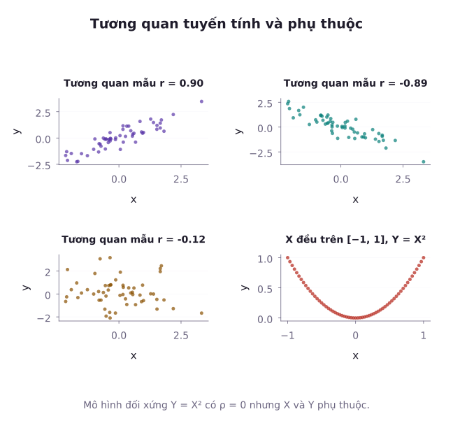
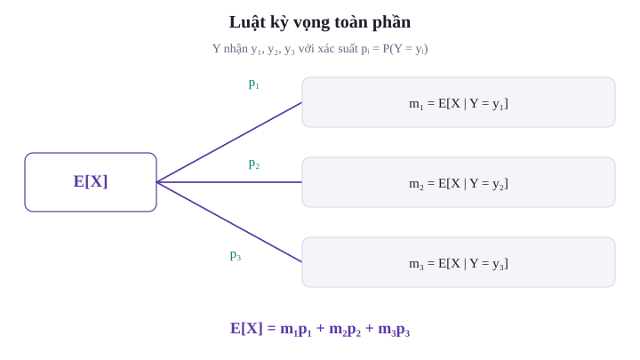
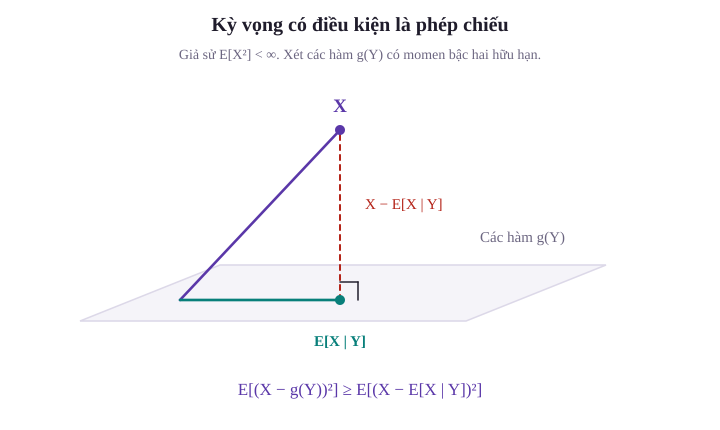

Ở các bài học thống kê mô tả (Bài 07) và hồi quy (Bài 08 và 24), ta đã làm quen với hệ số tương quan mẫu $r$ và mô hình hồi quy tuyến tính bình phương bé nhất. Tuy nhiên, ở tầng lý thuyết xác suất nền tảng, những khái niệm này bắt nguồn từ đâu?

Khi hai biến ngẫu nhiên cùng biến thiên, làm thế nào để định lượng mức độ ràng buộc đồng thời giữa chúng? Liệu hai biến số không có tương quan tuyến tính ($\rho = 0$) có đồng nghĩa với việc chúng hoàn toàn độc lập với nhau? Và khi ta muốn dự báo một biến ngẫu nhiên chưa biết $X$ dựa trên thông tin quan sát được từ biến $Y$, hàm số dự báo nào sẽ mang lại sai số bình phương trung bình nhỏ nhất?

Ta sẽ xây dựng hiệp phương sai và hệ số tương quan từ kỳ vọng. Sau đó, kỳ vọng có điều kiện cho phép phân rã kỳ vọng, phương sai và giải bài toán dự báo với sai số bình phương nhỏ nhất.

---

## 1. Hiệp phương sai và hệ số tương quan

Để đo lường xu hướng cùng tăng hoặc cùng giảm giữa hai biến ngẫu nhiên $X$ và $Y$, ta đo kỳ vọng tích các độ lệch của chúng so với giá trị trung bình tương ứng.

### Định nghĩa hiệp phương sai (Covariance)

Trong phần hiệp phương sai, giả sử $X,Y$ có mômen bậc hai hữu hạn. Điều này bảo đảm các kỳ vọng của $X$, $Y$ và $XY$ đều tồn tại hữu hạn. Đặt $\mu_X = \mathbb{E}[X]$ và $\mu_Y = \mathbb{E}[Y]$. Hiệp phương sai của hai biến ngẫu nhiên $X$ và $Y$ (ký hiệu $\mathrm{Cov}(X, Y)$ hay $\sigma_{X,Y}$) được định nghĩa là:

$$
\sigma_{X,Y} = \mathbb{E}[(X - \mu_X)(Y - \mu_Y)].
$$

Khai triển tích và rút gọn theo tính tuyến tính của kỳ vọng, ta nhận được công thức thực hành:

$$
\mathrm{Cov}(X, Y) = \mathbb{E}[XY] - \mathbb{E}[X]\mathbb{E}[Y].
$$

- Khi $X = Y$: Hiệp phương sai của một biến với chính nó chính là phương sai: $\mathrm{Cov}(X, X) = \mathrm{Var}(X)$.
- Tính đối xứng: $\mathrm{Cov}(X, Y) = \mathrm{Cov}(Y, X)$.
- Tính song tuyến tính: $\mathrm{Cov}(aX + b, cY + d) = ac \, \mathrm{Cov}(X, Y)$ với mọi hằng số thực $a, b, c, d$.
- Nếu hai biến $X$ và $Y$ độc lập, thì $\mathbb{E}[XY] = \mathbb{E}[X]\mathbb{E}[Y]$, kéo theo $\mathrm{Cov}(X, Y) = 0$.

### Hệ số tương quan Pearson

Hiệp phương sai phụ thuộc vào đơn vị đo. Nếu cả hai phương sai đều dương và hữu hạn, ta chuẩn hóa bằng tích độ lệch chuẩn để thu được hệ số không thứ nguyên. Khi một biến có phương sai bằng 0, hệ số tương quan không được xác định:

$$
\begin{aligned}
\rho_{X,Y} &= \frac{\mathrm{Cov}(X, Y)}{\sigma_X \sigma_Y} \\
&= \frac{\mathrm{Cov}(X, Y)}{\sqrt{\mathrm{Var}(X) \mathrm{Var}(Y)}}.
\end{aligned}
$$

Bất đẳng thức Cauchy-Schwarz đảm bảo rằng hệ số tương quan luôn nằm trong đoạn $[-1, 1]$:

$$
-1 \le \rho_{X,Y} \le 1.
$$

- $\rho = +1$: Hai biến có mối quan hệ tuyến tính đồng biến tuyệt đối ($Y = aX + b$ hầu chắc chắn với $a > 0$).
- $\rho = -1$: Hai biến có mối quan hệ tuyến tính nghịch biến tuyệt đối ($Y = aX + b$ hầu chắc chắn với $a < 0$).
- $\rho = 0$: Hai biến không có tương quan tuyến tính.

::: example Ví dụ 1: Tính toán hiệp phương sai từ bảng rời rạc
Giả sử bảng phân phối xác suất đồng thời của sự cố phần cứng $X \in \{0, 1\}$ và sự cố phần mềm $Y \in \{0, 1, 2\}$ ở Bài 31:
- Phân phối lề của $X$: $P(X=0) = 0{,}70$, $P(X=1) = 0{,}30$.
- Phân phối lề của $Y$: $P(Y=0) = 0{,}50$, $P(Y=1) = 0{,}30$, $P(Y=2) = 0{,}20$.
- Bảng xác suất đồng thời: $p(1, 1) = 0{,}10$, $p(1, 2) = 0{,}10$, các ô còn lại có $X = 0$ hoặc $Y = 0$.

Tính hiệp phương sai $\mathrm{Cov}(X, Y)$ và hệ số tương quan $\rho_{X,Y}$.

*Lời giải:*
1. Tính các kỳ vọng và phương sai lề:
   - $\mathbb E[X]=0{,}30$ vì $X$ chỉ nhận giá trị 0 và 1.
   - $\mathbb E[X^2]=0{,}30$ vì $X^2=X$.
   - $\mathrm{Var}(X)=0{,}21$, bằng $0{,}30-(0{,}30)^2$.
   - $\mathbb{E}[Y] = 0{,}30 + 2(0{,}20) = 0{,}70$.
   - $\mathbb{E}[Y^2] = 0{,}30 + 4(0{,}20) = 1{,}10$.
   - $\mathrm{Var}(Y) = 1{,}10 - 0{,}49 = 0{,}61$.
2. Tính kỳ vọng của tích $\mathbb{E}[XY]$:
   Tích $XY$ chỉ khác 0 khi cả $X$ và $Y$ đều khác 0:

$$
\begin{aligned}
\mathbb{E}[XY] &= 1(0{,}10) + 2(0{,}10)\\
&= 0{,}30.
\end{aligned}
$$

3. Hiệp phương sai:

$$
\begin{aligned}
\mathrm{Cov}(X, Y) &= \mathbb{E}[XY] - \mathbb{E}[X]\mathbb{E}[Y] \\
&= 0{,}30 - 0{,}30(0{,}70) \\
&= 0{,}09.
\end{aligned}
$$

4. Hệ số tương quan:

$$
\begin{aligned}
\rho_{X,Y} &= \frac{0{,}09}{\sqrt{0{,}21 \times 0{,}61}} \\
&= \frac{0{,}09}{\sqrt{0{,}1281}} \approx 0{,}2515.
\end{aligned}
$$

Hai biến có mức tương quan dương yếu: Khi xảy ra sự cố phần cứng, số lỗi phần mềm có xu hướng tăng nhẹ.
:::

---

## 2. Phương sai của tổng các biến ngẫu nhiên phụ thuộc

Khi các biến ngẫu nhiên không độc lập, phương sai của tổng không đơn thuần bằng tổng các phương sai mà xuất hiện thêm các số hạng hiệp phương sai chéo.

### Định lý phương sai của tổng

Với $n$ biến ngẫu nhiên có mômen bậc hai hữu hạn, đặt $S = X_1 + \dots + X_n = \sum_{i=1}^n X_i$, $\sigma_i^2 = \mathrm{Var}(X_i)$ và $\sigma_{ij} = \mathrm{Cov}(X_i, X_j)$:

$$
\mathrm{Var}(S) = \sum_{i=1}^n \sigma_i^2 + 2 \sum_{1 \le i < j \le n} \sigma_{ij}.
$$

- Nếu các biến có tương quan dương ($\mathrm{Cov} > 0$), các biến động cùng chiều khuếch đại lẫn nhau, khiến phương sai của tổng lớn hơn tổng phương sai.
- Nếu các biến có tương quan âm ($\mathrm{Cov} < 0$), biến động của biến này triệt tiêu bớt biến động của biến kia, làm giảm phương sai toàn thể.
- Nếu các biến từng đôi không tương quan, phương sai của tổng bằng tổng phương sai. Đây là điều kiện đủ. Với từ ba biến trở lên, các hiệp phương sai khác 0 vẫn có thể bù trừ, miễn tổng của chúng bằng 0.

---

## 3. Phản ví dụ: Không tương quan nhưng phụ thuộc

Khái niệm "không tương quan" ($\rho = 0$) không đồng nhất với "độc lập". Độc lập kéo theo không tương quan, nhưng chiều ngược lại không đúng.

::: example Ví dụ 2: Phụ thuộc phi tuyến có hệ số tương quan bằng 0
Xét biến ngẫu nhiên $X$ phân phối đều trên đoạn đối xứng $[-1, 1]$: $X \sim U(-1, 1)$. Đặt $Y = X^2$.

1. Tính hiệp phương sai $\mathrm{Cov}(X, Y)$ và hệ số tương quan $\rho_{X,Y}$.
2. Hai biến $X$ và $Y$ có độc lập với nhau không?

*Lời giải:*
1. **Tính hiệp phương sai**:
   Mật độ của $X$ là $f_X(x) = 1/2$ trên $[-1, 1]$. Do tính đối xứng qua gốc tọa độ, các mômen bậc lẻ đều triệt tiêu:

$$
\mathbb{E}[X] = \int_{-1}^1 \frac{x}{2} \, dx = 0.
$$

   Kỳ vọng tích $XY = X \times X^2 = X^3$:

$$
\begin{aligned}
\mathbb{E}[XY] &= \mathbb{E}[X^3]\\
&= \int_{-1}^1 \frac{x^3}{2} \, dx\\
&= 0.
\end{aligned}
$$

   Hiệp phương sai:

$$
\begin{aligned}
\mathrm{Cov}(X, Y) &= \mathbb{E}[XY] - \mathbb{E}[X]\mathbb{E}[Y] \\
&= 0 - 0 \cdot \mathbb{E}[Y] = 0.
\end{aligned}
$$

   Ta còn có $\mathrm{Var}(X) = 1/3$ và $\mathrm{Var}(Y) = 1/5 - 1/9 = 4/45$, đều dương. Do đó $\rho_{X,Y} = 0$. Hai biến ngẫu nhiên $X$ và $Y$ hoàn toàn không có tương quan tuyến tính.
2. **Xét tính độc lập**:
   Rõ ràng $Y = X^2$ hoàn toàn phụ thuộc mang tính tất định vào $X$: Nếu biết $X = 0{,}8$, ta biết chắc chắn rằng $Y = 0{,}64$.
   Kiểm tra hình thức xác suất:
   - Biến cố $Y\le0{,}25$ tương đương $|X|\le0{,}5$ và có xác suất $0{,}5$.
   - Biến cố $A = \{|X| \le 0{,}5\}$ trùng với $B = \{Y \le 0{,}25\}$. Vì vậy $P(A \cap B) = 1/2$, còn $P(A)P(B) = 1/4$.

   Hai xác suất khác nhau, nên $X,Y$ không độc lập.
   Hệ số tương quan $\rho$ chỉ đo lường mối quan hệ tuyến tính. Khi quan hệ là đường cong đối xứng, $\rho$ trả về giá trị 0.
:::

---

## 4. Kỳ vọng có điều kiện xem như một biến ngẫu nhiên

Khái niệm kỳ vọng có điều kiện $\mathbb{E}[X \mid Y = y]$ đã học ở Bài 31 là một con số thực phụ thuộc vào giá trị $y$. Nếu ta coi giá trị quan sát $Y$ là ngẫu nhiên, thì bản thân $\mathbb{E}[X \mid Y]$ là một **biến ngẫu nhiên mới**, ký hiệu là $g(Y)$.

### Định nghĩa biến ngẫu nhiên kỳ vọng có điều kiện

Giả sử $\mathbb{E}[|X|] < \infty$. Biến $g(Y) = \mathbb{E}[X \mid Y]$ nhận giá trị trung bình có điều kiện ứng với quan sát $Y$. Nó được xác định duy nhất hầu chắc chắn. Kỳ vọng của nó hữu hạn, còn để bàn về phương sai hữu hạn, ta giả sử thêm $\mathbb{E}[X^2] < \infty$.

### Định lý kỳ vọng toàn phần (Luật của Adam)

Kỳ vọng của biến ngẫu nhiên kỳ vọng có điều kiện bằng chính kỳ vọng vô điều kiện của $X$:

$$
\mathbb{E}\left[ \mathbb{E}[X \mid Y] \right] = \mathbb{E}[X].
$$

### Định lý phương sai toàn phần (Luật của Eve)

Khi $\mathbb{E}[X^2] < \infty$, phương sai của $X$ được phân rã thành phần biến thiên trong nhóm và phần giữa các nhóm. Đây là đẳng thức của hai đại lượng không âm, không phải khẳng định chúng là hai biến ngẫu nhiên độc lập:

$$
\mathrm{Var}(X) = \mathbb{E}[V] + \mathrm{Var}(M)
$$

với $V = \mathrm{Var}(X \mid Y)$ là phương sai có điều kiện và $M = \mathbb{E}[X \mid Y]$ là kỳ vọng có điều kiện.

Ý nghĩa thống kê:
- $\mathbb{E}[\mathrm{Var}(X \mid Y)]$: **Biến thiên nội bộ nhóm**, tức phần bất định trung bình còn lại của $X$ sau khi đã biết $Y$.
- $\mathrm{Var}(\mathbb{E}[X \mid Y])$: **Biến thiên giữa các nhóm**, tức mức độ dao động của các giá trị dự báo trung bình giữa các phân nhóm khác nhau.

::: example Ví dụ 3: Định lý Adam và Eve cho tổng ngẫu nhiên các biến ngẫu nhiên
Giả sử một trung tâm dữ liệu nhận các đợt tấn công từ chối dịch vụ. Trong mỗi giờ, số đợt tấn công $N$ tuân theo phân phối Poisson với trung bình $\lambda = 10$ đợt ($N \sim \mathrm{Poisson}(10)$). Giả sử dãy lượng yêu cầu $X_1,X_2,\dots$ độc lập, cùng phân phối và độc lập với $N$. Mỗi $X_i$ có kỳ vọng $\mathbb{E}[X_i] = 5$ nghìn yêu cầu và phương sai $\mathrm{Var}(X_i) = 4$ (nghìn yêu cầu)$^2$.
Gọi $S = \sum_{i=1}^N X_i$ là tổng lượng yêu cầu rác dội vào hệ thống trong một giờ (nếu $N = 0$ thì $S = 0$).

1. Tính tổng lượng yêu cầu rác kỳ vọng trong một giờ: $\mathbb{E}[S]$.
2. Tính phương sai và độ lệch chuẩn của tổng lượng yêu cầu rác: $\mathrm{Var}(S)$.

*Lời giải:*
1. **Tính kỳ vọng $\mathbb{E}[S]$ qua Luật của Adam**:
   Điều kiện hóa theo số đợt tấn công $N$: Khi biết $N = n$, tổng $S$ là tổng của $n$ biến độc lập cùng phân phối:

$$
\begin{aligned}
\mathbb{E}[S \mid N = n] &= n \mathbb{E}[X_1] \\
&= 5n.
\end{aligned}
$$

Vì vậy, $\mathbb{E}[S \mid N] = 5N$.

   Áp dụng định lý kỳ vọng toàn phần:

$$
\begin{aligned}
\mathbb{E}[S] &= \mathbb{E}\left[ \mathbb{E}[S \mid N] \right] \\
&= 5 \mathbb{E}[N] \\
&= 5 \times 10 \\
&= 50 \text{ nghìn yêu cầu}.
\end{aligned}
$$

2. **Tính phương sai $\mathrm{Var}(S)$ qua Luật của Eve**:
   Khi biết $N = n$, phương sai có điều kiện của tổng $n$ biến độc lập là:

$$
\begin{aligned}
\mathrm{Var}(S \mid N = n) &= n \mathrm{Var}(X_1) \\
&= 4n.
\end{aligned}
$$

Vì vậy, $\mathrm{Var}(S \mid N) = 4N$.

   Kỳ vọng của phương sai có điều kiện:

$$
\begin{aligned}
\mathbb{E}\left[ \mathrm{Var}(S \mid N) \right] &= \mathbb{E}[4N] \\
&= 4 \mathbb{E}[N] \\
&= 4 \times 10 \\
&= 40.
\end{aligned}
$$

   Phương sai của kỳ vọng có điều kiện (lưu ý rằng với $N \sim \mathrm{Poisson}(10)$, $\mathrm{Var}(N) = 10$):

$$
\begin{aligned}
\mathrm{Var}\left( \mathbb{E}[S \mid N] \right) &= \mathrm{Var}(5N) \\
&= 5^2 \mathrm{Var}(N) \\
&= 25 \times 10 \\
&= 250.
\end{aligned}
$$

   Áp dụng định lý phương sai toàn phần:

$$
\mathrm{Var}(S) = 40 + 250 = 290.
$$

   Độ lệch chuẩn:

$$
\begin{aligned}
\sigma_S &= \sqrt{290} \\
&\approx 17{,}03 \text{ nghìn yêu cầu}.
\end{aligned}
$$

:::

---

## 5. Dự báo tối ưu sai số bình phương trung bình (MMSE)

Trong học máy và lý thuyết ước lượng, hàm kỳ vọng có điều kiện $g(Y) = \mathbb{E}[X \mid Y]$ được chọn làm mô hình dự báo mục tiêu.

Giả sử $\mathbb{E}[X^2] < \infty$. Ta xét các hàm đo được $g$ sao cho $\mathbb{E}[g(Y)^2] < \infty$ và tìm hàm có sai số bình phương trung bình (MSE) nhỏ nhất. Giá trị nhỏ nhất này được gọi là MMSE:

$$
\min_g \mathbb{E}\left[ (X - g(Y))^2 \right].
$$

::: proof Chứng minh tính tối ưu MMSE của kỳ vọng có điều kiện
Đặt $\hat{X} = \mathbb{E}[X \mid Y]$. Với bất kỳ hàm số $g(Y)$, ta phân tích sai số thành tổng hai thành phần $U = X - \hat{X}$ và $V = \hat{X} - g(Y)$:

$$
X - g(Y) = U + V.
$$

Lấy bình phương hai vế:

$$
(X - g(Y))^2 = U^2 + V^2 + 2UV.
$$

Vì $V$ là hàm số của $Y$, khi điều kiện hóa theo $Y$, $V$ là hằng số đã biết. Ta áp dụng Luật của Adam cho tích chéo:

$$
\begin{aligned}
\mathbb{E}[UV] &= \mathbb{E}[\mathbb{E}[UV \mid Y]] \\
&= \mathbb{E}[V \cdot \mathbb{E}[U \mid Y]] \\
&= \mathbb{E}[V \cdot 0] = 0.
\end{aligned}
$$

(do $\mathbb{E}[U \mid Y] = \mathbb{E}[X \mid Y] - \hat{X} = 0$). Số hạng tích chéo triệt tiêu do tính trực giao hình học. Lấy kỳ vọng hai vế:

$$
\mathbb{E}[(X - g(Y))^2] = \mathbb{E}[U^2] + \mathbb{E}[V^2].
$$

Vì $\mathbb{E}[V^2] = \mathbb{E}[(\hat{X} - g(Y))^2] \ge 0$, tổng sai số đạt giá trị nhỏ nhất khi và chỉ khi $V = 0$, tức:

$$
g(Y) = \hat{X} = \mathbb{E}[X \mid Y]
$$

(hầu chắc chắn).

Nghiệm tối ưu là duy nhất nếu đồng nhất các hàm dự báo bằng nhau hầu chắc chắn. Giá trị dự báo trên một tập quan sát có xác suất 0 không ảnh hưởng MSE.
:::

---

## Tóm tắt bài học

- **Hiệp phương sai và tương quan**: Đo lường cường độ và chiều hướng của mối quan hệ tuyến tính. Hệ số tương quan $\rho \in [-1, 1]$ độc lập với thang đo đơn vị.
- **Không tương quan không đồng nghĩa với độc lập**: Giá trị $\rho = 0$ chỉ loại trừ mối quan hệ đường thẳng, hoàn toàn có thể tồn tại các mối quan hệ phi tuyến hoàn hảo.
- **Phương sai của tổng phụ thuộc**: Xuất hiện thêm tổng các số hạng hiệp phương sai kép $2\sum_{i<j} \mathrm{Cov}(X_i, X_j)$.
- **Định lý Adam và Eve**: Giúp tính kỳ vọng và phương sai bằng cách điều kiện hóa theo một biến trung gian.
- **Bản chất hình học MMSE**: Kỳ vọng có điều kiện $\mathbb{E}[X \mid Y]$ là phép chiếu trực giao của biến ngẫu nhiên mục tiêu lên không gian hàm của biến quan sát, tối thiểu hóa sai số bình phương trung bình.

---

## Tài liệu tham khảo

- MIT OpenCourseWare, [18.05: Calendar, Class 7 Joint Distributions: Independence, Covariance, and Correlation](https://ocw.mit.edu/courses/18-05-introduction-to-probability-and-statistics-spring-2022/pages/calendar/).
- Penn State University, [STAT 414: Introduction to Probability Theory](https://online.stat.psu.edu/stat414/index), phần The Correlation Coefficient và Conditional Distributions.
- Joseph K. Blitzstein và Jessica Hwang, [Introduction to Probability](https://probabilitybook.net/), kỳ vọng có điều kiện, luật kỳ vọng và phương sai toàn phần.

Hệ thống bài tập rèn luyện kỹ năng tính toán hiệp phương sai, áp dụng luật Adam và Eve, cùng các bài toán dự báo tối ưu MMSE.

## Bài tập rèn luyện: Hiệp phương sai, tương quan và kỳ vọng có điều kiện

::: exercise Bài tập 1
Ba biến ngẫu nhiên $X_1, X_2, X_3$ có cùng phương sai $\sigma^2 = 4$ và hiệp phương sai từng đôi giữa hai biến phân biệt bất kỳ đều bằng $\mathrm{Cov}(X_i, X_j) = 1$ ($i \ne j$). Tính phương sai của tổng $S = X_1 + X_2 + X_3$.
:::
::: solution Lời giải
Phương sai của tổng $S = X_1 + X_2 + X_3$ gồm 3 số hạng phương sai và $2\binom{3}{2} = 6$ số hạng hiệp phương sai:

$$
\mathrm{Var}(S) = 3\sigma^2 + 6 \, \mathrm{Cov}(X_1, X_2).
$$

Thay các giá trị $\sigma^2 = 4$ và $\mathrm{Cov}(X_1, X_2) = 1$:

$$
\begin{aligned}
\mathrm{Var}(S) &= 3(4) + 6(1) \\
&= 12 + 6 = 18.
\end{aligned}
$$

:::

::: exercise Bài tập 2
Cho vector ngẫu nhiên $(X, Y)$ có hàm mật độ đồng thời $f(x, y) = 2$ trên miền tam giác $0 \le x \le y \le 1$.
1. Xác định hàm mật độ lề $f_X(x)$.
2. Tìm hàm mật độ có điều kiện $f_{Y \mid X}(y \mid x)$ và tính kỳ vọng có điều kiện $\mathbb{E}[Y \mid X = x]$.
:::
::: solution Lời giải
1. Mật độ lề của $X$ (với $0 \le x \le 1$):

$$
f_X(x) = \int_x^1 2 \, dy = 2(1 - x).
$$

2. Với $0 \le x < 1$, mật độ có điều kiện của $Y$ trên $x \le y \le 1$ là:

$$
\begin{aligned}
f_{Y \mid X}(y \mid x) &= \frac{f(x, y)}{f_X(x)} \\
&= \frac{2}{2(1 - x)} \\
&= \frac{1}{1 - x}.
\end{aligned}
$$

Đây là phân phối đều liên tục $U(x, 1)$.
Kỳ vọng có điều kiện của $Y$ khi biết $X = x$ là trung điểm của đoạn $[x, 1]$:

$$
\begin{aligned}
\mathbb{E}[Y \mid X = x] &= \int_x^1 \frac{y}{1 - x} \, dy \\
&= \frac{1 - x^2}{2(1 - x)} \\
&= \frac{1 + x}{2}.
\end{aligned}
$$

:::

::: exercise Bài tập 3
Tung một con xúc xắc 6 mặt cân đối để chọn ngẫu nhiên một số nguyên $N \in \{1, 2, 3, 4, 5, 6\}$ với xác suất bằng nhau là $1/6$. Sau đó, tung $N$ đồng xu cân đối độc lập. Gọi $K$ là tổng số mặt ngửa thu được.
1. Tính số mặt ngửa kỳ vọng: $\mathbb{E}[K]$.
2. Tính phương sai của số mặt ngửa: $\mathrm{Var}(K)$.
:::
::: solution Lời giải
1. Khi biết $N = n$, biến $K$ tuân theo phân phối Nhị thức: $K \mid (N = n) \sim \mathrm{Bin}(n, 0{,}5)$.
Do đó: $\mathbb{E}[K \mid N] = 0{,}5 N$ và $\mathrm{Var}(K\mid N)=0{,}25N$.
Kỳ vọng của $N$:

$$
\begin{aligned}
\mathbb{E}[N] &= \frac{1 + 2 + 3 + 4 + 5 + 6}{6} \\
&= \frac{21}{6} \\
&= 3{,}5.
\end{aligned}
$$

Áp dụng định lý kỳ vọng toàn phần:

$$
\begin{aligned}
\mathbb{E}[K] &= \mathbb{E}[\mathbb{E}[K \mid N]] \\
&= 0{,}5 \mathbb{E}[N] \\
&= 0{,}5 \times 3{,}5 = 1{,}75.
\end{aligned}
$$

2. Tính phương sai $\mathrm{Var}(K)$ qua định lý phương sai toàn phần:
Phương sai của biến rời rạc đều $N$ trên $\{1, \dots, 6\}$:

$$
\mathrm{Var}(N) = \frac{6^2 - 1}{12} = \frac{35}{12}.
$$

Thành phần thứ nhất (Kỳ vọng của phương sai có điều kiện):

$$
\begin{aligned}
\mathbb{E}[\mathrm{Var}(K \mid N)] &= \mathbb{E}[0{,}25 N] \\
&= 0{,}25 \times 3{,}5 \\
&= \frac{7}{8} = 0{,}875.
\end{aligned}
$$

Thành phần thứ hai (Phương sai của kỳ vọng có điều kiện):

$$
\begin{aligned}
\mathrm{Var}(\mathbb{E}[K \mid N]) &= \mathrm{Var}(0{,}5 N)\\
&= \frac{1}{4} \mathrm{Var}(N)\\
&= \frac{1}{4} \times \frac{35}{12}\\
&= \frac{35}{48}.
\end{aligned}
$$

Tổng phương sai:

$$
\begin{aligned}
\mathrm{Var}(K) &= \frac{7}{8} + \frac{35}{48} \\
&= \frac{42 + 35}{48} \\
&= \frac{77}{48} \\
&\approx 1{,}6042.
\end{aligned}
$$

:::

::: exercise Bài tập 4
Chứng minh bất đẳng thức Cauchy-Schwarz đối với kỳ vọng: Với hai biến ngẫu nhiên $X$ và $Y$ có mômen bậc hai hữu hạn, ta luôn có:

$$
\left( \mathbb{E}[XY] \right)^2 \le \mathbb{E}[X^2] \, \mathbb{E}[Y^2].
$$

Khi cả hai phương sai đều dương, sử dụng bất đẳng thức này để chứng minh hệ số tương quan thỏa mãn $-1 \le \rho_{X,Y} \le 1$.
:::
::: solution Lời giải
Xét tam thức bậc hai theo biến thực $t$:

$$
g(t) = \mathbb{E}\left[ (tX - Y)^2 \right].
$$

Vì $(tX - Y)^2 \ge 0$ với mọi $t$, kỳ vọng của nó cũng luôn không âm: $g(t) \ge 0, \forall t \in \mathbb{R}$.
Khai triển theo tính tuyến tính của kỳ vọng:

$$
\begin{aligned}
g(t) &= t^2 \mathbb{E}[X^2] - 2t \mathbb{E}[XY] + \mathbb{E}[Y^2] \\
&\ge 0.
\end{aligned}
$$

Nếu $\mathbb{E}[X^2] = 0$ thì $X=0$ hầu chắc chắn, và bất đẳng thức cần chứng minh trở thành $0 \le 0$. Nếu $\mathbb{E}[X^2] > 0$, đây là tam thức bậc hai $At^2+Bt+C$ có hệ số $A > 0$. Để tam thức không đổi dấu với mọi $t$, biệt thức thu gọn $\Delta'$ bắt buộc phải không dương:

$$
\begin{aligned}
\Delta' &= \left( \mathbb{E}[XY] \right)^2 - \mathbb{E}[X^2] \mathbb{E}[Y^2] \\
&\le 0 \\
&\implies \left( \mathbb{E}[XY] \right)^2 \\
&\le \mathbb{E}[X^2] \mathbb{E}[Y^2].
\end{aligned}
$$

Áp dụng kết quả này cho hai biến lệch tâm $\tilde{X} = X - \mathbb{E}[X]$ và $\tilde{Y} = Y - \mathbb{E}[Y]$:

$$
\begin{aligned}
\left( \mathrm{Cov}(X, Y) \right)^2 &= \left( \mathbb{E}[\tilde{X}\tilde{Y}] \right)^2 \\
&\le \mathrm{Var}(X) \mathrm{Var}(Y).
\end{aligned}
$$

Chia cả hai vế cho $\mathrm{Var}(X)\mathrm{Var}(Y) > 0$, ta thu được:

$$
\begin{aligned}
\rho_{X,Y}^2 &= \frac{\left( \mathrm{Cov}(X, Y) \right)^2}{\mathrm{Var}(X)\mathrm{Var}(Y)} \le 1 \\
&\iff -1 \le \rho_{X,Y} \le 1.
\end{aligned}
$$

:::

::: exercise Bài tập 5
Cho $X \sim \mathcal{N}(0, 1)$ và biến ngẫu nhiên độc lập $W$ nhận giá trị $+1$ hoặc $-1$ với xác suất bằng nhau: $P(W = 1) = P(W = -1) = 0{,}5$. Đặt $Y = W \cdot X$.
1. Chứng minh rằng $Y$ cũng tuân theo phân phối Chuẩn chuẩn tắc $\mathcal{N}(0, 1)$.
2. Chứng minh rằng $\mathrm{Cov}(X, Y) = 0$.
3. Hai biến $X$ và $Y$ có độc lập với nhau không?
:::
::: solution Lời giải
1. Xét hàm phân phối tích lũy $F_Y(y) = P(Y \le y)$. Áp dụng công thức xác suất toàn phần theo $W$ (với $P(W = \pm 1) = 0{,}5$):

$$
\begin{aligned}
F_Y(y) &= 0{,}5 \Phi(y) + 0{,}5 P(X \ge -y) \\
&= 0{,}5 \Phi(y) + 0{,}5 \Phi(y) \\
&= \Phi(y).
\end{aligned}
$$

Vậy $Y$ có cùng phân phối Chuẩn chuẩn tắc $\mathcal{N}(0, 1)$.
2. Tính hiệp phương sai:
Vì $X$ và $W$ độc lập:

$$
\begin{aligned}
\mathbb{E}[Y] &= \mathbb{E}[W \cdot X] \\
&= \mathbb{E}[W] \mathbb{E}[X] \\
&= 0 \times 0 \\
&= 0.
\end{aligned}
$$

Kỳ vọng tích:

$$
\begin{aligned}
\mathbb{E}[XY] &= \mathbb{E}[X \cdot (WX)] \\
&= \mathbb{E}[W] \mathbb{E}[X^2] \\
&= 0 \times 1 \\
&= 0.
\end{aligned}
$$

Do đó: $\mathrm{Cov}(X, Y) = 0$.
3. Xét tính độc lập:
Mặc dù $\mathrm{Cov}(X, Y) = 0$, hai biến $X$ và $Y$ không độc lập.
Cụ thể: $|Y| = |WX| = |W| \cdot |X| = |X|$ (do $|W| = 1$).
Đặt $A=\{|X| \le 1\}$ và $B=\{|Y| \le 1\}$. Vì $|X|=|Y|$, ta có $A=B$. Xác suất chung là $q=2\Phi(1)-1$, với $0<q<1$, nên $P(A \cap B)=q \ne q^2=P(A)P(B)$. Do đó $X,Y$ không độc lập.

Ví dụ cũng cho thấy hai phân phối lề Chuẩn chưa đủ để cặp biến có phân phối Chuẩn hai chiều.
:::

