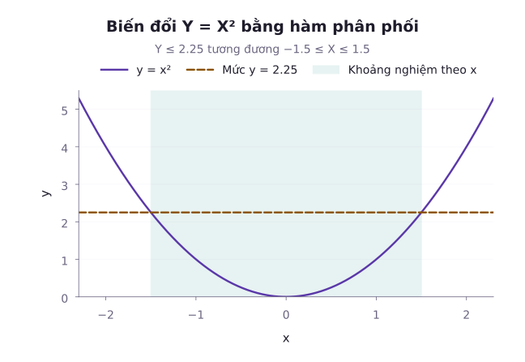
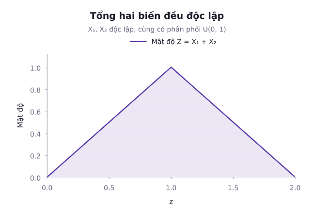
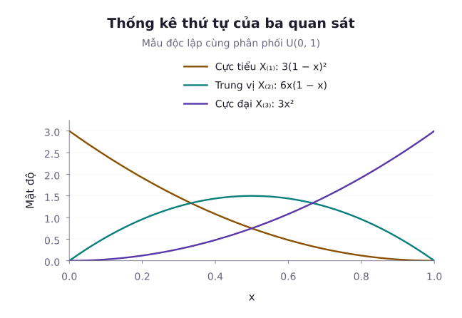

Trong thực tế tính toán khoa học và kỹ thuật, ta hiếm khi chỉ làm việc trực tiếp với các biến ngẫu nhiên nguyên thủy:
- Khi biết phân phối sai số vận tốc $V \sim \mathcal{N}(0, \sigma^2)$, ta cần tìm phân phối động năng $K = \frac{1}{2}m V^2$.
- Khi hai linh kiện độc lập cùng tham gia vào một chuỗi xử lý, ta cần tìm phân phối tổng thời gian trễ $Z = X + Y$.
- Một hệ thống dự phòng song song chỉ dừng khi linh kiện cuối cùng hỏng. Tuổi thọ hệ thống là cực đại của các tuổi thọ thành phần.
- Một hệ thống nối tiếp dừng ngay khi linh kiện đầu tiên hỏng, nên tuổi thọ là cực tiểu của các tuổi thọ thành phần.

Làm thế nào để xác định chính xác hàm mật độ của một hàm phi tuyến $Y = g(X)$, hoặc của một hàm hai biến $Z = g(X, Y)$? Bài học này cung cấp hệ thống phương pháp giải tích chặt chẽ: Phương pháp hàm phân phối tích lũy (CDF Technique), công thức đổi biến Jacobian nhiều chiều, công thức tích chập (Convolution), cùng lý thuyết về thống kê thứ tự (Order Statistics).

---

## 1. Phương pháp hàm phân phối tích lũy (CDF Technique)

Phương pháp CDF là công cụ tổng quát và an toàn nhất để tìm phân phối của biến đổi $Y = g(X)$, đặc biệt khi hàm $g$ là hàm phi đơn điệu (không có hàm ngược một-đối-một trên toàn miền).

Quy trình giải tích gồm 3 bước:
1. Xác định tập giá trị khả dĩ của biến đổi $Y$.
2. Tìm biểu thức hàm phân phối tích lũy $F_Y(y) = P(Y \le y) = P(g(X) \le y)$ bằng cách đưa biến cố về theo biến $X$ và tích phân hàm mật độ $f_X(x)$.
3. Nếu phân phối của $Y$ liên tục tuyệt đối, lấy đạo hàm $F_Y$ để thu được mật độ hầu khắp nơi. Phép biến đổi có thể tạo khối xác suất tại một điểm, nên cần kiểm tra giả thiết này trước khi chỉ dùng đạo hàm.

::: example Ví dụ 1: Bình phương biến ngẫu nhiên Chuẩn và phân phối Chi-bình phương
Cho $X \sim \mathcal{N}(0, 1)$ là biến ngẫu nhiên phân phối Chuẩn chuẩn tắc có hàm mật độ:

$$
f_X(x) = \frac{1}{\sqrt{2\pi}} e^{-x^2 / 2}.
$$

Tìm hàm mật độ xác suất của biến ngẫu nhiên bình phương $Y = X^2$.

*Lời giải:*
1. **Tập giá trị**: Vì $Y = X^2$, $Y \ge 0$, và mật độ được xét trên $y > 0$. Với $y \le 0$, $F_Y(y) = 0$.
2. **Tìm hàm tích lũy $F_Y(y)$ với $y > 0$**:

$$
\begin{aligned}
F_Y(y) &= P(Y \le y) \\
&= P(X^2 \le y) \\
&= P(-\sqrt{y} \le X \le \sqrt{y}) \\
&= \Phi(\sqrt{y}) - \Phi(-\sqrt{y}).
\end{aligned}
$$

   Do tính đối xứng của phân phối Chuẩn chuẩn tắc $\Phi(-\sqrt{y}) = 1 - \Phi(\sqrt{y})$:

$$
\begin{aligned}
F_Y(y) &= 2\Phi(\sqrt{y}) - 1 \\
&= 2 \int_0^{\sqrt{y}} \frac{e^{-x^2/2}}{\sqrt{2\pi}} \, dx.
\end{aligned}
$$

3. **Lấy đạo hàm để tìm hàm mật độ $f_Y(y)$**:
   Áp dụng quy tắc Leibniz:

$$
\begin{aligned}
f_Y(y) &= \frac{d}{dy} F_Y(y) \\
&= 2 \frac{d}{dy} \Phi(\sqrt{y}) \\
&= 2 \left[ \frac{1}{\sqrt{2\pi}} e^{-y / 2} \times \frac{1}{2\sqrt{y}} \right] \\
&= \frac{1}{\sqrt{2\pi}} y^{-1/2} e^{-y / 2}, \quad y > 0.
\end{aligned}
$$

   Nhận xét: Sử dụng $\Gamma(1/2) = \sqrt{\pi}$, với $y > 0$, ta có thể viết lại:

$$
f_Y(y) = \frac{(1/2)^{1/2}}{\Gamma(1/2)} y^{1/2 - 1} e^{-y / 2}.
$$

   Đây là hàm mật độ của **phân phối Chi-bình phương với 1 bậc tự do**: $Y \sim \chi^2(1)$, tương đương phân phối $\mathrm{Gamma}(1/2, 1/2)$.
:::

---

## 2. Công thức đổi biến Jacobian

Khi phép biến đổi $y = g(x)$ là một hàm đơn điệu ngặt (tăng ngặt hoặc giảm ngặt) và khả vi liên tục trên miền xác định, ta có thể áp dụng trực tiếp công thức đổi biến Jacobian mà không cần qua bước tích lũy.

### Trường hợp 1 chiều

Nếu $g: (a, b) \to (c, d)$ khả vi và đơn điệu ngặt với đạo hàm $g'(x) \ne 0$, thì tồn tại hàm ngược duy nhất $x = g^{-1}(y)$. Khi đó hàm mật độ của $Y$ được xác định qua công thức:

$$
\begin{aligned}
f_Y(y) &= f_X\left( g^{-1}(y) \right) \left| \frac{dx}{dy} \right| \\
&= f_X\left( g^{-1}(y) \right) \left| \frac{1}{g'(g^{-1}(y))} \right|.
\end{aligned}
$$

Thừa số trị tuyệt đối của đạo hàm $\left| \frac{dx}{dy} \right|$ chính là định thức Jacobi 1 chiều, đóng vai trò hệ số co giãn chiều dài vi phân: $|dy| = |g'(x)|\,|dx|$. Dấu trị tuyệt đối bảo đảm mật độ không âm cả khi phép biến đổi giảm.

::: example Ví dụ 2: Biến đổi tuyến tính của biến Exponential
Cho $X \sim \mathrm{Exp}(\lambda = 2)$ có hàm mật độ $f_X(x) = 2e^{-2x}$ với $x > 0$. Tìm hàm mật độ của biến ngẫu nhiên $Y = 3X + 1$.

*Lời giải:*
1. Hàm số $g(x) = 3x + 1$ là hàm tăng ngặt trên $(0, \infty)$, miền giá trị tương ứng của $Y$ là $(1, \infty)$.
2. Tìm hàm ngược:

$$
\begin{aligned}
y &= 3x + 1 \\
\implies x &= g^{-1}(y) \\
&= \frac{y - 1}{3}.
\end{aligned}
$$

3. Đạo hàm của hàm ngược:

$$
\begin{aligned}
\frac{dx}{dy} &= \frac{d}{dy}\left( \frac{y - 1}{3} \right) \\
&= \frac{1}{3} \\
\implies \left| \frac{dx}{dy} \right| &= \frac{1}{3}.
\end{aligned}
$$

4. Áp dụng công thức đổi biến:

$$
\begin{aligned}
f_Y(y) &= f_X\left( \frac{y - 1}{3} \right) \left| \frac{dx}{dy} \right| \\
&= 2 e^{-2(y - 1) / 3} \times \frac{1}{3} \\
&= \frac{2}{3} e^{-2(y - 1) / 3}
\end{aligned}
$$

(với $y > 1$).
:::

### Trường hợp 2 chiều (Bivariate Jacobian)

Xét vector ngẫu nhiên $(X_1, X_2)$ có mật độ đồng thời $f_{X_1, X_2}(x_1, x_2)$ và phép biến đổi song ánh khả vi liên tục trên miền đang xét. Giả sử định thức Jacobi khác 0 trong miền này và phép biến đổi ngược cũng khả vi liên tục:

$$
\begin{aligned}
&\begin{cases} Y_1 = g_1(X_1, X_2) \\ Y_2 = g_2(X_1, X_2) \end{cases} \\
&\iff \begin{cases} X_1 = h_1(Y_1, Y_2) \\ X_2 = h_2(Y_1, Y_2). \end{cases}
\end{aligned}
$$

Ma trận Jacobi của phép biến đổi ngược:

$$
J = \begin{pmatrix} \frac{\partial x_1}{\partial y_1} & \frac{\partial x_1}{\partial y_2} \\ \frac{\partial x_2}{\partial y_1} & \frac{\partial x_2}{\partial y_2} \end{pmatrix}.
$$

Khi đó hàm mật độ xác suất đồng thời của $(Y_1, Y_2)$ là:

$$
f(y_1, y_2) = f(x_1, x_2) |\det(J)|.
$$

::: example Ví dụ 3: Đổi biến tỷ lệ và tổng của hai biến Exponential độc lập
Cho hai biến ngẫu nhiên độc lập $X, Y \stackrel{\text{iid}}{\sim} \mathrm{Exp}(\lambda = 1)$ có mật độ đồng thời trên $x > 0, y > 0$:

$$
\begin{aligned}
f_{X,Y}(x, y) &= e^{-x} e^{-y} \\
&= e^{-(x + y)}.
\end{aligned}
$$

Thực hiện phép biến đổi sang hai biến mới:

$$
U = X + Y, \quad V = \frac{X}{X + Y}.
$$

1. Xác định miền giá trị khả dĩ của $(U, V)$.
2. Tính định thức Jacobi và tìm hàm mật độ đồng thời $f_{U,V}(u, v)$.
3. Hai biến $U$ và $V$ có độc lập với nhau hay không?

*Lời giải:*
1. **Miền giá trị**:
   Vì $x > 0, y > 0$, tổng $u = x + y > 0$.
   Tỷ lệ $v = \frac{x}{x + y}$ luôn nằm trong khoảng mở $(0, 1)$. Miền khả dĩ là tích Descartes: $(0, \infty) \times (0, 1)$.
2. **Biểu diễn phép biến đổi ngược và ma trận Jacobi**:
   Từ hệ phương trình:

$$
\begin{cases} u = x + y \\ v = \frac{x}{u} \end{cases} \implies \begin{cases} x = uv \\ y = u(1 - v) \end{cases}
$$

   Ma trận các đạo hàm riêng:

$$
J = \begin{pmatrix} \frac{\partial x}{\partial u} & \frac{\partial x}{\partial v} \\ \frac{\partial y}{\partial u} & \frac{\partial y}{\partial v} \end{pmatrix} = \begin{pmatrix} v & u \\ 1 - v & -u \end{pmatrix}.
$$

   Định thức Jacobi:

$$
\begin{aligned}
\det(J) &= v(-u) - u(1 - v) \\
&= -u \\
&\implies |\det(J)| = u.
\end{aligned}
$$

3. **Hàm mật độ đồng thời**:
   Với $u > 0$ và $0 < v < 1$:

$$
\begin{aligned}
f_{U,V}(u, v) &= f_{X,Y}(uv, u(1 - v)) \cdot u \\
&= u e^{-u}.
\end{aligned}
$$

   Hàm mật độ đồng thời phân rã được thành:

$$
\begin{aligned}
f_{U,V}(u, v) &= (u e^{-u}) \times 1 \\
&= f_U(u) \times f_V(v),
\end{aligned}
$$

   trên miền tích Descartes $(0, \infty) \times (0, 1)$.
   Do đó, $U$ và $V$ **độc lập với nhau**. Trong đó $U \sim \mathrm{Gamma}(\alpha = 2, \lambda = 1)$ và $V \sim U(0, 1)$.
:::

---

## 3. Công thức tích chập cho tổng biến độc lập

Một bài toán trung tâm trong lý thuyết xác suất là tìm phân phối của tổng hai biến ngẫu nhiên độc lập: $Z = X + Y$.

### Định lý công thức tích chập liên tục

Nếu hai biến ngẫu nhiên liên tục $X$ và $Y$ độc lập với nhau, thì hàm mật độ xác suất của tổng $Z = X + Y$ là tích chập của hai hàm mật độ thành phần:

$$
\begin{aligned}
f_Z(z) &= (f_X * f_Y)(z) \\
&= \int_{-\infty}^\infty f_X(x) f_Y(z - x) \, dx.
\end{aligned}
$$

::: derivation Khai triển suy dẫn công thức tích chập
Ta sử dụng phương pháp hàm phân phối tích lũy:

$$
\begin{aligned}
F_Z(z) &= P(X + Y \le z) \\
&= \iint_{x + y \le z} f_X(x) f_Y(y) \, dx dy.
\end{aligned}
$$

Cắt tích phân theo biến $x$ chạy trên toàn trục số thực. Khi đó với mỗi $x$ cố định, $y \le z - x$, tích phân theo $y$ từ $-\infty$ đến $z - x$ chính là hàm tích lũy $F_Y(z - x)$:

$$
F_Z(z) = \int_{-\infty}^\infty f_X(x) F_Y(z - x) \, dx.
$$

Đổi biến $u=x+y$ trong tích phân trong, rồi áp dụng Tonelli cho tích phân không âm. Ta được $F_Z(z)$ bằng tích phân từ âm vô cùng đến $z$ của hàm tích chập. Vì vậy, đạo hàm của $F_Z$ bằng hàm tích chập hầu khắp nơi:

$$
\begin{aligned}
f_Z(z) &= \frac{d}{dz} F_Z(z) \\
&= \int_{-\infty}^\infty f_X(x) F'_Y(z - x) \, dx \\
&= \int_{-\infty}^\infty f_X(x) f_Y(z - x) \, dx.
\end{aligned}
$$

Biểu thức tích chập được chứng minh hoàn tất.
:::

---

## 4. Thống kê thứ tự (Order Statistics)

Xét mẫu ngẫu nhiên gồm $n$ quan sát độc lập cùng phân phối: $X_1, X_2, \dots, X_n \stackrel{\text{iid}}{\sim} f(x)$ với hàm tích lũy $F(x)$. Khi sắp xếp các quan sát này theo thứ tự tăng dần:

$$
\begin{aligned}
X_{(1)} &\le X_{(2)} \\
&\le \dots \\
&\le X_{(k)} \\
&\le \dots \\
&\le X_{(n)}.
\end{aligned}
$$

Các biến ngẫu nhiên có thứ tự này được gọi là các **thống kê thứ tự** (Order Statistics). Trong đó:
- $X_{(1)} = \min(X_1, \dots, X_n)$ là giá trị nhỏ nhất.
- $X_{(n)} = \max(X_1, \dots, X_n)$ là giá trị lớn nhất.
- $X_{(k)}$ là thống kê thứ tự bậc $k$.

### Phân phối của giá trị lớn nhất

Biến cố $\{X_{(n)} \le x\}$ xảy ra khi và chỉ khi tất cả $n$ quan sát đều nhỏ hơn hoặc bằng $x$:

$$
\begin{aligned}
F_{X_{(n)}}(x) &= P(X_{(n)} \le x) \\
&= \prod_{i=1}^n P(X_i \le x) \\
&= [F(x)]^n.
\end{aligned}
$$

Lấy đạo hàm theo $x$:

$$
f_{X_{(n)}}(x) = n [F(x)]^{n - 1} f(x).
$$

### Phân phối của giá trị nhỏ nhất

Biến cố $\{X_{(1)} > x\}$ xảy ra khi và chỉ khi tất cả $n$ quan sát đều lớn hơn $x$:

$$
\begin{aligned}
P(X_{(1)} > x) &= \prod_{i=1}^n P(X_i > x) \\
&= [1 - F(x)]^n.
\end{aligned}
$$

Hàm tích lũy của $X_{(1)}$:

$$
\begin{aligned}
F_{X_{(1)}}(x) &= 1 - P(X_{(1)} > x) \\
&= 1 - [1 - F(x)]^n.
\end{aligned}
$$

Lấy đạo hàm:

$$
f_{X_{(1)}}(x) = n [1 - F(x)]^{n - 1} f(x).
$$

### Hàm mật độ tổng quát của thống kê thứ tự bậc k

Bằng lập luận tổ hợp vi phân: Để $X_{(k)}$ rơi vào lân cận vi phân $[x, x + dx]$, cần có:
- Đúng $k - 1$ quan sát nhỏ hơn $x$ (mỗi quan sát có xác suất $F(x)$).
- Đúng 1 quan sát rơi vào khoảng nhỏ $[x, x+dx]$, có xác suất xấp xỉ $f(x)dx$ tại điểm mật độ liên tục.
- Đúng $n-k$ quan sát lớn hơn $x+dx$, có xác suất tiến về $1-F(x)$ khi $dx$ tiến về 0.

Các trường hợp có từ hai quan sát trong khoảng nhỏ chỉ đóng góp bậc cao hơn $dx$, nên biến mất khi chia cho $dx$ rồi lấy giới hạn.

Số cách phân chia $n$ phần tử vào 3 nhóm này là hệ số đa thức $c_{n,k} = \frac{n!}{(k-1)! (n-k)!}$. Đặt $u = F(x)$, hàm mật độ xác suất của thống kê thứ tự bậc $k$ có biểu thức:

$$
f_{X_{(k)}}(x) = c_{n,k} u^{k-1} (1 - u)^{n-k} f(x).
$$

::: example Ví dụ 4: Độ tin cậy hệ thống gồm 5 linh kiện
Một hệ thống kỹ thuật gồm $n = 5$ linh kiện dự phòng độc lập, mỗi linh kiện có tuổi thọ tuân theo phân phối Exponential $X_i \stackrel{\text{iid}}{\sim} \mathrm{Exp}(\lambda = 0{,}1)$ (đơn vị: Nghìn giờ).

1. Hệ thống nối tiếp (dừng ngay khi linh kiện đầu tiên bị hỏng $X_{(1)}$). Tìm phân phối của $X_{(1)}$ và tính tuổi thọ kỳ vọng.
2. Hệ thống song song hoàn toàn (chỉ dừng khi cả 5 linh kiện đều hỏng $X_{(5)}$). Tìm tuổi thọ kỳ vọng của hệ thống.

*Lời giải:*
1. **Tuổi thọ của hệ thống nối tiếp $X_{(1)}$**:
   Hàm xác suất đuôi của từng linh kiện là $1 - F(x) = e^{-0{,}1 x}$.
   Xác suất đuôi của linh kiện hỏng đầu tiên với $x > 0$:

$$
\begin{aligned}
P(X_{(1)} > x) &= [1 - F(x)]^5 \\
&= (e^{-0{,}1 x})^5 \\
&= e^{-0{,}5 x}.
\end{aligned}
$$

   Do đó $X_{(1)} \sim \mathrm{Exp}(\lambda_{\text{sys}} = 0{,}5)$. Tuổi thọ kỳ vọng:

$$
\mathbb{E}[X_{(1)}] = \frac{1}{0{,}5} = 2 \text{ nghìn giờ}.
$$

2. **Tuổi thọ của hệ thống song song $X_{(5)}$**:
   Lúc đầu có $n$ linh kiện đang hoạt động, nên thời gian tới lần hỏng đầu tiên có kỳ vọng $1/(n\lambda)$. Do tính không nhớ, sau lần hỏng đó, thời gian đến lần hỏng kế tiếp có kỳ vọng $1/((n-1)\lambda)$. Tiếp tục đến linh kiện cuối cùng, các kỳ vọng là:

$$
\frac{1}{n\lambda},\ \frac{1}{(n-1)\lambda},\ \dots,\ \frac{1}{\lambda}.
$$

   Cộng các khoảng chờ để đến lần hỏng cuối, ta được:

$$
\begin{aligned}
\mathbb{E}[X_{(n)}] &= \frac{1}{\lambda} \sum_{j=1}^n \frac{1}{j} \\
&= \frac{1}{\lambda} \left( 1 + \frac{1}{2} + \dots + \frac{1}{n} \right).
\end{aligned}
$$

   Với $n = 5$ và $\lambda = 0{,}1$, tổng điều hòa là $H_5 = 1 + \frac{1}{2} + \frac{1}{3} + \frac{1}{4} + \frac{1}{5} = \frac{137}{60}$. Tuổi thọ kỳ vọng của hệ thống song song:

$$
\begin{aligned}
\mathbb{E}[X_{(5)}] &= \frac{1}{\lambda} H_5 \\
&= 10 \times \frac{137}{60} \\
&= \frac{137}{6} \approx 22{,}8333.
\end{aligned}
$$

   (với đơn vị nghìn giờ).
:::

---

## Tóm tắt bài học

- **Phương pháp hàm phân phối tích lũy**: Công cụ cơ bản và đa năng nhất để tìm mật độ của hàm phi tuyến hoặc hàm phi đơn điệu thông qua phép lấy đạo hàm $f_Y(y) = F'_Y(y)$.
- **Công thức đổi biến Jacobian**: Áp dụng khi phép biến đổi là song ánh trơn. Hệ số co giãn vi phân $|\det(J)|$ bảo toàn nguyên lý thể tích độ đo xác suất trong không gian nhiều chiều.
- **Tích chập**: Phân phối của tổng các biến ngẫu nhiên liên tục độc lập $Z = X + Y$ được xác định qua tích phân tích chập của các hàm mật độ thành phần.
- **Thống kê thứ tự**: Mô hình hóa hành vi của các giá trị xếp hạng, cực đại, cực tiểu và trung vị. Phân phối cực trị là công cụ trụ cột trong đánh giá độ tin cậy hệ thống.

---

## Tài liệu tham khảo

- Penn State University, [STAT 414: Introduction to Probability Theory](https://online.stat.psu.edu/stat414/index), phần Functions of One Random Variable và Transformations of Two Random Variables.
- Joseph K. Blitzstein và Jessica Hwang, [Introduction to Probability](https://probabilitybook.net/), phép biến đổi, tích chập và thống kê thứ tự.

Hệ thống bài tập rèn luyện kỹ năng đổi biến một chiều và nhiều chiều, áp dụng tích chập và tính toán phân phối thống kê thứ tự.

## Bài tập rèn luyện: Biến đổi biến ngẫu nhiên, tích chập và thống kê thứ tự

::: exercise Bài tập 1
Cho hai biến ngẫu nhiên độc lập $X, Y \stackrel{\text{iid}}{\sim} U(0, 1)$ cùng phân phối đều trên đoạn $[0, 1]$. Sử dụng công thức tích chập để chứng minh rằng biến tổng $Z = X + Y$ tuân theo phân phối tam giác:

$$
f_Z(z) = \begin{cases} z, & 0 \le z \le 1, \\ 2 - z, & 1 < z \le 2, \\ 0, & \text{khác}. \end{cases}
$$

:::
::: solution Lời giải
Hàm mật độ của $X$ và $Y$ là: $f_X(x) = 1$ khi $0 \le x \le 1$ và 0 ở nơi khác.
Áp dụng công thức tích chập:

$$
\begin{aligned}
f_Z(z) &= \int_{-\infty}^\infty f_X(x) f_Y(z - x) \, dx \\
&= \int_0^1 f_Y(z - x) \, dx.
\end{aligned}
$$

Hàm $f_Y(z - x) = 1$ khi và chỉ khi:

$$
\begin{aligned}
0 &\le z - x \\
&\le 1 \\
&\iff z - 1 \\
&\le x \\
&\le z.
\end{aligned}
$$

Kết hợp với điều kiện $0 \le x \le 1$, miền lấy tích phân là giao: $[\max(0, z - 1), \min(1, z)]$.
- **Khi $0 \le z \le 1$**: $\max(0, z - 1) = 0$ và $\min(1, z) = z$. Do đó:

$$
f_Z(z) = \int_0^z 1 \, dx = z.
$$

- **Khi $1 < z \le 2$**: $\max(0, z - 1) = z - 1$ và $\min(1, z) = 1$. Do đó:

$$
\begin{aligned}
f_Z(z) &= \int_{z-1}^1 1 \, dx \\
&= 1 - (z - 1) \\
&= 2 - z.
\end{aligned}
$$

- Khi $z < 0$ hoặc $z > 2$: Tích phân bằng 0.
Công thức phân phối tam giác được chứng minh hoàn tất.
:::

::: exercise Bài tập 2
Cho biến ngẫu nhiên $X \sim U(0, 1)$. Tìm hàm mật độ xác suất của biến nghịch đảo $Y = 1/X$.
:::
::: solution Lời giải
1. Vì $X \in (0, 1)$, biến nghịch đảo $Y = 1/X$ nhận giá trị trong khoảng $(1, \infty)$.
2. Phép biến đổi $g(x) = 1/x$ là hàm giảm ngặt trên $(0, 1)$.
   Hàm ngược: $x = g^{-1}(y) = 1/y$.
3. Đạo hàm của hàm ngược:

$$
\begin{aligned}
\frac{dx}{dy} &= \frac{d}{dy}\left( \frac{1}{y} \right) \\
&= -\frac{1}{y^2} \\
\implies \left| \frac{dx}{dy} \right| &= \frac{1}{y^2}.
\end{aligned}
$$

4. Áp dụng công thức Jacobian 1 chiều với $y > 1$:

$$
\begin{aligned}
f_Y(y) &= f_X(1/y) \left| \frac{dx}{dy} \right| \\
&= 1 \times \frac{1}{y^2} \\
&= \frac{1}{y^2}.
\end{aligned}
$$

Đây là dạng phân phối Pareto với tham số hình dạng $\alpha = 1$.
:::

::: exercise Bài tập 3
Xét mẫu ngẫu nhiên kích thước $n = 3$ rút từ phân phối đều $U(0, 1)$: $X_1, X_2, X_3 \stackrel{\text{iid}}{\sim} U(0, 1)$.
1. Tìm hàm mật độ xác suất của giá trị trung vị mẫu $X_{(2)}$.
2. Nhận diện phân phối của $X_{(2)}$ và tính giá trị kỳ vọng của nó.
:::
::: solution Lời giải
1. Với phân phối đều $U(0, 1)$, ta có $f(x) = 1$ và $F(x) = x$ với $0 \le x \le 1$.
   Áp dụng công thức tổng quát cho thống kê thứ tự bậc $k = 2$ với mẫu $n = 3$ trên đoạn $0 \le x \le 1$:

$$
\begin{aligned}
f_{X_{(2)}}(x) &= \frac{3!}{1! 1!} F(x) [1 - F(x)] f(x) \\
&= 6x(1 - x).
\end{aligned}
$$

2. Đối chiếu với hàm mật độ của phân phối Beta:

$$
f(x) = \frac{1}{B(\alpha, \beta)} x^{\alpha - 1} (1 - x)^{\beta - 1},
$$

ta thấy ngay $X_{(2)}$ tuân theo phân phối Beta với $\alpha = 2$ và $\beta = 2$: $X_{(2)} \sim \mathrm{Beta}(2, 2)$.
Kỳ vọng của trung vị mẫu:

$$
\begin{aligned}
\mathbb{E}[X_{(2)}] &= \frac{\alpha}{\alpha + \beta} \\
&= \frac{2}{2 + 2} \\
&= 0{,}5.
\end{aligned}
$$

:::

::: exercise Bài tập 4
Cho $X \sim \mathcal{N}(0, 1)$. Sử dụng phương pháp Jacobian để tìm hàm mật độ của biến ngẫu nhiên $Y = e^X$.
:::
::: solution Lời giải
1. Vì $X \in (-\infty, \infty)$, hàm $Y = e^X$ nhận giá trị trong $(0, \infty)$.
2. Phép biến đổi $y = e^x$ là hàm tăng ngặt khả vi liên tục.
   Hàm ngược: $x = \ln(y)$ với $y > 0$.
3. Đạo hàm của hàm ngược:

$$
\begin{aligned}
\frac{dx}{dy} &= \frac{d}{dy}(\ln y) \\
&= \frac{1}{y} \\
\implies \left| \frac{dx}{dy} \right| &= \frac{1}{y}.
\end{aligned}
$$

4. Áp dụng công thức Jacobian 1 chiều với $y > 0$:

$$
\begin{aligned}
f_Y(y) &= f_X(\ln y) \cdot \frac{1}{y} \\
&= \frac{1}{\sqrt{2\pi}} e^{-(\ln y)^2 / 2} \cdot \frac{1}{y} \\
&= \frac{1}{y\sqrt{2\pi}} e^{-(\ln y)^2 / 2}.
\end{aligned}
$$

Đây là phân phối Lognormal chuẩn tắc đã học ở Bài 30.
:::

::: exercise Bài tập 5
Cho hai biến ngẫu nhiên độc lập cùng phân phối đều $X, Y \stackrel{\text{iid}}{\sim} U(0, 1)$.
1. Tìm hàm phân phối tích lũy đồng thời của cặp cực trị $U = \min(X, Y)$ và $V = \max(X, Y)$.
2. Tìm hàm mật độ đồng thời $f_{U,V}(u, v)$ và xác định miền giá trị khả dĩ của nó.
:::
::: solution Lời giải
1. **Hàm phân phối tích lũy đồng thời**:
Ta cần tính xác suất cả $U \le u$ và $V \le v$. Trước hết xét $0 \le u \le v \le 1$. Biến cố $V \le v$ nghĩa là cả hai điểm $X,Y$ nằm trong $[0,v]$, có xác suất $v^2$. Trong số đó, loại trường hợp cả hai đều lớn hơn $u$, có xác suất $(v-u)^2$:

$$
\begin{aligned}
F_{U,V}(u,v) &= v^2-(v-u)^2 \\
&= 2uv-u^2.
\end{aligned}
$$

Nếu $0 \le v \le u \le 1$, điều kiện $U \le u$ tự động đúng khi $V \le v$, nên $F_{U,V}(u,v)=v^2$.

Để viết công thức cho mọi $u,v$ thực, đặt $a$ và $b$ là các ngưỡng được chặn vào đoạn đơn vị:

$$
\begin{aligned}
a &= \min(1,\max(0,u)), \\
b &= \min(1,\max(0,v)).
\end{aligned}
$$

Khi đó:

$$
F_{U,V}(u,v)=b^2-\max(b-a,0)^2.
$$

Công thức cho kết quả 0 nếu một ngưỡng âm, bằng 1 nếu cả hai ngưỡng ít nhất bằng 1, và khớp hai trường hợp bên trong hình vuông đã xét.

2. **Hàm mật độ đồng thời**:
Trên miền $0<u<v<1$, lấy đạo hàm hỗn hợp của $2uv-u^2$ theo $u$ rồi theo $v$, ta được 2. Ngoài miền tam giác này, mật độ bằng 0:

$$
f_{U,V}(u,v)=
\begin{cases}
2,&0<u<v<1,\\
0,&\text{khác}.
\end{cases}
$$

Mật độ chuẩn hóa vì tam giác có diện tích $1/2$. Cũng có thể thấy hệ số 2 từ hai thứ tự đối xứng $X<Y$ và $Y<X$, mỗi thứ tự được gấp vào cùng miền $u<v$.
:::

