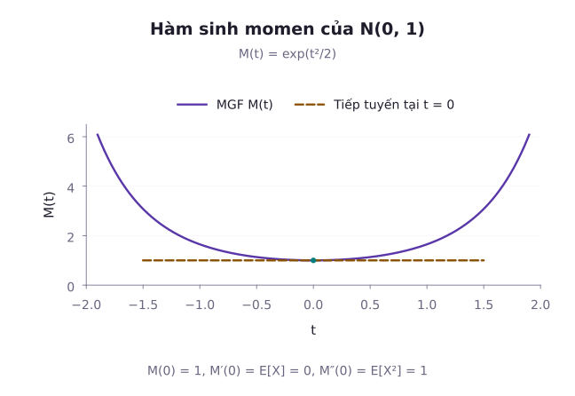
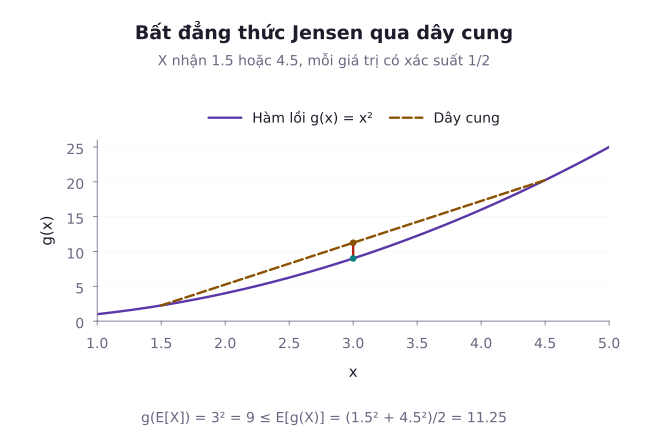

Làm thế nào để mô tả trọn vẹn đặc trưng hình học của một phân phối xác suất khi chỉ biết trung bình và độ phân tán là chưa đủ? Hai phân phối hoàn toàn có thể có cùng kỳ vọng $\mu = 0$ và cùng phương sai $\sigma^2 = 1$, nhưng một bên hoàn toàn đối xứng, còn bên kia lại lệch hẳn về một phía hoặc có phần đuôi rất nặng với nhiều giá trị ngoại lai cực đoan.

Các **mômen** (Moments) bổ sung thông tin về phân phối qua những kỳ vọng lũy thừa. Tuy nhiên, một phân phối có thể thiếu mômen hữu hạn, và ngay cả toàn bộ chuỗi mômen hữu hạn cũng chưa luôn xác định duy nhất phân phối. Hơn thế nữa, thay vì phải tính riêng lẻ từng tích phân cho từng bậc mômen, ta có thể gói gọn toàn bộ thông tin của vô hạn các mômen vào trong một hàm số duy nhất gọi là **hàm sinh mômen** (Moment Generating Function - MGF). Khi không thể tính toán chính xác hàm mật độ, các **bất đẳng thức xác suất kinh điển** (Markov, Chebyshev, Cauchy-Schwarz, Jensen) cho phép ta chặn trên hoặc chặn dưới xác suất của các biến cố với độ tin cậy toán học.

Bài học này xây dựng hệ thống giải tích về mômen, hàm sinh và bốn bất đẳng thức trụ cột của lý thuyết xác suất hiện đại.

---

## 1. Hệ thống mômen của biến ngẫu nhiên

Khái niệm mômen trong xác suất bắt nguồn từ cơ học cổ điển: Nếu coi hàm khối lượng xác suất như khối lượng phân bố dọc theo thanh đòn, thì kỳ vọng là trọng tâm, còn phương sai là mômen quán tính quay.

### Mômen gốc (Raw Moments)

Mômen gốc bậc $k$ (với $k \in \mathbb{N}^*$) của biến ngẫu nhiên $X$ được định nghĩa là kỳ vọng của lũy thừa bậc $k$:

$$
\mu_k = \mathbb{E}[X^k].
$$

- Mômen bậc 1 chính là kỳ vọng: $\mu_1 = \mathbb{E}[X]$.
- Với biến rời rạc có các giá trị $x_1,x_2,\dots$, đặt $a_j=x_j^k p(x_j)$ là đóng góp từ giá trị thứ $j$. Khi đó:

$$
\begin{aligned}
\mathbb E[X^k]&=a_1+a_2+\dots \\
&=\sum_{j=1}^\infty a_j.
\end{aligned}
$$

- Với biến liên tục: $\mathbb{E}[X^k] = \int_{-\infty}^\infty x^k f(x) \, dx$.

Điều kiện tồn tại: Tích phân hoặc chuỗi phải hội tụ tuyệt đối: $\mathbb{E}[|X|^k] < \infty$. Nếu mômen bậc $k$ tồn tại hữu hạn thì mọi mômen bậc thấp hơn $j < k$ cũng đều tồn tại hữu hạn.

### Mômen trung tâm (Central Moments)

Để đo lường độ biến động quanh trọng tâm, ta xét mômen trung tâm bậc $k$:

$$
\mu'_k = \mathbb{E}\left[ (X - \mathbb{E}[X])^k \right].
$$

- Mômen trung tâm bậc 1 luôn bằng 0: $\mu'_1 = \mathbb{E}[X - \mu] = 0$.
- Mômen trung tâm bậc 2 chính là phương sai: $\mu'_2 = \mathbb{E}[(X - \mu)^2] = \mathrm{Var}(X) = \sigma^2$.

### Hệ số bất đối xứng và Hệ số nhọn

Giả sử phương sai dương và hữu hạn, đồng thời mômen tuyệt đối bậc ba hoặc bậc bốn tương ứng hữu hạn. Để so sánh các phân phối khác đơn vị đo, ta chuẩn hóa bằng độ lệch chuẩn $\sigma = \sqrt{\mathrm{Var}(X)}$:
1. **Hệ số bất đối xứng (Skewness)**: Đo mức độ lệch của phân phối so với hình đối xứng:

$$
\gamma_1 = \frac{\mu'_3}{\sigma^3} = \frac{\mathbb{E}[(X - \mu)^3]}{\sigma^3}.
$$

   - Nếu phân phối đối xứng quanh tâm và mômen tuyệt đối bậc ba hữu hạn thì $\gamma_1=0$. Chiều ngược lại không đúng nói chung.
   - $\gamma_1 > 0$: Lệch phải (đuôi bên phải kéo dài, phần lớn dữ liệu tập trung bên trái).
   - $\gamma_1 < 0$: Lệch trái (đuôi bên trái kéo dài).
2. **Hệ số độ nhọn (Kurtosis)**: Đo kỳ vọng của lũy thừa bậc bốn của độ lệch đã chuẩn hóa, nhấn mạnh các giá trị xa trung bình:

$$
\gamma_2 = \frac{\mu'_4}{\sigma^4} = \frac{\mathbb{E}[(X - \mu)^4]}{\sigma^4}.
$$

   - Với phân phối Chuẩn tắc: $\gamma_2 = 3$. Vì vậy, người ta thường dùng **độ nhọn dư**: $\kappa = \gamma_2 - 3$. Giá trị $\kappa>0$ cho biết mômen trung tâm chuẩn hóa bậc bốn lớn hơn mốc Chuẩn. Nó không tự xác lập một thứ tự so sánh xác suất đuôi tại mọi ngưỡng.

---

## 2. Hàm sinh mômen (MGF)

Thay vì phải tính riêng lẻ từng tích phân $\int x^k f(x) dx$, ta xét một biến đổi tích phân hàm mũ gom tất cả các lũy thừa lại với nhau.

### Định nghĩa MGF

Hàm sinh mômen của biến ngẫu nhiên $X$ được định nghĩa là:

$$
M_X(t) = \mathbb{E}[e^{tX}], \quad t \in \mathbb{R}.
$$

- Nếu $X$ là biến rời rạc: $M_X(t) = \sum_x e^{tx} p(x)$.
- Nếu $X$ là biến liên tục: $M_X(t) = \int_{-\infty}^\infty e^{tx} f(x) \, dx$.

**Điều kiện tồn tại**: Hàm sinh mômen chỉ được coi là tồn tại nếu kỳ vọng $\mathbb{E}[e^{tX}]$ hội tụ hữu hạn trong một khoảng mở $(-h, h)$ bao quanh điểm 0 (với $h > 0$). Luôn có $M_X(0) = \mathbb{E}[e^0] = 1$.

### Cơ chế sinh mômen bằng đạo hàm

Khai triển chuỗi Taylor của hàm mũ quanh 0:

$$
\begin{aligned}
e^{tX} &= 1 + tX + \frac{t^2 X^2}{2!} + \dots \\
&= \sum_{k=0}^\infty \frac{t^k X^k}{k!}.
\end{aligned}
$$

Khi MGF hữu hạn trên một khoảng mở quanh 0, ta có thể đổi thứ tự kỳ vọng và chuỗi trong một khoảng đủ nhỏ nằm bên trong đó. Với ký hiệu mômen gốc $\mu_k$, ta được:

$$
\begin{aligned}
M_X(t) &= \mathbb{E}\left[ \sum_{k=0}^\infty \frac{t^k X^k}{k!} \right] \\
&= \sum_{k=0}^\infty \frac{t^k}{k!} \mathbb{E}[X^k] \\
&= 1+t\mu_1+\frac{t^2\mu_2}{2!}+\dots
\end{aligned}
$$

Lấy đạo hàm bậc $k$ của $M_X(t)$ theo biến $t$ rồi cho $t = 0$:

$$
\begin{aligned}
M_X^{(k)}(0) &= \left. \frac{d^k}{dt^k} M_X(t) \right|_{t=0} \\
&= \mathbb{E}[X^k].
\end{aligned}
$$

Mômen bậc $k$ chính là đạo hàm cấp $k$ của hàm sinh mômen tại gốc tọa độ.

### Định lý duy nhất của MGF

Nếu hai biến ngẫu nhiên $X$ và $Y$ có hàm sinh mômen tồn tại và bằng nhau trên cùng một khoảng lân cận quanh 0: $M_X(t) = M_Y(t), \forall t \in (-h, h)$, thì $X$ và $Y$ bắt buộc phải có cùng một hàm phân phối xác suất.

### MGF của biến ngẫu nhiên độc lập

Nếu $X_1, X_2, \dots, X_n$ là các biến ngẫu nhiên độc lập, thì MGF của biến tổng bằng tích các MGF thành phần:

$$
\begin{aligned}
M_{\sum_{i=1}^n X_i}(t) &= \mathbb{E}\left[ \prod_{i=1}^n e^{t X_i} \right] \\
&= \prod_{i=1}^n \mathbb{E}[e^{t X_i}] \\
&= \prod_{i=1}^n M_{X_i}(t).
\end{aligned}
$$

Tính chất này biến phép toán tích chập tích phân phức tạp thành phép nhân đại số đơn giản.

::: example Ví dụ 1: Tính mômen của phân phối Chuẩn chuẩn tắc qua MGF
Cho $X \sim \mathcal{N}(0, 1)$ có hàm mật độ $f(x) = \frac{1}{\sqrt{2\pi}} e^{-x^2 / 2}$.

1. Tìm hàm sinh mômen $M_X(t)$.
2. Sử dụng $M_X(t)$ để tính $\mathbb{E}[X]$, $\mathbb{E}[X^2]$ và $\mathbb{E}[X^4]$.

*Lời giải:*
1. **Tìm $M_X(t)$**:

$$
M_X(t)=\frac1{\sqrt{2\pi}}\int_{\mathbb R}e^{tx-x^2/2}\,dx.
$$

   Hoàn thành bình phương trên số mũ: $x^2 - 2tx = (x - t)^2 - t^2$.

$$
M_X(t)=e^{t^2/2}\int_{\mathbb R}f_t(x)\,dx.
$$

   Ở đây, $f_t(x)=e^{-(x-t)^2/2}/\sqrt{2\pi}$ là mật độ Chuẩn có trung bình $t$ và phương sai 1. Vì vậy tích phân trên bằng 1. Nói cách khác, đây là tích phân của hàm mật độ chuẩn $\mathcal{N}(t, 1)$ trên toàn trục số thực, nên bằng đúng 1.
   Do đó:

$$
M_X(t) = e^{t^2 / 2}, \quad \forall t \in \mathbb{R}.
$$

2. **Tính các mômen bằng đạo hàm**:
   - Đạo hàm cấp 1:

$$
\begin{aligned}
M'_X(t) &= t e^{t^2 / 2} \\
\implies \mathbb{E}[X] &= M'_X(0) \\
&= 0.
\end{aligned}
$$

   - Đạo hàm cấp 2:

$$
\begin{aligned}
M''_X(t) &= (1 + t^2) e^{t^2 / 2} \\
\implies \mathbb{E}[X^2] &= M''_X(0) \\
&= 1.
\end{aligned}
$$

   - Đạo hàm cấp 3:

$$
\begin{aligned}
M'''_X(t) &= (3t + t^3) e^{t^2 / 2} \\
\implies \mathbb{E}[X^3] &= M'''_X(0) \\
&= 0.
\end{aligned}
$$

   - Đạo hàm cấp 4:

$$
\begin{aligned}
M^{(4)}_X(t) &= (3 + 6t^2 + t^4) e^{t^2 / 2} \\
\implies \mathbb{E}[X^4] &= M^{(4)}_X(0) \\
&= 3.
\end{aligned}
$$

   Toàn bộ các mômen được tìm thấy bằng đạo hàm đại số thuần túy, không cần tính thêm tích phân.
:::

::: example Ví dụ 2: Chứng minh tổng của hai biến Poisson độc lập là phân phối Poisson
Cho hai biến ngẫu nhiên độc lập $X_1 \sim \mathrm{Poisson}(\lambda_1)$ và $X_2 \sim \mathrm{Poisson}(\lambda_2)$. Tìm phân phối của tổng $S = X_1 + X_2$.

*Lời giải:*
Trước hết ta tìm MGF của biến $X \sim \mathrm{Poisson}(\lambda)$:

$$
\begin{aligned}
M_X(t) &= \sum_{k=0}^\infty e^{tk} \frac{\lambda^k e^{-\lambda}}{k!} \\
&= e^{-\lambda} \sum_{k=0}^\infty \frac{(\lambda e^t)^k}{k!} \\
&= e^{-\lambda} e^{\lambda e^t} = e^{\lambda(e^t - 1)}.
\end{aligned}
$$

Vì $X_1$ và $X_2$ độc lập:

$$
\begin{aligned}
M_S(t) &= M_{X_1}(t) M_{X_2}(t) \\
&= e^{\lambda_1(e^t - 1)} e^{\lambda_2(e^t - 1)} \\
&= e^{(\lambda_1 + \lambda_2)(e^t - 1)}.
\end{aligned}
$$

Hàm $M_S(t)$ có dạng chuẩn xác của hàm sinh mômen phân phối Poisson với tham số $\lambda = \lambda_1 + \lambda_2$.
Theo định lý duy nhất của MGF:

$$
S = X_1 + X_2 \sim \mathrm{Poisson}(\lambda_1 + \lambda_2).
$$

:::

---

## 3. Hàm sinh xác suất (PGF)

Đối với biến ngẫu nhiên nhận giá trị nguyên không âm $X \in \{0, 1, 2, \dots\}$, việc làm việc với lũy thừa $s^X$ thường thuận tiện hơn $e^{tX}$.

Hàm sinh xác suất của $X$ được định nghĩa là:

$$
\begin{aligned}
G_X(s)&=\mathbb E[s^X] \\
&=\sum_{k=0}^\infty p_k s^k \\
&=p_0+p_1s+p_2s^2+\dots.
\end{aligned}
$$

Chuỗi hội tụ tuyệt đối với $|s|\le1$.

- Các hệ số của chuỗi lũy thừa chính là các xác suất: $p_k = P(X = k) = \frac{G_X^{(k)}(0)}{k!}$.
- Luôn có $G_X(1) = \sum_{k=0}^\infty p_k = 1$.
- Mối liên hệ với biểu thức kỳ vọng hàm mũ: $G_X(s)=\mathbb{E}[e^{(\ln s)X}]$ khi $s>0$ và kỳ vọng hữu hạn. Trên $0<s\le1$, kỳ vọng này luôn hữu hạn. Với $s>1$, cần kiểm tra hội tụ riêng.
- Tại $s=0$, quy ước $0^0=1$ trong số hạng ứng với $X=0$, nên $G_X(0)=p_0$.

---

## 4. Bốn bất đẳng thức xác suất kinh điển

Khi phân phối thực tế quá phức tạp hoặc hàm mật độ không có biểu thức giải tích tường minh, bốn bất đẳng thức sau đây cung cấp các cận đánh giá định lượng nghiêm ngặt.

### 1. Bất đẳng thức Markov

::: proof Phát biểu và chứng minh bất đẳng thức Markov
Cho $X$ là một biến ngẫu nhiên không âm ($X \ge 0$). Với mọi hằng số thực $a > 0$, ta luôn có:

$$
P(X \ge a) \le \frac{\mathbb{E}[X]}{a}.
$$

*Chứng minh:*
Xét biến ngẫu nhiên chỉ thị $I_{\{X \ge a\}}$, nhận giá trị 1 khi $X \ge a$ và nhận giá trị 0 khi $X < a$.
Vì $X \ge 0$, ta luôn có bất đẳng thức:

$$
X \ge a \cdot I_{\{X \ge a\}}.
$$

Lấy kỳ vọng hai vế và sử dụng tính bảo toàn thứ tự của kỳ vọng:

$$
\begin{aligned}
\mathbb E[X]&\ge a\mathbb E[I_{\{X\ge a\}}] \\
&=aP(X\ge a).
\end{aligned}
$$

Chia cả hai vế cho $a > 0$, ta thu được: $P(X \ge a) \le \frac{\mathbb{E}[X]}{a}$.
:::

### 2. Bất đẳng thức Chebyshev

Bằng cách áp dụng bất đẳng thức Markov cho biến ngẫu nhiên không âm $(X - \mu)^2$, ta thu được đánh giá về mức độ phân tán quanh trung bình.

::: proof Phát biểu và chứng minh bất đẳng thức Chebyshev
Cho biến ngẫu nhiên $X$ có kỳ vọng $\mu$ và phương sai $0<\sigma^2<\infty$. Với mọi hằng số $k > 0$:

$$
P(|X - \mu| \ge k\sigma) \le \frac{1}{k^2}.
$$

*Chứng minh:*
Biến cố $\{|X - \mu| \ge k\sigma\}$ tương đương với $\{(X - \mu)^2 \ge k^2 \sigma^2\}$.
Đặt $Y=(X-\mu)^2$, khi đó $\mathbb E[Y]=\sigma^2$. Áp dụng Markov cho $Y$ với ngưỡng $a = k^2 \sigma^2 > 0$:

$$
\begin{aligned}
P(Y\ge k^2\sigma^2)&\le\frac{\mathbb E[Y]}{k^2\sigma^2} \\
&=\frac1{k^2}.
\end{aligned}
$$

Bất đẳng thức được chứng minh hoàn tất.
:::
- Khi $k = 2$: $P(|X - \mu| \ge 2\sigma) \le 1/4 = 25\%$ (ít nhất 75% dữ liệu nằm trong khoảng $\mu \pm 2\sigma$).
- Khi $k = 3$: $P(|X - \mu| \ge 3\sigma) \le 1/9 \approx 11{,}1\%$.

::: example Ví dụ 3: Đánh giá điểm thi bằng Markov và Chebyshev
Giả sử điểm thi kết thúc học phần của một khóa sinh viên có trung bình $\mu = 70$ điểm và độ lệch chuẩn $\sigma = 10$ điểm. Điểm thi là số không âm.

1. Sử dụng bất đẳng thức Markov để chặn trên xác suất một sinh viên đạt từ 90 điểm trở lên: $P(X \ge 90)$.
2. Sử dụng bất đẳng thức Chebyshev để đánh giá xác suất này.

*Lời giải:*
1. **Theo bất đẳng thức Markov** (với $X \ge 0, a = 90$):

$$
\begin{aligned}
P(X\ge90)&\le\frac{\mathbb E[X]}{90} \\
&=\frac79\approx0{,}7778.
\end{aligned}
$$

2. **Theo bất đẳng thức Chebyshev**:
   Biến cố sinh viên đạt từ 90 điểm trở lên kéo theo khoảng cách từ điểm số đến trung bình ít nhất là $90 - 70 = 20$ điểm:

$$
\{X \ge 90\} \subset \{|X - 70| \ge 20\}.
$$

   Vì $20 = 2\sigma$ (ứng với $k = 2$):

$$
\begin{aligned}
P(X\ge90)&\le\frac{\sigma^2}{20^2} \\
&=\frac{100}{400}=\frac14=25\%.
\end{aligned}
$$

   Bằng cách sử dụng thêm thông tin về phương sai, đánh giá Chebyshev đã thu hẹp cận xác suất từ $77{,}78\%$ xuống còn $25\%$.
:::

### 3. Bất đẳng thức Cauchy-Schwarz

Với hai biến ngẫu nhiên $X$ và $Y$ có mômen bậc hai hữu hạn:

$$
\left( \mathbb{E}[XY] \right)^2 \le \mathbb{E}[X^2] \, \mathbb{E}[Y^2].
$$

Dấu bằng xảy ra khi và chỉ khi $X,Y$ phụ thuộc tuyến tính trong không gian các biến có mômen bậc hai hữu hạn. Nghĩa là có hai hằng số $a,b$, không đồng thời bằng 0, sao cho $aX+bY=0$ hầu chắc chắn. Nếu $\mathbb{E}[X^2]>0$, có thể viết điều kiện này thành $Y=cX$.

### 4. Bất đẳng thức Jensen

Giả sử $X$ khả tích, nhận giá trị trong một khoảng $I$, và $g$ lồi trên $I$. Nếu $\mathbb{E}[|g(X)|]<\infty$, thì:

$$
\mathbb{E}[g(X)] \ge g(\mathbb{E}[X]).
$$

Nếu $g$ lõm, bất đẳng thức đổi chiều với cùng điều kiện khả tích. Với hàm khả vi hai lần, dấu của đạo hàm bậc hai là một cách kiểm tra tính lồi hoặc lõm:

$$
\mathbb{E}[g(X)] \le g(\mathbb{E}[X]).
$$

::: example Ví dụ 4: Ứng dụng bất đẳng thức Jensen
Cho biến ngẫu nhiên $X>0$ có $\mathbb{E}[X]=4$, $\mathrm{Var}(X)=9$ và $\mathbb{E}[1/X]<\infty$.

1. So sánh $\mathbb{E}[X^2]$ với $(\mathbb{E}[X])^2$.
2. So sánh $\mathbb{E}[1/X]$ với $1/\mathbb{E}[X]$.

*Lời giải:*
1. Hàm số $g(x) = x^2$ có $g''(x) = 2 > 0$ nên là hàm lồi ngặt trên $\mathbb{R}$.
   Theo bất đẳng thức Jensen: $\mathbb{E}[X^2] \ge (\mathbb{E}[X])^2$.
   Kiểm chứng số học:

$$
\begin{aligned}
\mathbb{E}[X^2] &= \mathrm{Var}(X) + (\mathbb{E}[X])^2 \\
&= 9 + 4^2 \\
&= 25.
\end{aligned}
$$

   Trong khi: $(\mathbb{E}[X])^2 = 4^2 = 16$.
   Hiệu hai vế bằng $25-16=9$, chính là phương sai dương của $X$.
2. Hàm số $h(x) = 1/x$ trên khoảng $(0, \infty)$ có đạo hàm cấp hai $h''(x) = 2/x^3 > 0$, nên là hàm lồi ngặt.
   Theo bất đẳng thức Jensen:

$$
\mathbb{E}\left[ \frac{1}{X} \right] > \frac{1}{\mathbb{E}[X]} = \frac{1}{4} = 0{,}25.
$$

   Chẳng hạn, cho $X$ nhận hai giá trị 1 và 7 với xác suất bằng nhau. Khi đó trung bình bằng 4 và phương sai bằng 9, còn:

$$
\begin{aligned}
\mathbb{E}[1/X] &= \frac12\left(1+\frac17\right) \\
&= \frac47>\frac14.
\end{aligned}
$$

   Nếu $X$ suy biến thành hằng số dương thì Jensen cho dấu bằng.
:::

---

## Tóm tắt bài học

- **Hệ thống mômen**: Kỳ vọng (bậc 1), phương sai (bậc 2 trung tâm), Skewness (bậc 3 chuẩn hóa, đo độ lệch) và Kurtosis (bậc 4 chuẩn hóa, đo độ dày của đuôi ngoại lai).
- **Hàm sinh mômen (MGF)**: Gom toàn bộ thông tin phân phối vào hàm mũ $M(t) = \mathbb{E}[e^{tX}]$ trên khoảng mở quanh 0. Đạo hàm cấp $k$ tại 0 sinh ra mômen gốc bậc $k$. MGF của tổng biến độc lập bằng tích các MGF thành phần.
- **Bất đẳng thức Markov**: Cận xác suất đuôi cơ sở cho biến ngẫu nhiên không âm chỉ cần biết kỳ vọng: $P(X \ge a) \le \mathbb{E}[X] / a$.
- **Bất đẳng thức Chebyshev**: Đánh giá độ lệch khỏi trung bình qua phương sai: $P(|X - \mu| \ge k\sigma) \le 1/k^2$.
- **Bất đẳng thức Jensen**: Nền tảng so sánh $\mathbb{E}[g(X)] \ge g(\mathbb{E}[X])$ đối với các hàm lồi, được dùng để đánh giá các kỳ vọng phi tuyến trong lý thuyết thông tin và tối ưu hóa.

---

## Tài liệu tham khảo

- Penn State University, [STAT 414: Moment Generating Functions](https://online.stat.psu.edu/stat414/Lesson09).
- Joseph K. Blitzstein và Jessica Hwang, [Introduction to Probability](https://probabilitybook.net/), mômen, hàm sinh và bất đẳng thức xác suất.

Hệ thống bài tập rèn luyện kỹ năng tính toán hàm sinh mômen, hàm sinh xác suất và thiết lập các đánh giá bất đẳng thức Markov, Chebyshev, Cantelli.

## Bài tập rèn luyện: Momen, hàm sinh và bất đẳng thức xác suất

::: exercise Bài tập 1
Tìm hàm sinh mômen $M_X(t)$ của biến ngẫu nhiên phân phối Exponential $X \sim \mathrm{Exp}(\lambda)$ với $f(x) = \lambda e^{-\lambda x}$ ($x > 0$). Sử dụng $M_X(t)$ để tính $\mathbb{E}[X]$ và $\mathbb{E}[X^2]$.
:::
::: solution Lời giải
1. Tính MGF:

$$
M_X(t)=\lambda\int_0^\infty e^{-(\lambda-t)x}\,dx.
$$

Tích phân này hội tụ khi và chỉ khi $\lambda - t > 0 \iff t < \lambda$. Khi đó:

$$
M_X(t)=\frac{\lambda}{\lambda-t},\quad t<\lambda.
$$

2. Tính mômen bằng đạo hàm:
- Đạo hàm cấp 1:

$$
\begin{aligned}
M'_X(t) &= \frac{\lambda}{(\lambda - t)^2} \\
\implies \mathbb{E}[X] &= M'_X(0) \\
&= \frac{1}{\lambda}.
\end{aligned}
$$

- Đạo hàm cấp 2:

$$
\begin{aligned}
M''_X(t) &= \frac{2\lambda}{(\lambda - t)^3} \\
\implies \mathbb{E}[X^2] &= M''_X(0) \\
&= \frac{2}{\lambda^2}.
\end{aligned}
$$

- Phương sai:

$$
\begin{aligned}
\mathrm{Var}(X)&=\frac2{\lambda^2}-\frac1{\lambda^2} \\
&=\frac1{\lambda^2}.
\end{aligned}
$$

:::

::: exercise Bài tập 2
Tìm hàm sinh xác suất PGF $G_X(s)$ của biến ngẫu nhiên phân phối Nhị thức $X \sim \mathrm{Bin}(n, p)$ với $P(X = k) = \binom{n}{k} p^k (1 - p)^{n - k}$.
:::
::: solution Lời giải
Theo định nghĩa của PGF:

$$
\begin{aligned}
G_X(s) &= \mathbb{E}[s^X] \\
&= \sum_{k=0}^n \binom{n}{k} (ps)^k (1 - p)^{n - k}.
\end{aligned}
$$

Áp dụng công thức nhị thức Newton với hai số hạng $a = ps$ và $b = 1 - p$:

$$
\begin{aligned}
G_X(s) &= (ps + 1 - p)^n \\
&= (1 - p + ps)^n.
\end{aligned}
$$

Kiểm tra tại $s = 1$: $G_X(1) = (1 - p + p)^n = 1^n = 1$.
:::

::: exercise Bài tập 3
Cho biến ngẫu nhiên $X$ có phân phối Chuẩn chuẩn tắc $X \sim \mathcal{N}(0, 1)$.
1. Sử dụng tính đối xứng để xác định hệ số bất đối xứng $\gamma_1$.
2. Tính hệ số độ nhọn dư $\kappa = \gamma_2 - 3$.
:::
::: solution Lời giải
1. Vì phân phối Chuẩn chuẩn tắc có hàm mật độ $f(x) = \frac{1}{\sqrt{2\pi}} e^{-x^2 / 2}$ là hàm chẵn đối xứng qua 0, mọi mômen trung tâm bậc lẻ đều bằng 0:

$$
\begin{aligned}
\mu'_3 &= \mathbb{E}[(X - 0)^3] \\
&= \mathbb{E}[X^3] \\
&= 0 \\
\implies \gamma_1 &= \frac{\mu'_3}{\sigma^3} \\
&= 0.
\end{aligned}
$$

Phân phối hoàn toàn đối xứng, không có độ lệch.
2. Từ kết quả Ví dụ 1, mômen bậc 4 là $\mathbb{E}[X^4] = 3$. Vì $\mu = 0$ và $\sigma = 1$:

$$
\gamma_2 = \frac{\mu'_4}{\sigma^4} = \frac{3}{1^4} = 3.
$$

Hệ số độ nhọn dư:

$$
\kappa = \gamma_2 - 3 = 3 - 3 = 0.
$$

Phân phối Chuẩn là chuẩn mực so sánh độ nhọn với độ nhọn dư bằng 0.
:::

::: exercise Bài tập 4
Chứng minh bất đẳng thức Cantelli: Cho biến ngẫu nhiên $X$ có kỳ vọng $\mu = 0$ và phương sai $0<\sigma^2<\infty$. Với mọi hằng số $k > 0$:

$$
P(X \ge k\sigma) \le \frac{1}{1 + k^2}.
$$

:::
::: solution Lời giải
Với bất kỳ số thực $u > 0$, biến cố $\{X \ge k\sigma\}$ tương đương với $\{X + u \ge k\sigma + u\}$.
Vì $k\sigma + u > 0$, biến cố này kéo theo $(X + u)^2 \ge (k\sigma + u)^2$.
Áp dụng bất đẳng thức Markov cho biến không âm $(X + u)^2$:

$$
P(X\ge k\sigma)\le\frac{\mathbb E[(X+u)^2]}{(k\sigma+u)^2}.
$$

Khai triển tử số với $\mathbb{E}[X] = 0$ và $\mathbb{E}[X^2] = \sigma^2$:

$$
\begin{aligned}
\mathbb{E}[(X + u)^2] &= \mathbb{E}[X^2 + 2uX + u^2] \\
&= \sigma^2 + u^2.
\end{aligned}
$$

Do đó:

$$
P(X \ge k\sigma) \le \frac{\sigma^2 + u^2}{(k\sigma + u)^2}.
$$

Bất đẳng thức đúng với mọi $u > 0$. Ta chọn $u$ để làm tối thiểu hóa phân số này. Đặt $u = \frac{\sigma}{k}$:

$$
\begin{aligned}
\frac{\sigma^2 + (\sigma/k)^2}{(k\sigma + \sigma/k)^2} &= \frac{\sigma^2 (1 + 1/k^2)}{\sigma^2 (k + 1/k)^2} \\
&= \frac{1}{1 + k^2}.
\end{aligned}
$$

Bất đẳng thức Cantelli được chứng minh hoàn tất.
:::

::: exercise Bài tập 5
Nêu hai ví dụ về các phân phối xác suất kinh điển không tồn tại hàm sinh mômen $M_X(t)$ trên bất kỳ khoảng mở nào quanh 0 và giải thích nguyên nhân giải tích.
:::
::: solution Lời giải
1. **Phân phối Cauchy**: Hàm mật độ $f(x) = \frac{1}{\pi(1 + x^2)}$ trên $\mathbb{R}$.
Khi tính $M_X(t) = \int_{-\infty}^\infty e^{tx} \frac{1}{\pi(1 + x^2)} dx$ với $t > 0$, hàm số dưới dấu tích phân tiến ra vô cùng với tốc độ hàm mũ khi $x \to +\infty$ ($e^{tx} / x^2 \to \infty$). Do đó tích phân phân kỳ với mọi $t \ne 0$. Phân phối Cauchy không có MGF.
2. **Phân phối Lognormal**: Biến $Y = e^Z$ với $Z \sim \mathcal{N}(0, 1)$.
Mọi mômen của phân phối Lognormal đều tồn tại hữu hạn: $\mathbb{E}[Y^k] = e^{k^2 / 2}$. Tuy nhiên, tích phân $M_Y(t) = \int_0^\infty e^{ty} f_Y(y) dy$ phân kỳ với mọi $t > 0$ do chuỗi $\sum \frac{t^k}{k!} e^{k^2 / 2}$ có bán kính hội tụ bằng 0. Do đó MGF không tồn tại trên lân cận của 0.
:::

