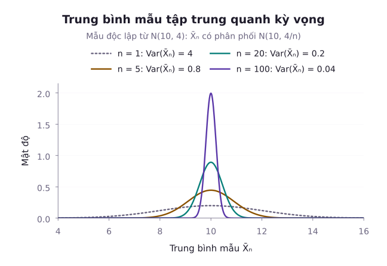
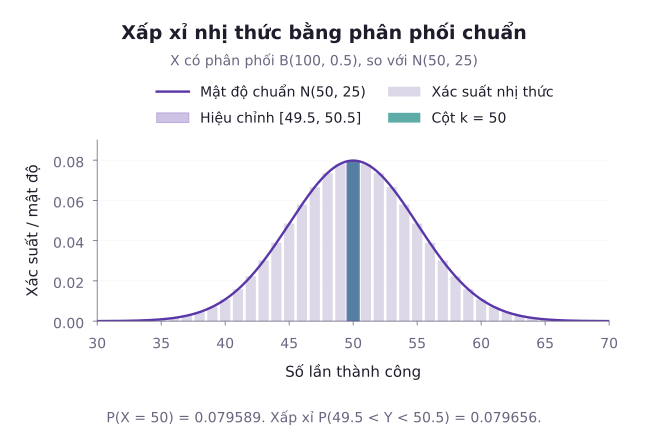
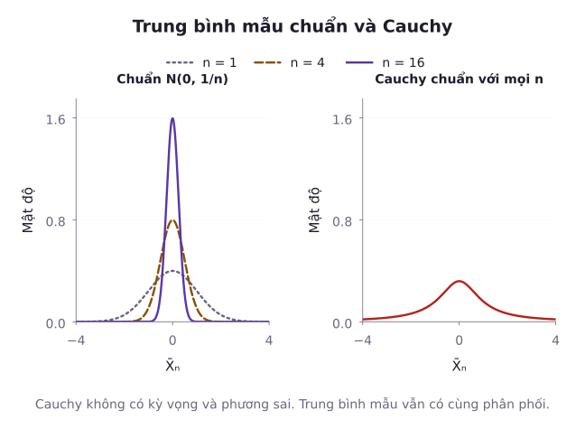

Khi lấy trung bình nhiều phép đo độc lập, vì sao sai số trung bình thường nhỏ hơn sai số của một phép đo? Với một danh mục bảo hiểm lớn, ta có thể ước lượng tổng tiền bồi thường quanh mức nào, và phần dao động ngẫu nhiên còn lớn đến đâu?

Trung bình mẫu có thể ổn định khi cỡ mẫu tăng, nhưng mức độ ổn định phụ thuộc vào độc lập, tính đồng nhất phân phối và các mômen hữu hạn. Sự ổn định tương đối không có nghĩa tổng tổn thất hết dao động hay rủi ro phá sản bằng 0. Hai trụ cột toán học giải thích quy luật này là **Luật số lớn** (Law of Large Numbers - LLN) và **Định lý giới hạn trung tâm** (Central Limit Theorem - CLT).

Ta sẽ phân biệt ba dạng hội tụ, chứng minh luật số lớn yếu trong trường hợp phương sai hữu hạn, rồi phát biểu luật mạnh và CLT. Các ví dụ hiệu chỉnh liên tục và phân phối Cauchy giúp xác định phạm vi áp dụng của những kết quả này.

---

## 1. Ba dạng thức hội tụ của dãy biến ngẫu nhiên

Trong giải tích hàm thông thường, dãy số thực $(a_n)$ hội tụ về $a$ nếu khoảng cách $|a_n - a| < \varepsilon$ với mọi $n$ đủ lớn. Đối với dãy biến ngẫu nhiên $(X_n)$, mỗi $X_n$ là một hàm đo trên không gian mẫu $\Omega$. Do đó, khái niệm hội tụ có thể định nghĩa theo nhiều cấp độ khác nhau.

### Hội tụ theo phân phối (Convergence in Distribution)

Dãy biến ngẫu nhiên $X_1, X_2, \dots, X_n$ được gọi là **hội tụ theo phân phối** về biến ngẫu nhiên $X$, ký hiệu $X_n \xrightarrow{d} X$, nếu:

$$
\lim_{n \to \infty} F_{X_n}(x) = F_X(x)
$$

tại mọi điểm liên tục $x$ của hàm phân phối tích lũy $F_X(x)$.

Trong ba dạng đang xét, hội tụ theo phân phối là dạng yếu nhất: Nó chỉ yêu cầu hình dạng phân phối tiệm cận về nhau, chứ bản thân giá trị của $X_n$ và $X$ không nhất thiết phải gần nhau trên từng biến cố.

### Hội tụ theo xác suất (Convergence in Probability)

Dãy biến ngẫu nhiên $X_n$ được gọi là **hội tụ theo xác suất** về biến ngẫu nhiên $X$ (hoặc hằng số $c$), ký hiệu $X_n \xrightarrow{P} X$, nếu với mọi số thực dương $\varepsilon > 0$:

$$
\lim_{n \to \infty} P(|X_n - X| \ge \varepsilon) = 0,
$$

hoặc tương đương:

$$
\lim_{n \to \infty} P(|X_n - X| < \varepsilon) = 1.
$$

Ý nghĩa trực giác: Khi cỡ mẫu $n$ tăng lên, xác suất để $X_n$ đi chệch khỏi giá trị mục tiêu một khoảng dù nhỏ tùy ý sẽ tiến dần về 0.

### Hội tụ hầu chắc chắn (Almost Sure Convergence)

Dãy biến ngẫu nhiên $X_n$ được gọi là **hội tụ hầu chắc chắn** (hội tụ với xác suất 1) về biến ngẫu nhiên $X$, ký hiệu $X_n \xrightarrow{a.s.} X$, nếu:

$$
P\left(\lim_{n\to\infty}X_n=X\right)=1.
$$

Ý nghĩa trực giác: Tập hợp tất cả các kịch bản thực nghiệm $\omega$ mà tại đó dãy số $X_n(\omega)$ không hội tụ về $X(\omega)$ có tổng xác suất đúng bằng 0.

### Mối quan hệ phân tầng giữa các dạng hội tụ

Các chế độ hội tụ tuân theo sơ đồ quan hệ một chiều:

$$
\begin{aligned}
X_n \xrightarrow{a.s.} X &\implies X_n \xrightarrow{P} X \\
&\implies X_n \xrightarrow{d} X.
\end{aligned}
$$

Chiều ngược lại nhìn chung không đúng:
- Hội tụ theo phân phối không suy ra hội tụ theo xác suất (trừ trường hợp giới hạn $X = c$ là một hằng số tất định: $X_n \xrightarrow{d} c \iff X_n \xrightarrow{P} c$).
- Hội tụ theo xác suất không suy ra hội tụ hầu chắc chắn (như trong mô hình lát cắt trượt).

---

## 2. Luật số lớn (Law of Large Numbers)

Xét dãy các biến ngẫu nhiên độc lập, cùng phân phối (i.i.d.) $X_1, X_2, \dots, X_n$ có cùng kỳ vọng hữu hạn $\mathbb{E}[X_i] = \mu$. Đặt trung bình mẫu là:

$$
\begin{aligned}
\bar{X}_n &= \frac{1}{n} \sum_{i=1}^n X_i \\
&= \frac{X_1 + X_2 + \dots + X_n}{n}.
\end{aligned}
$$

### Luật số lớn yếu (Weak Law of Large Numbers - WLLN)

**Định lý (Khinchin - WLLN)**: Cho $X_1, X_2, \dots$ là dãy biến ngẫu nhiên i.i.d. có kỳ vọng khả tích tuyệt đối $\mathbb{E}[|X_i|] < \infty$ với giá trị trung bình $\mathbb{E}[X_i] = \mu$. Khi đó trung bình mẫu hội tụ theo xác suất về $\mu$:

$$
\bar{X}_n \xrightarrow{P} \mu \quad \text{khi } n \to \infty.
$$

Nói cách khác, với mọi $\varepsilon > 0$:

$$
\lim_{n \to \infty} P\left( |\bar{X}_n - \mu| \ge \varepsilon \right) = 0.
$$

::: proof Chứng minh WLLN trường hợp phương sai hữu hạn
Giả sử các biến ngẫu nhiên có phương sai hữu hạn $\mathrm{Var}(X_i) = \sigma^2 < \infty$.
Kỳ vọng của trung bình mẫu:

$$
\begin{aligned}
\mathbb{E}[\bar{X}_n] &= \mathbb{E}\left[ \frac{1}{n} \sum_{i=1}^n X_i \right] \\
&= \frac{1}{n} (n\mu) \\
&= \mu.
\end{aligned}
$$

Vì các biến $X_i$ độc lập với nhau, phương sai của tổng bằng tổng các phương sai:

$$
\begin{aligned}
\mathrm{Var}(\bar{X}_n) &= \frac{1}{n^2} \sum_{i=1}^n \mathrm{Var}(X_i) \\
&= \frac{n\sigma^2}{n^2} \\
&= \frac{\sigma^2}{n}.
\end{aligned}
$$

Áp dụng bất đẳng thức Chebyshev cho biến ngẫu nhiên $\bar{X}_n$:

$$
\begin{aligned}
P\left( |\bar{X}_n - \mu| \ge \varepsilon \right) &\le \frac{\mathrm{Var}(\bar{X}_n)}{\varepsilon^2} \\
&= \frac{\sigma^2}{n \varepsilon^2}.
\end{aligned}
$$

Lấy giới hạn hai vế khi $n \to \infty$ với $\varepsilon > 0$ cố định:

$$
\begin{aligned}
0 &\le \lim_{n \to \infty} P\left( |\bar{X}_n - \mu| \ge \varepsilon \right) \\
&\le \lim_{n \to \infty} \frac{\sigma^2}{n \varepsilon^2} \\
&= 0.
\end{aligned}
$$

Theo nguyên lý kẹp, ta suy ra $\lim_{n \to \infty} P(|\bar{X}_n - \mu| \ge \varepsilon) = 0$.
:::

### Luật số lớn mạnh (Strong Law of Large Numbers - SLLN)

**Định lý (Kolmogorov - SLLN)**: Cho $X_1, X_2, \dots$ là dãy biến ngẫu nhiên i.i.d. có kỳ vọng khả tích tuyệt đối $\mathbb{E}[|X_i|] < \infty$ với giá trị $\mathbb{E}[X_i] = \mu$. Khi đó trung bình mẫu hội tụ hầu chắc chắn về $\mu$:

$$
P\left( \lim_{n \to \infty} \bar{X}_n = \mu \right) = 1.
$$

Sự khác biệt giữa hai luật:
- **Luật yếu**: Đảm bảo rằng với một cỡ mẫu $n$ lớn ấn định trước, xác suất để giá trị $\bar{X}_n$ tại điểm cắt đó bị sai lệch là rất nhỏ.
- **Luật mạnh**: Khẳng định toàn bộ quỹ đạo của quá trình thực nghiệm vô hạn gần như chắc chắn sẽ đi vào và ở mãi mãi bên trong dải kẹp $\varepsilon$ kể từ một thời điểm nào đó trở đi.

---

## 3. Định lý giới hạn trung tâm (Central Limit Theorem)

Luật số lớn chỉ ra rằng $\bar{X}_n - \mu \to 0$. Tuy nhiên, tốc độ triệt tiêu sai số này diễn ra như thế nào? Và nếu phóng đại độ lệch đó lên theo một thang đo thích hợp, hình dạng phân phối xác suất giới hạn sẽ ra sao?

### Định lý Lindeberg-Lévy

**Định lý**: Cho dãy biến ngẫu nhiên độc lập, cùng phân phối $X_1, X_2, \dots$ có kỳ vọng $\mathbb{E}[X_i] = \mu$ và phương sai hữu hạn dương $0 < \mathrm{Var}(X_i) = \sigma^2 < \infty$. Khi đó, biến chuẩn hóa của tổng hoặc trung bình mẫu:

$$
\begin{aligned}
Z_n &= \frac{\sum_{i=1}^n X_i - n\mu}{\sigma \sqrt{n}} \\
&= \frac{\bar{X}_n - \mu}{\sigma / \sqrt{n}}
\end{aligned}
$$

sẽ hội tụ theo phân phối về phân phối Chuẩn chuẩn tắc $\mathcal{N}(0, 1)$:

$$
Z_n \xrightarrow{d} \mathcal{N}(0, 1) \quad \text{khi } n \to \infty.
$$

Nói cách khác, với mọi số thực $z$:

$$
\lim_{n\to\infty}P(Z_n\le z)=\Phi(z).
$$

Định lý áp dụng cho dãy độc lập, cùng phân phối có phương sai hữu hạn dương, dù phân phối gốc không Chuẩn. Đại lượng có giới hạn Chuẩn là độ lệch đã chuẩn hóa $Z_n$. Trung bình mẫu chưa chuẩn hóa lại co về $\mu$ theo luật số lớn.

Độ lệch chuẩn của trung bình mẫu bằng $\sigma/\sqrt n$. Đây là thang dao động, không phải tốc độ sai số của phép xấp xỉ phân phối. Muốn có một cận kiểu Berry–Esseen, cần thêm giả thiết, chẳng hạn mômen tuyệt đối bậc ba hữu hạn.

### Định lý De Moivre-Laplace và Hiệu chỉnh liên tục (Continuity Correction)

Khi $X \sim \mathrm{Binomial}(n,p)$ với $p \in (0,1)$ cố định và $n$ tăng vô hạn, biến $X$ có thể biểu diễn dưới dạng tổng của $n$ biến chỉ thị Bernoulli độc lập $X = \sum_{i=1}^n B_i$ với $\mathbb{E}[B_i] = p$ và $\mathrm{Var}(B_i) = p(1-p)$. Theo định lý CLT:

$$
Z = \frac{X - np}{\sqrt{np(1-p)}} \xrightarrow{d} \mathcal{N}(0, 1).
$$

Do ta đang dùng một phân phối liên tục (phân phối Chuẩn) để xấp xỉ một biến ngẫu nhiên nhận giá trị nguyên rời rạc, ta mở rộng mỗi điểm số nguyên $k$ thành một khoảng độ dài đơn vị $[k - 0{,}5; k + 0{,}5]$. Kỹ thuật này gọi là **hiệu chỉnh liên tục** (Continuity Correction):
Đặt $Y$ có phân phối Chuẩn với trung bình $np$ và độ lệch chuẩn $s=\sqrt{np(1-p)}$. Khi đó:

1. **Xác suất tại một điểm nguyên**:

$$
P(X=k)\approx\Phi(z_+)-\Phi(z_-).
$$

Ở đây $z_-=(k-0{,}5-np)/s$ và $z_+=(k+0{,}5-np)/s$. Khoảng Chuẩn tương ứng có hai đầu mút $k-0{,}5$ và $k+0{,}5$:

2. **Khoảng có hai đầu mút nguyên**: Với $a\le b$, đặt $\alpha=a-0{,}5$ và $\beta=b+0{,}5$, rồi dùng:

$$
P(a\le X\le b)\approx P(\alpha\le Y\le\beta).
$$

3. **Đuôi một phía**:

$$
\begin{aligned}
P(X\ge k)&\approx P(Y\ge k-0{,}5), \\
P(X\le k)&\approx P(Y\le k+0{,}5).
\end{aligned}
$$

Các dấu xấp xỉ ở đây phụ thuộc vào độ chính xác của xấp xỉ Chuẩn, không phải đẳng thức giữa hai phân phối.
---

## 4. Xấp xỉ Poisson đối với biến cố hiếm

Khi cỡ mẫu $n \to \infty$ nhưng xác suất thành công trong mỗi phép thử lại nhỏ $p \to 0$ sao cho tích số $\lambda = np$ được giữ nguyên là một hằng số cố định, giả thiết xác suất Bernoulli cố định của CLT đã học không còn thỏa mãn. Phương sai của tổng cũng không tăng vô hạn mà tiến về $\lambda$. Khi đó, định lý Poisson thay thế đóng vai trò xấp xỉ chủ đạo.

**Định lý (Luật biến cố hiếm Poisson)**: Nếu $n \to \infty$ và $p \to 0$ sao cho $np = \lambda$ không đổi, thì với mọi số nguyên không âm $k \in \mathbb{N}$:

$$
\lim_{n \to \infty} \binom{n}{k} p^k (1 - p)^{n - k} = \frac{\lambda^k e^{-\lambda}}{k!}.
$$

Để chọn xấp xỉ, cần xét cả $n,p$ và biến cố đang tính. Poisson phù hợp khi $p$ nhỏ và $np$ ở mức vừa phải. Chuẩn phù hợp hơn khi cả $np$ và $n(1-p)$ đủ lớn. Đây là hướng dẫn thực hành, không phải tiêu chuẩn bảo đảm sai số. Khi có công cụ tính, nên đối chiếu với xác suất Nhị thức chính xác, đặc biệt ở đuôi phân phối.
---

## 5. Phản ví dụ: Phân phối Cauchy vi phạm các định lý giới hạn

Các giả thiết xác định phạm vi bảo đảm của một định lý giới hạn. Bỏ một giả thiết có thể khiến kết luận sai. Phân phối Cauchy cho thấy cụ thể điều gì xảy ra khi thiếu mômen hữu hạn.

Xét biến ngẫu nhiên $X$ tuân theo phân phối Cauchy chuẩn tắc với hàm mật độ xác suất:

$$
f(x) = \frac{1}{\pi (1 + x^2)}, \quad x \in \mathbb{R}.
$$

Tích phân kỳ vọng phân kỳ tuyệt đối:

$$
\int_{\mathbb R}\frac{|x|}{\pi(1+x^2)}\,dx=\infty.
$$

Do đó, phân phối Cauchy **không có kỳ vọng xác định** và phương sai theo định nghĩa thông thường cũng không xác định. Mômen gốc bậc hai của nó phân kỳ.

Hàm đặc trưng của biến Cauchy chuẩn tắc là:

$$
\varphi_X(t) = \mathbb{E}[e^{itX}] = e^{-|t|}.
$$

Xét trung bình mẫu của $n$ biến ngẫu nhiên Cauchy độc lập cùng phân phối $\bar{X}_n = \frac{1}{n} \sum_{k=1}^n X_k$. Hàm đặc trưng của $\bar{X}_n$ được tính như sau:

$$
\begin{aligned}
\varphi_{\bar{X}_n}(t) &= \left[ \varphi_X\left( \frac{t}{n} \right) \right]^n \\
&= \left( e^{-|t/n|} \right)^n \\
&= e^{-|t|}.
\end{aligned}
$$

Hàm đặc trưng của trung bình mẫu $\bar{X}_n$ hoàn toàn trùng khớp với hàm đặc trưng ban đầu của một biến đơn lẻ $X_1$. Điều này chứng minh rằng: **Trung bình mẫu của $n$ biến Cauchy vẫn là một biến Cauchy chuẩn tắc nguyên vẹn**, hoàn toàn không phụ thuộc vào quy mô mẫu $n$.
1. **Kết luận luật số lớn không còn đúng**: Dù quan sát hàng triệu hay hàng tỷ mẫu, trung bình mẫu $\bar{X}_n$ không bao giờ co cụm về một hằng số.
2. **CLT hữu hạn phương sai không áp dụng**: Không thể chuẩn hóa bằng kỳ vọng và độ lệch chuẩn vì hai đại lượng đó không được xác định. Trung bình mẫu vẫn có phân phối Cauchy, thay vì co cụm quanh một hằng số.

---

## 6. Các ví dụ minh họa giải tích

::: example Ví dụ 1: Đánh giá cỡ mẫu tối thiểu cho Luật số lớn yếu bằng Chebyshev
Giả sử một công ty đo lường cảm biến chất lượng trong dây chuyền tự động. Biết rằng sai số đo của mỗi cảm biến là biến ngẫu nhiên độc lập có cùng kỳ vọng $\mu$ và độ lệch chuẩn $\sigma = 2\,\mathrm{mm}$.
Hỏi cần lấy trung bình ít nhất bao nhiêu phép đo ($n$) để đảm bảo xác suất sai lệch giữa trung bình mẫu $\bar{X}_n$ và giá trị thực $\mu$ vượt quá $0{,}1\,\mathrm{mm}$ không lớn hơn $1\%$ ($0{,}01$)?

*Lời giải:*
Theo đề bài: $\sigma = 2$, ngưỡng sai số $\varepsilon = 0{,}1$, và mức trần xác suất rủi ro là $\alpha = 0{,}01$.
Áp dụng bất đẳng thức Chebyshev cho trung bình mẫu:

$$
\begin{aligned}
P(|\bar X_n-\mu|\ge0{,}1)&\le\frac4{n(0{,}1)^2} \\
&=\frac{400}n.
\end{aligned}
$$

Để đảm bảo xác suất này không vượt quá $0{,}01$, ta giải bất đẳng thức:

$$
\begin{aligned}
\frac{400}n&\le0{,}01 \\
&\iff n\ge40\,000.
\end{aligned}
$$

Cận Chebyshev cho điều kiện đủ $n \ge 40\,000$. Đây là cỡ mẫu nhỏ nhất đáp ứng cận vừa dùng, chưa phải cỡ mẫu thực sự nhỏ nhất của mọi phân phối có cùng phương sai.
:::

::: example Ví dụ 2: Hiệu chỉnh liên tục trong xấp xỉ De Moivre-Laplace
Tung một đồng xu đồng chất $n = 100$ lần. Đặt $X$ là số lần xuất hiện mặt ngửa.
1. Tính xác suất chính xác để số mặt ngửa nằm trong đoạn từ 45 đến 55 lần: $P(45 \le X \le 55)$.
2. Dùng định lý CLT không dùng hiệu chỉnh liên tục.
3. Dùng định lý CLT có hiệu chỉnh liên tục và đánh giá sai số tương đối.

*Lời giải:*
Biến ngẫu nhiên $X \sim \mathrm{Binomial}(n = 100, p = 0{,}5)$.
Kỳ vọng và độ lệch chuẩn:

$$
\begin{aligned}
\mu&=100(0{,}5)=50, \\
\sigma&=\sqrt{100(0{,}5)(0{,}5)}=5.
\end{aligned}
$$

1. **Xác suất chính xác theo phân phối Nhị thức**:

$$
q=\sum_{k=45}^{55}\binom{100}k2^{-100}.
$$

Ở đây $q=P(45\le X\le55)$. Tính tổng cho $q\approx0{,}728747$.

2. **Xấp xỉ CLT không có hiệu chỉnh liên tục**:
   Chuẩn hóa trực tiếp tại 45 và 55:

$$
\begin{aligned}
z_1&=(45-50)/5=-1, \\
z_2&=(55-50)/5=1.
\end{aligned}
$$

$$
\begin{aligned}
q&\approx\Phi(1)-\Phi(-1) \\
&\approx0{,}682689.
\end{aligned}
$$

   Sai số tuyệt đối là $|0{,}682689 - 0{,}728747| \approx 0{,}046058$ (sai lệch tương đối khoảng $6{,}3\%$).
3. **Xấp xỉ CLT có hiệu chỉnh liên tục**:
   Mở rộng hai đầu mút sang $[44{,}5; 55{,}5]$:

$$
\begin{aligned}
z_1&=(44{,}5-50)/5=-1{,}1, \\
z_2&=(55{,}5-50)/5=1{,}1.
\end{aligned}
$$

$$
\begin{aligned}
q&\approx\Phi(1{,}1)-\Phi(-1{,}1) \\
&\approx0{,}728668.
\end{aligned}
$$

   Sai số tương đối:

$$
\begin{aligned}
\text{Sai số tương đối}&\approx0{,}0001085 \\
&<0{,}02\%.
\end{aligned}
$$

   Trong ví dụ này, hiệu chỉnh liên tục giảm sai số đáng kể. Đây là kết quả so sánh cụ thể, không phải bảo đảm cho mọi xác suất đuôi hay mọi bộ tham số.
:::

::: example Ví dụ 3: Đánh giá xấp xỉ Poisson cho biến cố hiếm trong máy chủ mạng
Giả sử một trung tâm dữ liệu xử lý $n = 2000$ gói tin mỗi giây. Xác suất để một gói tin bị lỗi truyền dẫn độc lập là $p = 0{,}001$.
1. Tính xác suất chính xác để trong một giây có đúng 3 gói tin bị lỗi.
2. Dùng phân phối Poisson để xấp xỉ và so sánh kết quả.

*Lời giải:*
1. **Xác suất chính xác theo phân phối Nhị thức**:
   $X \sim \mathrm{Binomial}(2000, 0{,}001)$.

$$
\begin{aligned}
P(X=3)&=\binom{2000}3p^3(1-p)^{1997}\\
&\approx0{,}180537.
\end{aligned}
$$

2. **Xấp xỉ phân phối Poisson**:
   Tham số tốc độ trung bình: $\lambda = np = 2000 \times 0{,}001 = 2{,}0$.
   Áp dụng công thức Poisson với $k = 3$:

$$
\begin{aligned}
P(Y = 3) &= \frac{\lambda^3 e^{-\lambda}}{3!} \\
&= \frac{2^3 e^{-2}}{6} \\
&\approx 0{,}180447.
\end{aligned}
$$

   Chênh lệch giữa hai kết quả:

$$
\begin{aligned}
\text{Sai số tuyệt đối}&\approx0{,}0000903 \\
&<10^{-4}.
\end{aligned}
$$

   Xấp xỉ Poisson có độ chính xác cao và thuận tiện khi tính toán cỡ mẫu lớn.
:::

::: example Ví dụ 4: Bài toán bảo hiểm và tính an toàn vốn theo CLT
Xét mô hình minh họa gồm $n=10\,000$ hợp đồng độc lập, mỗi hợp đồng phát sinh tối đa một yêu cầu bồi thường với xác suất $p=0{,}04$. Các khoản chi khi có bồi thường độc lập, cùng phân phối, có trung bình $\mu_C=20$ triệu đồng và độ lệch chuẩn $\sigma_C=10$ triệu đồng. Giả sử các khoản chi này độc lập với các chỉ thị phát sinh sự cố.

Dùng xấp xỉ Chuẩn theo CLT để ước lượng mức phí $c$ cho mục tiêu xác suất tổng bồi thường vượt tổng phí khoảng $0{,}1\%$. Bài toán bỏ qua chi phí vận hành và lãi đầu tư. Chỉ hai mômen đã cho chưa đủ để bảo đảm chính xác xác suất ở đuôi xa này.

*Lời giải:*
Gọi $N$ là tổng số vụ bồi thường trong năm: $N \sim \mathrm{Binomial}(n = 10\,000, p = 0{,}04)$.
Kỳ vọng và phương sai của số vụ:

$$
\begin{aligned}
\mathbb E[N]&=10\,000(0{,}04)=400, \\
\mathrm{Var}(N)&=400(0{,}96)=384.
\end{aligned}
$$

Tổng chi phí bồi thường trong năm là tổng ngẫu nhiên: $S = \sum_{i=1}^N C_i$.
Áp dụng định luật kỳ vọng toàn phần và phương sai toàn phần:

$$
\begin{aligned}
\mathbb{E}[S] &= \mathbb{E}[N] \cdot \mu_C \\
&= 400 \times 20 \\
&= 8\,000 \text{ triệu đồng}.
\end{aligned}
$$

$$
\begin{aligned}
\mathrm{Var}(S) &= \mathbb{E}[N] \cdot \sigma_C^2 + \mathrm{Var}(N) \cdot \mu_C^2 \\
&= 400 \times 10^2 + 384 \times 20^2 \\
&= 193\,600.
\end{aligned}
$$

Độ lệch chuẩn của tổng chi phí:

$$
\sigma_S = \sqrt{193\,600} = 440 \text{ triệu đồng}.
$$

Tổng doanh thu phí bảo hiểm thu về là $R = 10\,000 \times c$.
Có thể xem $S$ là tổng của $10\,000$ khoản chi theo từng hợp đồng, mỗi khoản bằng 0 nếu không có sự cố. Các khoản này độc lập, cùng phân phối và có phương sai hữu hạn dương. CLT gợi ý xấp xỉ Chuẩn. Đặt ngưỡng chuẩn hóa $z_R=(R-8000)/440$, ta có:

$$
P(S>R) \approx 1-\Phi(z_R).
$$

Phân vị Chuẩn là $z_{0{,}999}\approx3{,}090232$. Để vế xấp xỉ không vượt $0{,}001$, ta chọn $z_R$ ít nhất bằng phân vị này:

$$
\frac{10\,000c-8000}{440}\ge z_{0{,}999}.
$$

Suy ra mức phí tối thiểu trên mỗi khách hàng:

$$
\begin{aligned}
c &\ge \frac{8000+440z_{0{,}999}}{10\,000} \\
&\approx0{,}935970\ \text{triệu đồng}.
\end{aligned}
$$

Làm tròn lên, mức phí theo xấp xỉ là $936\,000$ đồng. Trong đó $800\,000$ đồng bù kỳ vọng bồi thường và khoảng $136\,000$ đồng dành cho biến động. Mức này đáp ứng mục tiêu trong phép xấp xỉ, chưa phải bảo đảm vốn của một mô hình bảo hiểm đầy đủ.
:::

---

## Tóm tắt bài học

- **Ba chế độ hội tụ**: Hội tụ theo phân phối, hội tụ theo xác suất, và hội tụ hầu chắc chắn.
- **Luật số lớn yếu (WLLN)**: Trung bình mẫu của các biến i.i.d. có kỳ vọng khả tích tuyệt đối hội tụ theo xác suất về kỳ vọng lý thuyết $\bar{X}_n \xrightarrow{P} \mu$; chứng minh trực tiếp bằng bất đẳng thức Chebyshev khi phương sai hữu hạn.
- **Luật số lớn mạnh (SLLN)**: Đảm bảo trung bình mẫu hội tụ với xác suất 1 về kỳ vọng lý thuyết trên toàn bộ quỹ đạo.
- **Định lý giới hạn trung tâm (CLT)**: Tổng chuẩn hóa của các biến i.i.d. có phương sai hữu hạn dương luôn tiệm cận về phân phối Chuẩn chuẩn tắc $\mathcal{N}(0, 1)$ dù phân phối gốc không Chuẩn. Thang độ lệch chuẩn của trung bình là $1/\sqrt n$, còn tốc độ sai số xấp xỉ cần giả thiết riêng.
- **Hiệu chỉnh liên tục (Continuity Correction)**: Mở rộng đoạn rời rạc nguyên sang hai đầu $\pm 0{,}5$ khi xấp xỉ phân phối Nhị thức bằng phân phối Chuẩn, thường giúp xấp xỉ tốt hơn, cần kiểm tra độ chính xác trong bài toán cụ thể.
- **Phân phối Cauchy**: Minh chứng mẫu mực về sự đổ vỡ của các định lý giới hạn khi giả thiết kỳ vọng và phương sai hữu hạn bị vi phạm.

---

## Tài liệu tham khảo

- MIT OpenCourseWare, [18.05: Calendar, Class 6b Law of Large Numbers, Central Limit Theorem, Histograms](https://ocw.mit.edu/courses/18-05-introduction-to-probability-and-statistics-spring-2022/pages/calendar/).
- Penn State University, [STAT 414: Introduction to Probability Theory](https://online.stat.psu.edu/stat414/index), phần The Central Limit Theorem và Approximations for Discrete Distributions.
- Joseph K. Blitzstein và Jessica Hwang, [Introduction to Probability](https://probabilitybook.net/), các dạng hội tụ và định lý giới hạn.

Hệ thống bài tập rèn luyện kỹ năng phân tích các dạng thức hội tụ, tính toán cỡ mẫu theo luật số lớn và ứng dụng định lý giới hạn trung tâm có hiệu chỉnh liên tục.

## Bài tập rèn luyện: Luật số lớn và định lý giới hạn trung tâm

::: exercise Bài tập 1
Phát biểu sự khác biệt cốt lõi giữa Luật số lớn yếu (WLLN) và Luật số lớn mạnh (SLLN). Nêu một tình huống thực tế để phân biệt rõ hai khái niệm này.
:::
::: solution Lời giải
1. **Khác biệt toán học**:
- Luật số lớn yếu khẳng định sự hội tụ theo xác suất: Với mọi $\varepsilon > 0$, xác suất tại từng thời điểm đơn lẻ $P(|\bar{X}_n - \mu| \ge \varepsilon) \to 0$ khi $n \to \infty$.
- Luật số lớn mạnh khẳng định sự hội tụ hầu chắc chắn: Toàn bộ quá trình thực nghiệm vô hạn gần như chắc chắn sẽ ổn định vĩnh viễn trong dải kẹp: $P(\lim_{n \to \infty} \bar{X}_n = \mu) = 1$.
2. **Hình ảnh trực giác**:
- Giả sử một trò chơi tung đồng xu vô hạn lần. Luật yếu nói rằng nếu bạn kiểm tra tỷ lệ mặt ngửa ở bước thứ 1 triệu, bạn gần như chắc chắn thấy nó rất gần 0,5. Nhưng luật yếu không cấm việc ở bước thứ 10 triệu hay 1 tỷ, tỷ lệ đó lại trượt chân vọt ra ngoài dải kẹp một lần rồi mới quay lại.
- Luật mạnh đảm bảo rằng tồn tại một bước hữu hạn $N$, mà kể từ bước $N$ trở đi mãi mãi về sau, tỷ lệ mặt ngửa không bao giờ vượt ra ngoài dải kẹp $\pm \varepsilon$ nữa.
:::

::: exercise Bài tập 2
Trong kỹ thuật mô phỏng Monte Carlo cổ điển, để tạo ra một biến ngẫu nhiên xấp xỉ phân phối Chuẩn chuẩn tắc $\mathcal{N}(0, 1)$, người ta thường lấy tổng của 12 biến ngẫu nhiên độc lập có cùng phân phối đều $U_i \sim \mathrm{Uniform}(0, 1)$ rồi trừ đi 6:

$$
S = \sum_{i=1}^{12} U_i - 6.
$$

1. Tính kỳ vọng và phương sai của $S$.
2. Giải thích vì sao người ta lại chọn đúng con số 12.
:::
::: solution Lời giải
1. Biến ngẫu nhiên đều $U_i \sim \mathrm{Uniform}(0, 1)$ có:

$$
\begin{aligned}
\mathbb E[U_i]&=1/2, \\
\mathrm{Var}(U_i)&=1/12.
\end{aligned}
$$

Kỳ vọng của $S$:

$$
\begin{aligned}
\mathbb E[S]&=12(1/2)-6 \\
&=0.
\end{aligned}
$$

Vì các biến $U_i$ độc lập:

$$
\begin{aligned}
\mathrm{Var}(S) &= \sum_{i=1}^{12} \mathrm{Var}(U_i) \\
&= 12 \times \frac{1}{12} \\
&= 1.
\end{aligned}
$$

2. **Ý nghĩa của số 12**:
Chọn $n=12$ làm tổng phương sai bằng 1, nên sau khi trừ 6 không cần chia thêm cho độ lệch chuẩn. Tuy vậy, $S$ chỉ nhận giá trị trong $[-6,6]$, còn biến Chuẩn nhận giá trị trên toàn trục số. Vì thế đây chỉ là xấp xỉ ở phần trung tâm, không phù hợp khi cần mô phỏng chính xác đuôi xa.
:::

::: exercise Bài tập 3
Một cuộc thăm dò dư luận phỏng vấn ngẫu nhiên $n$ cử tri độc lập để ước lượng tỷ lệ $p$ người ủng hộ một chính sách. Gọi $\hat{p}$ là tỷ lệ ủng hộ trong mẫu điều tra.
Dùng định lý giới hạn trung tâm để xác định cỡ mẫu $n$ tối thiểu sao cho sai số ước lượng $|\hat{p} - p|$ không vượt quá 3 điểm phần trăm ($0{,}03$) với độ tin cậy $95\%$ ($z_{0{,}975} = 1{,}96$), biết rằng không có thông tin tiên nghiệm nào về $p$.
:::
::: solution Lời giải
Gọi $\hat{p} = \frac{X}{n}$ với $X \sim \mathrm{Binomial}(n, p)$.
Kỳ vọng và phương sai của $\hat{p}$:

$$
\mathbb{E}[\hat{p}] = p, \quad \mathrm{Var}(\hat{p}) = \frac{p(1-p)}{n}.
$$

Theo định lý giới hạn trung tâm:

$$
\frac{\hat{p} - p}{\sqrt{p(1-p)/n}} \approx \mathcal{N}(0, 1).
$$

Khoảng tin cậy $95\%$ có bán kính sai số:

$$
E=1{,}96\sqrt{\frac{p(1-p)}n}\le0{,}03.
$$

Vì không có thông tin tiên nghiệm về $p$, ta dùng trường hợp bảo thủ nhất: Hàm số $g(p) = p(1-p)$ đạt giá trị lớn nhất tại $p = 0{,}5$, khi đó $p(1-p) \le 0{,}25$.
Thay vào bất đẳng thức:

$$
\begin{aligned}
1{,}96\sqrt{\frac{0{,}25}n}&\le0{,}03 \\
&\iff \frac{0{,}98}{\sqrt n}\le0{,}03.
\end{aligned}
$$

$$
\begin{aligned}
n&\ge\left(\frac{0{,}98}{0{,}03}\right)^2 \\
&=1067{,}111\dots.
\end{aligned}
$$

Theo công thức xấp xỉ Chuẩn và lựa chọn bảo thủ $p(1-p)\le1/4$, lấy $n=1068$ là đủ cho mục tiêu sai số 3 điểm phần trăm ở mức xấp xỉ $95\%$. Đây không phải bảo đảm hữu hạn mẫu chính xác cho mọi $p$.
:::

::: exercise Bài tập 4
Xét không gian mẫu là đoạn đơn vị $\Omega = [0, 1]$ với độ đo xác suất Lebesgue đồng đều $P([a, b]) = b - a$.
Xây dựng một dãy biến ngẫu nhiên $(X_n)$ hội tụ theo xác suất về 0 ($X_n \xrightarrow{P} 0$) nhưng không hội tụ hầu chắc chắn về 0 ($X_n \overset{a.s.}{\not\to} 0$).
:::
::: solution Lời giải
Đây là ví dụ kinh điển về **dãy khoảng trượt (Sliding Intervals)**.
Ở bậc $k$, chia $[0,1]$ thành $k$ khoảng độ dài $1/k$, lấy đầu trái và bỏ đầu phải, riêng khoảng cuối chứa cả điểm 1. Liệt kê hết bậc 1, rồi bậc 2, bậc 3 và tiếp tục:
- Bậc 1: $I_1=[0,1]$.
- Bậc 2: $I_2=[0,1/2)$ và $I_3=[1/2,1]$.
- Bậc 3: $I_4=[0,1/3)$, $I_5=[1/3,2/3)$ và $I_6=[2/3,1]$.

Khoảng thứ $j$ của bậc $k$ có chỉ số $n=k(k-1)/2+j$, với $1\le j\le k$. Gọi $k_n$ là bậc chứa chỉ số $n$, nên $k_n\to\infty$ khi $n\to\infty$.
Định nghĩa biến ngẫu nhiên chỉ thị: $X_n(\omega) = \mathbf{1}_{I_n}(\omega)$.
1. **Xét sự hội tụ theo xác suất**:
Với bất kỳ $\varepsilon \in (0, 1)$, biến cố $\{|X_n| \ge \varepsilon\}$ tương đương với $\{\omega \in I_n\}$.
Do đó xác suất sai lệch chính là độ dài khoảng:

$$
\begin{aligned}
P(|X_n|\ge\varepsilon)&=P(I_n) \\
&=\frac1{k_n}\to0.
\end{aligned}
$$

Vậy dãy biến ngẫu nhiên hội tụ theo xác suất về 0: $X_n \xrightarrow{P} 0$.
2. **Xét sự hội tụ hầu chắc chắn**:
Với mọi điểm bất kỳ $\omega \in [0, 1]$, vì các khoảng trượt quét qua toàn bộ $[0, 1]$ vô hạn lần, giá trị của $X_n(\omega)$ sẽ nhận giá trị 1 vô hạn lần và nhận giá trị 0 vô hạn lần.
Do đó dãy số thực $X_n(\omega)$ dao động giữa 0 và 1, không hội tụ về 0 tại bất kỳ điểm $\omega$ nào.
Tập hợp các điểm hội tụ có độ đo bằng 0. Vậy $X_n$ không hội tụ hầu chắc chắn về 0.
:::

::: exercise Bài tập 5
Định lý Slutsky cho phép kết hợp các chế độ hội tụ khác nhau trong thống kê mẫu.
Phát biểu định lý Slutsky cho hai dãy biến ngẫu nhiên $X_n \xrightarrow{d} X$ và $Y_n \xrightarrow{P} c$ (với $c$ là hằng số) đối với phép cộng và phép nhân.
:::
::: solution Lời giải
**Định lý Slutsky**:
Cho dãy biến ngẫu nhiên $(X_n)$ hội tụ theo phân phối về biến ngẫu nhiên $X$, và dãy biến ngẫu nhiên $(Y_n)$ hội tụ theo xác suất về một hằng số $c \in \mathbb{R}$. Khi đó:
1. **Phép cộng**: $X_n + Y_n \xrightarrow{d} X + c$.
2. **Phép nhân**: $X_n Y_n \xrightarrow{d} cX$.
3. **Phép chia**: Nếu $c \ne 0$, thì $\frac{X_n}{Y_n} \xrightarrow{d} \frac{X}{c}$.

Ứng dụng nền tảng: Trong kiểm định giả thuyết thống kê, trung bình mẫu chuẩn hóa $\frac{\bar{X}_n - \mu}{\sigma / \sqrt{n}} \xrightarrow{d} \mathcal{N}(0, 1)$. Khi không biết phương sai lý thuyết $\sigma$, ta thay bằng độ lệch chuẩn mẫu $S_n$. Với mẫu i.i.d. và $0<\sigma^2<\infty$, $S_n \xrightarrow{P}\sigma$ theo luật số lớn áp dụng cho $X_i$ và $X_i^2$. Vì vậy định lý Slutsky đảm bảo rằng thống kê Student $T = \frac{\bar{X}_n - \mu}{S_n / \sqrt{n}}$ vẫn hội tụ theo phân phối về $\mathcal{N}(0, 1)$ khi $n \to \infty$.
:::

