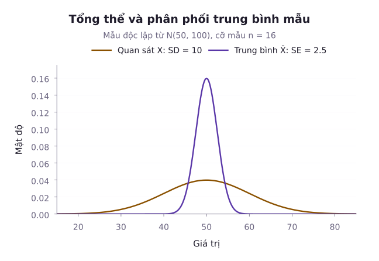
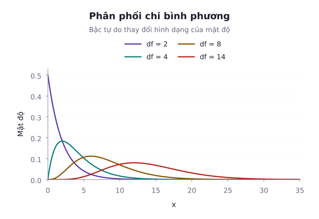
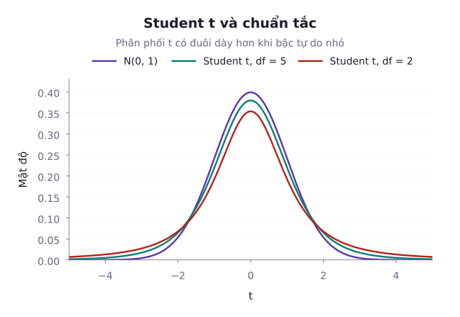

Trong thực tế nghiên cứu, chúng ta hiếm khi quan sát được toàn bộ tổng thể. Thay vào đó, mọi kết luận khoa học đều được suy ra từ một tập hợp dữ liệu thu thập hữu hạn gồm $n$ quan sát độc lập, cùng phân phối (i.i.d.). Một câu hỏi cốt lõi đặt ra là: Nếu chúng ta tính toán một đại lượng trên mẫu (chẳng hạn như trung bình mẫu $\bar{X}$ hoặc phương sai mẫu $S^2$), đại lượng này sẽ dao động ngẫu nhiên như thế nào qua các lần lặp lại thí nghiệm? Định lý giới hạn trung tâm ở bài học trước đã cho ta câu trả lời xấp xỉ khi cỡ mẫu tiến ra vô cùng. Tuy nhiên, khi cỡ mẫu nhỏ hoặc khi chúng ta cần độ chính xác tuyệt đối mà không dựa vào xấp xỉ tiệm cận, chúng ta bắt buộc phải khảo sát **phân phối mẫu chính xác (Exact Sampling Distributions)**. Bài học này phân tích các thống kê mẫu từ tổng thể chuẩn, làm rõ cơ chế của hiệu chỉnh Bessel trong phương sai mẫu, và thiết lập ba họ phân phối kinh điển: Phân phối Chi bình phương ($\chi^2$), Student $t$ và Fisher $F$.

## 1. Mẫu ngẫu nhiên và Thống kê mẫu

Giả sử tổng thể mang một biến ngẫu nhiên $X$ với hàm mật độ hoặc hàm khối xác suất $f(x; \theta)$, trong đó $\theta$ là tham số chưa biết.

Một **mẫu ngẫu nhiên (Random Sample)** kích thước $n$ là tập hợp gồm $n$ biến ngẫu nhiên $X_1, X_2, \dots, X_n$ độc lập và cùng phân phối (i.i.d.) với $X$. Hàm mật độ đồng thời của mẫu ngẫu nhiên này có dạng tích:

$$
\begin{aligned}
f(\mathbf{x}; \theta) &= \prod_{i=1}^n f(x_i; \theta) \\
&= f(x_1; \theta) \cdots f(x_n; \theta)
\end{aligned}
$$

Một **thống kê (Statistic)** $T = g(X_1, X_2, \dots, X_n)$ là một hàm số thực xác định trên mẫu ngẫu nhiên mà trong biểu thức của nó tuyệt đối không chứa bất kỳ tham số chưa biết $\theta$ nào. Bản thân thống kê $T$ là một biến ngẫu nhiên, và phân phối xác suất của nó được gọi là **phân phối mẫu (Sampling Distribution)**.

::: info Phân biệt thống kê và tham số
- **Tham số (Parameter)**: Là đại lượng cố định của toàn bộ tổng thể (chẳng hạn kỳ vọng $\mu$ hay phương sai $\sigma^2$), mang tính chất lý thuyết và người nghiên cứu không quan sát trực tiếp được.
- **Thống kê (Statistic)**: Là đại lượng biến thiên ngẫu nhiên được tính toán trực tiếp từ dữ liệu mẫu quan sát (chẳng hạn $\bar{X}$ hay $S^2$), thay đổi từ mẫu này sang mẫu khác.
:::

Hai thống kê mẫu cơ bản nhất là trung bình mẫu và phương sai mẫu:

$$
\begin{aligned}
\bar{X} &= \frac{1}{n} \sum_{i=1}^n X_i \\
&= \frac{X_1 + \dots + X_n}{n}
\end{aligned}
$$

$$
S^2 = \frac{1}{n - 1} \sum_{i=1}^n (X_i - \bar{X})^2
$$

Để mô tả cấu trúc phân phối tích lũy của mẫu dữ liệu, người ta định nghĩa **hàm phân phối thực nghiệm (Empirical CDF)**:

$$
F_n(x) = \frac{1}{n} \sum_{i=1}^n \mathbb{I}(X_i \le x)
$$

Ở đây $\mathbb I(A)$ bằng $1$ nếu mệnh đề $A$ đúng và bằng $0$ nếu sai. Đặt $I_i(x)=\mathbb I(X_i\le x)$, ta có $nF_n(x)=I_1(x)+\dots+I_n(x)$: Hàm thực nghiệm đếm tỷ lệ quan sát không vượt quá $x$.

Theo luật số lớn, với mỗi điểm $x$ cố định, $F_n(x)$ hội tụ hầu chắc chắn về hàm phân phối lý thuyết $F(x)$ của tổng thể khi $n \to \infty$.

Hình dùng tổng thể chuẩn có kỳ vọng $50$, phương sai $100$ và cỡ mẫu $16$. Vì thế, trung bình mẫu có kỳ vọng $50$ và phương sai $100/16=6{,}25$. Đường phân phối mẫu hẹp hơn đường của một phép đo đơn lẻ.

## 2. Tính không chệch của phương sai mẫu và Hiệu chỉnh Bessel

Một câu hỏi tự nhiên mà người học thường đặt ra là: Tại sao trong công thức của phương sai mẫu $S^2$, mẫu số lại là $n - 1$ thay vì $n$?

Để trả lời câu hỏi này, ta tính kỳ vọng toán học của tổng bình phương sai lệch quanh trung bình mẫu $\sum_{i=1}^n (X_i - \bar{X})^2$.

::: derivation Khai triển chi tiết kỳ vọng của tổng bình phương sai lệch
Đặt các sai lệch $A_i = X_i - \mu$, sai lệch trung bình $B = \bar{X} - \mu$ và đặt $Q = \sum_{i=1}^n (X_i - \bar{X})^2$. Khi đó:

$$
X_i - \bar{X} = A_i - B
$$

Bình phương hai vế cho từng quan sát:

$$
(X_i - \bar{X})^2 = A_i^2 - 2B A_i + B^2
$$

Lấy tổng theo $i$ từ $1$ đến $n$. Chú ý rằng $\sum_{i=1}^n A_i = \sum_{i=1}^n (X_i - \mu) = nB$. Do đó:

$$
\begin{aligned}
Q &= \sum_{i=1}^n A_i^2 - 2B(nB) + nB^2 \\
&= \sum_{i=1}^n A_i^2 - nB^2
\end{aligned}
$$

Thay $A_i$ và $B$ trở lại, ta được biểu thức:

$$
Q = \sum_{i=1}^n (X_i - \mu)^2 - n(\bar{X} - \mu)^2
$$

Lấy kỳ vọng hai vế và sử dụng tính chất tuyến tính của kỳ vọng:

$$
\begin{aligned}
\mathbb{E}[Q] &= \sum_{i=1}^n \mathbb{E}[A_i^2] - n \mathbb{E}[B^2] \\
&= n \sigma^2 - n \mathrm{Var}(\bar{X}) \\
&= n \sigma^2 - n \left(\frac{\sigma^2}{n}\right) \\
&= (n - 1)\sigma^2
\end{aligned}
$$

:::

Bước quyết định là đẳng thức $Q=\sum_{i=1}^n(X_i-\mu)^2-n(\bar X-\mu)^2$. Mỗi số hạng trong tổng đầu có kỳ vọng $\sigma^2$, còn số hạng trừ đi có kỳ vọng $\sigma^2$. Vì vậy, $\mathbb E[Q]=(n-1)\sigma^2$. Lập luận chỉ cần mẫu i.i.d., $n\ge2$ và phương sai hữu hạn, không cần tổng thể chuẩn.

Như vậy, nếu chia cho $n$, ước lượng sẽ bị chệch âm một lượng $-\sigma^2/n$, tức là có xu hướng đánh giá thấp độ phân tán thực tế của tổng thể. Việc chia cho $n - 1$ được gọi là **hiệu chỉnh Bessel (Bessel's correction)**, giúp đảm bảo tính không chệch:

$$
\begin{aligned}
\mathbb{E}[S^2] &= \frac{1}{n - 1} \mathbb{E}\left[\sum_{i=1}^n (X_i - \bar{X})^2\right] \\
&= \frac{(n - 1)\sigma^2}{n - 1} \\
&= \sigma^2
\end{aligned}
$$

::: example Tính toán phương sai mẫu không chệch
Một mẫu gồm $5$ quan sát độc lập: $x = [12, 15, 14, 11, 18]$. Hãy tính trung bình mẫu $\bar{x}$, phương sai mẫu không chệch $S^2$ và độ lệch chuẩn mẫu $S$.

**Lời giải**:
Trung bình mẫu là:

$$
\begin{aligned}
\bar{x} &= \frac{12 + 15 + 14 + 11 + 18}{5} \\
&= \frac{70}{5} \\
&= 14
\end{aligned}
$$

Các độ lệch $d_i = x_i - \bar{x}$ lần lượt là: $-2, 1, 0, -3, 4$.
Tổng bình phương sai lệch là:

$$
\begin{aligned}
Q &= \sum_{i=1}^5 (x_i - \bar{x})^2 \\
&= (-2)^2 + 1^2 + 0^2 + (-3)^2 + 4^2 \\
&= 4 + 1 + 0 + 9 + 16 \\
&= 30
\end{aligned}
$$

Phương sai mẫu không chệch chia cho $n - 1 = 4$:

$$
S^2 = \frac{30}{4} = 7{,}5
$$

Độ lệch chuẩn mẫu:

$$
S = \sqrt{7{,}5} \approx 2{,}7386
$$

Nếu chia cho $n = 5$, ta thu được $30 / 5 = 6{,}0$, nhỏ hơn phương sai không chệch $20\%$.
:::

## 3. Phân phối mẫu từ Tổng thể chuẩn và Định lý Fisher-Cochran

Khi tổng thể gốc tuân theo phân phối chuẩn $\mathcal{N}(\mu, \sigma^2)$, cấu trúc xác suất của các thống kê mẫu đạt được những tính chất giải tích hoàn hảo.

::: tip Định lý về tính độc lập của trung bình và phương sai mẫu
Cho $X_1, X_2, \dots, X_n$ là mẫu ngẫu nhiên từ phân phối chuẩn $\mathcal{N}(\mu, \sigma^2)$. Khi đó:
1. Trung bình mẫu tuân theo phân phối chuẩn: $\bar{X} \sim \mathcal{N}\left(\mu, \frac{\sigma^2}{n}\right)$.
2. Biến đổi chuẩn hóa của phương sai mẫu tuân theo phân phối Chi bình phương $n - 1$ bậc tự do:

$$
\begin{aligned}
V &= \frac{(n - 1)S^2}{\sigma^2} \\
&= \sum_{i=1}^n \left(\frac{X_i - \bar{X}}{\sigma}\right)^2 \sim \chi^2(n - 1)
\end{aligned}
$$

3. Hai thống kê $\bar{X}$ và $S^2$ là hai biến ngẫu nhiên **độc lập thống kê**.
:::

Giả thiết chuẩn bảo đảm tính độc lập này. Với tổng thể không chuẩn, không được tự động dùng kết quả đó. Đặc biệt, không tương quan không đồng nghĩa với độc lập: Một phân phối đối xứng có thể cho hiệp phương sai bằng không nhưng hai thống kê vẫn phụ thuộc.

## 4. Ba phân phối mẫu kinh điển: Chi bình phương, Student t và Fisher F

### Phân phối Chi bình phương

Nếu $Z_1, Z_2, \dots, Z_k$ là $k$ biến ngẫu nhiên độc lập cùng phân phối chuẩn tắc $\mathcal{N}(0, 1)$, thì tổng bình phương của chúng tuân theo **phân phối Chi bình phương với $k$ bậc tự do**:

$$
\begin{aligned}
V &= \sum_{i=1}^k Z_i^2 \\
&= Z_1^2 + \dots + Z_k^2 \sim \chi^2(k)
\end{aligned}
$$

- Kỳ vọng và phương sai: $\mathbb{E}[V] = k$, $\mathrm{Var}(V) = 2k$.
- Tính chất cộng tính: Nếu $V_1 \sim \chi^2(k_1)$ và $V_2 \sim \chi^2(k_2)$ độc lập thì $V_1 + V_2 \sim \chi^2(k_1 + k_2)$.

### Phân phối Student t

Nếu $Z \sim \mathcal{N}(0, 1)$ và $V \sim \chi^2(k)$ độc lập với nhau, thì tỷ số:

$$
T = \frac{Z}{\sqrt{V / k}} \sim t(k)
$$

được gọi là **phân phối Student $t$ với $k$ bậc tự do**.

Khi áp dụng vào mẫu ngẫu nhiên từ $\mathcal{N}(\mu, \sigma^2)$, đặt $Z = \frac{\bar{X} - \mu}{\sigma / \sqrt{n}} \sim \mathcal{N}(0, 1)$ và $V = \frac{(n-1)S^2}{\sigma^2} \sim \chi^2(n-1)$, ta có thống kê:

$$
\begin{aligned}
T &= \frac{\frac{\bar{X} - \mu}{\sigma / \sqrt{n}}}{\sqrt{\frac{(n-1)S^2}{\sigma^2} / (n-1)}} \\
&= \frac{\bar{X} - \mu}{S / \sqrt{n}} \sim t(n - 1)
\end{aligned}
$$

Đại lượng $\sigma$ chưa biết đã bị triệt tiêu hoàn toàn, cho phép kiểm định và suy luận về $\mu$ mà không cần biết phương sai của tổng thể.

### Phân phối Fisher F

Nếu $U \sim \chi^2(d_1)$ và $V \sim \chi^2(d_2)$ là hai biến ngẫu nhiên độc lập, thì tỷ số giữa hai biến Chi bình phương đã chia cho bậc tự do tương ứng tuân theo **phân phối Fisher $F$**:

$$
F = \frac{U / d_1}{V / d_2} \sim F(d_1, d_2)
$$

Trong so sánh phương sai của hai mẫu chuẩn độc lập có kích thước $n_1$ và $n_2$:

$$
F = \frac{S_1^2 / \sigma_1^2}{S_2^2 / \sigma_2^2} \sim F(n_1 - 1, n_2 - 1)
$$

Đặc biệt, tính chất nghịch đảo của phân vị phân phối Fisher rất hữu ích trong tra cứu:

$$
F_{1 - \alpha}(d_1, d_2) = \frac{1}{F_\alpha(d_2, d_1)}
$$

::: info Quy ước phân vị và giá trị tới hạn
Trong toàn bộ giáo trình, ta phân biệt rõ hai khái niệm phân vị:
- **Phân vị tích lũy (Cumulative Quantile)** $q_p$: Là giá trị thỏa mãn $P(X \le q_p) = p$.
- **Giá trị tới hạn đuôi phải (Upper-tail Critical Value)** $c_\alpha$: Là giá trị thỏa mãn $P(X > c_\alpha) = \alpha$, tức là $c_\alpha = q_{1-\alpha}$.
Chẳng hạn, với phân phối $F(d_1, d_2)$, ký hiệu $F_\alpha(d_1, d_2)$ chỉ giá trị tới hạn đuôi phải tại mức diện tích đuôi $\alpha$, tương đương với phân vị tích lũy $q_{1-\alpha}$.
:::

::: example Ứng dụng phân phối Student t
Một mẫu gồm $n = 9$ phép đo độc lập từ tổng thể chuẩn có trung bình mẫu $\bar{x} = 52{,}4$ và độ lệch chuẩn mẫu $s = 3{,}6$. Giả sử cần kiểm tra xem mẫu này có phù hợp với kỳ vọng lý thuyết $\mu_0 = 50$ hay không. Hãy tính giá trị thống kê $t$ và xác suất đuôi $P(T > t_{\text{obs}})$ dưới giả thiết $\mu = 50$.

**Lời giải**:
Bậc tự do của mẫu là $df = n - 1 = 9 - 1 = 8$.
Sai số chuẩn của trung bình mẫu:

$$
SE = \frac{s}{\sqrt{n}} = \frac{3{,}6}{\sqrt{9}} = \frac{3{,}6}{3} = 1{,}2
$$

Giá trị quan sát của thống kê $t$:

$$
\begin{aligned}
t_{\text{obs}} &= \frac{\bar{x} - \mu_0}{SE} \\
&= \frac{52{,}4 - 50}{1{,}2} \\
&= 2{,}0
\end{aligned}
$$

Xác suất để thống kê Student $t(8)$ vượt quá $2{,}0$ là:

$$
\begin{aligned}
P(T > 2{,}0) &= 1 - F_t(2{,}0; df=8) \\
&\approx 0{,}0403
\end{aligned}
$$

Nếu đối thuyết một phía $\mu>50$ đã được chọn trước khi xem dữ liệu, xác suất đuôi này là giá trị $p$ của kiểm định. Với đối thuyết hai phía, phải tính cả hai đuôi, cho giá trị $p$ xấp xỉ $0{,}0805$.
:::

::: example Ứng dụng phân phối Fisher F
Hai dây chuyền sản xuất có các phép đo độc lập, phân phối chuẩn và có cùng độ biến thiên chất lượng ($\sigma_1^2 = \sigma_2^2$). Người ta lấy mẫu ngẫu nhiên $n_1 = 11$ sản phẩm từ dây chuyền 1 và $n_2 = 16$ sản phẩm từ dây chuyền 2. Hãy xác định phân phối của tỷ số $S_1^2 / S_2^2$ và tìm ngưỡng tới hạn $F_{0{,}05}$ sao cho xác suất tỷ số này vượt ngưỡng chỉ là $5\%$.

**Lời giải**:
Bậc tự do tương ứng của hai mẫu là:

$$
d_1 = n_1 - 1 = 10
$$

$$
d_2 = n_2 - 1 = 15
$$

Dưới điều kiện $\sigma_1^2 = \sigma_2^2$, thống kê tỷ số phương sai tuân theo:

$$
F = \frac{S_1^2}{S_2^2} \sim F(10, 15)
$$

Tra giá trị tới hạn đuôi phải mức $5\%$ của phân phối $F(10, 15)$:

$$
c_{0{,}05} = F_{0{,}05}(10, 15) \approx 2{,}5437
$$

Nghĩa là nếu hai dây chuyền thực sự có cùng phương sai, xác suất để phương sai mẫu của dây chuyền 1 gấp hơn $2{,}5437$ lần phương sai mẫu của dây chuyền 2 chỉ là $5\%$.

Ngoài ra, giá trị tới hạn đuôi trái (tương ứng mức tích lũy $5\%$) được tính nhờ tính chất nghịch đảo:

$$
\begin{aligned}
F_{0{,}95}(10, 15) &= \frac{1}{F_{0{,}05}(15, 10)} \\
&= \frac{1}{2{,}8450} \\
&\approx 0{,}3515
\end{aligned}
$$

:::

## Tóm tắt

1. Thống kê mẫu là hàm của mẫu ngẫu nhiên không chứa tham số chưa biết. Phân phối xác suất của thống kê qua các lần lặp lại thí nghiệm gọi là phân phối mẫu.
2. Hiệu chỉnh Bessel chia cho $n - 1$ trong phương sai mẫu $S^2$ bù trừ cho việc ước lượng trung bình mẫu $\bar{X}$ thay vì $\mu$, đảm bảo $\mathbb{E}[S^2] = \sigma^2$.
3. Với mẫu rút từ tổng thể chuẩn $\mathcal{N}(\mu, \sigma^2)$, trung bình mẫu $\bar{X}$ và phương sai mẫu $S^2$ độc lập với nhau.
4. Ba phân phối giải tích kinh điển $\chi^2$, Student $t$ và Fisher $F$ hình thành nên chiếc cầu nối toán học vững chắc, cho phép thực hiện suy luận thống kê chính xác trên mẫu hữu hạn mà không phụ thuộc vào xấp xỉ cỡ mẫu lớn.

## Bài tập tự luyện

::: exercise 1. Xác suất của trung bình mẫu
Một quy trình đóng gói tự động tạo ra các gói cà phê có khối lượng tuân theo phân phối chuẩn với trung bình $\mu = 80\,\mathrm{g}$ và độ lệch chuẩn $\sigma = 10\,\mathrm{g}$. Người ta lấy ngẫu nhiên một mẫu gồm $n = 25$ gói để kiểm tra. Hãy tính xác suất để trung bình mẫu vượt quá $83\,\mathrm{g}$.
:::

::: solution
Sai số chuẩn của trung bình mẫu là:

$$
\sigma_{\bar{X}} = \frac{\sigma}{\sqrt{n}} = \frac{10}{\sqrt{25}} = 2\,\mathrm{g}
$$

Vì tổng thể gốc là phân phối chuẩn, trung bình mẫu tuân theo phân phối chuẩn chính xác: $\bar{X} \sim \mathcal{N}(80, 2^2)$.
Chuẩn hóa giá trị quan sát $83$:

$$
Z = \frac{83 - 80}{2} = 1{,}5
$$

Xác suất cần tìm:

$$
\begin{aligned}
P(\bar{X} > 83) &= P(Z > 1{,}5) \\
&= 1 - \Phi(1{,}5) \\
&\approx 1 - 0{,}9332 \\
&\approx 0{,}0668
\end{aligned}
$$

Vậy có khoảng $6{,}68\%$ khả năng trung bình mẫu vượt quá $83\,\mathrm{g}$.
:::

::: exercise 2. Tính toán phương sai mẫu từ định nghĩa
Cho mẫu số liệu gồm $4$ số đo độc lập: $x = [5, 7, 8, 12]$. Hãy tính trung bình mẫu $\bar{x}$, tổng bình phương sai lệch quanh trung bình và phương sai mẫu hiệu chỉnh $S^2$.
:::

::: solution
Trung bình mẫu là:

$$
\begin{aligned}
\bar{x} &= \frac{5 + 7 + 8 + 12}{4} \\
&= \frac{32}{4} \\
&= 8
\end{aligned}
$$

Các độ lệch $(x_i - \bar{x})$ là: $-3, -1, 0, 4$.
Tổng bình phương sai lệch là:

$$
\begin{aligned}
Q &= \sum_{i=1}^4 (x_i - \bar{x})^2 \\
&= (-3)^2 + (-1)^2 + 0^2 + 4^2 \\
&= 9 + 1 + 0 + 16 \\
&= 26
\end{aligned}
$$

Phương sai mẫu với mẫu số $n - 1 = 3$:

$$
S^2 = \frac{26}{3} \approx 8{,}6667
$$

:::

::: exercise 3. Phân vị phân phối Chi bình phương
Cho biến ngẫu nhiên $V \sim \chi^2(12)$. Hãy xác định giá trị tới hạn đuôi phải $\chi^2_{0{,}05}(12)$, tức là giá trị $c$ sao cho $P(V > c) = 0{,}05$.
:::

::: solution
Theo định nghĩa giá trị tới hạn đuôi phải của phân phối Chi bình phương với bậc tự do $k = 12$ tại mức xác suất phần dư $0{,}05$ (tương ứng phân vị tích lũy $q_{0{,}95}$):

$$
c = \chi^2_{0{,}05}(12) \approx 21{,}0261
$$

Nghĩa là diện tích phần đuôi bên phải vượt quá $21{,}0261$ bằng đúng $0{,}05$, hay $P(V \le 21{,}0261) = 0{,}95$.
:::

::: exercise 4. Khoảng đối xứng của phân phối Student t
Một thống kê $T$ tuân theo phân phối Student $t$ với $15$ bậc tự do. Hãy xác định xác suất $P(-1{,}753 \le T \le 1{,}753)$.
:::

::: solution
Tra giá trị tới hạn đuôi phải của phân phối Student với $df = 15$, ta có $t_{0{,}05, 15} \approx 1{,}75305$.
Do phân phối Student hoàn toàn đối xứng qua gốc tọa độ $0$, diện tích mỗi phần đuôi là:

$$
P(T > 1{,}753) \approx 0{,}05
$$

$$
P(T < -1{,}753) \approx 0{,}05
$$

Xác suất nằm trong khoảng đối xứng trung tâm là:

$$
\begin{aligned}
P(|T| \le 1{,}753) &\approx 1 - 2 \times 0{,}05 \\
&= 0{,}90
\end{aligned}
$$

:::

::: exercise 5. Tỷ số hai phương sai mẫu
Hai mẫu ngẫu nhiên độc lập kích thước $n_1 = 9$ và $n_2 = 9$ được rút ra từ cùng một phân phối chuẩn có phương sai $\sigma^2$. Hãy tìm xác suất để tỷ số phương sai mẫu $S_1^2 / S_2^2$ vượt quá $3{,}44$.
:::

::: solution
Vì hai mẫu độc lập cùng rút từ tổng thể chuẩn có cùng phương sai $\sigma^2$, tỷ số phương sai mẫu tuân theo phân phối Fisher:

$$
\begin{aligned}
F &= \frac{S_1^2}{S_2^2} \\
&\sim F(n_1 - 1, n_2 - 1) = F(8, 8)
\end{aligned}
$$

Giá trị tới hạn đuôi phải mức $5\%$ của phân phối $F(8, 8)$ là:

$$
c_{0{,}05} = F_{0{,}05}(8, 8) \approx 3{,}4381 \approx 3{,}44
$$

Do đó:

$$
P\left(\frac{S_1^2}{S_2^2} > 3{,}44\right) \approx 0{,}05
$$

:::

## Tài liệu tham khảo

- MIT OpenCourseWare. [18.05: Introduction to Probability and Statistics, Spring 2022](https://ocw.mit.edu/courses/18-05-introduction-to-probability-and-statistics-spring-2022/).
- NIST/SEMATECH. [Gallery of Distributions](https://www.itl.nist.gov/div898/handbook/eda/section3/eda366.htm).
- Penn State Eberly College of Science. [STAT 415: Introduction to Mathematical Statistics](https://online.stat.psu.edu/stat415/).
