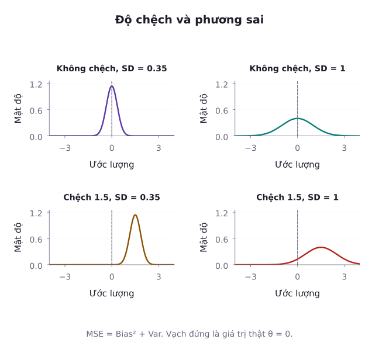
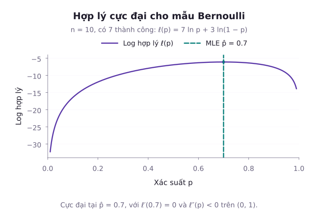
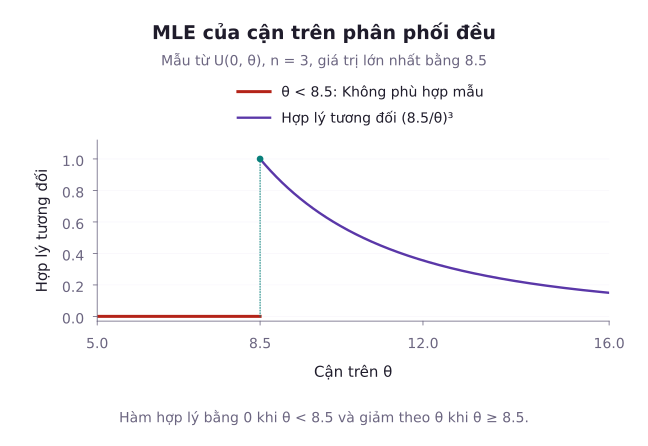

Trong thực tế khoa học dữ liệu, chúng ta thường giả định dữ liệu tuân theo một họ phân phối xác suất xác định. Chẳng hạn, phân phối Bernoulli mô hình hóa tỷ lệ bấm quảng cáo, phân phối Poisson mô tả lượng yêu cầu gửi tới máy chủ, còn phân phối Gauss mô tả sai số đo lường. Tuy nhiên, các tham số đặc trưng của mô hình là những ẩn số cần tìm. Nhiệm vụ của **ước lượng điểm (Point Estimation)** là đưa ra một giá trị duy nhất từ mẫu dữ liệu để đại diện cho tham số tổng thể. Bài học này làm rõ các tiêu chuẩn độ chệch, phương sai, sai số toàn phương trung bình, cùng hai phương pháp tìm ước lượng kinh điển: Phương pháp momen và Phương pháp hợp lý cực đại.

## 1. Tiêu chuẩn đánh giá ước lượng điểm

Giả sử mẫu ngẫu nhiên $X_1, X_2, \dots, X_n$ được rút ra từ phân phối có tham số $\theta \in \Theta$. Một ước lượng điểm của $\theta$ là một thống kê $\hat{\theta} = g(X_1, X_2, \dots, X_n)$.

Để đánh giá chất lượng của $\hat{\theta}$, các nhà thống kê toán học thiết lập ba tiêu chuẩn nền tảng sau:

### Độ chệch (Bias)
Độ chệch đo lường mức độ sai lệch trung bình giữa ước lượng và giá trị tham số thực:

$$
\mathrm{Bias}(\hat{\theta}) = \mathbb{E}[\hat{\theta}] - \theta
$$

- Ước lượng được gọi là **không chệch (Unbiased)** nếu $\mathrm{Bias}(\hat{\theta}) = 0$, nghĩa là $\mathbb{E}[\hat{\theta}] = \theta$ với mọi $\theta \in \Theta$.
- Nếu $\mathbb{E}[\hat{\theta}] \neq \theta$, ước lượng bị chệch. Khi $\lim_{n \to \infty} \mathbb{E}[\hat{\theta}] = \theta$, ước lượng được gọi là không chệch tiệm cận.

### Phương sai và Sai số toàn phương trung bình (MSE)
Một ước lượng không chệch vẫn có thể dao động lớn qua các lần lấy mẫu nếu phương sai của nó quá lớn. Để dung hòa giữa độ chệch và độ dao động, người ta sử dụng **sai số toàn phương trung bình (Mean Squared Error - MSE)**:

$$
\mathrm{MSE}(\hat{\theta}) = \mathbb{E}\left[(\hat{\theta} - \theta)^2\right]
$$

::: proof Phân rã sai số toàn phương trung bình
Đặt $B = \mathrm{Bias}(\hat{\theta}) = \mathbb{E}[\hat{\theta}] - \theta$. Khai triển bên trong kỳ vọng:

$$
\begin{aligned}
\hat{\theta} - \theta &= (\hat{\theta} - \mathbb{E}[\hat{\theta}]) + (\mathbb{E}[\hat{\theta}] - \theta) \\
&= (\hat{\theta} - \mathbb{E}[\hat{\theta}]) + B
\end{aligned}
$$

Bình phương hai vế và lấy kỳ vọng, chú ý rằng tích chéo triệt tiêu vì $\mathbb{E}[\hat{\theta} - \mathbb{E}[\hat{\theta}]] = 0$:

$$
\begin{aligned}
\mathrm{MSE}(\hat{\theta}) &= \mathbb{E}\left[(\hat{\theta} - \mathbb{E}[\hat{\theta}] + B)^2\right] \\
&= \mathbb{E}\left[(\hat{\theta} - \mathbb{E}[\hat{\theta}])^2\right] + B^2 \\
&= \mathrm{Var}(\hat{\theta}) + [\mathrm{Bias}(\hat{\theta})]^2
\end{aligned}
$$

:::

Với phương sai hữu hạn, phép trừ và cộng kỳ vọng cho ta phân rã:

$$
\mathrm{MSE}(\hat\theta)=\mathrm{Var}(\hat\theta)+B^2
$$

Ở đây $B$ là độ chệch đã định nghĩa. Đẳng thức này cho thấy một ước lượng chệch nhẹ nhưng có phương sai nhỏ hơn đáng kể hoàn toàn có thể mang lại sai số toàn phương trung bình nhỏ hơn một ước lượng không chệch nhưng dao động quá mạnh.

### Tính nhất quán (Consistency)
Ước lượng $\hat{\theta}_n$ được gọi là **nhất quán (Consistent)** nếu nó hội tụ theo xác suất về tham số thực $\theta$ khi cỡ mẫu $n \to \infty$:

$$
\lim_{n \to \infty} P(|\hat{\theta}_n - \theta| \ge \epsilon) = 0 \quad (\forall \epsilon > 0)
$$

Theo bất đẳng thức Chebyshev, điều kiện đủ để $\hat{\theta}_n$ nhất quán là:

$$
\lim_{n \to \infty} \mathrm{Bias}(\hat{\theta}_n) = 0
$$

$$
\lim_{n \to \infty} \mathrm{Var}(\hat{\theta}_n) = 0
$$

Điều này tương đương với:

$$
\lim_{n \to \infty} \mathrm{MSE}(\hat{\theta}_n) = 0
$$

## 2. Phương pháp momen (Method of Moments - MOM)

Phương pháp momen dựa trên trực giác: Các đặc trưng số của tổng thể (momen lý thuyết) được xấp xỉ bằng các đặc trưng số tương ứng tính trên dữ liệu mẫu (momen mẫu).

Định nghĩa momen lý thuyết gốc bậc $k$: $\mu_k' = \mathbb{E}[X^k]$.
Định nghĩa momen mẫu gốc bậc $k$:

$$
m_k' = \frac{1}{n} \sum_{i=1}^n X_i^k
$$

Đặc biệt, momen mẫu gốc bậc 1 là trung bình mẫu: $m_1' = \bar{X}$.
Momen trung tâm mẫu bậc 2 theo đúng quy chuẩn phương pháp momen được định nghĩa với mẫu số $n$:

$$
m_2 = \frac{1}{n} \sum_{i=1}^n (X_i - \bar{X})^2
$$

::: info Lưu ý về mẫu số trong phương pháp momen
Theo định nghĩa, các momen mẫu luôn chia cho $n$ (kích thước mẫu). Thống kê $m_2$ chia cho $n$ là ước lượng momen tự nhiên của phương sai tổng thể $\sigma^2 = \mathbb{E}[(X - \mu)^2]$. Tuy $m_2$ bị chệch âm một lượng $-\sigma^2/n$, nó là momen mẫu thực thụ, khác với phương sai mẫu hiệu chỉnh không chệch $S^2 = \frac{n}{n-1}m_2$ có mẫu số $n - 1$.
:::

Nếu mô hình có $p$ tham số cần ước lượng $(\theta_1, \dots, \theta_p)$, ta thiết lập hệ $p$ phương trình cân bằng:

$$
\mu_k'(\boldsymbol{\theta}) = m_k' \quad (k = 1, \dots, p)
$$

Giải hệ phương trình này theo các tham số $\theta$ ta thu được ước lượng momen $\hat{\theta}_{\mathrm{MM}}$.

::: example Ước lượng momen cho phân phối Poisson
Cho mẫu ngẫu nhiên $X_1, \dots, X_n \sim \mathrm{Poisson}(\lambda)$. Hãy tìm ước lượng momen của $\lambda$ và áp dụng cho tập dữ liệu số lượng sự cố mạng trong 6 giờ: $[2, 4, 1, 3, 5, 3]$.

**Lời giải**:
Momen lý thuyết bậc 1 của phân phối Poisson là kỳ vọng:

$$
\mu_1' = \mathbb{E}[X] = \lambda
$$

Cân bằng với momen mẫu bậc 1:

$$
\lambda = m_1' = \bar{X} \implies \hat{\lambda}_{\mathrm{MM}} = \bar{X}
$$

Áp dụng vào mẫu dữ liệu cụ thể:

$$
\begin{aligned}
\bar{x} &= \frac{2 + 4 + 1 + 3 + 5 + 3}{6} \\
&= \frac{18}{6} \\
&= 3{,}0
\end{aligned}
$$

Vậy ước lượng momen của tham số cường độ là $\hat{\lambda}_{\mathrm{MM}} = 3{,}0$ sự cố/giờ.
:::

::: example Ước lượng momen cho phân phối Đều
Cho $X_1, \dots, X_n \sim \mathcal{U}(0, \theta)$. Hãy tìm ước lượng momen của cận trên $\theta$ và tính toán trên mẫu quan sát gồm 4 phép đo thời gian chờ: $[2, 5, 8, 9]$.

**Lời giải**:
Kỳ vọng lý thuyết của phân phối Đều trên $[0, \theta]$ là:

$$
\mu_1' = \mathbb{E}[X] = \frac{\theta}{2}
$$

Cân bằng với trung bình mẫu:

$$
\frac{\theta}{2} = \bar{X} \implies \hat{\theta}_{\mathrm{MM}} = 2\bar{X}
$$

Với mẫu quan sát đã cho:

$$
\begin{aligned}
\bar{x} &= \frac{2 + 5 + 8 + 9}{4} \\
&= \frac{24}{4} \\
&= 6{,}0
\end{aligned}
$$

Do đó ước lượng momen là:

$$
\hat{\theta}_{\mathrm{MM}} = 2 \times 6{,}0 = 12{,}0
$$

:::

## 3. Phương pháp hợp lý cực đại (Maximum Likelihood Estimation - MLE)

Phương pháp hợp lý cực đại chọn tham số làm hàm khối xác suất hoặc mật độ của mẫu quan sát đạt cực đại. Với dữ liệu liên tục, mật độ không phải xác suất tại đúng một điểm. Vì vậy, không diễn giải hàm hợp lý như xác suất của tham số hay xác suất của đúng mẫu liên tục.

Cho mẫu ngẫu nhiên độc lập $X_1, X_2, \dots, X_n$ với hàm mật độ hoặc hàm khối $f(x; \theta)$. **Hàm hợp lý (Likelihood Function)** là hàm của tham số $\theta$ khi cố định dữ liệu mẫu quan sát:

$$
L(\theta) = \prod_{i=1}^n f(x_i; \theta)
$$

Do tích nhiều số nhỏ thường gây tràn số dưới trong tính toán số học, người ta lấy logarit tự nhiên để chuyển phép nhân thành phép cộng, tạo thành **hàm log-likelihood**:

$$
\begin{aligned}
\ell(\theta) &= \ln L(\theta) \\
&= \sum_{i=1}^n \ln f(x_i; \theta)
\end{aligned}
$$

Ký hiệu $\arg\max$ chỉ giá trị tham số tại đó hàm đạt cực đại. Cụ thể, nghiệm $\hat\theta$ phải thỏa $L(\hat\theta)\ge L(\theta)$ với mọi $\theta\in\Theta$. Nghiệm có thể không tồn tại hoặc không duy nhất, nên phải kiểm tra miền tham số và các điểm biên.

Vì hàm $\ln(\cdot)$ đồng biến nghiêm ngặt, điểm đạt cực đại của $L(\theta)$ và $\ell(\theta)$ là hoàn toàn trùng nhau:

$$
\begin{aligned}
\hat{\theta}_{\mathrm{MLE}} &= \arg\max_{\theta \in \Theta} L(\theta) \\
&= \arg\max_{\theta \in \Theta} \ell(\theta)
\end{aligned}
$$

Hình xét mẫu Bernoulli có bảy thành công trong mười phép thử. Hàm log-hợp lý đạt cực đại tại $\hat p=7/10=0{,}7$. Điểm cực đại thuộc phần trong miền tham số vì mẫu có cả thành công và thất bại.

### MLE cho phân phối Exponential
Xét biến ngẫu nhiên thời gian hoạt động $X \sim \mathrm{Exp}(\lambda)$ với hàm mật độ $f(x) = \lambda e^{-\lambda x}$ ($x \ge 0$).
Hàm hợp lý và log-likelihood:

$$
\begin{aligned}
L(\lambda) &= \prod_{i=1}^n \left(\lambda e^{-\lambda x_i}\right) \\
&= \lambda^n \exp\left(-\lambda \sum_{i=1}^n x_i\right)
\end{aligned}
$$

$$
\ell(\lambda) = n \ln \lambda - \lambda \sum_{i=1}^n x_i
$$

Lấy đạo hàm cấp 1 theo $\lambda$ và cho bằng $0$:

$$
\begin{aligned}
\frac{d \ell}{d \lambda} &= \frac{n}{\lambda} - \sum_{i=1}^n x_i = 0 \\
&\implies \hat{\lambda}_{\mathrm{MLE}} = \frac{n}{\sum_{i=1}^n X_i} = \frac{1}{\bar{X}}
\end{aligned}
$$

Đạo hàm cấp 2:

$$
\frac{d^2 \ell}{d \lambda^2} = -\frac{n}{\lambda^2} < 0 \quad (\forall \lambda > 0)
$$

Hàm log-likelihood lõm nghiêm ngặt, đảm bảo nghiệm tìm được là điểm cực đại toàn cục duy nhất.

::: example Tính toán MLE cho phân phối Exponential
Kiểm tra thời gian đáp ứng (giây) của 4 yêu cầu dịch vụ mạng: $[0{,}5, 1{,}2, 0{,}8, 1{,}5]$. Giả sử thời gian đáp ứng tuân theo phân phối Exponential($\lambda$). Hãy tìm ước lượng hợp lý cực đại của $\lambda$.

**Lời giải**:
Tổng thời gian quan sát là:

$$
\sum_{i=1}^4 x_i = 4{,}0\,\text{giây}
$$

Trung bình mẫu là $\bar{x} = 4{,}0 / 4 = 1{,}0\,\text{giây}$.
Áp dụng công thức nghiệm MLE:

$$
\begin{aligned}
\hat{\lambda}_{\mathrm{MLE}} &= \frac{1}{\bar{x}} \\
&= 1{,}0\,\mathrm{s}^{-1}
\end{aligned}
$$

:::

### MLE cho phân phối chuẩn: So sánh hai ước lượng phương sai
Với mẫu ngẫu nhiên từ $\mathcal{N}(\mu, \sigma^2)$, đặt $Q = \sum_{i=1}^n (x_i - \mu)^2$. Hàm log-likelihood là:

$$
\ell(\mu, \sigma^2) = -\frac{n}{2}\ln(2\pi\sigma^2) - \frac{Q}{2\sigma^2}
$$

Lấy đạo hàm riêng theo $\mu$ và $\sigma^2$:

$$
\begin{aligned}
\frac{\partial \ell}{\partial \mu} &= \frac{1}{\sigma^2}\sum_{i=1}^n (x_i - \mu) = 0 \\
&\implies \hat{\mu}_{\mathrm{MLE}} = \bar{X}
\end{aligned}
$$

$$
\begin{aligned}
\frac{\partial \ell}{\partial \sigma^2} &= -\frac{n}{2\sigma^2}+\frac{Q}{2(\sigma^2)^2}=0
\end{aligned}
$$

Thay nghiệm $\hat\mu=\bar X$ vào $Q$ và giải phương trình trên:

$$
\hat\sigma^2_{\mathrm{MLE}}=\frac{1}{n}\sum_{i=1}^n(X_i-\bar X)^2
$$

Các công thức này áp dụng khi $n\ge2$ và mẫu không đồng nhất. Nếu mọi quan sát bằng nhau, hợp lý tăng không bị chặn khi $\sigma^2\downarrow0$, nên không có nghiệm cực đại trong miền $\sigma^2>0$.

::: warning So sánh quan trọng giữa MLE và phương sai không chệch
Ước lượng MLE của phương sai là $\hat{\sigma}^2_{\mathrm{MLE}} = \frac{n - 1}{n} S^2$.
- $\hat{\sigma}^2_{\mathrm{MLE}}$ là ước lượng bị chệch: $\mathbb{E}[\hat{\sigma}^2_{\mathrm{MLE}}] = \frac{n - 1}{n}\sigma^2 = \sigma^2 - \frac{\sigma^2}{n}$.
- Tuy nhiên, $\hat{\sigma}^2_{\mathrm{MLE}}$ lại có sai số toàn phương trung bình $\mathrm{MSE}$ nhỏ hơn $S^2$! Cụ thể:

$$
\mathrm{MSE}(\hat{\sigma}^2_{\mathrm{MLE}}) = \frac{2n - 1}{n^2}\sigma^4
$$

$$
\mathrm{MSE}(S^2) = \frac{2}{n - 1}\sigma^4
$$

Vì $\frac{2n - 1}{n^2} < \frac{2}{n - 1}$ với mọi $n \ge 2$, ước lượng MLE có MSE nhỏ hơn. Đây là ví dụ điển hình về việc đánh đổi: Chấp nhận một độ chệch nhỏ để đổi lấy phương sai giảm nhiều hơn, làm giảm tổng sai số toàn phương.
:::

::: example So sánh số học giữa MLE và S²
Cho mẫu dữ liệu $n = 5$ quan sát: $[10, 12, 14, 16, 18]$. Hãy tính $\hat{\sigma}^2_{\mathrm{MLE}}$ và $S^2$.

**Lời giải**:
Trung bình mẫu: $\bar{x} = 70 / 5 = 14$.
Các độ lệch $(x_i - \bar{x})$ là $-4, -2, 0, 2, 4$.
Tổng bình phương sai lệch:

$$
\begin{aligned}
Q &= \sum_{i=1}^5 (x_i - \bar{x})^2 \\
&= 16 + 4 + 0 + 4 + 16 = 40
\end{aligned}
$$

Ước lượng MLE (chia cho $n = 5$):

$$
\hat{\sigma}^2_{\mathrm{MLE}} = \frac{40}{5} = 8{,}0
$$

Phương sai mẫu không chệch (chia cho $n - 1 = 4$):

$$
S^2 = \frac{40}{4} = 10{,}0
$$

:::

## 4. Ước lượng trên điểm biên: Trường hợp phân phối Đều

Không phải bài toán tìm MLE nào cũng có thể giải bằng cách cho đạo hàm bằng $0$. Trường hợp phân phối Đều $\mathcal{U}(0, \theta)$ là ví dụ kinh điển khi điểm cực đại nằm ngay tại biên của miền khả thi, vi phạm điều kiện chính quy vì miền xác định $[0, \theta]$ phụ thuộc vào tham số $\theta$.

Hàm mật độ của từng quan sát: $f(x) = \frac{1}{\theta}\,\mathbb{I}(0 \le x \le \theta)$.
Hàm hợp lý của mẫu gồm $n$ quan sát:

$$
\begin{aligned}
L(\theta) &= \frac{1}{\theta^n} \prod_{i=1}^n \mathbb{I}(0 \le x_i \le \theta) \\
&= \frac{1}{\theta^n}\,\mathbb{I}(x_{(n)} \le \theta)
\end{aligned}
$$

trong đó $x_{(n)} = \max(x_1, \dots, x_n)$ là giá trị quan sát lớn nhất trong mẫu.

Phân tích hàm $L(\theta)$:
1. Nếu $\theta < x_{(n)}$, ít nhất một quan sát vượt quá $\theta$, điều này bất khả thi trong mô hình nên $L(\theta) = 0$.
2. Nếu $\theta \ge x_{(n)}$, $L(\theta) = 1/\theta^n$ là một hàm giảm liên tục theo $\theta$.

Do đó, $L(\theta)$ đạt giá trị lớn nhất tại điểm cận dưới của miền xác định, tức là ngay tại biên $\theta = x_{(n)}$:

$$
\begin{aligned}
\hat{\theta}_{\mathrm{MLE}} &= X_{(n)} \\
&= \max(X_1, \dots, X_n)
\end{aligned}
$$

Vì đạo hàm $\frac{d L}{d\theta} = -\frac{n}{\theta^{n+1}} < 0$ không triệt tiêu tại bất kỳ đâu, nghiệm cực đại đạt được tại điểm biên chứ không thông qua phương trình đạo hàm bằng 0.

Hình dùng ba quan sát với cực đại $8{,}5$. Các giá trị $\theta<8{,}5$ không thể chứa toàn bộ mẫu. Trong miền còn lại, hàm hợp lý giảm nên cực đại đạt tại $8{,}5$.

::: example Ước lượng cận trên phân phối Đều
Quan sát một mẫu gồm 4 giá trị đo đạc: $[3{,}2, 7{,}8, 5{,}4, 8{,}9]$. Giả sử dữ liệu tuân theo $\mathcal{U}(0, \theta)$. Hãy xác định ước lượng MLE của $\theta$ và so sánh với ước lượng momen $\hat{\theta}_{\mathrm{MM}}$.

**Lời giải**:
Ước lượng hợp lý cực đại là giá trị lớn nhất trong mẫu:

$$
\hat{\theta}_{\mathrm{MLE}} = x_{(4)} = 8{,}9
$$

Trong khi đó, trung bình mẫu là:

$$
\bar{x} = \frac{25{,}3}{4} = 6{,}325
$$

Ước lượng momen là:

$$
\hat{\theta}_{\mathrm{MM}} = 2\bar{x} = 2 \times 6{,}325 = 12{,}65
$$

Nhận xét: Ước lượng MLE $\hat{\theta}_{\mathrm{MLE}} = X_{(n)}$ luôn nhỏ hơn hoặc bằng tham số thực $\theta$ (bị chệch âm), nhưng nó tận dụng triệt để thông tin hình học của giá trị biên.
:::

## Tóm tắt

1. Ước lượng điểm đánh giá qua độ chệch $\mathrm{Bias}(\hat{\theta}) = \mathbb{E}[\hat{\theta}] - \theta$ và phương sai $\mathrm{Var}(\hat{\theta})$. Sai số toàn phương trung bình kết hợp cả hai yếu tố: $\mathrm{MSE} = \mathrm{Var} + \mathrm{Bias}^2$.
2. Phương pháp momen (MOM) cân bằng momen lý thuyết với momen mẫu chia cho $n$. Đây là phương pháp trực quan, dễ tính toán, thường dùng để tìm nghiệm khởi đầu cho các thuật toán tối ưu số.
3. Phương pháp hợp lý cực đại (MLE) tối đa hóa hàm hợp lý. Tính bất biến cho phép biến đổi nghiệm khi đổi tham số. Tính nhất quán và hiệu quả tiệm cận còn đòi hỏi các điều kiện chính quy, không đúng tự động với mọi mô hình.
4. Đối với các phân phối có miền xác định phụ thuộc vào tham số (như phân phối Đều), cực đại của hàm hợp lý nằm tại điểm biên của mẫu, không thể giải bằng đạo hàm triệt tiêu thông thường.

## Bài tập tự luyện

::: exercise 1. So sánh MSE của hai ước lượng
Cho mẫu $X_1, \dots, X_9$ từ phân phối chuẩn $\mathcal{N}(\mu, 1)$ với $\mu = 2$. Xét hai ước lượng của $\mu$:
- $T_1 = \bar{X}$ (trung bình mẫu)
- $T_2 = 0{,}9\,\bar{X}$
Hãy tính độ chệch, phương sai và so sánh sai số toàn phương trung bình $\mathrm{MSE}$ của $T_1$ và $T_2$.
:::

::: solution
Với $T_1 = \bar{X}$:
- Kỳ vọng $\mathbb{E}[T_1] = \mu$, suy ra độ chệch $\mathrm{Bias}(T_1) = 0$.
- Phương sai $\mathrm{Var}(T_1) = \frac{\sigma^2}{n} = \frac{1}{9} \approx 0{,}1111$.
- Sai số toàn phương $\mathrm{MSE}(T_1) = \mathrm{Var}(T_1) \approx 0{,}1111$.

Với $T_2 = 0{,}9\,\bar{X}$:
- Kỳ vọng $\mathbb{E}[T_2] = 0{,}9 \times 2 = 1{,}8$, suy ra $\mathrm{Bias}(T_2) = -0{,}2$.
- Bình phương độ chệch $[\mathrm{Bias}(T_2)]^2 = 0{,}04$.
- Phương sai $\mathrm{Var}(T_2) = 0{,}81 \times \frac{1}{9} = 0{,}09$.
- Sai số toàn phương $\mathrm{MSE}(T_2) = 0{,}09 + 0{,}04 = 0{,}13$.

So sánh: Do $0{,}1111 < 0{,}1300$, ước lượng không chệch $T_1$ có sai số toàn phương nhỏ hơn.
:::

::: exercise 2. Ước lượng momen cho phân phối Gamma
Phân phối $\mathrm{Gamma}(\alpha, \beta)$ có kỳ vọng $\mathbb{E}[X] = \alpha / \beta$ và phương sai $\mathrm{Var}(X) = \alpha / \beta^2$. Hãy thiết lập công thức ước lượng momen của $\alpha, \beta$ theo quy chuẩn momen trung tâm mẫu $m_2 = \frac{1}{n}\sum_{i=1}^n (x_i - \bar{x})^2$, và tính giá trị cụ thể khi mẫu quan sát có $\bar{x} = 6{,}0$ và $m_2 = 12{,}0$.
:::

::: solution
Thiết lập hệ phương trình cân bằng giữa các momen lý thuyết và momen mẫu:

$$
\frac{\alpha}{\beta} = \bar{X}, \quad \frac{\alpha}{\beta^2} = m_2
$$

Chia phương trình thứ nhất cho phương trình thứ hai:

$$
\frac{\alpha / \beta}{\alpha / \beta^2} = \beta = \frac{\bar{X}}{m_2}
$$

Thay $\beta$ ngược lại phương trình thứ nhất:

$$
\alpha = \bar{X} \cdot \beta = \frac{\bar{X}^2}{m_2}
$$

Thay số với $\bar{x} = 6{,}0$ và $m_2 = 12{,}0$:

$$
\hat{\beta}_{\mathrm{MM}} = \frac{6{,}0}{12{,}0} = 0{,}5
$$

$$
\hat{\alpha}_{\mathrm{MM}} = \frac{6{,}0^2}{12{,}0} = \frac{36}{12} = 3{,}0
$$

Lưu ý: Momen trung tâm mẫu $m_2$ chia cho $n$ theo định nghĩa. Hai tham số Gamma ở đây đều dương và $\beta$ là tham số tốc độ, không phải tham số tỷ lệ. Nếu người nghiên cứu sử dụng phương sai mẫu không chệch $S^2 = \frac{n}{n-1}m_2$, giá trị ước lượng sẽ được điều chỉnh tương ứng theo tỷ lệ cỡ mẫu.
:::

::: exercise 3. Ước lượng MLE cho tỷ lệ Bernoulli
Trong một khảo sát độc lập gồm $n = 20$ cử tri, có $14$ người tán thành một chính sách kinh tế mới. Hãy tìm ước lượng hợp lý cực đại $\hat{p}_{\mathrm{MLE}}$ của tỷ lệ tán thành $p$ trong toàn bộ tổng thể, và viết phương sai lý thuyết của ước lượng này. Sau đó, ước lượng phương sai bằng cách thay tham số chưa biết bằng tỷ lệ mẫu.
:::

::: solution
Với mẫu Bernoulli $X_1, \dots, X_n \in \{0, 1\}$, hàm hợp lý là:

$$
L(p) = p^{\sum x_i} (1 - p)^{n - \sum x_i}
$$

Đặt số quan sát thành công $k = \sum_{i=1}^n x_i$. Hàm log-likelihood là:

$$
\ell(p) = k \ln p + (n - k) \ln(1 - p)
$$

Lấy đạo hàm và cho bằng $0$:

$$
\begin{aligned}
\frac{d\ell}{dp} &= \frac{k}{p} - \frac{n - k}{1 - p} = 0 \\
&\implies \hat{p}_{\mathrm{MLE}} = \frac{k}{n} = \bar{X}
\end{aligned}
$$

Với $n = 20$ và $k = 14$:

$$
\hat{p}_{\mathrm{MLE}} = \frac{14}{20} = 0{,}70
$$

Phương sai của $\hat{p}$ là:

$$
\mathrm{Var}(\hat p)=\frac{p(1-p)}{n}
$$

Đây là phương sai lý thuyết, vẫn phụ thuộc vào $p$ chưa biết. Ước lượng thay thế của nó là:

$$
\widehat{\mathrm{Var}}(\hat p)=\frac{0{,}70\times0{,}30}{20}=0{,}0105
$$

:::

::: exercise 4. Hiệu chỉnh không chệch cho ước lượng biên phân phối Đều
Cho $X_1, \dots, X_n \sim \mathcal{U}(0, \theta)$. Ta biết $\hat{\theta}_{\mathrm{MLE}} = X_{(n)}$ bị chệch âm với kỳ vọng $\mathbb{E}[X_{(n)}] = \frac{n}{n + 1}\theta$. Hãy đề xuất một hệ số hiệu chỉnh để thu được ước lượng không chệch và tính giá trị của ước lượng không chệch này khi $n = 4$ và $x_{(4)} = 8{,}0$.
:::

::: solution
Để thu được ước lượng không chệch, ta nhân $X_{(n)}$ với nghịch đảo của hệ số kỳ vọng:

$$
\hat{\theta}_{\mathrm{unbiased}} = \frac{n + 1}{n} X_{(n)}
$$

Kiểm tra tính không chệch:

$$
\begin{aligned}
\mathbb{E}[\hat{\theta}_{\mathrm{unbiased}}] &= \frac{n + 1}{n} \mathbb{E}[X_{(n)}] \\
&= \frac{n + 1}{n} \cdot \frac{n}{n + 1}\theta \\
&= \theta
\end{aligned}
$$

Với $n = 4$ và $x_{(4)} = 8{,}0$:

$$
\hat{\theta}_{\mathrm{unbiased}} = \frac{4 + 1}{4} \times 8{,}0 = 10{,}0
$$

:::

::: exercise 5. Tính bất biến của ước lượng hợp lý cực đại
Giả sử $\hat{\theta}_{\mathrm{MLE}}$ là ước lượng hợp lý cực đại của tham số $\theta$. Nếu hàm số $g(\theta)$ là một song ánh khả vi, hãy phát biểu tính bất biến (Invariance Property) của MLE và tìm ước lượng MLE của độ lệch chuẩn $\sigma$ trong tổng thể chuẩn $\mathcal{N}(\mu, \sigma^2)$.
:::

::: solution
Theo tính bất biến của MLE, nếu $\hat{\theta}_{\mathrm{MLE}}$ là ước lượng hợp lý cực đại của $\theta$, thì ước lượng hợp lý cực đại của hàm $g(\theta)$ chính là $g(\hat{\theta}_{\mathrm{MLE}})$:

$$
\widehat{g(\theta)}_{\mathrm{MLE}} = g(\hat{\theta}_{\mathrm{MLE}})
$$

Đối với tổng thể chuẩn, ước lượng MLE của phương sai là:

$$
\hat{\sigma}^2_{\mathrm{MLE}} = \frac{1}{n} \sum_{i=1}^n (X_i - \bar{X})^2
$$

Vì độ lệch chuẩn $\sigma = \sqrt{\sigma^2}$ là hàm căn bậc hai (đơn điệu tăng trên $\mathbb{R}^+$), theo tính chất bất biến, ước lượng MLE của độ lệch chuẩn là:

$$
\begin{aligned}
\hat{\sigma}_{\mathrm{MLE}} &= \sqrt{\hat{\sigma}^2_{\mathrm{MLE}}} \\
&= \sqrt{\frac{1}{n} \sum_{i=1}^n (X_i - \bar{X})^2}
\end{aligned}
$$

:::

## Tài liệu tham khảo

- MIT OpenCourseWare. [18.05: Introduction to Probability and Statistics, Spring 2022](https://ocw.mit.edu/courses/18-05-introduction-to-probability-and-statistics-spring-2022/).
- NIST/SEMATECH. [Estimating the Parameters of a Distribution](https://www.itl.nist.gov/div898/handbook/eda/section3/eda365.htm).
- Penn State Eberly College of Science. [STAT 415: Introduction to Mathematical Statistics](https://online.stat.psu.edu/stat415/).
