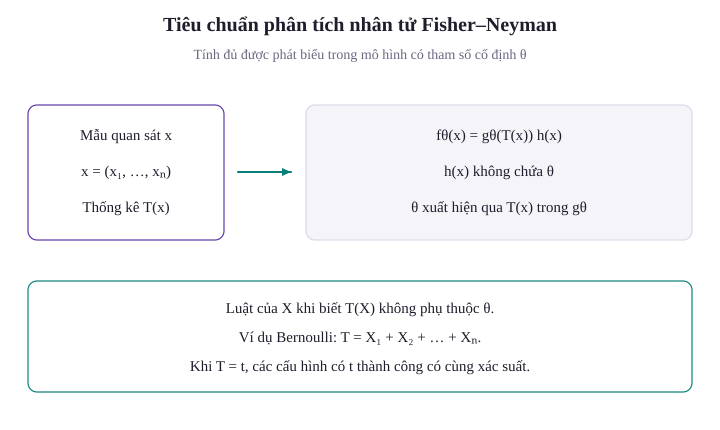
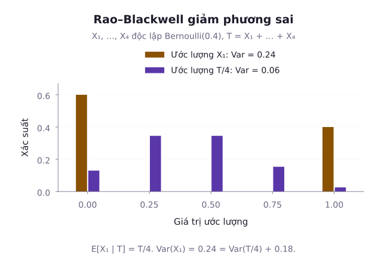
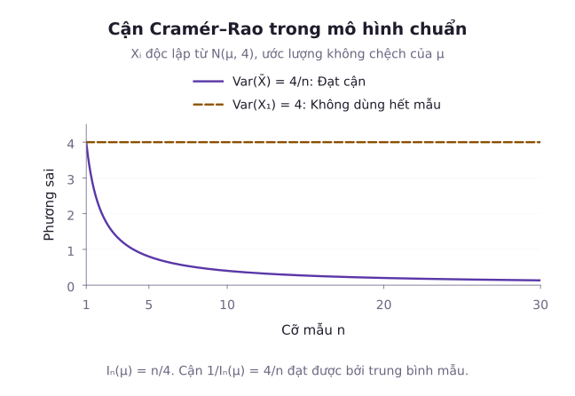

Trong bài học trước, chúng ta đã tiếp cận hai phương pháp xây dựng ước lượng điểm là phương pháp momen và phương pháp hợp lý cực đại. Tuy nhiên, một câu hỏi lý thuyết sâu sắc đặt ra là: Liệu một thống kê cụ thể có thể nén toàn bộ $n$ quan sát ban đầu thành một vài con số tổng hợp mà không làm thất thoát bất kỳ mẩu thông tin nào về tham số $\theta$ hay không? Và trong số tất cả các ước lượng không chệch có thể có, liệu tồn tại một ước lượng duy nhất có phương sai nhỏ nhất đồng đều trên toàn bộ miền tham số hay không? Bài học này giải quyết trọn vẹn những câu hỏi đó. Chúng ta sẽ khảo sát khái niệm thống kê đủ qua định lý phân tích nhân tử Fisher-Neyman và cơ chế cải thiện ước lượng của định lý Rao-Blackwell. Tiếp theo, bài học sẽ đo lường lượng thông tin trong dữ liệu qua thông tin Fisher, từ đó xác lập chặn dưới Cramér-Rao cùng định lý Lehmann-Scheffé về ước lượng không chệch có phương sai nhỏ nhất đồng đều (UMVU).

## 1. Khái niệm Thống kê đủ và Định lý phân tích nhân tử Fisher-Neyman

Giả sử chúng ta thu thập một mẫu ngẫu nhiên $X = (X_1, X_2, \dots, X_n)$ với mật độ đồng thời $f(x; \theta)$. Mục đích của việc tính toán thống kê $T = u(X)$ là rút gọn kích thước dữ liệu từ $n$ chiều xuống một hoặc vài chiều.

Một thống kê $T = u(\mathbf{X})$ được gọi là **thống kê đủ (Sufficient Statistic)** cho tham số $\theta$ nếu phân phối có điều kiện của mẫu ngẫu nhiên $\mathbf{X} = (X_1, \dots, X_n)$ khi biết giá trị của $T = t$ hoàn toàn không còn phụ thuộc vào tham số $\theta$:

Định nghĩa này áp dụng cho phân phối có điều kiện nói chung, gồm cả trường hợp liên tục. Không dùng xác suất tại một điểm đơn lẻ để định nghĩa tính đủ cho dữ liệu liên tục, vì xác suất đó thường bằng không.

Ý nghĩa thực tế: Một khi đã biết giá trị của thống kê đủ $T$, việc biết thêm các giá trị riêng lẻ của từng quan sát $X_i$ không cung cấp thêm bất kỳ thông tin nào về tham số $\theta$.

Trong thực hành, việc tìm kiếm phân phối có điều kiện theo định nghĩa thường rất phức tạp. Thay vào đó, người ta sử dụng công cụ đại số là **Định lý phân tích nhân tử Fisher-Neyman (Fisher-Neyman Factorization Theorem)**.

::: tip Định lý phân tích nhân tử Fisher-Neyman
Thống kê $T = u(\mathbf{X})$ là thống kê đủ cho $\theta$ khi và chỉ khi hàm mật độ (hoặc hàm khối) đồng thời của mẫu có thể phân tích thành tích của hai nhân tử:

$$
f(\mathbf{x}; \theta) = g(u(\mathbf{x}), \theta) \cdot h(\mathbf{x})
$$

trong đó:
- Nhân tử $g(t, \theta)$ chỉ phụ thuộc vào mẫu thông qua giá trị của thống kê $T = u(\mathbf{x})$ và có chứa tham số $\theta$.
- Nhân tử $h(\mathbf{x})$ chỉ phụ thuộc vào dữ liệu mẫu và tuyệt đối không chứa tham số $\theta$.
:::

::: example Thống kê đủ cho phân phối Bernoulli
Cho mẫu ngẫu nhiên $X_1, \dots, X_n \sim \mathrm{Bernoulli}(p)$ với $p \in (0, 1)$. Hãy tìm một thống kê đủ cho $p$.

**Lời giải**:
Hàm khối xác suất đồng thời của mẫu $\mathbf{x} = (x_1, \dots, x_n)$ là:

$$
\begin{aligned}
f(\mathbf{x}; p) &= \prod_{i=1}^n p^{x_i} (1 - p)^{1 - x_i} \\
&= p^{\sum x_i} (1 - p)^{n - \sum x_i} \\
&= \left(\frac{p}{1 - p}\right)^{\sum x_i} (1 - p)^n
\end{aligned}
$$

Đặt $T(\mathbf{x}) = \sum_{i=1}^n x_i$. Ta phân tích hàm xác suất thành:

$$
\begin{aligned}
g(t, p) &= \left(\frac{p}{1 - p}\right)^t (1 - p)^n, \\
h(\mathbf{x}) &= 1
\end{aligned}
$$

Theo định lý Fisher-Neyman, tổng số lần thành công $T = \sum_{i=1}^n X_i$ (hoặc trung bình mẫu $\bar{X} = T/n$) là thống kê đủ cho tham số $p \in (0, 1)$.
:::

::: example Phân tích tính đủ trong mẫu từ tổng thể chuẩn
Cho mẫu ngẫu nhiên $X_1, \dots, X_n \sim \mathcal{N}(\mu, \sigma^2)$. Đặt $Q = \sum_{i=1}^n x_i^2$ và $T = \sum_{i=1}^n x_i$. Tính đủ của các thống kê phụ thuộc vào việc tham số nào đã biết và tham số nào cần ước lượng:

1. **Trường hợp phương sai $\sigma^2 = \sigma_0^2$ đã biết trước**: Cần ước lượng kỳ vọng $\mu$. Đặt tổng bình phương sai lệch là $A=\sum_{i=1}^n(x_i-\mu)^2$. Khai triển từng bình phương rồi cộng lại cho:

$$
A=Q-2\mu T+n\mu^2
$$

 Đặt phần không chứa tham số là $h(\mathbf{x}) = (2\pi\sigma_0^2)^{-n/2} \exp(-Q / (2\sigma_0^2))$. Khi đó hàm mật độ phân tích thành:

$$
f(\mathbf{x}; \mu) = \exp\left(\frac{2\mu T - n\mu^2}{2\sigma_0^2}\right) h(\mathbf{x})
$$

Do đó, tổng mẫu $\sum_{i=1}^n X_i$ (hoặc trung bình mẫu $\bar{X}$) là thống kê đủ cho $\mu$.

2. **Trường hợp kỳ vọng $\mu = \mu_0$ đã biết trước**: Cần ước lượng $\sigma^2$. Khi đó thống kê đủ cho $\sigma^2$ là tổng bình phương sai lệch $\sum_{i=1}^n (X_i - \mu_0)^2$.

3. **Trường hợp cả $\mu$ và $\sigma^2$ đều chưa biết**: Cần ước lượng đồng thời vector tham số $(\mu, \sigma^2)$. Khi đó, hàm mật độ đồng thời phụ thuộc vào dữ liệu qua hai đại lượng:

$$
T(\mathbf{X}) = \left(\sum_{i=1}^n X_i, \sum_{i=1}^n X_i^2\right)
$$

Vector hai chiều $T(\mathbf{X})$ hoặc tương đương cặp thống kê $(\bar{X}, S^2)$ là thống kê đủ đồng thời cho $(\mu, \sigma^2)$.
:::

## 2. Định lý Rao-Blackwell: Nâng cấp ước lượng bằng thống kê đủ

Giả sử ta có một ước lượng không chệch ban đầu $W$ nhưng phương sai của nó còn lớn. Làm thế nào để cải thiện ước lượng này? Định lý Rao-Blackwell chỉ ra rằng: Lấy kỳ vọng có điều kiện của $W$ theo một thống kê đủ $T$ sẽ tạo ra một ước lượng mới luôn có phương sai nhỏ hơn hoặc bằng phương sai ban đầu.

::: tip Định lý Rao-Blackwell
Giả sử $W$ là một ước lượng không chệch của tham số $\theta$ với **phương sai hữu hạn** $\mathrm{Var}(W) < \infty$, và $T$ là một thống kê đủ cho $\theta$. Đặt:

$$
W^* = \mathbb{E}[W \mid T]
$$

Khi đó:
1. $W^*$ là một thống kê (nghĩa là không chứa $\theta$, do tính chất của thống kê đủ).
2. $W^*$ là ước lượng không chệch của $\theta$: $\mathbb{E}[W^*] = \mathbb{E}[\mathbb{E}[W \mid T]] = \mathbb{E}[W] = \theta$.
3. Phương sai của $W^*$ không vượt quá phương sai của $W$:

$$
\mathrm{Var}(W^*) \le \mathrm{Var}(W)
$$

Dấu bằng xảy ra khi và chỉ khi $W$ vốn dĩ đã là một hàm của $T$ hầu chắc chắn (nghĩa là $P(W = W^*) = 1$).
:::

::: proof Chứng minh qua công thức phân rã phương sai toàn phần
Đặt mức giảm phương sai là $\Delta V = \mathrm{Var}(W) - \mathrm{Var}(W^*)$. Theo định lý phân rã phương sai toàn phần:

$$
\Delta V = \mathbb{E}[\mathrm{Var}(W \mid T)]
$$

Vì phương sai có điều kiện luôn không âm ($\mathrm{Var}(W \mid T) \ge 0$), kỳ vọng của nó cũng không âm:

$$
\Delta V \ge 0
$$

Hệ thức $\Delta V \ge 0$ tương đương với:

$$
\mathrm{Var}(W^*) \le \mathrm{Var}(W)
$$

:::

Cơ chế giảm phương sai nằm ở công thức phương sai toàn phần. Đặt $\Delta V=\mathrm{Var}(W)-\mathrm{Var}(W^*)$, ta có:

$$
\Delta V=\mathbb E[\mathrm{Var}(W\mid T)]
$$

Vế phải không âm và đo phần dao động còn lại sau khi đã biết $T$. Điều kiện hóa loại bỏ phần dao động này mà vẫn giữ kỳ vọng.

Hình xét bốn quan sát Bernoulli với $p=0{,}4$. Phương sai của $X_1$ bằng $0{,}24$, trong khi phương sai của $T/4$ bằng $0{,}06$. Phép điều kiện hóa giữ kỳ vọng $0{,}4$ và giảm phương sai bốn lần.

::: example Ứng dụng định lý Rao-Blackwell cho tỷ lệ Bernoulli
Cho $X_1, \dots, X_n \sim \mathrm{Bernoulli}(p)$ với $p \in (0, 1)$. Xét ước lượng thô ban đầu $W = X_1$ (chỉ nhìn vào quan sát đầu tiên).
Rõ ràng $\mathbb{E}[W] = \mathbb{E}[X_1] = p$, vậy $W$ không chệch với phương sai hữu hạn $\mathrm{Var}(W) = p(1 - p) < \infty$.
Hãy dùng thống kê đủ $T = \sum_{i=1}^n X_i$ để nâng cấp ước lượng $W$.

**Lời giải**:
Theo định lý Rao-Blackwell, ta tính kỳ vọng có điều kiện:

$$
\begin{aligned}
W^*(t) &= \mathbb{E}[W \mid T=t] \\
&= P(X_1=1\mid T=t)
\end{aligned}
$$

Đặt $p_t = P(X_1 = 1 \mid T = t)$ và $S_2 = \sum_{i=2}^n X_i$. Theo định nghĩa xác suất có điều kiện:

$$
\begin{aligned}
p_t &= \frac{P(X_1 = 1, T = t)}{P(T = t)} \\
&= \frac{P(X_1 = 1) P(S_2 = t - 1)}{P(T = t)}
\end{aligned}
$$

Vì $T \sim \mathrm{Binomial}(n, p)$ và $S_2 \sim \mathrm{Binomial}(n - 1, p)$:

$$
\begin{aligned}
p_t &= \frac{\binom{n - 1}{t - 1} p^t (1 - p)^{n - t}}{\binom{n}{t} p^t (1 - p)^{n - t}} \\
&= \frac{\binom{n - 1}{t - 1}}{\binom{n}{t}} \\
&= \frac{t}{n}
\end{aligned}
$$

Vậy ước lượng mới sau khi điều kiện hóa là:

$$
W^* = \frac{T}{n} = \frac{1}{n} \sum_{i=1}^n X_i = \bar{X}
$$

Phương sai của ước lượng mới:

$$
\begin{aligned}
\mathrm{Var}(W^*) &= \mathrm{Var}(\bar{X}) \\
&= \frac{p(1 - p)}{n} \\
&= \frac{1}{n}\mathrm{Var}(W)
\end{aligned}
$$

Phương sai đã giảm đi $n$ lần so với ước lượng ban đầu.
:::

## 3. Thông tin Fisher và Chặn dưới Cramér-Rao

Làm thế nào để biết một ước lượng không chệch đã đạt đến độ chính xác giới hạn hay chưa? Ronald Fisher và sau đó là Harald Cramér cùng C. R. Rao đã thiết lập chặn dưới lý thuyết cho phương sai của mọi ước lượng không chệch.

### Hàm Score và Thông tin Fisher
Giả sử hàm mật độ $f(x; \theta)$ thỏa mãn ba **điều kiện chính quy (Regularity Conditions)**:
1. **Miền xác định độc lập với tham số**: Tập hợp $\{x : f(x; \theta) > 0\}$ không phụ thuộc vào tham số $\theta$.
2. **Khả vi dưới dấu tích phân**: Đạo hàm $\frac{\partial \ln f(x; \theta)}{\partial \theta}$ tồn tại hữu hạn, và cho phép đổi thứ tự tích phân và đạo hàm đối với $\theta$:

$$
\frac{d}{d\theta}\int f(x; \theta)\,dx = \int \frac{\partial f(x; \theta)}{\partial \theta}\,dx
$$

3. **Thông tin Fisher hữu hạn và dương**: Đại lượng $I(\theta)$ thỏa $0<I(\theta)<\infty$ trên miền tham số đang xét. Với mô hình rời rạc, các điều kiện đổi đạo hàm và tổng thay cho tích phân.

**Hàm Score (Score Function)** là đạo hàm theo tham số của log-likelihood của một quan sát:

$$
S(X; \theta) = \frac{\partial \ln f(X; \theta)}{\partial \theta}
$$

Kỳ vọng của hàm Score luôn bằng $0$:

$$
\begin{aligned}
\mathbb{E}[S(X; \theta)] &= \int \frac{\partial \ln f}{\partial \theta} f\,dx \\
&= \int \frac{\partial f}{\partial \theta}\,dx \\
&= \frac{d}{d\theta}\int f\,dx \\
&= \frac{d}{d\theta}(1) = 0
\end{aligned}
$$

**Thông tin Fisher (Fisher Information)** chứa trong một quan sát đơn lẻ là phương sai của hàm Score:

$$
\begin{aligned}
I(\theta) &= \mathrm{Var}(S(X; \theta)) \\
&= \mathbb{E}\left[\left(\frac{\partial \ln f(X; \theta)}{\partial \theta}\right)^2\right]
\end{aligned}
$$

Dưới các điều kiện chính quy khả vi cấp 2, thông tin Fisher còn được tính bằng kỳ vọng của đạo hàm cấp 2 đổi dấu:

$$
I(\theta) = -\mathbb{E}\left[\frac{\partial^2 \ln f(X; \theta)}{\partial \theta^2}\right]
$$

Đối với mẫu ngẫu nhiên gồm $n$ quan sát độc lập, thông tin Fisher có tính chất cộng tính: $I_n(\theta) = n I(\theta)$.

### Bất đẳng thức Cramér-Rao (CRLB)
::: tip Định lý Bất đẳng thức Cramér-Rao
Cho $X_1, \dots, X_n$ là mẫu ngẫu nhiên thỏa mãn các điều kiện chính quy. Giả sử $\theta$ nằm trong phần trong của một khoảng tham số. Nếu $\hat\theta$ không chệch, có phương sai hữu hạn và được phép đưa đạo hàm qua kỳ vọng của $\hat\theta$, thì:

$$
\mathrm{Var}(\hat{\theta}) \ge \frac{1}{n I(\theta)}
$$

Đại lượng $\mathrm{CRLB} = \frac{1}{n I(\theta)}$ được gọi là **Chặn dưới Cramér-Rao (Cramér-Rao Lower Bound)**.
:::

Một ước lượng không chệch đạt dấu bằng trong bất đẳng thức Cramér-Rao được gọi là **ước lượng hiệu quả (Efficient Estimator)**. Tỷ số:

$$
\mathrm{Eff}(\hat{\theta}) = \frac{\mathrm{CRLB}}{\mathrm{Var}(\hat{\theta})} \le 1
$$

được gọi là hiệu suất của ước lượng.

Hình xét tổng thể chuẩn có phương sai đã biết bằng $4$. Chặn Cramér–Rao cho ước lượng không chệch của kỳ vọng là $4/n$, và trung bình mẫu đạt chặn này.

::: example Tính thông tin Fisher và CRLB cho phân phối Poisson
Cho $X \sim \mathrm{Poisson}(\lambda)$ với hàm khối xác suất $f(x; \lambda) = \frac{\lambda^x e^{-\lambda}}{x!}$ ($\lambda > 0$). Hãy tính thông tin Fisher $I(\lambda)$ và chặn dưới Cramér-Rao cho mẫu kích thước $n$.

**Lời giải**:
Log-likelihood của một quan sát:

$$
\ln f(x; \lambda) = x \ln \lambda - \lambda - \ln(x!)
$$

Đạo hàm cấp 1:

$$
\frac{\partial \ln f}{\partial \lambda} = \frac{x}{\lambda} - 1
$$

Đạo hàm cấp 2:

$$
\frac{\partial^2 \ln f}{\partial \lambda^2} = -\frac{x}{\lambda^2}
$$

Thông tin Fisher của một quan sát:

$$
\begin{aligned}
I(\lambda) &= -\mathbb{E}\left[-\frac{X}{\lambda^2}\right] \\
&= \frac{\mathbb{E}[X]}{\lambda^2} = \frac{\lambda}{\lambda^2} = \frac{1}{\lambda}
\end{aligned}
$$

Chặn dưới Cramér-Rao cho mẫu kích thước $n$:

$$
\begin{aligned}
\mathrm{CRLB} &= \frac{1}{n I(\lambda)} \\
&= \frac{1}{n \cdot (1 / \lambda)} \\
&= \frac{\lambda}{n}
\end{aligned}
$$

Xét ước lượng trung bình mẫu $\hat{\lambda} = \bar{X}$:
Ta biết $\mathbb{E}[\bar{X}] = \lambda$ (không chệch) và $\mathrm{Var}(\bar{X}) = \lambda / n$.
Vì $\mathrm{Var}(\bar{X}) = \mathrm{CRLB}$, trung bình mẫu $\bar{X}$ đạt chặn dưới Cramér-Rao, là ước lượng hiệu quả tuyệt đối với hiệu suất $\mathrm{Eff} = 100\%$.
:::

::: warning Phản ví dụ: Vi phạm điều kiện chính quy
Xét mẫu $X_1, \dots, X_n \sim \mathcal{U}(0, \theta)$. Miền xác định là $[0, \theta]$, phụ thuộc trực tiếp vào tham số $\theta$, vi phạm điều kiện chính quy số 1.
Trong bài trước, ta đã biết ước lượng không chệch hiệu chỉnh là $\hat{\theta} = \frac{n + 1}{n} X_{(n)}$.
Phương sai của ước lượng này là:

$$
\begin{aligned}
\mathrm{Var}(\hat{\theta}) &= \frac{\theta^2}{n(n + 2)} \\
&= O(n^{-2})
\end{aligned}
$$

Phương sai này có bậc $n^{-2}$. Không thể áp dụng công thức Cramér–Rao chính quy rồi suy ra một chặn có bậc $n^{-1}$ cho mô hình có miền giá trị phụ thuộc tham số này. Điều này khẳng định: Bất đẳng thức Cramér-Rao chỉ đúng khi các điều kiện chính quy được thỏa mãn.
:::

## 4. Tính đầy đủ và Ước lượng không chệch có phương sai nhỏ nhất đồng đều (UMVU)

Khi một ước lượng không chệch không đạt được chặn Cramér-Rao (hoặc khi CRLB không áp dụng được), làm sao ta biết nó có phải là ước lượng tốt nhất trong mọi ước lượng không chệch hay không? Câu trả lời nằm ở khái niệm **tính đầy đủ (Completeness)** và **Định lý Lehmann-Scheffé**.

### Thống kê đầy đủ (Complete Statistic)
Thống kê $T$ được gọi là đầy đủ cho họ phân phối $\{f(t; \theta) : \theta \in \Theta\}$ nếu với mọi hàm thực $g$ thỏa $\mathbb E_\theta[|g(T)|]<\infty$ với mọi $\theta$, ta có điều kiện:

$$
\begin{aligned}
&\mathbb{E}_\theta[g(T)] = 0 \\
&\implies P_\theta(g(T) = 0) = 1
\end{aligned}
$$

với mọi $\theta \in \Theta$.

Nói cách khác, không tồn tại bất kỳ hàm khác không nào của $T$ mà lại có kỳ vọng triệt tiêu đồng nhất bằng $0$ với mọi giá trị của tham số.

### Định lý Lehmann-Scheffé
::: tip Định lý Lehmann-Scheffé
Giả sử $T$ vừa đủ vừa đầy đủ cho tham số $\theta$. Nếu $g(T)$ không chệch và có phương sai hữu hạn, nó là ước lượng không chệch có phương sai nhỏ nhất đồng đều (UMVU). Tính duy nhất được hiểu đến sai khác trên tập xác suất không.
:::

Hệ quả thực hành: Để tìm UMVU của $\theta$, ta chỉ cần:
1. Tìm một thống kê đủ và đầy đủ $T$ (thường xuất phát từ họ phân phối hàm mũ Exponential Family).
2. Tìm một hàm $h(T)$ sao cho $\mathbb{E}[h(T)] = \theta$. Khi đó $h(T)$ chắc chắn là UMVU, không cần so sánh với bất kỳ ước lượng nào khác.

## Tóm tắt

1. Thống kê đủ $T(X)$ nén dữ liệu mà không làm thất thoát thông tin về tham số $\theta$. Tiêu chuẩn Fisher-Neyman cho phép nhận diện thống kê đủ qua phân tích $f(x; \theta) = g(T(x), \theta) h(x)$.
2. Định lý Rao-Blackwell khẳng định phép lấy kỳ vọng có điều kiện theo thống kê đủ $W^* = \mathbb{E}[W \mid T]$ bảo toàn kỳ vọng và không bao giờ làm tăng phương sai khi phương sai ban đầu hữu hạn.
3. Thông tin Fisher $I(\theta) = \mathbb{E}[(\partial \ln f / \partial \theta)^2]$ đo lường lượng thông tin trong mẫu. Chặn dưới Cramér-Rao $\mathrm{Var}(\hat{\theta}) \ge 1 / [n I(\theta)]$ đặt ra giới hạn phương sai tối thiểu cho mọi ước lượng không chệch dưới các điều kiện chính quy.
4. Thống kê vừa đủ vừa đầy đủ kết hợp với định lý Lehmann-Scheffé cung cấp phương pháp xác định trực tiếp ước lượng không chệch có phương sai nhỏ nhất đồng đều (UMVU) duy nhất.

## Bài tập tự luyện

::: exercise 1. Thống kê đủ cho phân phối Exponential
Cho $X_1, \dots, X_n \sim \mathrm{Exp}(\lambda)$ với hàm mật độ $f(x; \lambda) = \lambda e^{-\lambda x}$ ($x \ge 0, \lambda > 0$). Hãy áp dụng định lý phân tích nhân tử Fisher-Neyman để chứng minh rằng tổng mẫu $T = \sum_{i=1}^n X_i$ là thống kê đủ cho $\lambda$.
:::

::: solution
Đặt $\mathbf{x} = (x_1, \dots, x_n)$. Hàm mật độ đồng thời của mẫu ngẫu nhiên:

$$
\begin{aligned}
f(\mathbf{x}; \lambda) &= \prod_{i=1}^n \lambda e^{-\lambda x_i} \\
&= \lambda^n \exp\left(-\lambda \sum_{i=1}^n x_i\right)
\end{aligned}
$$

Đặt $T(x) = \sum_{i=1}^n x_i$. Biểu thức mật độ được viết lại:

$$
f(x_1, \dots, x_n; \lambda) = \left[\lambda^n e^{-\lambda T(x)}\right] \cdot 1
$$

Chọn $g(t, \lambda) = \lambda^n e^{-\lambda t}$ và $h(x) = 1$.
Theo định lý phân tích nhân tử Fisher-Neyman, $T = \sum_{i=1}^n X_i$ là thống kê đủ cho tham số $\lambda$.
:::

::: exercise 2. Thông tin Fisher của phân phối Bernoulli
Cho $X \sim \mathrm{Bernoulli}(p)$ với $0<p<1$. Hãy tính thông tin Fisher $I(p)$ và suy ra chặn dưới Cramér-Rao cho mẫu ngẫu nhiên kích thước $n = 25$ khi $p = 0{,}4$.
:::

::: solution
Hàm khối xác suất của biến ngẫu nhiên Bernoulli với $x \in \{0, 1\}$:

$$
f(x; p) = p^x (1 - p)^{1 - x}
$$

Đặt $\ell(p) = \ln f(x; p)$ là hàm log-likelihood:

$$
\ell(p) = x \ln p + (1 - x) \ln(1 - p)
$$

Đạo hàm cấp 1:

$$
\frac{\partial \ln f}{\partial p} = \frac{x}{p} - \frac{1 - x}{1 - p}
$$

Đạo hàm cấp 2:

$$
\frac{\partial^2 \ln f}{\partial p^2} = -\frac{x}{p^2} - \frac{1 - x}{(1 - p)^2}
$$

Lấy kỳ vọng đổi dấu với $\mathbb{E}[X] = p$:

$$
\begin{aligned}
I(p) &= -\mathbb{E}\left[\frac{\partial^2 \ln f}{\partial p^2}\right] \\
&= \frac{p}{p^2} + \frac{1 - p}{(1 - p)^2} \\
&= \frac{1}{p} + \frac{1}{1 - p} = \frac{1}{p(1 - p)}
\end{aligned}
$$

Biểu thức này xác định với mọi $p \in (0, 1)$. Chặn dưới Cramér-Rao cho mẫu kích thước $n$:

$$
\mathrm{CRLB} = \frac{1}{n I(p)} = \frac{p(1 - p)}{n}
$$

Với $n = 25$ và $p = 0{,}4$:

$$
\begin{aligned}
\mathrm{CRLB} &= \frac{0{,}4 \times 0{,}6}{25} \\
&= \frac{0{,}24}{25} = 0{,}0096
\end{aligned}
$$

Trung bình mẫu $\hat{p} = \bar{X}$ có phương sai đúng bằng $0{,}0096$, do đó đạt hiệu quả tuyệt đối.
:::

::: exercise 3. Thông tin Fisher của kỳ vọng phân phối chuẩn
Cho $X_1, \dots, X_n \sim \mathcal{N}(\mu, \sigma^2)$ với phương sai $\sigma^2$ đã biết trước. Hãy tính thông tin Fisher $I(\mu)$ và chỉ ra rằng trung bình mẫu $\bar{X}$ là ước lượng hiệu quả của $\mu$.
:::

::: solution
Đặt hằng số chuẩn hóa $C_0 = (2\pi\sigma^2)^{-1/2}$. Hàm mật độ của một quan sát:

$$
f(x; \mu) = C_0 \exp\left(-\frac{(x - \mu)^2}{2\sigma^2}\right)
$$

Đặt $C_1 = -\frac{1}{2}\ln(2\pi\sigma^2)$. Log-likelihood:

$$
\ln f(x; \mu) = C_1 - \frac{(x - \mu)^2}{2\sigma^2}
$$

Đạo hàm cấp 1:

$$
\frac{\partial \ln f}{\partial \mu} = \frac{x - \mu}{\sigma^2}
$$

Đạo hàm cấp 2:

$$
\frac{\partial^2 \ln f}{\partial \mu^2} = -\frac{1}{\sigma^2}
$$

Thông tin Fisher:

$$
I(\mu) = -\mathbb{E}\left[-\frac{1}{\sigma^2}\right] = \frac{1}{\sigma^2}
$$

Chặn dưới Cramér-Rao cho mẫu kích thước $n$:

$$
\mathrm{CRLB} = \frac{1}{n I(\mu)} = \frac{\sigma^2}{n}
$$

Vì $\mathrm{Var}(\bar{X}) = \sigma^2 / n = \mathrm{CRLB}$, trung bình mẫu $\bar{X}$ đạt chặn dưới Cramér-Rao và là ước lượng hiệu quả của $\mu$.
:::

::: exercise 4. Tính đầy đủ của thống kê đủ Bernoulli
Cho $X_1, \dots, X_n \sim \mathrm{Bernoulli}(p)$ với $p \in (0, 1)$. Ta biết $T = \sum_{i=1}^n X_i \sim \mathrm{Binomial}(n, p)$ là thống kê đủ. Hãy chứng minh $T$ là thống kê đầy đủ, và kết luận về tính UMVU của trung bình mẫu $\bar{X}$.
:::

::: solution
Giả sử tồn tại hàm $g$ sao cho $\mathbb{E}_p[g(T)] = 0$ với mọi $p \in (0, 1)$:

$$
\sum_{t=0}^n g(t) \binom{n}{t} p^t (1 - p)^{n - t} = 0
$$

Chia cả hai vế cho $(1 - p)^n > 0$ và đặt biến đổi $\xi = \frac{p}{1 - p} \in (0, \infty)$:

$$
\sum_{t=0}^n \left[g(t) \binom{n}{t}\right] \xi^t = 0 \quad (\forall \xi > 0)
$$

Vế trái là một đa thức bậc $n$ theo biến $\xi$. Một đa thức triệt tiêu tại vô số điểm khi và chỉ khi mọi hệ số của nó bằng $0$, với mọi $t = 0, 1, \dots, n$:

$$
\begin{aligned}
&g(t) \binom{n}{t} = 0 \\
&\implies g(t) = 0
\end{aligned}
$$

Do đó $P(g(T) = 0) = 1$. Thống kê $T$ là đầy đủ.
Vì $T$ vừa đủ vừa đầy đủ, và $\bar{X} = T/n$ là hàm của $T$ thỏa mãn $\mathbb{E}[\bar{X}] = p$, theo định lý Lehmann-Scheffé, $\bar{X}$ là ước lượng không chệch có phương sai nhỏ nhất đồng đều (UMVU) duy nhất của $p$.
:::

::: exercise 5. Hiệu suất tương đối của trung vị mẫu so với trung bình mẫu
Trong tổng thể chuẩn $\mathcal{N}(\mu, \sigma^2)$, trung bình mẫu $\bar{X}$ có phương sai $\mathrm{Var}(\bar{X}) = \sigma^2 / n$. Trong khi đó, trung vị mẫu $\tilde{X}$ có phương sai tiệm cận $\mathrm{Var}(\tilde{X}) \approx \frac{\pi \sigma^2}{2n}$. Hãy tính hiệu suất tiệm cận tương đối (Asymptotic Relative Efficiency - ARE) của trung vị so với trung bình và giải thích ý nghĩa.
:::

::: solution
Hiệu suất tương đối của trung vị so với trung bình mẫu được định nghĩa bằng tỷ số phương sai:

$$
\begin{aligned}
\mathrm{ARE}(\tilde{X}, \bar{X}) &= \frac{\mathrm{Var}(\bar{X})}{\mathrm{Var}(\tilde{X})} \\
&= \frac{\sigma^2 / n}{\frac{\pi \sigma^2}{2n}} \\
&= \frac{2}{\pi} \approx 0{,}6366
\end{aligned}
$$

Ý nghĩa: Trên tổng thể phân phối chuẩn, trung vị mẫu chỉ đạt hiệu suất khoảng $63{,}7\%$ so với trung bình mẫu. Điều này đồng nghĩa với việc để đạt được cùng độ chính xác (cùng phương sai ước lượng), người sử dụng trung vị mẫu phải thu thập lượng dữ liệu lớn hơn khoảng $1 / 0{,}6366 \approx 1{,}57$ lần (nhiều hơn $57\%$ cỡ mẫu) so với người sử dụng trung bình mẫu.
:::

## Tài liệu tham khảo

- MIT OpenCourseWare. [18.655: Mathematical Statistics, Lecture 6, Sufficiency](https://ocw.mit.edu/courses/18-655-mathematical-statistics-spring-2016/bbbca14a2009e47add8c7ea2a49daa41_MIT18_655S16_LecNote6.pdf).
- MIT OpenCourseWare. [18.655: Unbiased Estimation and Risk Inequalities](https://ocw.mit.edu/courses/18-655-mathematical-statistics-spring-2016/resources/mit18_655s16_lecnote13/). Điều kiện chính quy, thông tin Fisher và bất đẳng thức thông tin.
- MIT Mathematics. [18.655: Mathematical Statistics, Syllabus](https://www.mit.edu/~18.655/syllabus.html). Các chủ đề Rao–Blackwell, UMVU và Cramér–Rao.
- Penn State Eberly College of Science. [STAT 415: Introduction to Mathematical Statistics](https://online.stat.psu.edu/stat415/).
