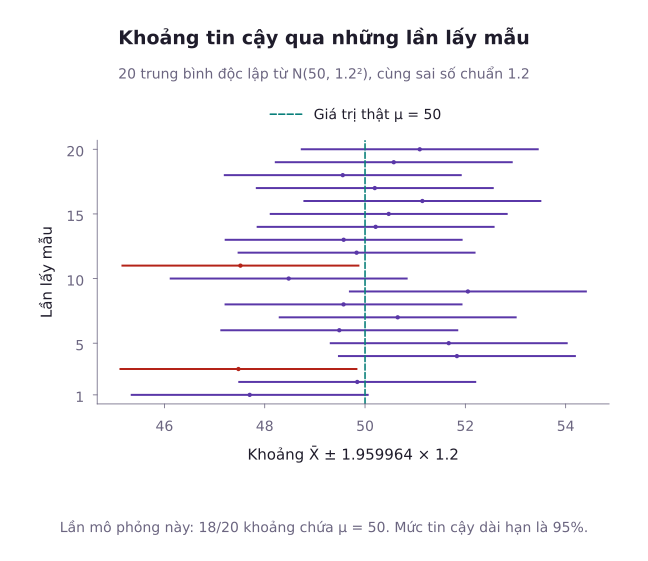
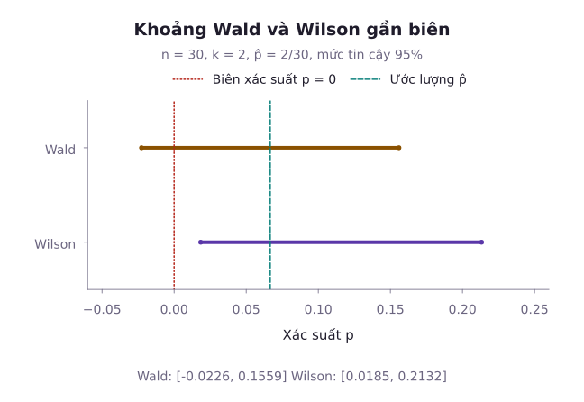
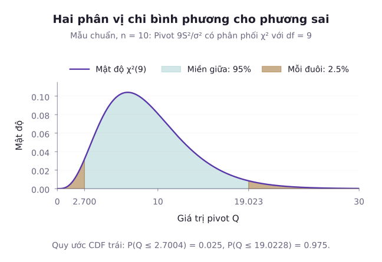

Một ước lượng điểm cung cấp một giá trị đại diện cho tham số tổng thể. Tuy nhiên, trong thực tế nghiên cứu khoa học và kỹ thuật, ước lượng điểm không phản ánh mức độ bất định đi kèm. Chẳng hạn, khi kiểm định độ bền chịu lực của một mác bê tông mới, việc kết luận độ bền trung bình bằng $35\,\mathrm{MPa}$ là chưa đủ nếu kỹ sư không biết sai số ngẫu nhiên dao động trong khoảng $\pm 1\,\mathrm{MPa}$ hay $\pm 10\,\mathrm{MPa}$. Khoảng tin cậy giải quyết bài toán này bằng cách cung cấp một khoảng giá trị khả dĩ chứa tham số với xác suất bao phủ được kiểm soát trước. Bài học này trình bày phương pháp tổng quát thiết lập khoảng tin cậy qua đại lượng định vị (Pivot), khảo sát các khoảng tin cậy cho kỳ vọng, so sánh hai trung bình độc lập và bắt cặp. Tiếp theo, bài học mổ xẻ sự khác biệt giữa khoảng Wald và khoảng Wilson cho tỷ lệ, xác lập khoảng tin cậy cho phương sai, và tính toán cỡ mẫu cần thiết trong quy hoạch thực nghiệm.

## 1. Bản chất xác suất của Khoảng tin cậy và Phương pháp Pivot

Giả sử mẫu ngẫu nhiên $X = (X_1, \dots, X_n)$ tuân theo phân phối có tham số chưa biết $\theta$. Một khoảng tin cậy mức $1 - \alpha$ (với $\alpha \in (0, 1)$, thường chọn $0{,}05$ ứng với độ tin cậy $95\%$) cho $\theta$ là một khoảng ngẫu nhiên $[L(X), U(X)]$ thỏa mãn điều kiện:

$$
P_\theta(L(X)\le\theta\le U(X))\ge1-\alpha
$$

Khoảng chính xác có xác suất bao phủ bằng mức danh định. Khoảng bảo thủ có thể bao phủ cao hơn, còn khoảng xấp xỉ chỉ đạt gần mức này khi các điều kiện xấp xỉ phù hợp.

Cần lưu ý rằng trong trường phái thống kê cổ điển, tham số $\theta$ là một hằng số cố định nhưng chưa biết, không phải là một biến ngẫu nhiên. Hai đầu mút $L(X)$ và $U(X)$ là các thống kê mẫu, do đó chúng là các biến ngẫu nhiên biến thiên theo từng mẫu dữ liệu thu thập được.

Hình minh họa 20 lần lấy mẫu khi trung bình ước lượng có phân phối chuẩn, kỳ vọng $50$ và sai số chuẩn $1{,}2$. Mỗi khoảng có nửa độ rộng $z_{0{,}025}\times1{,}2$. Trong 20 lần cụ thể này, 18 khoảng chứa kỳ vọng và hai khoảng bỏ sót. Tỷ lệ hữu hạn $18/20$ không phải độ bao phủ lý thuyết $95\%$.

Ý nghĩa của phát biểu độ tin cậy $95\%$: Giả sử ta lặp lại phép lấy mẫu độc lập vô số lần trong cùng điều kiện và tính khoảng tin cậy cho mỗi mẫu. Với một thủ tục có độ bao phủ đúng $95\%$, tỷ lệ khoảng chứa tham số sẽ tiến tới $95\%$ khi số lần lặp tăng. Một khoảng đã tính xong hoặc chứa tham số hoặc không chứa, nên không gán xác suất $95\%$ cho tham số cố định nằm trong chính khoảng đó.

Công cụ nền tảng để tìm ra hai đầu mút $L(X)$ và $U(X)$ là **Đại lượng định vị (Pivot)**.

::: tip Khái niệm Đại lượng định vị (Pivot)
Một hàm số của mẫu và tham số $Q(X_1, \dots, X_n; \theta)$ được gọi là một đại lượng định vị nếu phân phối xác suất của nó hoàn toàn không phụ thuộc vào tham số $\theta$ hay bất kỳ tham số phụ trợ nào khác.
:::

Quy trình xây dựng khoảng tin cậy qua đại lượng định vị gồm ba bước:
1. **Xác định đại lượng định vị**: Chọn $Q(X; \theta)$ có phân phối đã biết (như chuẩn tắc $\mathcal{N}(0, 1)$, Student $t$, hoặc Chi bình phương $\chi^2$).
2. **Tìm hai phân vị thích hợp**: Xác định $q_1, q_2$ của phân phối $Q$ sao cho:

$$
P(q_1 \le Q(X; \theta) \le q_2) = 1 - \alpha
$$

3. **Biến đổi bất đẳng thức**: Giải bất đẳng thức $q_1 \le Q(X; \theta) \le q_2$ để đưa tham số $\theta$ về vị trí trung tâm, nhận được dạng $L(X) \le \theta \le U(X)$.

## 2. Khoảng tin cậy cho Kỳ vọng của Phân phối chuẩn

Trong bài này, $z_a$, $t_{a,\nu}$, $\chi^2_{a,\nu}$ và $F_a$ đều là giá trị tới hạn đuôi phải, có diện tích bên phải bằng $a$. Chúng tương ứng với phân vị tích lũy mức $1-a$.

### Trường hợp đã biết phương sai tổng thể

Khi mẫu ngẫu nhiên độc lập $X_1, \dots, X_n \overset{\mathrm{iid}}{\sim} \mathcal{N}(\mu, \sigma^2)$ với $\sigma^2$ đã biết, đại lượng định vị là biến ngẫu nhiên chuẩn hóa:

$$
Z = \frac{\bar{X} - \mu}{\sigma / \sqrt{n}} \sim \mathcal{N}(0, 1)
$$

Do đồ thị phân phối chuẩn tắc đối xứng qua gốc tọa độ, ta chọn hai phân vị đối xứng $-z_{\alpha/2}$ và $z_{\alpha/2}$, với $z_{\alpha/2}$ thỏa mãn $P(Z > z_{\alpha/2}) = \alpha/2$. Đặt sai số biên độ $E_z = z_{\alpha/2} \frac{\sigma}{\sqrt{n}}$, biến đổi tương đương xác suất bao phủ:

$$
\begin{aligned}
&P(-z_{\alpha/2} \le Z \le z_{\alpha/2}) = 1 - \alpha \\
&\iff P(\bar{X} - E_z \le \mu \le \bar{X} + E_z) \\
&= 1 - \alpha
\end{aligned}
$$

Khoảng tin cậy hai phía đối xứng cho kỳ vọng $\mu$ là:

$$
[\bar{X} - E_z, \, \bar{X} + E_z]
$$

### Trường hợp chưa biết phương sai tổng thể

Khi phương sai tổng thể chưa biết, ta dùng phương sai mẫu hiệu chỉnh $S^2$ đã định nghĩa ở bài phân phối mẫu. Với giả định mẫu độc lập từ tổng thể chuẩn, theo định lý Gosset, đại lượng định vị chuyển thành thống kê $T$:

$$
T = \frac{\bar{X} - \mu}{S / \sqrt{n}} \sim t(n - 1)
$$

Đặt sai số biên độ $E_t = t_{\alpha/2, n-1} \frac{S}{\sqrt{n}}$, khoảng tin cậy $1 - \alpha$ cho kỳ vọng $\mu$ là:

$$
[\bar{X} - E_t, \, \bar{X} + E_t]
$$

trong đó $t_{\alpha/2, n-1}$ là giá trị tới hạn phía trên của phân phối Student với $n-1$ bậc tự do. Do phân phối $t$ có đuôi dày hơn phân phối chuẩn, với cùng sai số chuẩn ước tính, khoảng dùng phân vị $t$ rộng hơn khoảng dùng $z$. Điều này không có nghĩa mọi khoảng dựa trên $S$ đều rộng hơn khoảng dựa trên $\sigma$ thực, vì $S$ còn dao động theo mẫu.

::: example Khoảng tin cậy một mẫu cho kỳ vọng
Đo thời gian phản hồi của một máy chủ cơ sở dữ liệu trên một mẫu ngẫu nhiên gồm $n = 16$ truy vấn độc lập thu được trung bình mẫu $\bar{x} = 22{,}5\,\mathrm{ms}$ và độ lệch chuẩn mẫu $s = 4{,}0\,\mathrm{ms}$. Giả thiết thời gian phản hồi tuân theo phân phối chuẩn. Hãy xây dựng khoảng tin cậy $95\%$ cho thời gian phản hồi trung bình của hệ thống.

**Lời giải**:
Vì mẫu độc lập từ tổng thể chuẩn và $\sigma$ chưa biết, ta sử dụng phân phối Student với bậc tự do:

$$
\nu = n - 1 = 16 - 1 = 15
$$

Với mức tin cậy $95\%$, mức ý nghĩa là $\alpha = 0{,}05$, phân vị tương ứng là $t_{0{,}025, 15} \approx 2{,}1315$.
Sai số chuẩn của ước lượng:

$$
\mathrm{SE} = \frac{s}{\sqrt{n}} = \frac{4{,}0}{\sqrt{16}} = 1{,}0\,\mathrm{ms}
$$

Biên độ sai số (Margin of Error):

$$
\begin{aligned}
E &= t_{\alpha/2, n-1} \cdot \mathrm{SE} \\
&= 2{,}1315 \times 1{,}0 = 2{,}1315\,\mathrm{ms}
\end{aligned}
$$

Khoảng tin cậy $95\%$ cho kỳ vọng $\mu$ là:

$$
\begin{aligned}
&[22{,}5 - 2{,}1315, \, 22{,}5 + 2{,}1315] \\
&= [20{,}3685, \, 24{,}6315]\,\mathrm{ms}
\end{aligned}
$$

Ta kết luận với độ tin cậy $95\%$ rằng thời gian phản hồi trung bình thực tế của hệ thống nằm trong khoảng từ $20{,}37\,\mathrm{ms}$ đến $24{,}63\,\mathrm{ms}$.
:::

## 3. So sánh Hai Kỳ vọng: Mẫu Bắt cặp và Mẫu Độc lập

### Mẫu bắt cặp (Paired Samples)

Khi hai tập dữ liệu được thu thập trên cùng một đối tượng tại hai thời điểm khác nhau (trước và sau can thiệp) hoặc trên các cặp đối tượng ghép đôi, hai phép đo trong cùng một cặp có thể phụ thuộc. Ta xét hiệu số $D_i = X_{1i} - X_{2i}$. Các cặp khác nhau phải độc lập, do đó các hiệu số tạo thành một mẫu độc lập.

Nếu các hiệu số $D_i$ tuân theo phân phối chuẩn $\mathcal{N}(\mu_D, \sigma_D^2)$, đặt sai số biên độ $E_D = t_{\alpha/2, n-1} \frac{S_D}{\sqrt{n}}$, bài toán quy về khoảng tin cậy một mẫu cho kỳ vọng hiệu số $\mu_D = \mu_1 - \mu_2$:

$$
[\bar{D} - E_D, \, \bar{D} + E_D]
$$

trong đó $\bar{D} = \frac{1}{n}\sum_{i=1}^n D_i$ và $S_D = \sqrt{\frac{1}{n-1}\sum_{i=1}^n (D_i - \bar{D})^2}$.

::: example Khoảng tin cậy cho mẫu bắt cặp
Một nhóm kỹ sư đo hiệu năng tiêu thụ điện năng (đơn vị: Watts) của $n = 6$ bộ xử lý trước và sau khi áp dụng bản vá tối ưu hóa mã nguồn. Hiệu số chênh lệch đo được giữa mức tiêu thụ trước và sau cho từng chip là: $3{,}0; \, 5{,}0; \, 2{,}0; \, 4{,}0; \, 6{,}0; \, 4{,}0$. Giả sử các hiệu số tuân theo phân phối chuẩn. Hãy lập khoảng tin cậy $95\%$ cho mức giảm công suất tiêu thụ trung bình.

**Lời giải**:
Tổng các hiệu số là $\sum_{i=1}^6 d_i = 24{,}0\,\mathrm{W}$. Trung bình mẫu:

$$
\bar{d} = \frac{24{,}0}{6} = 4{,}0\,\mathrm{W}
$$

Đặt tổng bình phương sai lệch là $Q_D = \sum_{i=1}^6 (d_i - \bar{d})^2$:

$$
\begin{aligned}
Q_D &= 1 + 1 + 4 + 0 + 4 + 0 \\
&= 10{,}0
\end{aligned}
$$

Phương sai mẫu và độ lệch chuẩn mẫu:

$$
\begin{aligned}
s_d^2 &= \frac{10{,}0}{6 - 1} = 2{,}0 \\
\implies s_d &= \sqrt{2{,}0} \approx 1{,}4142\,\mathrm{W}
\end{aligned}
$$

Sai số chuẩn của hiệu số trung bình:

$$
\begin{aligned}
\mathrm{SE} &= \frac{s_d}{\sqrt{n}} = \frac{\sqrt{2{,}0}}{\sqrt{6}} \\
&= \frac{1}{\sqrt{3}} \approx 0{,}5774\,\mathrm{W}
\end{aligned}
$$

Với $n - 1 = 5$ bậc tự do và $\alpha = 0{,}05$, tra bảng phân vị Student ta có $t_{0{,}025, 5} \approx 2{,}5706$.
Biên độ sai số:

$$
E = 2{,}5706 \times 0{,}5774 \approx 1{,}4841\,\mathrm{W}
$$

Khoảng tin cậy $95\%$ cho mức tiết kiệm trung bình $\mu_D$:

$$
\begin{aligned}
&[4{,}0 - 1{,}4841, \, 4{,}0 + 1{,}4841] \\
&= [2{,}5159, \, 5{,}4841]\,\mathrm{W}
\end{aligned}
$$

Khoảng này nằm trên 0, cho thấy mức công suất trước cao hơn sau trong quần thể được lấy mẫu. Muốn quy chênh lệch cho bản vá, cần thiết kế kiểm soát các thay đổi đồng thời và các yếu tố gây nhiễu.
:::

### Hai mẫu độc lập và Xấp xỉ Welch

Khi so sánh kỳ vọng của hai tổng thể độc lập $X_1 \sim \mathcal{N}(\mu_1, \sigma_1^2)$ và $X_2 \sim \mathcal{N}(\mu_2, \sigma_2^2)$ với kích thước mẫu lần lượt là $n_1$ và $n_2$:

1. **Trường hợp hai phương sai bằng nhau ($\sigma_1^2 = \sigma_2^2 = \sigma^2$)**: Ta tính phương sai gộp (Pooled Variance):

$$
S_p^2 = \frac{(n_1 - 1)S_1^2 + (n_2 - 1)S_2^2}{n_1 + n_2 - 2}
$$

Đặt sai số biên độ gộp $E_p = t_{\alpha/2, n_1 + n_2 - 2} \cdot S_p \sqrt{\frac{1}{n_1} + \frac{1}{n_2}}$. Khoảng tin cậy cho $\mu_1 - \mu_2$ dựa trên phân phối $t(n_1 + n_2 - 2)$ chính xác là:

$$
(\bar{X}_1 - \bar{X}_2) \pm E_p
$$

2. **Trường hợp hai phương sai không bằng nhau ($\sigma_1^2 \ne \sigma_2^2$)**: Đây là bài toán Behrens-Fisher cổ điển. Ngay cả khi hai tổng thể tuân theo phân phối chuẩn hoàn hảo, đại lượng chuẩn hóa khi dùng phương sai riêng không tuân theo phân phối Student chính xác. Giải pháp chuẩn tắc được áp dụng rộng rãi nhất là phép **xấp xỉ Welch-Satterthwaite**. Bậc tự do hiệu dụng $\nu$ được tính theo công thức:

$$
\nu = \frac{\left(\frac{S_1^2}{n_1} + \frac{S_2^2}{n_2}\right)^2}{\frac{(S_1^2 / n_1)^2}{n_1 - 1} + \frac{(S_2^2 / n_2)^2}{n_2 - 1}}
$$

Phần mềm có thể dùng trực tiếp $\nu$ không nguyên. Khi tra bảng chỉ có bậc tự do nguyên, có thể làm tròn xuống để lấy phân vị lớn hơn, cho khoảng hơi rộng hơn trong cùng phép xấp xỉ Welch. Khoảng tin cậy tương ứng là:

$$
(\bar{X}_1 - \bar{X}_2) \pm t_{\alpha/2, \nu} \sqrt{\frac{S_1^2}{n_1} + \frac{S_2^2}{n_2}}
$$

::: example Khoảng tin cậy Welch cho hai kỳ vọng
So sánh điểm đánh giá chất lượng trải nghiệm của người dùng trên hai phiên bản giao diện A và B thu được các số liệu sau:
- Phiên bản A: $n_1 = 10, \, \bar{x}_1 = 82{,}0, \, s_1 = 6{,}0$.
- Phiên bản B: $n_2 = 12, \, \bar{x}_2 = 75{,}0, \, s_2 = 4{,}0$.
Giả thiết điểm số trên cả hai phiên bản tuân theo phân phối chuẩn với phương sai khác nhau. Hãy lập khoảng tin cậy $95\%$ cho độ chênh lệch kỳ vọng $\mu_1 - \mu_2$.

**Lời giải**:
Chênh lệch trung bình điểm số giữa hai phiên bản:

$$
\bar{x}_1 - \bar{x}_2 = 82{,}0 - 75{,}0 = 7{,}0
$$

Đặt $v_1 = s_1^2 / n_1$ và $v_2 = s_2^2 / n_2$:

$$
\begin{aligned}
v_1 &= \frac{36{,}0}{10} = 3{,}6, \\
v_2 &= \frac{16{,}0}{12} \approx 1{,}3333
\end{aligned}
$$

Sai số chuẩn của ước lượng hiệu số:

$$
\begin{aligned}
\mathrm{SE} &= \sqrt{3{,}6 + 1{,}3333} \\
&= \sqrt{4{,}9333} \approx 2{,}2211
\end{aligned}
$$

Đặt tử số $N_\nu=(v_1+v_2)^2$. Thay số:

$$
N_\nu=4{,}9333^2\approx24{,}3378
$$

Mẫu số $D_\nu$:

$$
\begin{aligned}
D_\nu &= \frac{v_1^2}{9} + \frac{v_2^2}{11} \\
&= 1{,}4400 + 0{,}1616 = 1{,}6016
\end{aligned}
$$

Bậc tự do xấp xỉ Welch:

$$
\nu = \frac{24{,}3378}{1{,}6016} \approx 15{,}196
$$

Làm tròn xuống số nguyên gần nhất ta được $\nu = 15$ bậc tự do.
Tra bảng phân vị Student với 15 bậc tự do tại mức tin cậy $95\%$: $t_{0{,}025, 15} \approx 2{,}1315$.
Biên độ sai số:

$$
E = 2{,}1315 \times 2{,}2211 \approx 4{,}7342
$$

Khoảng tin cậy $95\%$ cho $\mu_1 - \mu_2$:

$$
\begin{aligned}
&[7{,}0 - 4{,}7342, \, 7{,}0 + 4{,}7342] \\
&= [2{,}2658, \, 11{,}7342]
\end{aligned}
$$

Khoảng ước lượng này hoàn toàn dương, cho thấy phiên bản giao diện A mang lại điểm số trải nghiệm cao hơn phiên bản B từ $2{,}27$ đến $11{,}73$ điểm với độ tin cậy $95\%$.
:::

## 4. Khoảng tin cậy cho Tỷ lệ: So sánh Khoảng Wald và Khoảng Wilson

Khi ước lượng tỷ lệ thành công $p$ từ mẫu Bernoulli kích thước $n$ với $X$ lần thành công, ước lượng hợp lý cực đại là tỷ lệ mẫu $\hat{p} = X / n$.

### Khoảng Wald truyền thống và hạn chế

Theo định lý giới hạn trung tâm, khi kích thước mẫu lớn thỏa mãn điều kiện $n\hat{p} \ge 10$ và $n(1 - \hat{p}) \ge 10$, thống kê chuẩn hóa có phân phối xấp xỉ chuẩn tắc:

$$
\frac{\hat{p} - p}{\sqrt{\hat{p}(1 - \hat{p}) / n}} \approx \mathcal{N}(0, 1)
$$

Khoảng tin cậy Wald cổ điển có dạng:

$$
\hat{p} \pm z_{\alpha/2} \sqrt{\frac{\hat{p}(1 - \hat{p})}{n}}
$$

Dù có công thức tính toán đơn giản, khoảng Wald bộc lộ hạn chế nghiêm trọng khi kích thước mẫu nhỏ hoặc khi tỷ lệ thực tế $p$ nằm gần hai biên giới cực đoan ($0$ hoặc $1$):
- Khi $X = 0$ hoặc $X = n$, sai số chuẩn bằng 0, dẫn đến khoảng tin cậy thoái hóa thành một điểm đơn lẻ $[\hat{p}, \hat{p}]$.
- Đầu mút của khoảng Wald có thể tràn ra ngoài khoảng hợp lệ $[0, 1]$ (cho ra cận dưới âm hoặc cận trên lớn hơn 1).
- Tần suất bao phủ thực tế dao động hỗn loạn và thường thấp hơn nhiều so với độ tin cậy danh định $1 - \alpha$.

Hình xét riêng trường hợp hai thành công trên 30 phép thử. Tỷ lệ mẫu bằng $2/30$. Khoảng Wald $95\%$ xấp xỉ $[-0{,}0226,0{,}1559]$, còn Wilson cho $[0{,}0185,0{,}2132]$. Cận âm của Wald không phải một tỷ lệ hợp lệ, nên không thể diễn giải trực tiếp như xác suất.

### Khoảng điểm số Wilson (Wilson Score Interval)

Khoảng Wilson được xây dựng bằng cách đảo kiểm định điểm số, dùng phương sai theo giá trị $p$ đang xét:

$$
\begin{aligned}
-z_{\alpha/2} &\le \frac{\hat{p} - p}{\sqrt{p(1 - p) / n}} \\
&\le z_{\alpha/2}
\end{aligned}
$$

Với $0<p<1$, bất đẳng thức kép tương đương với việc bình phương trị tuyệt đối của thống kê chuẩn hóa. Ta được bất phương trình bậc hai theo $p$:

$$
(\hat{p} - p)^2 \le z_{\alpha/2}^2 \frac{p(1 - p)}{n}
$$

Giải bất phương trình này theo $p$, ta thu được hai nghiệm chính là hai đầu mút của **Khoảng tin cậy Wilson**:

$$
\frac{\hat{p} + \frac{z^2}{2n} \pm z \sqrt{\frac{\hat{p}(1 - \hat{p})}{n} + \frac{z^2}{4n^2}}}{1 + \frac{z^2}{n}}
$$

trong đó $z = z_{\alpha/2}$.

Đặc điểm ưu việt của khoảng Wilson:
- Tâm của khoảng tin cậy không còn là $\hat{p}$ mà bị kéo nhẹ về phía $0{,}5$ qua số hạng bổ chính $\frac{z^2}{2n}$. Có thể xem tâm này như tỷ lệ đã thêm $z^2/2$ thành công và $z^2/2$ thất bại, không phải quy tắc cộng một của Laplace.
- Hai đầu mút nằm trong đoạn $[0,1]$, có thể chạm $0$ hoặc $1$ khi toàn bộ kết quả giống nhau.
- Độ bao phủ thường ổn định hơn Wald gần biên, nhưng Wilson vẫn là khoảng xấp xỉ, không bảo đảm độ bao phủ tối thiểu cho mọi $n$ và $p$.

Đối với trường hợp yêu cầu độ chính xác tuyệt đối mà không sử dụng bất kỳ xấp xỉ phân phối chuẩn nào, nhà nghiên cứu có thể sử dụng **Khoảng tin cậy Clopper-Pearson** (khoảng chính xác dựa trên phân phối nhị thức và phân phối Beta). Khoảng Clopper-Pearson luôn đảm bảo xác suất bao phủ không bao giờ tụt xuống dưới mức danh định $1 - \alpha$.

::: example So sánh khoảng Wald và khoảng Wilson
Trong một thử nghiệm lâm sàng nhỏ gồm $n = 40$ bệnh nhân, có $X = 6$ bệnh nhân phản hồi tích cực với loại thuốc mới. Hãy lập khoảng tin cậy $95\%$ cho tỷ lệ phản hồi của quần thể bằng cả phương pháp Wald và phương pháp Wilson, sau đó so sánh kết quả.

**Lời giải**:
Tỷ lệ thành công mẫu:

$$
\hat{p} = \frac{6}{40} = 0{,}15
$$

Với mức tin cậy $95\%$, giá trị phân vị chuẩn tắc là $z = 1{,}96$.

1. **Khoảng tin cậy Wald**:
Sai số chuẩn ước tính:

$$
\begin{aligned}
\mathrm{SE}_{\mathrm{Wald}} &= \sqrt{\frac{0{,}15 \times 0{,}85}{40}} \\
&= \sqrt{0{,}0031875} \approx 0{,}05646
\end{aligned}
$$

Biên độ sai số:

$$
E = 1{,}96 \times 0{,}05646 \approx 0{,}1107
$$

Khoảng tin cậy Wald:

$$
\begin{aligned}
&[0{,}15 - 0{,}1107, \, 0{,}15 + 0{,}1107] \\
&= [0{,}0393, \, 0{,}2607]
\end{aligned}
$$

2. **Khoảng tin cậy Wilson**:
Tính các đại lượng thành phần với $n = 40$ và $z^2 = 1{,}96^2 = 3{,}8416$:
Mẫu số chung của công thức Wilson:

$$
D_w = 1 + \frac{3{,}8416}{40} = 1{,}09604
$$

Điểm tâm của khoảng:

$$
\begin{aligned}
C_w &= \frac{0{,}15 + 3{,}8416/80}{1{,}09604} \\
&= \frac{0{,}19802}{1{,}09604} \approx 0{,}18067
\end{aligned}
$$

Đặt phần phương sai mẫu $a = \frac{0{,}15 \times 0{,}85}{40} = 0{,}0031875$ và số hạng bổ chính $b = \frac{3{,}8416}{6400} = 0{,}00060025$. Số hạng dưới căn bậc hai:

$$
R_w^2 = a + b = 0{,}00378775
$$

Khai căn ta có $R_w = \sqrt{0{,}00378775} \approx 0{,}061545$.
Biên độ sai số Wilson:

$$
\begin{aligned}
E_{\mathrm{Wilson}} &= \frac{1{,}96 \times 0{,}061545}{1{,}09604} \\
&= \frac{0{,}120628}{1{,}09604} \approx 0{,}11006
\end{aligned}
$$

Hai đầu mút của khoảng Wilson:

$$
\begin{aligned}
L_w &= 0{,}18067 - 0{,}11006 \approx 0{,}0706, \\
U_w &= 0{,}18067 + 0{,}11006 \approx 0{,}2907
\end{aligned}
$$

Khoảng tin cậy Wilson thu được là $[0{,}0706, \, 0{,}2907]$. Ta nhận thấy khoảng Wilson dịch chuyển tâm về phía phải (từ $0{,}15$ lên $0{,}18$) và nâng cận dưới lên $0{,}0706$ (thay vì $0{,}0393$ của Wald), tránh được hiện tượng đánh giá quá lạc quan về độ chính xác ở vùng biên.
:::

## 5. Khoảng tin cậy cho Phương sai và Tỷ số Phương sai

### Khoảng tin cậy cho một phương sai

Khi khảo sát mẫu ngẫu nhiên độc lập $X_1, \dots, X_n \overset{\mathrm{iid}}{\sim} \mathcal{N}(\mu, \sigma^2)$, đại lượng định vị cho phương sai $\sigma^2$ là:

$$
Q = \frac{(n - 1)S^2}{\sigma^2} \sim \chi^2(n - 1)
$$

Do hàm mật độ của phân phối Chi bình phương lệch phải và nhận giá trị trên $[0, \infty)$, khoảng tin cậy đối xứng về diện tích đuôi sẽ không đối xứng về mặt khoảng cách quanh ước lượng điểm $S^2$.

Hình dùng phân phối Chi bình phương chín bậc tự do. Hai phân vị tích lũy mức $0{,}025$ và $0{,}975$ xấp xỉ $2{,}7004$ và $19{,}0228$. Khi đảo bất đẳng thức để tìm phương sai, phân vị lớn đi vào mẫu số của cận dưới.

Đặt hai giá trị phân vị $q_L = \chi^2_{1 - \alpha/2, n-1}$ và $q_U = \chi^2_{\alpha/2, n-1}$:

$$
P(q_L \le Q \le q_U) = 1 - \alpha
$$

Nghịch đảo các vế của bất đẳng thức làm đổi chiều quan hệ, ta nhận được khoảng tin cậy hai phía mức $1 - \alpha$ cho phương sai $\sigma^2$:

$$
\left[\frac{(n - 1)S^2}{\chi^2_{\alpha/2, n-1}}, \, \frac{(n - 1)S^2}{\chi^2_{1 - \alpha/2, n-1}}\right]
$$

Lấy căn bậc hai hai đầu mút, ta thu được khoảng tin cậy tương ứng cho độ lệch chuẩn $\sigma$.

### Khoảng tin cậy cho tỷ số hai phương sai

Xét hai mẫu ngẫu nhiên độc lập từ hai phân phối chuẩn: Mẫu thứ nhất kích thước $n_1$ có phương sai mẫu $S_1^2$, mẫu thứ hai kích thước $n_2$ có phương sai mẫu $S_2^2$. Đại lượng định vị là:

$$
\begin{aligned}
F &= \frac{S_1^2 / \sigma_1^2}{S_2^2 / \sigma_2^2} \\
&= \frac{S_1^2 \sigma_2^2}{S_2^2 \sigma_1^2} \sim F(n_1 - 1, n_2 - 1)
\end{aligned}
$$

Đặt tỷ số phương sai mẫu $R_S = S_1^2 / S_2^2$, và các phân vị $F_U = F_{\alpha/2}(n_1 - 1, n_2 - 1)$, $F_L = F_{1 - \alpha/2}(n_1 - 1, n_2 - 1)$. Khoảng tin cậy $1 - \alpha$ cho tỷ số $\frac{\sigma_1^2}{\sigma_2^2}$ có dạng:

$$
\left[\frac{R_S}{F_U}, \, \frac{R_S}{F_L}\right]
$$

Lưu ý quy tắc phân vị nghịch đảo của phân phối Fisher: $F_{1 - \alpha/2}(n_1 - 1, n_2 - 1) = \frac{1}{F_{\alpha/2}(n_2 - 1, n_1 - 1)}$.

::: example Khoảng tin cậy cho tỷ số phương sai
Để so sánh độ ổn định của hai dây chuyền đóng gói tự động, người ta đo thể tích của $n_1 = 10$ lon nước từ dây chuyền 1 thu được $s_1^2 = 24{,}0\,\mathrm{ml}^2$, và $n_2 = 12$ lon nước từ dây chuyền 2 thu được $s_2^2 = 10{,}0\,\mathrm{ml}^2$. Giả thiết thể tích đóng gói của cả hai dây chuyền tuân theo phân phối chuẩn. Hãy lập khoảng tin cậy $95\%$ cho tỷ số phương sai $\sigma_1^2 / \sigma_2^2$.

**Lời giải**:
Tỷ số phương sai mẫu:

$$
R = \frac{s_1^2}{s_2^2} = \frac{24{,}0}{10{,}0} = 2{,}4
$$

Bậc tự do của tử số và mẫu số lần lượt là $\nu_1 = 10 - 1 = 9$ và $\nu_2 = 12 - 1 = 11$.
Mức ý nghĩa $\alpha = 0{,}05$, ta tra bảng phân phối Fisher:
- Phân vị phía trên: $F_{0{,}025}(9, 11) \approx 3{,}5879$.
- Phân vị phía dưới:

$$
\begin{aligned}
F_{0{,}975}(9, 11) &= \frac{1}{F_{0{,}025}(11, 9)} \\
&= \frac{1}{3{,}912} \approx 0{,}2556
\end{aligned}
$$

Khoảng tin cậy $95\%$ cho tỷ số phương sai $\sigma_1^2 / \sigma_2^2$:

$$
\begin{aligned}
L_F &= \frac{2{,}4}{3{,}5879} \approx 0{,}6689, \\
U_F &= \frac{2{,}4}{0{,}2556} \approx 9{,}3890
\end{aligned}
$$

Khoảng tin cậy $95\%$ thu được là $[0{,}6689, \, 9{,}3890]$. Vì khoảng tin cậy này có chứa giá trị 1, dữ liệu chưa đủ bằng chứng thực nghiệm ở mức ý nghĩa $5\%$ để khẳng định hai dây chuyền có độ biến động khác nhau.
:::

## 6. Khoảng tin cậy một phía và Quy hoạch Cỡ mẫu

### Khoảng tin cậy một phía (One-sided Confidence Bounds)

Trong một số tình huống kỹ thuật, nhà quản lý chỉ quan tâm đến một giới hạn an toàn:
- **Chặn dưới tin cậy $1 - \alpha$ cho kỳ vọng**:

$$
\mu \ge \bar{X} - t_{\alpha, n-1} \frac{S}{\sqrt{n}}
$$

- **Chặn trên tin cậy $1 - \alpha$ cho kỳ vọng**:

$$
\mu \le \bar{X} + t_{\alpha, n-1} \frac{S}{\sqrt{n}}
$$

Điểm khác biệt căn bản so với khoảng hai phía: Toàn bộ mức rủi ro $\alpha$ được dồn vào một phía đuôi duy nhất, do đó ta dùng phân vị $t_\alpha$ hoặc $z_\alpha$ thay vì chia đôi thành $\alpha/2$.

### Quy hoạch kích thước mẫu cho sai số định trước

Trước khi thu thập dữ liệu, câu hỏi đầu tiên đặt ra là cần lấy bao nhiêu quan sát để khoảng tin cậy đạt biên độ sai số $E$ cho trước ở mức tin cậy $1 - \alpha$:

1. **Xác định cỡ mẫu cho kỳ vọng**:

$$
\begin{aligned}
E &= z_{\alpha/2} \frac{\sigma}{\sqrt{n}} \\
\implies n &= \left(\frac{z_{\alpha/2} \sigma}{E}\right)^2
\end{aligned}
$$

Nếu chưa biết $\sigma$, có thể dùng ước lượng từ nghiên cứu thí điểm để lập kế hoạch. Khi đó cỡ mẫu tính được còn phụ thuộc độ tin cậy của ước lượng sơ bộ, không phải một bảo đảm chính xác cho mọi tổng thể.

2. **Xác định cỡ mẫu cho tỷ lệ**:

$$
\begin{aligned}
E &= z_{\alpha/2} \sqrt{\frac{p(1 - p)}{n}} \\
\implies n &= \frac{z_{\alpha/2}^2 p(1 - p)}{E^2}
\end{aligned}
$$

Nếu không có bất kỳ thông tin tiên nghiệm nào về $p$, áp dụng kịch bản thận trọng nhất tại điểm cực trị $p = 0{,}5$ (nơi hàm số $p(1 - p)$ đạt giá trị cực đại bằng $0{,}25$):

$$
n_{\mathrm{conservative}} = \frac{z_{\alpha/2}^2}{4 E^2}
$$

Kích thước mẫu tính toán được được làm tròn lên. Bảo đảm sai số dựa trên mô hình và phương pháp lập khoảng đang dùng, trong đó quy hoạch tỷ lệ bằng công thức chuẩn là xấp xỉ.

## Tóm tắt

1. Khoảng tin cậy $[L(X), U(X)]$ là một khoảng ngẫu nhiên bao phủ tham số cố định $\theta$ với xác suất danh định $1 - \alpha$. Đại lượng định vị (Pivot) $Q(X; \theta)$ có phân phối không phụ thuộc vào tham số là công cụ toán học để thiết lập các đầu mút của khoảng tin cậy.
2. Với kỳ vọng phân phối chuẩn, ta sử dụng phân phối chuẩn tắc $Z$ khi đã biết phương sai tổng thể và phân phối Student $t(n-1)$ khi phải ước lượng phương sai qua $S^2$. Mẫu bắt cặp được quy về bài toán một mẫu qua biến hiệu số $D_i$.
3. Khi so sánh hai kỳ vọng độc lập có phương sai khác nhau, xấp xỉ Welch-Satterthwaite cung cấp bậc tự do hiệu dụng $\nu$ giúp kiểm soát tốt xác suất bao phủ thực tế.
4. Khoảng Wald cho tỷ lệ chỉ áp dụng khi mẫu lớn ($n\hat{p} \ge 10, n(1-\hat{p}) \ge 10$). Khoảng điểm số Wilson tránh thoái hóa ở biên nhưng vẫn cần phân biệt độ bao phủ xấp xỉ với bảo đảm tối thiểu của Clopper–Pearson.
5. Khoảng tin cậy cho phương sai dựa trên phân phối Chi bình phương và có tính chất bất đối xứng quanh $S^2$. So sánh hai phương sai độc lập dựa trên phân phối Fisher $F$.

## Bài tập tự luyện

::: exercise 1. Quy hoạch cỡ mẫu ước lượng điểm trung bình
Một nhà máy sản xuất chi tiết máy cần ước lượng đường kính trung bình của sản phẩm với biên độ sai số không quá $E = 1{,}5\,\mathrm{mm}$ ở mức tin cậy $95\%$. Qua lịch sử sản xuất, độ lệch chuẩn tổng thể được biết là $\sigma = 6{,}0\,\mathrm{mm}$. Hỏi nhà máy cần lấy mẫu ngẫu nhiên tối thiểu bao nhiêu chi tiết máy?
:::

::: solution
Mức tin cậy $95\%$ ứng với $\alpha = 0{,}05$, phân vị chuẩn tắc hai phía là $z_{0{,}025} = 1{,}96$.
Áp dụng công thức quy hoạch cỡ mẫu cho kỳ vọng:

$$
\begin{aligned}
n &= \left(\frac{z_{\alpha/2} \sigma}{E}\right)^2 \\
&= \left(\frac{1{,}96 \times 6{,}0}{1{,}5}\right)^2 \\
&= 7{,}84^2 = 61{,}4656
\end{aligned}
$$

Theo nguyên tắc an toàn, kích thước mẫu luôn được làm tròn lên số nguyên kế tiếp:

$$
n = \lceil 61{,}4656 \rceil = 62
$$

Vậy nhà máy cần đo kiểm tra tối thiểu 62 chi tiết máy để đảm bảo độ chính xác theo yêu cầu.
:::

::: exercise 2. Quy hoạch cỡ mẫu ước lượng tỷ lệ thận trọng
Một công ty viễn thông muốn ước lượng tỷ lệ khách hàng hài lòng với dịch vụ chăm sóc khách hàng với sai số cho phép không vượt quá $E = 0{,}03$ ($3\%$) ở mức tin cậy $95\%$. Công ty chưa có bất kỳ số liệu khảo sát nào trước đây. Cần khảo sát tối thiểu bao nhiêu khách hàng?
:::

::: solution
Do chưa có thông tin tiên nghiệm về tỷ lệ thực tế, ta sử dụng cận trên thận trọng $p^* = 0{,}5$.
Phân vị chuẩn tắc tại mức tin cậy $95\%$ là $z = 1{,}96$.
Đặt tích phương sai cực đại $V^* = p^*(1 - p^*) = 0{,}25$.
Cỡ mẫu tối thiểu được xác định bởi:

$$
\begin{aligned}
n &= \frac{z^2 V^*}{E^2} \\
&= \frac{1{,}96^2 \times 0{,}25}{0{,}03^2} \\
&= \frac{0{,}9604}{0{,}0009} \approx 1067{,}11
\end{aligned}
$$

Làm tròn lên số nguyên kế tiếp:

$$
n = \lceil 1067{,}11 \rceil = 1068
$$

Như vậy, công ty cần phỏng vấn ngẫu nhiên tối thiểu 1068 khách hàng.
:::

::: exercise 3. Khoảng tin cậy cho phương sai của phân phối chuẩn
Kiểm tra độ biến thiên trọng lượng của một mẫu gồm $n = 15$ sản phẩm thu được phương sai mẫu $s^2 = 18{,}5\,\mathrm{g}^2$. Giả thiết trọng lượng sản phẩm tuân theo phân phối chuẩn. Hãy xác lập khoảng tin cậy $95\%$ cho phương sai tổng thể $\sigma^2$.
:::

::: solution
Bậc tự do của mẫu:

$$
\nu = n - 1 = 15 - 1 = 14
$$

Mức ý nghĩa $\alpha = 0{,}05$. Tra bảng phân vị Chi bình phương với 14 bậc tự do:
- Phân vị phía trên: $\chi^2_{0{,}025, 14} \approx 26{,}1189$.
- Phân vị phía dưới: $\chi^2_{0{,}975, 14} \approx 5{,}6287$.
Tử số chung của hai đầu mút khoảng tin cậy:

$$
\begin{aligned}
Q_s &= (n - 1)s^2 \\
&= 14 \times 18{,}5 = 259{,}0
\end{aligned}
$$

Hai đầu mút của khoảng tin cậy cho $\sigma^2$:

$$
\begin{aligned}
L_{\sigma^2} &= \frac{259{,}0}{26{,}1189} \approx 9{,}9162\,\mathrm{g}^2, \\
U_{\sigma^2} &= \frac{259{,}0}{5{,}6287} \approx 46{,}0140\,\mathrm{g}^2
\end{aligned}
$$

Khoảng tin cậy $95\%$ cho phương sai tổng thể là $[9{,}9162, \, 46{,}0140]\,\mathrm{g}^2$. Các đầu mút cuối cùng được tính bằng phân vị chưa làm tròn.
:::

::: exercise 4. So sánh hai tỷ lệ độc lập
Trong một cuộc khảo sát người dùng ứng dụng di động, ở nhóm dùng phiên bản hệ điều hành cũ có $x_1 = 45$ người gặp sự cố trên $n_1 = 300$ người được hỏi. Ở nhóm dùng phiên bản hệ điều hành mới có $x_2 = 24$ người gặp sự cố trên $n_2 = 400$ người được hỏi. Hãy xây dựng khoảng tin cậy $95\%$ cho độ chênh lệch tỷ lệ sự cố giữa hai hệ điều hành ($p_1 - p_2$).
:::

::: solution
Tính tỷ lệ sự cố quan sát được trên hai mẫu:

$$
\begin{aligned}
\hat{p}_1 &= \frac{45}{300} = 0{,}15, \\
\hat{p}_2 &= \frac{24}{400} = 0{,}06
\end{aligned}
$$

Chênh lệch tỷ lệ mẫu:

$$
\hat{p}_1 - \hat{p}_2 = 0{,}15 - 0{,}06 = 0{,}09
$$

Đặt $v_1 = \frac{\hat{p}_1(1 - \hat{p}_1)}{n_1} = \frac{0{,}1275}{300} = 0{,}000425$.
Đặt $v_2 = \frac{\hat{p}_2(1 - \hat{p}_2)}{n_2} = \frac{0{,}0564}{400} = 0{,}000141$.
Sai số chuẩn của hiệu hai tỷ lệ:

$$
\begin{aligned}
\mathrm{SE} &= \sqrt{v_1 + v_2} \\
&= \sqrt{0{,}000566} \approx 0{,}02379
\end{aligned}
$$

Với mức tin cậy $95\%$, giá trị tới hạn chuẩn tắc là $z = 1{,}96$. Biên độ sai số:

$$
E = 1{,}96 \times 0{,}02379 \approx 0{,}04663
$$

Khoảng tin cậy $95\%$ cho $p_1 - p_2$:

$$
\begin{aligned}
&[0{,}09 - 0{,}04663, \, 0{,}09 + 0{,}04663] \\
&= [0{,}0434, \, 0{,}1366]
\end{aligned}
$$

Khoảng tin cậy hoàn toàn nằm trên 0, cho thấy trong mẫu khảo sát này, độ chênh lệch tỷ lệ sự cố giữa hai phiên bản nằm trong khoảng từ $4{,}34$ đến $13{,}66$ điểm phần trăm (percentage points) với độ tin cậy $95\%$. Lưu ý: Do đây là dữ liệu từ cuộc khảo sát quan sát (observational survey) chứ không phải thử nghiệm ngẫu nhiên có đối chứng, ta không thể kết luận quan hệ nhân quả rằng việc cập nhật hệ điều hành trực tiếp làm giảm sự cố. Trong thực tế quan sát, luôn có thể tồn tại các biến gây nhiễu, chẳng hạn người dùng hệ điều hành mới sử dụng thiết bị phần cứng đời mới hơn.
:::

## Tài liệu tham khảo

- MIT OpenCourseWare. [18.05: Introduction to Probability and Statistics, Spring 2022](https://ocw.mit.edu/courses/18-05-introduction-to-probability-and-statistics-spring-2022/).
- NIST/SEMATECH. [What Are Confidence Intervals?](https://www.itl.nist.gov/div898/handbook/prc/section1/prc14.htm).
- NIST/SEMATECH. [Confidence Intervals for a Proportion](https://www.itl.nist.gov/div898/handbook/prc/section2/prc241.htm).
- Penn State Eberly College of Science. [STAT 415: Introduction to Mathematical Statistics](https://online.stat.psu.edu/stat415/).
