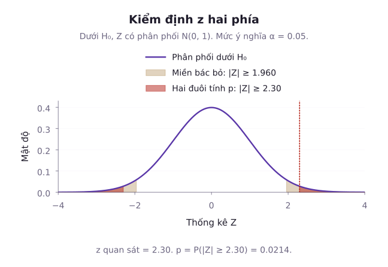
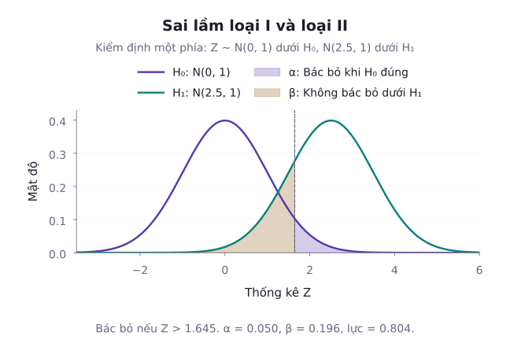
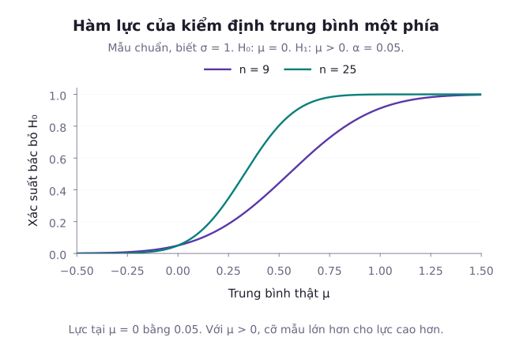

Trong nghiên cứu khoa học và kỹ thuật, các quyết định quan trọng không dừng lại ở việc ước lượng một tham số mà đòi hỏi phải đưa ra một phán quyết nhị phân rõ ràng: Thuốc mới có thực sự giảm huyết áp hay chỉ là hiệu ứng ngẫu nhiên? Thuật toán nén dữ liệu mới có giảm dung lượng lưu trữ so với thuật toán hiện hành hay không? Lý thuyết kiểm định giả thuyết thống kê cung cấp khuôn khổ toán học chặt chẽ để trả lời những câu hỏi này. Bài học này đi từ cấu trúc giả thuyết không ($H_0$) và đối thuyết ($H_1$), mổ xẻ bản chất của hai loại sai lầm thống kê, xây dựng tiêu chuẩn kiểm định tối ưu qua bổ đề Neyman-Pearson và kiểm định tỷ số hợp lý tổng quát (GLRT). Tiếp theo, bài học khảo sát hàm công suất kiểm định để quy hoạch cỡ mẫu và làm rõ định nghĩa toán học chuẩn xác của giá trị $p$ ($p$-value).

## 1. Cấu trúc Giả thuyết Thống kê và Miền Bác bỏ

Một bài toán kiểm định giả thuyết bắt đầu từ việc phân chia không gian tham số $\Theta$ thành hai tập con rời nhau:
- **Giả thuyết không ($H_0$)**: Thường đại diện cho trạng thái mặc định, không có sự khác biệt, không có hiệu ứng mới ($\theta \in \Theta_0$).
- **Đối thuyết ($H_1$ hoặc $H_a$)**: Đại diện cho sự hiện diện của một hiệu ứng thực sự, một sự đổi khác mà nhà nghiên cứu mong muốn tìm bằng chứng để khẳng định ($\theta \in \Theta_1 = \Theta \setminus \Theta_0$).

Một **giả thuyết đơn** xác định duy nhất một phân phối của dữ liệu. Chẳng hạn, chỉ cố định kỳ vọng của phân phối chuẩn chưa tạo giả thuyết đơn nếu phương sai vẫn chưa biết. Ngược lại, nếu tập tham số chứa nhiều hơn một điểm (chẳng hạn giả thuyết $H_1: \theta > \theta_0$ hoặc $H_1: \theta \ne \theta_0$), giả thuyết đó được gọi là **giả thuyết phức (Composite Hypothesis)**.

Một quy tắc kiểm định phân chia không gian mẫu thành hai vùng:
- **Miền bác bỏ (Critical Region hoặc Rejection Region, ký hiệu là $C$)**: Nếu thống kê mẫu rơi vào vùng này, ta bác bỏ giả thuyết $H_0$. Quyết định này dựa trên mô hình và mức ý nghĩa đã chọn, không chứng minh đối thuyết đúng chắc chắn.
- **Miền không bác bỏ**: Nếu thống kê mẫu không thuộc $C$, ta không đủ bằng chứng để bác bỏ $H_0$.

Hình minh họa riêng quan sát $z=2{,}3$ trong kiểm định chuẩn hai phía. Diện tích hai đuôi bằng $2P(Z\ge2{,}3)\approx0{,}02145$. Đối thuyết phải được chọn trước khi tính diện tích đuôi.

## 2. Hai Loại Sai lầm và Hàm Công suất Kiểm định

Khi đưa ra quyết định dựa trên một mẫu hữu hạn, ta luôn phải đối mặt với nguy cơ mắc sai lầm:

| Thực tế khách quan | Quyết định: Không bác bỏ $H_0$ | Quyết định: Bác bỏ $H_0$ |
| :--- | :--- | :--- |
| **$H_0$ đúng** | Quyết định đúng (Xác suất ít nhất $1-\alpha$) | Sai lầm loại I (Xác suất không quá $\alpha$) |
| **$H_0$ sai ($H_1$ đúng)** | **Sai lầm loại II (Xác suất $\beta$)** | Quyết định đúng (**Công suất $1 - \beta$**) |

1. **Sai lầm loại I (Type I Error)**: Xảy ra khi bác bỏ giả thuyết $H_0$ trong khi trên thực tế $H_0$ đúng (kết luận có hiệu ứng khi thực chất không có). Một kiểm định được gọi là có **mức ý nghĩa $\alpha$ (Level $\alpha$)** nếu xác suất mắc sai lầm loại I được chặn trên bởi $\alpha$:

$$
\sup_{\theta \in \Theta_0} P_\theta(X \in C) \le \alpha
$$

Đại lượng $\sup_{\theta \in \Theta_0} P_\theta(X \in C)$ được gọi là **kích thước thực tế (Size)** của kiểm định.
Trong các phân phối rời rạc (như nhị thức hay Poisson), do hàm phân phối tích lũy biến thiên qua các bước nhảy gián đoạn, kích thước thực tế của kiểm định không ngẫu nhiên hóa (non-randomized test) thường nhỏ hơn nghiêm ngặt so với mức danh định $\alpha$. Hiện tượng này được gọi là tính bảo thủ rời rạc (discrete conservatism). Để đạt đúng kích thước $\alpha$, về mặt lý thuyết cần sử dụng kiểm định ngẫu nhiên hóa (randomized test) đưa ra quyết định với xác suất biên tại điểm ngưỡng.

2. **Sai lầm loại II (Type II Error)**: Xảy ra khi không bác bỏ giả thuyết $H_0$ trong khi trên thực tế $H_0$ sai (bỏ sót một hiệu ứng có thật). Xác suất mắc sai lầm loại II phụ thuộc vào giá trị cụ thể của tham số dưới đối thuyết:

$$
\beta(\theta) = P_\theta(X \notin C) \quad (\theta \in \Theta_1)
$$

3. **Hàm công suất (Power Function)**: Khả năng phát hiện ra sự thật khi đối thuyết đúng được định lượng qua hàm công suất $\pi(\theta)$:

$$
\begin{aligned}
\pi(\theta) &= P_\theta(X \in C) \\
&= 1 - \beta(\theta) \quad (\theta \in \Theta_1)
\end{aligned}
$$

Dưới giả thuyết $H_0$, $\pi(\theta) \le \alpha$. Dưới đối thuyết $H_1$, ta mong muốn $\pi(\theta)$ càng tiệm cận 1 càng tốt.

Hình so phân phối chuẩn tắc dưới giả thuyết không với phân phối chuẩn có kỳ vọng $2{,}5$, phương sai $1$ dưới một đối thuyết cụ thể. Ngưỡng phải $1{,}6449$ cho mức ý nghĩa $5\%$ và sai lầm loại II xấp xỉ $0{,}1962$.

Về mối quan hệ giữa hai loại sai lầm: Khi xét một họ miền bác bỏ lồng nhau cố định theo ngưỡng $c$, việc siết chặt ngưỡng $c$ để giảm xác suất sai lầm loại I sẽ mở rộng vùng chấp nhận, làm tăng xác suất sai lầm loại II. Dù vậy, tăng cỡ mẫu $n$ không phải là cách duy nhất để nâng cao công suất. Ta có thể nâng cao công suất mà vẫn giữ nguyên mức ý nghĩa $\alpha$ bằng cách tối ưu hóa thiết kế thực nghiệm (như ghép cặp đối chứng), nâng cao độ chính xác của phép đo, hoặc chọn thống kê kiểm định tối ưu dựa trên thống kê đủ.

Hình so sánh kiểm định một phía của trung bình chuẩn với mốc $\mu_0=0$, độ lệch chuẩn đã biết $\sigma=1$ và mức ý nghĩa $5\%$. Hai cỡ mẫu là $9$ và $25$. Mỗi đường cho xác suất bác bỏ tại từng kỳ vọng thực, không phải xác suất giả thuyết đúng sau khi có dữ liệu.

## 3. Bổ đề Neyman-Pearson: Tiêu chuẩn Kiểm định Tối ưu

Khi cả hai giả thuyết đều là giả thuyết đơn ($H_0: \theta = \theta_0$ và $H_1: \theta = \theta_1$), bài toán tối ưu đặt ra là: Trong số tất cả các kiểm định có cùng mức ý nghĩa $\alpha$, kiểm định nào tối đa hóa công suất $1 - \beta$? Câu trả lời được khẳng định bởi Bổ đề Neyman-Pearson.

::: tip Bổ đề Neyman-Pearson
Xét bài toán kiểm định hai giả thuyết đơn $H_0: \theta = \theta_0$ và $H_1: \theta = \theta_1$. Đặt $L(\theta; x)$ là hàm hợp lý của mẫu. Kiểm định mạnh nhất (Most Powerful Test) ở mức ý nghĩa $\alpha$ có miền bác bỏ xác định bởi tỷ số hợp lý:

$$
\Lambda(x) = \frac{L(\theta_0; x)}{L(\theta_1; x)} \le k
$$

Ngưỡng được chọn để xác suất bác bỏ dưới $H_0$ đạt $\alpha$, nếu làm được. Nếu tỷ số hợp lý có khối xác suất ở biên, kiểm định mạnh nhất có thể cần ngẫu nhiên hóa tại dấu bằng. Dùng ngưỡng bảo thủ không tự động cho cùng kết luận tối ưu ở mọi mức $\alpha$.
:::

Ý nghĩa bản chất: Tỷ số $\Lambda(x)$ so sánh trực tiếp mức độ khả dĩ của dữ liệu dưới hai kịch bản đối lập. Nếu dữ liệu quan sát được xuất hiện dưới $H_1$ với xác suất cao hơn vượt trội so với dưới $H_0$, tỷ số $\Lambda(x)$ sẽ nhỏ hơn ngưỡng $k$, và ta bác bỏ $H_0$.

::: example Kiểm định mạnh nhất cho phân phối chuẩn
Giả sử quan sát một biến ngẫu nhiên $X \sim \mathcal{N}(\mu, 1)$. Ta muốn kiểm định giả thuyết đơn $H_0: \mu = 0$ đối với đối thuyết đơn $H_1: \mu = 2$ ở mức ý nghĩa $\alpha = 0{,}05$. Hãy tìm miền bác bỏ mạnh nhất và tính công suất của kiểm định.

**Lời giải**:
Hàm mật độ của $X$ dưới hai giả thuyết lần lượt là:

$$
\begin{aligned}
L(0; x) &= \frac{1}{\sqrt{2\pi}} \exp\left(-\frac{x^2}{2}\right), \\
L(2; x) &= \frac{1}{\sqrt{2\pi}} \exp\left(-\frac{(x - 2)^2}{2}\right)
\end{aligned}
$$

Tỷ số hợp lý Neyman-Pearson: Khai triển hiệu bình phương số mũ ta có $-\frac{x^2 - (x - 2)^2}{2} = -2x + 2$. Khi đó:

$$
\begin{aligned}
\Lambda(x) &= \frac{\exp(-x^2 / 2)}{\exp(-(x - 2)^2 / 2)} \\
&= \exp(-2x + 2)
\end{aligned}
$$

Bất đẳng thức $\Lambda(x) \le k$ tương đương với:

$$
\begin{aligned}
-2x + 2 &\le \ln k \\
\iff x &\ge c
\end{aligned}
$$

với $c = 1 - \frac{1}{2}\ln k$. Như vậy miền bác bỏ có dạng một phía: Bác bỏ $H_0$ khi $X \ge c$.
Xác định hằng số $c$ từ mức ý nghĩa $\alpha = 0{,}05$: Dưới $H_0$, $X \sim \mathcal{N}(0, 1)$, do đó:

$$
\begin{aligned}
P_{\mu=0}(X \ge c) &= 0{,}05 \\
\implies c &= z_{0{,}05} \approx 1{,}6449
\end{aligned}
$$

Tính công suất kiểm định dưới $H_1$ ($\mu = 2$): Dưới $H_1$, biến đổi $X - 2 \sim \mathcal{N}(0, 1)$.

$$
\begin{aligned}
\pi(2) &= P_{\mu=2}(X \ge 1{,}6449) \\
&= P(X - 2 \ge 1{,}6449 - 2) \\
&= P(Z \ge -0{,}3551) \\
&= \Phi(0{,}3551) \approx 0{,}6388
\end{aligned}
$$

Công suất của kiểm định đạt khoảng $63{,}88\%$.
:::

## 4. Kiểm định Tỷ số Hợp lý Tổng quát (GLRT) và Định lý Wilks

Khi các giả thuyết là giả thuyết phức, không gian tham số không chỉ gồm hai điểm đơn lẻ. Để tổng quát hóa bổ đề Neyman-Pearson, ta sử dụng **Kiểm định tỷ số hợp lý tổng quát (Generalized Likelihood Ratio Test - GLRT)**.

Xét bài toán kiểm định $H_0: \theta \in \Theta_0$ đối với $H_1: \theta \in \Theta \setminus \Theta_0$. Thống kê tỷ số hợp lý được định nghĩa:

$$
\lambda(x) = \frac{\sup_{\theta \in \Theta_0} L(\theta; x)}{\sup_{\theta \in \Theta} L(\theta; x)}
$$

Nhận xét: Vì $\Theta_0 \subseteq \Theta$, tử số không bao giờ lớn hơn mẫu số, do đó $0 \le \lambda(x) \le 1$. Nếu $\lambda(x)$ rất nhỏ gần 0, điều này phản ánh rằng cực đại của hàm hợp lý trên toàn bộ không gian tham số vượt trội so với cực đại dưới ràng buộc $H_0$, báo hiệu dữ liệu không ủng hộ $H_0$.

::: tip Định lý Wilks về Phân phối tiệm cận của GLRT
Giả sử các điều kiện chính quy (Regularity Conditions) được thỏa mãn: Vector tham số nằm trong phần trong của không gian tham số, hàm mật độ khả vi liên tục hai cấp, ma trận thông tin Fisher dương xác định, và tham số định danh được. Khi kích thước mẫu $n \to \infty$, dưới giả thuyết không $H_0$, thống kê kiểm định:

$$
-2 \ln \lambda(X) \xrightarrow{d} \chi^2(r)
$$

trong đó bậc tự do $r$ bằng số chiều sai khác giữa không gian tham số tổng thể và không gian ràng buộc:

$$
r = \dim(\Theta) - \dim(\Theta_0)
$$

:::

Lưu ý: Phân phối Chi bình phương trong định lý Wilks là một kết quả tiệm cận khi $n$ lớn. Phân phối này đòi hỏi giả thuyết không không được nằm trên biên của không gian tham số (non-boundary null). Khi tham số nằm trên biên, phân phối giới hạn có thể là hỗn hợp Chi bình phương hoặc dạng khác tùy mô hình. Không được dùng bảng Wilks mà chưa xác định cách hiệu chuẩn phù hợp. Ngoài các điều kiện trên, giả thuyết không còn phải là một mô hình con trơn với số chiều xác định.

## 5. Các Kiểm định Tham số Chuẩn tắc Cổ điển

### Kiểm định cho một kỳ vọng: Phép thử z và phép thử t

Trong mục này, các quan sát độc lập từ tổng thể chuẩn và có phương sai dương. Phân phối dưới đây là chính xác tại giá trị biên $\mu=\mu_0$. Với tổng thể không chuẩn, việc dùng chuẩn hoặc Student cần điều kiện xấp xỉ và cỡ mẫu phù hợp.

Ký hiệu $z_a$, $t_{a,\nu}$, $\chi^2_{a,\nu}$ và $F_a$ chỉ giá trị tới hạn đuôi phải, tương ứng phân vị tích lũy mức $1-a$.

1. **Kiểm định z (khi đã biết $\sigma$)**: Dưới giả thuyết $H_0$:

$$
Z = \frac{\bar{X} - \mu_0}{\sigma / \sqrt{n}} \sim \mathcal{N}(0, 1)
$$

- Với đối thuyết hai phía $H_1: \mu \ne \mu_0$: Bác bỏ $H_0$ khi $|Z| \ge z_{\alpha/2}$.
- Với đối thuyết phía trên $H_1: \mu > \mu_0$: Bác bỏ $H_0$ khi $Z \ge z_\alpha$.
- Với đối thuyết phía dưới $H_1: \mu < \mu_0$: Bác bỏ $H_0$ khi $Z \le -z_\alpha$.

2. **Kiểm định Student t (khi chưa biết $\sigma$)**: Dưới giả thuyết $H_0$:

$$
T = \frac{\bar{X} - \mu_0}{S / \sqrt{n}} \sim t(n - 1)
$$

Quy tắc bác bỏ sử dụng các giá trị phân vị $t_{\alpha/2, n-1}$ hoặc $t_{\alpha, n-1}$.

::: example Kiểm định z hai phía cho kỳ vọng
Xét một quần thể điểm số chuẩn với độ lệch chuẩn đã biết $\sigma=15$. Lấy mẫu ngẫu nhiên độc lập $n=36$ học sinh đã tham gia một chương trình đào tạo, thu được điểm trung bình mẫu là $\bar{x} = 105{,}2$. Ở mức ý nghĩa $\alpha = 0{,}05$, hãy kiểm định xem chương trình có làm thay đổi điểm IQ trung bình so với chuẩn thông thường ($\mu_0 = 100$) hay không.

**Lời giải**:
Thiết lập cặp giả thuyết:

$$
\begin{aligned}
H_0: \mu &= 100, \\
H_1: \mu &\ne 100
\end{aligned}
$$

Sai số chuẩn của ước lượng trung bình:

$$
\begin{aligned}
\mathrm{SE} &= \frac{\sigma}{\sqrt{n}} \\
&= \frac{15}{\sqrt{36}} = 2{,}5
\end{aligned}
$$

Giá trị thống kê kiểm định $z$ quan sát:

$$
\begin{aligned}
z_{\mathrm{obs}} &= \frac{\bar{x} - \mu_0}{\mathrm{SE}} \\
&= \frac{105{,}2 - 100}{2{,}5} \\
&= \frac{5{,}2}{2{,}5} = 2{,}08
\end{aligned}
$$

Với mức ý nghĩa $\alpha = 0{,}05$, giá trị tới hạn hai phía là $z_{0{,}025} = 1{,}96$.
Vì $|z_{\mathrm{obs}}| = 2{,}08 > 1{,}96$, thống kê mẫu rơi vào miền bác bỏ.
Tính giá trị $p$ hai phía:

$$
\begin{aligned}
p\text{-value} &= 2 P(Z \ge 2{,}08) \\
&= 2 (1 - \Phi(2{,}08)) \\
&= 2 (1 - 0{,}98124) \approx 0{,}0375
\end{aligned}
$$

Vì $p\text{-value} \approx 0{,}0375 < 0{,}05$, ta bác bỏ $H_0$ và kết luận rằng kỳ vọng điểm số của quần thể được lấy mẫu khác $100$ ở mức ý nghĩa $5\%$. So sánh với một mốc chuẩn không tự chứng minh tác dụng nhân quả của chương trình.
:::

::: example Kiểm định t một phía cho hiệu năng cải tiến
Một thuật toán nén ảnh mới được kỳ vọng làm giảm dung lượng lưu trữ trung bình một lượng đáng kể so với bản cũ. Đo thử nghiệm trên $n = 10$ tệp ảnh mẫu ngẫu nhiên, ta thu được mức giảm dung lượng trung bình là $\bar{x} = 2{,}3\,\mathrm{MB}$ và độ lệch chuẩn mẫu $s = 2{,}5\,\mathrm{MB}$. Giả sử các hiệu số độc lập và phân phối chuẩn. Với mức ý nghĩa $\alpha = 0{,}01$, hãy kiểm định xem thuật toán có làm giảm dung lượng ($\mu > 0$) hay không.

**Lời giải**:
Thiết lập giả thuyết kiểm định một phía:

$$
\begin{aligned}
H_0: \mu &\le 0, \\
H_1: \mu &> 0
\end{aligned}
$$

Bậc tự do $\nu = n - 1 = 10 - 1 = 9$.
Sai số chuẩn của trung bình mẫu:

$$
\mathrm{SE} = \frac{s}{\sqrt{n}} = \frac{2{,}5}{\sqrt{10}} \approx 0{,}79057\,\mathrm{MB}
$$

Giá trị thống kê $t$ quan sát:

$$
t_{\mathrm{obs}} = \frac{2{,}3 - 0}{0{,}79057} \approx 2{,}9093
$$

Tra bảng phân vị Student với 9 bậc tự do ở mức ý nghĩa một phía $\alpha = 0{,}01$: $t_{0{,}01, 9} \approx 2{,}8214$.
Vì $t_{\mathrm{obs}} \approx 2{,}9093 > 2{,}8214$, thống kê rơi vào miền bác bỏ.
Giá trị $p$ một phía:

$$
\begin{aligned}
p\text{-value} &= P(t_9 \ge 2{,}9093) \\
&\approx 0{,}0087
\end{aligned}
$$

Vì $p\text{-value} \approx 0{,}0087 < 0{,}01$, ta bác bỏ $H_0$ ở mức ý nghĩa $1\%$, khẳng định thuật toán mới làm giảm dung lượng tệp ảnh thực sự.
:::

### Kiểm định so sánh hai tỷ lệ: Thống kê z gộp

Khi kiểm định giả thuyết hai tổng thể có cùng tỷ lệ thành công $H_0: p_1 = p_2 = p_0$ đối với $H_1: p_1 \ne p_2$:
Với hai mẫu Bernoulli độc lập, ước lượng hợp lý cực đại của tỷ lệ chung dưới $H_0$ là tỷ lệ gộp (Pooled Proportion):

$$
\hat{p}_0 = \frac{X_1 + X_2}{n_1 + n_2}
$$

Đặt số hạng nghịch đảo cỡ mẫu $K_n = \frac{1}{n_1} + \frac{1}{n_2}$. Sai số chuẩn gộp:

$$
\mathrm{SE}_{\mathrm{pool}} = \sqrt{\hat{p}_0 (1 - \hat{p}_0) K_n}
$$

Thống kê kiểm định chuẩn hóa dưới $H_0$:

$$
Z = \frac{\hat{p}_1 - \hat{p}_2}{\mathrm{SE}_{\mathrm{pool}}} \xrightarrow{d} \mathcal{N}(0,1)
$$

Xấp xỉ này cần số thành công và thất bại kỳ vọng đủ lớn trong cả hai mẫu. Mỗi người dùng phải đóng góp một kết quả độc lập, không coi nhiều lượt xem phụ thuộc của cùng một người như các quan sát mới.

::: example Kiểm định so sánh hai tỷ lệ chuyển đổi
Một công ty thương mại điện tử thử nghiệm hai nút kêu gọi hành động (Call to Action) trên trang thanh toán:
- Nút màu xanh lá: Nhận $n_1 = 120$ lượt xem và có $x_1 = 36$ lượt bấm mua.
- Nút màu cam: Nhận $n_2 = 150$ lượt xem và có $x_2 = 30$ lượt bấm mua.
Ở mức ý nghĩa $\alpha = 0{,}05$, hãy kiểm định xem tỷ lệ chuyển đổi giữa hai màu nút có sự khác biệt hay không.

**Lời giải**:
Cặp giả thuyết:

$$
\begin{aligned}
H_0: p_1 &= p_2, \\
H_1: p_1 &\ne p_2
\end{aligned}
$$

Tỷ lệ quan sát riêng rẽ:

$$
\begin{aligned}
\hat{p}_1 &= \frac{36}{120} = 0{,}30, \\
\hat{p}_2 &= \frac{30}{150} = 0{,}20
\end{aligned}
$$

Tỷ lệ gộp chung dưới giả thiết $H_0$:

$$
\begin{aligned}
\hat{p}_0 &= \frac{36 + 30}{120 + 150} \\
&= \frac{66}{270} \approx 0{,}24444
\end{aligned}
$$

Tích phương sai gộp $V_0 = \hat{p}_0 (1 - \hat{p}_0) \approx 0{,}18469$.
Tổng nghịch đảo cỡ mẫu $K_n = \frac{1}{120} + \frac{1}{150} = 0{,}0150$.
Sai số chuẩn gộp:

$$
\begin{aligned}
\mathrm{SE}_{\mathrm{pool}} &= \sqrt{V_0 \cdot K_n} \\
&= \sqrt{0{,}18469 \times 0{,}0150} \\
&= \sqrt{0{,}002770} \approx 0{,}05264
\end{aligned}
$$

Giá trị thống kê $z$:

$$
\begin{aligned}
z_{\mathrm{obs}} &= \frac{0{,}30 - 0{,}20}{0{,}05264} \\
&= \frac{0{,}10}{0{,}05264} \approx 1{,}90
\end{aligned}
$$

Với mức ý nghĩa $\alpha = 0{,}05$, giá trị tới hạn hai phía là $z_{0{,}025} = 1{,}96$.
Vì $|z_{\mathrm{obs}}| \approx 1{,}90 < 1{,}96$, thống kê chưa vượt qua ngưỡng bác bỏ.
Tính giá trị $p$ hai phía:

$$
\begin{aligned}
p\text{-value} &= 2 (1 - \Phi(1{,}90)) \\
&\approx 2 (1 - 0{,}9713) \\
&= 2 \times 0{,}0287 \approx 0{,}0574
\end{aligned}
$$

Vì $p\text{-value} \approx 0{,}0574 > 0{,}05$, ta chưa đủ bằng chứng thực nghiệm ở mức ý nghĩa $5\%$ để bác bỏ $H_0$. Sự chênh lệch quan sát được giữa $30\%$ và $20\%$ có thể chỉ do biến động ngẫu nhiên khi kích thước mẫu chưa đủ lớn.
:::

## 6. Bản chất Chuẩn tắc của Giá trị p và Quy hoạch Cỡ mẫu theo Công suất

### Định nghĩa và cách diễn giải giá trị p

Độ cực đoan phải được xác định từ câu hỏi kiểm định trước khi xem dữ liệu. Nếu thống kê $T$ càng lớn càng chống lại giả thuyết không đơn, giá trị $p$ là:

$$
p_{\mathrm{obs}}=P_{H_0}(T\ge t_{\mathrm{obs}})
$$

Với đối thuyết hai phía và phân phối không đối xứng, phải nêu quy tắc so sánh hai phía. Không có một công thức hai phía duy nhất dùng cho mọi mô hình. Chẳng hạn:

- Trong kiểm định chuẩn hoặc Student đối xứng, dùng trị tuyệt đối của thống kê. Khi đó giá trị $p$ bằng hai lần diện tích một đuôi.
- Với kiểm định phương sai hai phía, có thể dùng hai đuôi bằng nhau, lấy hai lần xác suất đuôi nhỏ hơn và chặn kết quả ở $1$.
- Với kiểm định nhị thức hoặc Fisher rời rạc, một quy ước hợp lệ là cộng xác suất các kết cục có khối xác suất không lớn hơn kết cục quan sát. Quy ước này không áp dụng bằng cách lấy xác suất tại điểm cho biến liên tục.

Với giả thuyết không phức, có thể lấy xác suất đuôi lớn nhất trên miền $H_0$ để bảo đảm mức ý nghĩa. Trong kiểm định trung bình một phía, giá trị lớn nhất này đạt ở biên $\mu=\mu_0$.

Giá trị $p$ không phải $P(H_0\mid X)$ và không phải xác suất quyết định hiện tại sai. Không bác bỏ cũng không chứng minh $H_0$ đúng. Cần trình bày cả ước lượng hiệu ứng và khoảng tin cậy để đánh giá ý nghĩa thực tế.

### Quy hoạch cỡ mẫu theo công suất mong muốn

Trong thiết kế nghiên cứu lâm sàng hoặc thử nghiệm A/B, việc chọn cỡ mẫu phải đảm bảo đồng thời hai yêu cầu: Mức ý nghĩa $\alpha$ và công suất kiểm định tối thiểu $1 - \beta$ khi độ chênh lệch thực tế đạt mức tối thiểu có ý nghĩa thực tế $\Delta = \mu_1 - \mu_0$.

Với kiểm định $z$ một phía cho kỳ vọng từ mẫu chuẩn độc lập, biết $\sigma$, và hiệu ứng cần phát hiện $\Delta>0$, cỡ mẫu thực được tính từ:

$$
n = \frac{(z_\alpha + z_\beta)^2 \sigma^2}{\Delta^2}
$$

trong đó $z_\alpha = \Phi^{-1}(1 - \alpha)$ và $z_\beta = \Phi^{-1}(1 - \beta)$.

## Tóm tắt

1. Kiểm định giả thuyết phân chia không gian tham số thành $H_0$ (mặc định) và $H_1$ (hiệu ứng cần kiểm chứng). Quy tắc kiểm định xác lập miền bác bỏ $C$ trên không gian mẫu.
2. Hai loại sai lầm thống kê: Sai lầm loại I (bác bỏ nhầm $H_0$ khi $H_0$ đúng) được khống chế bởi mức ý nghĩa $\alpha$. Sai lầm loại II (bỏ sót khi $H_1$ đúng) có xác suất $\beta$. Công suất kiểm định $\pi = 1 - \beta$ đo lường xác suất phát hiện thành công hiệu ứng thực tế.
3. Bổ đề Neyman-Pearson chứng minh rằng tỷ số hợp lý $\Lambda(x) \le k$ mang lại kiểm định mạnh nhất cho hai giả thuyết đơn.
4. Kiểm định tỷ số hợp lý tổng quát (GLRT) áp dụng cho giả thuyết phức, với thống kê $-2 \ln \lambda(X)$ tuân theo phân phối tiệm cận Chi bình phương (Định lý Wilks) dưới các điều kiện chính quy.
5. Giá trị $p$ là xác suất dưới $H_0$ nhận được kết quả cực đoan bằng hoặc hơn dữ liệu quan sát được. Bác bỏ $H_0$ khi $p \le \alpha$.

## Bài tập tự luyện

::: exercise 1. Quy hoạch cỡ mẫu để kiểm định đạt công suất 80%
Một nhóm nghiên cứu muốn kiểm định xem một kỹ thuật dạy học mới có nâng cao điểm số trung bình của học sinh so với phương pháp truyền thống ($\mu_0 = 70$) hay không. Mức chênh lệch tối thiểu cần phát hiện là $\Delta = 3{,}0$ điểm, với độ lệch chuẩn tổng thể là $\sigma = 6{,}0$ điểm. Hỏi cần thử nghiệm trên tối thiểu bao nhiêu học sinh để kiểm định một phía đạt mức ý nghĩa $\alpha = 0{,}05$ và công suất kiểm định đạt $80\%$ ($\beta = 0{,}20$)?
:::

::: solution
Xác định các giá trị phân vị chuẩn tắc:
- Mức ý nghĩa một phía là $\alpha=0{,}05$. Phân vị tới hạn tương ứng là $z_\alpha\approx1{,}6449$.
- Công suất yêu cầu là $0{,}80$, nên $\beta=0{,}20$. Phân vị tương ứng là $z_\beta\approx0{,}8416$.
Tổng hai phân vị:

$$
\begin{aligned}
z_\alpha+z_\beta&=1{,}6449+0{,}8416\\
&=2{,}4865
\end{aligned}
$$

Áp dụng công thức cỡ mẫu cho kiểm định một phía:

$$
\begin{aligned}
n &= \left(\frac{(z_\alpha + z_\beta) \sigma}{\Delta}\right)^2 \\
&= \left(\frac{2{,}4865 \times 6{,}0}{3{,}0}\right)^2 \\
&= (4{,}9730)^2 \approx 24{,}731
\end{aligned}
$$

Làm tròn lên số nguyên kế tiếp:

$$
n = \lceil 24{,}731 \rceil = 25
$$

Vậy nhóm nghiên cứu cần chọn tối thiểu 25 học sinh vào mẫu thử nghiệm để đảm bảo xác suất phát hiện thành công sự cải thiện 3 điểm là $80\%$.
:::

::: exercise 2. Kiểm định Chi bình phương cho phương sai
Quy chuẩn sản xuất bu-lông quy định phương sai đường kính không được vượt quá $\sigma_0^2 = 1{,}0\,\mathrm{mm}^2$. Kiểm tra một mẫu ngẫu nhiên gồm $n = 20$ bu-lông thu được phương sai mẫu $s^2 = 1{,}8\,\mathrm{mm}^2$. Giả thiết đường kính bu-lông tuân theo phân phối chuẩn. Ở mức ý nghĩa $\alpha = 0{,}05$, hãy kiểm định xem dây chuyền sản xuất có bị mất ổn định về độ phân tán hay không.
:::

::: solution
Thiết lập cặp giả thuyết kiểm định một phía:

$$
H_0: \sigma^2 \le 1{,}0 \quad \text{và} \quad H_1: \sigma^2 > 1{,}0
$$

Bậc tự do: $\nu = n - 1 = 20 - 1 = 19$.
Thống kê kiểm định Chi bình phương:

$$
\begin{aligned}
\chi^2_{\mathrm{obs}} &= \frac{(n - 1)s^2}{\sigma_0^2} \\
&= \frac{19 \times 1{,}8}{1{,}0} = 34{,}2
\end{aligned}
$$

Tra bảng phân vị Chi bình phương với 19 bậc tự do ở mức ý nghĩa $\alpha = 0{,}05$: $\chi^2_{0{,}05, 19} \approx 30{,}1435$.
Vì $\chi^2_{\mathrm{obs}} = 34{,}2 > 30{,}1435$, thống kê rơi vào miền bác bỏ.
Tính giá trị $p$:

$$
p\text{-value} = P(\chi^2_{19} \ge 34{,}2) \approx 0{,}0174
$$

Vì $p\text{-value}\approx0{,}0174<0{,}05$, ta bác bỏ $H_0$. Dữ liệu cung cấp bằng chứng phương sai vượt giới hạn cho phép, với giả thiết mẫu chuẩn độc lập đã nêu.
:::

::: exercise 3. Kiểm định Fisher so sánh hai phương sai
Để so sánh độ phân tán của hai cảm biến nhiệt độ, người ta lấy mẫu $n_1 = 11$ lần đo từ cảm biến A thu được $s_1^2 = 4{,}5$ và $n_2 = 16$ lần đo từ cảm biến B thu được $s_2^2 = 1{,}5$. Giả thiết số đo của hai cảm biến độc lập và tuân theo phân phối chuẩn. Hãy kiểm định giả thuyết hai cảm biến có độ biến thiên như nhau $H_0: \sigma_1^2 = \sigma_2^2$ đối với $H_1: \sigma_1^2 \ne \sigma_2^2$ ở mức ý nghĩa $\alpha = 0{,}05$.
:::

::: solution
Bậc tự do của tử số và mẫu số: $\nu_1 = 11 - 1 = 10$, $\nu_2 = 16 - 1 = 15$.
Giá trị thống kê $F$ quan sát:

$$
F_{\mathrm{obs}} = \frac{s_1^2}{s_2^2} = \frac{4{,}5}{1{,}5} = 3{,}0
$$

Giá trị tới hạn phía trên của phân phối Fisher ở mức ý nghĩa $\alpha/2 = 0{,}025$:

$$
F_{0{,}025}(10, 15) \approx 3{,}06
$$

Ngưỡng phía dưới là $F_{0{,}975}(10,15)\approx0{,}2840$. Giá trị $F_{\mathrm{obs}}=3$ nằm giữa hai ngưỡng nên chưa bác bỏ $H_0$. Với quy tắc hai đuôi bằng nhau, giá trị $p$ xấp xỉ $0{,}0541$.
:::

::: exercise 4. Kiểm định t bắt cặp cho thời gian khởi động
Đo thời gian khởi động của $n = 5$ máy tính văn phòng trước và sau khi nâng cấp ổ cứng từ HDD sang SSD. Hiệu số thời gian đo được (trước trừ sau, đơn vị: Giây) là: $25; \, 32; \, 28; \, 35; \, 30$. Giả sử các hiệu số độc lập và phân phối chuẩn. Với mức ý nghĩa $\alpha = 0{,}05$, hãy kiểm định xem việc nâng cấp ổ cứng có thực sự giúp giảm thời gian khởi động ($\mu_D > 0$) hay không.
:::

::: solution
Tính trung bình mẫu của các hiệu số:

$$
\begin{aligned}
\bar{d} &= \frac{25 + 32 + 28 + 35 + 30}{5} \\
&= \frac{150}{5} = 30{,}0\,\mathrm{s}
\end{aligned}
$$

Tổng bình phương các sai lệch $d_i - \bar{d}$ gồm các số hạng: $(-5)^2 + 2^2 + (-2)^2 + 5^2 + 0^2$. Do đó:

$$
\begin{aligned}
\sum_{i=1}^5 (d_i - \bar{d})^2 &= 25 + 4 + 4 + 25 + 0 \\
&= 58
\end{aligned}
$$

Phương sai mẫu và độ lệch chuẩn mẫu:

$$
\begin{aligned}
s_d^2 &= \frac{58}{4} = 14{,}5 \\
\implies s_d &= \sqrt{14{,}5} \approx 3{,}8079\,\mathrm{s}
\end{aligned}
$$

Sai số chuẩn của trung bình hiệu số:

$$
\begin{aligned}
\mathrm{SE} &= \frac{s_d}{\sqrt{n}} = \frac{\sqrt{14{,}5}}{\sqrt{5}} \\
&= \sqrt{2{,}9} \approx 1{,}7029\,\mathrm{s}
\end{aligned}
$$

Thống kê $t$ quan sát với $df = 4$:

$$
t_{\mathrm{obs}} = \frac{30{,}0 - 0}{1{,}7029} \approx 17{,}6166
$$

Giá trị tới hạn một phía với 4 bậc tự do ở mức $\alpha = 0{,}05$: $t_{0{,}05, 4} \approx 2{,}1318$.
Vì $t_{\mathrm{obs}} \approx 17{,}62 > 2{,}13$, ta bác bỏ $H_0$ với $p\text{-value} < 0{,}0001$. Nâng cấp SSD mang lại sự cải thiện vượt trội về tốc độ khởi động.
:::

## Tài liệu tham khảo

- MIT OpenCourseWare. [18.05: Introduction to Probability and Statistics, Spring 2022](https://ocw.mit.edu/courses/18-05-introduction-to-probability-and-statistics-spring-2022/).
- NIST/SEMATECH. [What Are Statistical Tests?](https://www.itl.nist.gov/div898/handbook/prc/section1/prc13.htm).
- MIT Mathematics. [18.655: Mathematical Statistics, Syllabus](https://www.mit.edu/~18.655/syllabus.html). Các chủ đề Neyman–Pearson và suy luận tiệm cận.
