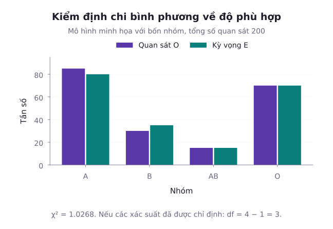
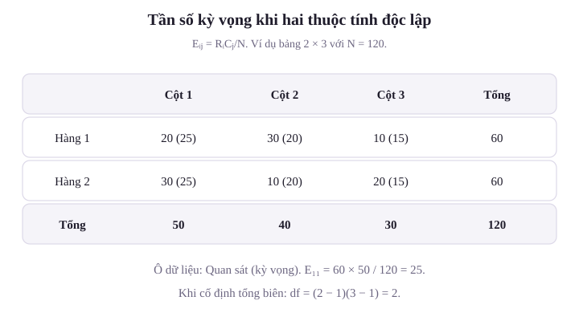
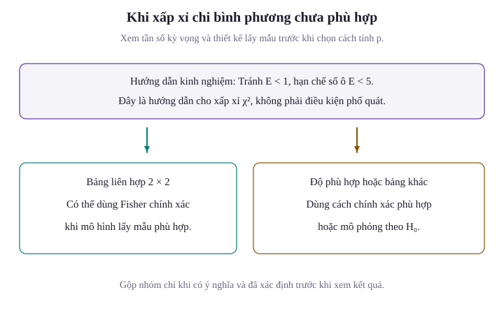

Khi dữ liệu thu thập không phải là các biến số đo lường liên tục mà là các phân loại định tính (như nhóm máu, sự hài lòng của khách hàng, kiểu hình di truyền hay lỗi phần mềm), các công cụ dựa trên phân phối chuẩn không còn áp dụng được trực tiếp. Trong các tình huống này, câu hỏi đặt ra là: Liệu tần số các kết cục quan sát được có phù hợp với một mô hình lý thuyết đề xuất hay không? Và liệu hai tiêu chí phân loại có độc lập với nhau hay có mối quan hệ tương quan ngầm ẩn? Bài học này trình bày chi tiết kiểm định độ phù hợp Pearson và cơ chế suy giảm bậc tự do khi ước lượng tham số. Tiếp theo, bài học xây dựng kiểm định tính độc lập và đồng nhất trên bảng ngẫu nhiên, khảo sát giới hạn ứng dụng qua quy tắc Cochran, kiểm định chính xác Fisher cho bảng thưa, và định lượng cường độ liên kết qua kích thước hiệu ứng.

## 1. Kiểm định Độ phù hợp Pearson (Goodness-of-Fit Test)

Giả sử một phép thử ngẫu nhiên có thể dẫn đến $k$ kết cục loại trừ lẫn nhau với các xác suất dương $p_1,p_2,\dots,p_k$. Tổng xác suất bằng một nghĩa là $p_1+p_2+\dots+p_k=1$. Thực hiện phép thử độc lập $n$ lần, ta thu được các tần số quan sát thực tế là $O_1, O_2, \dots, O_k$ với $\sum_{i=1}^k O_i = n$.

Mô hình lý thuyết dự báo các xác suất này nhận các giá trị xác định $p_{10}, p_{20}, \dots, p_{k0}$. Ta thiết lập bài toán kiểm định giả thuyết:
- **Giả thuyết không ($H_0$)**: $p_1 = p_{10}, \, p_2 = p_{20}, \, \dots, \, p_k = p_{k0}$.
- **Đối thuyết ($H_1$)**: Tồn tại ít nhất một chỉ số $i$ sao cho $p_i \ne p_{i0}$.

Dưới giả thuyết $H_0$, tần số kỳ vọng xuất hiện ở nhóm thứ $i$ là:

$$
E_i = n \cdot p_{i0}
$$

Hình dùng bốn tần số quan sát $85$, $30$, $15$, $70$, so với các kỳ vọng tương ứng $80$, $35$, $15$, $70$. Tổng hai dãy đều bằng $200$. Thống kê Pearson xấp xỉ $1{,}0268$, phản ánh sai lệch đã chuẩn hóa theo từng kỳ vọng.

Để đo lường mức độ sai lệch tổng thể giữa tần số thực tế $O_i$ và tần số lý thuyết $E_i$, Karl Pearson đề xuất thống kê kiểm định:

$$
Q = \sum_{i=1}^k \frac{(O_i - E_i)^2}{E_i}
$$

::: tip Định lý Giới hạn của Pearson
Khi kích thước mẫu $n \to \infty$, dưới giả thuyết không $H_0$, thống kê Pearson hội tụ theo phân phối về phân phối Chi bình phương với $k - 1$ bậc tự do:

$$
Q = \sum_{i=1}^k \frac{(O_i - E_i)^2}{E_i} \xrightarrow{d} \chi^2(k - 1)
$$

:::

Giải thích bản chất bậc tự do $k - 1$: Mặc dù có $k$ số hạng bình phương, các tần số quan sát bị ràng buộc bởi điều kiện tuyến tính $\sum_{i=1}^k O_i = n$. Khi đã biết $k - 1$ tần số, tần số cuối cùng hoàn toàn bị cố định. Ràng buộc bảo toàn này làm triệt tiêu đúng 1 bậc tự do.

Quy tắc quyết định ở mức ý nghĩa $\alpha$:
- Bác bỏ $H_0$ nếu $Q \ge \chi^2_{\alpha, k-1}$.
- Giá trị $p$: $p\text{-value} = P(\chi^2_{k-1} \ge Q_{\mathrm{obs}})$.

::: example Kiểm định tỷ lệ phân ly di truyền Mendel
Xét một phép lai hai tính trạng độc lập có mô hình phân ly kiểu hình $9 : 3 : 3 : 1$ ứng với bốn nhóm: Vàng trơn, Xanh trơn, Vàng nhăn, và Xanh nhăn. Một nhà sinh học gieo trồng và phân loại $n = 160$ cây thu được kết quả thực nghiệm: $95$ hạt vàng trơn, $25$ hạt xanh trơn, $28$ hạt vàng nhăn, và $12$ hạt xanh nhăn. Ở mức ý nghĩa $\alpha = 0{,}05$, dữ liệu có phù hợp với định luật Mendel hay không?

**Lời giải**:
Tổng số phần bằng nhau theo mô hình lý thuyết:

$$
9 + 3 + 3 + 1 = 16
$$

Các xác suất lý thuyết dưới giả thuyết $H_0$:

$$
\begin{aligned}
&p_{10} = \frac{9}{16}, \quad p_{20} = \frac{3}{16}, \\
&p_{30} = \frac{3}{16}, \quad p_{40} = \frac{1}{16}
\end{aligned}
$$

Tần số kỳ vọng cho từng nhóm với $n = 160$:

$$
\begin{aligned}
E_1 &= 160 \times \frac{9}{16} = 90, \\
E_2 &= E_3 = 160 \times \frac{3}{16} = 30, \\
E_4 &= 160 \times \frac{1}{16} = 10
\end{aligned}
$$

Kiểm tra điều kiện: Mọi $E_i \ge 10$, thỏa mãn điều kiện áp dụng xấp xỉ Chi bình phương.
Tính các độ lệch bình phương chuẩn hóa:

$$
\begin{aligned}
Q &= \sum_{i=1}^4 \frac{(O_i - E_i)^2}{E_i} \\
&= \frac{25}{90} + \frac{29}{30} + \frac{4}{10} \\
&\approx 0{,}2778 + 0{,}9667 + 0{,}4000 \\
&= 1{,}6444
\end{aligned}
$$

Số nhóm là $k = 4$, bậc tự do:

$$
\nu = k - 1 = 4 - 1 = 3
$$

Tra bảng phân vị Chi bình phương với 3 bậc tự do ở mức ý nghĩa $\alpha = 0{,}05$: $\chi^2_{0{,}05, 3} \approx 7{,}8147$.
Vì $Q_{\mathrm{obs}} \approx 1{,}6444 < 7{,}8147$, giá trị kiểm định nhỏ hơn giá trị tới hạn.
Giá trị $p$:

$$
\begin{aligned}
p\text{-value} &= P(\chi^2_3 \ge 1{,}6444) \\
&\approx 0{,}6493
\end{aligned}
$$

Vì $p\text{-value} \approx 0{,}649 > 0{,}05$, ta không có cơ sở bác bỏ $H_0$. Mức sai lệch quan sát được chưa đủ lớn để bác bỏ mô hình tỷ lệ đã nêu, không chứng minh mô hình là đúng.
:::

## 2. Quy tắc Mất Bậc tự do khi Ước lượng Tham số

Trong nhiều bài toán thực tế, phân phối lý thuyết không được xác định hoàn toàn mà chứa các tham số chưa biết (ví dụ: Muốn kiểm định xem dữ liệu có tuân theo phân phối Poisson($\lambda$) hay chuẩn $\mathcal{N}(\mu, \sigma^2)$ hay không mà chưa biết $\lambda$ hoặc $\mu, \sigma^2$).

Khi đó, ta bắt buộc phải sử dụng dữ liệu mẫu để ước lượng $r$ tham số này dưới giả thuyết $H_0$.

::: tip Quy tắc Giảm bậc tự do của Fisher
Giả sử có $k$ nhóm cố định với xác suất dương, mô hình nhóm khả vi và định danh. Nếu $r$ tham số được khớp bằng MLE hoặc cực tiểu Chi bình phương từ tần số nhóm, thống kê Pearson có phân phối giới hạn Chi bình phương với bậc tự do:

$$
\nu = k - 1 - r
$$

:::

Chẳng hạn, mô hình chuẩn có hai tham số chưa biết. Nếu khớp hai tham số từ hợp lý đa thức của các tần số trong $k$ khoảng cố định và thỏa điều kiện trên, ta dùng $k-3$ bậc tự do. Cần có $k-1-r>0$.

Không tự động trừ số tham số khi đã khớp từ dữ liệu thô rồi mới phân nhóm. Phân phối giới hạn khi đó có thể khác. Có thể hiệu chuẩn bằng mô phỏng tham số: Mỗi lần sinh mẫu dưới mô hình đã khớp, phải ước lượng lại tham số và thực hiện lại toàn bộ quy trình tính $Q$.

Về quy tắc gộp nhóm (pooling rules): Điều kiện áp dụng định lý Pearson yêu cầu các tần số kỳ vọng không quá nhỏ. Khi một số nhóm có $E_i < 5$, ta cần gộp các nhóm lân cận lại để đảm bảo độ tin cậy của xấp xỉ. Quy chuẩn phương pháp luận bắt buộc: Quy tắc và ngưỡng gộp nhóm phải được ấn định trước khi quan sát kết quả dữ liệu (a priori), không được gộp tùy tiện sau khi thấy số liệu để thao túng bậc tự do hoặc giá trị $p$.

## 3. Bảng Ngẫu nhiên: Kiểm định Tính Độc lập và Tính Đồng nhất

Khi khảo sát đồng thời hai tiêu chí định tính trên một tập hợp đối tượng:
- Biến dòng $A$ có $r$ mức phân loại ($A_1, \dots, A_r$).
- Biến cột $B$ có $c$ mức phân loại ($B_1, \dots, B_c$).
Dữ liệu được tổ chức dưới dạng **Bảng ngẫu nhiên (Contingency Table)** kích thước $r \times c$.

Hình dùng hai dòng quan sát $(20,30,10)$ và $(30,10,20)$, tổng mẫu $120$. Hai dòng đều có tổng $60$, nên mỗi dòng kỳ vọng dưới độc lập là $(25,20,15)$.

Ký hiệu:
- $O_{ij}$: Tần số quan sát được tại ô dòng $i$, cột $j$.
- $R_i = \sum_{j=1}^c O_{ij}$: Tổng tần số dòng $i$.
- $C_j = \sum_{i=1}^r O_{ij}$: Tổng tần số cột $j$.
- $N = \sum_{i=1}^r \sum_{j=1}^c O_{ij}$: Tổng dung lượng toàn bảng.

### Kiểm định tính độc lập

Giả thuyết không phát biểu rằng biến dòng $A$ và biến cột $B$ độc lập về mặt xác suất:

$$
P(A_i \cap B_j) = P(A_i) P(B_j) \quad (\forall i, j)
$$

Dưới $H_0$, xác suất biên được ước lượng bởi $\hat{P}(A_i) = \frac{R_i}{N}$ và $\hat{P}(B_j) = \frac{C_j}{N}$. Do đó, tần số kỳ vọng tại ô $(i, j)$ được tính theo công thức:

$$
\begin{aligned}
E_{ij} &= N \cdot \hat{P}(A_i \cap B_j) \\
&= N \cdot \left(\frac{R_i}{N}\right) \cdot \left(\frac{C_j}{N}\right) \\
&= \frac{R_i \cdot C_j}{N}
\end{aligned}
$$

Thống kê kiểm định Chi bình phương:

$$
\begin{aligned}
Q &= \sum_{i=1}^r \sum_{j=1}^c \frac{(O_{ij} - E_{ij})^2}{E_{ij}} \\
&\xrightarrow{d} \chi^2\big((r - 1)(c - 1)\big)
\end{aligned}
$$

Giải thích công thức bậc tự do $(r - 1)(c - 1)$:
Bảng ngẫu nhiên có tổng cộng $r \cdot c$ ô. Tuy nhiên, các tần số phải thỏa mãn $r$ ràng buộc tổng dòng và $c$ ràng buộc tổng cột. Vì tổng của các dòng bằng tổng của các cột (cùng bằng $N$), có đúng $r + c - 1$ ràng buộc độc lập. Do đó, số bậc tự do còn lại là:

$$
\begin{aligned}
r \cdot c - (r + c - 1) &= r c - r - c + 1 \\
&= (r - 1)(c - 1)
\end{aligned}
$$

### Phân biệt Kiểm định Tính Độc lập và Tính Đồng nhất

Mặc dù sử dụng chung công thức toán học và cho ra cùng một giá trị thống kê $Q$, hai kiểm định này khác nhau về thiết kế thu thập mẫu:
1. **Kiểm định tính độc lập (Test of Independence)**: Lấy một mẫu ngẫu nhiên duy nhất kích thước $N$ từ một quần thể chung, sau đó phân loại từng đối tượng theo cả hai tiêu chí $A$ và $B$. Cả tổng dòng và tổng cột đều là các biến ngẫu nhiên.
2. **Kiểm định tính đồng nhất (Test of Homogeneity)**: Cố định trước kích thước mẫu từ $r$ quần thể độc lập (các tổng dòng $R_i$ là các hằng số định trước). Sau đó, ta đo lường phân bố của tiêu chí $B$ trên từng quần thể để so sánh xem các tỷ lệ có đồng nhất giữa các nhóm hay không.

::: example Kiểm định tính độc lập trên bảng 2x3
Một trường đại học khảo sát mức độ hài lòng về chất lượng giảng dạy trực tuyến của $N = 150$ sinh viên thuộc hai khối ngành: Kỹ thuật và Kinh tế. Dữ liệu bảng ngẫu nhiên quan sát được như sau:
- Khối Kỹ thuật: Có 30 người hài lòng, 20 người trung lập, 10 người không hài lòng (tổng dòng $R_1 = 60$).
- Khối Kinh tế: Có 20 người hài lòng, 30 người trung lập, 40 người không hài lòng (tổng dòng $R_2 = 90$).
Các tổng cột lần lượt là: Cột hài lòng có $C_1 = 50$, cột trung lập có $C_2 = 50$, cột không hài lòng có $C_3 = 50$. Ở mức ý nghĩa $\alpha = 0{,}05$, hãy kiểm định xem mức độ hài lòng có độc lập với khối ngành học hay không.

**Lời giải**:
Thiết lập giả thuyết:
- $H_0$: Mức độ hài lòng độc lập với khối ngành học.
- $H_1$: Mức độ hài lòng có phụ thuộc vào khối ngành học.

Tính bảng tần số kỳ vọng $E_{ij} = \frac{R_i C_j}{N}$:
- Dòng 1 (Kỹ thuật, $R_1 = 60$):

$$
\begin{aligned}
E_{11} &= E_{12} \\
&= E_{13} \\
&= \frac{60 \times 50}{150} \\
&= 20
\end{aligned}
$$

- Dòng 2 (Kinh tế, $R_2 = 90$):

$$
\begin{aligned}
E_{21} &= E_{22} \\
&= E_{23} \\
&= \frac{90 \times 50}{150} \\
&= 30
\end{aligned}
$$

Mọi $E_{ij} \ge 20$, thỏa mãn điều kiện xấp xỉ Chi bình phương.
Tính giá trị thống kê $Q$:

$$
\begin{aligned}
Q &= \sum_{i=1}^2 \sum_{j=1}^3 \frac{(O_{ij} - E_{ij})^2}{E_{ij}} \\
&= \frac{200}{20} + \frac{200}{30} \\
&= 10 + \frac{20}{3} \\
&\approx 16{,}6667
\end{aligned}
$$

Bậc tự do:

$$
\begin{aligned}
\nu &= (r - 1)(c - 1) \\
&= (2 - 1)(3 - 1) \\
&= 2
\end{aligned}
$$

Tra bảng phân vị Chi bình phương với 2 bậc tự do ở mức ý nghĩa $\alpha = 0{,}05$: $\chi^2_{0{,}05, 2} \approx 5{,}9915$.
Vì $Q_{\mathrm{obs}} \approx 16{,}6667 > 5{,}9915$, thống kê rơi sâu vào miền bác bỏ.
Giá trị $p$:

$$
\begin{aligned}
p\text{-value} &= P(\chi^2_2 \ge 16{,}6667) \\
&\approx 0{,}00024
\end{aligned}
$$

Vì $p\text{-value} < 0{,}001$, ta bác bỏ giả thuyết $H_0$ ở mức ý nghĩa $0{,}1\%$. Mức độ hài lòng có sự phụ thuộc rõ rệt vào khối ngành học.
:::

## 4. Giới hạn Ứng dụng: Quy tắc Cochran và Kiểm định Chính xác Fisher

### Quy tắc Cochran cho bảng ngẫu nhiên

Phép xấp xỉ Chi bình phương chỉ đáng tin cậy khi kích thước mẫu đủ lớn. Một hướng dẫn kiểm tra xấp xỉ thường dùng là:
1. Mọi ô có tần số kỳ vọng ít nhất $1$.
2. Tối thiểu $80\%$ số ô trong bảng phải có tần số kỳ vọng lớn hơn hoặc bằng 5 ($E_{ij} \ge 5$).

Đây là hướng dẫn thực hành, không phải định lý bảo đảm sai số cho mọi bảng. Với bảng $2\times2$, hướng dẫn thận trọng là mọi ô kỳ vọng ít nhất $5$. Khi bảng thưa, xấp xỉ có thể kém và sai số thực tế có thể lệch mức danh định.

Có thể gộp các nhóm có ý nghĩa chuyên môn theo quy tắc định trước. Với bảng $2\times2$, dùng kiểm định chính xác Fisher là một lựa chọn. Với bảng lớn hơn, có thể dùng kiểm định điều kiện chính xác hoặc mô phỏng phù hợp với thiết kế lấy mẫu. Đối với độ phù hợp một chiều, cần kiểm định đa thức chính xác hoặc mô phỏng, không thay trực tiếp bằng Fisher $2\times2$.

### Kiểm định chính xác Fisher cho bảng 2x2 (Fisher's Exact Test)

Với bảng ngẫu nhiên kích thước $2 \times 2$ có dạng:

| Phân loại | Thành công | Thất bại | Tổng biên |
| :--- | :--- | :--- | :--- |
| **Nhóm 1** | $a$ | $b$ | $a + b$ |
| **Nhóm 2** | $c$ | $d$ | $c + d$ |
| **Tổng biên** | $a + c$ | $b + d$ | $N$ |

Dưới giả thuyết độc lập hoặc hai tỷ lệ bằng nhau, khi điều kiện hóa trên các tổng biên dòng và cột, số quan sát $a$ ở ô góc trái trên tuân theo **Phân phối siêu bội (Hypergeometric Distribution)** độc lập với bất kỳ tham số phụ trợ nào:

$$
P(X = a \mid \text{biên}) = \frac{\binom{a+b}{a} \binom{c+d}{c}}{\binom{N}{a+c}}
$$

Định nghĩa giá trị $p$ chính xác:
- Với kiểm định một phía: Giá trị $p$ là tổng xác suất của các cấu hình cực đoan hơn cấu hình quan sát theo chiều đối thuyết.
- Với kiểm định hai phía: Giá trị $p$ là tổng xác suất của tất cả các bảng khả dĩ (cùng tổng biên) có xác suất nhỏ hơn hoặc bằng xác suất của bảng quan sát được ($P(\text{bảng}) \le P(\text{bảng quan sát})$).

::: example Kiểm định chính xác Fisher cho thử nghiệm mẫu nhỏ
Trong một nghiên cứu thí điểm đánh giá phản ứng phụ của một loại vắc-xin, người ta ghi nhận dữ liệu trên $N = 10$ chuột thí nghiệm:
- Nhóm tiêm vắc-xin ($a + b = 4$): Có $a = 3$ con xuất hiện phản ứng, $b = 1$ con không.
- Nhóm đối chứng ($c + d = 6$): Có $c = 1$ con xuất hiện phản ứng, $d = 5$ con không.
Tổng số chuột có phản ứng là $a + c = 4$, và không có phản ứng là $b + d = 6$. Hãy tính xác suất xuất hiện cấu hình này dưới giả thiết không có sự khác biệt giữa hai nhóm, và xác định giá trị $p$ một phía của kiểm định Fisher.

**Lời giải**:
Tổng số cách chọn 4 chuột có phản ứng từ 10 chuột là:

$$
\begin{aligned}
\binom{10}{4} &= \frac{10 \times 9 \times 8 \times 7}{4 \times 3 \times 2 \times 1} \\
&= 210
\end{aligned}
$$

Xác suất xuất hiện đúng $a = 3$ con ở nhóm tiêm vắc-xin theo phân phối siêu bội:

$$
\begin{aligned}
P(X = 3) &= \frac{\binom{4}{3} \binom{6}{1}}{\binom{10}{4}} \\
&= \frac{24}{210} \\
&\approx 0{,}11429
\end{aligned}
$$

Cấu hình duy nhất cực đoan hơn theo hướng vắc-xin gây nhiều phản ứng hơn là $a = 4$ (và $c = 0$):

$$
\begin{aligned}
P(X = 4) &= \frac{\binom{4}{4} \binom{6}{0}}{\binom{10}{4}} \\
&= \frac{1}{210} \\
&\approx 0{,}00476
\end{aligned}
$$

Giá trị $p$ một phía (One-sided $p$-value):

$$
\begin{aligned}
p\text{-value} &= P(X \ge 3) \\
&= \frac{24}{210} + \frac{1}{210} \\
&= \frac{25}{210} \\
&\approx 0{,}11905
\end{aligned}
$$

Vì $p\text{-value} \approx 0{,}119 > 0{,}05$, ở mức ý nghĩa $5\%$, ta chưa đủ bằng chứng kết luận vắc-xin gây ra tỷ lệ phản ứng phụ cao hơn nhóm đối chứng với dữ liệu hiện có. Việc không bác bỏ không xác nhận hai tỷ lệ bằng nhau.
:::

## 5. Kích thước Hiệu ứng cho Bảng Ngẫu nhiên

Giá trị $p$ đánh giá độ cực đoan của dữ liệu dưới giả thuyết không, không đo cường độ liên kết hay xác suất mối liên hệ chỉ do ngẫu nhiên. Khi kích thước mẫu $N$ rất lớn, ngay cả một sự khác biệt không đáng kể cũng có thể đạt mức ý nghĩa thống kê $p < 0{,}001$. Để khắc phục, ta đo lường **Kích thước hiệu ứng (Effect Size)**.

1. **Hệ số Phi ($\phi$) cho bảng $2 \times 2$**:

$$
\phi = \sqrt{\frac{Q}{N}}
$$

Hệ số $\phi$ nhận giá trị trong đoạn $[0, 1]$, bằng trị tuyệt đối của hệ số tương quan Pearson khi mã hóa hai biến thành $0$ và $1$. Dấu của tương quan phụ thuộc cách mã hóa, còn công thức trên chỉ đo độ lớn.

2. **Hệ số Cramér's V cho bảng $r \times c$ tổng quát**:
Harald Cramér mở rộng hệ số $\phi$ cho bảng kích thước bất kỳ bằng cách chuẩn hóa theo số chiều tối thiểu:

$$
V = \sqrt{\frac{Q}{N \cdot \min(r - 1, c - 1)}}
$$

- $V \in [0, 1]$.
Không có các ngưỡng nhỏ, vừa, lớn phù hợp với mọi lĩnh vực và mọi kích thước bảng. Cần đọc $V$ cùng tỷ lệ trong từng ô và ý nghĩa chuyên môn của khác biệt.

Trong ví dụ bảng $2 \times 3$ về mức độ hài lòng của sinh viên ở mục trước:

$$
\begin{aligned}
V &= \sqrt{\frac{16{,}6667}{150 \times \min(2 - 1, 3 - 1)}} \\
&= \sqrt{\frac{16{,}6667}{150 \times 1}} \\
&= \sqrt{0{,}1111} \\
&\approx 0{,}3333
\end{aligned}
$$

Hệ số Cramér's $V \approx 0{,}333$ lượng hóa độ lớn liên kết trong mẫu. Muốn đánh giá mức độ đáng quan tâm, cần xem cả sự khác biệt tỷ lệ hài lòng giữa hai khối ngành.

## Tóm tắt nội dung bài học

1. **Kiểm định độ phù hợp Pearson**: Dùng để so sánh các tần số quan sát thực nghiệm $O_i$ với tần số lý thuyết $E_i = n \cdot p_{i0}$. Thống kê $Q = \sum \frac{(O_i - E_i)^2}{E_i}$ tiệm cận phân phối $\chi^2(k - 1)$.
2. **Quy tắc giảm bậc tự do**: Khi có $r$ tham số độc lập được ước lượng từ mẫu bằng phương pháp MLE trên dữ liệu nhóm, số bậc tự do bị trừ đi đúng $r$, còn lại $\nu = k - 1 - r$.
3. **Bảng ngẫu nhiên $r \times c$**: Tần số kỳ vọng tại ô $(i, j)$ dưới giả thuyết độc lập tính bằng $E_{ij} = \frac{R_i \cdot C_j}{N}$. Thống kê Pearson tiệm cận phân phối $\chi^2\big((r - 1)(c - 1)\big)$.
4. **Quy tắc Cochran và kiểm định Fisher**: Phép xấp xỉ Chi bình phương đòi hỏi mọi ô có $E_{ij} \ge 1$ và ít nhất $80\%$ số ô có $E_{ij} \ge 5$. Khi bị vi phạm, bảng $2 \times 2$ được kiểm định chính xác bằng phân phối siêu bội Fisher.
5. **Kích thước hiệu ứng**: Sử dụng hệ số Phi ($\phi$) cho bảng $2 \times 2$ và Cramér's V cho bảng $r \times c$ để lượng hóa độ mạnh yếu của liên kết, tránh phụ thuộc thuần túy vào cỡ mẫu lớn.

## Bài tập tự luyện

::: exercise Bài tập 1: Kiểm định độ cân đối của con súc sắc
Để kiểm tra độ cân đối của một con súc sắc 6 mặt, người ta gieo thử $N = 120$ lần và ghi nhận tần số xuất hiện của các mặt từ 1 đến 6 lần lượt là: $15, \, 28, \, 17, \, 22, \, 18, \, 20$. Ở mức ý nghĩa $\alpha = 0{,}05$, hãy kiểm định giả thuyết súc sắc được chế tạo cân đối.
:::

::: solution Lời giải Bài tập 1
Nếu súc sắc cân đối ($H_0$), xác suất xuất hiện mỗi mặt là $p_i = 1/6$.
Tần số kỳ vọng cho mỗi mặt với $N = 120$:

$$
\begin{aligned}
E_i &= 120 \times \frac{1}{6} \\
&= 20 \quad (i = 1, \dots, 6)
\end{aligned}
$$

Mọi $E_i = 20 \ge 5$, thỏa mãn điều kiện Cochran.
Tính thống kê kiểm định Chi bình phương:

$$
\begin{aligned}
Q &= \sum_{i=1}^6 \frac{(O_i - 20)^2}{20} \\
&= \frac{25 + 64 + 9 + 4 + 4 + 0}{20} \\
&= \frac{106}{20} \\
&= 5{,}30
\end{aligned}
$$

Bậc tự do: $\nu = k - 1 = 6 - 1 = 5$.
Tra bảng phân vị Chi bình phương với 5 bậc tự do ở mức $\alpha = 0{,}05$: $\chi^2_{0{,}05, 5} \approx 11{,}0705$.
Vì $Q_{\mathrm{obs}} = 5{,}30 < 11{,}0705$, giá trị kiểm định chưa vượt qua ngưỡng tới hạn.
Giá trị $p$:

$$
\begin{aligned}
p\text{-value} &= P(\chi^2_5 \ge 5{,}30) \\
&\approx 0{,}3802
\end{aligned}
$$

Vì $p\text{-value} \approx 0{,}380 > 0{,}05$, ta không bác bỏ $H_0$. Không có bằng chứng cho thấy con súc sắc bị lệch.
:::

::: exercise Bài tập 2: Tính hệ số Phi cho bảng 2x2
Khảo sát mối liên hệ giữa thói quen đọc sách trước khi ngủ và chất lượng giấc ngủ trên $N = 100$ người thu được bảng ngẫu nhiên sau:
- Nhóm có đọc sách: 40 người ngủ tốt, 10 người mất ngủ.
- Nhóm không đọc sách: 20 người ngủ tốt, 30 người mất ngủ.
Hãy tính giá trị thống kê kiểm định Chi bình phương và hệ số kích thước hiệu ứng Phi ($\phi$).
:::

::: solution Lời giải Bài tập 2
Tính các tổng biên:
- Tổng dòng: $R_1 = 40 + 10 = 50$, $R_2 = 20 + 30 = 50$.
- Tổng cột: $C_1 = 40 + 20 = 60$, $C_2 = 10 + 30 = 40$.
- Tổng toàn bảng: $N = 100$.

Tần số kỳ vọng:

$$
\begin{aligned}
E_{11} &= E_{21} = \frac{50 \times 60}{100} = 30, \\
E_{12} &= E_{22} = \frac{50 \times 40}{100} = 20
\end{aligned}
$$

Thống kê kiểm định Chi bình phương:

$$
\begin{aligned}
Q &= \frac{100}{30} + \frac{100}{20} + \frac{100}{30} + \frac{100}{20} \\
&= \frac{200}{30} + 10 \\
&\approx 16{,}6667
\end{aligned}
$$

Bậc tự do: $\nu = (2 - 1)(2 - 1) = 1$. Giá trị tới hạn $\chi^2_{0{,}05, 1} \approx 3{,}8415$. Ta bác bỏ giả thuyết độc lập ($p < 0{,}0001$).
Tính hệ số kích thước hiệu ứng Phi:

$$
\begin{aligned}
\phi &= \sqrt{\frac{Q}{N}} \\
&= \sqrt{\frac{16{,}6667}{100}} \\
&\approx 0{,}4082
\end{aligned}
$$

Giá trị $\phi \approx 0{,}41$ thể hiện mối liên hệ tương đối rõ nét giữa thói quen đọc sách và chất lượng giấc ngủ.
:::

::: exercise Bài tập 3: Xác định bậc tự do khi kiểm định phân phối chuẩn
Một kỹ sư thu thập dữ liệu $n = 200$ quan sát và chia thành $k = 10$ khoảng phân lớp để kiểm định xem dữ liệu có tuân theo phân phối chuẩn hay không. Cả kỳ vọng $\mu$ và phương sai $\sigma^2$ của phân phối đều không được biết trước mà được ước lượng bằng MLE từ các tần số trong 10 khoảng đã cố định trước. Giả sử các điều kiện chính quy và tần số kỳ vọng phù hợp. Hỏi phân phối xấp xỉ của thống kê có bao nhiêu bậc tự do?
:::

::: solution Lời giải Bài tập 3
Số lượng nhóm phân loại là $k = 10$.
Số lượng tham số tổng thể được ước lượng từ mẫu là $r = 2$ (gồm trung bình $\mu$ và phương sai $\sigma^2$).
Theo quy tắc giảm bậc tự do của Fisher:

$$
\begin{aligned}
\nu &= k - 1 - r \\
&= 10 - 1 - 2 \\
&= 7
\end{aligned}
$$

Vậy phân phối xấp xỉ dùng để hiệu chuẩn là Chi bình phương với 7 bậc tự do. Đây là kết quả tiệm cận, không phải phân phối chính xác trên mẫu hữu hạn.
:::

::: exercise Bài tập 4: Phân tích cấu trúc bảng 3x3
Một nhà nghiên cứu xã hội học phân tích bảng ngẫu nhiên kích thước $3 \times 3$ về mối quan hệ giữa trình độ học vấn (3 mức) và thái độ đối với năng lượng tái tạo (3 mức) với tổng số $N = 300$ người trả lời. Thống kê Chi bình phương tính được là $Q = 18{,}0$. Hỏi bậc tự do của kiểm định là bao nhiêu, và giá trị Cramér's V tương ứng là bao nhiêu?
:::

::: solution Lời giải Bài tập 4
Kích thước bảng là $r = 3$ dòng và $c = 3$ cột.
Bậc tự do của kiểm định:

$$
\begin{aligned}
\nu &= (r - 1)(c - 1) \\
&= (3 - 1)(3 - 1) \\
&= 4
\end{aligned}
$$

Tính hệ số kích thước hiệu ứng Cramér's V:

$$
\begin{aligned}
V &= \sqrt{\frac{Q}{N \cdot \min(r - 1, c - 1)}} \\
&= \sqrt{\frac{18{,}0}{300 \times 2}} \\
&= \sqrt{0{,}03} \\
&\approx 0{,}1732
\end{aligned}
$$

Tra bảng phân vị Chi bình phương với 4 bậc tự do ở mức $\alpha = 0{,}05$: $\chi^2_{0{,}05, 4} \approx 9{,}4877$. Vì $Q = 18{,}0 > 9{,}4877$, kiểm định có ý nghĩa thống kê, nhưng hệ số $V \approx 0{,}173$ cho thấy mức độ liên kết giữa hai tiêu chí trên thực tế là tương đối yếu.
:::

## Tài liệu tham khảo

- NIST/SEMATECH. [Chi-Square Goodness-of-Fit Test](https://www.itl.nist.gov/div898/handbook/eda/section3/eda35f.htm).
- Penn State Eberly College of Science. [STAT 415: Introduction to Mathematical Statistics](https://online.stat.psu.edu/stat415/).
