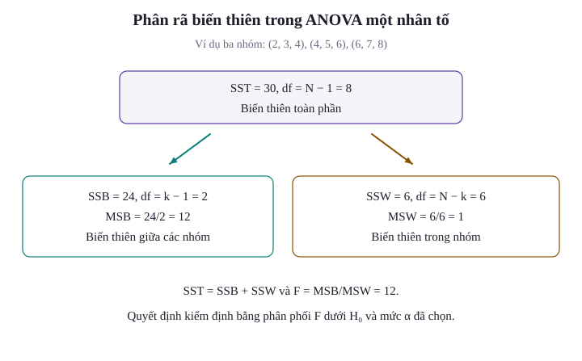
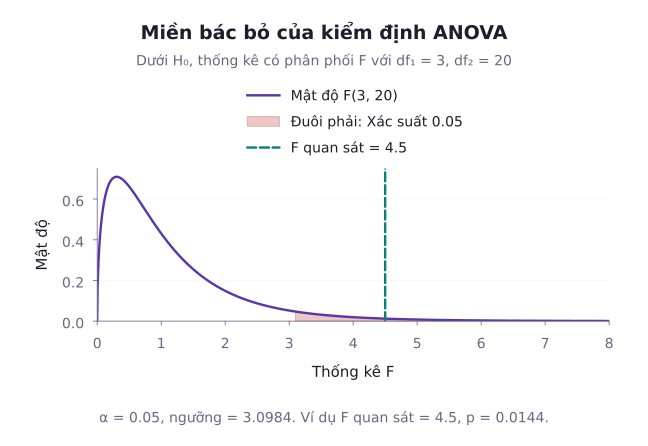
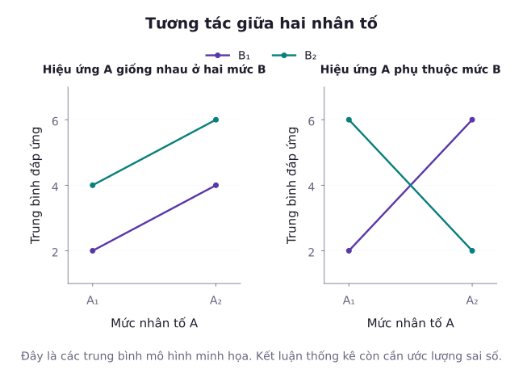

Khi muốn so sánh hiệu quả của hai phương pháp điều trị hoặc hai thuật toán, kiểm định hai mẫu Student $t$ là lựa chọn tự nhiên. Tuy nhiên, nếu nhà nghiên cứu cần so sánh đồng thời ba, bốn hay nhiều phương pháp thì việc thực hiện lặp đi lặp lại hàng loạt phép thử $t$ từng đôi một sẽ làm bùng nổ xác suất mắc sai lầm loại I. Làm thế nào để kiểm tra sự khác biệt giữa nhiều nhóm trong một phép thử thống nhất duy nhất mà vẫn kiểm soát chặt chẽ sai số danh định? Phân tích phương sai (Analysis of Variance - ANOVA) do Ronald Fisher phát minh chính là lời giải trọn vẹn cho bài toán này. Bài học này trình bày mô hình toán học của ANOVA một nhân tố, định lý phân rã tổng bình phương và thống kê $F$. Tiếp theo, bài học khảo sát các giả thiết nghiêm ngặt cần kiểm tra, các phương pháp so sánh bội hậu nghiệm (Tukey HSD và Bonferroni), cùng nguyên lý mở rộng sang ANOVA hai nhân tố có tương tác.

## 1. Vấn đề So sánh Bội và Động lực của ANOVA

Giả sử ta cần so sánh kỳ vọng của $k$ tổng thể: $\mu_1, \mu_2, \dots, \mu_k$.
Nếu áp dụng phương pháp so sánh từng cặp bằng kiểm định $t$, số lượng cặp cần kiểm định là:

$$
m = \binom{k}{2} = \frac{k(k - 1)}{2}
$$

Chẳng hạn với $k = 4$ nhóm, số phép thử là $m = 6$. Với $k = 10$ nhóm, số phép thử tăng vọt lên $m = 45$.

Nếu mỗi phép thử riêng lẻ được thực hiện ở mức ý nghĩa $\alpha = 0{,}05$, xác suất để cả $m$ phép thử độc lập đều không mắc sai lầm loại I là $(1 - \alpha)^m$. Do đó, xác suất mắc ít nhất một sai lầm loại I trong toàn bộ họ phép thử, gọi là **Tỷ lệ sai lầm trên toàn họ (Family-Wise Error Rate - FWER)**, bị đội lên:

$$
\mathrm{FWER} = 1 - (1 - \alpha)^m
$$

Với $k = 4$ nhóm ($m = 6$ cặp độc lập giả định):

$$
\begin{aligned}
\mathrm{FWER} &= 1 - (0{,}95)^6 \\
&\approx 1 - 0{,}7351 \\
&= 0{,}2649
\end{aligned}
$$

Con số $26{,}49\%$ chỉ minh họa trường hợp các kiểm định độc lập và mọi giả thuyết không đều đúng. Các phép so sánh từng cặp dùng chung nhóm thường phụ thuộc, nên không được coi con số này là FWER chính xác của ANOVA.

Để khắc phục hiện tượng lạm phát sai số này, ANOVA kiểm định giả thuyết tổng thể duy nhất:
- **Giả thuyết không ($H_0$)**: Kỳ vọng các nhóm bằng nhau $\mu_1 = \mu_2 = \dots = \mu_k$.
- **Đối thuyết ($H_1$)**: Tồn tại ít nhất hai chỉ số $i \ne j$ sao cho $\mu_i \ne \mu_j$.

Ý tưởng của Ronald Fisher: Thay vì so sánh trực tiếp các trung bình mẫu, ta so sánh mức độ biến động giữa các nhóm với mức độ biến động ngẫu nhiên nội bộ bên trong các nhóm.

## 2. Mô hình ANOVA Một Nhân tố và Phân rã Tổng Bình phương

Giả sử ta có $k$ nhóm độc lập, nhóm thứ $i$ có $n_i$ quan sát. Tổng số quan sát toàn bộ là $N = \sum_{i=1}^k n_i$.

Mô hình thống kê tuyến tính cho quan sát thứ $j$ trong nhóm thứ $i$ được viết:

$$
\begin{aligned}
&Y_{ij} = \mu + \alpha_i + \varepsilon_{ij} \\
&\quad (i = 1, \dots, k; \, j = 1, \dots, n_i)
\end{aligned}
$$

trong đó:
- $\mu$: Trung bình có trọng số của các kỳ vọng nhóm theo thiết kế, với trọng số $n_i/N$.
- $\alpha_i = \mu_i - \mu$: Hiệu ứng riêng biệt của nhóm thứ $i$, thỏa mãn điều kiện ràng buộc cân bằng $\sum_{i=1}^k n_i \alpha_i = 0$.
- $\varepsilon_{ij}$: Sai số ngẫu nhiên độc lập cùng phân phối $\varepsilon_{ij} \overset{\text{iid}}{\sim} \mathcal{N}(0, \sigma^2)$.

Ký hiệu:
- Trung bình của nhóm thứ $i$: $\bar{Y}_{i\bullet} = \frac{1}{n_i}\sum_{j=1}^{n_i} Y_{ij}$.
- Trung bình chung toàn bộ mẫu: $\bar{Y}_{\bullet\bullet} = \frac{1}{N}\sum_{i=1}^k \sum_{j=1}^{n_i} Y_{ij}$.

Hình dùng ba nhóm số đo riêng để nhìn rõ phép phân rã. Nhóm thứ nhất gồm $2$, $3$, $4$, nhóm thứ hai gồm $4$, $5$, $6$, còn nhóm thứ ba gồm $6$, $7$, $8$. Với các số này, SSB bằng $24$, SSW bằng $6$ và SST bằng $30$.

::: tip Định lý Phân rã Phương sai ANOVA
Tổng bình phương sai lệch toàn phần ($\mathrm{SST}$) có thể phân tích đại số thành tổng của hai thành phần: Tổng bình phương giữa các nhóm ($\mathrm{SSB}$) và Tổng bình phương nội bộ nhóm ($\mathrm{SSW}$):

$$
\mathrm{SST} = \mathrm{SSB} + \mathrm{SSW}
$$

Bậc tự do tương ứng cũng thỏa mãn hệ thức bảo toàn cộng tính:

$$
N - 1 = (k - 1) + (N - k)
$$

:::

Đặt $G=\bar Y_{\bullet\bullet}$ và $M_i=\bar Y_{i\bullet}$. Đẳng thức dựa trên cách tách sai lệch:

$$
Y_{ij}-G=(Y_{ij}-M_i)+(M_i-G)
$$

Trong mỗi nhóm, các sai lệch quanh trung bình nhóm cộng lại bằng không. Vì vậy, khi bình phương và cộng trên mọi quan sát, các tích chéo triệt tiêu. Dưới mô hình sai số chuẩn độc lập cùng phương sai, SSB và SSW còn độc lập về xác suất.

Công thức chi tiết của từng thành phần:
1. **Tổng bình phương toàn phần (Total Sum of Squares - $\mathrm{SST}$)**:

$$
\mathrm{SST} = \sum_{i=1}^k \sum_{j=1}^{n_i} (Y_{ij} - \bar{Y}_{\bullet\bullet})^2
$$

Bậc tự do toàn phần là $df_{\mathrm{total}} = N - 1$.

2. **Tổng bình phương giữa các nhóm (Between-Group Sum of Squares - $\mathrm{SSB}$)**:

$$
\mathrm{SSB} = \sum_{i=1}^k n_i (\bar{Y}_{i\bullet} - \bar{Y}_{\bullet\bullet})^2
$$

Bậc tự do giữa các nhóm là $df_{\mathrm{between}} = k - 1$. $\mathrm{SSB}$ đo lường mức độ phân tán của các trung bình nhóm quanh trung bình chung.

3. **Tổng bình phương nội bộ nhóm (Within-Group Sum of Squares - $\mathrm{SSW}$ hay $\mathrm{SSE}$)**:

$$
\mathrm{SSW} = \sum_{i=1}^k \sum_{j=1}^{n_i} (Y_{ij} - \bar{Y}_{i\bullet})^2
$$

Bậc tự do nội bộ nhóm là $df_{\mathrm{within}} = N - k$. $\mathrm{SSW}$ phản ánh độ biến động do nhiễu ngẫu nhiên không giải thích được bởi sự khác biệt nhóm.

## 3. Bảng ANOVA và Thống kê Kiểm định F

Để chuẩn hóa theo bậc tự do, ta chia các tổng bình phương cho bậc tự do tương ứng để thu được các **Trung bình bình phương (Mean Squares)**:
- Trung bình bình phương giữa các nhóm: $\mathrm{MSB} = \frac{\mathrm{SSB}}{k - 1}$.
- Trung bình bình phương nội bộ nhóm: $\mathrm{MSW} = \frac{\mathrm{SSW}}{N - k}$.

Kỳ vọng toán học của hai đại lượng này dưới mô hình là:

$$
\begin{aligned}
\mathbb{E}[\mathrm{MSW}] &= \sigma^2, \\
\mathbb{E}[\mathrm{MSB}] &= \sigma^2 + \frac{1}{k - 1}\sum_{i=1}^k n_i \alpha_i^2
\end{aligned}
$$

Nhận xét:
- Nếu $H_0$ đúng (mọi $\alpha_i = 0$), cả $\mathrm{MSB}$ và $\mathrm{MSW}$ đều là các ước lượng không chệch của phương sai nhiễu $\sigma^2$. Do đó tỷ số của chúng dao động quanh 1.
- Nếu $H_0$ sai (tồn tại $\alpha_i \ne 0$), $\mathbb{E}[\mathrm{MSB}] > \sigma^2$, khiến tỷ số giữa $\mathrm{MSB}$ và $\mathrm{MSW}$ có xu hướng lớn hơn 1 rõ rệt.

Theo định lý Cochran, dưới giả thuyết $H_0$, thống kê kiểm định $F$ tuân theo phân phối Fisher:

Kết quả này dùng các giả thiết chuẩn, độc lập và cùng phương sai của mô hình. Ký hiệu $F_a$ trong bài chỉ giá trị tới hạn đuôi phải, tương ứng phân vị tích lũy mức $1-a$.

$$
F = \frac{\mathrm{MSB}}{\mathrm{MSW}} \sim F(k - 1, \, N - k)
$$

Hình dùng phân phối Fisher với bậc tự do $3$ và $20$, cùng giá trị quan sát $4{,}5$. Diện tích đuôi phải xấp xỉ $0{,}01437$. Đây là một ví dụ về cách đọc giá trị $p$, khác số liệu ba nhóm ở phần tính toán.

Quy tắc quyết định: Bác bỏ $H_0$ ở mức ý nghĩa $\alpha$ nếu $F \ge F_{\alpha}(k - 1, N - k)$.
Giá trị $p$: $p\text{-value} = P(F_{k-1, N-k} \ge F_{\mathrm{obs}})$.

Cấu trúc chuẩn của một **Bảng ANOVA**:

| Nguồn biến thiên | Tổng bình phương ($\mathrm{SS}$) | Bậc tự do ($df$) | Trung bình bình phương ($\mathrm{MS}$) | Thống kê $F$ | Giá trị $p$ |
| :--- | :--- | :--- | :--- | :--- | :--- |
| **Giữa các nhóm** | $\mathrm{SSB}$ | $k - 1$ | $\mathrm{MSB} = \frac{\mathrm{SSB}}{k - 1}$ | $F = \frac{\mathrm{MSB}}{\mathrm{MSW}}$ | $P(F \ge F_{\mathrm{obs}})$ |
| **Nội bộ nhóm** | $\mathrm{SSW}$ | $N - k$ | $\mathrm{MSW} = \frac{\mathrm{SSW}}{N - k}$ | | |
| **Toàn phần** | $\mathrm{SST}$ | $N - 1$ | | | |

::: example Phân tích ANOVA một nhân tố đầy đủ
Một phòng thí nghiệm kiểm tra hiệu quả của $k = 3$ loại phân bón hóa học khác nhau lên năng suất lúa (đơn vị: Tạ/ha). Giả sử 12 thửa ruộng được phân bổ ngẫu nhiên cho ba loại phân bón ($n=4$ thửa mỗi loại), các quan sát độc lập, sai số chuẩn và cùng phương sai. Số liệu thu được:
- Phân bón 1: $6, \, 8, \, 7, \, 7$
- Phân bón 2: $8, \, 9, \, 10, \, 9$
- Phân bón 3: $10, \, 11, \, 11, \, 12$
Ở mức ý nghĩa $\alpha = 0{,}05$, hãy kiểm định xem 3 loại phân bón có mang lại năng suất trung bình khác nhau hay không.

**Lời giải**:
Tính trung bình từng nhóm và trung bình chung toàn bộ dữ liệu:

$$
\begin{aligned}
\bar{y}_{1\bullet} &= \frac{6 + 8 + 7 + 7}{4} = 7{,}0, \\
\bar{y}_{2\bullet} &= \frac{8 + 9 + 10 + 9}{4} = 9{,}0, \\
\bar{y}_{3\bullet} &= \frac{10 + 11 + 11 + 12}{4} \\
&= 11{,}0
\end{aligned}
$$

Trung bình chung của $N = 12$ quan sát:

$$
\begin{aligned}
\bar{y}_{\bullet\bullet} &= \frac{7{,}0 + 9{,}0 + 11{,}0}{3} \\
&= \frac{27{,}0}{3} = 9{,}0
\end{aligned}
$$

Tính tổng bình phương giữa các nhóm ($\mathrm{SSB}$):

$$
\begin{aligned}
\mathrm{SSB} &= 4 \times \left[(-2)^2 + 0^2 + 2^2\right] \\
&= 4 \times 8 \\
&= 32{,}0
\end{aligned}
$$

Tính tổng bình phương nội bộ nhóm ($\mathrm{SSW}$):
- Nhóm 1: Tổng bình phương các sai lệch $-1$, $1$, $0$, $0$ bằng $2$.
- Nhóm 2: Tổng bình phương các sai lệch $-1$, $0$, $1$, $0$ bằng $2$.
- Nhóm 3: Tổng bình phương các sai lệch $-1$, $0$, $0$, $1$ bằng $2$.

$$
\begin{aligned}
\mathrm{SSW} &= 2{,}0 + 2{,}0 + 2{,}0 \\
&= 6{,}0
\end{aligned}
$$

Tổng bình phương toàn phần:

$$
\begin{aligned}
\mathrm{SST} &= \mathrm{SSB} + \mathrm{SSW} \\
&= 32{,}0 + 6{,}0 = 38{,}0
\end{aligned}
$$

Xác định các bậc tự do:

$$
\begin{aligned}
df_{\mathrm{between}} &= k - 1 \\
&= 3 - 1 \\
&= 2, \\
df_{\mathrm{within}} &= N - k \\
&= 12 - 3 \\
&= 9, \\
df_{\mathrm{total}} &= N - 1 \\
&= 12 - 1 \\
&= 11
\end{aligned}
$$

Tính các trung bình bình phương:

$$
\begin{aligned}
\mathrm{MSB} &= \frac{32{,}0}{2} = 16{,}0, \\
\mathrm{MSW} &= \frac{6{,}0}{9} \approx 0{,}6667
\end{aligned}
$$

Giá trị thống kê $F$:

$$
\begin{aligned}
F_{\mathrm{obs}} &= \frac{\mathrm{MSB}}{\mathrm{MSW}} \\
&= \frac{16{,}0}{2 / 3} \\
&= 24{,}0
\end{aligned}
$$

Lập bảng phân tích ANOVA hoàn chỉnh:

| Nguồn biến thiên | $\mathrm{SS}$ | $df$ | $\mathrm{MS}$ | $F$ | Giá trị $p$ |
| :--- | :--- | :--- | :--- | :--- | :--- |
| **Giữa các nhóm** | $32{,}0$ | $2$ | $16{,}0$ | $24{,}0$ | $0{,}000247$ |
| **Nội bộ nhóm** | $6{,}0$ | $9$ | $0{,}6667$ | | |
| **Toàn phần** | $38{,}0$ | $11$ | | | |

Tra bảng phân vị Fisher với $(2, 9)$ bậc tự do ở mức ý nghĩa $\alpha = 0{,}05$: $F_{0{,}05}(2, 9) \approx 4{,}2565$.
Vì $F_{\mathrm{obs}} = 24{,}0 > 4{,}2565$, ta bác bỏ giả thuyết $H_0$ với $p\text{-value} \approx 0{,}00025 < 0{,}001$. Có bằng chứng rằng ít nhất hai kỳ vọng nhóm khác nhau. Kiểm định tổng thể chưa xác định những cặp nào khác biệt.
:::

## 4. Các Giả thiết Mô hình và Kiểm tra Vi phạm

Để kết luận của kiểm định $F$ trong ANOVA có giá trị học thuật, dữ liệu phải thỏa mãn ba giả thiết nền tảng:
1. **Tính độc lập của các quan sát**: Các quan sát trong từng nhóm và giữa các nhóm phải độc lập với nhau. Đây là giả thiết nghiêm ngặt nhất, cần được bảo vệ bằng thiết kế lấy mẫu và phân bổ thực nghiệm phù hợp. Các quan sát cùng cụm hoặc đo lặp trên cùng thửa ruộng có thể vẫn phụ thuộc.
2. **Tính phân phối chuẩn của sai số**: Các sai số ngẫu nhiên $\varepsilon_{ij}$ tuân theo phân phối chuẩn. Giả thiết này có thể kiểm tra qua biểu đồ Q-Q plot của phần dư hoặc kiểm định Shapiro-Wilk. ANOVA tương đối bền vững trước các sai lệch nhẹ về phân phối chuẩn nếu kích thước các nhóm cân bằng ($n_1 = n_2 = \dots = n_k$).
3. **Tính thuần nhất của phương sai (Homoscedasticity)**: Tất cả $k$ nhóm phải có cùng phương sai tổng thể $\sigma_1^2 = \sigma_2^2 = \dots = \sigma_k^2 = \sigma^2$. Có thể kiểm tra bằng kiểm định Levene hoặc kiểm định Bartlett. Nếu phương sai giữa các nhóm chênh lệch quá lớn và kích thước mẫu không cân bằng, thống kê $F$ truyền thống bị sai lệch, cần chuyển sang kiểm định Welch ANOVA.

## 5. So sánh Bội Hậu nghiệm (Post-hoc Tests): Bonferroni và Tukey HSD

Sau khi kiểm định $F$ bác bỏ giả thuyết $H_0$, câu hỏi tiếp theo là: Cụ thể những cặp nhóm nào khác biệt nhau? Việc kiểm tra tiếp tục này được gọi là **Phân tích hậu nghiệm (Post-hoc Analysis)**.

### Hiệu chỉnh Bonferroni

Khi từng giá trị $p$ hợp lệ dưới giả thuyết tương ứng, Bonferroni kiểm soát FWER mà không đòi hỏi các phép thử độc lập. Phương pháp này chia đều mức ý nghĩa danh định cho tổng số phép thử so sánh từng đôi $m = \binom{k}{2}$:

$$
\alpha^* = \frac{\alpha}{m}
$$

Họ so sánh phải được xác định trước hoặc bao trùm mọi so sánh đã cân nhắc. Không nhất thiết phải đợi kiểm định tổng thể có ý nghĩa mới dùng Bonferroni hoặc Tukey với mức sai số toàn họ đã định.

Một cặp nhóm $(i, j)$ được coi là khác biệt có ý nghĩa thống kê nếu giá trị $p$ của phép thử $t$ hai mẫu giữa chúng nhỏ hơn $\alpha^*$.
Ưu điểm: Rất đơn giản, áp dụng được cho mọi loại so sánh.
Nhược điểm: Khi số nhóm $k$ lớn, phương pháp này trở nên quá thận trọng (bảo thủ), làm giảm công suất phát hiện các khác biệt thực tế.

### Phương pháp khoảng cách ý nghĩa trung thực của Tukey (Tukey's HSD)

Tukey HSD dành cho họ tất cả các so sánh từng cặp, dựa trên **Phân phối phạm vi chuẩn hóa của Student (Studentized Range Distribution, ký hiệu là $q$)**.

Với thiết kế cân bằng ($n_1 = \dots = n_k = n$), ngưỡng sai biệt ý nghĩa trung thực ($\mathrm{HSD}$) được tính:

$$
\mathrm{HSD} = q_{\alpha, \, k, \, N - k} \sqrt{\frac{\mathrm{MSW}}{n}}
$$

Công thức HSD giả sử sai số chuẩn độc lập, cùng phương sai và thiết kế cân bằng. Ở đây $q_{\alpha, k, N-k}$ là giá trị tới hạn đuôi phải của phân phối $q$ với $k$ nhóm và $N - k$ bậc tự do nội bộ ở mức ý nghĩa $\alpha$.

Quy tắc quyết định: Hai nhóm $i$ và $j$ có sự khác biệt có ý nghĩa thống kê ở mức $\alpha$ nếu:

$$
|\bar{Y}_{i\bullet} - \bar{Y}_{j\bullet}| \ge \mathrm{HSD}
$$

::: example Phân tích hậu nghiệm Tukey HSD
Tiếp tục với số liệu của ví dụ phân bón ở trên (gồm $k = 3$ nhóm, $n = 4$, $N = 12$, và $\mathrm{MSW} \approx 0{,}6667$). Hãy xác định những cặp phân bón nào có sự khác biệt có ý nghĩa ở mức $\alpha = 0{,}05$.

**Lời giải**:
Tra bảng phân phối phạm vi chuẩn hóa Student với $k = 3$ nhóm và $df = 9$ ở mức $\alpha = 0{,}05$:

$$
q_{0{,}05, 3, 9} \approx 3{,}9486
$$

Thang chuẩn hóa trong thống kê khoảng biến thiên Student:

$$
\begin{aligned}
\mathrm{SE} &= \sqrt{\frac{\mathrm{MSW}}{n}} \\
&= \sqrt{\frac{2 / 3}{4}} \\
&= \sqrt{\frac{1}{6}} \\
&\approx 0{,}40825
\end{aligned}
$$

Ngưỡng chênh lệch Tukey HSD:

$$
\begin{aligned}
\mathrm{HSD} &= 3{,}9486 \times 0{,}40825 \\
&\approx 1{,}6119
\end{aligned}
$$

So sánh chênh lệch trung bình thực tế giữa các cặp nhóm:
1. Cặp Phân bón 2 và Phân bón 1: $|\bar{y}_{2\bullet} - \bar{y}_{1\bullet}| = 2{,}0 > \mathrm{HSD} \approx 1{,}6119$ (Khác biệt có ý nghĩa).
2. Cặp Phân bón 3 và Phân bón 2: $|\bar{y}_{3\bullet} - \bar{y}_{2\bullet}| = 2{,}0 > \mathrm{HSD} \approx 1{,}6119$ (Khác biệt có ý nghĩa).
3. Cặp Phân bón 3 và Phân bón 1: $|\bar{y}_{3\bullet} - \bar{y}_{1\bullet}| = 4{,}0 > \mathrm{HSD} \approx 1{,}6119$ (Khác biệt có ý nghĩa).

Kết luận: Cả ba loại phân bón đều tạo ra năng suất khác biệt nhau từng đôi một ở mức ý nghĩa $5\%$. Trong đó Phân bón 3 cho năng suất cao nhất ($11{,}0\,\text{tạ/ha}$), vượt trội so với Phân bón 2 ($9{,}0$) và Phân bón 1 ($7{,}0$).
:::

## 6. Tổng quan ANOVA Hai Nhân tố và Phân tích Hiệu ứng Tương tác

Khi khảo sát đồng thời tác động của hai yếu tố thực nghiệm: Nhân tố A có $a$ mức độ và Nhân tố B có $b$ mức độ. Trong thiết kế trực giao cân bằng với $r\ge2$ quan sát độc lập cho mỗi ô xử lý, mô hình toán học là:

$$
Y_{ijk} = \mu_{ij} + \varepsilon_{ijk}
$$

với kỳ vọng tại mỗi ô xử lý $(i, j)$ được mô hình hóa bởi:

$$
\mu_{ij} = \mu + \alpha_i + \beta_j + (\alpha\beta)_{ij}
$$

Ở đây $i=1,\dots,a$, $j=1,\dots,b$, và $k=1,\dots,r$. Để các hệ số được xác định duy nhất, ta dùng các ràng buộc tổng hiệu ứng A bằng không, tổng hiệu ứng B bằng không, và mỗi tổng theo hàng hoặc cột của tương tác đều bằng không. Nếu chỉ có một quan sát mỗi ô, không thể tách riêng tương tác đầy đủ khỏi sai số bằng mô hình này.

trong đó:
- $\alpha_i$: Hiệu ứng chính của nhân tố A ($df = a - 1$).
- $\beta_j$: Hiệu ứng chính của nhân tố B ($df = b - 1$).
- $(\alpha\beta)_{ij}$: Hiệu ứng tương tác giữa A và B ($df = (a - 1)(b - 1)$).
- $\varepsilon_{ijk} \overset{\text{iid}}{\sim} \mathcal{N}(0, \sigma^2)$: Sai số ngẫu nhiên ($df = ab(r - 1)$).

Phân rã tổng bình phương hai nhân tố:

$$
\mathrm{SST} = \mathrm{SSA} + \mathrm{SSB} + \mathrm{SSAB} + \mathrm{SSE}
$$

Ý nghĩa của hiệu ứng tương tác:
- **Không có tương tác**: Tác động của nhân tố A giữ nguyên không đổi bất kể nhân tố B ở mức độ nào. Các đường kỳ vọng theo mô hình song song. Đường trung bình mẫu có thể không song song chỉ vì sai số lấy mẫu.
- **Có tương tác**: Tác động của nhân tố A phụ thuộc chặt chẽ vào mức độ cụ thể của nhân tố B. Các đường kỳ vọng không song song, dù không nhất thiết cắt nhau trong miền đang xét.

Lưu ý phương pháp luận quan trọng: Khi hiệu ứng tương tác có ý nghĩa thống kê, các hiệu ứng chính của từng nhân tố không được diễn giải một cách độc lập và vô điều kiện. Nhà nghiên cứu không thể kết luận đơn giản rằng "nhân tố A luôn vượt trội hơn" nếu tác động của A thay đổi chiều hướng tùy theo mức độ của B. Trong tình huống này, phân tích phải chuyển sang khảo sát hiệu ứng đơn lẻ (simple main effects) của nhân tố A tại từng mức độ cụ thể của nhân tố B.

Cần lưu ý phân biệt ANOVA hai nhân tố giai thừa (Factorial Design) với mô hình đo lường lặp lại (Repeated Measures ANOVA). Trong mô hình đo lường lặp lại, các đối tượng được quan sát nhiều lần theo thời gian, dẫn đến các quan sát trên cùng đối tượng có tương quan nội tại và vi phạm giả thiết độc lập thông thường.

## Tóm tắt nội dung bài học

1. **Vấn đề so sánh bội**: Thực hiện nhiều kiểm định $t$ độc lập làm bùng nổ sai số toàn họ $\mathrm{FWER} = 1 - (1 - \alpha)^m$. ANOVA kiểm tra một giả thuyết tổng thể. Các kết luận tiếp theo cho từng cặp vẫn cần hiệu chỉnh so sánh bội.
2. **Phân rã phương sai**: Tổng bình phương biến thiên toàn phần $\mathrm{SST}$ phân rã thành $\mathrm{SSB}$ (giữa các nhóm) và $\mathrm{SSW}$ (nội bộ nhóm). Thống kê $F = \frac{\mathrm{MSB}}{\mathrm{MSW}}$ tuân theo phân phối Fisher $F(k - 1, N - k)$.
3. **Giả thiết cốt lõi**: Ba điều kiện bắt buộc gồm quan sát độc lập, sai số phân phối chuẩn và phương sai thuần nhất giữa các nhóm.
4. **So sánh bội hậu nghiệm**: Sử dụng hiệu chỉnh Bonferroni hoặc phương pháp Tukey HSD để xác định chính xác các cặp nhóm khác biệt sau khi bác bỏ $H_0$.
5. **ANOVA hai nhân tố**: Phân rã biến thiên thành hiệu ứng chính của từng nhân tố và hiệu ứng tương tác. Khi tương tác có ý nghĩa thống kê, hiệu ứng chính không được diễn giải độc lập mà phải xét theo từng mức của nhân tố còn lại.

## Bài tập tự luyện

::: exercise Bài tập 1: Tính toán tỷ lệ sai lầm trên toàn họ (FWER)
Một nhà nghiên cứu dược phẩm thử nghiệm đồng thời $k = 5$ loại hợp chất ức chế vi khuẩn. Nếu nhà nghiên cứu thực hiện kiểm định $t$ cho tất cả các cặp hợp chất khả dĩ, mỗi kiểm định ở mức ý nghĩa $\alpha = 0{,}05$, hỏi có bao nhiêu phép thử cần thực hiện, hãy tính FWER nếu giả định các phép thử độc lập và mọi giả thuyết không đều đúng. Nếu không giả định độc lập, cận trên Bonferroni là bao nhiêu?
:::

::: solution Lời giải Bài tập 1
Số lượng cặp so sánh:

$$
m = \binom{k}{2} = \frac{5 \times 4}{2} = 10
$$

Tỷ lệ sai lầm trên toàn họ nếu giả định các phép thử độc lập:

$$
\begin{aligned}
\mathrm{FWER} &= 1 - (1 - \alpha)^m \\
&= 1 - (0{,}95)^{10} \\
&\approx 1 - 0{,}59874 \\
&\approx 0{,}4013
\end{aligned}
$$

Tỷ lệ sai lầm toàn họ bị đẩy lên tới $40{,}13\%$. Nếu dùng hiệu chỉnh Bonferroni, mức ý nghĩa cho từng phép thử cặp cần hạ xuống:

$$
\alpha^* = \frac{0{,}05}{10} = 0{,}005
$$

Nếu không có giả thiết độc lập, bất đẳng thức hợp cho cận trên:

$$
\mathrm{FWER}\le\min(1,m\alpha)=0{,}50
$$

Các so sánh từng cặp dùng chung nhóm phụ thuộc, nên $40{,}13\%$ không phải giá trị chính xác chung cho mọi thiết kế.
:::

::: exercise Bài tập 2: Tính kích thước hiệu ứng Eta bình phương
Trong ví dụ phân bón ở Mục 3, ta đã tính được $\mathrm{SSB} = 32{,}0$ và $\mathrm{SST} = 38{,}0$. Hãy tính hệ số kích thước hiệu ứng Eta bình phương ($\eta^2$) và diễn giải ý nghĩa của nó.
:::

::: solution Lời giải Bài tập 2
Hệ số Eta bình phương biểu thị tỷ lệ phương sai của biến kết quả được giải thích bởi yếu tố phân loại:

$$
\begin{aligned}
\eta^2 &= \frac{\mathrm{SSB}}{\mathrm{SST}} \\
&= \frac{32{,}0}{38{,}0} \\
&= \frac{16}{19} \\
&\approx 0{,}8421
\end{aligned}
$$

Hệ số $\eta^2 \approx 84{,}21\%$ cho thấy hơn $84\%$ độ biến thiên về năng suất lúa trong thí nghiệm nằm ở thành phần giữa các nhóm, còn khoảng $15{,}79\%$ nằm trong nội bộ nhóm. Đây là phân rã biến thiên của mẫu, không tự động là tỷ lệ hiệu ứng nhân quả trong quần thể.
:::

::: exercise Bài tập 3: Khôi phục bảng ANOVA từ thông tin khuyết thiếu
Một bài báo khoa học trình bày kết quả ANOVA một nhân tố so sánh $k = 4$ phương pháp tối ưu hóa mạng nơ-ron với tổng cộng $N = 40$ lần chạy thí nghiệm. Bài báo ghi nhận: Tổng bình phương $\mathrm{SSB} = 180{,}0$ và $\mathrm{SST} = 900{,}0$. Hãy khôi phục đầy đủ các thông số còn lại của bảng ANOVA và đưa ra kết luận ở mức $\alpha = 0{,}01$.
:::

::: solution Lời giải Bài tập 3
Tính các đại lượng còn thiếu:
- Tổng bình phương nội bộ nhóm:

$$
\begin{aligned}
\mathrm{SSW} &= \mathrm{SST} - \mathrm{SSB} \\
&= 900{,}0 - 180{,}0 \\
&= 720{,}0
\end{aligned}
$$

- Bậc tự do giữa các nhóm: $df_{\mathrm{between}} = k - 1 = 4 - 1 = 3$.
- Bậc tự do nội bộ nhóm: $df_{\mathrm{within}} = N - k = 40 - 4 = 36$.
- Trung bình bình phương giữa các nhóm: $\mathrm{MSB} = \frac{180{,}0}{3} = 60{,}0$.
- Trung bình bình phương nội bộ nhóm: $\mathrm{MSW} = \frac{720{,}0}{36} = 20{,}0$.
- Thống kê kiểm định $F$:

$$
\begin{aligned}
F_{\mathrm{obs}} &= \frac{\mathrm{MSB}}{\mathrm{MSW}} \\
&= \frac{60{,}0}{20{,}0} \\
&= 3{,}0
\end{aligned}
$$

Tra bảng phân vị Fisher với $(3, 36)$ bậc tự do ở mức $\alpha = 0{,}01$: $F_{0{,}01}(3, 36) \approx 4{,}377$.
Vì $F_{\mathrm{obs}} = 3{,}0 < 4{,}377$, ta chưa đủ bằng chứng ở mức ý nghĩa $1\%$ để khẳng định các phương pháp tối ưu có hiệu quả khác nhau.
:::

::: exercise Bài tập 4: Bậc tự do trong ANOVA hai nhân tố
Một kỹ sư kiểm thử phần mềm thiết kế thực nghiệm ANOVA hai nhân tố: Yếu tố A là loại hệ điều hành (3 mức), Yếu tố B là kích thước bộ nhớ đệm (4 mức). Thí nghiệm thực hiện $r = 5$ lần chạy lặp lại cho mỗi cấu hình kết hợp. Hãy xác định bậc tự do của tất cả các nguồn biến thiên trong bảng ANOVA.
:::

::: solution Lời giải Bài tập 4
Các tham số: $a = 3$, $b = 4$, $r = 5$.
Tổng số lần chạy thí nghiệm: $N = a \cdot b \cdot r = 3 \times 4 \times 5 = 60$.
Bậc tự do cho từng nguồn biến thiên:
- Yếu tố A: $df_A = a - 1 = 3 - 1 = 2$.
- Yếu tố B: $df_B = b - 1 = 4 - 1 = 3$.
- Tương tác $AB$: Lấy tích bậc tự do của hai nhân tố.

$$
df_{AB}=(a-1)(b-1)=2\times3=6
$$
- Sai số ngẫu nhiên:

$$
\begin{aligned}
df_E &= a \cdot b \cdot (r - 1) \\
&= 3 \times 4 \times 4 \\
&= 48
\end{aligned}
$$

- Toàn phần: $df_{\mathrm{total}} = N - 1 = 60 - 1 = 59$.

Kiểm tra tính bảo toàn bậc tự do:

$$
\begin{aligned}
\sum df &= df_A + df_B + df_{AB} + df_E \\
&= 2 + 3 + 6 + 48 \\
&= 59 = df_{\mathrm{total}}
\end{aligned}
$$

:::

## Tài liệu tham khảo

- NIST/SEMATECH. [Are the Means Equal?](https://www.itl.nist.gov/div898/handbook/prc/section4/prc43.htm).
- NIST/SEMATECH. [Tukey’s Method](https://www.itl.nist.gov/div898/handbook/prc/section4/prc471.htm).
- Penn State Eberly College of Science. [STAT 415: Introduction to Mathematical Statistics](https://online.stat.psu.edu/stat415/).
