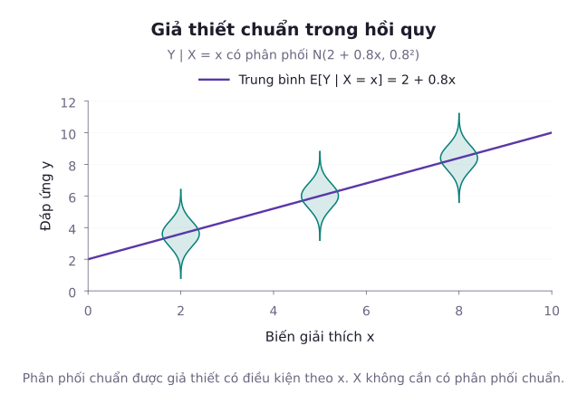
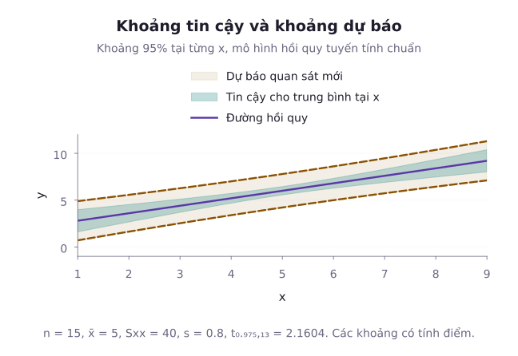
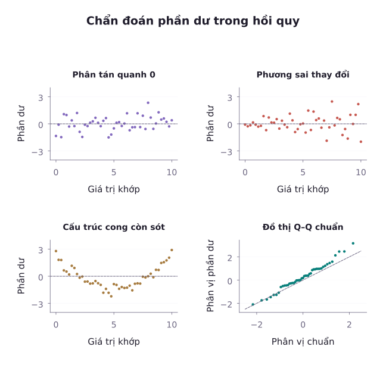

Trong các bài học trước về giải tích dữ liệu, phương pháp bình phương tối thiểu (OLS) đã được giới thiệu như một thuật toán tối ưu hình học để khớp một đường thẳng qua đám mây điểm. Tuy nhiên, nếu chỉ dừng lại ở phép tính đại số đó, ta không thể biết: Liệu độ dốc tìm được có thực sự khác 0 trong quần thể hay chỉ là sản phẩm của nhiễu ngẫu nhiên? Mức độ tin cậy của đường hồi quy tại từng giá trị dự báo là bao nhiêu? Và làm sao phân biệt được khoảng biến động của giá trị trung bình với khoảng dao động của một cá thể mới? Bài học này thiết lập cơ sở xác suất chuẩn tắc cho mô hình hồi quy tuyến tính cổ điển với sai số chuẩn. Chúng ta sẽ khảo sát phân phối mẫu của các ước lượng hệ số, xây dựng kiểm định $t$ và khoảng tin cậy cho độ dốc. Tiếp theo, bài học mổ xẻ sự khác biệt bản chất giữa khoảng tin cậy kỳ vọng và khoảng dự báo cho quan sát mới, tìm hiểu bốn biểu đồ chẩn đoán phần dư chuẩn tắc, và khái quát hóa mô hình hồi quy bội dưới dạng ma trận.

## 1. Mô hình Hồi quy Tuyến tính Cổ điển với Sai số Phân phối chuẩn

Xét mối quan hệ giữa biến giải thích (độc lập) $X$ và biến phản hồi (phụ thuộc) $Y$. Trong mô hình hồi quy cổ điển, toàn bộ suy luận thống kê (các kiểm định $t$, $F$, khoảng tin cậy và khoảng dự báo) đều được thiết lập có điều kiện trên các giá trị đã biết của biến giải thích $X$ (conditional on design $X$).

Mô hình hồi quy tuyến tính đơn biến được phát biểu:

$$
Y_i = \beta_0 + \beta_1 x_i + \varepsilon_i
$$

trong đó $i = 1, \dots, n$, đi kèm các giả thiết chuẩn tắc Gauss-Markov mở rộng:
1. **Tính tuyến tính của kỳ vọng**: Kỳ vọng có điều kiện của $Y$ theo $x$ là một hàm tuyến tính:

$$
\mathbb{E}[Y_i \mid x_i] = \beta_0 + \beta_1 x_i
$$

2. **Sai số ngẫu nhiên có kỳ vọng bằng 0**: Kỳ vọng triệt tiêu $\mathbb{E}[\varepsilon_i] = 0$ với mọi $i$.
3. **Tính thuần nhất phương sai (Homoscedasticity)**: Phương sai $\mathrm{Var}(\varepsilon_i) = \sigma^2$ không đổi với mọi giá trị $x_i$.
4. **Tính không tương quan**: Hiệp phương sai $\mathrm{Cov}(\varepsilon_i, \varepsilon_j) = 0$ với mọi $i \ne j$.
5. **Giả thiết phân phối chuẩn**: Các sai số tuân theo phân phối chuẩn độc lập cùng tham số:

$$
\varepsilon_i \overset{\text{iid}}{\sim} \mathcal{N}(0, \sigma^2)
$$

Để ước lượng riêng hệ số chặn và hệ số dốc, cần các $x_i$ không đồng nhất, tức $S_{XX}>0$. Để ước lượng phương sai dư và suy luận bằng Student, cần $n>2$ và $\sigma^2>0$. Điều kiện không tương quan tự nó không suy ra độc lập, nên giả thiết chuẩn độc lập được nêu riêng.

Hệ quả trực tiếp: Biến phản hồi $Y_i$ có điều kiện trên $x_i$ tuân theo phân phối chuẩn độc lập:

$$
Y_i \mid x_i \sim \mathcal{N}(\beta_0 + \beta_1 x_i, \, \sigma^2)
$$

Lưu ý phương pháp luận về tính nhân quả: Trong các nghiên cứu quan sát, mô hình hồi quy tuyến tính chỉ lượng hóa mối liên hệ thống kê và khả năng dự báo có điều kiện giữa $X$ và $Y$. Hệ số dốc $\beta_1 \ne 0$ tuyệt đối không đồng nghĩa với quan hệ nhân quả. Ta không thể kết luận rằng can thiệp làm thay đổi $X$ sẽ gây ra sự biến đổi ở $Y$ nếu chưa có thiết kế hoặc các giả thiết nhận dạng nhân quả thích hợp để xử lý những yếu tố gây nhiễu.

Hình xét mô hình có kỳ vọng điều kiện $2+0{,}8x$ và phương sai sai số $0{,}64$. Phân phối tại mỗi điểm thiết kế có cùng độ lệch chuẩn $0{,}8$, dù kỳ vọng thay đổi theo $x$.

## 2. Phân phối Mẫu của các Ước lượng Bình phương Tối thiểu

Các ước lượng bình phương tối thiểu thông thường (OLS) của hệ số chặn $\beta_0$ và hệ số dốc $\beta_1$ có dạng:

$$
\hat{\beta}_1 = \frac{S_{XY}}{S_{XX}}, \quad \hat{\beta}_0 = \bar{Y} - \hat{\beta}_1 \bar{x}
$$

trong đó:

$$
\begin{aligned}
S_{XX} &= \sum_{i=1}^n (x_i - \bar{x})^2, \\
S_{XY} &= \sum_{i=1}^n (x_i - \bar{x})(Y_i - \bar{Y})
\end{aligned}
$$

Vì $\hat{\beta}_1$ có thể biểu diễn thành tổ hợp tuyến tính của các biến ngẫu nhiên chuẩn độc lập $Y_i$:

$$
\begin{aligned}
\hat{\beta}_1 &= \sum_{i=1}^n \left(\frac{x_i - \bar{x}}{S_{XX}}\right) Y_i \\
&= \sum_{i=1}^n w_i Y_i
\end{aligned}
$$

với $\sum_{i=1}^n w_i = 0$ và $\sum_{i=1}^n w_i^2 = \frac{1}{S_{XX}}$, ta suy ra phân phối mẫu chính xác:

::: tip Phân phối Mẫu của Hệ số Hồi quy OLS
Dưới các giả thiết hồi quy chuẩn tắc:
1. Ước lượng hệ số dốc $\hat{\beta}_1$ tuân theo phân phối chuẩn:

$$
\hat{\beta}_1 \sim \mathcal{N}\left(\beta_1, \, \frac{\sigma^2}{S_{XX}}\right)
$$

2. Ước lượng hệ số chặn $\hat{\beta}_0$ tuân theo phân phối chuẩn:

$$
\hat{\beta}_0 \sim \mathcal{N}\left(\beta_0, \, \sigma^2 \left(\frac{1}{n} + \frac{\bar{x}^2}{S_{XX}}\right)\right)
$$

:::

### Ước lượng không chệch của phương sai sai số

Trong thực tế, $\sigma^2$ chưa biết và được ước lượng từ tổng bình phương phần dư ($\mathrm{RSS}$ hoặc $\mathrm{SSE}$):

$$
\begin{aligned}
e_i &= Y_i - \hat{Y}_i \\
&= Y_i - (\hat{\beta}_0 + \hat{\beta}_1 x_i)
\end{aligned}
$$

$$
\mathrm{RSS} = \sum_{i=1}^n e_i^2
$$

Quy ước bậc tự do nhất quán: Mô hình hồi quy đơn có 1 biến dự báo và 1 hệ số chặn, tổng cộng ước lượng $p = 2$ tham số $(\beta_0, \beta_1)$. Số bậc tự do của phần dư là $df_e = n - 2$. Ước lượng không chệch của $\sigma^2$ là phương sai dư:

$$
s_e^2 = \frac{\mathrm{RSS}}{n - 2} \implies \mathbb{E}[s_e^2] = \sigma^2
$$

Định lý Cochran khẳng định rằng thống kê chuẩn hóa phần dư độc lập với các ước lượng $\hat{\beta}_0, \hat{\beta}_1$ và tuân theo phân phối Chi bình phương:

$$
\frac{(n - 2)s_e^2}{\sigma^2} \sim \chi^2(n - 2)
$$

## 3. Suy luận Thống kê cho Hệ số Dốc: Kiểm định t và Khoảng Tin cậy

Sai số chuẩn ước tính của hệ số dốc $\hat{\beta}_1$ là:

$$
\mathrm{SE}(\hat{\beta}_1) = \frac{s_e}{\sqrt{S_{XX}}}
$$

### Kiểm định ý nghĩa của hệ số dốc

Để kiểm tra xem biến $X$ có thực sự có mối liên hệ tuyến tính với biến $Y$ hay không, ta thiết lập cặp giả thuyết:
- **Giả thuyết không ($H_0$)**: Hệ số dốc triệt tiêu $\beta_1 = 0$ (biến $X$ không giúp giải thích biến động của $Y$).
- **Đối thuyết ($H_1$)**: Hệ số dốc khác không $\beta_1 \ne 0$.

Thống kê kiểm định $t$ tuân theo phân phối Student với $n - 2$ bậc tự do:

$$
\begin{aligned}
T &= \frac{\hat{\beta}_1 - 0}{\mathrm{SE}(\hat{\beta}_1)} \\
&= \frac{\hat{\beta}_1 \sqrt{S_{XX}}}{s_e}
\end{aligned}
$$

với $T \sim t(n - 2)$ dưới giả thuyết $H_0$.

Bác bỏ $H_0$ ở mức ý nghĩa $\alpha$ nếu $|T| \ge t_{\alpha/2, n-2}$.

### Khoảng tin cậy cho hệ số dốc

Khoảng tin cậy mức $1 - \alpha$ cho hệ số dốc thực tế $\beta_1$ có dạng:

$$
\hat{\beta}_1 \pm t_{\alpha/2, n-2} \cdot \mathrm{SE}(\hat{\beta}_1)
$$

Nếu khoảng tin cậy này không chứa giá trị 0, ta khẳng định ở mức ý nghĩa $\alpha$ rằng mối quan hệ tuyến tính có ý nghĩa thống kê.

## 4. Phân biệt Bản chất: Khoảng Tin cậy Kỳ vọng và Khoảng Dự báo

Ước lượng kỳ vọng tại $x_0$ và dự báo một quan sát mới tại $x_0$ là hai mục tiêu khác nhau. Quan sát mới còn chứa sai số cá thể ngay cả khi biết chính xác đường hồi quy.

Hình dùng $n=15$, trung bình thiết kế $5$, tổng bình phương sai lệch thiết kế $40$ và độ lệch chuẩn dư $0{,}8$. Các khoảng được tính tại từng điểm bằng Student với 13 bậc tự do. Chúng minh họa hình dạng, không phải dải tin cậy đồng thời.

Tại một điểm quan tâm $x_0$, giá trị dự báo điểm của cả hai bài toán đều là $\hat{y}_0 = \hat{\beta}_0 + \hat{\beta}_1 x_0$. Tuy nhiên mức độ bất định của chúng hoàn toàn khác nhau.

### Khoảng tin cậy cho kỳ vọng điều kiện

Ở đây ta ước lượng tâm kỳ vọng lý thuyết $\mu_{Y|x_0} = \mathbb{E}[Y \mid x_0] = \beta_0 + \beta_1 x_0$.
Phương sai của ước lượng điểm $\hat{y}_0$ là:

$$
\mathrm{Var}(\hat{y}_0) = \sigma^2 \left[\frac{1}{n} + \frac{(x_0 - \bar{x})^2}{S_{XX}}\right]
$$

Khoảng tin cậy $1 - \alpha$ cho kỳ vọng $\mathbb{E}[Y \mid x_0]$:

$$
\hat{y}_0 \pm t_{\alpha/2, n-2} \cdot s_e \sqrt{\frac{1}{n} + \frac{(x_0 - \bar{x})^2}{S_{XX}}}
$$

Đặc điểm: Độ rộng của khoảng tin cậy đạt giá trị nhỏ nhất tại điểm trọng tâm $x_0 = \bar{x}$, và nở rộng dần hình hyperbol khi $x_0$ rời xa giá trị trung bình mẫu.

Các khoảng vừa nêu có độ bao phủ tại từng giá trị $x_0$ cố định. Vẽ chúng cho nhiều giá trị $x_0$ không tạo thành dải tin cậy đồng thời $95\%$ cho toàn bộ đường hồi quy.

### Khoảng dự báo cho quan sát cá thể mới

Ở đây ta muốn dự đoán giá trị của một đối tượng cá thể mới $Y_0 = \beta_0 + \beta_1 x_0 + \varepsilon_0$.
Sai số dự báo là $e_{\mathrm{pred}} = Y_0 - \hat{y}_0$. Vì quan sát mới $Y_0$ độc lập với mẫu dữ liệu ban đầu dùng để tính $\hat{y}_0$, phương sai của sai số dự báo chứa thêm phương sai của nhiễu quan sát mới $\sigma^2$:

Đặt $V_0 = \frac{1}{n} + \frac{(x_0 - \bar{x})^2}{S_{XX}}$, phương sai của sai số dự báo là:

$$
\begin{aligned}
\mathrm{Var}(Y_0 - \hat{y}_0) &= \mathrm{Var}(Y_0) + \mathrm{Var}(\hat{y}_0) \\
&= \sigma^2 + \sigma^2 V_0 \\
&= \sigma^2 (1 + V_0)
\end{aligned}
$$

Khoảng dự báo (Prediction Interval - PI) $1 - \alpha$ cho quan sát mới $Y_0$:

$$
\hat{y}_0 \pm t_{\alpha/2, n-2} \cdot s_e \sqrt{1 + V_0}
$$

So sánh bản chất:
Khoảng dự báo luôn rộng hơn khoảng tin cậy do phải gánh thêm số hạng $1$ dưới dấu căn biểu thị độ biến động nội tại của cá thể $\varepsilon_0 \sim \mathcal{N}(0, \sigma^2)$. Nếu thiết kế đủ thông tin để $V_0\to0$ và $s_e\to\sigma$ khi cỡ mẫu tăng, khoảng cho kỳ vọng co lại. Khoảng dự báo vẫn có nửa độ rộng tiến tới $z_{\alpha/2}\sigma$, vì sai số của quan sát mới không mất đi.

::: example Tính toán hồi quy và khoảng dự báo trên năm cặp quan sát
Xét tập dữ liệu thực nghiệm nhỏ gồm $n = 5$ cặp quan sát $(x_i, y_i)$: $(1, 2), (2, 3), (3, 5), (4, 4), (5, 6)$.
Giả sử mô hình chuẩn độc lập, cùng phương sai ở Mục 1 áp dụng cho các điểm thiết kế này.
1. Xác định phương trình hồi quy tuyến tính mẫu.
2. Kiểm định ý nghĩa thống kê của hệ số dốc ở mức $\alpha = 0{,}05$.
3. Tại điểm $x_0 = 3$, hãy lập khoảng tin cậy $95\%$ cho kỳ vọng $\mathbb{E}[Y \mid x_0 = 3]$ và khoảng dự báo $95\%$ cho một quan sát mới $Y_0$.

**Lời giải**:
Tính các đại lượng thống kê mô tả cơ bản:

$$
\begin{aligned}
\bar{x} &= \frac{15}{5} = 3{,}0, \\
\bar{y} &= \frac{20}{5} = 4{,}0
\end{aligned}
$$

Tính các tổng bình phương và tích chéo sai lệch:

$$
\begin{aligned}
S_{XX} &= 4 + 1 + 0 + 1 + 4 \\
&= 10{,}0
\end{aligned}
$$

$$
\begin{aligned}
S_{YY} &= 4 + 1 + 1 + 0 + 4 \\
&= 10{,}0
\end{aligned}
$$

$$
\begin{aligned}
S_{XY} &= 4 + 1 + 0 + 0 + 4 \\
&= 9{,}0
\end{aligned}
$$

1. **Phương trình hồi quy**:

$$
\hat{\beta}_1 = \frac{S_{XY}}{S_{XX}} = \frac{9{,}0}{10{,}0} = 0{,}90
$$

$$
\begin{aligned}
\hat{\beta}_0 &= \bar{y} - \hat{\beta}_1 \bar{x} \\
&= 4{,}0 - 2{,}70 \\
&= 1{,}30
\end{aligned}
$$

Phương trình hồi quy là $\hat{y} = 1{,}30 + 0{,}90 x$.

2. **Kiểm định hệ số dốc**:
Tính phần dư tại từng quan sát: $e_1 = -0{,}20$, $e_2 = -0{,}10$, $e_3 = +1{,}00$, $e_4 = -0{,}90$, $e_5 = +0{,}20$.
Tổng bình phương phần dư:

$$
\begin{aligned}
\mathrm{RSS} &= \sum_{i=1}^5 e_i^2 \\
&= 0{,}05 + 1{,}00 + 0{,}85 \\
&= 1{,}90
\end{aligned}
$$

Bậc tự do: $\nu = n - 2 = 5 - 2 = 3$.
Phương sai dư và độ lệch chuẩn dư:

$$
\begin{aligned}
s_e^2 &= \frac{1{,}90}{3} \approx 0{,}6333, \\
s_e &= \sqrt{\frac{1{,}90}{3}} \approx 0{,}79582
\end{aligned}
$$

Sai số chuẩn của hệ số dốc:

$$
\begin{aligned}
\mathrm{SE}(\hat{\beta}_1) &= \frac{s_e}{\sqrt{S_{XX}}} \\
&= \frac{0{,}79582}{\sqrt{10{,}0}} \\
&\approx 0{,}25166
\end{aligned}
$$

Thống kê $t$ quan sát:

$$
t_{\mathrm{obs}} = \frac{0{,}90 - 0}{0{,}25166} \approx 3{,}576
$$

Phân vị Student hai phía với 3 bậc tự do ở mức $\alpha = 0{,}05$: $t_{0{,}025, 3} \approx 3{,}1825$.
Vì $t_{\mathrm{obs}} = 3{,}576 > 3{,}1825$, ta bác bỏ $H_0$ với $p\text{-value} \approx 0{,}0374 < 0{,}05$. Hệ số dốc có ý nghĩa thống kê.
Khoảng tin cậy $95\%$ cho độ dốc $\beta_1$:

$$
\begin{aligned}
\mathrm{CI}_{95\%}(\beta_1) &= 0{,}90 \pm 3{,}1825 \cdot \mathrm{SE} \\
&= 0{,}90 \pm 0{,}8009 \\
&= [0{,}0991, \, 1{,}7009]
\end{aligned}
$$

3. **Khoảng tin cậy và khoảng dự báo tại $x_0 = 3$**:
Giá trị dự báo điểm: $\hat{y}_0 = 1{,}30 + 0{,}90 \times 3 = 4{,}00$.
Vì $x_0 = \bar{x} = 3$, số hạng $(x_0 - \bar{x})^2 / S_{XX} = 0$.

- **Khoảng tin cậy cho kỳ vọng $\mathbb{E}[Y \mid x_0 = 3]$**:

$$
\begin{aligned}
\mathrm{SE}_{\mathrm{mean}} &= \frac{s_e}{\sqrt{5}} \\
&= \frac{0{,}79582}{\sqrt{5}} \\
&\approx 0{,}3559
\end{aligned}
$$

Biên độ sai số:

$$
\begin{aligned}
E_{\mathrm{mean}} &= 3{,}1825 \times 0{,}3559 \\
&\approx 1{,}1326
\end{aligned}
$$

Khoảng tin cậy $95\%$:

$$
\begin{aligned}
\mathrm{CI}_{95\%} &= 4{,}00 \pm 1{,}1326 \\
&= [2{,}8674, \, 5{,}1326]
\end{aligned}
$$

- **Khoảng dự báo cho quan sát mới $Y_0$ tại $x_0 = 3$**:

$$
\begin{aligned}
\mathrm{SE}_{\mathrm{pred}} &= s_e \sqrt{1 + 0{,}20} \\
&= 0{,}79582 \times \sqrt{1{,}2} \\
&\approx 0{,}8718
\end{aligned}
$$

Biên độ sai số dự báo:

$$
\begin{aligned}
E_{\mathrm{pred}} &= 3{,}1825 \times 0{,}8718 \\
&\approx 2{,}7744
\end{aligned}
$$

Khoảng dự báo $95\%$:

$$
\begin{aligned}
\mathrm{PI}_{95\%} &= 4{,}00 \pm 2{,}7744 \\
&= [1{,}2256, \, 6{,}7744]
\end{aligned}
$$

Khoảng dự báo rộng hơn khoảng tin cậy gần $2{,}5$ lần, phản ánh độ bất định của một quan sát cá thể riêng lẻ.
:::

## 5. Bốn Biểu đồ Chẩn đoán Phần dư Chuẩn tắc

Mọi kết luận suy luận thống kê ở trên đều phụ thuộc vào tính hợp lệ của các giả thiết sai số. Bốn biểu đồ chẩn đoán phần dư chuẩn tắc giúp phát hiện dấu hiệu vi phạm, không chứng minh các giả thiết đã đúng:

1. **Biểu đồ Phần dư theo Giá trị Khớp (Residuals vs Fitted)**:
Trục hoành là $\hat{y}_i$, trục tung là phần dư $e_i$. Dùng để kiểm tra giả thiết tính tuyến tính và phương sai thuần nhất. Dấu hiệu mô hình tốt: Các điểm rải đều ngẫu nhiên quanh đường ngang $0$, không tạo thành hình cánh quạt (phương sai đổi) hay đường cong parabol (phi tuyến).

2. **Biểu đồ Q-Q Chuẩn của Phần dư (Normal Q-Q Plot)**:
So sánh phân vị thực nghiệm của phần dư chuẩn hóa với phân vị lý thuyết của phân phối chuẩn $\mathcal{N}(0, 1)$. Dấu hiệu mô hình tốt: Các điểm bám sát một đường thẳng tham chiếu. Góc của đường phụ thuộc cách chọn trục và chuẩn hóa. Nếu hai đầu uốn cong chữ S, dữ liệu có đuôi dày hoặc đuôi mỏng so với phân phối chuẩn.

3. **Biểu đồ Vị trí - Tỷ lệ (Scale-Location Plot)**:
Trục hoành là $\hat{y}_i$, trục tung là căn bậc hai của phần dư chuẩn hóa tuyệt đối $\sqrt{|e_i^*|}$. Dùng để kiểm tra tính thuần nhất phương sai một cách nhạy bén hơn. Dấu hiệu mô hình tốt: Đường xu hướng nằm ngang phẳng lì.

4. **Biểu đồ Phần dư theo Đòn bẩy (Residuals vs Leverage)**:
Trục hoành là độ đòn bẩy $h_{ii}$ (khoảng cách của điểm $x_i$ so với trung tâm dữ liệu), trục tung là phần dư chuẩn hóa, đi kèm các đường đồng mức khoảng cách Cook (Cook's Distance). Dùng để phát hiện các điểm dị biệt có ảnh hưởng chi phối làm lệch toàn bộ đường hồi quy. Các điểm có khoảng cách Cook lớn hơn $0{,}5$ hoặc $1{,}0$ cần được kiểm tra kỹ lưỡng.

## 6. Khái quát hóa Mô hình Hồi quy Bội dưới dạng Ma trận

Khi có $k$ biến dự báo $X_1, X_2, \dots, X_k$ và 1 hệ số chặn, mô hình hồi quy tuyến tính bội được biểu diễn gọn gàng bằng đại số tuyến tính:

$$
Y = X \beta + \varepsilon
$$

trong đó:
- $Y \in \mathbb{R}^{n \times 1}$: Vector biến phản hồi.
- $X \in \mathbb{R}^{n \times (k + 1)}$: Ma trận thiết kế có hạng cột đầy đủ $\mathrm{rank}(X)=k+1<n$, với cột đầu tiên gồm toàn số 1 ứng với hệ số chặn.
- $\beta = (\beta_0, \beta_1, \dots, \beta_k)^T \in \mathbb{R}^{(k + 1) \times 1}$: Vector $p = k + 1$ hệ số cần ước lượng.
- $\varepsilon \mid X \sim \mathcal{N}(0, \, \sigma^2 I_n)$: Vector sai số ngẫu nhiên thỏa mãn giả thiết chuẩn tắc.

Mỗi hàng của phép nhân ma trận chính là một phương trình:

$$
Y_i=\beta_0+\beta_1x_{i1}+\dots+\beta_kx_{ik}+\varepsilon_i
$$

Với một biến dự báo, công thức trở về mô hình đường thẳng ở Mục 1. Trong toàn mục này, $p=k+1$ luôn tính cả hệ số chặn và mọi phân phối được hiểu có điều kiện trên $X$ cố định.

Ước lượng OLS tổng quát:

$$
\hat{\beta} = (X^T X)^{-1} X^T Y
$$

Ma trận hiệp phương sai của vector ước lượng:

$$
\mathrm{Cov}(\hat{\beta}) = \sigma^2 (X^T X)^{-1}
$$

Phương sai dư không chệch với bậc tự do $n - p = n - k - 1$:

$$
s_e^2 = \frac{\mathrm{RSS}}{n - k - 1}
$$

### Hệ số xác định hiệu chỉnh và Kiểm định F toàn cục

1. **Hệ số xác định hiệu chỉnh ($R^2_{\mathrm{adj}}$)**:
Với cùng tập dữ liệu và mô hình có hệ số chặn, thêm cột vào ma trận thiết kế không làm giảm $R^2$. Giá trị có thể giữ nguyên, không nhất thiết tăng nghiêm ngặt. Giả sử $\mathrm{SST}>0$. Để khắc phục, ta sử dụng $R^2$ hiệu chỉnh theo bậc tự do:

$$
R^2_{\mathrm{adj}} = 1 - (1 - R^2)\frac{n - 1}{n - k - 1}
$$

2. **Kiểm định F toàn cục (Global F-test)**:
Kiểm tra giả thuyết tất cả các hệ số dốc đồng thời bằng 0: $H_0: \beta_1 = \beta_2 = \dots = \beta_k = 0$.
Thống kê kiểm định:

$$
\begin{aligned}
F &= \frac{(\mathrm{SST} - \mathrm{RSS}) / k}{\mathrm{RSS} / (n - k - 1)} \\
&= \frac{R^2 / k}{(1 - R^2) / (n - k - 1)}
\end{aligned}
$$

với $F \sim F(k, \, n - k - 1)$ dưới giả thuyết không.

## Tóm tắt nội dung bài học

1. **Mô hình hồi quy cổ điển**: Thiết lập có điều kiện trên ma trận thiết kế $X$ với các sai số $\varepsilon_i \overset{\text{iid}}{\sim} \mathcal{N}(0, \sigma^2)$. Hệ số OLS là các ước lượng tuyến tính không chệch tốt nhất (BLUE) và có phân phối chuẩn.
2. **Suy luận hệ số dốc**: Kiểm định $t$ với thống kê $T = \frac{\hat{\beta}_1}{\mathrm{SE}(\hat{\beta}_1)} \sim t(n - 2)$ kiểm tra ý nghĩa của quan hệ tuyến tính giữa hai biến.
3. **Phân biệt khoảng tin cậy và khoảng dự báo**: Khoảng tin cậy cho kỳ vọng điều kiện chỉ tính đến sai số lấy mẫu của đường hồi quy, trong khi khoảng dự báo cho cá thể mới phải gánh thêm phương sai của nhiễu quan sát $\sigma^2$, khiến nó luôn rộng hơn đáng kể.
4. **Chẩn đoán phần dư**: Bốn biểu đồ chuẩn tắc giúp phát hiện sớm các vi phạm về tính tuyến tính, phương sai thuần nhất, phân phối chuẩn và điểm ảnh hưởng cao.
5. **Cảnh báo phi nhân quả**: Hồi quy trên dữ liệu quan sát chỉ phản ánh mối tương quan thống kê, không thể suy diễn nhân quả nếu thiếu thiết kế hoặc giả thiết nhận dạng nhân quả thích hợp.

## Bài tập tự luyện

::: exercise Bài tập 1: Sai số chuẩn và khoảng tin cậy cho hệ số chặn
Với tập dữ liệu 5 quan sát ở Mục 4, hãy tính sai số chuẩn của hệ số chặn $\mathrm{SE}(\hat{\beta}_0)$ và lập khoảng tin cậy $95\%$ cho hệ số chặn $\beta_0$.
:::

::: solution Lời giải Bài tập 1
Từ kết quả đã tính: $n = 5$, $\bar{x} = 3{,}0$, $S_{XX} = 10{,}0$, $s_e \approx 0{,}79582$, $t_{0{,}025, 3} \approx 3{,}1825$, $\hat{\beta}_0 = 1{,}30$.
Công thức phương sai mẫu của hệ số chặn:

$$
\begin{aligned}
\mathrm{SE}(\hat{\beta}_0) &= s_e \sqrt{\frac{1}{n} + \frac{\bar{x}^2}{S_{XX}}} \\
&= 0{,}79582 \times \sqrt{0{,}20 + 0{,}90} \\
&= 0{,}79582 \times \sqrt{1{,}10} \\
&\approx 0{,}83467
\end{aligned}
$$

Biên độ sai số:

$$
\begin{aligned}
E &= t_{0{,}025, 3} \times \mathrm{SE}(\hat{\beta}_0) \\
&= 3{,}1825 \times 0{,}83467 \\
&\approx 2{,}6563
\end{aligned}
$$

Khoảng tin cậy $95\%$ cho $\beta_0$:

$$
\begin{aligned}
\mathrm{CI}_{95\%}(\beta_0) &= 1{,}30 \pm 2{,}6563 \\
&= [-1{,}3563, \, 3{,}9563]
\end{aligned}
$$

Khoảng tin cậy này có chứa số 0, cho thấy hệ số chặn chưa có ý nghĩa thống kê khác 0 ở mức $\alpha = 0{,}05$.
:::

::: exercise Bài tập 2: Tính hệ số xác định và thống kê F của phương trình hồi quy
Với tập dữ liệu trên ($S_{YY} = 10{,}0, \mathrm{RSS} = 1{,}90$), hãy tính hệ số xác định $R^2$, hệ số $R^2_{\mathrm{adj}}$, và kiểm tra tính tương đương giữa kiểm định $F$ và kiểm định $t$.
:::

::: solution Lời giải Bài tập 2
Tổng bình phương toàn phần $\mathrm{SST} = S_{YY} = 10{,}0$.
Tổng bình phương hồi quy:

$$
\begin{aligned}
\mathrm{SSR} &= \mathrm{SST} - \mathrm{RSS} \\
&= 10{,}0 - 1{,}90 \\
&= 8{,}10
\end{aligned}
$$

Hệ số xác định:

$$
R^2 = \frac{\mathrm{SSR}}{\mathrm{SST}} = \frac{8{,}10}{10{,}0} = 0{,}81
$$

Hệ số $R^2$ hiệu chỉnh với $n = 5, k = 1$:

$$
\begin{aligned}
R^2_{\mathrm{adj}} &= 1 - (1 - 0{,}81)\frac{4}{3} \\
&= 1 - 0{,}19 \times \frac{4}{3} \\
&\approx 0{,}7467
\end{aligned}
$$

Thống kê $F$ của hồi quy đơn:

$$
\begin{aligned}
F &= \frac{\mathrm{SSR} / 1}{\mathrm{RSS} / 3} \\
&= \frac{8{,}10}{0{,}6333} \\
&\approx 12{,}789
\end{aligned}
$$

So sánh với thống kê $t$ của hệ số dốc đã tính ở Mục 4 ($t \approx 3{,}576$):

$$
t^2 = (3{,}5762)^2 \approx 12{,}789 = F
$$

Đẳng thức $F = t^2$ được nghiệm đúng hoàn toàn, minh chứng cho tính nhất quán toán học giữa kiểm định $F$ của ANOVA và kiểm định $t$ của hệ số hồi quy trong mô hình đơn biến.
:::

::: exercise Bài tập 3: Dự báo tại điểm biên ngoại suy
Cũng với mô hình trên, một người muốn dự báo giá trị phản hồi tại điểm $x_0 = 8$. Hãy tính độ rộng của khoảng tin cậy cho kỳ vọng tại $x_0 = 8$ so với tại điểm tâm $x_0 = 3$.
:::

::: solution Lời giải Bài tập 3
Tại điểm $x_0 = 8$, khoảng cách tới trọng tâm mẫu là:

$$
\begin{aligned}
(x_0 - \bar{x})^2 &= (8 - 3)^2 \\
&= 5^2 \\
&= 25{,}0
\end{aligned}
$$

Số hạng dưới dấu căn trong sai số chuẩn của kỳ vọng:

$$
\begin{aligned}
\frac{1}{n} + \frac{(x_0 - \bar{x})^2}{S_{XX}} &= \frac{1}{5} + \frac{25{,}0}{10{,}0} \\
&= 0{,}20 + 2{,}50 \\
&= 2{,}70
\end{aligned}
$$

Tại điểm tâm $x_0 = 3$, số hạng này chỉ bằng $0{,}20$.
Tỷ số giữa hai sai số chuẩn:

$$
\begin{aligned}
\frac{\mathrm{SE}(x_0 = 8)}{\mathrm{SE}(x_0 = 3)} &= \sqrt{\frac{2{,}70}{0{,}20}} \\
&= \sqrt{13{,}5} \\
&\approx 3{,}674
\end{aligned}
$$

Sai số chuẩn tại điểm ngoại suy $x_0 = 8$ lớn gấp hơn $3{,}6$ lần so với tại điểm tâm dữ liệu. Đây là lời cảnh báo sâu sắc về sự nguy hiểm của việc ngoại suy ngoài phạm vi dữ liệu quan sát.
:::

::: exercise Bài tập 4: Ý nghĩa của độ đòn bẩy trong ma trận mũ
Trong mô hình hồi quy ma trận, ma trận mũ (Hat Matrix) được định nghĩa là $H = X(X^T X)^{-1} X^T$. Hãy chứng minh rằng ma trận $H$ có tính chất đối xứng và lũy đẳng ($H^2 = H$).
:::

::: solution Lời giải Bài tập 4
1. **Tính đối xứng**:

$$
\begin{aligned}
H^T &= \left(X(X^T X)^{-1} X^T\right)^T \\
&= (X^T)^T \left((X^T X)^{-1}\right)^T X^T \\
&= X (X^T X)^{-1} X^T \\
&= H
\end{aligned}
$$

2. **Tính lũy đẳng**:

Đặt $A = X^T X$, ta có:

$$
\begin{aligned}
H^2 &= H \cdot H \\
&= X A^{-1} (X^T X) A^{-1} X^T \\
&= X A^{-1} X^T \\
&= H
\end{aligned}
$$

Ý nghĩa hình học: Ma trận $H$ là toán tử chiếu trực giao không gian quan sát $\mathbb{R}^n$ lên không gian cột của ma trận thiết kế $X$.
:::

## Tài liệu tham khảo

- MIT OpenCourseWare. [18.05: Introduction to Probability and Statistics, Spring 2022](https://ocw.mit.edu/courses/18-05-introduction-to-probability-and-statistics-spring-2022/).
- MIT OpenCourseWare. [18.655: Gaussian Linear Models](https://ocw.mit.edu/courses/18-655-mathematical-statistics-spring-2016/resources/mit18_655s16_lecnote19/). Phân phối hệ số và phần dư với thiết kế cố định có hạng đầy đủ.
- NIST/SEMATECH. [How Can I Tell If a Model Fits My Data?](https://www.itl.nist.gov/div898/handbook/pmd/section4/pmd44.htm).
- Penn State Eberly College of Science. [STAT 415: Introduction to Mathematical Statistics](https://online.stat.psu.edu/stat415/).
