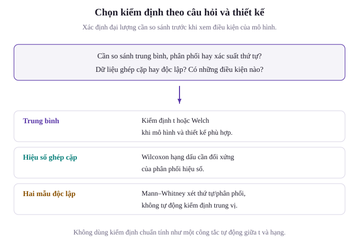
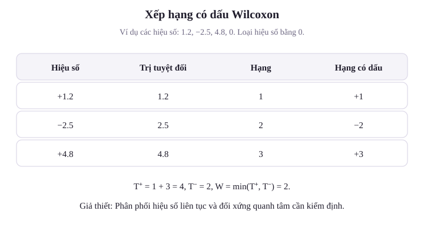
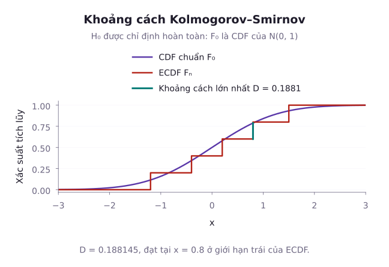

Các phương pháp suy luận tham số kinh điển (như kiểm định $t$, ANOVA hay hồi quy tuyến tính) dựa trên giả thiết nền tảng rằng dữ liệu xuất phát từ một phân phối chuẩn hoặc một họ phân phối xác định. Tuy nhiên, trong thế giới thực, dữ liệu thường bị lệch nặng, chứa các giá trị ngoại lai cực đoan, hoặc chỉ được đo lường dưới dạng thứ bậc (thang đo Likert). Khi các giả thiết phân phối bị vi phạm nghiêm trọng và kích thước mẫu không đủ lớn để nương tựa vào Định lý giới hạn trung tâm, các kiểm định tham số có thể dẫn đến kết luận sai lệch. Các phương pháp thống kê phi tham số (Non-parametric Methods), hay phương pháp không phụ thuộc phân phối (Distribution-free Methods), cung cấp những lựa chọn khác với các giả thiết riêng cần kiểm tra. Bài học này trình bày các kiểm định phi tham số nền tảng: Kiểm định dấu, kiểm định xếp hạng có dấu Wilcoxon với giả thiết đối xứng, kiểm định Mann-Whitney U cho hai mẫu độc lập, tương quan thứ bậc Spearman, và kiểm định độ phù hợp phân phối liên tục Kolmogorov-Smirnov.

## 1. Động lực và Đánh đổi giữa Tham số và Phi tham số

Phương pháp phi tham số không ấn định một họ phân phối hữu hạn tham số cho toàn bộ dữ liệu. Tuy nhiên, mỗi kiểm định vẫn đòi hỏi những điều kiện cụ thể như tính độc lập, tính liên tục, tính đối xứng hoặc khả năng hoán đổi nhãn dưới giả thuyết không.

Các kiểm định dựa trên hạng ít bị chi phối bởi độ lớn của một giá trị ngoại lai. Mann–Whitney và Spearman có thể dùng thứ bậc, còn Wilcoxon hạng có dấu cần tính hiệu và so sánh độ lớn của hiệu, nên không phù hợp với mọi thang đo thứ bậc tùy ý.

Công suất phụ thuộc mô hình và loại đối thuyết. Với mô hình vị trí chuẩn, hiệu quả tiệm cận tương đối của Wilcoxon hạng có dấu so với kiểm định $t$ là $3/\pi\approx0{,}955$. Đây là kết quả tiệm cận trong mô hình cụ thể, không phải bảo đảm công suất thấp hơn ở mọi mẫu hay mọi phân phối.

## 2. Kiểm định Dấu (Sign Test)

Kiểm định dấu là phương pháp phi tham số đơn giản nhất, dùng để kiểm định trung vị (Median, ký hiệu là $M$) của một biến ngẫu nhiên liên tục mà không đòi hỏi bất kỳ giả thiết nào về tính đối xứng của phân phối.

Xét bài toán kiểm định trung vị tổng thể $H_0: M = m_0$:
Với mẫu ngẫu nhiên $X_1, \dots, X_n$, ta tính các hiệu số $D_i = X_i - m_0$:
- Bỏ qua các quan sát có $D_i = 0$ (quan sát bằng đúng trung vị giả thuyết) và giảm kích thước mẫu hiệu dụng xuống $n^*$.
- Đếm số lượng quan sát có dấu dương ($D_i > 0$), ký hiệu là $K$:

$$
K = \sum_{i=1}^{n^*} \mathbb{I}(D_i > 0)
$$

Với phân phối liên tục và giả thuyết $P(X>m_0)=P(X<m_0)=1/2$, mỗi dấu là một phép thử Bernoulli cân bằng. Nếu có khối xác suất đúng tại $m_0$, điều kiện trung vị đơn thuần chưa bảo đảm hai dấu còn lại cân bằng sau khi bỏ số không. Do đó, dưới giả thuyết $H_0$, thống kê $K$ tuân theo phân phối nhị thức:

$$
K \sim \mathrm{Binomial}(n^*, \, 0{,}5)
$$

Giá trị $p$ được tính chính xác qua phân phối nhị thức:
- Với đối thuyết phía trên $H_1: M > m_0$: $p\text{-value} = P(K \ge k_{\mathrm{obs}})$.
- Với đối thuyết hai phía $H_1: M \ne m_0$: $p\text{-value}=\min(1,2p_{\min})$.

Ở công thức hai phía, $p_{\min}$ là xác suất nhỏ hơn trong hai đuôi kể cả kết cục quan sát. Phép chặn ở $1$ cần thiết khi kết cục nằm giữa phân phối nhị thức.

Với dữ liệu làm tròn có số không, bài này dùng giả thuyết cân bằng dấu có điều kiện trên các hiệu khác không. Khi chỉ muốn kiểm định trung vị cho một phân phối rời rạc bất kỳ, phải chọn cách xử lý số bằng mốc phù hợp, không tự động bỏ chúng.

::: example Kiểm định dấu cho thời gian chờ khám bệnh
Một bệnh viện tuyên bố rằng thời gian chờ khám bệnh trung vị của bệnh nhân là $m_0 = 30$ phút. Giả sử các dấu khác không độc lập, cân bằng dưới giả thuyết không. Khảo sát ngẫu nhiên 10 bệnh nhân thu được thời gian chờ (phút): $35, 28, 42, 30, 45, 38, 25, 40, 50, 36$. Ở mức ý nghĩa $\alpha = 0{,}05$, hãy kiểm định xem thời gian chờ trung vị thực tế có khác 30 phút hay không.

**Lời giải**:
Tính các hiệu số $D_i = X_i - 30$:
$+5$, $-2$, $+12$, $0$, $+15$, $+8$, $-5$, $+10$, $+20$, $+6$.
Loại bỏ 1 quan sát có $D_i = 0$, kích thước mẫu hiệu dụng còn $n^* = 9$.
Số hiệu số mang dấu dương là $k = 7$ (ứng với các giá trị $+5, +12, +15, +8, +10, +20, +6$), và 2 hiệu số mang dấu âm.
Dưới giả thuyết $H_0: M = 30$, thống kê $K \sim \mathrm{Binomial}(9, 0{,}5)$.
Tính xác suất ở đuôi phía trên:

$$
\begin{aligned}
P(K=7)&=\frac{\binom97}{2^9}=\frac{36}{512},\\
P(K=8)&=\frac{\binom98}{2^9}=\frac9{512},\\
P(K=9)&=\frac{\binom99}{2^9}=\frac1{512}
\end{aligned}
$$

Cộng ba xác suất ở đuôi trên:

$$
\begin{aligned}
P(K\ge7)&=\frac{36+9+1}{512}\\
&=\frac{46}{512}\\
&\approx0{,}08984
\end{aligned}
$$

Giá trị $p$ kiểm định hai phía:

$$
\begin{aligned}
p\text{-value} &= 2 \times P(K \ge 7) \\
&= 2 \times \frac{46}{512} \\
&= \frac{92}{512} \\
&\approx 0{,}17969
\end{aligned}
$$

Vì $p\text{-value} \approx 0{,}180 > 0{,}05$, ta không có đủ bằng chứng ở mức ý nghĩa $5\%$ để bác bỏ tuyên bố của bệnh viện.
:::

## 3. Kiểm định Xếp hạng có Dấu Wilcoxon (Wilcoxon Signed-Rank Test)

Kiểm định dấu chỉ sử dụng dấu của hiệu số mà bỏ qua hoàn toàn độ lớn của độ lệch $|D_i|$. Frank Wilcoxon đề xuất tận dụng thêm thông tin độ lớn này bằng cách xếp hạng trị tuyệt đối của các hiệu số, có thể tăng công suất trong mô hình vị trí đối xứng.

::: warning Giả thiết Nghiêm ngặt về Tính Đối xứng
Kiểm định Wilcoxon xếp hạng có dấu yêu cầu phân phối của các sai số hoặc hiệu số phải **đối xứng quanh trung vị** $M$. Nếu phân phối bị lệch nặng (Asymmetric), kiểm định Wilcoxon có thể dẫn đến kết luận sai về trung vị.
:::

Quy trình thực hiện kiểm định Wilcoxon:
1. Tính các hiệu số $D_i = X_i - m_0$ (hoặc $D_i = X_{1i} - X_{2i}$ đối với mẫu bắt cặp). Loại bỏ các giá trị $D_i = 0$, còn lại $n$ quan sát.
2. Xếp hạng các giá trị tuyệt đối $|D_i|$ theo thứ tự tăng dần từ 1 đến $n$. Nếu có các giá trị tuyệt đối bằng nhau (Ties), gán cho mỗi giá trị hạng trung bình của các vị trí tương ứng.
3. Gán lại dấu ban đầu của $D_i$ cho từng thứ hạng.
4. Tính tổng các thứ hạng mang dấu dương ($W^+$) và tổng các thứ hạng mang dấu âm ($W^-$):

$$
W^+ = \sum_{D_i > 0} R_i, \quad W^- = \sum_{D_i < 0} R_i
$$

Tổng của hai đại lượng luôn bảo toàn: $W^+ + W^- = \frac{n(n + 1)}{2}$.
Thống kê kiểm định là $W = \min(W^+, W^-)$.

Xấp xỉ chuẩn khi mẫu đủ lớn, không có hạng nào chi phối tổng:
Với các hiệu độc lập, đối xứng quanh $0$ và không có hạng trùng, kỳ vọng và phương sai của $W^+$ là:

$$
\begin{aligned}
\mathbb E[W^+]&=\frac{n(n+1)}4,\\
\mathrm{Var}(W^+)&=\frac{n(n+1)(2n+1)}{24}
\end{aligned}
$$

Thống kê sau có phân phối xấp xỉ chuẩn tắc trong các điều kiện vừa nêu:

$$
Z=\frac{W^+-\mathbb E[W^+]}{\sqrt{\mathrm{Var}(W^+)}}
$$

Nếu có hạng trùng, phương sai phải hiệu chỉnh hoặc tính từ các hạng trung bình thực tế. Có thể tính chính xác bằng cách giữ các độ lớn và xét mọi cách gán dấu độc lập với xác suất $1/2$. Bảng tới hạn cho hạng $1,\dots,n$ không dùng nguyên trạng khi các hạng đã thay đổi vì trùng nhau.

::: example Kiểm định Wilcoxon trên mẫu hiệu số nhỏ
Một thử nghiệm so sánh huyết áp trước và sau khi dùng thuốc trên $n = 9$ bệnh nhân cho các hiệu số chênh lệch: $2, 5, -2, 4, 7, 3, -1, 6, 8$. Giả thiết phân phối hiệu số có tính chất đối xứng. Ở mức ý nghĩa $\alpha = 0{,}05$, hãy kiểm định giả thuyết thuốc không làm thay đổi huyết áp ($H_0: M = 0$).

**Lời giải**:
Lập bảng tính thứ hạng trị tuyệt đối cho 9 quan sát:

| Hiệu số $D_i$ | Trị tuyệt đối $|D_i|$ | Thứ hạng $|D_i|$ | Dấu ban đầu | Thứ hạng có dấu |
| :--- | :--- | :--- | :--- | :--- |
| $-1$ | $1$ | $1$ | Âm ($-$) | $-1$ |
| $+2$ | $2$ | $2{,}5$ (chia sẻ hạng 2, 3) | Dương ($+$) | $+2{,}5$ |
| $-2$ | $2$ | $2{,}5$ (chia sẻ hạng 2, 3) | Âm ($-$) | $-2{,}5$ |
| $+3$ | $3$ | $4$ | Dương ($+$) | $+4$ |
| $+4$ | $4$ | $5$ | Dương ($+$) | $+5$ |
| $+5$ | $5$ | $6$ | Dương ($+$) | $+6$ |
| $+6$ | $6$ | $7$ | Dương ($+$) | $+7$ |
| $+7$ | $7$ | $8$ | Dương ($+$) | $+8$ |
| $+8$ | $8$ | $9$ | Dương ($+$) | $+9$ |

Tính tổng các thứ hạng:
- Tổng thứ hạng âm: $W^- = 1 + 2{,}5 = 3{,}5$.
- Tổng thứ hạng dương: $W^+=45-3{,}5=41{,}5$.
Kiểm tra tổng bảo toàn:

$$
\begin{aligned}
W^++W^-&=41{,}5+3{,}5\\
&=45\\
&=\frac{9\times10}{2}
\end{aligned}
$$
Giá trị thống kê kiểm định:

$$
W_{\mathrm{obs}} = \min(W^+, W^-) = 3{,}5
$$

Các trị tuyệt đối có hạng trùng, nên ta không dùng bảng tới hạn không trùng. Với giả thuyết các dấu độc lập, đối xứng có điều kiện trên độ lớn, cả $2^9=512$ cách gán dấu đều có cùng xác suất.

Các tập con có tổng hạng không quá $3{,}5$ là tập rỗng, tập chỉ chứa hạng $1$, hai tập chỉ chứa một trong hai hạng $2{,}5$, và hai tập chứa $1$ cùng một hạng $2{,}5$. Có $6$ cách ở đuôi dưới và $6$ cách đối xứng ở đuôi trên.

$$
p_{\mathrm{obs}}=\frac{12}{512}=0{,}0234375
$$

Ta bác bỏ giả thuyết tâm đối xứng bằng $0$ ở mức $5\%$. Kết quả đánh giá hiệu số huyết áp trong quần thể được lấy mẫu. Thiết kế trước và sau đơn thuần chưa đủ xác lập hiệu ứng nhân quả của thuốc.
:::

## 4. Kiểm định Mann-Whitney U cho Hai Mẫu Độc lập

Khi so sánh hai mẫu ngẫu nhiên độc lập $X_1, \dots, X_{n_1}$ và $Y_1, \dots, Y_{n_2}$, kiểm định Mann-Whitney U (còn gọi là kiểm định tổng hạng Wilcoxon) là giải pháp thay thế phi tham số chuẩn tắc cho kiểm định hai mẫu Student $t$.

Kiểm định hoán vị Mann–Whitney cổ điển được hiệu chuẩn dưới giả thuyết hai mẫu độc lập, cùng một phân phối, tức $F_X=F_Y$. Khi đó nhãn nhóm có thể hoán đổi. Với dữ liệu liên tục, xác suất một quan sát ngẫu nhiên từ nhóm X vượt một quan sát từ nhóm Y bằng $1/2$.

Thống kê $U_1/(n_1n_2)$ ước lượng xác suất vượt trội, có tính nửa trọng số cho các cặp bằng nhau. Tuy nhiên, chỉ giả sử xác suất này bằng $1/2$ mà cho phép hai phân phối khác hình dạng chưa đủ để dùng nguyên phân phối không của phép thử cổ điển.

Chỉ trong mô hình hai phân phối cùng hình dạng, cùng độ phân tán và khác nhau bởi một phép dịch chuyển, kiểm định này mới được diễn giải thành so sánh trung vị. Nó không kiểm định thứ tự ngẫu nhiên đầy đủ hay hai trung vị bất kỳ trong mọi mô hình.

Quy trình tính toán:
1. Gộp chung toàn bộ $N = n_1 + n_2$ quan sát từ hai mẫu lại với nhau và xếp hạng từ 1 đến $N$.
2. Tính tổng các thứ hạng của mẫu 1 ($R_1$) và mẫu 2 ($R_2$).
3. Thống kê $U$ của Mann-Whitney được tính theo công thức:

$$
\begin{aligned}
U_1&=R_1-\frac{n_1(n_1+1)}2,\\
U_2&=R_2-\frac{n_2(n_2+1)}2
\end{aligned}
$$

với $U_1 + U_2 = n_1 \cdot n_2$.
Thống kê kiểm định là $U = \min(U_1, U_2)$.

::: example Kiểm định Mann-Whitney so sánh hai nhóm độc lập
Một công ty công nghệ thử nghiệm thời gian hoàn thành một tác vụ lập trình (đơn vị: Giờ) của hai nhóm kỹ sư:
- Nhóm dùng công cụ AI ($n_1 = 4$): $12, 15, 18, 20$.
- Nhóm đối chứng không dùng AI ($n_2 = 5$): $8, 10, 11, 14, 16$.
Ở mức ý nghĩa $\alpha = 0{,}05$, hãy kiểm định xem có sự khác biệt giữa hai nhóm hay không.

**Lời giải**:
Gộp $N=9$ quan sát và xếp hạng:

| Giá trị | 8 | 10 | 11 | 12 | 14 | 15 | 16 | 18 | 20 |
| --- | --- | --- | --- | --- | --- | --- | --- | --- | --- |
| Nhóm | 2 | 2 | 2 | 1 | 2 | 1 | 2 | 1 | 1 |
| Hạng | 1 | 2 | 3 | 4 | 5 | 6 | 7 | 8 | 9 |

Tính tổng thứ hạng cho từng nhóm:
- Nhóm 1: $R_1 = 4 + 6 + 8 + 9 = 27$
- Nhóm 2: $R_2 = 1 + 2 + 3 + 5 + 7 = 18$
Kiểm tra: $R_1 + R_2 = 27 + 18 = 45 = \frac{9 \times 10}{2}$.
Tính các thống kê $U$:

$$
\begin{aligned}
U_1 &= 27 - \frac{4 \times 5}{2} \\
&= 27 - 10 \\
&= 17
\end{aligned}
$$

$$
\begin{aligned}
U_2 &= 18 - \frac{5 \times 6}{2} \\
&= 18 - 15 \\
&= 3
\end{aligned}
$$

Kiểm tra: $U_1+U_2=17+3=20$, đúng bằng $n_1n_2=4\times5$.
Thống kê kiểm định:

$$
U = \min(U_1, U_2) = 3{,}0
$$

Tra bảng giá trị tới hạn Mann-Whitney với $n_1 = 4, n_2 = 5$ ở mức $\alpha = 0{,}05$ hai phía: Giá trị tới hạn là $U_{\mathrm{crit}} = 1$.
Không có giá trị trùng, nên dưới $H_0$ có $\binom94=126$ cách gán bốn nhãn nhóm 1. Có $7$ cách cho $U_1\le3$ và $7$ cách đối xứng cho $U_1\ge17$. Vì vậy, giá trị $p$ hai phía bằng $14/126\approx0{,}1111$.
Vì $U = 3 > 1$ và $p\text{-value} \approx 0{,}111 > 0{,}05$, ta chưa đủ bằng chứng để khẳng định hai nhóm có thời gian hoàn thành khác nhau ở mức ý nghĩa $5\%$.
:::

## 5. Hệ số Tương quan Thứ bậc Spearman

Khi muốn đánh giá mức độ liên kết giữa hai biến ngẫu nhiên nhưng mối quan hệ không nhất thiết phải là tuyến tính mà chỉ cần **đơn điệu (Monotonic)**:

Hệ số tương quan hạng Spearman ($r_s$ hoặc $\rho$) thực chất là hệ số tương quan Pearson tính trên các thứ hạng của biến $X$ và biến $Y$. Khi dữ liệu không có các giá trị buộc trùng nhau (Ties), công thức tính thu gọn thành:

$$
r_s = 1 - \frac{6 \sum_{i=1}^n d_i^2}{n(n^2 - 1)}
$$

trong đó $d_i = R(X_i) - R(Y_i)$ là hiệu số giữa thứ hạng của $X_i$ và thứ hạng của $Y_i$.

Đặc điểm:
- $r_s \in [-1, 1]$.
- $r_s = 1$ khi và chỉ khi có mối quan hệ đơn điệu tăng tuyệt đối (khi $X$ tăng thì $Y$ luôn tăng, bất kể đường cong dốc ra sao).
- $r_s = -1$ khi có mối quan hệ đơn điệu giảm tuyệt đối.

::: example Tính tương quan hạng Spearman
Đo điểm đánh giá kỹ năng chuyên môn ($X$) và mức độ gắn kết với công ty ($Y$) của $n = 5$ nhân viên thu được kết quả:
- Điểm $X$: $1, 2, 3, 4, 5$
- Điểm $Y$: $2, 1, 4, 5, 3$
Hãy tính hệ số tương quan thứ bậc Spearman.

**Lời giải**:
Thứ hạng của $X$ đã được sắp sẵn: $R(X) = (1, 2, 3, 4, 5)$.
Thứ hạng của $Y$: $R(Y) = (2, 1, 4, 5, 3)$.
Tính hiệu số thứ hạng $d_i$ và bình phương $d_i^2$:
- Quan sát 1: $d_1 = 1 - 2 = -1 \implies d_1^2 = 1$
- Quan sát 2: $d_2 = 2 - 1 = +1 \implies d_2^2 = 1$
- Quan sát 3: $d_3 = 3 - 4 = -1 \implies d_3^2 = 1$
- Quan sát 4: $d_4 = 4 - 5 = -1 \implies d_4^2 = 1$
- Quan sát 5: $d_5 = 5 - 3 = +2 \implies d_5^2 = 4$
Tổng các bình phương:

$$
\begin{aligned}
\sum_{i=1}^5 d_i^2 &= 1 + 1 + 1 + 1 + 4 \\
&= 8
\end{aligned}
$$

Áp dụng công thức Spearman:

$$
\begin{aligned}
r_s&=1-\frac{6\times8}{5\times(5^2-1)}\\
&=1-\frac{48}{120}\\
&=0{,}60
\end{aligned}
$$

Hệ số $r_s = 0{,}60$ thể hiện mối liên hệ tương quan đồng biến ở mức độ khá giữa kỹ năng và độ gắn kết.
:::

## 6. Kiểm định Độ phù hợp Kolmogorov-Smirnov (K-S Test)

Kiểm định Kolmogorov-Smirnov một mẫu là phương pháp phi tham số chuẩn tắc dùng để so sánh hàm phân phối tích lũy thực nghiệm $F_n(x)$ với một hàm phân phối lý thuyết liên tục hoàn chỉnh $F_0(x)$.

Hàm phân phối thực nghiệm (Empirical CDF) của mẫu sắp thứ tự $x_{(1)} \le x_{(2)} \le \dots \le x_{(n)}$ là hàm bậc thang:

$$
F_n(x) = \frac{1}{n} \sum_{i=1}^n \mathbb{I}(x_i \le x)
$$

Thống kê Kolmogorov-Smirnov $D_n$ đo lường khoảng cách dọc tối đa giữa đồ thị thực nghiệm và đồ thị lý thuyết:

$$
D_n = \sup_{x \in \mathbb{R}} |F_n(x) - F_0(x)|
$$

Hình xét một mẫu riêng gồm $-1{,}2$, $-0{,}4$, $0{,}2$, $0{,}8$, $1{,}5$ so với phân phối chuẩn tắc đã cho trước. Khoảng cách lớn nhất xấp xỉ $0{,}1881$, tại mép trái bước nhảy $x=0{,}8$. Ở đó, $F_n(x^-)=0{,}6$ còn $F_0(x)\approx0{,}7881$. Chỉ xét mép phải sẽ bỏ qua độ lệch này.

Trong thực hành, $D_n$ được tính tại các điểm gián đoạn của bước nhảy:

$$
\begin{aligned}
d_i^+&=\frac{i}{n}-F_0(x_{(i)}),\\
d_i^-&=F_0(x_{(i)})-\frac{i-1}{n}
\end{aligned}
$$

Với $i=1,\dots,n$, lấy các giá trị lớn nhất:

$$
D^+=\max_i d_i^+,\qquad D^-=\max_i d_i^-
$$

Khi đó $D_n=\max(D^+,D^-)$. Ta phải xét cả trước và sau mỗi bước nhảy, không chỉ giá trị $F_n$ tại điểm quan sát.

::: warning Giới hạn Nghiêm ngặt của Kiểm định K-S
Bảng phân vị chuẩn của thống kê Kolmogorov-Smirnov **chỉ có giá trị khi phân phối $F_0(x)$ được xác định hoàn toàn tiên nghiệm** (nghĩa là mọi tham số đều phải được cho trước, không được ước lượng từ mẫu).
Nếu tham số của $F_0$ được ước lượng từ mẫu, phân phối không của $D_n$ thay đổi. Không dùng trực tiếp bảng K–S thông thường. Với một số họ như chuẩn hoặc mũ, có thể dùng hiệu chỉnh Lilliefors thích hợp. Một lựa chọn khác là mô phỏng tham số và khớp lại tham số ở mỗi lần lặp.
:::

::: example Kiểm định Kolmogorov-Smirnov cho phân phối đều
Một bộ tạo số ngẫu nhiên được giả thiết sinh ra các giá trị tuân theo phân phối đều liên tục $U(0, 1)$ với hàm phân phối $F_0(x) = x$ trên $[0, 1]$. Một mẫu gồm $n = 5$ số được sinh ra (đã sắp xếp): $0{,}10; \, 0{,}25; \, 0{,}40; \, 0{,}70; \, 0{,}85$. Hãy tính thống kê khoảng cách Kolmogorov-Smirnov $D$ và đưa ra kết luận ở mức ý nghĩa $\alpha = 0{,}05$.

**Lời giải**:
Với $n = 5$, mỗi bước nhảy của hàm thực nghiệm có độ cao $1/5 = 0{,}20$.
Lập bảng so sánh tại từng quan sát $x_{(i)}$ với $F_0(x_{(i)}) = x_{(i)}$:

| $i$ | $x_{(i)}$ | $d_i^+$ | $d_i^-$ |
| --- | --- | --- | --- |
| 1 | $0{,}10$ | $0{,}10$ | $0{,}10$ |
| 2 | $0{,}25$ | $0{,}15$ | $0{,}05$ |
| 3 | $0{,}40$ | $0{,}20$ | $0{,}00$ |
| 4 | $0{,}70$ | $0{,}10$ | $0{,}10$ |
| 5 | $0{,}85$ | $0{,}15$ | $0{,}05$ |

Tìm khoảng cách lớn nhất:
- Độ lệch phía trên lớn nhất: Giá trị $D^+=0{,}20$ (đạt được tại điểm $i = 3$).
- Độ lệch phía dưới lớn nhất: Giá trị $D^-=0{,}10$.
Thống kê Kolmogorov-Smirnov:

$$
D = \max(D^+, D^-) = 0{,}20
$$

Tra bảng giá trị tới hạn Kolmogorov-Smirnov với $n = 5$ ở mức ý nghĩa $\alpha = 0{,}05$: $D_{\mathrm{crit}}\approx0{,}5633$.
Vì $D=0{,}20<0{,}5633$, ta không có cơ sở bác bỏ giả thuyết $H_0$. Mẫu chưa cung cấp đủ bằng chứng chống lại $U(0,1)$. Năm quan sát không xác nhận bộ tạo số là đều hay độc lập, và K–S một mẫu không kiểm tra riêng tính độc lập.
:::

## Tóm tắt

1. Kiểm định dấu nhắm vào xác suất hai dấu, nên cần xác định cách xử lý các hiệu bằng không. Với phân phối liên tục, điều này cho kiểm định trung vị không cần đối xứng.
2. Wilcoxon hạng có dấu khai thác độ lớn của hiệu qua thứ hạng nhưng cần phân phối đối xứng. Hạng trùng làm thay đổi phân phối không, vì vậy phải hiệu chuẩn theo các hạng thực tế.
3. Mann–Whitney cổ điển được hiệu chuẩn dưới giả thuyết hai phân phối giống nhau. Diễn giải thành so sánh trung vị còn cần mô hình cùng hình dạng, khác vị trí.
4. Spearman đo liên kết qua thứ hạng. Khi có hạng trùng, tính tương quan Pearson trên các hạng trung bình thay vì dùng công thức rút gọn không trùng.
5. K–S so sánh toàn bộ hàm phân phối và phải xét cả hai mép mỗi bước nhảy. Phân phối không thông thường cần mẫu độc lập từ một phân phối liên tục đã xác định đầy đủ trước khi quan sát.

## Bài tập tự luyện

::: exercise Bài tập 1: Xử lý quan sát trùng lặp trong kiểm định Wilcoxon
Cho tập dữ liệu gồm các hiệu số chênh lệch sau khi dùng bản vá phần mềm: $-3, -1, 0, 2, 2, 4, 5$. Hãy xác định kích thước mẫu hiệu dụng và tính tổng thứ hạng âm $W^-$ của kiểm định Wilcoxon.
:::

::: solution Lời giải Bài tập 1
Quan sát bằng 0 bị loại bỏ, kích thước mẫu hiệu dụng là $n^* = 7 - 1 = 6$.
Lấy trị tuyệt đối của các hiệu số: $3, 1, 2, 2, 4, 5$.
Sắp xếp tăng dần để gán thứ hạng:
- Giá trị $1$: Hạng 1.
- Hai giá trị $2$: Chia sẻ vị trí 2 và 3, nhận hạng trung bình là $\frac{2 + 3}{2} = 2{,}5$.
- Giá trị $3$: Hạng 4.
- Giá trị $4$: Hạng 5.
- Giá trị $5$: Hạng 6.
Các hiệu số mang dấu âm ban đầu là $-3$ (hạng 4) và $-1$ (hạng 1).
Tổng các thứ hạng âm:

$$
W^- = 1 + 4 = 5
$$

Tổng các thứ hạng dương: $W^+ = 2{,}5 + 2{,}5 + 5 + 6 = 16$.
Kiểm tra tổng bảo toàn: $W^+ + W^- = 16 + 5 = 21 = \frac{6 \times 7}{2}$.
:::

::: exercise Bài tập 2: Tính toán Mann-Whitney U khi hai mẫu bằng nhau
Hai nhóm học sinh tham gia hai phương pháp học từ vựng tiếng Anh khác nhau, mỗi nhóm có $n_1 = n_2 = 6$ học sinh. Sau khi xếp hạng toàn bộ 12 học sinh, tổng thứ hạng của nhóm 1 là $R_1 = 48$. Hãy tính giá trị $U_1, U_2$ và kiểm tra tổng $U_1 + U_2$.
:::

::: solution Lời giải Bài tập 2
Tính thống kê $U_1$:

$$
\begin{aligned}
U_1 &= R_1 - \frac{n_1(n_1 + 1)}{2} \\
&= 48 - \frac{6 \times 7}{2} \\
&= 48 - 21 \\
&= 27
\end{aligned}
$$

Tổng thứ hạng của toàn bộ 12 học sinh:

$$
\begin{aligned}
R_1+R_2&=\frac{12\times13}2=78,\\
R_2&=78-48=30
\end{aligned}
$$

Tính thống kê $U_2$:

$$
\begin{aligned}
U_2 &= R_2 - \frac{n_2(n_2 + 1)}{2} \\
&= 30 - 21 \\
&= 9
\end{aligned}
$$

Kiểm tra tích số quan sát:

$$
\begin{aligned}
U_1 + U_2 &= 27 + 9 \\
&= 36 \\
&= n_1 \cdot n_2 \\
&= 6 \times 6 \\
&= 36
\end{aligned}
$$

Thống kê kiểm định là $U = \min(27, 9) = 9$.
:::

::: exercise Bài tập 3: Nghịch lý khi dùng sai kiểm định phi tham số
Giả sử phân phối thu nhập đang xét lệch phải và không đối xứng. Giải thích tại sao không dùng Wilcoxon hạng có dấu để kiểm định trung vị của phân phối này.
:::

::: solution Lời giải Bài tập 3
Theo giả thiết của đề bài, phân phối không đối xứng. Vì vậy, không có cơ sở coi dấu dương và âm là các phép gán cân bằng khi đã biết độ lớn của hiệu số. Phân phối không của tổng hạng có dấu theo mô hình đối xứng không còn phù hợp.

Kiểm định có thể bác bỏ vì độ lệch hình dạng, nên kết quả không được diễn giải riêng thành trung vị khác mốc. Với phân phối liên tục và các quan sát độc lập, kiểm định dấu nhắm trực tiếp vào trung vị mà không đòi hỏi đối xứng.
:::

::: exercise Bài tập 4: Ý nghĩa của kiểm định hai mẫu Kolmogorov-Smirnov
Ngoài kiểm định một mẫu so sánh với phân phối lý thuyết, kiểm định Kolmogorov-Smirnov hai mẫu (Two-sample K-S Test) so sánh hai hàm phân phối thực nghiệm $F_{n_1}(x)$ và $G_{n_2}(x)$ từ hai mẫu độc lập. Hãy nêu ưu điểm của kiểm định này so với kiểm định Mann-Whitney.
:::

::: solution Lời giải Bài tập 4
Kiểm định Mann-Whitney chủ yếu nhạy cảm với sự dịch chuyển vị trí (Location Shift) giữa hai phân phối. Trong khi đó, kiểm định hai mẫu Kolmogorov-Smirnov đo lường khoảng cách lớn nhất giữa hai đường cong thực nghiệm, do đó nó nhạy bén với bất kỳ sự khác biệt nào giữa hai phân phối, bao gồm:
- Khác biệt về vị trí trung tâm (Kỳ vọng hoặc trung vị).
- Khác biệt về độ phân tán (Phương sai).
- Khác biệt về hình dạng phân phối (Độ xiên Skewness hoặc độ nhọn Kurtosis).
Dưới hai mẫu độc lập từ các phân phối liên tục, K–S là kiểm định nhất quán cho khác biệt tổng thể giữa hai hàm phân phối. Điều này không bảo đảm công suất cao hơn Mann–Whitney cho mọi đối thuyết. Với dữ liệu rời rạc hoặc hạng trùng, cần hiệu chuẩn phù hợp, chẳng hạn hoán vị nhãn.
:::

## Tài liệu tham khảo

- NIST/SEMATECH. [Rank Sum Test](https://www.itl.nist.gov/div898/software/dataplot/refman1/auxillar/ranksum.htm).
- NIST/SEMATECH. [Signed Rank Test](https://www.itl.nist.gov/div898/software/dataplot/refman1/auxillar/signrank.htm).
- NIST/SEMATECH. [Kolmogorov–Smirnov Test](https://www.itl.nist.gov/div898/handbook/prc/section2/prc212.htm).
- Penn State Eberly College of Science. [STAT 500: Introduction to Nonparametric Tests and Bootstrap](https://online.stat.psu.edu/stat500/Lesson11).
