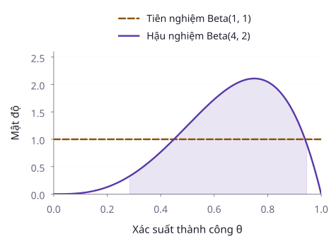
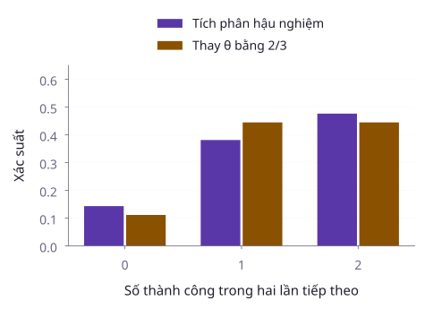
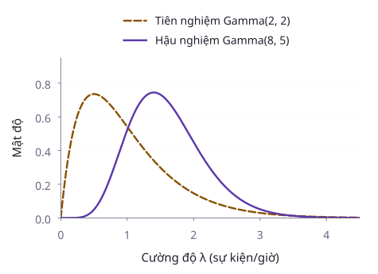

Giả sử một đường truyền đã gửi bốn gói tin, trong đó ba gói đến đích thành công. Tỷ lệ quan sát được bằng ba phần tư. Tuy nhiên, bốn phép thử chưa xác định chính xác xác suất thành công của đường truyền. Ta sẽ mô tả sự chưa biết ấy như thế nào và dự đoán kết quả của những lần gửi tiếp theo ra sao?

[Định lý Bayes](./10-tinh-toan-xac-suat.md) cho phép cập nhật xác suất khi biết thêm dữ kiện. Trong bài này, đối tượng được cập nhật là tham số của mô hình. Ta sẽ tính phân phối hậu nghiệm, dựng khoảng xác suất cho tham số và phân biệt dự đoán bằng tích phân với cách thay tham số bằng một ước lượng.

## 1. Từ trọng số ban đầu đến trọng số sau quan sát

Xét hai trạng thái giả định của một hệ thống. Trạng thái A có xác suất phát sinh lỗi bằng 0,2, còn trạng thái B có xác suất này bằng 0,8. Trước khi kiểm tra, ta gán xác suất 0,9 cho A và 0,1 cho B. Một lần kiểm tra phát hiện lỗi.

Gọi dữ kiện vừa quan sát là D. Bảng sau mở rõ phép nhân trong công thức Bayes.

| Trạng thái | Xác suất trước kiểm tra | Xác suất quan sát D | Trọng số chưa chuẩn hóa |
| --- | --- | --- | --- |
| A | 0,9 | 0,2 | 0,18 |
| B | 0,1 | 0,8 | 0,08 |

Xác suất của D bằng tổng hai trọng số, tức 0,26. Vì vậy, xác suất của B sau khi thấy lỗi là

$$
P(B\mid D)=\frac{0{,}08}{0{,}26}.
$$

Kết quả bằng $4/13$, xấp xỉ 30,77%. Dữ kiện làm xác suất của B tăng so với ban đầu, nhưng chưa khiến B trở thành trạng thái có xác suất lớn nhất. Ta phải kết hợp mức phù hợp của dữ kiện với cả hai trọng số ban đầu.

**Phân phối tiên nghiệm** mô tả thông tin về tham số trước dữ kiện đang xét. **Phân phối hậu nghiệm** mô tả thông tin ấy sau khi điều kiện hóa theo dữ kiện. Việc dùng tiên nghiệm không cho phép tùy tiện chọn kết luận. Tiên nghiệm, mô hình lấy mẫu và dữ liệu đều phải được phát biểu để người khác có thể kiểm tra phép suy luận.

## 2. Tham số liên tục cần một mật độ

Quay lại đường truyền. Gọi $\theta$ là xác suất gửi thành công. Giả sử các kết quả gửi độc lập khi đã biết $\theta$ và cùng tuân theo mô hình Bernoulli.

Với tham số liên tục, ta dùng mật độ tiên nghiệm $\pi_0(\theta)$ và mật độ hậu nghiệm $\pi(\theta\mid D)$. Hàm hợp lý $L(\theta)$ giữ dữ liệu cố định và thay đổi tham số.

$$
\pi(\theta\mid D)=\frac{L(\theta)\pi_0(\theta)}{m(D)}.
$$

Ở đây, $m(D)$ là hằng số chuẩn hóa. Với tham số trong khoảng từ 0 đến 1,

$$
m(D)=\int_0^1 L(u)\pi_0(u)\,du.
$$

Hằng số này phải dương và hữu hạn. Mật độ tại một điểm không phải xác suất tham số bằng đúng điểm đó. Muốn tính xác suất của một khoảng, ta tích phân mật độ hậu nghiệm trên khoảng tương ứng.

::: example Bốn lần gửi với ba lần thành công
Giả sử tiên nghiệm là phân phối đều trên khoảng từ 0 đến 1, tức beta với hai tham số bằng 1. Chuỗi kết quả quan sát là $(1,1,0,1)$. Tính độc lập có điều kiện cho

$$
L(\theta)=\theta^3(1-\theta).
$$

Ba thừa số $\theta$ ứng với ba lần thành công. Thừa số còn lại ứng với lần thất bại. Nếu chỉ ghi tổng số thành công, hàm hợp lý có thêm hệ số tổ hợp bằng 4. Hệ số đó không phụ thuộc $\theta$ và sẽ bị triệt tiêu khi chuẩn hóa.

Đặt I là tích phân của hàm hợp lý trên khoảng đơn vị. Ta tính được

$$
I=\frac14-\frac15=\frac1{20}.
$$

Vì mật độ tiên nghiệm bằng 1, mật độ hậu nghiệm là

$$
\pi(\theta\mid D)=20\theta^3(1-\theta).
$$

Đây là mật độ beta với hai tham số 4 và 2. Trung bình hậu nghiệm bằng $2/3$, còn điểm cực đại của mật độ bằng $3/4$. Hai kết quả trả lời hai câu hỏi khác nhau, nên chúng không nhất thiết trùng nhau.
:::

### Cập nhật beta với dữ liệu Bernoulli

Giả sử tiên nghiệm là beta với tham số $a,b>0$. Sau n phép thử độc lập có điều kiện, ta quan sát s lần thành công và n trừ s lần thất bại. Đặt

$$
a'=a+s,\qquad b'=b+n-s.
$$

Nhân mật độ tiên nghiệm với hàm hợp lý làm cộng các số mũ tương ứng. Vì vậy,

$$
\theta\mid D\sim\mathrm{Beta}(a',b').
$$

Họ tiên nghiệm và hậu nghiệm cùng là beta. Ta gọi đây là một cặp liên hợp. Hai tham số của tiên nghiệm đóng vai trò trọng số thông tin trong phép cập nhật, nhưng không phải những quan sát thực tế vừa được thu thập.

Khi dữ liệu được thu thập nối tiếp, hậu nghiệm của bước trước có thể làm tiên nghiệm của bước sau. Mỗi quan sát chỉ được đưa vào hàm hợp lý một lần. Dùng lại cùng dữ liệu để chọn tiên nghiệm rồi tiếp tục coi chúng là dữ kiện mới sẽ làm thông tin bị đếm lặp.

## 3. Xác suất hậu nghiệm và khoảng xác suất

Với hậu nghiệm beta trong ví dụ trên, hàm phân phối tại $0\le t\le1$ là

$$
F(t)=5t^4-4t^5.
$$

Biểu thức này thu được bằng cách tích phân mật độ từ 0 đến t.

::: example Đường truyền có xác suất thành công lớn hơn một nửa không?
Đặt $r=P(\theta>1/2\mid D)$. Lấy phần bù của xác suất tích lũy cho

$$
r=1-F(1/2)=\frac{13}{16}.
$$

Kết quả bằng 81,25%, theo đúng tiên nghiệm và mô hình đã chọn.

Một khoảng có hai đuôi xác suất bằng 2,5% được xác định bằng hai phân vị hậu nghiệm. Khoảng 95% tính được xấp xỉ

$$
[0{,}2836,\;0{,}9473].
$$

Khoảng còn rộng dù tỷ lệ mẫu bằng 0,75. Bốn quan sát cung cấp ít thông tin để xác định chính xác tham số.
:::

Khoảng trên thường được gọi là khoảng xác suất hậu nghiệm (credible interval). Sau khi điều kiện hóa theo dữ liệu, xác suất hậu nghiệm để tham số nằm trong khoảng bằng 95%, với sai số làm tròn ở hai đầu mút.

Trong [khoảng tin cậy tần suất](./39-khoang-tin-cay-tham-so.md), tham số được giữ cố định và quy trình lấy mẫu tạo ra khoảng ngẫu nhiên. Mức tin cậy mô tả độ bao phủ qua những lần lấy mẫu lặp lại. Hai phát biểu sử dụng hai mô hình xác suất khác nhau. Không chuyển cách diễn giải từ mô hình này sang mô hình kia chỉ vì cả hai khoảng đều mang nhãn 95%.

## 4. Dự đoán cần tính cả sự chưa biết về tham số

Gọi Y là chỉ báo thành công của lần gửi tiếp theo. Khi biết $\theta$, xác suất thành công bằng $\theta$. Sau dữ liệu D, luật kỳ vọng toàn phần cho

$$
P(Y=1\mid D)=E(\theta\mid D).
$$

Trong ví dụ, xác suất dự đoán bằng $2/3$. Với một phép thử Bernoulli tiếp theo, thay tham số bằng trung bình hậu nghiệm cho cùng kết quả. Tuy nhiên, sự trùng hợp này không đúng với mọi câu hỏi dự đoán.

::: example Hai lần gửi tiếp theo cùng thành công
Khi biết $\theta$, xác suất cả hai lần thành công bằng $\theta^2$. Do đó, ta phải lấy trung bình hậu nghiệm của bình phương tham số.

$$
E(\theta^2\mid D)=\frac{4\cdot5}{6\cdot7}.
$$

Kết quả bằng $10/21$, xấp xỉ 0,4762. Nếu thay $\theta$ bằng trung bình $2/3$ rồi mới bình phương, ta nhận $4/9$, xấp xỉ 0,4444.

Hai phép tính khác nhau vì kỳ vọng bình phương còn chứa phương sai. Các lần gửi tương lai độc lập khi đã biết tham số. Khi lấy trung bình qua một tham số chung chưa biết, chúng không còn độc lập nói chung.
:::

Bảng xác suất dự đoán của số thành công K mở rõ ba khả năng.

| K | 0 | 1 | 2 |
| --- | --- | --- | --- |
| Xác suất hậu nghiệm dự đoán | $1/7$ | $8/21$ | $10/21$ |

Ba xác suất cộng thành 1. Phân phối này là trường hợp của phân phối beta–nhị thức. Nó tính cả biến thiên của các phép thử mới và sự chưa biết về xác suất thành công chung.

## 5. Cập nhật cường độ Poisson bằng tiên nghiệm gamma

Giả sử các số đếm trên những khoảng thời gian không chồng lấn độc lập khi biết cường độ $\lambda$. Số đếm trong khoảng dài t giờ có phân phối Poisson với kỳ vọng $\lambda t$. Mô hình giả thiết cường độ không đổi trên thời gian đang xét.

Chọn tiên nghiệm gamma theo quy ước hình dạng a và tốc độ b. Nếu ghi nhận tổng cộng k sự kiện trong tổng thời gian T, phép nhân mật độ cho quy tắc cập nhật

$$
a'=a+k,\qquad b'=b+T.
$$

Hậu nghiệm là gamma với hình dạng $a'$ và tốc độ $b'$. Tham số tốc độ b có đơn vị thời gian trong cách tham số hóa này. Không nhầm b với tham số thang đo bằng nghịch đảo của nó.

::: example Số sự kiện ghi nhận trên máy chủ
Giả sử tiên nghiệm là gamma với hình dạng 2 và tốc độ 2 giờ. Ba khoảng theo dõi, mỗi khoảng một giờ, ghi nhận lần lượt 1, 3 và 2 sự kiện. Tổng số sự kiện bằng 6 và tổng thời gian bằng 3 giờ.

Hậu nghiệm có hình dạng 8 và tốc độ 5 giờ. Trung bình cường độ hậu nghiệm bằng $8/5=1{,}6$ sự kiện mỗi giờ. Phương sai bằng $8/25=0{,}32$, với đơn vị là bình phương đơn vị của cường độ.

Để dự đoán không có sự kiện nào trong giờ tiếp theo, ta lấy kỳ vọng hậu nghiệm của $e^{-\lambda}$.

$$
P(K_{\mathrm{mới}}=0\mid D)=\left(\frac56\right)^8.
$$

Kết quả xấp xỉ 0,2326. Thay cường độ bằng 1,6 rồi tính $e^{-1{,}6}$ chỉ cho xấp xỉ 0,2019. Lấy tích phân qua phân phối tham số và thay tham số bằng một điểm ước lượng là hai thao tác khác nhau.
:::

Tiên nghiệm có ảnh hưởng rõ khi dữ liệu còn ít. Khi so sánh những tiên nghiệm hợp lý khác nhau, cần xem kết luận nào ổn định và kết luận nào thay đổi. Đồng thời, phải kiểm tra mô hình lấy mẫu. Một hậu nghiệm tính đúng không khắc phục được giả thiết độc lập hoặc cường độ không đổi bị vi phạm.

## Tóm tắt

Suy luận Bayes nhân thông tin tiên nghiệm với hàm hợp lý rồi chuẩn hóa để tạo hậu nghiệm. Với dữ liệu Bernoulli và tiên nghiệm beta, số thành công và thất bại được cộng vào hai tham số tương ứng. Với số đếm Poisson và tiên nghiệm gamma, số sự kiện cập nhật hình dạng, còn thời gian quan sát cập nhật tốc độ.

Dự đoán bằng hậu nghiệm phải lấy trung bình xác suất có điều kiện qua toàn bộ phân phối tham số. Khoảng xác suất hậu nghiệm và khoảng tin cậy tần suất cần được diễn giải theo đúng mô hình đã dùng để xây dựng chúng.

## Tài liệu tham khảo

- MIT OpenCourseWare. [18.05, Introduction to Probability and Statistics, Spring 2022, Calendar](https://ocw.mit.edu/courses/18-05-introduction-to-probability-and-statistics-spring-2022/pages/calendar/). Các buổi 11–16 về cập nhật Bayes, phân phối beta, tiên nghiệm liên hợp và khoảng xác suất.
- MIT OpenCourseWare. [18.05, Classes: Reading and In-class Materials](https://ocw.mit.edu/courses/18-05-introduction-to-probability-and-statistics-spring-2022/pages/classes-reading-and-in-class-materials/). Các tài liệu về tiên nghiệm liên tục và xác suất dự đoán.
- Joseph K. Blitzstein và Jessica Hwang. [Introduction to Probability, tài nguyên chính thức của Harvard Stat 110](https://projects.iq.harvard.edu/stat110/home). Xác suất có điều kiện, kỳ vọng có điều kiện và các họ phân phối beta, gamma.

## Bài tập tự luyện

::: exercise 1. Tính hậu nghiệm từ một mẫu nhỏ
Một tham số Bernoulli có tiên nghiệm đều trên khoảng từ 0 đến 1. Ba phép thử độc lập khi biết tham số cho hai lần thành công. Xác định hậu nghiệm, trung bình hậu nghiệm và xác suất hậu nghiệm để tham số lớn hơn một nửa.
:::

::: solution
Cộng hai thành công và một thất bại vào hai tham số tiên nghiệm. Hậu nghiệm là beta với hai tham số 3 và 2. Trung bình bằng $3/5=0{,}6$.

Mật độ hậu nghiệm bằng $12\theta^2(1-\theta)$. Tích phân từ 0 đến t cho hàm phân phối

$$
F(t)=4t^3-3t^4.
$$

Tại t bằng một nửa, hàm phân phối bằng $5/16$. Vì vậy, xác suất cần tìm bằng $11/16=0{,}6875$.
:::

::: exercise 2. Dự đoán sau những lần thành công liên tiếp
Chọn tiên nghiệm beta với hai tham số 2 và 3. Năm phép thử độc lập có điều kiện đều thành công. Tính xác suất dự đoán cho lần tiếp theo và cho hai lần tiếp theo cùng thành công.
:::

::: solution
Hậu nghiệm có hai tham số 7 và 3. Xác suất thành công của một lần tiếp theo bằng trung bình hậu nghiệm, tức $7/10=0{,}7$.

Với hai lần cùng thành công, phải lấy kỳ vọng hậu nghiệm của bình phương tham số.

$$
E(\theta^2\mid D)=\frac{7\cdot8}{10\cdot11}.
$$

Kết quả bằng $28/55$, xấp xỉ 0,5091. Bình phương 0,7 chỉ cho 0,49 và bỏ qua phương sai hậu nghiệm của tham số.
:::

::: exercise 3. Kiểm tra đơn vị trong cập nhật gamma
Cường độ một quá trình đếm không đổi có tiên nghiệm gamma với hình dạng 3 và tốc độ 2 giờ. Trong bốn giờ quan sát, có tổng cộng năm sự kiện. Xác định hậu nghiệm, trung bình và phương sai của cường độ.
:::

::: solution
Năm sự kiện cập nhật hình dạng thành 8. Bốn giờ quan sát cập nhật tốc độ thành 6 giờ. Hậu nghiệm là gamma theo quy ước hình dạng 8 và tốc độ 6.

Trung bình bằng $8/6=4/3$ sự kiện mỗi giờ. Phương sai bằng $8/36=2/9$, với đơn vị bình phương của cường độ. Cộng số sự kiện vào tham số thời gian sẽ sai cả ý nghĩa mô hình lẫn đơn vị đo.
:::

::: exercise 4. Diễn giải hai khoảng mang nhãn 95%
Một nhóm công bố khoảng tin cậy tần suất 95% cho một tham số. Nhóm khác dùng mô hình Bayes và công bố khoảng xác suất hậu nghiệm 95%. Có được diễn giải cả hai là “Sau khi có dữ liệu, tham số có xác suất 95% nằm trong khoảng đã công bố” không? Giải thích thông tin cần biết để đánh giá từng kết quả.
:::

::: solution
Không thể dùng chung cách diễn giải đó. Trong cách tiếp cận tần suất, tham số cố định và mức tin cậy mô tả độ bao phủ của quy trình qua những mẫu lặp lại. Cần kiểm tra thiết kế lấy mẫu, giả thiết và cách dựng khoảng.

Trong mô hình Bayes, phát biểu xác suất sau dữ liệu sử dụng phân phối hậu nghiệm của tham số. Cần biết tiên nghiệm, hàm hợp lý và dữ liệu đã dùng. Cùng một mức 95% không làm hai quy trình trở thành một phương pháp.
:::

## Tài liệu tham khảo

- MIT OpenCourseWare. [18.05, Spring 2022, các buổi học về suy luận Bayes](https://ocw.mit.edu/courses/18-05-introduction-to-probability-and-statistics-spring-2022/pages/calendar/).

