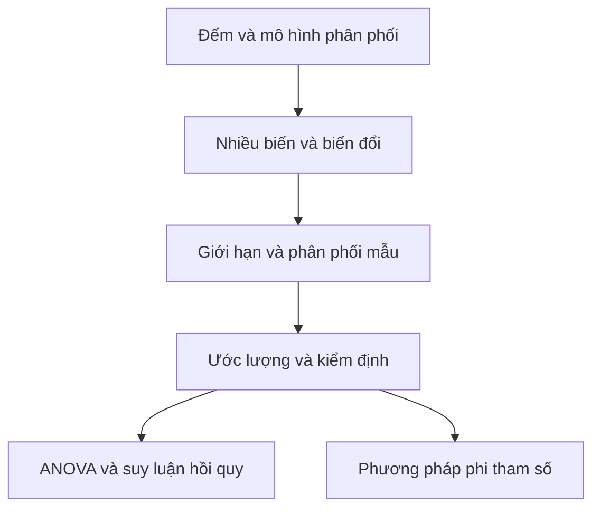

# Bổ trợ xác suất thống kê cổ điển

Một phép mô phỏng có thể cho thấy trung bình mẫu ổn định dần. Để biết khi nào hiện tượng ấy xảy ra, ta cần các giả thiết của luật số lớn. Một khoảng ước lượng có thể được tính từ dữ liệu, nhưng để xác định mức bao phủ, ta cần phân phối của thống kê dùng để dựng khoảng đó.

Phần bổ trợ nối cách tiếp cận bằng dữ liệu và mô phỏng trong 27 bài hiện có với nền tảng xác suất giải tích và thống kê toán. Mỗi chuyên đề có trang riêng, hình minh họa, ví dụ có lời giải và bài tập tự luyện. Các bài cũ vẫn là nơi học phân tích dữ liệu, suy luận bằng mô phỏng, nhân quả và dự đoán.

## 1. Đếm và xây dựng mô hình xác suất

Các bài [Cơ sở xác suất](./bai-giang/09-co-so-xac-suat.md), [Tính toán xác suất](./bai-giang/10-tinh-toan-xac-suat.md) và [Phân phối xác suất](./bai-giang/11-phan-phoi-xac-suat.md) cung cấp điểm xuất phát. Ba chuyên đề dưới đây mở rộng kỹ thuật đếm và các họ phân phối.

- [Đếm và xác suất cổ điển](./bai-giang/28-dem-va-xac-suat-co-dien.md): Phân biệt thứ tự, hoàn lại và đồng khả năng. Dùng bù trừ, xác suất hình học và tính liên tục của xác suất.
- [Phân phối rời rạc mở rộng](./bai-giang/29-phan-phoi-roi-rac-mo-rong.md): Mô hình số lần chờ đến thành công và số đếm thuộc nhiều nhóm bằng phân phối hình học, nhị thức âm và đa thức.
- [Phân phối liên tục mở rộng](./bai-giang/30-phan-phoi-lien-tuc-mo-rong.md): Tính xác suất và mômen bằng tích phân. Học các mô hình mũ, gamma, beta và những phân phối liên quan.

## 2. Phụ thuộc, biến đổi và các định lý giới hạn

Sau [Biến ngẫu nhiên](./bai-giang/12-bien-ngau-nhien.md), [Kỳ vọng và phương sai](./bai-giang/13-ky-vong-va-sai-so-chuan.md), hãy chuyển từ một biến sang nhiều biến. Tích phân một biến, đạo hàm và khái niệm độc lập là các kiến thức cần dùng.

- [Vector ngẫu nhiên và phân phối đồng thời](./bai-giang/31-vector-ngau-nhien-va-phan-phoi-dong-thoi.md): Từ bảng xác suất đến mật độ trên miền hai chiều, phân phối biên và phân phối có điều kiện.
- [Hiệp phương sai và kỳ vọng có điều kiện](./bai-giang/32-hiep-phuong-sai-va-ky-vong-co-dieu-kien.md): Định lượng phụ thuộc, dự đoán từ thông tin và phân rã phương sai trong nhóm, giữa nhóm.
- [Biến đổi và thống kê thứ tự](./bai-giang/33-bien-doi-va-thong-ke-thu-tu.md): Tìm phân phối sau biến đổi, cộng các đại lượng độc lập và xét cực trị trong mẫu.
- [Mômen, hàm sinh và bất đẳng thức](./bai-giang/34-momen-ham-sinh-va-bat-dang-thuc.md): Dùng hàm sinh để tính mômen và bất đẳng thức để chặn xác suất.
- [Luật số lớn và định lý giới hạn](./bai-giang/35-luat-so-lon-va-dinh-ly-gioi-han.md): Phân biệt các kiểu hội tụ, kiểm tra giả thiết và chọn xấp xỉ phù hợp cho tổng hoặc trung bình.

## 3. Ước lượng và kiểm định trong mô hình tham số

Đọc trước [Từ mẫu đến tổng thể](./bai-giang/15-tu-mau-den-tong-the.md), [Khoảng tin cậy](./bai-giang/16-khoang-tin-cay.md) và hai bài kiểm định [thứ nhất](./bai-giang/18-kiem-dinh-gia-thuyet-1.md), [thứ hai](./bai-giang/19-kiem-dinh-gia-thuyet-2.md). Tuyến bổ trợ tập trung vào cách suy ra công thức và điều kiện áp dụng.

- [Phân phối mẫu chính xác](./bai-giang/36-phan-phoi-mau-chinh-xac.md): Hiểu nguồn gốc các phân phối Student, khi bình phương và Fisher cùng bậc tự do.
- [Ước lượng điểm, mômen và hợp lý cực đại](./bai-giang/37-uoc-luong-diem-momen-va-hop-ly-cuc-dai.md): Xây dựng ước lượng và đánh giá độ chệch, phương sai, sai số bình phương trung bình.
- [Tính đủ và hiệu quả ước lượng](./bai-giang/38-tinh-du-va-hieu-qua-uoc-luong.md): Rút gọn thông tin trong mẫu, cải thiện ước lượng và kiểm tra giới hạn của cận Cramér–Rao.
- [Khoảng tin cậy tham số](./bai-giang/39-khoang-tin-cay-tham-so.md): Chọn khoảng cho trung bình, tỷ lệ hoặc phương sai, với một mẫu hay hai mẫu.
- [Kiểm định tham số và công suất](./bai-giang/40-kiem-dinh-tham-so-va-cong-suat.md): Chọn thống kê kiểm định, miền bác bỏ, công suất và cỡ mẫu phù hợp với câu hỏi.
- [Kiểm định khi bình phương](./bai-giang/41-kiem-dinh-khi-binh-phuong.md): Kiểm tra độ phù hợp và quan hệ giữa các biến định tính qua số đếm kỳ vọng.

## 4. So sánh nhiều nhóm và suy luận từ mô hình

- [Phân tích phương sai](./bai-giang/42-phan-tich-phuong-sai.md): Phân rã biến thiên, so sánh nhiều trung bình và phân biệt tác động chính với tương tác.
- [Suy luận hồi quy tuyến tính](./bai-giang/43-suy-luan-hoi-quy-tuyen-tinh.md): Bổ sung khoảng tin cậy hệ số, kiểm định mô hình và khoảng dự đoán cho phần khớp đường hồi quy đã học.
- [Phương pháp phi tham số](./bai-giang/44-phuong-phap-phi-tham-so.md): Dùng dấu, thứ hạng hoặc hàm phân phối thực nghiệm với những giả thiết được phát biểu rõ.
- [Suy luận Bayes và phân phối dự đoán](./bai-giang/45-suy-luan-bayes-va-du-doan.md): Cập nhật tiên nghiệm thành hậu nghiệm, dựng khoảng xác suất và dự đoán bằng tích phân trong mô hình beta–Bernoulli và gamma–Poisson.

Khi ôn một dạng bài, hãy ghi lại mô hình lấy mẫu, tham số cần tìm và giả thiết của công thức trước khi thay số. Chỉ xem lời giải sau khi đã tự chọn phương pháp. Nếu một điều kiện không thỏa, quay lại bước chọn mô hình.

## Tài liệu tham khảo

- MIT OpenCourseWare. [18.05, Calendar, Spring 2022](https://ocw.mit.edu/courses/18-05-introduction-to-probability-and-statistics-spring-2022/pages/calendar/). Các chủ đề xác suất, phân phối đồng thời, hợp lý cực đại, suy luận và hồi quy.
- Penn State. [STAT 414, Introduction to Probability Theory](https://online.stat.psu.edu/stat414/). Phân phối, biến đổi, kỳ vọng và các định lý giới hạn.
- Penn State. [STAT 415, Introduction to Mathematical Statistics](https://online.stat.psu.edu/stat415/). Ước lượng và suy luận thống kê.
- NIST/SEMATECH. [e-Handbook of Statistical Methods](https://www.itl.nist.gov/div898/handbook/). Các phương pháp phân tích, kiểm định và đánh giá mô hình.
