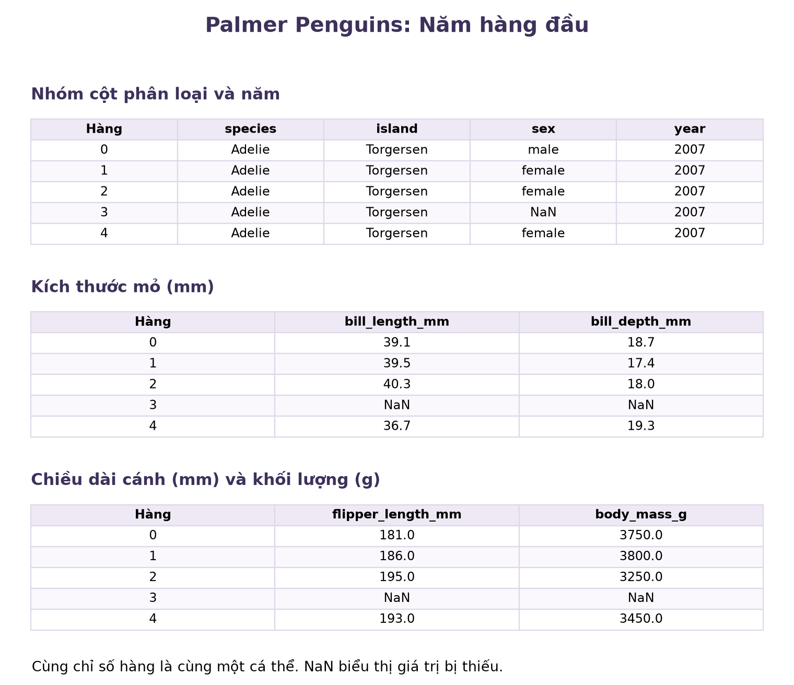

# Problem Set 01: Câu hỏi và dữ liệu

Một phép tính đúng chưa đủ để bảo đảm một kết luận đúng. Ta còn cần biết đang đếm đối tượng nào, dữ liệu được thu thập ra sao và phép tổng hợp giữ lại thông tin gì. Bộ bài tập này giúp bạn nối câu hỏi nghiên cứu với cách đọc dữ liệu và phạm vi của kết luận.

## Mục tiêu

Sau khi hoàn thành, bạn có thể:

1. Thực hiện các phép tính tay đơn giản để giải thích vai trò của mẫu số, trọng số, phép gộp nhóm và phép đo lặp.
2. Phân biệt mô tả, suy rộng, dự đoán và kết luận nhân quả. Xác định giới hạn của kết luận khi dữ liệu chỉ cho thấy một mối liên hệ.
3. Từ một khẳng định, đặt câu hỏi về cách dữ liệu đã được tạo ra và thu thập.
4. Xác định đơn vị quan sát, các biến, giá trị của biến, loại biến và mức chi tiết của từng hàng.
5. Giải thích vì sao số hàng trong bảng không mặc nhiên bằng số đối tượng độc lập.
6. Đọc cấu trúc cơ bản của bảng DataFrame và phân biệt ý nghĩa thống kê của biến với kiểu lưu trữ của phần mềm.

## Cách làm bài

- Với bài 1–4, hãy tính tay và ghi các bước chính. Không dùng Python để thay cho phần trình bày của bạn.
- Với câu hỏi lập luận, hãy nêu lý do. Nếu kết luận vượt quá dữ liệu, cần chỉ rõ thông tin hoặc điều kiện còn thiếu.
- Khi đọc một bảng, hãy xác định mỗi hàng là gì, đối tượng nào được đo nhiều lần và câu hỏi đang yêu cầu đếm đối tượng nào.
- Bài 9 chỉ dùng bốn thao tác đọc cấu trúc là `head()`, `shape`, `columns` và `dtypes`. Không yêu cầu tính thống kê mô tả hoặc vẽ biểu đồ.
- Các bài không đòi hỏi kiến thức xác suất hay suy luận thống kê nâng cao. Hãy tự làm trước khi mở lời giải.

Các câu hỏi lập luận sử dụng bốn loại kết luận:

- **Mô tả** chỉ nói về dữ liệu đã quan sát.
- **Suy rộng** đưa kết luận từ nhóm đã quan sát ra một tổng thể rộng hơn.
- **Dự đoán** dùng thông tin đã biết để dự báo một giá trị chưa biết.
- **Kết luận nhân quả** nói rằng thay đổi một yếu tố sẽ làm thay đổi yếu tố khác.

## Phần A. Tính tay

### Bài 1. So sánh số máy gặp sự cố và tỷ lệ gặp sự cố

::: exercise
Một trung tâm dữ liệu vận hành hai loại máy chủ. Trong cùng một tháng, trung tâm ghi nhận:

| Loại máy | Số máy vận hành | Số máy gặp sự cố |
| --- | ---: | ---: |
| A | 2.400 | 48 |
| B | 700 | 21 |

Cột cuối đếm số máy có gặp sự cố trong tháng. Bảng không cho biết mỗi máy gặp bao nhiêu sự cố.

1. Nếu chỉ so sánh số máy gặp sự cố, loại nào có số lượng lớn hơn?
2. Tính tỷ lệ máy gặp sự cố của từng loại dưới ba dạng: Phân số tối giản, phần trăm và số máy gặp sự cố trên mỗi 1.000 máy đang vận hành.
3. Loại nào có tỷ lệ máy gặp sự cố cao hơn?
4. Giải thích vì sao so sánh 48 với 21 khác với so sánh hai tỷ lệ vừa tính.
5. Viết một câu mô tả được bảng dữ liệu trực tiếp hỗ trợ.
6. Một kỹ sư kết luận: “Sử dụng máy loại B làm tăng nguy cơ gặp sự cố.” Kết luận này bổ sung điều gì mà phép so sánh tỷ lệ chưa chứng minh được?
:::

::: hint
Tỷ lệ của mỗi loại phải dùng số máy vận hành của chính loại đó làm mẫu số. Sau khi tính, hãy tách nhận xét về tháng đã quan sát khỏi kết luận về nguyên nhân.
:::

::: solution
1. Loại A có nhiều máy gặp sự cố hơn vì 48 lớn hơn 21.

2. Với loại A:

$$
\frac{48}{2400}=\frac{1}{50}=2\%.
$$

   Quy đổi ra mỗi 1.000 máy:

$$
\frac{48}{2400}\times1000=20.
$$

   Với loại B:

$$
\frac{21}{700}=\frac{3}{100}=3\%.
$$

   Quy đổi ra mỗi 1.000 máy:

$$
\frac{21}{700}\times1000=30.
$$

3. Loại B có tỷ lệ cao hơn, với 3% so với 2%.
4. Số đếm cho biết có bao nhiêu máy gặp sự cố. Tỷ lệ cho biết các máy đó chiếm bao nhiêu trong từng nhóm, nên đã tính đến quy mô nhóm.
5. “Trong tháng quan sát, 2% máy loại A và 3% máy loại B gặp sự cố.”
6. Kỹ sư đã chuyển từ mô tả mối liên hệ sang kết luận nhân quả. Hai loại máy có thể khác nhau về tuổi máy, khối lượng công việc hoặc điều kiện vận hành. Bảng chưa tách được tác động của loại máy khỏi các yếu tố này.
:::

### Bài 2. Tỷ lệ theo nhóm và tỷ lệ sau khi gộp

::: exercise
Hai hệ thống A và B xử lý các tác vụ dễ và khó. Mỗi ô ghi số tác vụ thành công trên tổng số tác vụ của nhóm đó.

| Loại tác vụ | Hệ thống A | Hệ thống B |
| --- | --- | --- |
| Dễ | 9 thành công trên 10 | 80 thành công trên 100 |
| Khó | 20 thành công trên 100 | 1 thành công trên 10 |

1. Tính tỷ lệ thành công của A và B đối với tác vụ dễ.
2. Tính tỷ lệ thành công của A và B đối với tác vụ khó.
3. Khi xét riêng từng loại tác vụ, hệ thống nào có tỷ lệ thành công cao hơn?
4. Với mỗi hệ thống, tính tổng số tác vụ, tổng số tác vụ thành công và tỷ lệ thành công sau khi gộp hai loại.
5. Sau khi gộp, hệ thống nào có tỷ lệ thành công cao hơn? Thứ tự này có giống kết quả ở câu 3 không?
6. Hoàn thành hai câu bằng tên hệ thống và các tỷ lệ cụ thể: “Trong từng loại tác vụ, … có tỷ lệ thành công cao hơn ….” Và “Khi gộp tất cả tác vụ, … có tỷ lệ thành công cao hơn ….”
7. Dựa vào số tác vụ dễ và khó mà mỗi hệ thống xử lý, giải thích trọng số của từng nhóm và nguyên nhân khiến thứ tự so sánh đảo chiều.
8. Bảng ban đầu phân biệt từng cặp hệ thống và loại tác vụ. Nếu chỉ giữ tổng của mỗi hệ thống, thông tin nào sẽ bị mất?
:::

::: hint
Tỷ lệ chung bằng tổng số thành công chia cho tổng số tác vụ. Không lấy trung bình cộng hai tỷ lệ nếu hai nhóm có số tác vụ khác nhau.
:::

::: solution
1. Với tác vụ dễ, A đạt $9/10=90\%$, còn B đạt $80/100=80\%$.
2. Với tác vụ khó, A đạt $20/100=20\%$, còn B đạt $1/10=10\%$.
3. A có tỷ lệ cao hơn trong cả hai nhóm.
4. Mỗi hệ thống xử lý 110 tác vụ. A thành công $9+20=29$ tác vụ, còn B thành công $80+1=81$ tác vụ. Vì vậy:

$$
p_A=\frac{29}{110}\approx26{,}36\%.
$$

$$
p_B=\frac{81}{110}\approx73{,}64\%.
$$

5. B có tỷ lệ chung cao hơn. Thứ tự đã đảo ngược so với khi xét riêng từng loại tác vụ.
6. “Trong nhóm dễ, A đạt 90% so với 80% của B. Trong nhóm khó, A đạt 20% so với 10% của B.” Và “Khi gộp tất cả tác vụ, B đạt khoảng 73,64%, cao hơn mức 26,36% của A.”
7. A xử lý 100 tác vụ khó nhưng chỉ 10 tác vụ dễ. B xử lý 100 tác vụ dễ nhưng chỉ 10 tác vụ khó. Trong tỷ lệ chung, mỗi nhóm được cho trọng số bằng số tác vụ của nhóm chia cho 110:

$$
p_A=\frac{10}{110}\cdot0{,}9+\frac{100}{110}\cdot0{,}2.
$$

$$
p_B=\frac{100}{110}\cdot0{,}8+\frac{10}{110}\cdot0{,}1.
$$

   Hai trọng số trong mỗi phép tính cộng lại bằng 1. Tác vụ khó chiếm phần lớn ở A, còn tác vụ dễ chiếm phần lớn ở B, nên hai tỷ lệ chung phản ánh cả sự khác nhau về cơ cấu tác vụ.

8. Ta mất số tác vụ và số thành công riêng theo độ khó. Khi đó không còn tính được các tỷ lệ trong từng nhóm hoặc nhận ra sự khác nhau về cơ cấu tác vụ.
:::

### Bài 3. Trung bình theo bộ pin và trung bình theo phép đo

::: exercise
Ba bộ pin được đo nhiệt độ trong một thử nghiệm. Một số dữ liệu bị mất, nên số phép đo còn lại không bằng nhau.

| Bộ pin | Các nhiệt độ còn lại (°C) |
| --- | --- |
| P1 | 10, 14 |
| P2 | 20, 20, 20, 20 |
| P3 | 30 |

1. Có bao nhiêu bộ pin? Nếu mỗi nhiệt độ được lưu thành một hàng, bảng có bao nhiêu hàng?
2. Tính nhiệt độ trung bình của từng bộ pin.
3. Tính trung bình cộng của ba kết quả ở câu 2, để mỗi bộ pin được cho trọng số bằng nhau.
4. Gộp các phép đo lại và tính nhiệt độ trung bình của toàn bộ bảy phép đo.
5. Hai kết quả ở câu 3 và câu 4 có bằng nhau không?
6. Trong phép tính ở câu 3, đối tượng nào có trọng số bằng nhau: Bộ pin hay phép đo? Ở câu 4, trọng số bằng nhau được áp dụng cho đối tượng nào?
7. Vì sao bảy hàng dữ liệu không tương đương với bảy bộ pin độc lập?
8. Nếu muốn mô tả nhiệt độ của một bộ pin khi mỗi bộ pin có vai trò ngang nhau, cách tính nào phù hợp hơn? Nếu muốn mô tả nhiệt độ của một phép đo được ghi lại, nên chọn cách nào?
:::

::: hint
Hãy tính riêng từng trung bình trước. Sau đó xét xem bộ pin P2 đóng góp một phần ba hay bốn phần bảy vào mỗi phép tính.
:::

::: solution
1. Có ba bộ pin và $2+4+1=7$ hàng dữ liệu.
2. Trung bình của P1, P2, P3 lần lượt là:

$$
\bar x_1=\frac{10+14}{2}=12\,{}^\circ\mathrm C.
$$

$$
\bar x_2=20\,{}^\circ\mathrm C,\qquad
\bar x_3=30\,{}^\circ\mathrm C.
$$

3. Trung bình khi mỗi bộ pin có vai trò ngang nhau:

$$
\bar x_{\mathrm{pin}}=\frac{12+20+30}{3}
\approx20{,}67\,{}^\circ\mathrm C.
$$

4. Tổng của bảy nhiệt độ là 134 °C. Do đó:

$$
\bar x_{\mathrm{do}}=\frac{134}{7}
\approx19{,}14\,{}^\circ\mathrm C.
$$

5. Hai kết quả khác nhau.
6. Ở câu 3, mỗi bộ pin có trọng số $1/3$. Ở câu 4, mỗi phép đo có trọng số $1/7$, nên ba bộ pin lần lượt có trọng số $2/7$, $4/7$ và $1/7$.
7. Có nhiều phép đo thuộc cùng một bộ pin. Chúng không tạo thêm bộ pin mới, và ta không thể mặc nhiên coi các phép đo cùng một bộ pin là độc lập.
8. Trung bình ở câu 3 phù hợp với yêu cầu cho ba bộ pin vai trò ngang nhau. Trung bình ở câu 4 phù hợp khi mỗi phép đo được ghi lại có vai trò ngang nhau. Tuy nhiên, cả hai chỉ mô tả dữ liệu còn lại. Muốn kết luận về toàn bộ thử nghiệm, cần biết vì sao dữ liệu bị mất.
:::

### Bài 4. Lập bảng liên hợp và nhận diện thông tin bị mất

::: exercise
Một khảo sát ghi nhận câu trả lời của 10 sinh viên. Mỗi hàng là một người trả lời.

- `student_id` là mã sinh viên.
- `season` là mùa yêu thích, với `Spring`, `Summer`, `Fall`, `Winter` lần lượt là xuân, hạ, thu, đông.
- `mts_beach` là lựa chọn đi núi (`Mountains`) hoặc đi biển (`Beach`).
- `coding_exp` cho biết có kinh nghiệm lập trình (`Yes`) hay chưa (`No`).

<div class="data-lab-set">

| student_id | season | mts_beach | coding_exp |
| --- | --- | --- | --- |
| 01 | Spring | Beach | No |
| 02 | Spring | Mountains | Yes |
| 03 | Summer | Beach | No |
| 04 | Summer | Beach | Yes |
| 05 | Summer | Mountains | No |
| 06 | Fall | Mountains | Yes |
| 07 | Fall | Mountains | No |
| 08 | Winter | Beach | Yes |
| 09 | Winter | Mountains | No |
| 10 | Winter | Beach | No |

</div>

1. Đơn vị quan sát là gì? Bảng có bao nhiêu quan sát?
2. Lập bảng liên hợp giữa mùa yêu thích và lựa chọn đi núi hoặc đi biển. Điền số người vào từng ô và tính tổng hàng, tổng cột theo mẫu dưới đây.
3. Với từng mùa, tính tỷ lệ chọn đi biển trong số những người chọn mùa đó.
4. Nếu chỉ còn bảng liên hợp, ta có biết sinh viên 04 có kinh nghiệm lập trình hay không?
5. Có thể khôi phục duy nhất thứ tự 10 sinh viên trong bảng gốc từ bảng liên hợp không? Vì sao?
6. So sánh mức chi tiết của hai bảng. Một hàng trong bảng gốc đại diện cho đối tượng nào? Một ô trong bảng liên hợp chứa thông tin gì?
7. Giải thích vì sao gộp dữ liệu vừa làm bảng ngắn hơn, vừa thay đổi những câu hỏi có thể trả lời.

| Mùa | Mountains | Beach | Tổng |
| --- | ---: | ---: | ---: |
| Spring | … | … | … |
| Summer | … | … | … |
| Fall | … | … | … |
| Winter | … | … | … |
| Tổng | … | … | 10 |
:::

::: hint
Chẳng hạn, ô Summer và Beach đếm những người đồng thời chọn mùa hạ và đi biển. Mẫu số để tính tỷ lệ đi biển của mùa hạ là tổng số người chọn mùa hạ.
:::

::: solution
1. Đơn vị quan sát là một sinh viên trả lời khảo sát. Có 10 quan sát.
2. Bảng đếm thu được:

| Mùa | Mountains | Beach | Tổng |
| --- | ---: | ---: | ---: |
| Spring | 1 | 1 | 2 |
| Summer | 1 | 2 | 3 |
| Fall | 2 | 0 | 2 |
| Winter | 1 | 2 | 3 |
| Tổng | 5 | 5 | 10 |

3. Tỷ lệ đi biển theo mùa lần lượt là $1/2=50\%$ cho Spring, $2/3\approx66{,}67\%$ cho Summer, $0/2=0\%$ cho Fall và $2/3\approx66{,}67\%$ cho Winter.
4. Không. Bảng liên hợp không giữ mã sinh viên và thông tin kinh nghiệm lập trình.
5. Không. Nhiều cách sắp xếp các hàng và phân bổ danh tính khác nhau vẫn tạo ra cùng một bảng đếm.
6. Một hàng của bảng gốc là câu trả lời của một sinh viên. Một ô dữ liệu trong bảng liên hợp là số sinh viên cùng thuộc một cặp lựa chọn về mùa và nơi đi chơi.
7. Bảng liên hợp giữ số đếm theo hai biến nhưng bỏ thông tin từng người và biến kinh nghiệm lập trình. Vì vậy, ta vẫn tính được tỷ lệ đi biển theo mùa, nhưng không trả lời được câu hỏi về một sinh viên cụ thể.
:::

## Phần B. Đánh giá lập luận

### Bài 5. Sức khỏe của nhóm vừa bỏ thuốc

::: exercise
Một nghiên cứu quan sát so sánh người đang hút thuốc với người gần đây đã bỏ thuốc. Khi so sánh trong các nhóm tuổi và giới tính, nhóm vừa bỏ thuốc có tình trạng sức khỏe kém hơn. Một người kết luận: “Bỏ thuốc làm sức khỏe xấu đi.”

1. Kết quả quan sát mô tả mối liên hệ nào giữa tình trạng hút thuốc và sức khỏe?
2. Câu “Bỏ thuốc làm sức khỏe xấu đi” thuộc loại kết luận nào: Mô tả, suy rộng, dự đoán hay nhân quả?
3. Vì sao chỉ từ mối liên hệ quan sát được ở câu 1, ta chưa thể suy ra kết luận nhân quả ở câu 2?
4. Mô tả một khả năng trong đó sức khỏe giảm sút trước, rồi khiến một số người quyết định bỏ thuốc.
5. Viết lại kết luận để chỉ nói điều dữ liệu đã mô tả hỗ trợ.
6. Vì sao chỉ tăng số người trong cùng kiểu nghiên cứu chưa chắc trả lời được câu hỏi về tác động của việc bỏ thuốc so với tiếp tục hút?
:::

::: hint
Hãy xem xét thứ tự thời gian. Tình trạng sức khỏe trước khi bỏ thuốc có thể ảnh hưởng đến quyết định bỏ thuốc hay không?
:::

::: solution
1. Trong nhóm được quan sát và trong các nhóm tuổi, giới tính đang so sánh, người vừa bỏ thuốc có sức khỏe kém hơn người còn hút thuốc.
2. Đây là kết luận nhân quả vì quy sự thay đổi sức khỏe cho việc bỏ thuốc.
3. Việc xét tuổi và giới tính chưa loại trừ mọi khác biệt giữa hai nhóm. Đặc biệt, sức khỏe trước khi bỏ thuốc có thể ảnh hưởng đến quyết định bỏ thuốc.
4. Một người có triệu chứng bệnh, sau đó quyết định bỏ thuốc. Khi khảo sát, người đó thuộc nhóm vừa bỏ thuốc nhưng vẫn có sức khỏe kém do tình trạng đã xuất hiện trước đó.
5. “Trong dữ liệu quan sát, nhóm vừa bỏ thuốc có sức khỏe kém hơn nhóm đang hút thuốc khi so sánh theo tuổi và giới tính.”
6. Thêm người có thể giúp mô tả mối liên hệ chính xác hơn nhưng không tự loại bỏ sự khác nhau có sẵn giữa các nhóm hoặc làm rõ chiều tác động. Cần thông tin và thiết kế nghiên cứu phù hợp để phân biệt các cách giải thích.
:::

### Bài 6. Mối liên hệ giữa hành vi kiểm soát và lượng mỡ cơ thể

::: exercise
Một nghiên cứu ở trẻ nhỏ ghi nhận rằng trẻ có lượng mỡ cơ thể cao hơn thường có mẹ được đánh giá là kiểm soát con nhiều hơn. Từ kết quả đó, một bài báo khuyên cha mẹ của trẻ thừa cân nên giảm mức độ kiểm soát con.

1. Nghiên cứu ghi nhận mối liên hệ nào giữa hai biến?
2. Lời khuyên của bài báo ngầm giả định tác động nhân quả nào?
3. Chỉ rõ bước suy luận đã chuyển từ việc so sánh các gia đình trong dữ liệu sang khẳng định tác động khi cha mẹ thay đổi cách kiểm soát con.
4. Nêu hai cách giải thích khác nhau có thể tạo ra cùng mối liên hệ, mà không cần giả định việc kiểm soát nhiều làm tăng lượng mỡ cơ thể.
5. Viết một tiêu đề hoặc kết luận không vượt quá kết quả quan sát.
6. Nếu chỉ các gia đình tự nguyện tại một địa điểm tham gia nghiên cứu, khẳng định “Mọi trẻ em đều có xu hướng như vậy” còn có vấn đề suy luận nào ngoài vấn đề nhân quả?
:::

::: hint
Một cách giải thích có thể đảo chiều tác động. Cách khác có thể đưa vào một yếu tố ảnh hưởng đến cả hai biến. Hãy diễn đạt chúng như các khả năng cần kiểm tra.
:::

::: solution
1. Trong nhóm trẻ được quan sát, lượng mỡ cơ thể cao hơn đi cùng với mức độ kiểm soát của mẹ được đánh giá cao hơn.
2. Lời khuyên giả định rằng giảm kiểm soát sẽ làm giảm lượng mỡ cơ thể hoặc tình trạng thừa cân.
3. Nghiên cứu so sánh các gia đình khác nhau, còn lời khuyên dự đoán điều xảy ra khi thay đổi hành vi trong một gia đình. Dữ liệu mô tả chưa chứng minh được tác động của sự thay đổi đó.
4. Khả năng thứ nhất là cha mẹ lo lắng khi con tăng cân nên kiểm soát con nhiều hơn. Khả năng thứ hai là một yếu tố chung, chẳng hạn hoàn cảnh sinh hoạt gia đình, ảnh hưởng đến cả hành vi kiểm soát và lượng mỡ cơ thể. Đây là các giả thuyết giải thích, chưa phải kết quả đã được chứng minh.
5. “Trong nhóm khảo sát, lượng mỡ cơ thể của trẻ có liên hệ với mức độ kiểm soát của mẹ.”
6. Khẳng định đó suy rộng từ mẫu tự nguyện tại một địa điểm ra mọi trẻ em. Nhóm tham gia chưa chắc đại diện cho tổng thể rộng hơn, và một xu hướng trong nhóm cũng không có nghĩa đúng với từng trẻ.
:::

### Bài 7. Chương trình cải tạo và tỷ lệ trở lại nhà tù

::: exercise
Một chương trình cải tạo cho phép phạm nhân tự nguyện tham gia khóa huấn luyện tập trung, gọi là boot camp. Sau khi ra tù, những người hoàn thành khóa học có tỷ lệ trở lại nhà tù thấp hơn những phạm nhân còn lại. Người phát ngôn kết luận rằng chương trình làm giảm tái phạm.

1. Viết một câu mô tả được dữ liệu trực tiếp hỗ trợ.
2. Khẳng định “Chương trình làm giảm tái phạm” thuộc loại kết luận nào?
3. Mô tả bằng lời quá trình hình thành hai nhóm so sánh, từ cơ hội tham gia đến tự nguyện đăng ký và hoàn thành khóa học. Ai thuộc nhóm còn lại? Chỉ rõ thông tin nào đề bài chưa cung cấp.
4. Hai nhóm có thể khác nhau từ trước chương trình như thế nào? Nêu ít nhất hai khả năng.
5. Vì sao việc tham gia tự nguyện và điều kiện phải hoàn thành khóa học ảnh hưởng đến cách đánh giá kết luận?
6. Nếu thu thập dữ liệu của 100.000 phạm nhân theo cùng quy trình tự nguyện, số quan sát lớn có tự bảo đảm kết luận nhân quả không? Giải thích.
7. Viết lại kết luận của người phát ngôn cho phù hợp với dữ liệu.
:::

::: hint
Nhóm được so sánh là những người hoàn thành khóa học. Hãy xét những khác biệt có thể xuất hiện ở cả bước đăng ký và bước hoàn thành.
:::

::: solution
1. “Trong dữ liệu theo dõi sau khi ra tù, nhóm hoàn thành khóa học có tỷ lệ trở lại nhà tù thấp hơn nhóm còn lại.”
2. Đây là kết luận nhân quả.
3. Trong số người có cơ hội tham gia, một số tự nguyện đăng ký, rồi chỉ một số trong nhóm đăng ký hoàn thành khóa học. Nhóm so sánh còn lại có thể gồm người không tham gia và người không hoàn thành. Đề chưa cho biết ai đủ điều kiện, ai được mời tham gia hoặc thành phần cụ thể của nhóm còn lại.
4. Người tham gia hoặc hoàn thành có thể có động lực thay đổi cao hơn, có hỗ trợ gia đình tốt hơn, hoặc có hoàn cảnh và tiền sử khác nhóm còn lại. Các khả năng này cần dữ liệu kiểm tra.
5. Tự nguyện đăng ký đã có thể tạo ra hai nhóm khác nhau. Việc chỉ xét người hoàn thành lại chọn thêm một nhóm có khả năng khác với cả những người đã đăng ký nhưng bỏ dở.
6. Không. Số quan sát lớn không tự làm hai nhóm tương đương từ trước chương trình, cũng không xóa ảnh hưởng của cách tự chọn và điều kiện hoàn thành.
7. “Nhóm hoàn thành chương trình có tỷ lệ trở lại nhà tù thấp hơn nhóm còn lại. So sánh này chưa đủ để kết luận chương trình gây ra sự giảm đó.” Ngoài ra, cần biết việc trở lại nhà tù được ghi nhận như thế nào trước khi coi nó là thước đo đầy đủ của tái phạm.
:::

## Phần C. Cấu trúc dữ liệu

### Bài 8. Loại biến thống kê và kiểu lưu trữ

::: exercise
Một hệ thống lưu bốn cột sau:

<div class="data-lab-set">

| Cột | Giá trị minh họa | Ý nghĩa |
| --- | --- | --- |
| `student_id` | 24001234, 24001235, 24001236 | Mã sinh viên |
| `satisfaction` | 1, 2, 3, 4, 5 | Mức hài lòng từ rất không hài lòng đến rất hài lòng |
| `num_siblings` | 0, 1, 2, 3, … | Số anh, chị, em ruột |
| `temperature_c` | 21.4, 21.9, 22.1, … | Nhiệt độ theo °C |

</div>

Phần mềm có thể lưu ba cột đầu bằng số nguyên và cột cuối bằng số thực.

1. Phân loại từng biến thành định tính không thứ tự, định tính có thứ tự, định lượng rời rạc hoặc định lượng liên tục.
2. Với những cột nào, hiệu giữa hai giá trị có ý nghĩa định lượng trong thực tế? Với những cột nào, số chủ yếu là mã nhận diện hoặc mức phân loại?
3. Trung bình của mã sinh viên có ý nghĩa mô tả đặc điểm của sinh viên không? Giải thích dựa vào ý nghĩa của mã.
4. Nếu thay các mức hài lòng bằng nhãn chữ tương ứng từ “Rất không hài lòng” đến “Rất hài lòng”, loại biến thống kê có thay đổi không?
5. Việc `student_id` có kiểu lưu trữ `int64` cho biết điều gì? Nó không cho biết điều gì?
6. Viết một câu phân biệt loại biến thống kê với kiểu lưu trữ của phần mềm.
:::

::: hint
Hãy hỏi giá trị biểu thị danh tính, thứ bậc, số đếm hay đại lượng đo. Đừng bắt đầu phân loại bằng việc cột được viết bằng chữ hay số.
:::

::: solution
1. `student_id` là định tính không thứ tự. `satisfaction` là định tính có thứ tự. `num_siblings` là định lượng rời rạc. `temperature_c` là định lượng liên tục.
2. Chênh lệch số anh, chị, em và chênh lệch nhiệt độ có ý nghĩa định lượng. Mã sinh viên chỉ xác định danh tính. Các mức hài lòng có thứ tự nhưng chưa có căn cứ coi khoảng cách giữa hai mức liên tiếp là bằng nhau.
3. Không. Mã sinh viên là nhãn nhận diện, nên trung bình các mã không biểu thị một đặc điểm trung bình có ý nghĩa của sinh viên.
4. Không. Ý nghĩa và thứ tự các mức được giữ nguyên, nên biến vẫn là định tính có thứ tự.
5. `int64` cho biết phần mềm lưu các giá trị dưới dạng số nguyên có dấu 64 bit. Nó không cho biết đây là một đại lượng định lượng hay phép tính nào có ý nghĩa thống kê.
6. “Loại biến thống kê phụ thuộc vào ý nghĩa của giá trị, còn kiểu lưu trữ cho biết phần mềm biểu diễn giá trị đó như thế nào.”
:::

### Bài 9. Đọc cấu trúc Palmer Penguins bằng Python

::: exercise
Palmer Penguins là bộ dữ liệu về các cá thể chim cánh cụt thuộc ba loài, được ghi nhận trên ba đảo ở quần đảo Palmer, Nam Cực. Bài này yêu cầu đọc cấu trúc bảng trước khi phân tích.

Dùng [tệp CSV công khai](https://raw.githubusercontent.com/allisonhorst/palmerpenguins/main/inst/extdata/penguins.csv) và bốn thao tác `head()`, `shape`, `columns`, `dtypes` được hướng dẫn bên dưới.

1. `penguins.shape` trả về số hàng và số cột. Vì sao chỉ hai con số này chưa cho biết mỗi hàng đại diện cho đối tượng nào?
2. Dựa vào mô tả bộ dữ liệu và tên các cột, xác định đơn vị quan sát của một hàng.
3. Phân loại năm biến `species`, `island`, `bill_length_mm`, `body_mass_g` và `year` theo ý nghĩa thống kê.
4. Đối chiếu câu 3 với `penguins.dtypes`. Chọn hai cột để minh họa sự khác nhau giữa ý nghĩa thống kê của biến và cách phần mềm lưu giá trị.
5. Nếu mã hóa các loài thành Adelie = 1, Chinstrap = 2 và Gentoo = 3, biến loài có trở thành biến định lượng rời rạc không? Vì sao?
6. Nếu thay chiều dài mỏ bằng ba mức ngắn, trung bình, dài, biến mới thuộc loại nào? Nêu một thông tin bị mất so với phép đo ban đầu.
7. Tệp CSV có mô tả đầy đủ cách chọn và đo các cá thể không? Nêu ít nhất hai điều cần biết về quá trình thu thập trước khi suy rộng kết quả ra ngoài nhóm trong tệp.
:::

#### Chuẩn bị và hiểu yêu cầu

Bạn sẽ đọc một tệp vào bảng dữ liệu, xem vài hàng đầu, kiểm tra kích thước, tên cột và cách phần mềm lưu từng cột. Những thao tác này chưa tính trung bình, chưa kiểm định và chưa tạo biểu đồ.

**pandas** là thư viện Python để làm việc với dữ liệu dạng bảng. **DataFrame** là đối tượng bảng của pandas, gồm hàng, cột và nhãn hàng. **CSV** là tệp văn bản lưu dữ liệu bảng, trong tệp này các giá trị được ngăn cách bằng dấu phẩy.

Nếu máy đã có Python nhưng chưa có pandas, mở Terminal hoặc PowerShell và chạy:

```sh
python -m pip install pandas
```

Lệnh cài đặt chạy trong cửa sổ dòng lệnh, không phải trong tệp Python. Sau đó tạo tệp `penguins.py`, chép đoạn mã sau và chạy bằng `python penguins.py`. Bạn cũng có thể dùng từng đoạn trong một ô mã của notebook.

```python
import pandas as pd

url = (
    "https://raw.githubusercontent.com/"
    "allisonhorst/palmerpenguins/main/inst/extdata/penguins.csv"
)
penguins = pd.read_csv(url)

print(penguins.head())
print()
print(penguins.shape)
print()
print(penguins.columns)
print()
print(penguins.dtypes)
```

Hai chuỗi trong ngoặc đơn được Python nối thành một địa chỉ liên tục. Không chèn thêm khoảng trắng hoặc ngắt dòng vào bên trong một chuỗi địa chỉ.

Bạn có thể tải [mã Python](/materials/xac-suat-thong-ke/problem-set-01/penguins.py), [bản CSV](/materials/xac-suat-thong-ke/problem-set-01/penguins.csv) và [toàn bộ đầu ra dạng văn bản](/materials/xac-suat-thong-ke/problem-set-01/output.txt). Để đọc bản CSV đã tải về, đặt nó cùng thư mục với tệp Python và thay đối số `url` trong `pd.read_csv(url)` bằng `"penguins.csv"`. Khi đó, chạy lệnh từ thư mục chứa hai tệp.

#### Giải thích từng thao tác

- `import pandas as pd` nạp thư viện và đặt tên ngắn `pd`. Tên này giúp gọi các công cụ của pandas gọn hơn.
- `pd.read_csv(url)` đọc tệp CSV tại địa chỉ `url` và tạo một DataFrame. Dấu `=` gán bảng đó cho biến `penguins`. Đọc trực tiếp từ địa chỉ web cần kết nối Internet.
- `penguins.head()` là lời gọi phương thức, tức thao tác gắn với bảng. Dấu ngoặc `()` thực hiện thao tác. Khi không truyền đối số, phương thức trả về năm hàng đầu.
- `penguins.shape` là thuộc tính chứa cặp số theo thứ tự số hàng, số cột. Thuộc tính được đọc trực tiếp, không thêm `()`.
- `penguins.columns` là thuộc tính chứa tên các cột theo thứ tự trong bảng.
- `penguins.dtypes` là thuộc tính cho biết kiểu lưu trữ của từng cột.
- `print(...)` hiển thị kết quả khi chạy tệp Python. `print()` không có đối số tạo một dòng trống để tách các đầu ra.

Trong notebook, một biểu thức ở cuối ô thường được tự hiển thị. Khi chạy tệp `.py`, hãy dùng `print(...)` như đoạn mã trên để thấy đủ cả bốn kết quả.

#### Bốn đầu ra đã chạy

Các kết quả dưới đây được tạo bằng pandas 3.0.5 trên bản CSV đi kèm.

Đầu ra của `print(penguins.head())`:

```text
  species     island  bill_length_mm  ...  body_mass_g     sex  year
0  Adelie  Torgersen            39.1  ...       3750.0    male  2007
1  Adelie  Torgersen            39.5  ...       3800.0  female  2007
2  Adelie  Torgersen            40.3  ...       3250.0  female  2007
3  Adelie  Torgersen             NaN  ...          NaN     NaN  2007
4  Adelie  Torgersen            36.7  ...       3450.0  female  2007

[5 rows x 8 columns]
```

Các số 0–4 ở mép trái là nhãn hàng, không phải một cột dữ liệu bổ sung. Dấu `...` cho biết pandas rút gọn các cột ở giữa khi in. `NaN` biểu thị giá trị bị thiếu, không có nghĩa là số 0. Hàng số 3 vẫn là một quan sát dù thiếu một số phép đo.

Ảnh dưới trình bày đủ tám cột của chính năm hàng đó, chia thành ba nhóm để đọc rõ hơn. Cùng một nhãn hàng trong ba nhóm vẫn chỉ cùng một cá thể.



Đầu ra của `print(penguins.shape)`:

```text
(344, 8)
```

Bảng có 344 hàng và 8 cột. Đây là kích thước của bảng, chưa phải lời giải thích ý nghĩa của mỗi hàng.

Đầu ra của `print(penguins.columns)`:

```text
Index(['species', 'island', 'bill_length_mm', 'bill_depth_mm',
       'flipper_length_mm', 'body_mass_g', 'sex', 'year'],
      dtype='str')
```

`Index` ở đây là đối tượng chứa nhãn cột của pandas. Dòng `dtype='str'` nói rằng các tên cột được lưu bằng kiểu chuỗi, không có nghĩa là mọi cột dữ liệu đều chứa chuỗi.

Ý nghĩa các cột:

<div class="data-lab-set">

| Cột | Ý nghĩa |
| --- | --- |
| `species` | Loài chim cánh cụt |
| `island` | Đảo ghi nhận cá thể |
| `bill_length_mm` | Chiều dài mỏ, đơn vị mm |
| `bill_depth_mm` | Độ dày mỏ, đơn vị mm |
| `flipper_length_mm` | Chiều dài cánh, đơn vị mm |
| `body_mass_g` | Khối lượng cơ thể, đơn vị g |
| `sex` | Giới tính được ghi nhận |
| `year` | Năm ghi nhận |

</div>

Đầu ra của `print(penguins.dtypes)`:

```text
species                  str
island                   str
bill_length_mm       float64
bill_depth_mm        float64
flipper_length_mm    float64
body_mass_g          float64
sex                      str
year                   int64
dtype: object
```

`str` biểu thị chuỗi văn bản. `float64` là kiểu số thực dấu phẩy động 64 bit, còn `int64` là kiểu số nguyên có dấu 64 bit. Chúng mô tả cách lưu dữ liệu, không tự xác định ý nghĩa thống kê.

Dòng cuối `dtype: object` mô tả kiểu lưu trữ của chính danh sách kết quả `dtypes`, không phải kiểu của mọi cột trong `penguins`. Trong các phiên bản pandas khác, cột chữ có thể hiện là `object`, `string` hoặc `str`. Cách hiển thị thay đổi không làm biến loài trở thành biến định lượng.

::: hint
Với mỗi cột, hãy trả lời hai câu riêng. Cột đó ghi nhận điều gì trong thế giới thực? Phần mềm đang lưu các giá trị đó bằng kiểu nào?
:::

::: solution
1. Cặp số (344, 8) chỉ cho biết kích thước. Một bảng có cùng kích thước vẫn có thể ghi người, sản phẩm hoặc phép đo lặp. Ta cần mô tả dữ liệu để biết ý nghĩa của hàng.
2. Mỗi hàng ghi thông tin về một cá thể chim cánh cụt được quan sát trong lần ghi nhận tương ứng. Số hàng không tự chứng minh các quan sát độc lập hoặc đại diện cho mọi chim cánh cụt.
3. `species` và `island` là biến định tính không thứ tự. `bill_length_mm` và `body_mass_g` là biến định lượng liên tục, dù được ghi với độ chính xác hữu hạn. `year` là biến định lượng rời rạc dùng để biểu diễn thời gian theo năm, với chênh lệch năm có ý nghĩa.
4. `species` có kiểu `str`, còn ý nghĩa thống kê là nhãn loài không có thứ tự. `year` có kiểu `int64`, còn ý nghĩa là thời gian theo năm, không phải số cá thể. Kiểu phần mềm cho biết cách lưu, còn loại biến thống kê cho biết ý nghĩa và những phép so sánh phù hợp.
5. Không. Các số 1, 2, 3 chỉ thay tên loài. Chênh lệch giữa các mã không đo khoảng cách định lượng giữa các loài.
6. Biến mới là định tính có thứ tự. Ta mất chiều dài chính xác và chênh lệch chiều dài giữa các cá thể nằm trong cùng một mức.
7. Không. Cần biết các cá thể được chọn theo cách nào, được ghi nhận ở đâu và vào thời điểm nào, phép đo được thực hiện ra sao, hoặc những cá thể nào bị loại khỏi bảng. Chẳng hạn, muốn suy rộng sang quần thể khác cần xem nhóm được chọn có đại diện cho quần thể đó không.
:::

### Bài 10. Một hàng là quốc gia hay quốc gia trong một năm?

::: exercise
Xét bảng thu nhỏ sau. Hai cột tuổi thọ và dân số được để trống có chủ ý, vì bài yêu cầu phân tích cấu trúc thay vì tính toán từ số liệu thực tế.

<div class="data-lab-set">

| country | year | life_expectancy | population | region |
| --- | --- | --- | --- | --- |
| Vietnam | 2000 | | | Asia |
| Vietnam | 2010 | | | Asia |
| Japan | 2000 | | | Asia |
| Japan | 2010 | | | Asia |
| Kenya | 2000 | | | Africa |
| Kenya | 2010 | | | Africa |

</div>

`country` là quốc gia, `year` là năm, `life_expectancy` là tuổi thọ kỳ vọng, `population` là dân số và `region` là khu vực. `Asia` chỉ châu Á, còn `Africa` chỉ châu Phi.

1. Bảng có bao nhiêu hàng? Mô tả chính xác đối tượng mà một hàng đại diện.
2. Có bao nhiêu quốc gia khác nhau? Những quốc gia nào được ghi nhận nhiều lần?
3. Vì sao sáu hàng không tương đương với sáu quốc gia độc lập?
4. Trong bảng này, `country` là một biến hay chính là đơn vị của một hàng? Giải thích sự khác nhau giữa hai khái niệm.
5. Phân loại các biến `year`, `life_expectancy`, `population` và `region`.
6. Để xác định quốc gia có tuổi thọ cao nhất năm 2010, cấu trúc mỗi hàng là một cặp quốc gia và năm có phù hợp không? Phân biệt sự phù hợp về cấu trúc với khả năng trả lời khi các ô số liệu vẫn để trống.
7. Nếu muốn so sánh tuổi thọ trung bình theo quốc gia trong giai đoạn đang xét, có thể tạo bảng mỗi quốc gia một hàng không? Khi đó cần làm rõ cách tính trung bình và thông tin nào bị gộp đi?
8. Vì sao gộp sớm thành mỗi quốc gia một hàng có thể làm mất dữ liệu cần để nghiên cứu sự thay đổi tuổi thọ theo thời gian trong từng quốc gia?
9. Việc `region = Asia` xuất hiện ở nhiều hàng có đủ để kết luận bảng có bản ghi trùng lặp không? Vì sao?
:::

::: hint
Hãy dùng cả tên quốc gia lẫn năm để nhận diện một hàng. Phân biệt việc bảng có đúng cấu trúc cho câu hỏi với việc bảng đã có đủ giá trị cần thiết.
:::

::: solution
1. Có sáu hàng. Mỗi hàng là một quốc gia tại một năm, tức một cặp quốc gia và năm.
2. Có ba quốc gia là Việt Nam, Nhật Bản và Kenya. Cả ba đều được ghi nhận hai lần, vào năm 2000 và 2010.
3. Hai hàng của cùng một quốc gia là các lần ghi nhận theo thời gian của quốc gia đó. Chúng không tạo thành hai quốc gia mới. Bảng cũng chưa cung cấp căn cứ để khẳng định các hàng độc lập.
4. `country` là biến định tính dùng để nhận diện quốc gia. Đơn vị của một hàng là quốc gia tại một năm, nên cần kết hợp `country` và `year` để nhận diện hàng đó.
5. `year` là định lượng rời rạc biểu diễn thời gian theo năm. `life_expectancy` là định lượng liên tục, `population` là định lượng rời rạc và `region` là định tính không thứ tự.
6. Cấu trúc này phù hợp vì có thể chọn các hàng năm 2010 rồi so sánh tuổi thọ. Tuy nhiên, cột tuổi thọ đang trống nên chưa thể xác định quốc gia nào cao nhất.
7. Có thể tính một giá trị trung bình cho mỗi quốc gia nếu có số liệu và quy định rõ các năm, trọng số. Với bảng này, trung bình hai mốc 2000 và 2010 không tự trở thành trung bình của toàn bộ các năm trong giai đoạn. Khi chỉ giữ trung bình, ta mất giá trị riêng ở từng năm.
8. Hai quốc gia có cùng trung bình vẫn có thể có diễn biến tăng hoặc giảm khác nhau. Nếu chỉ giữ trung bình, ta không còn các giá trị theo năm để xác định chiều và mức thay đổi.
9. Không. Nhiều quốc gia hoặc nhiều năm có thể cùng thuộc châu Á. Giá trị lặp của một cột không đồng nghĩa với bản ghi trùng. Cần xét các trường nhận diện một bản ghi, chẳng hạn cặp quốc gia và năm, cùng bối cảnh thu thập.
:::

## Tài liệu tham khảo

- [Palmer Penguins: Mô tả dữ liệu, các biến và giấy phép CC0](https://allisonhorst.github.io/palmerpenguins/).
- [pandas: Đọc và ghi dữ liệu dạng bảng](https://pandas.pydata.org/docs/getting_started/intro_tutorials/02_read_write.html).
- [pandas.DataFrame: Các phương thức và thuộc tính của bảng dữ liệu](https://pandas.pydata.org/docs/reference/api/pandas.DataFrame.html).
