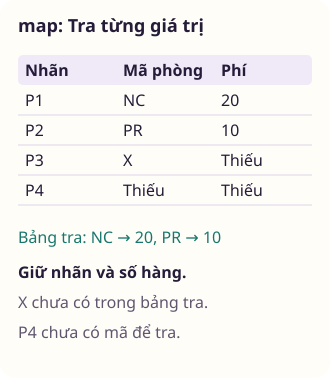
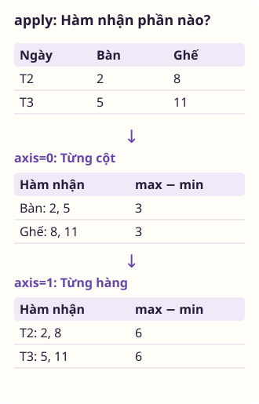

<div class="lecture-notes-content">

## 1. Giới thiệu cấu trúc dữ liệu trong pandas

Bạn nhận được bảng dữ liệu giá phòng cho thuê gồm nhiều cột: Mã căn hộ, loại phòng, số đêm lưu trú, đơn giá mỗi đêm và phí dọn dẹp. Một số căn hộ chưa ghi nhận phí dọn phòng hoặc để trống số đêm. Nếu dùng mảng hai chiều NumPy, việc kết hợp đồng thời chuỗi ký tự tên loại phòng và số thực đơn giá sẽ buộc toàn bộ mảng chuyển thành kiểu chuỗi hoặc đối tượng rời rạc, làm mất đi khả năng tính toán số học nhanh. Thư viện pandas giải quyết vấn đề này bằng cách cung cấp cấu trúc bảng hai chiều `DataFrame`, nơi mỗi cột lưu trữ một kiểu dữ liệu riêng biệt nhưng các hàng được kết nối chặt chẽ qua một hệ thống chỉ mục nhãn đồng nhất.

### 1.1. Cấu trúc Series: Mảng một chiều có nhãn
`Series` là đối tượng mảng một chiều gồm hai thành phần gắn kết chặt chẽ:
1. **Mảng giá trị (*values*)**: Vùng đệm dữ liệu số học hoặc đối tượng bên dưới, có kiểu dữ liệu `dtype` đồng nhất.
2. **Chỉ mục nhãn (*index*)**: Mảng các nhãn định danh đi kèm từng phần tử.

```python
import pandas as pd
import numpy as np

# Khởi tạo Series với chỉ mục mặc định (0, 1, 2, ...)
s1 = pd.Series([4.5, 7.2, -5.3, 3.0])

# Khởi tạo Series với chỉ mục nhãn tùy biến
s2 = pd.Series([100, 80, 60], index=["P01", "P02", "P03"])
print(s2)
# P01    100
# P02     80
# P03     60
# dtype: int64
```

Khác với danh sách Python, `Series` cho phép truy xuất phần tử theo nhãn tương tự từ điển: `s2["P01"]`. Đồng thời, `Series` hỗ trợ trọn vẹn các phép toán vector hóa của NumPy:
```python
s_gap_doi = s2 * 2
s_loc = s2[s2 >= 80]
```
Mọi phép toán số học đều tự động bảo lưu liên kết nhãn với giá trị tương ứng.

### 1.2. Cấu trúc DataFrame: Bảng dữ liệu hai chiều
`DataFrame` biểu diễn một bảng dữ liệu hai chiều có cấu trúc, gồm tập hợp các cột có tên nhãn cụ thể, trong đó mỗi cột có thể chứa một kiểu dữ liệu riêng biệt.

#### Khởi tạo DataFrame
DataFrame có thể được xây dựng từ nhiều nguồn dữ liệu:
- Từ một từ điển chứa các danh sách có cùng độ dài:
```python
du_lieu = {
    "khu_vuc": ["Bắc", "Bắc", "Nam", "Nam"],
    "nam": [2024, 2025, 2024, 2025],
    "doanh_thu": [150.5, 180.2, 210.0, 245.8]
}
df = pd.DataFrame(du_lieu, index=["HN1", "HN2", "SG1", "SG2"])
```
- Từ từ điển lồng nhau: Các khóa ngoài trở thành tên cột, các khóa trong trở thành nhãn hàng (*index*).

#### Thuộc tính và thao tác cơ bản
- `df.shape`: Tuple trả về số hàng và số cột `(so_hang, so_cot)`.
- `df.columns`: Đối tượng Index chứa danh sách tên các cột.
- `df.index`: Đối tượng Index chứa danh sách nhãn các hàng.
- `df.dtypes`: Series hiển thị kiểu dữ liệu của từng cột.
- `df.head(n)` và `df.tail(n)`: Xem nhanh $n$ dòng đầu tiên hoặc $n$ dòng cuối cùng của bảng.

Trích xuất một cột từ DataFrame bằng cú pháp ngoặc vuông `df["doanh_thu"]` hoặc truy cập thuộc tính `df.doanh_thu` sẽ trả về một đối tượng `Series`. Thêm một cột mới vào bảng được thực hiện bằng phép gán:
```python
df["thue"] = df["doanh_thu"] * 0.1
```
Xóa một cột khỏi bảng sử dụng câu lệnh `del df["thue"]` hoặc phương thức `.drop()`.

### 1.3. Đối tượng chỉ mục Index
Các đối tượng `Index` trong pandas chịu trách nhiệm lưu trữ nhãn trục (hàng và cột) và các siêu dữ liệu khác.

> [!IMPORTANT] Tính bất biến của Index
> Các đối tượng `Index` mang tính **bất biến** (*immutable*). Lập trình viên không thể chỉnh sửa riêng lẻ một nhãn bên trong Index:
> ```python
> idx = df.index
> idx[0] = "HN_MOI"  # TypeError: Index does not support mutable operations
> ```
> Tính bất biến này giúp bảo đảm an toàn dữ liệu, cho phép chia sẻ cùng một đối tượng `Index` giữa nhiều cấu trúc DataFrame và Series mà không sợ bị biến đổi ngoài tầm kiểm soát.

Đối tượng Index hỗ trợ đầy đủ các phép toán đại số tập hợp:
- `idx1.union(idx2)`: Tập hợp hợp.
- `idx1.intersection(idx2)`: Tập hợp giao.
- `idx1.difference(idx2)`: Tập hợp hiệu.
- `idx.is_unique`: Kiểm tra xem các nhãn chỉ mục có duy nhất hay không.

---

## 2. Các chức năng thiết yếu của pandas

### 2.1. Tái lập chỉ mục
Phương thức `.reindex()` tạo ra một đối tượng mới với dữ liệu được sắp xếp lại theo một chỉ mục nhãn mới. Nếu một nhãn mới không có trong dữ liệu ban đầu, pandas sẽ điền giá trị khuyết thiếu `NaN`:

```python
s = pd.Series([10, 20, 30], index=["a", "b", "c"])
s_moi = s.reindex(["a", "b", "c", "d"], fill_value=0)
# a    10
# b    20
# c    30
# d     0
```

Trong dữ liệu chuỗi thời gian, ta có thể nội suy các giá trị thiếu khi đổi chỉ mục bằng tham số `method`:
- `method="ffill"` (*forward fill*): Điền tiếp giá trị của quan sát trước đó về phía sau.
- `method="bfill"` (*backward fill*): Lấy giá trị của quan sát liền sau điền ngược về trước.

<!-- worked-example bai-04-lam-quen-pandas-worked-1 -->

::: example Tái lập chỉ mục nhãn với giá trị lấp đầy và phương pháp ffill

Khi đồng bộ hóa dữ liệu từ nhiều nguồn thời gian không liên tục, ta cần đưa các chuỗi quan sát về một hệ chỉ mục thời gian chuẩn chung. Nếu một mốc thời gian bị khuyết trong dữ liệu gốc, phương thức reindex cho phép ta lựa chọn điền hằng số hoặc truyền tiếp giá trị trước đó. Ta đối chiếu hai chiến lược lấp đầy để chuẩn bị chuỗi thời gian sạch.

```python
import pandas as pd

s_goc = pd.Series([100, 105, 110], index=["T1", "T2", "T4"])
chi_so_moi = ["T1", "T2", "T3", "T4", "T5"]

s_fill_0 = s_goc.reindex(chi_so_moi, fill_value=0)
s_ffill = s_goc.reindex(chi_so_moi, method="ffill")

df_so_sanh = pd.DataFrame({
    "fill_0": s_fill_0,
    "ffill": s_ffill,
})
print(df_so_sanh)
```

Kết quả khi chạy đoạn mã trên:

<div class="data-worked-table">

| Chỉ mục | fill&#95;0 | ffill |
| --- | --- | --- |
| T1 | 100 | 100 |
| T2 | 105 | 105 |
| T3 | 0 | 105 |
| T4 | 110 | 110 |
| T5 | 0 | 110 |

</div>

Phương thức `reindex` tạo ra một đối tượng `Series` mới bằng cách sắp xếp lại dữ liệu theo danh sách nhãn mới `chi_so_moi`. Đối với các nhãn đã có sẵn như `T1`, `T2` và `T4`, giá trị ban đầu được bảo lưu nguyên vẹn.

Tại các nhãn mới xuất hiện như `T3` và `T5`, nếu không chỉ định tham số lấp đầy, pandas sẽ điền giá trị khuyết thiếu `NaN`. Khi thiết lập `fill_value=0`, các vị trí này nhận ngay giá trị số không, thích hợp cho các bài toán tính số lượng phát sinh. `fill_value` chỉ dùng cho nhãn mới, không thay các ô thiếu vốn đã có trong Series gốc.

Ngược lại, tham số `method='ffill'` (forward fill) thực hiện truyền tiếp giá trị hợp lệ gần nhất về phía sau. Tại mốc `T3`, giá trị 105 của mốc `T2` được mang sang, và tại mốc `T5`, giá trị 110 của `T4` được giữ lại.

`method="ffill"` cần chỉ mục gốc tăng hoặc giảm đơn điệu. Nó dựa vào thứ tự nhãn, nên T1, T2 và T4 ở đây chỉ là nhãn minh họa đã được sắp. Chỉ chọn 0 khi ô vắng thực sự có nghĩa là không phát sinh, và chỉ truyền giá trị trước khi có cơ sở cho rằng trạng thái vẫn giữ nguyên.

:::

<!-- /worked-example -->

### 2.2. Loại bỏ dòng và cột với drop
Phương thức `.drop()` loại bỏ các nhãn chỉ định khỏi một trục và trả về một đối tượng mới:
```python
# Loại bỏ hàng theo nhãn (axis=0 mặc định)
df_bot_hang = df.drop(["HN1", "SG1"])

# Loại bỏ cột theo tên (axis=1 hoặc axis="columns")
df_bot_cot = df.drop(columns=["nam"])
```

### 2.3. Chỉ mục, lựa chọn và sàng lọc với loc và iloc
Để tránh mơ hồ giữa việc chọn theo nhãn danh nghĩa hay chọn theo vị trí số nguyên, pandas cung cấp hai toán tử chỉ mục chuyên dụng:

#### 1. Chọn theo nhãn với `.loc`
Toán tử `.loc[hang_nhan, cot_nhan]` tiếp nhận nhãn danh nghĩa:
```python
# Chọn một ô đơn lẻ
gia_tri = df.loc["HN1", "doanh_thu"]

# Chọn một tập hợp hàng và cột
bang_con = df.loc[["HN1", "SG1"], ["khu_vuc", "doanh_thu"]]

# Cắt lát theo nhãn: BAO GỒM CẢ ĐIỂM KẾT THÚC
lat_cat_loc = df.loc["HN1":"SG1", "khu_vuc":"doanh_thu"]
```

#### 2. Chọn theo vị trí số nguyên với `.iloc`
Toán tử `.iloc[hang_vi_tri, cot_vi_tri]` tiếp nhận chỉ số nguyên từ $0$ đến $n-1$:
```python
# Chọn hàng 0, cột 2
gia_tri = df.iloc[0, 2]

# Cắt lát theo vị trí: KHÔNG BAO GỒM ĐIỂM KẾT THÚC (chuẩn Python)
lat_cat_iloc = df.iloc[0:2, 1:3]
```

#### Nhãn số nguyên và vị trí trong dãy {#cam-bay-chi-muc-so-nguyen}
Xét Series có nhãn nguyên nhưng thứ tự nhãn khác vị trí:

```python
s = pd.Series([10, 20, 30], index=[2, 0, 1])
assert s[1] == s.loc[1] == 30
assert s.iloc[1] == 20
```

Trong trường hợp này, `s[1]` tìm nhãn 1 chứ không lấy phần tử thứ hai. `s[-1]` báo `KeyError` vì không có nhãn -1. Viết `.loc` và `.iloc` giúp thể hiện rõ ý định chọn theo nhãn hay vị trí.

<!-- worked-example bai-04-lam-quen-pandas-worked-2 -->

::: example Phân biệt truy xuất theo nhãn số nguyên và vị trí với loc và iloc

Khi một Series mang chỉ mục nhãn là các số nguyên không liên tục hoặc bị xáo trộn, việc sử dụng cú pháp ngoặc vuông thông thường rất dễ gây nhầm lẫn giữa nhãn danh nghĩa và vị trí vật lý. Để loại bỏ sự mơ hồ này, pandas cung cấp hai toán tử riêng biệt là loc và iloc. Ta đối chiếu kết quả truy xuất trên một chuỗi có nhãn nguyên đảo lộn.

```python
import pandas as pd

s = pd.Series([10, 20, 30, 40], index=[3, 1, 0, 2])

print(f"Truy xuất s.loc[0] (theo nhãn):   {s.loc[0]}")
print(f"Truy xuất s.iloc[0] (theo vị trí): {s.iloc[0]}")
print("Cắt lát s.loc[3:0] (theo nhãn 3 đến 0):")
print(s.loc[3:0])
print("Cắt lát s.iloc[0:2] (theo vị trí 0 đến trước 2):")
print(s.iloc[0:2])
```

Kết quả khi chạy đoạn mã trên:

```text
Truy xuất s.loc[0] (theo nhãn):   30
Truy xuất s.iloc[0] (theo vị trí): 10
Cắt lát s.loc[3:0] (theo nhãn 3 đến 0):
```

<div class="data-worked-table">

| Chỉ mục | Giá trị |
| --- | --- |
| 3 | 10 |
| 1 | 20 |
| 0 | 30 |

</div>

```text
Cắt lát s.iloc[0:2] (theo vị trí 0 đến trước 2):
```

<div class="data-worked-table">

| Chỉ mục | Giá trị |
| --- | --- |
| 3 | 10 |
| 1 | 20 |

</div>

Series `s` chứa các giá trị `[10, 20, 30, 40]` với nhãn tương ứng `[3, 1, 0, 2]`. `s.loc[0]` tìm nhãn 0 nên trả 30. `s.iloc[0]` tìm vị trí đầu tiên nên trả 10. Cùng một số 0 nhưng ý nghĩa đối số khác nhau.

Sự khác biệt bộc lộ rõ khi thực hiện cắt lát: Biểu thức `s.loc[3:0]` tìm kiếm các phần tử từ nhãn 3 đến nhãn 0 theo thứ tự xuất hiện, bao gồm cả điểm kết thúc nhãn 0, thu được ba phần tử `[10, 20, 30]`.

Ngược lại, `s.iloc[0:2]` thực hiện cắt lát theo quy ước chỉ số Python truyền thống từ vị trí số 0 đến trước vị trí số 2 (không bao gồm vị trí 2), thu được hai phần tử đầu tiên là `[10, 20]`.

Trong pandas hiện hành, chỉ số nguyên đơn lẻ của Series được hiểu là nhãn, còn lát cắt số nguyên thông thường có thể mang nghĩa vị trí. Dùng `loc` và `iloc` giúp nói rõ ý định ngay tại chỗ truy cập. Với nhãn trùng hoặc thiếu nhãn biên, cần kiểm tra chỉ mục trước khi dùng cách cắt lát theo nhãn của ví dụ này.

:::

<!-- /worked-example -->

#### Gán dữ liệu với cơ chế Copy-on-Write {#cam-bay-gan-chuoi-va-co-che-copy-on-write}
Một thao tác dễ gây lỗi logic là viết câu lệnh gán hai lần ngoặc vuông (*chained indexing*):
```pycon
>>> phong_demo["gia"][phong_demo["gia"] < 50] = 50
```
Với `phong_demo` là DataFrame có cột `gia`, lần chọn đầu lấy một Series trung gian. Trong pandas 3 dùng Copy-on-Write, phép gán chuỗi này không cập nhật bảng gốc và phát cảnh báo thuộc loại `ChainedAssignmentError`. Đừng hiểu tên cảnh báo là bảo đảm chương trình luôn dừng bằng ngoại lệ, vì điều đó còn tùy cấu hình xử lý warning.

> [!TIP] Gán rõ bảng đích trong một bước
> Một cách cập nhật là dùng `.loc` với cả điều kiện hàng và tên cột:
> ```python
> phong_demo = pd.DataFrame({"gia": [40.0, 70.0]})
> phong_demo.loc[phong_demo["gia"] < 50, "gia"] = 50
> assert phong_demo["gia"].tolist() == [50.0, 70.0]
> ```

<!-- worked-example bai-04-lam-quen-pandas-worked-3 -->

::: example Gán giá trị có điều kiện an toàn với loc trong cơ chế Copy-on-Write

Trong pandas 3, cơ chế Copy-on-Write được kích hoạt mặc định nhằm ngăn chặn việc sửa đổi dữ liệu ngoài ý muốn trên các khung nhìn trung gian. Cú pháp gán chuỗi hai lần ngoặc vuông sẽ bị cảnh báo hoặc không thể cập nhật ngược vào bảng dữ liệu gốc. Ta sử dụng cú pháp loc đồng thời trên hàng và cột để thực hiện phép gán giá trị hợp lệ.

```python
import pandas as pd

df = pd.DataFrame({
    "ma": ["P01", "P02", "P03"],
    "gia": [40.0, 75.0, 30.0],
})

df.loc[df["gia"] < 50.0, "gia"] = 50.0
print(df)
```

Kết quả khi chạy đoạn mã trên:

<div class="data-worked-table">

| ma | gia |
| --- | --- |
| P01 | 50.0 |
| P02 | 75.0 |
| P03 | 50.0 |

</div>

Đoạn mã khởi tạo bảng dữ liệu giá phòng `df` gồm cột mã phòng `ma` và cột đơn giá `gia`. Ta cần áp dụng chính sách giá sàn: Mọi phòng có giá dưới 50.0 phải được điều chỉnh tăng lên mức 50.0.

Cách viết `df["gia"][df["gia"] < 50.0] = 50.0` gán qua một Series trung gian. Với Copy-on-Write mặc định trong pandas 3, thao tác đó không cập nhật bảng `df` như mong muốn và có thể phát cảnh báo `ChainedAssignmentError`. Một phép gán trực tiếp bằng `loc` xác định rõ bảng cần sửa.

Cú pháp chuẩn xác là sử dụng toán tử `loc` với đầy đủ hai chiều: Chiều hàng nhận biểu thức điều kiện `df['gia'] < 50.0`, và chiều cột nhận tên cột `'gia'`. Thao tác này thông báo trực tiếp cho DataFrame vị trí các ô cần cập nhật trong một bước duy nhất.

Bảng kết quả in ra cho thấy hai phòng `P01` (40.0) và `P03` (30.0) đã được nâng lên 50.0 thành công, trong khi phòng `P02` giữ nguyên 75.0. Kỹ thuật này bảo đảm tính toàn vẹn dữ liệu và tuân thủ đúng ngữ nghĩa của pandas 3.

:::

<!-- /worked-example -->

### 2.4. Số học và căn chỉnh dữ liệu tự động
Khi thực hiện các phép tính số học giữa hai đối tượng Series hoặc DataFrame, pandas tự động **căn chỉnh dữ liệu theo nhãn**:

```python
s1 = pd.Series([10, 20], index=["a", "b"])
s2 = pd.Series([30, 40], index=["b", "c"])
ket_qua_cong = s1 + s2
assert ket_qua_cong.loc["b"] == 50
assert ket_qua_cong.loc[["a", "c"]].isna().all()
```
Phép cộng $s_1 + s_2$ sẽ lấy hợp của toàn bộ các nhãn:
- Nhãn `"a"` chỉ có ở $s_1$, thiếu ở $s_2 \implies$ kết quả là `NaN`.
- Nhãn `"b"` có ở cả hai bên: $20 + 30 = 50$.
- Nhãn `"c"` chỉ có ở $s_2$, thiếu ở $s_1 \implies$ kết quả là `NaN`.

Muốn thay thế các giá trị khuyết thiếu bằng một hằng số khi tính toán, ta sử dụng các phương thức số học có tham số `fill_value`:
```python
s_tong = s1.add(s2, fill_value=0)
# a    10.0
# b    50.0
# c    40.0
```

<!-- worked-example bai-04-lam-quen-pandas-worked-4 -->

::: example Căn chỉnh nhãn tự động trong phép cộng hai Series và bù khuyết với add

Khi tổng hợp doanh thu từ hai chi nhánh kinh doanh có danh mục hàng hóa không hoàn toàn trùng khớp, phép cộng số học thông thường giữa hai Series sẽ sinh ra giá trị NaN tại mọi vị trí nhãn bị lệch. Để bảo toàn doanh thu của những mặt hàng chỉ bán được ở một chi nhánh, ta sử dụng phương thức add kết hợp tham số fill_value. Ta so sánh trực tiếp hai cách tính này.

```python
import pandas as pd

cn1 = pd.Series([100, 200], index=["Áo", "Quần"])
cn2 = pd.Series([50, 80], index=["Quần", "Giày"])

tong_thong_thuong = cn1 + cn2
tong_co_fill = cn1.add(cn2, fill_value=0)

df_kq = pd.DataFrame({
    "thong_thuong": tong_thong_thuong,
    "bu_khuyet": tong_co_fill,
})
print(df_kq)
```

Kết quả khi chạy đoạn mã trên:

<div class="data-worked-table">

| Chỉ mục | thong&#95;thuong | bu&#95;khuyet |
| --- | --- | --- |
| Giày | (thiếu) | 80.0 |
| Quần | 250.0 | 250.0 |
| Áo | (thiếu) | 100.0 |

</div>

Ô ghi “(thiếu)” biểu thị giá trị chưa được cung cấp hoặc chưa xác định.

Series `cn1` chứa các nhãn `['Áo', 'Quần']` và `cn2` chứa các nhãn `['Quần', 'Giày']`. Khi thực hiện phép cộng `cn1 + cn2`, pandas tự động lấy hợp của các nhãn thành `['Giày', 'Quần', 'Áo']`.

Vì nhãn `'Áo'` khuyết ở `cn2` và `'Giày'` khuyết ở `cn1`, phép toán thông thường coi đó là phép cộng với `NaN` và trả về `NaN` cho cả hai mặt hàng. Chỉ duy nhất mặt hàng `'Quần'` có mặt ở hai bên mới cho kết quả số học 250.0.

Phương thức `cn1.add(cn2, fill_value=0)` giải quyết vấn đề này: Trước khi thực hiện phép cộng, nếu một nhãn bị thiếu ở một trong hai bên, giá trị tại bên thiếu đó sẽ được thay thế tạm thời bằng 0. Do đó, `'Áo'` nhận 100 + 0 = 100 và `'Giày'` nhận 0 + 80 = 80. Nếu cả hai phía đều thiếu tại một nhãn, kết quả ở nhãn đó vẫn thiếu. Việc dùng 0 cần dựa trên cách hiểu số liệu, không phải quy tắc bắt buộc của mọi phép cộng.

Bảng kết quả đối chiếu minh họa rõ: Cách cộng bù khuyết bảo toàn đầy đủ số liệu của các mặt hàng độc quyền ở từng chi nhánh, tránh làm thất thoát doanh thu trong báo cáo tổng hợp.

:::

<!-- /worked-example -->

#### Phép toán giữa DataFrame và Series (Broadcasting)
Theo mặc định, phép toán giữa DataFrame và Series khớp nhãn Series với tên cột rồi dùng lại các giá trị đó cho mỗi hàng. Muốn khớp với nhãn hàng, hãy chỉ định `axis="index"` hoặc `axis=0`:
```python
bang_so = pd.DataFrame({"A": [10, 20], "B": [30, 40]}, index=["r1", "r2"])
s_theo_hang = pd.Series([1, 2], index=["r1", "r2"])
df_tru = bang_so.sub(s_theo_hang, axis="index")
np.testing.assert_array_equal(df_tru.to_numpy(), [[9, 29], [18, 38]])
```

<!-- worked-example bai-04-lam-quen-pandas-worked-5 -->

::: example Trừ một Series theo cột hoặc hàng bằng sub

Khi chuẩn hóa bảng dữ liệu, ta có thể cần trừ đi giá trị trung bình của từng cột hoặc trừ đi mức sàn chi phí của từng hàng quan sát. Phép trừ mặc định giữa DataFrame và Series luôn gióng hàng theo tên cột, nên nếu muốn trừ theo từng hàng, ta bắt buộc phải chỉ định rõ tham số axis='index'. Ta thực hiện cả hai chiều phát sóng để thấy rõ sự khác biệt.

```python
import pandas as pd

bang = pd.DataFrame({
    "A": [10.0, 20.0],
    "B": [30.0, 40.0],
}, index=["H1", "H2"])

tru_cot = pd.Series([5.0, 10.0], index=["A", "B"])
tru_hang = pd.Series([1.0, 2.0], index=["H1", "H2"])

print("Bảng dữ liệu gốc:")
print(bang)
print("Trừ theo từng cột (axis='columns'):")
print(bang.sub(tru_cot, axis="columns"))
print("Trừ theo từng hàng (axis='index'):")
print(bang.sub(tru_hang, axis="index"))
```

Kết quả khi chạy đoạn mã trên:

```text
Bảng dữ liệu gốc:
```

<div class="data-worked-table">

| Chỉ mục | A | B |
| --- | --- | --- |
| H1 | 10.0 | 30.0 |
| H2 | 20.0 | 40.0 |

</div>

```text
Trừ theo từng cột (axis='columns'):
```

<div class="data-worked-table">

| Chỉ mục | A | B |
| --- | --- | --- |
| H1 | 5.0 | 20.0 |
| H2 | 15.0 | 30.0 |

</div>

```text
Trừ theo từng hàng (axis='index'):
```

<div class="data-worked-table">

| Chỉ mục | A | B |
| --- | --- | --- |
| H1 | 9.0 | 29.0 |
| H2 | 18.0 | 38.0 |

</div>

Bảng dữ liệu `bang` có kích thước 2 hàng (`H1`, `H2`) và 2 cột (`A`, `B`). Phép toán `bang.sub(tru_cot, axis='columns')` gióng các nhãn `A` và `B` của Series với các cột tương ứng của DataFrame và trừ đi 5.0 ở cột `A`, 10.0 ở cột `B` cho mọi hàng.

Sau phép trừ theo cột, hàng `H1` là `[5.0, 20.0]`, còn `H2` là `[15.0, 30.0]`. Cách căn nhãn này cũng được dùng khi viết `bang - tru_cot`. Với `axis="columns"`, các nhãn của Series phải được hiểu là tên cột.

Khi muốn trừ theo từng hàng quan sát, ta sử dụng Series `tru_hang` có nhãn là `H1` và `H2`, đồng thời chỉ định tường minh `axis='index'` (hoặc `axis=0`). Lúc này, mọi phần tử ở hàng `H1` bị trừ 1.0 và mọi phần tử ở hàng `H2` bị trừ 2.0.

Kết quả theo hàng thu được tại `H1` là `[9.0, 29.0]` và `H2` là `[18.0, 38.0]`. Việc nắm vững tham số `axis` giúp người phân tích thực hiện chính xác các phép chuẩn hóa dữ liệu theo chiều dọc hoặc chiều ngang mà không bị nhầm trục.

:::

<!-- /worked-example -->

### 2.5. Áp dụng hàm và ánh xạ

Một bảng đặt phòng có thể cần tra phí theo mã phòng, tính tổng tiền từ nhiều cột hoặc định dạng từng giá trị để in báo cáo. Ba việc này đòi hỏi hàm nhận đầu vào khác nhau. Trước khi chọn phương thức, hãy xác định hàm cần một giá trị, một hàng hay một cột.

- `df.apply(ham, axis=0)`: Áp dụng một hàm số lên từng cột (hoặc từng hàng nếu `axis=1`). Thường dùng cho các hàm tổng hợp hoặc biến đổi phức tạp.
- `ser.map(anh_xa)`: Ánh xạ từng phần tử của Series thông qua một từ điển tra cứu hoặc một hàm một đối số.
- `df.map(ham)`: Áp dụng một hàm lên từng ô đơn lẻ của toàn bộ DataFrame (thay thế phương thức `applymap` cũ).

```python
# Tra cứu phí theo loại phòng bằng map
bang_phi = {"Nguyên căn": 20, "Phòng riêng": 10}
phong_phi = pd.DataFrame({"loai": ["Nguyên căn", "Phòng riêng"]})
phong_phi["phi"] = phong_phi["loai"].map(bang_phi)
assert phong_phi["phi"].tolist() == [20, 10]
```

<!-- worked-example bai-04-lam-quen-pandas-method-1 -->

::: example Tra phí từ mã phòng bằng Series.map

Một bảng đặt phòng chỉ lưu mã loại chỗ ở. Bảng giá phụ quy định phí cho hai mã đã biết. Ta cần đưa phí về đúng từng hàng mà không đổi thứ tự đặt phòng.

```python
import pandas as pd
phong = pd.DataFrame({"loai": ["NC", "PR", "X", None]},
                     index=["P1", "P2", "P3", "P4"])
phi = {"NC": 20, "PR": 10}
ket_qua = phong.assign(phi=phong["loai"].map(phi))
print(ket_qua)
assert ket_qua.loc["P1", "phi"] == 20
assert ket_qua.loc[["P3", "P4"], "phi"].isna().all()
```

Kết quả khi chạy đoạn mã trên:

<div class="data-worked-table">

| Chỉ mục | loai | phi |
| --- | --- | --- |
| P1 | NC | 20.0 |
| P2 | PR | 10.0 |
| P3 | X | (thiếu) |
| P4 | (thiếu) | (thiếu) |

</div>

Ô ghi “(thiếu)” biểu thị giá trị chưa được cung cấp hoặc chưa xác định.



`phong['loai']` là một Series có nhãn `P1` đến `P4`. Khi nhận từ điển `phi`, phương thức `map` lấy từng giá trị của Series làm khóa tra cứu, rồi đặt kết quả ở đúng nhãn ban đầu. Nó không coi khóa `NC` và `PR` là nhãn hàng. Kết quả vẫn có bốn phần tử, kể cả khi một lần tra không tìm thấy khóa.

`P1` nhận 20 và `P2` nhận 10. `P3` có mã `X` không nằm trong bảng tra, còn `P4` chưa có mã, nên cả hai nhận giá trị thiếu `NaN`. Hai ô thiếu có cùng cách hiển thị nhưng khác nguyên nhân. Khi cần báo nguyên nhân, có thể kiểm tra `phong['loai'].notna()` cùng với `ket_qua['phi'].isna()` để tìm mã đã được cung cấp nhưng chưa có trong bảng giá.

Điền ngay hai ô này bằng 0 sẽ biến việc chưa biết phí thành khẳng định miễn phí. Chỉ làm vậy khi quy định nghiệp vụ thực sự coi mã ngoài danh sách là phí 0. Nếu mục tiêu chỉ là thay vài nhãn và giữ nguyên các nhãn còn lại, phương thức `replace` phù hợp hơn một phép tra cứu đầy đủ bằng `map`.

:::

<!-- /worked-example -->

<!-- worked-example bai-04-lam-quen-pandas-method-2 -->

::: example Hàm trong map nhận một giá trị, không nhận cả hàng

Tên khu vực được nhập với khoảng trắng và cách viết khác nhau. Ta muốn chuẩn hóa những tên đã biết, đồng thời giữ nguyên trạng thái thiếu của các hàng chưa được nhập.

```python
import pandas as pd
ten = pd.Series(["  Đông ", None, "TÂY"],
                index=["A", "B", "C"], dtype="object")
def chuan_hoa(value):
    return value.strip().casefold()
chuan = ten.map(chuan_hoa, na_action="ignore")
ket_qua = pd.DataFrame({"goc": ten, "chuan": chuan})
print(ket_qua)
assert chuan.loc["A"] == "đông"
assert pd.isna(chuan.loc["B"])
```

Kết quả khi chạy đoạn mã trên:

<div class="data-worked-table">

| Chỉ mục | goc | chuan |
| --- | --- | --- |
| A |   Đông  | đông |
| B | (thiếu) | (thiếu) |
| C | TÂY | tây |

</div>

Ô ghi “(thiếu)” biểu thị giá trị chưa được cung cấp hoặc chưa xác định.

Hàm `chuan_hoa` được viết để nhận một chuỗi và trả về một chuỗi mới. Với hàng `A`, đối số là `'  Đông '`, không phải Series `A` và cũng không phải toàn bộ cột. Phương thức `strip()` bỏ khoảng trắng hai đầu, còn `casefold()` chuẩn hóa cách viết hoa, viết thường phục vụ so sánh nhãn.

Tham số `na_action='ignore'` giữ nguyên ô thiếu và không truyền nó vào hàm. Nếu bỏ tham số này, hàm có thể nhận `None`, trong khi `None` không có phương thức `strip`. Chuyển mọi đối số thành chuỗi để tránh lỗi lại tạo nhãn `'None'`, khiến một giá trị chưa biết trông như dữ liệu hợp lệ.

Với đúng hai thao tác chuỗi này, có thể viết ngắn gọn bằng `ten.str.strip().str.casefold()`. Phương thức `map` hữu ích khi quy tắc của từng giá trị cần một hàm riêng, chẳng hạn chuẩn hóa theo nhiều điều kiện hoặc dùng một thư viện ngoài. Việc chọn cách viết không tự chứng minh cách nào nhanh hơn trên mọi bộ dữ liệu.

:::

<!-- /worked-example -->

<!-- worked-example bai-04-lam-quen-pandas-method-3 -->

::: example Theo dõi đối số của DataFrame.apply qua từng trục

Một cửa hàng có số bán của hai mặt hàng trong hai ngày. Cùng một hàm tính độ chênh giữa số lớn nhất và nhỏ nhất sẽ trả lời hai câu hỏi khác nhau khi đổi trục.

```python
import pandas as pd
ban = pd.DataFrame({"ban": [2, 5], "ghe": [8, 11]},
                   index=["T2", "T3"])
def do_chenh(s):
    return s.max() - s.min()
theo_cot = ban.apply(do_chenh, axis=0)
theo_hang = ban.apply(do_chenh, axis=1)
print("Dữ liệu:")
print(ban)
print("Giữa hai ngày của từng mặt hàng:")
print(theo_cot)
print("Giữa hai mặt hàng trong từng ngày:")
print(theo_hang)
assert theo_cot.to_list() == [3, 3]
assert theo_hang.to_list() == [6, 6]
```

Kết quả khi chạy đoạn mã trên:

```text
Dữ liệu:
```

<div class="data-worked-table">

| Chỉ mục | ban | ghe |
| --- | --- | --- |
| T2 | 2 | 8 |
| T3 | 5 | 11 |

</div>

```text
Giữa hai ngày của từng mặt hàng:
```

<div class="data-worked-table">

| Chỉ mục | Giá trị |
| --- | --- |
| ban | 3 |
| ghe | 3 |

</div>

```text
Giữa hai mặt hàng trong từng ngày:
```

<div class="data-worked-table">

| Chỉ mục | Giá trị |
| --- | --- |
| T2 | 6 |
| T3 | 6 |

</div>



Với `axis=0`, lần gọi đầu nhận Series `[2, 5]` mang tên `ban`, có nhãn `T2` và `T3`. Lần gọi tiếp nhận `[8, 11]` mang tên `ghe`. Mỗi lần hàm trả một số nên kết quả là Series có hai nhãn là tên cột. Hai giá trị 3 mô tả mức thay đổi giữa hai ngày của từng mặt hàng.

Với `axis=1`, hàm nhận lần lượt hàng `T2` gồm `[2, 8]` và hàng `T3` gồm `[5, 11]`. Nhãn bên trong đối số lúc này là `ban` và `ghe`, còn nhãn kết quả là `T2` và `T3`. Hai số 6 mô tả độ lệch giữa hai mặt hàng trong cùng ngày, không phải mức tăng qua thời gian.

Tham số `axis` cho biết hướng của những phần tử mà hàm xử lý cùng nhau. Nó không có nghĩa rằng kết quả luôn còn nguyên trục đó. Hình dạng kết quả còn phụ thuộc hàm trả về một số, Series hay danh sách. Với phép tổng hợp đã có sẵn, biểu thức `ban.max() - ban.min()` thể hiện trực tiếp cùng câu hỏi theo cột.

Mặc định `raw=False`, đối số là Series nên có thể đọc theo tên cột. Đặt `raw=True` thì hàm nhận mảng NumPy và không còn nhãn. Chỉ đổi tham số này khi hàm thực sự được viết để nhận mảng và thứ tự cột đã được kiểm soát. Không sửa trực tiếp đối số bên trong hàm rồi trông chờ bảng gốc được cập nhật.

:::

<!-- /worked-example -->

<!-- worked-example bai-04-lam-quen-pandas-method-4 -->

::: example Một hàng có thể tạo ra nhiều cột kết quả

Báo giá cho một lần lưu trú cần giá mỗi đêm, số đêm và phí một lần. Vì ba giá trị thuộc cùng một hàng, ta có thể viết một hàm nhận hàng để tách tiền phòng và tổng tiền.

```python
import pandas as pd
dat = pd.DataFrame({"gia": [80, 100], "dem": [2, 3],
                    "phi": [20, 0]}, index=["A", "B"])
def tinh_tien(row):
    phong = row["gia"] * row["dem"]
    return [phong, phong + row["phi"]]
tien = dat.apply(tinh_tien, axis=1, result_type="expand")
tien.columns = ["tien_phong", "tong"]
print(tien)
truc_tiep = dat["gia"] * dat["dem"] + dat["phi"]
assert tien["tong"].equals(truc_tiep.rename("tong"))
```

Kết quả khi chạy đoạn mã trên:

<div class="data-worked-table">

| Chỉ mục | tien&#95;phong | tong |
| --- | --- | --- |
| A | 160 | 180 |
| B | 300 | 300 |

</div>

Hàm `tinh_tien` đọc ba trường của một hàng và trả về danh sách hai phần tử. Tham số `result_type='expand'` mở danh sách thành hai cột của DataFrame kết quả. Sau khi đặt tên cột, hàng `A` có tiền phòng 160 và tổng 180, còn hàng `B` có tiền phòng và tổng cùng bằng 300. Kết quả giữ nguyên nhãn `A`, `B` để có thể gióng hàng trở lại bảng đặt chỗ ban đầu.

Nếu giữ `result_type=None`, danh sách có thể được giữ như một đối tượng trong mỗi phần tử của Series thay vì mở thành hai cột. Một cách viết khác là trả về một `pd.Series({'tien_phong': phong, 'tong': tong})` để vừa nêu giá trị vừa nêu tên cột trực tiếp.

Trong ví dụ này, công thức tổng tiền có thể được viết trực tiếp bằng phép toán vector hóa trên cột `dat['gia'] * dat['dem'] + dat['phi']`. Cách viết đó làm lộ rõ đơn vị của từng đại lượng và tránh gọi hàm lặp qua từng hàng. Phương thức `apply` phù hợp khi quy tắc tính toán phức tạp hơn hoặc cần gọi một hàm không hỗ trợ giao diện cột.

:::

<!-- /worked-example -->

<!-- worked-example bai-04-lam-quen-pandas-method-5 -->

::: example DataFrame.map giữ từng ô độc lập

Hai cột số đang lưu diện tích cần một bước làm tròn đồng nhất. Mỗi kết quả chỉ phụ thuộc đúng một ô, nên không cần truyền cả hàng hoặc cả cột vào hàm.

```python
import pandas as pd
so = pd.DataFrame({"phong": [12.45, None],
                   "ban_cong": [3.16, 4.04]})
ket_qua = so.map(round, ndigits=1, na_action="ignore")
print(ket_qua)
assert ket_qua.shape == so.shape
assert ket_qua.loc[0, "phong"] == 12.4
assert pd.isna(ket_qua.loc[1, "phong"])
```

Kết quả khi chạy đoạn mã trên:

<div class="data-worked-table">

| phong | ban&#95;cong |
| --- | --- |
| 12.4 | 3.2 |
| (thiếu) | 4.0 |

</div>

Ô ghi “(thiếu)” biểu thị giá trị chưa được cung cấp hoặc chưa xác định.

Phương thức `DataFrame.map` gọi hàm nhận một giá trị vô hướng trên từng ô đơn lẻ của bảng. Ở đây `round` nhận từng số riêng biệt và nhận thêm đối số `ndigits=1`. Kích thước hai chiều, chỉ mục hàng và tên cột của bảng kết quả được bảo lưu nguyên vẹn. Ô thiếu tiếp tục là thiếu vì có `na_action='ignore'`.

Hàm không biết ô đang thuộc cột nào hoặc các ô khác của cùng hàng. Nếu muốn nhân giá với số đêm, cần phép toán giữa hai cột hoặc một hàm xử lý hàng, chứ không thể dùng `DataFrame.map`. Nếu các cột có đơn vị đo lường hoặc quy tắc khác nhau, áp dụng cùng một hàm cho cả bảng cũng có thể không đúng mục tiêu phân tích.

Đối với việc làm tròn, phương thức chuyên dụng `so.round(1)` diễn đạt yêu cầu ngắn gọn hơn. Chọn phương thức chuyên dụng khi nó đã biểu đạt đúng phép tính, còn `map` dành cho các biến đổi từng ô cần hàm xử lý riêng biệt. Trong pandas hiện hành, tên phương thức là `map`, thay thế cho tên `applymap` trong các phiên bản cũ.

:::

<!-- /worked-example -->

### 2.6. Sắp xếp và xếp hạng
- Sắp xếp theo chỉ mục nhãn: `df.sort_index(ascending=True)`.
- Sắp xếp theo giá trị cột: `df.sort_values(by="doanh_thu", ascending=False)`.
- Xếp hạng dữ liệu: Phương thức `.rank()` gán thứ hạng từ $1$ đến $n$ cho các phần tử. Khi các giá trị bằng nhau, tham số `method` quyết định cách giải quyết hòa vị:
  - `"average"` (mặc định): Lấy trung bình cộng các thứ hạng hòa (ví dụ hai số cùng nhỏ nhất chia nhau hạng 1 và 2 sẽ nhận hạng $1{,}5$).
  - `"min"`: Cùng nhận thứ hạng nhỏ nhất.
  - `"max"`: Cùng nhận thứ hạng lớn nhất.
  - `"first"`: Xếp hạng theo thứ tự xuất hiện trước trong dữ liệu.
  - `"dense"`: Tăng thứ hạng liền kề mà không bỏ qua bậc (hạng 1, hạng 1, tiếp theo là hạng 2).

---

<!-- worked-example bai-04-lam-quen-pandas-worked-11 -->

::: example Xếp hạng các giá trị bằng nhau với rank

Khi đánh giá hiệu suất của các chi nhánh hoặc nhân viên, nhiều quan sát có thể đạt thành tích bằng nhau. Tham số method trong phương thức rank quyết định cách thức phân bổ thứ hạng cho các trường hợp hòa vị như lấy trung bình, lấy hạng nhỏ nhất hoặc xếp hạng dày. Ta so sánh các phương thức xếp hạng trên một mảng điểm có giá trị trùng lặp.

```python
import pandas as pd

diem = pd.Series([80, 90, 80, 100], index=["A", "B", "C", "D"])

df_rank = pd.DataFrame({
    "diem": diem,
    "average": diem.rank(method="average"),
    "min": diem.rank(method="min"),
    "dense": diem.rank(method="dense"),
})
print(df_rank)
```

Kết quả khi chạy đoạn mã trên:

<div class="data-worked-table data-worked-table-wide">

| Chỉ mục | diem | average | min | dense |
| --- | --- | --- | --- | --- |
| A | 80.0 | 1.5 | 1.0 | 1.0 |
| B | 90.0 | 3.0 | 3.0 | 2.0 |
| C | 80.0 | 1.5 | 1.0 | 1.0 |
| D | 100.0 | 4.0 | 4.0 | 3.0 |

</div>

Chuỗi dữ liệu `diem` chứa hai học viên `A` và `C` cùng đạt mức điểm 80, trong khi `B` đạt 90 và `D` đạt 100. Phương thức `rank` mặc định sắp xếp theo thứ tự tăng dần (`ascending=True`), trong đó điểm thấp nhất nhận thứ hạng nhỏ nhất.

Phương thức `method='average'` (mặc định) lấy trung bình cộng của các thứ hạng mà nhóm đồng hạng chiếm giữ. Vì hai điểm 80 đứng ở vị trí 1 và 2, thứ hạng của cả `A` và `C` là `(1 + 2) / 2 = 1.5`, sau đó điểm 90 nhận hạng 3.0.

`method="min"` gán thứ hạng nhỏ nhất của nhóm đồng hạng cho tất cả phần tử trong nhóm. A và C cùng nhận 1.0, còn B nhận 3.0. Hai quan sát đã chiếm vị trí thứ nhất và thứ hai, nên thứ hạng tiếp theo là 3.

Phương thức `method='dense'` cũng gán hạng nhỏ nhất 1.0 cho `A` và `C`, nhưng không để lại khoảng trống ở bậc tiếp theo: Điểm 90 nhận ngay hạng 2.0 và điểm 100 nhận hạng 3.0. Bảng kết quả cung cấp căn cứ để lựa chọn phương án xếp hạng phù hợp với quy chế đánh giá.

:::

<!-- /worked-example -->

## 3. Thống kê mô tả và tóm tắt dữ liệu

### 3.1. Các phương thức thống kê mô tả
pandas cung cấp đầy đủ các phương thức thống kê tổng hợp trên DataFrame:
- `df.sum(axis=0)`: Tính tổng theo từng cột.
- `df.mean(axis=1)`: Tính trung bình theo từng hàng.
- `df.describe()`: Bảng tóm tắt toàn diện gồm số lượng đếm, trung bình, độ lệch chuẩn, giá trị nhỏ nhất, các phân vị $25\%$, $50\%$ (trung vị), $75\%$, và giá trị lớn nhất.

#### Tham số `skipna` và `min_count`
Theo mặc định, các phương thức thống kê của pandas tự động bỏ qua các giá trị khuyết thiếu (`skipna=True`).
Tuy nhiên, cần đặc biệt lưu ý: Một Series toàn giá trị `NaN` khi gọi `.sum()` mặc định sẽ trả về $0{,}0$. Để bắt buộc phép tính phải có ít nhất một giá trị hợp lệ mới sinh ra kết quả, ta sử dụng tham số `min_count=1`:
```python
s_trong = pd.Series([np.nan, np.nan])
print(s_trong.sum())               # 0.0 (Nguy cơ gây hiểu lầm)
print(s_trong.sum(min_count=1))    # NaN (Phản ánh đúng dữ liệu khuyết)
```

<!-- worked-example bai-04-lam-quen-pandas-worked-12 -->

::: example Tính tổng cột thiếu dữ liệu với min_count

Phương thức sum của pandas mặc định bỏ qua toàn bộ giá trị khuyết thiếu và trả về 0.0 nếu một cột hoàn toàn là NaN. Kết quả 0.0 này có thể khiến báo cáo hiểu lầm rằng doanh thu bằng không thay vì dữ liệu bị mất tín hiệu thu thập. Tham số min_count=1 giúp bảo đảm phép tính chỉ trả về kết quả số khi có ít nhất một quan sát hợp lệ.

```python
import numpy as np
import pandas as pd

df = pd.DataFrame({
    "co_so": [10.0, np.nan, 20.0],
    "toan_nan": [np.nan, np.nan, np.nan],
})

print("Tổng mặc định (skipna=True):")
print(df.sum(skipna=True))
print("Tổng với min_count=1:")
print(df.sum(min_count=1))
```

Kết quả khi chạy đoạn mã trên:

```text
Tổng mặc định (skipna=True):
```

<div class="data-worked-table">

| Chỉ mục | Giá trị |
| --- | --- |
| co&#95;so | 30.0 |
| toan&#95;nan | 0.0 |

</div>

```text
Tổng với min_count=1:
```

<div class="data-worked-table">

| Chỉ mục | Giá trị |
| --- | --- |
| co&#95;so | 30.0 |
| toan&#95;nan | (thiếu) |

</div>

Ô ghi “(thiếu)” biểu thị giá trị chưa được cung cấp hoặc chưa xác định.

Bảng dữ liệu `df` chứa cột `co_so` có hai giá trị thực kèm một giá trị khuyết thiếu `NaN`, và cột `toan_nan` chứa toàn bộ các giá trị `NaN`. Phép tính tổng mặc định `df.sum()` kích hoạt `skipna=True` để tự động bỏ qua các ô trống.

Ở cột `toan_nan`, vì không có bất kỳ số thực nào, pandas trả về giá trị phần tử trung hòa của phép cộng là 0.0. Nếu người lập trình không để ý, con số 0.0 này sẽ bị ghi nhận vào báo cáo như một mức doanh thu hợp lệ bằng không.

Bằng cách bổ sung tham số `min_count=1`, ta yêu cầu phép tính phải có ít nhất một giá trị số thực hợp lệ mới được sinh ra tổng. Cột `co_so` có 2 giá trị hợp lệ nên vẫn trả về 30.0 chính xác, trong khi cột `toan_nan` không đủ điều kiện và được giữ nguyên là `NaN`.

Kết quả in ra cho thấy vai trò của `min_count=1` trong việc ngăn ngừa sai lệch báo cáo. Kỹ thuật này giúp phân biệt rõ ràng giữa một cửa hàng có doanh thu bằng không với một cửa hàng chưa gửi dữ liệu về máy chủ.

:::

<!-- /worked-example -->

### 3.2. Tương quan và hiệp phương sai
- `s1.corr(s2)`: Tính hệ số tương quan Pearson giữa hai Series.
- `df.corr()`: Ma trận tương quan giữa tất cả các cặp cột số học.
- `df.corrwith(s1)`: Tính tương quan giữa từng cột của DataFrame với một Series chỉ định.

<!-- worked-example bai-04-lam-quen-pandas-worked-13 -->

::: example Tính toán ma trận tương quan giữa các chỉ số bằng corr và corrwith

Trong phân tích kinh tế lượng và quản trị rủi ro danh mục đầu tư, ta cần đo lường mức độ đồng biến thiên tuyến tính giữa các chuỗi số liệu tài chính. Hệ số tương quan Pearson chuẩn hóa mức độ liên hệ về khoảng [-1, 1]. Ta tính toán ma trận tương quan giữa doanh thu, chi phí quảng cáo và số đơn hàng.

```python
import pandas as pd

du_lieu = pd.DataFrame({
    "dt": [100.0, 120.0, 140.0, 180.0],
    "qc": [10.0, 12.0, 15.0, 20.0],
    "don": [50.0, 58.0, 72.0, 85.0],
})

print("Ma trận tương quan Pearson:")
print(du_lieu.corr().round(3))
print("Tương quan riêng với doanh thu dt:")
print(du_lieu.corrwith(du_lieu["dt"]).round(3))
```

Kết quả khi chạy đoạn mã trên:

```text
Ma trận tương quan Pearson:
```

<div class="data-worked-table data-worked-table-wide">

| Chỉ mục | dt | qc | don |
| --- | --- | --- | --- |
| dt | 1.0 | 0.998 | 0.988 |
| qc | 0.998 | 1.0 | 0.99 |
| don | 0.988 | 0.99 | 1.0 |

</div>

```text
Tương quan riêng với doanh thu dt:
```

<div class="data-worked-table">

| Chỉ mục | Giá trị |
| --- | --- |
| dt | 1.0 |
| qc | 0.998 |
| don | 0.988 |

</div>

Bảng `du_lieu` lưu trữ ba biến số kinh doanh gồm doanh thu `dt`, chi phí quảng cáo `qc` và số lượng đơn hàng `don` qua bốn kỳ khảo sát. Phương thức `corr()` tính toán ma trận hệ số tương quan Pearson giữa tất cả các cặp biến số.

Hệ số tương quan giữa `dt` và `qc` đạt 0.998 và giữa `dt` và `don` đạt 0.988, cho thấy mối liên hệ đồng biến thiên tuyến tính mạnh trong tập mẫu quan sát giữa chi phí tiếp thị và doanh số thu về.

`corrwith(du_lieu["dt"])` trả Series chứa tương quan giữa từng cột và cột `dt`, bao gồm cả `dt` với chính nó. Chỉ tiêu tự tương quan này bằng 1 trong ví dụ vì cột có biến thiên. Cột hằng hoặc không đủ cặp quan sát hợp lệ có thể cho kết quả thiếu.

Cần nhấn mạnh nguyên tắc căn bản: Hệ số tương quan cao chỉ phản ánh hai biến số biến thiên cùng chiều trong mẫu quan sát, chứ tương quan không đồng nghĩa với quan hệ nhân quả. Để khẳng định quan hệ nhân quả, ta cần có các giả thiết bổ sung, mô hình can thiệp hoặc thử nghiệm ngẫu nhiên có kiểm soát.

:::

<!-- /worked-example -->

### 3.3. Giá trị duy nhất, đếm tần suất và kiểm tra thành viên
- `ser.unique()`: Trả về một mảng NumPy chứa các giá trị phân biệt theo thứ tự xuất hiện.
- `ser.value_counts()`: Trả về Series thống kê tần suất xuất hiện của từng giá trị, sắp xếp giảm dần.
- `ser.isin(danh_sach)`: Trả về Series boolean kiểm tra từng ô có thuộc danh sách giá trị cho trước hay không.

---

<!-- worked-example bai-04-lam-quen-pandas-worked-14 -->

::: example Thống kê tần suất xuất hiện và tỷ lệ phần trăm với value_counts

Khi phân tích các trường dữ liệu định tính hoặc phân loại khách hàng, ta cần biết các giá trị phân biệt xuất hiện bao nhiêu lần và tỷ lệ phần trăm tương ứng của chúng trong tổng thể. Ta xây dựng bảng phân phối tần suất cho các khu vực kinh doanh bằng phương thức value_counts.

```python
import pandas as pd

khu_vuc = pd.Series(["Bắc", "Trung", "Nam", "Bắc", "Bắc", "Nam", None])

dem_so = khu_vuc.value_counts()
ty_le = (khu_vuc.value_counts(normalize=True) * 100).round(1)

df_phan_phoi = pd.DataFrame({
    "so_luong": dem_so,
    "ty_le_pt": ty_le,
})
print(df_phan_phoi)
print("Tỷ lệ khi tính cả ô thiếu (%):")
print(khu_vuc.value_counts(dropna=False, normalize=True).mul(100).round(1))
```

Kết quả khi chạy đoạn mã trên:

<div class="data-worked-table">

| Chỉ mục | so&#95;luong | ty&#95;le&#95;pt |
| --- | --- | --- |
| Bắc | 3.0 | 50.0 |
| Nam | 2.0 | 33.3 |
| Trung | 1.0 | 16.7 |

</div>

```text
Tỷ lệ khi tính cả ô thiếu (%):
```

<div class="data-worked-table">

| Chỉ mục | proportion |
| --- | --- |
| Bắc | 42.9 |
| Nam | 28.6 |
| Trung | 14.3 |
| (thiếu) | 14.3 |

</div>

Ô ghi “(thiếu)” biểu thị giá trị chưa được cung cấp hoặc chưa xác định.

Phương thức `value_counts()` đếm số lần xuất hiện của từng giá trị phân biệt trong Series `khu_vuc` và sắp xếp kết quả giảm dần theo số lượng. Khu vực 'Bắc' đứng đầu với 3 lần, 'Nam' có 2 lần và 'Trung' có 1 lần.

Mặc định `dropna=True`, các ô thiếu không được đếm. Vì thế, `normalize=True` chia cho tổng 6 giá trị đã biết. Nhân 100 rồi làm tròn cho Bắc 50.0%, Nam 33.3% và Trung 16.7%, dù danh sách gốc có 7 phần tử.

Cấu trúc kết quả của `value_counts()` là một Series có chỉ mục nhãn chính là các giá trị phân biệt và giá trị mảng là số đếm tương ứng. Ta kết hợp hai Series thành bảng DataFrame hai cột để trình bày số liệu.

Lệnh cuối đặt `dropna=False` để tính cả ô thiếu thành một nhóm. Mẫu số khi đó là 7 nên tỷ lệ Bắc trở thành khoảng 42.9%. Hai bảng trả lời hai câu hỏi khác nhau. Khi viết báo cáo, cần xác định tỷ lệ đang tính trong số quan sát đã biết hay trong toàn bộ bản ghi.

:::

<!-- /worked-example -->

## Tài liệu tham khảo

- [pandas: Series.map](https://pandas.pydata.org/docs/reference/api/pandas.Series.map.html).
- [pandas: DataFrame.apply](https://pandas.pydata.org/docs/reference/api/pandas.DataFrame.apply.html).
- [pandas: DataFrame.map](https://pandas.pydata.org/docs/reference/api/pandas.DataFrame.map.html).


- Wes McKinney. *Python for Data Analysis: Data Wrangling with pandas, NumPy, and Jupyter*, tái bản lần 3. O'Reilly Media, 2022. Chương 5: Getting Started with pandas.
- The pandas Development Team. *pandas documentation: Indexing and selecting data & Copy-on-Write*. https://pandas.pydata.org/docs/user_guide/indexing.html
- Viện Trí tuệ Nhân tạo, Trường Đại học Công nghệ, ĐHQGHN. *Học liệu môn học Lập trình xử lý dữ liệu: Bài 4 - Làm quen với pandas và Bài 5 - Series & DataFrame chuyên sâu*. Các bài tập thực hành trong bài giảng được biên soạn và chuẩn hóa dựa trên học liệu mở của IAI UET theo giấy phép [Creative Commons Attribution-NonCommercial-ShareAlike 4.0 International (CC BY-NC-SA 4.0)](https://github.com/uet-iai-course/programming-for-data-processing/blob/main/LICENSE).

- IAI, [Lập trình xử lý dữ liệu, học liệu và notebook](https://courses.iaidev.com/programming-for-data-processing/2627-1/). Các đề thực hành đã được biên tập cách diễn đạt và bổ sung lời giải, giữ [CC BY-NC-SA 4.0](https://creativecommons.org/licenses/by-nc-sa/4.0/). [Giấy phép học liệu](https://github.com/uet-iai-course/programming-for-data-processing/blob/main/LICENSE).

</div>

<div class="lecture-exercises-content" aria-label="Bài tập của chương">

## 4. Bài tập thực hành

<span id="iai-04-bai-1"></span>

::: exercise Bài tập 1: Chọn chỗ ở theo ngân sách và ngưỡng số đêm
Bảng dữ liệu giả lập về ba chỗ ở với giá thuê mỗi đêm và phí dọn dẹp một lần duy nhất cho mỗi lượt ở (đơn vị USD):

| Chỗ ở | Giá mỗi đêm | Phí dọn dẹp |
| :--- | :--- | :--- |
| a | 100 | 0 |
| b | 80 | 100 |
| c | 60 | 300 |

1. Tạo DataFrame `cho_o` biểu diễn bảng trên với chỉ mục là tên các chỗ ở `["a", "b", "c"]`.
2. Sử dụng phép toán trên Series để tính tổng số tiền cho một chuyến đi kéo dài 2 đêm và 7 đêm. Trong mỗi trường hợp, chỗ ở nào có tổng chi phí thấp nhất?
3. Từ bao nhiêu đêm trở lên thì chỗ ở `c` sẽ có tổng chi phí rẻ hơn cả `a` và `b`? Hãy lập luận bằng bất đẳng thức và kiểm tra lại bằng mã nguồn Python.
:::

::: solution Lời giải
1. Tạo DataFrame:
```python
import pandas as pd

cho_o = pd.DataFrame({
    "gia_dem": [100, 80, 60],
    "phi_don": [0, 100, 300]
}, index=["a", "b", "c"])
```
2. Với mỗi chỗ ở, gọi p là giá mỗi đêm và f là phí dọn dẹp một lần. Tổng tiền cho n đêm là:
   $$
   T(n) = pn + f.
   $$
   - Với chuyến đi 2 đêm ($n = 2$):
     - Chỗ ở `a`: $100 \times 2 + 0 = 200$ USD.
     - Chỗ ở `b`: $80 \times 2 + 100 = 260$ USD.
     - Chỗ ở `c`: $60 \times 2 + 300 = 420$ USD.
     - Lựa chọn rẻ nhất là chỗ ở `a`.
   - Với chuyến đi 7 đêm ($n = 7$):
     - Chỗ ở `a`: $100 \times 7 + 0 = 700$ USD.
     - Chỗ ở `b`: $80 \times 7 + 100 = 660$ USD.
     - Chỗ ở `c`: $60 \times 7 + 300 = 720$ USD.
     - Lựa chọn rẻ nhất là chỗ ở `b`.
3. Xác định số đêm tối thiểu để `c` rẻ hơn cả `a` và `b`:
   Gọi $n$ là số đêm lưu trú ($n$ là số nguyên dương):
   - Để `c` rẻ hơn `a`:
     $$
     \begin{aligned}
     60n + 300 &< 100n, \\
     40n &> 300, \\
     n &> 7{,}5.
     \end{aligned}
     $$
   - Để `c` rẻ hơn `b`:
     $$
     \begin{aligned}
     60n + 300 &< 80n + 100, \\
     20n &> 200, \\
     n &> 10.
     \end{aligned}
     $$
   Kết hợp hai điều kiện: $n > 10$. Vì số đêm là số nguyên nên số đêm lưu trú tối thiểu để `c` trở thành phương án tiết kiệm nhất là **11 đêm**.
   Kiểm tra số học:
   - Tại $n = 10$: `a` $= 1000$, `b` $= 900$, `c` $= 900$ (`b` và `c` bằng giá nhau).
   - Tại $n = 11$: `a` $= 1100$, `b` $= 980$, `c` $= 960$ (`c` rẻ nhất).
:::

<span id="iai-04-bai-2"></span>

::: exercise Bài tập 2: Phân biệt biến động giá và thay đổi tập mẫu quan sát
Một nghiên cứu theo dõi giá thuê của ba chỗ ở qua hai đợt thu thập dữ liệu (đơn vị USD/đêm):

| Chỗ ở | Lần 1 | Lần 2 |
| :--- | :--- | :--- |
| a | 100 | 110 |
| b | 200 | 210 |
| c | 300 | Chưa có giá (khuyết thiếu) |

1. Tạo DataFrame `df_gia` và tính giá trung bình của các giá đã biết ở mỗi lần thu thập.
2. Tính lại giá trung bình ở cả hai lần khi chỉ giới hạn khảo sát trên tập chỗ ở có mặt ở cả hai đợt (chỗ ở `a` và `b`).
3. Vì sao cách tính thứ nhất lại cho thấy giá trung bình của thị trường bị giảm, trong khi cách tính thứ hai cho thấy giá thực tế đang tăng? Bài học rút ra khi phân tích dữ liệu khuyết thiếu là gì?
:::

::: solution Lời giải
```python
import numpy as np
import pandas as pd

df_gia = pd.DataFrame({
    "lan_1": [100.0, 200.0, 300.0],
    "lan_2": [110.0, 210.0, np.nan]
}, index=["a", "b", "c"])

# 1. Trung bình trên các giá đã biết
tb_lan1 = df_gia["lan_1"].mean()  # (100 + 200 + 300) / 3 = 200.0
tb_lan2 = df_gia["lan_2"].mean()  # (110 + 210) / 2 = 160.0

# 2. Trung bình khi chỉ xét các chỗ ở có mặt ở cả hai lần (a và b)
tb_chung_lan1 = df_gia.loc[["a", "b"], "lan_1"].mean()  # (100 + 200) / 2 = 150.0
tb_chung_lan2 = df_gia.loc[["a", "b"], "lan_2"].mean()  # (110 + 210) / 2 = 160.0

print(f"Lần 1 toàn bộ: {tb_lan1}, Lần 2 toàn bộ: {tb_lan2}")
print(f"Lần 1 (a, b): {tb_chung_lan1}, Lần 2 (a, b): {tb_chung_lan2}")
```

3. Giải thích bản chất:
   - Ở cách tính thứ nhất, giá trung bình giảm từ $200$ xuống $160$ USD không phải vì giá phòng hạ nhiệt, mà do **sự thay đổi thành phần của tập mẫu quan sát**. Ở lần 1, mẫu có mặt căn hộ cao cấp `c` với giá $300$ USD kéo trung bình lên cao. Sang lần 2, căn hộ `c` bị khuyết thiếu dữ liệu, mẫu chỉ còn lại hai căn hộ giá thấp hơn.
   - Ở cách tính thứ hai trên cùng một tập đối tượng so sánh nhất quán (`a` và `b`), giá phòng thực tế tăng từ $150$ lên $160$ USD (mỗi phòng đều tăng đúng $10$ USD).
   - Bài học kinh nghiệm: Khi so sánh các chỉ số thống kê tổng hợp qua thời gian, phải luôn kiểm tra tính nhất quán của tập mẫu quan sát. Dữ liệu khuyết thiếu không ngẫu nhiên có thể bóp méo hoàn toàn kết luận kinh tế.
:::

<span id="iai-04-bai-3"></span>

::: exercise Bài tập 3: Lọc dữ liệu theo ngân sách và điều kiện kết hợp
Cho bảng dữ liệu `lua_chon` về các phòng cho thuê:
```python
lua_chon = pd.DataFrame({
    "loai": ["Nguyên căn", "Phòng riêng", "Nguyên căn", "Phòng riêng"],
    "gia": [90, 70, 120, 60]
}, index=["a", "b", "c", "d"])
```
Khách hàng đặt ra yêu cầu ngân sách: Nếu là phòng loại "Nguyên căn" thì giá phải $\le 100$ USD/đêm, còn nếu là loại "Phòng riêng" thì giá phải $\le 60$ USD/đêm.
1. Dự đoán bằng mắt những hàng nào thỏa mãn yêu cầu ngân sách trên.
2. Viết một mặt nạ boolean kết hợp toán tử logic để lọc ra các hàng thỏa mãn, chỉ hiển thị hai cột `loai` và `gia`.
:::

::: solution Lời giải
1. Phân tích từng dòng dữ liệu:
   - Hàng `a`: Loại "Nguyên căn", giá $90 \le 100 \implies$ Thỏa mãn.
   - Hàng `b`: Loại "Phòng riêng", giá $70 > 60 \implies$ Không thỏa mãn (mặc dù $70 \le 100$ nhưng đây là phòng riêng).
   - Hàng `c`: Loại "Nguyên căn", giá $120 > 100 \implies$ Không thỏa mãn.
   - Hàng `d`: Loại "Phòng riêng", giá $60 \le 60 \implies$ Thỏa mãn (nằm đúng trên biên ngân sách).
   - Danh sách hàng được chọn gồm `a` và `d`.
2. Mã lệnh lọc với toán tử `.loc`:
```python
mask = ((lua_chon["loai"] == "Nguyên căn") & (lua_chon["gia"] <= 100)) | \
       ((lua_chon["loai"] == "Phòng riêng") & (lua_chon["gia"] <= 60))

ket_qua = lua_chon.loc[mask, ["loai", "gia"]]
print(ket_qua)
```
   Kết quả trả về DataFrame gồm hai dòng `a` và `d` với đầy đủ hai cột `loai` và `gia`.
:::

<span id="iai-04-bai-4"></span>

::: exercise Bài tập 4: Sửa giá phòng và cạm bẫy phụ thuộc cột
Cho bảng dữ liệu ban đầu:
```python
df = pd.DataFrame({
    "loai": ["Nguyên căn", "Phòng riêng", "Nguyên căn"],
    "gia": [100.0, 50.0, np.nan]
}, index=["a", "b", "c"])
```
Yêu cầu: Tạo bảng báo giá mới `bao_gia` từ `df`. Áp dụng chính sách giảm giá $10\%$ cho tất cả các phòng loại "Nguyên căn", sau đó tính cột tiền thuê cho ba đêm `ba_dem = gia * 3`. Giữ nguyên bảng `df` ban đầu không bị biến đổi.
Một lập trình viên viết đoạn mã sau:
```python
bao_gia = df.copy()
bao_gia["ba_dem"] = bao_gia["gia"] * 3
mask = bao_gia["loai"] == "Nguyên căn"
gia_nguyen_can = bao_gia.loc[mask, "gia"]
gia_nguyen_can *= 0.9
```
1. Đoạn mã trên cho giá trị cột `ba_dem` của phòng `a` bằng bao nhiêu? Theo đúng yêu cầu bài toán, con số này phải bằng bao nhiêu?
2. Chỉ ra hai lỗi logic trong đoạn mã trên và viết lại đoạn mã chuẩn xác.
:::

::: solution Lời giải
1. Đoạn mã trên cho giá trị `ba_dem` của phòng `a` là $300{,}0$. Tuy nhiên, theo đúng yêu cầu nghiệp vụ, giá phòng `a` sau khi giảm $10\%$ còn $90{,}0$ USD, do đó tiền ba đêm phải là $90 \times 3 = 270{,}0$ USD.
2. Hai lỗi logic:
   - **Lỗi thứ tự tính toán**: Đoạn mã tính toán cột `ba_dem` trước khi thực hiện giảm giá. Các cột trong DataFrame lưu trữ giá trị tĩnh, không tự động cập nhật công thức như bảng tính Excel khi cột thành phần thay đổi.
   - **Lỗi gán trên đối tượng trích xuất**: Dòng `gia_nguyen_can = bao_gia.loc[mask, "gia"]` trích xuất một Series riêng biệt. Phép toán `gia_nguyen_can *= 0.9` chỉ biến đổi trên Series này mà không cập nhật ngược lại vào cột `gia` của `bao_gia` (do cơ chế bảo vệ Copy-on-Write).
3. Đoạn mã sửa lại chuẩn xác:
```python
bao_gia = df.copy()

# Bước 1: Giảm 10% giá phòng nguyên căn trực tiếp trên bảng
mask = bao_gia["loai"] == "Nguyên căn"
bao_gia.loc[mask, "gia"] = bao_gia.loc[mask, "gia"] * 0.9

# Bước 2: Tính toán cột tiền ba đêm sau khi giá đã được cập nhật
bao_gia["ba_dem"] = bao_gia["gia"] * 3

print("Bảng báo giá mới:")
print(bao_gia)
print("\nBảng gốc df vẫn được bảo toàn:")
print(df)
```
   Kết quả cho thấy `bao_gia.loc["a", "gia"]` $= 90{,}0$, `bao_gia.loc["a", "ba_dem"]` $= 270{,}0$, trong khi phòng `b` giữ nguyên $50{,}0$ và $150{,}0$, còn phòng `c` giữ nguyên `NaN`. Bảng `df` gốc không bị ảnh hưởng.
:::

<span id="iai-04-bai-5"></span>

::: exercise Bài tập 5: Bảo toàn mã định danh khi lưu trữ tệp CSV
Bảng dữ liệu `df` sử dụng các ký tự `"a"`, `"b"`, `"c"` làm nhãn chỉ mục hàng (*index*). Một kỹ sư xuất dữ liệu gửi cho đối tác bằng lệnh:
```python
bang_gui = df[["gia"]]
bang_gui.to_csv("bang_gui.csv", index=False)
```
1. Khi đối tác mở tệp `bang_gui.csv`, họ có biết từng giá tiền thuộc về mã chỗ ở nào không? Hãy mô tả nội dung của tệp CSV được sinh ra.
2. Hãy sửa lại cách lưu trữ để bảo đảm người nhận luôn đọc được đầy đủ cả mã chỗ ở lẫn giá tiền tương ứng.
:::

::: solution
Với `index=False`, tệp chỉ giữ cột giá mà không có các mã a, b, c. Vì người nhận không có bảng gốc, vị trí hàng không đủ để xác định mỗi giá thuộc chỗ ở nào.

Một cách là giữ chỉ mục và đặt tên cột mã khi xuất:

```python
from tempfile import TemporaryDirectory
from pathlib import Path
df_gui = pd.DataFrame({"gia":[100.0,50.0,np.nan]},index=["a","b","c"])
with TemporaryDirectory() as thu_muc:
    tep = Path(thu_muc)/"bang_gui.csv"
    df_gui.to_csv(tep,index=True,index_label="ma_cho_o")
    doc_lai = pd.read_csv(tep,index_col="ma_cho_o")
    assert doc_lai.index.tolist() == ["a","b","c"]
    np.testing.assert_allclose(doc_lai["gia"],[100,50,np.nan],equal_nan=True)
```

Cách khác là đưa mã thành cột dữ liệu trước khi dùng `index=False`:

```python
bang_gui_chuan = df_gui.rename_axis("ma_cho_o").reset_index()
assert bang_gui_chuan.columns.tolist() == ["ma_cho_o","gia"]
```

Khi lưu bảng thứ hai, dùng `bang_gui_chuan.to_csv(tep, index=False)` tại đường dẫn xuất mà bạn đã chọn. Hãy đọc lại tệp và kiểm các cặp mã–giá, không chỉ kiểm số hàng.
:::

<span id="iai-05-bai-1"></span>

::: exercise Bài tập 6: Gán cột khớp theo nhãn chỉ mục độc lập với thứ tự
Bảng `phong` quản lý danh sách các phòng với mã chỗ ở làm chỉ mục. Thông tin về phí dọn dẹp được đối tác cung cấp riêng dưới dạng hai danh sách Python độc lập có thứ tự bị xáo trộn:
```python
phong = pd.DataFrame({"gia": [100, 80, 60]}, index=["P1", "P2", "P3"])

ma_cho_o = ["P3", "P1", "P2"]
phi = [20, 10, 30]
```
Hãy thêm cột `phi` vào bảng `phong` sao cho giá trị phí luôn khớp chính xác với từng mã chỗ ở, kể cả khi thứ tự các hàng trong bảng `phong` bị thay đổi.
:::

::: solution Lời giải
Nếu gán trực tiếp danh sách `phi` bằng câu lệnh `phong["phi"] = phi`, pandas sẽ gán theo thứ tự vị trí vật lý từ trên xuống dưới, khiến `P1` nhận $20$, `P2` nhận $10$ và `P3` nhận $30$, dẫn đến sai lệch dữ liệu nghiêm trọng.

Giải pháp chuẩn xác là chuyển đổi danh sách thành một đối tượng `Series` có gắn kèm chỉ mục nhãn `ma_cho_o` trước khi gán:
```python
phong["phi"] = pd.Series(phi, index=ma_cho_o)
print(phong)
```

Kết quả:
```text
    gia  phi
P1  100   10
P2   80   30
P3   60   20
```
pandas tự động căn chỉnh theo nhãn: Mã `P1` nhận đúng phí $10$, `P2` nhận $30$ và `P3` nhận $20$. Kể cả khi ta đảo thứ tự các hàng trong bảng `phong` bằng lệnh `phong = phong.loc[["P3", "P1", "P2"]]`, phép gán vẫn duy trì sự toàn vẹn dữ liệu.
:::

<span id="iai-05-bai-2"></span>

::: exercise Bài tập 7: Tính toán chi phí có điều kiện và miễn phí dọn dẹp
Cho bảng `dat_cho` chứa thông tin về các lượt khách đặt phòng:
```python
dat_cho = pd.DataFrame({
    "gia": [100, 80, 60],
    "so_dem": [2, 7, 8],
    "phi": [20, 10, 15]
}, index=["P1", "P2", "P3"])
```
Chính sách ưu đãi của hệ thống: Khách lưu trú từ $7$ đêm trở lên được **miễn phí dọn dẹp hoàn toàn** (phí bằng 0). Phí dọn dẹp chỉ thu một lần duy nhất cho cả lượt ở.
Hãy tính tổng số tiền `tong` (gồm tiền phòng và phí dọn dẹp thực tế) cho từng lượt khách và thêm vào bảng `dat_cho`.
:::

::: solution Lời giải
Ta có thể thực hiện theo hai phương pháp chuẩn mực:

**Cách 1: Lập trình vector hóa với `.where()` (Khuyến nghị vì tối ưu tốc độ)**
```python
# Tính phí dọn dẹp sau miễn giảm: Nếu so_dem < 7 giữ nguyên phi, ngược lại bằng 0
phi_thuc_te = dat_cho["phi"].where(dat_cho["so_dem"] < 7, 0)
dat_cho["tong"] = dat_cho["gia"] * dat_cho["so_dem"] + phi_thuc_te
print(dat_cho)
```

**Cách 2: Áp dụng hàm theo từng hàng với `.apply()`**
```python
def tinh_tien_luot_o(hang):
    phi_ap_dung = 0 if hang["so_dem"] >= 7 else hang["phi"]
    return hang["gia"] * hang["so_dem"] + phi_ap_dung

dat_cho["tong"] = dat_cho.apply(tinh_tien_luot_o, axis=1)
```

Kết quả tính toán:
- Lượt `P1` (2 đêm $< 7$): $100 \times 2 + 20 = 220$ USD.
- Lượt `P2` (7 đêm $\ge 7$, miễn phí): $80 \times 7 + 0 = 560$ USD.
- Lượt `P3` (8 đêm $\ge 7$, miễn phí): $60 \times 8 + 0 = 480$ USD.
:::


<!-- data-labs:start -->
<section class="data-lab-set" data-lab="lab-04">

<!--@include: ../../../raw_materials/xu-ly-du-lieu/labs/lab-04.md-->

</section>

<section class="data-lab-set" data-lab="lab-05-pandas">

<!--@include: ../../../raw_materials/xu-ly-du-lieu/labs/lab-05-pandas.md-->

</section>

<!-- data-labs:end -->

## Tài liệu tham khảo

- Wes McKinney. *Python for Data Analysis: Data Wrangling with pandas, NumPy, and Jupyter*, tái bản lần 3. O'Reilly Media, 2022. Chương 5: Getting Started with pandas.
- The pandas Development Team. *pandas documentation: Indexing and selecting data & Copy-on-Write*. https://pandas.pydata.org/docs/user_guide/indexing.html
- Viện Trí tuệ Nhân tạo, Trường Đại học Công nghệ, ĐHQGHN. *Học liệu môn học Lập trình xử lý dữ liệu: Bài 4 - Làm quen với pandas và Bài 5 - Series & DataFrame chuyên sâu*. Các bài tập thực hành trong bài giảng được biên soạn và chuẩn hóa dựa trên học liệu mở của IAI UET theo giấy phép [Creative Commons Attribution-NonCommercial-ShareAlike 4.0 International (CC BY-NC-SA 4.0)](https://github.com/uet-iai-course/programming-for-data-processing/blob/main/LICENSE).

- IAI, [Lập trình xử lý dữ liệu, học liệu và notebook](https://courses.iaidev.com/programming-for-data-processing/2627-1/). Các đề thực hành đã được biên tập cách diễn đạt và bổ sung lời giải, giữ [CC BY-NC-SA 4.0](https://creativecommons.org/licenses/by-nc-sa/4.0/). [Giấy phép học liệu](https://github.com/uet-iai-course/programming-for-data-processing/blob/main/LICENSE).

- IAI. [Notebook thực hành](https://github.com/uet-iai-notebook-labs-2026/notebook-labs-template) và [học liệu thực hành 2627-1](https://courses.iaidev.com/programming-for-data-processing/2627-1/). Các yêu cầu kỹ thuật được đối chiếu, biên tập và bổ sung lời giải cùng dữ liệu minh họa. Phần thích nghi từ học liệu IAI áp dụng giấy phép [CC BY-NC-SA 4.0](https://creativecommons.org/licenses/by-nc-sa/4.0/).

</div>
