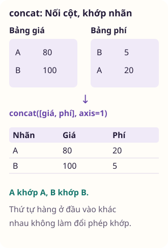

<div class="lecture-notes-content">

Để phân tích dữ liệu hiệu quả, người làm dữ liệu cần kết nối các nguồn bảng rời rạc bằng các phép toán quan hệ. Đồng thời, cấu trúc bảng cũng cần chuyển đổi linh hoạt giữa dạng dài (*Long format*) và dạng rộng (*Wide format*) cho các bước vẽ đồ thị hay huấn luyện mô hình. Bài học này trình bày có hệ thống các kỹ thuật: Tổ chức dữ liệu đa chiều bằng chỉ mục phân cấp, ghép bảng quan hệ, nối trục và xoay hình dạng bảng trong pandas.

---

## 1. Chỉ mục phân cấp (Hierarchical Indexing / MultiIndex)

Chỉ mục phân cấp (*Hierarchical Indexing*, được hiện thực hóa qua lớp `MultiIndex` trong pandas) là cơ chế cho phép bạn sở hữu hai hoặc nhiều tầng chỉ mục trên cùng một trục. Nhờ đó, ta có thể thao tác với dữ liệu nhiều chiều (3 chiều, 4 chiều) trong khuôn khổ của cấu trúc DataFrame hai chiều quen thuộc.

### 1.1. Khởi tạo và trích chọn dữ liệu với `.loc`

Ta có thể khởi tạo một `MultiIndex` từ danh sách các bộ giá trị (*tuples*), mảng song song, hoặc tích Descartes giữa các tập nhãn (*product*):

```python
import numpy as np
import pandas as pd

# Khởi tạo MultiIndex từ danh sách các cặp (khu_vuc, nam)
cac_cap = [
    ("Bắc", 2025), ("Bắc", 2026),
    ("Nam", 2025), ("Nam", 2026)
]
chi_muc = pd.MultiIndex.from_tuples(cac_cap, names=["khu_vuc", "nam"])

du_lieu = pd.Series([120, 150, 200, 260], index=chi_muc)
print("Series với chỉ mục phân cấp:")
print(du_lieu)
```

Điểm mạnh vượt trội của `MultiIndex` là khả năng **trích chọn bộ phận (Partial Indexing)**:
- Truy xuất tầng ngoài cùng: Cú pháp `du_lieu.loc["Bắc"]` sẽ trích xuất toàn bộ dữ liệu của khu vực Bắc dưới dạng một Series thông thường với chỉ mục là `nam`.
- Truy xuất phần tử cụ thể: Truyền một bộ giá trị `du_lieu.loc[("Bắc", 2026)]`.
- Truy xuất tầng bên trong: Sử dụng toán tử cắt lát kết hợp với `pd.IndexSlice`:

```python
print("Dữ liệu khu vực Bắc:")
print(du_lieu.loc["Bắc"])
assert du_lieu.loc[("Bắc", 2026)] == 150
```

### 1.2. Đảo và sắp xếp các tầng chỉ mục

Khi làm việc với chỉ mục phân cấp, thứ tự sắp xếp của các tầng đóng vai trò quyết định đến hiệu năng truy xuất:
- `swaplevel()`: Hoán đổi vị trí giữa hai tầng chỉ mục cụ thể.
- `sort_index(level=...)`: Sắp xếp các giá trị theo thứ tự từ điển tại một tầng được chỉ định.

> [!TIP] Nguyên tắc sắp xếp chỉ mục phân cấp
> Các phép trích chọn bộ phận và cắt lát dải nhãn trên `MultiIndex` sẽ đạt hiệu năng cao nhất và không bao giờ gặp cảnh báo lỗi khi chỉ mục đã được sắp xếp từ điển tăng dần bằng phương thức `sort_index()`.

```python
du_lieu_dao = du_lieu.swaplevel("khu_vuc", "nam").sort_index()
print("Series sau khi đảo tầng và sắp xếp:")
print(du_lieu_dao)
assert du_lieu_dao.index.names == ["nam", "khu_vuc"]
```

<!-- worked-example bai-08-ghep-bang-chuyen-dang-worked-1 -->

::: example Hoán vị thứ tự tầng chỉ mục với swaplevel và sắp xếp tầng với sort_index

Khi bảng dữ liệu bán hàng được đánh chỉ mục đa tầng gồm vùng và năm, việc truy vấn cắt lát theo năm đòi hỏi năm phải nằm ở tầng ngoài cùng hoặc chỉ mục phải được sắp xếp theo thứ tự. Ta sử dụng swaplevel để hoán đổi vị trí hai tầng chỉ mục và gọi sort_index để sắp xếp lại chỉ mục.

```python
import pandas as pd

idx = pd.MultiIndex.from_tuples([
    ("B", 2024), ("A", 2025), ("A", 2024), ("B", 2025)
], names=["vung", "nam"])

df_hang = pd.DataFrame({"tien": [10, 20, 30, 40]}, index=idx)
df_dao = df_hang.swaplevel("vung", "nam").sort_index(level="nam")
print(df_dao)
```

Kết quả khi chạy đoạn mã trên:

<div class="data-worked-table">

| nam | vung | tien |
| --- | --- | --- |
| 2024 | A | 30 |
| 2024 | B | 10 |
| 2025 | A | 20 |
| 2025 | B | 40 |

</div>

Chỉ mục phân cấp (MultiIndex) cho phép biểu diễn các chiều dữ liệu phân tầng trên cùng một trục. Thứ tự sắp đặt của các tầng chỉ mục quyết định trực tiếp khả năng cắt lát dữ liệu: Khi chỉ mục chưa được sắp xếp thứ tự, các thao tác truy xuất theo tầng con bằng toán tử `.loc` thường phát sinh cảnh báo hoặc gặp trở ngại khi xác định phạm vi cắt lát.

Phương thức `df.swaplevel('vung', 'nam')` hoán đổi vị trí giữa hai tầng: Tầng `nam` vốn ở bên trong được đưa ra ngoài làm tầng chỉ mục cấp 0, và tầng `vung` chuyển vào làm tầng cấp 1. Bản thân phép hoán vị này không làm xáo trộn mối liên kết giữa dữ liệu và các khóa chỉ mục ban đầu.

Ngay sau khi đảo tầng, việc gọi `sort_index(level='nam')` sắp xếp lại toàn bộ các nhãn chỉ mục theo thứ tự tăng dần của năm: Khi chỉ mục được sắp xếp đơn điệu, pandas có thể áp dụng các thuật toán tra cứu nhãn hiệu quả để truy xuất các khối dữ liệu thuộc từng năm.

Bảng kết quả gom các bản ghi năm 2024 (vùng A và B) lại liền mạch ở đầu bảng, tiếp theo là các bản ghi của năm 2025. Cấu trúc sau khi đảo tầng giúp bài toán so sánh số liệu giữa các vùng trong cùng một năm trở nên tường minh.

:::

<!-- /worked-example -->

### 1.3. Thống kê tổng hợp theo tầng chỉ mục

Thay vì phải phá vỡ cấu trúc bảng, các phương thức thống kê tổng hợp của pandas cho phép thực hiện phép tính trực tiếp trên một tầng chỉ mục thông qua phương thức `groupby(level=...)`:

```python
# Tính tổng doanh thu theo từng khu vực bất kể năm:
tong_theo_khu = du_lieu.groupby(level="khu_vuc").sum()
print("Tổng doanh thu theo khu vực:")
print(tong_theo_khu)
assert tong_theo_khu["Bắc"] == 270
assert tong_theo_khu["Nam"] == 460
```

### 1.4. Chuyển đổi qua lại giữa cột và chỉ mục

Hai phương thức cơ bản giúp luân chuyển dữ liệu giữa các cột thông thường và chỉ mục:
- `set_index([cot_1, cot_2])`: Đưa một hoặc nhiều cột hiện tại lên làm chỉ mục phân cấp (sử dụng `drop=False` nếu muốn giữ lại các cột đó trong phần thân dữ liệu).
- `reset_index()`: Đưa các tầng chỉ mục trở lại thành các cột dữ liệu thông thường, chuyển chỉ mục hàng về dạng số tự tăng `RangeIndex`.

---

<!-- worked-example bai-08-ghep-bang-chuyen-dang-worked-2 -->

::: example Chuyển cột thành MultiIndex với set_index và khôi phục cột với reset_index

Trong quy trình tiền xử lý, nhiều cột định tính như chi nhánh và phòng ban cần được nâng cấp thành chỉ mục hàng đa tầng để phục vụ các phép tính toán thống kê theo cấp bậc. Sau khi tính toán xong, ta hạ cấp chỉ mục này trở lại thành các cột bình thường bằng reset_index để xuất dữ liệu ra bảng phẳng.

```python
import pandas as pd

df_ns = pd.DataFrame({
    "chi_nhanh": ["HN", "HN", "SG"],
    "phong": ["KinhDoanh", "KyThuat", "KinhDoanh"],
    "nhan_su": [12, 8, 15]
})

df_idx = df_ns.set_index(["chi_nhanh", "phong"])
df_phang = df_idx.reset_index()
print(df_phang)
```

Kết quả khi chạy đoạn mã trên:

<div class="data-worked-table">

| chi&#95;nhanh | phong | nhan&#95;su |
| --- | --- | --- |
| HN | KinhDoanh | 12 |
| HN | KyThuat | 8 |
| SG | KinhDoanh | 15 |

</div>

Mối quan hệ giữa các cột dữ liệu thông thường và các tầng chỉ mục hàng mang tính chất hai chiều linh hoạt. Phương thức `df.set_index(['chi_nhanh', 'phong'])` rút hai cột dữ liệu ra khỏi thân bảng và chuyển chúng thành một MultiIndex hai tầng. Các cột này không còn là các trường đo lường mà trở thành tọa độ định danh cho từng dòng.

Khi đã trở thành chỉ mục, ta có thể áp dụng các phép tính tổng hợp theo từng tầng như `df_idx.groupby(level='chi_nhanh').sum()` một cách tự nhiên. Thao tác này giúp cấu trúc phân cấp được thể hiện rõ ràng trong cấu trúc bảng.

Khi cần ghi kết quả ra tệp CSV, gửi qua API hoặc chuyển giao cho các thư viện trực quan hóa, cấu trúc bảng phẳng là định dạng thường được ưu tiên. Phương thức `reset_index()` thực hiện thao tác hoàn nguyên: Toàn bộ các tầng chỉ mục hàng được đưa trở lại làm các cột dữ liệu thông thường, và chỉ mục hàng được thay thế bằng dãy số nguyên RangeIndex tự tăng.

Bảng kết quả sau khi gọi `reset_index` khôi phục lại ba cột ban đầu gồm `chi_nhanh`, `phong` và `nhan_su`. Đây là chu trình chuyển đổi giúp người phân tích linh hoạt luân chuyển giữa góc nhìn phân tích phân cấp và cấu trúc trao đổi bảng phẳng.

:::

<!-- /worked-example -->

## 2. Ghép và nối các tập dữ liệu (Combining and Merging)

Việc kết hợp nhiều bảng dữ liệu được thực hiện thông qua ba cơ chế toán học rạch ròi: Phép ghép theo kiểu cơ sở dữ liệu quan hệ (`merge`), phép nối dọc theo một trục tọa độ (`concat`), và phép ghép bù đắp dữ liệu khuyết (`combine_first`).

### 2.1. Phép ghép bảng kiểu cơ sở dữ liệu với `pd.merge`

Hàm `pd.merge()` kết nối các hàng của hai DataFrame dựa trên một hoặc nhiều khóa chung (*keys*), tương đương với mệnh đề `JOIN` trong ngôn ngữ SQL:
- `on`: Tên cột làm khóa ghép khi cả hai bảng đều dùng chung một tên cột.
- `left_on`, `right_on`: Chỉ định tên cột khóa riêng biệt khi hai bảng đặt tên cột khác nhau.
- `how`: Phương thức ghép nối:
  - `"inner"` (mặc định): Phép giao (*Inner Join*), chỉ giữ lại các bản ghi có khóa xuất hiện đồng thời ở cả hai bảng.
  - `"left"`: Phép ghép trái (*Left Join*), giữ lại toàn bộ các hàng của bảng bên trái, còn các hàng không tìm thấy đối tác bên phải sẽ nhận giá trị `NaN`.
  - `"right"`: Phép ghép phải (*Right Join*), giữ lại toàn bộ các hàng của bảng bên phải.
  - `"outer"`: Phép hợp (*Outer Join*), giữ lại toàn bộ các bản ghi của cả hai bảng, trong đó phần thiếu ở mỗi bên được điền `NaN`.
- `suffixes=("_trai", "_phai")`: Hậu tố tự động gán vào tên các cột không phải khóa nhưng bị trùng tên giữa hai bảng.

<!-- worked-example bai-08-ghep-bang-chuyen-dang-worked-3 -->

::: example Ghép ngoài theo mã và kiểm tra hàng chưa khớp bằng indicator

Khi kết nối danh mục sản phẩm với bảng kho bãi bằng phép ghép ngoài (Outer Join), một số mặt hàng có thể chỉ xuất hiện ở bảng bên trái hoặc bảng bên phải. Ta kích hoạt tham số indicator=True để pandas tự động sinh cột _merge, giúp phân loại chính xác nguồn gốc xuất xứ của từng bản ghi sau khi ghép.

```python
import pandas as pd

df_sp = pd.DataFrame({"id": [1, 2, 3], "ten": ["Ao", "Quan", "Mu"]})
df_kho = pd.DataFrame({"id": [2, 3, 4], "kho": ["K1", "K2", "K1"]})

df_ghep = pd.merge(df_sp, df_kho, on="id", how="outer", indicator=True)
print(df_ghep)
```

Kết quả khi chạy đoạn mã trên:

<div class="data-worked-table data-worked-table-wide">

| id | ten | kho | &#95;merge |
| --- | --- | --- | --- |
| 1 | Ao | (thiếu) | left&#95;only |
| 2 | Quan | K1 | both |
| 3 | Mu | K2 | both |
| 4 | (thiếu) | K1 | right&#95;only |

</div>

Ô ghi “(thiếu)” biểu thị giá trị chưa được cung cấp hoặc chưa xác định.

Hàm `pd.merge` thực hiện các phép kết nối bảng tương tự như phép JOIN trong đại số quan hệ. Khi sử dụng tùy chọn `how='outer'`, hàm giữ lại toàn bộ các khóa xuất hiện ở cả hai bảng: Nếu một khóa chỉ có ở một phía, các cột tương ứng của phía còn lại sẽ được điền giá trị `NaN`.

Cần lưu ý về hành vi của khóa mang giá trị thiếu: Trong pandas `merge`, các giá trị `NaN` trên cột khóa kết nối có thể khớp với nhau nếu xuất hiện ở cả hai bảng. Điểm này khác biệt với chuẩn SQL thông thường vốn coi `NULL = NULL` là không xác định và không tự động ghép hai giá trị `NULL` trong các phép nối tiêu chuẩn.

Tham số `indicator=True` giải quyết yêu cầu kiểm toán dữ liệu bằng cách tự động bổ sung cột `_merge` kiểu Categorical vào bảng kết quả. Cột `_merge` nhận một trong ba giá trị định danh: `'left_only'` biểu thị bản ghi chỉ có ở bảng bên trái (sản phẩm id=1), `'right_only'` biểu thị bản ghi chỉ có ở bảng bên phải (kho id=4), và `'both'` biểu thị bản ghi có mặt đầy đủ ở cả hai bảng (id=2 và id=3).

Việc nắm giữ cột chỉ báo này cho phép lọc nhanh các mặt hàng chưa được phân bổ kho bằng lệnh `df_ghep[df_ghep['_merge'] == 'left_only']`, phục vụ công tác đối soát dữ liệu sau khi kết nối bảng.

:::

<!-- /worked-example -->

#### Bản số ghép nối và nhân số hàng (Merge Cardinality)
Quan hệ giữa các bảng khi ghép có thể thuộc một trong bốn dạng bản số:
- **Một - Một (1:1)**: Mỗi giá trị khóa xuất hiện duy nhất một lần ở mỗi bảng.
- **Một - Nhiều (1:N) hoặc Nhiều - Một (N:1)**: Khóa ở một bảng là duy nhất (chẳng hạn bảng danh mục sản phẩm), còn ở bảng kia xuất hiện lặp lại (bảng nhật ký giao dịch).
- **Nhiều - Nhiều (N:M)**: Khóa xuất hiện lặp lại ở cả hai bảng. Khi một giá trị khóa xuất hiện $m$ lần ở bảng trái và $n$ lần ở bảng phải, phép ghép sẽ tạo ra tích Descartes nội bộ gồm $m \times n$ hàng cho riêng giá trị khóa đó.

<!-- worked-example bai-08-ghep-bang-chuyen-dang-worked-4 -->

::: example Hiện tượng bùng nổ hàng trong phép ghép nhiều - nhiều và kiểm soát khóa trùng

Khi cả hai bảng tham gia phép ghép đều chứa các giá trị trùng lặp trên cột khóa kết nối, phép ghép sẽ tạo ra tích Descartes của các nhóm khóa đó. Ta chủ động xây dựng một kịch bản khóa trùng ở cả hai phía để quan sát hiện tượng nhân số hàng và hiểu rõ nguyên nhân gây bùng nổ kích thước dữ liệu.

```python
import pandas as pd

df_kh = pd.DataFrame({
    "ma_kh": ["K1", "K1"],
    "ten": ["An", "An_VP"]
})
df_don = pd.DataFrame({
    "ma_kh": ["K1", "K1"],
    "tien": [100, 250]
})

df_nhan = pd.merge(df_kh, df_don, on="ma_kh")
print(df_nhan)
```

Kết quả khi chạy đoạn mã trên:

<div class="data-worked-table">

| ma&#95;kh | ten | tien |
| --- | --- | --- |
| K1 | An | 100 |
| K1 | An | 250 |
| K1 | An&#95;VP | 100 |
| K1 | An&#95;VP | 250 |

</div>

Bản số ghép nối (Merge Cardinality) mô tả mối quan hệ số lượng giữa các bản ghi có cùng khóa ở hai bảng. Trong các thiết kế cơ sở dữ liệu quan hệ, phép ghép thông thường diễn ra giữa khóa chính (duy nhất) và khóa ngoại (một hoặc nhiều). Tuy nhiên, nếu cả hai bảng đều có khóa trùng lặp, phép ghép sẽ chuyển hóa thành quan hệ nhiều - nhiều (many-to-many).

Cơ chế của phép ghép nhiều - nhiều là tích Descartes cục bộ: Giả sử khóa K1 xuất hiện m lần ở bảng trái và n lần ở bảng phải, số dòng sinh ra trong bảng kết quả cho riêng khóa K1 sẽ là m * n dòng. Trong ví dụ trên, mỗi bảng đều có 2 dòng mang mã K1, do đó kết quả ghép sinh ra đúng 2 * 2 = 4 dòng.

Quan sát nội dung bảng kết quả: Tên 'An' được ghép với cả hai đơn hàng 100 và 250, đồng thời tên 'An_VP' cũng được ghép với cả hai đơn hàng đó. Nếu không nắm vững bản số quan hệ, một bảng vài nghìn dòng trùng khóa có thể bùng nổ thành hàng triệu dòng, làm sai lệch các phép tính tổng doanh thu sau đó.

Hiểu rõ hiện tượng nhân số hàng giúp người phân tích luôn rà soát tính duy nhất của khóa trước khi ghép bảng, hoặc chủ động xử lý các bản ghi trùng lặp ở tầng danh mục để bảo đảm tính đúng đắn của dữ liệu tổng hợp.

:::

<!-- /worked-example -->

#### Hành vi của khóa mang giá trị khuyết thiếu (`NaN`)
Trong ngôn ngữ SQL chuẩn, `NULL` biểu thị dữ liệu chưa biết nên biểu thức so sánh `NULL = NULL` trả về `UNKNOWN`, làm cho các hàng mang khóa `NULL` không bao giờ ghép khớp với nhau. Ngược lại, trong pandas `pd.merge()`, giá trị khuyết thiếu (`NaN`) mặc định được đối xử như hai giá trị bằng nhau. Nếu cả hai bảng đều chứa các hàng mang khóa `NaN`, phép ghép sẽ nối các dòng `NaN` lại với nhau và sinh ra tích Descartes giữa các bản ghi thiếu khóa:

```python
bang_a = pd.DataFrame({"khoa": ["K1", "K1", np.nan], "gt_a": [1, 2, 3]})
bang_b = pd.DataFrame({"khoa": ["K1", "K1", np.nan], "gt_b": [10, 20, 30]})

# Khóa 'K1' sinh 2x2 = 4 hàng, khóa NaN sinh 1x1 = 1 hàng: Tổng 5 hàng
bang_ghep_khoa = pd.merge(bang_a, bang_b, on="khoa", how="inner")
print("Bảng ghép với khóa có NaN và trùng lặp:")
print(bang_ghep_khoa)
assert len(bang_ghep_khoa) == 5
assert bang_ghep_khoa["khoa"].isna().sum() == 1
```

Nếu bài toán nghiệp vụ không coi các bản ghi thiếu khóa là cùng một thực thể, bạn cần lọc bỏ hoặc xử lý `NaN` trên cột khóa trước khi thực hiện ghép bảng.

```python
bang_sinh_vien = pd.DataFrame({
    "ma_sv": ["SV01", "SV02", "SV03"],
    "ho_ten": ["An", "Bình", "Cường"],
    "khoa": ["CNTT", "Kinh tế", "CNTT"]
})

bang_diem = pd.DataFrame({
    "ma_sv": ["SV01", "SV02", "SV04"],
    "diem_gpa": [3.6, 3.2, 3.8]
})

# Ghép toàn bộ sinh viên và điểm số bằng phép Left Join
df_hop_nhat = pd.merge(bang_sinh_vien, bang_diem, on="ma_sv", how="left")
print("Bảng sau phép Left Join:")
print(df_hop_nhat)
assert len(df_hop_nhat) == 3
assert pd.isna(df_hop_nhat.loc[df_hop_nhat["ma_sv"] == "SV03", "diem_gpa"].iloc[0])
```

### 2.2. Kiểm thực cấu trúc ghép nối với tham số `validate`

Một trong những sai lầm nghiêm trọng nhất khi ghép bảng là **hiện tượng bùng nổ số hàng do tích Descartes ngầm** (*Cartesian Explosion*). Giả sử bạn muốn gắn thông tin danh mục vào bảng đơn hàng (kỳ vọng quan hệ nhiều - một). Nếu vô tình bảng danh mục bị trùng lặp khóa, mỗi đơn hàng sẽ bị nhân đôi hoặc nhân ba số dòng, làm sai lệch toàn bộ báo cáo doanh thu kế toán!

Để phòng vệ tuyệt đối, pandas cung cấp tham số `validate`:
- `validate="one_to_one"`: Kiểm tra khóa ở cả hai bảng đều là duy nhất tuyệt đối.
- `validate="one_to_many"`: Khóa ở bảng trái là duy nhất, bảng phải có thể lặp.
- `validate="many_to_one"`: Khóa ở bảng trái có thể lặp, bảng phải bắt buộc là duy nhất.
- `validate="many_to_many"`: Cho phép quan hệ nhiều - nhiều ở cả hai bên.

Nếu cấu trúc khóa thực tế vi phạm khai báo, pandas sẽ lập tức ném ra lỗi `MergeError` để dừng tiến trình, ngăn chặn việc sản sinh dữ liệu sai:

```python
try:
    # Bảng tra cứu không được phép trùng lặp khóa:
    tra_cuu_loi = pd.DataFrame({"ma_sv": ["SV01", "SV01"], "hoc_bong": [500, 700]})
    pd.merge(bang_sinh_vien, tra_cuu_loi, on="ma_sv", validate="many_to_one")
except pd.errors.MergeError:
    print("Bắt lỗi thành công: Khóa bảng tra cứu bị trùng lặp!")
```

<!-- worked-example bai-08-ghep-bang-chuyen-dang-worked-5 -->

::: example Xác thực ràng buộc bản số quan hệ với tham số validate

Khi ghép danh mục sản phẩm vào bảng nhật ký giao dịch, nghiệp vụ quy định mã sản phẩm ở danh mục phải là duy nhất (quan hệ một - nhiều). Nếu bảng danh mục vô tình bị trùng lặp mã do lỗi nhập liệu, phép ghép sẽ âm thầm nhân đôi doanh thu. Ta sử dụng tham số validate='one_to_many' để xác thực cấu trúc dữ liệu.

```python
import pandas as pd

df_dm = pd.DataFrame({"ma": ["SP1", "SP2"], "gia": [50, 80]})
df_gd = pd.DataFrame({"ma": ["SP1", "SP1", "SP2"], "so": [2, 5, 1]})

df_kt = pd.merge(df_dm, df_gd, on="ma", validate="one_to_many")
print(df_kt)
```

Kết quả khi chạy đoạn mã trên:

<div class="data-worked-table">

| ma | gia | so |
| --- | --- | --- |
| SP1 | 50 | 2 |
| SP1 | 50 | 5 |
| SP2 | 80 | 1 |

</div>

Một vấn đề tiềm ẩn trong các đường ống xử lý dữ liệu là sự sai lệch bản số: Người lập trình giả định bảng danh mục là duy nhất (quan hệ 1 - nhiều), nhưng thực tế bảng lại chứa các dòng trùng khóa. Phép ghép vẫn thực thi mà không báo lỗi cú pháp nhưng số dòng tăng lên đột biến và làm sai lệch kết quả phân tích.

Tham số `validate` cung cấp một chốt kiểm tra tính toàn vẹn ngay tại thời điểm thực thi: Các tùy chọn hợp lệ gồm `'one_to_one'`, `'one_to_many'`, `'many_to_one'` và `'many_to_many'`. Khi ta khai báo `validate='one_to_many'`, pandas kiểm tra xem khóa ở bảng bên trái (`df_dm`) có thực sự là duy nhất hay không.

Trong ví dụ trên: Bảng `df_dm` có hai mã SP1 và SP2 riêng biệt, thỏa mãn điều kiện `'one'`. Bảng `df_gd` chứa mã SP1 lặp lại hai lần, phù hợp với điều kiện `'many'`. Phép ghép được thực hiện và trả về ba dòng giao dịch kèm đơn giá tương ứng.

Tuy nhiên, không nên đánh đồng hoàn toàn tham số `validate` với các ràng buộc khóa ngoại trong SQL: Trong pandas, sự hiện diện của giá trị `NaN` hoặc kiểu dữ liệu Categorical trên cột khóa có thể tạo ra các hành vi so khớp khác biệt so với các động cơ cơ sở dữ liệu quan hệ truyền thống.

:::

<!-- /worked-example -->

### 2.3. Ghép nối dựa trên chỉ mục hàng (`join`)

Khi một hoặc cả hai bảng muốn sử dụng chính chỉ mục hàng (*Index*) làm khóa ghép, ta có thể chỉ định `left_index=True` hoặc `right_index=True`. Ngoài ra, phương thức tiện ích `df.join()` mặc định sử dụng chỉ mục hàng để ghép nối, rất thuận tiện khi hợp nhất nhiều DataFrame có chung chỉ mục.

<!-- worked-example bai-08-ghep-bang-chuyen-dang-worked-6 -->

::: example Ghép bảng dựa trên chỉ mục với join và phân biệt tên cột bằng hậu tố

Khi so sánh bảng giá cũ và bảng giá mới có cùng chỉ mục mã hàng hóa, cả hai bảng đều có cột mang tên gia. Việc gọi phương thức join mà không cấu hình hậu tố sẽ gây ra xung đột tên cột. Ta chỉ định lsuffix và rsuffix để phân biệt nguồn gốc giá của từng bảng.

```python
import pandas as pd

df_cu = pd.DataFrame({"gia": [100, 200]}, index=["H1", "H2"])
df_moi = pd.DataFrame({"gia": [95, 210]}, index=["H1", "H2"])

df_ghep = df_cu.join(df_moi, lsuffix="_goc", rsuffix="_moi")
print(df_ghep)
```

Kết quả khi chạy đoạn mã trên:

<div class="data-worked-table">

| Chỉ mục | gia&#95;goc | gia&#95;moi |
| --- | --- | --- |
| H1 | 100 | 95 |
| H2 | 200 | 210 |

</div>

Phương thức `df.join` chuyên dùng cho các phép ghép nối dựa trên chỉ mục hàng (Index): Thay vì phải chỉ định cột khóa `on='id'` như `pd.merge`, `join` mặc định ghép các dòng có cùng giá trị chỉ mục hàng của hai bảng.

Một tình huống phổ biến là hai bảng chứa các cột có tên trùng khớp, chẳng hạn cột `gia` ở cả bảng giá cũ và bảng giá mới. Nếu gọi trực tiếp `df_cu.join(df_moi)`, pandas sẽ ném ra ngoại lệ `ValueError` do không thể quyết định cột nào thuộc về bảng nào.

Hai tham số `lsuffix` và `rsuffix` xử lý sự xung đột này: Tham số `lsuffix='_goc'` tự động gắn hậu tố vào tên cột của bảng bên trái thành `gia_goc`. Đồng thời, `rsuffix='_moi'` gắn hậu tố vào cột của bảng bên phải thành `gia_moi`.

Bảng kết quả đặt hai cột giá cạnh nhau ngay ngắn trên từng mã hàng H1 và H2. Việc kiểm soát hậu tố tên cột giúp mã nguồn rõ ràng mà không cần bước đổi tên cột thủ công trước khi ghép.

:::

<!-- /worked-example -->

### 2.4. Nối dữ liệu dọc theo trục với `pd.concat`

Khi các tháng đều có một bảng doanh thu cùng cấu trúc, ta cần nối chúng thành một bảng dài hơn. `pd.concat()` nhận một danh sách các Series hoặc DataFrame, nối theo trục được chỉ định và căn chỉnh nhãn trên trục còn lại. Nó không tìm cặp hàng bằng một cột khóa như `merge`.

- `axis=0` (mặc định): Nối theo chiều dọc (thêm các hàng mới vào bên dưới).
- `axis=1`: Nối theo chiều ngang (thêm các cột mới vào bên phải).
- `join="inner"`: Giữ giao của các nhãn trên trục còn lại. Với `axis=0`, đó là tên cột. Với `axis=1`, đó là nhãn hàng. `join="outer"` (mặc định) giữ hợp các nhãn và tạo ô thiếu ở nơi chưa có giá trị.
- `ignore_index=True`: Đánh số lại nhãn trên trục đang nối. Với `axis=0`, pandas tạo chỉ mục hàng từ $0$ đến $N-1$. Với `axis=1`, pandas đánh số lại tên cột. Tham số này không loại các bản ghi trùng trong dữ liệu.
- `keys=[...]`: Tạo một tầng chỉ mục phân cấp mới ở ngoài cùng để đánh dấu xuất xứ của từng khối dữ liệu được ghép:

```python
thang_1 = pd.DataFrame({"doanh_thu": [100, 150]}, index=["SP1", "SP2"])
thang_2 = pd.DataFrame({"doanh_thu": [120, 180]}, index=["SP1", "SP2"])

# Nối theo chiều dọc và phân tầng theo tháng
df_noi = pd.concat([thang_1, thang_2], keys=["T1", "T2"])
print("Bảng nối với MultiIndex:")
print(df_noi)
assert df_noi.loc[("T2", "SP1"), "doanh_thu"] == 120
```

<!-- worked-example bai-08-ghep-bang-chuyen-dang-worked-11 -->

::: example Đổi axis của concat thì nhãn nào được khớp?

Bảng giá và bảng phí cùng mô tả các phòng nhưng xuất hiện theo thứ tự khác nhau. Ta thử ghép ngang để thấy pandas không ghép hàng chỉ vì chúng đứng cùng vị trí.

```python
import pandas as pd
gia = pd.DataFrame({"gia": [80, 100]}, index=["A", "B"])
phi = pd.DataFrame({"phi": [5, 20]}, index=["B", "A"])
ket_qua = pd.concat([gia, phi], axis=1)
print(ket_qua)
assert ket_qua.loc["A", "phi"] == 20
assert ket_qua.loc["B", "phi"] == 5
chi_a = pd.concat([gia, phi.loc[["A"]]], axis=1,
                  join="inner")
print(chi_a)
```

Kết quả khi chạy đoạn mã trên:

<div class="data-worked-table">

| Chỉ mục | gia | phi |
| --- | --- | --- |
| A | 80 | 20 |
| B | 100 | 5 |

</div>

<div class="data-worked-table">

| Chỉ mục | gia | phi |
| --- | --- | --- |
| A | 80 | 20 |

</div>



Thiết lập `axis=1` thực hiện nối các khối dữ liệu theo trục cột, do đó các nhãn ở trục hàng được dùng để so khớp. Bảng phí có nhãn B đứng trước nhãn A nhưng kết quả ghép vẫn đưa phí 20 về phòng A và phí 5 về phòng B. Đây là phép căn chỉnh dựa trên nhãn chỉ mục hàng của các bảng, khác với phép tìm kiếm theo giá trị cột của `pd.merge` và không phải là phép ghép theo vị trí vật lý.

Tham số `join` áp dụng lên trục còn lại ngoài trục đang được nối: Khi nối ngang theo cột, `join='inner'` chỉ giữ lại những nhãn hàng xuất hiện ở đồng thời cả hai bảng. Ví dụ thứ hai chỉ còn giữ lại nhãn phòng A. Nếu dùng `join='outer'`, nhãn B vẫn có mặt nhưng ô phí sẽ nhận giá trị thiếu `NaN`. Khi nối dọc với `axis=0`, vai trò của `join` đổi lại, quyết định tập hợp tên cột sẽ được giữ lại.

Tham số `ignore_index=True` chỉ đánh số lại trục đang được nối: Với `axis=1`, nó đánh số lại tên cột thành 0, 1 chứ không làm hai bảng bỏ qua nhãn hàng. Nếu các nhãn hiện có là mã định danh, việc loại bỏ chúng trước khi ghép có thể dẫn đến việc ghép sai lệch giữa giá và phí của các phòng mà chương trình không phát sinh lỗi.

:::

<!-- /worked-example -->

<!-- worked-example bai-08-ghep-bang-chuyen-dang-worked-12 -->

::: example Giữ nguồn gốc và phát hiện chỉ mục trùng khi nối tháng

Hai tháng đều có phòng A. Một bảng phân tích theo thời gian phải giữ được tháng đi kèm mỗi quan sát, thay vì coi mọi hàng A là cùng một bản ghi.

```python
import pandas as pd
thang_1 = pd.DataFrame({"gia": [80, 100]},
                       index=["A", "B"])
thang_2 = pd.DataFrame({"gia": [90]}, index=["A"])
theo_thang = pd.concat([thang_1, thang_2],
    keys=["T1", "T2"], names=["thang", "phong"])
print(theo_thang)
try:
    pd.concat([thang_1, thang_2], verify_integrity=True)
except ValueError:
    print("Chỉ mục A xuất hiện ở cả hai bảng")
danh_so = pd.concat([thang_1, thang_2], ignore_index=True)
print(danh_so)
assert len(danh_so) == 3
```

Kết quả khi chạy đoạn mã trên:

<div class="data-worked-table">

| thang | phong | gia |
| --- | --- | --- |
| T1 | A | 80 |
| T1 | B | 100 |
| T2 | A | 90 |

</div>

```text
Chỉ mục A xuất hiện ở cả hai bảng
```

<div class="data-worked-table">

| gia |
| --- |
| 80 |
| 100 |
| 90 |

</div>

Tham số `keys` tạo thêm một tầng chỉ mục mới mang nhãn T1 và T2 để lưu giữ thông tin nguồn gốc của từng bảng, còn tham số `names` đặt tên cho các tầng chỉ mục tương ứng. Cặp chỉ mục `(T1, A)` và `(T2, A)` giúp phân biệt hai lần quan sát độc lập theo thời gian. Dữ liệu giá không tự động bị gộp lại: Phòng A vẫn có hai dòng riêng biệt vì nó được ghi nhận ở hai tháng khác nhau.

Tham số `verify_integrity=True` kiểm tra xem trục kết quả sau khi nối có xuất hiện nhãn chỉ mục trùng lặp hay không: Khi không thêm tầng tháng qua `keys`, nhãn phòng A bị lặp lại ở cả hai bảng khiến `pd.concat` phát sinh ngoại lệ `ValueError`. Tham số này chỉ kiểm tra nhãn trên trục kết quả, không kiểm tra các cột dữ liệu thông thường và không thay thế cho việc xác thực khóa nghiệp vụ.

Tham số `ignore_index=True` đánh số lại chỉ mục thành 0, 1, 2 giúp loại bỏ sự trùng lặp nhãn chỉ mục, nhưng không khử trùng lặp các quan sát của phòng A. Để tránh mất thông tin nguồn gốc khi sử dụng chỉ mục số nguyên, ta nên chuyển các thông tin định danh như tháng và mã phòng thành các cột dữ liệu trước khi thực hiện nối bảng.

:::

<!-- /worked-example -->

### 2.5. Ghép chồng dữ liệu có phần khuyết bằng `combine_first`

Trong các bài toán làm sạch dữ liệu, ta thường có một nguồn dữ liệu chính nhưng bị khuyết thiếu một số ô, và một nguồn dữ liệu phụ dùng để chắp vá. Phương thức `df1.combine_first(df2)` sẽ thực hiện cơ chế: Giữ nguyên các giá trị hợp lệ của `df1`, và chỉ lấy giá trị từ `df2` để lấp đầy những vị trí mà `df1` đang mang giá trị `NaN`:

```python
du_lieu_chinh = pd.Series([np.nan, 2.5, np.nan, 3.5, 4.5], index=list("abcde"))
du_lieu_phu = pd.Series([1.0, 9.9, 3.0, 9.9, 9.9], index=list("abcde"))

ket_qua_va = du_lieu_chinh.combine_first(du_lieu_phu)
print("Dữ liệu sau khi vá ô trống:")
print(ket_qua_va)
assert ket_qua_va["a"] == 1.0
assert ket_qua_va["b"] == 2.5
```

---

<!-- worked-example bai-08-ghep-bang-chuyen-dang-worked-8 -->

::: example Vá dữ liệu khuyết thiếu bằng cách ghép chồng ưu tiên với combine_first

Trong các hệ thống quản lý danh mục, bảng dữ liệu chính có thể bị khuyết thiếu một số trường giá hoặc mã kho ở một vài sản phẩm. Ta sử dụng phương thức combine_first để lấy dữ liệu từ bảng dự phòng vá vào các ô trống của bảng chính mà không ghi đè lên các giá trị hợp lệ đã có.

```python
import numpy as np
import pandas as pd

df_chinh = pd.DataFrame({
    "gia": [100.0, np.nan, 300.0],
    "kho": ["K1", np.nan, "K2"]
}, index=["P1", "P2", "P3"])

df_phu = pd.DataFrame({
    "gia": [105.0, 200.0, np.nan],
    "kho": ["K1", "K3", "K2"]
}, index=["P1", "P2", "P3"])

df_va = df_chinh.combine_first(df_phu)
print(df_va)
```

Kết quả khi chạy đoạn mã trên:

<div class="data-worked-table">

| Chỉ mục | gia | kho |
| --- | --- | --- |
| P1 | 100.0 | K1 |
| P2 | 200.0 | K3 |
| P3 | 300.0 | K2 |

</div>

Bài toán vá dữ liệu xuất hiện khi hợp nhất thông tin từ hai nguồn: Một nguồn chính thống (có độ ưu tiên cao nhưng có thể bị khuyết dữ liệu) và một nguồn dự phòng (dùng để bổ sung vào các chỗ trống). Nếu dùng phép gán thông thường hoặc ghép bảng đơn giản, các giá trị của nguồn chính dễ bị ghi đè.

Phương thức `df_chinh.combine_first(df_phu)` hoạt động tương tự như hàm COALESCE trong SQL: Nó căn chỉnh hai bảng theo cả chỉ mục hàng và tiêu đề cột. Tại mọi vị trí mà `df_chinh` đã có giá trị hợp lệ, giá trị đó được giữ nguyên.

Chỉ tại những vị trí mang giá trị `NaN` trên bảng chính (chẳng hạn sản phẩm P2 khuyết cả `gia` lẫn `kho`), phương thức mới tìm kiếm giá trị tương ứng ở `df_phu` để đắp vào: Mức giá 200.0 và mã kho K3 từ bảng phụ được chuyển sang hoàn thiện bản ghi P2.

Tại bản ghi P1: Dù `df_phu` có mức giá 105.0, mức giá 100.0 của `df_chinh` vẫn được giữ lại vì ô này đã có dữ liệu hợp lệ. Kết quả thu được là một bảng dữ liệu kết hợp thông tin từ cả hai nguồn mà không làm mất tính ưu tiên của bảng chính.

:::

<!-- /worked-example -->

## 3. Chuyển dạng và xoay bảng (Reshaping and Pivoting)

Cấu trúc hình học của dữ liệu quyết định khả năng tính toán và trực quan hóa:
- **Dạng dài (Long format / Tidy data)**: Mỗi quan sát là một hàng riêng biệt, các biến số được biểu diễn bằng cột định danh và cột giá trị. Định dạng này lý tưởng cho các thư viện phân tích nhóm và đồ họa hiện đại như Seaborn.
- **Dạng rộng (Wide format)**: Các mức giá trị của một biến được trải rộng thành các cột riêng biệt, thuận tiện cho mắt người đọc báo cáo tổng hợp.

### 3.1. Chuyển dạng với `stack` và `unstack`

Cặp phương thức `stack()` và `unstack()` luân chuyển dữ liệu qua lại giữa cột và hàng dựa trên chỉ mục phân cấp:
- `unstack()`: Nhấc một tầng của chỉ mục hàng (*Row Index*) xoay lên làm tiêu đề cột (*Column Header*), biến bảng từ dạng dài thành dạng rộng hơn.
- `stack()`: Gom các tiêu đề cột nén ngược trở lại thành một tầng của chỉ mục hàng, biến bảng từ dạng rộng thành dạng dài hơn.

```python
bang_goc = pd.DataFrame(
    [[10, 20], [30, 40]],
    index=["Hà Nội", "Đà Nẵng"],
    columns=["Quý 1", "Quý 2"]
)

# Chuyển từ dạng rộng sang dạng dài bằng stack:
bang_dai = bang_goc.stack()
print("Bảng sau khi stack:")
print(bang_dai)

# Khôi phục lại dạng ban đầu bằng unstack:
bang_khoi_phuc = bang_dai.unstack()
assert bang_khoi_phuc.equals(bang_goc)
```

### 3.2. Chuyển dạng dài sang dạng rộng với `pivot`

Phương thức `pivot(index=..., columns=..., values=...)` cho phép tái cấu trúc một bảng dạng dài thành bảng dạng rộng dựa trên các cột nghiệp vụ:
- `index`: Cột sẽ trở thành chỉ mục hàng của bảng mới.
- `columns`: Cột có các giá trị phân loại sẽ được bung ra thành các tiêu đề cột mới.
- `values`: Cột chứa dữ liệu số học sẽ được điền vào phần thân bảng.

```python
nhat_ky_gia = pd.DataFrame({
    "ngay": ["2026-01-01", "2026-01-01", "2026-01-02", "2026-01-02"],
    "ma_cp": ["FPT", "VNM", "FPT", "VNM"],
    "gia_dong_cua": [120, 75, 122, 74]
})

bang_gia_rong = nhat_ky_gia.pivot(index="ngay", columns="ma_cp", values="gia_dong_cua")
print("Bảng giá dạng rộng:")
print(bang_gia_rong)
assert bang_gia_rong.loc["2026-01-02", "FPT"] == 122
```

> [!WARNING] Điều kiện tiên quyết của `pivot`
> Phương thức `pivot` bắt buộc mỗi cặp `(index, columns)` chỉ được xuất hiện duy nhất một lần. Nếu tồn tại nhiều bản ghi trùng lặp cho cùng một cặp chỉ mục và cột, `pivot` sẽ báo lỗi `ValueError`. Trong tình huống có dữ liệu trùng lặp cần tổng hợp, ta bắt buộc phải sử dụng `pivot_table` (sẽ học ở bài học tổng hợp nhóm).

<!-- worked-example bai-08-ghep-bang-chuyen-dang-worked-9 -->

::: example Tái cấu trúc bảng từ dạng dài sang dạng rộng bằng pivot

Bảng ghi nhận doanh thu theo ngày và kênh bán hàng thường được lưu ở dạng dài (mỗi dòng là một giao dịch của một kênh). Để thuận tiện cho việc so sánh giữa các kênh trên cùng một dòng ngày, ta sử dụng phương thức pivot để xoay giá trị của cột kênh thành các tiêu đề cột độc lập.

```python
import pandas as pd

df_dai = pd.DataFrame({
    "ngay": ["2026-01-01", "2026-01-01", "2026-01-02", "2026-01-02"],
    "kenh": ["Online", "CuaHang", "Online", "CuaHang"],
    "tien": [120, 300, 150, 280]
})

df_rong = df_dai.pivot(
    index="ngay",
    columns="kenh",
    values="tien"
).reset_index()
print(df_rong)
```

Kết quả khi chạy đoạn mã trên:

<div class="data-worked-table">

| ngay | CuaHang | Online |
| --- | --- | --- |
| 2026-01-01 | 300 | 120 |
| 2026-01-02 | 280 | 150 |

</div>

Dạng dữ liệu dài (Long format) thường được sử dụng trong lưu trữ vì cấu trúc bảng không thay đổi khi phát sinh thêm các danh mục kênh mới. Tuy nhiên, khi lập báo cáo đối chiếu, dạng dữ liệu rộng (Wide format) giúp người đọc quan sát đồng thời các kênh trên cùng một mốc thời gian.

Phương thức `df.pivot` thực hiện việc tái định hình bảng dựa trên ba tham số: Tham số `index='ngay'` xác định cột giữ vai trò làm chỉ mục hàng, `columns='kenh'` chỉ định cột có các giá trị sẽ được chuyển thành các tiêu đề cột mới, và `values='tien'` xác định dữ liệu số sẽ được phân bổ vào các ô giao nhau.

Cần lưu ý điều kiện của `pivot`: Các cặp giá trị giữa cột chỉ mục và cột xoay phải là duy nhất. Trong ví dụ trên, mỗi ngày chỉ có đúng một bản ghi Online và một bản ghi CuaHang, do đó phép xoay bảng không phát sinh lỗi trùng khóa.

Sau khi gọi `reset_index()`, bảng rộng thu được gồm ba cột: Cột `ngay`, cột `CuaHang` và cột `Online`. Cấu trúc mới này cho phép tính toán trực tiếp độ chênh lệch hoặc tỷ lệ doanh thu giữa hai kênh bán hàng qua từng ngày.

:::

<!-- /worked-example -->

### 3.3. Chuyển dạng rộng sang dạng dài với `melt`

Ngược lại với `pivot`, phương thức `pd.melt()` cho phép nén nhiều cột thành một cặp cột duy nhất gồm "tên thuộc tính" và "giá trị":
- `id_vars`: Danh sách các cột đóng vai trò là mã định danh, được giữ nguyên vị trí.
- `value_vars`: Danh sách các cột cần nén lại thành hàng (nếu bỏ qua, pandas sẽ nén toàn bộ các cột còn lại).
- `var_name`: Tên của cột mới lưu trữ tên các thuộc tính cũ.
- `value_name`: Tên của cột mới lưu trữ giá trị số học.

```python
bang_doanh_so = pd.DataFrame({
    "chi_nhanh": ["CN1", "CN2"],
    "Thang1": [500, 700],
    "Thang2": [600, 800]
})

bang_chay_dai = pd.melt(
    bang_doanh_so,
    id_vars=["chi_nhanh"],
    value_vars=["Thang1", "Thang2"],
    var_name="thoi_gian",
    value_name="doanh_so"
)
print("Bảng sau khi melt:")
print(bang_chay_dai)
assert len(bang_chay_dai) == 4
assert bang_chay_dai["doanh_so"].sum() == 2600
```

---

<!-- worked-example bai-08-ghep-bang-chuyen-dang-worked-10 -->

::: example Làm phẳng bảng số liệu dạng rộng thành dạng dài với melt

Một bảng báo cáo doanh số được trình bày ở dạng rộng với các cột đại diện cho từng tháng t1, t2. Để đưa bảng này vào các mô hình phân tích hoặc thư viện trực quan hóa, ta sử dụng hàm pd.melt để gom các cột tháng thành một cột biến định tính duy nhất kèm giá trị số tương ứng.

```python
import pandas as pd

df_rong = pd.DataFrame({
    "ma": ["A1", "A2"],
    "t1": [100, 150],
    "t2": [120, 180]
})

df_dai = pd.melt(
    df_rong,
    id_vars=["ma"],
    value_vars=["t1", "t2"],
    var_name="thang",
    value_name="tien"
)
print(df_dai)
```

Kết quả khi chạy đoạn mã trên:

<div class="data-worked-table">

| ma | thang | tien |
| --- | --- | --- |
| A1 | t1 | 100 |
| A2 | t1 | 150 |
| A1 | t2 | 120 |
| A2 | t2 | 180 |

</div>

Ngược lại với `pivot`, thao tác `melt` thực hiện việc chuyển đổi cấu trúc bảng từ dạng rộng sang dạng dài. Thao tác này đưa dữ liệu về cấu trúc bảng gọn gàng, trong đó mỗi dòng biểu diễn một quan sát và mỗi cột tương ứng với một biến đo lường.

Tham số `id_vars=['ma']` xác định danh sách các cột định danh cần giữ cố định làm trục tham chiếu: Giá trị của cột `ma` được lặp lại tương ứng với số lượng cột đo lường được làm phẳng.

Tham số `value_vars=['t1', 't2']` chỉ định các cột số liệu cần gom lại: Hai tham số `var_name='thang'` và `value_name='tien'` cho phép đặt tên trực tiếp cho cột biến số và cột giá trị, thay cho các tên cột mặc định `'variable'` và `'value'`.

Bảng kết quả thu được gồm 4 dòng với ba cột rõ ràng: Cột `ma`, cột `thang` và cột `tien`. Cấu trúc dạng dài này phù hợp với các hàm vẽ biểu đồ phân nhóm hoặc các mô hình hồi quy yêu cầu một cột giá trị thống nhất.

:::

<!-- /worked-example -->

## 5. Tổng kết

1. **Làm chủ chỉ mục phân cấp**: Sử dụng `MultiIndex` để quản lý dữ liệu nhiều chiều trên cấu trúc hai chiều, đồng thời nên gọi `sort_index()` để tối ưu hóa hiệu năng trích chọn bộ phận với `.loc`.
2. **Kỷ luật khi ghép bảng với `merge`**: Luôn định hình rõ mối quan hệ giữa các bảng ($1-1$, $1-N$, $N-1$) và sử dụng tham số `validate` để ngăn ngừa nguy cơ bùng nổ số hàng do tích Descartes ngoài ý muốn.
3. **Phân biệt rạch ròi giữa `merge` và `concat`**: Sử dụng `merge` khi cần kết nối dữ liệu dựa trên giá trị của các cột khóa chung, còn sử dụng `concat` khi cần dán ghép các mảng dữ liệu vật lý dọc theo chiều hàng hoặc chiều cột.
4. **Vá dữ liệu với `combine_first`**: Tận dụng cơ chế ghép chồng để lấp đầy các ô trống trong bảng dữ liệu chính bằng thông tin từ nguồn phụ trợ mà không ghi đè lên các giá trị hợp lệ đã có.
5. **Linh hoạt chuyển dạng dữ liệu**: Sử dụng `stack`/`unstack` cho cấu trúc có chỉ mục phân cấp, đồng thời chuyển đổi thuần thục giữa dạng dài và dạng rộng bằng `pivot` và `melt` để đáp ứng yêu cầu của từng giai đoạn phân tích.

---

## Tài liệu tham khảo

- [pandas: concat](https://pandas.pydata.org/docs/reference/api/pandas.concat.html).


- Wes McKinney, *Python for Data Analysis* (tái bản lần 3): [Chương 8: Data Wrangling: Join, Combine, and Reshape](https://wesmckinney.com/book/data-wrangling).
- Tài liệu chính thức pandas: [Merge, join, concatenate and compare](https://pandas.pydata.org/docs/user_guide/merging.html) & [Reshaping and pivot tables](https://pandas.pydata.org/docs/user_guide/reshaping.html).
- Hadley Wickham, *Tidy Data*, Journal of Statistical Software, 2014.
- Hệ thống bài tập được chuyển thể từ học liệu mở của: [Khóa học Lập trình xử lý dữ liệu (UET)](https://courses.iaidev.com/programming-for-data-processing/2627-1/) theo giấy phép [Creative Commons Attribution-NonCommercial-ShareAlike 4.0 International (CC BY-NC-SA 4.0)](https://github.com/uet-iai-course/programming-for-data-processing/blob/main/LICENSE).

- IAI, [Lập trình xử lý dữ liệu, học liệu và notebook](https://courses.iaidev.com/programming-for-data-processing/2627-1/). Các đề thực hành đã được biên tập cách diễn đạt và bổ sung lời giải, giữ [CC BY-NC-SA 4.0](https://creativecommons.org/licenses/by-nc-sa/4.0/). [Giấy phép học liệu](https://github.com/uet-iai-course/programming-for-data-processing/blob/main/LICENSE).

</div>

<div class="lecture-exercises-content" aria-label="Bài tập của chương">

## 4. Bài tập rèn luyện

<span id="iai-05-bai-4"></span>

::: exercise Bài tập 1: Ghép trái khi khóa lặp ở cả hai bảng
Cho hai bảng dữ liệu độc lập về hệ thống phòng nghỉ và khu vực địa lý:

Bảng `trai`:

| id | khu |
| :--- | :--- |
| P1 | A |
| P2 | A |
| P3 | B |

Bảng `phai`:

| khu | vung |
| :--- | :--- |
| A | Bắc |
| A | Trung tâm |

Hãy viết câu lệnh ghép hai bảng trên bằng phương thức `Left Join` trên cột khóa `khu`. Xác định rõ cấu trúc, số lượng hàng và giá trị cụ thể của từng hàng trong bảng kết quả. Giải thích cơ chế khớp dòng của thuật toán.
:::

::: solution Lời giải
Câu lệnh thực thi trong pandas:

```python
trai = pd.DataFrame({
    "id": ["P1", "P2", "P3"],
    "khu": ["A", "A", "B"]
})

phai = pd.DataFrame({
    "khu": ["A", "A"],
    "vung": ["Bắc", "Trung tâm"]
})

ket_qua_ghep = trai.merge(phai, on="khu", how="left")
print("Bảng kết quả sau phép Left Join:")
print(ket_qua_ghep)

assert len(ket_qua_ghep) == 5
assert ket_qua_ghep["vung"].tolist() == ["Bắc", "Trung tâm", "Bắc", "Trung tâm", np.nan] or \
       set(zip(ket_qua_ghep["id"], ket_qua_ghep["vung"])) == {
           ("P1", "Bắc"), ("P1", "Trung tâm"),
           ("P2", "Bắc"), ("P2", "Trung tâm"),
           ("P3", np.nan)
       }
```

Bảng kết quả gồm chính xác $5$ hàng theo thứ tự:
1. `(P1, A, Bắc)`
2. `(P1, A, Trung tâm)`
3. `(P2, A, Bắc)`
4. `(P2, A, Trung tâm)`
5. `(P3, B, NaN)`

**Phân tích cơ chế kỹ thuật**:
- Hàng đầu tiên của bảng trái (`P1`, `A`) khớp với hai hàng có mã `A` bên bảng phải, do đó sản sinh ra hai hàng tương ứng với vùng `Bắc` và `Trung tâm`.
- Hàng thứ hai của bảng trái (`P2`, `A`) cũng khớp với hai hàng bên bảng phải, tiếp tục sản sinh thêm hai hàng.
- Hàng thứ ba của bảng trái (`P3`, `B`) không tìm thấy mã `B` ở bảng phải. Tuy nhiên, vì sử dụng phương thức ghép `how="left"`, toàn bộ các hàng của bảng trái bắt buộc phải được bảo toàn. Do đó, dòng `P3` được giữ lại và trường thuộc tính `vung` được điền giá trị khuyết thiếu `NaN`.
:::

---


<!-- data-labs:start -->
<section class="data-lab-set" data-lab="lab-05-merge">

<!--@include: ../../../raw_materials/xu-ly-du-lieu/labs/lab-05-merge.md-->

</section>

<!-- data-labs:end -->

## Tài liệu tham khảo

- Wes McKinney, *Python for Data Analysis* (tái bản lần 3): [Chương 8: Data Wrangling: Join, Combine, and Reshape](https://wesmckinney.com/book/data-wrangling).
- Tài liệu chính thức pandas: [Merge, join, concatenate and compare](https://pandas.pydata.org/docs/user_guide/merging.html) & [Reshaping and pivot tables](https://pandas.pydata.org/docs/user_guide/reshaping.html).
- Hadley Wickham, *Tidy Data*, Journal of Statistical Software, 2014.
- Hệ thống bài tập được chuyển thể từ học liệu mở của: [Khóa học Lập trình xử lý dữ liệu (UET)](https://courses.iaidev.com/programming-for-data-processing/2627-1/) theo giấy phép [Creative Commons Attribution-NonCommercial-ShareAlike 4.0 International (CC BY-NC-SA 4.0)](https://github.com/uet-iai-course/programming-for-data-processing/blob/main/LICENSE).

- IAI, [Lập trình xử lý dữ liệu, học liệu và notebook](https://courses.iaidev.com/programming-for-data-processing/2627-1/). Các đề thực hành đã được biên tập cách diễn đạt và bổ sung lời giải, giữ [CC BY-NC-SA 4.0](https://creativecommons.org/licenses/by-nc-sa/4.0/). [Giấy phép học liệu](https://github.com/uet-iai-course/programming-for-data-processing/blob/main/LICENSE).

- IAI. [Notebook thực hành](https://github.com/uet-iai-notebook-labs-2026/notebook-labs-template) và [học liệu thực hành 2627-1](https://courses.iaidev.com/programming-for-data-processing/2627-1/). Các yêu cầu kỹ thuật được đối chiếu, biên tập và bổ sung lời giải cùng dữ liệu minh họa. Phần thích nghi từ học liệu IAI áp dụng giấy phép [CC BY-NC-SA 4.0](https://creativecommons.org/licenses/by-nc-sa/4.0/).

</div>
