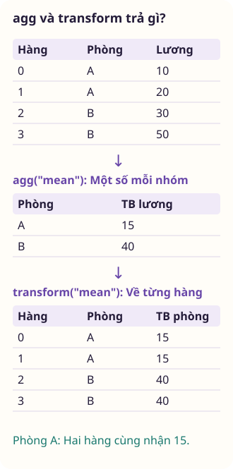

<div class="lecture-notes-content">

Trong phân tích dữ liệu, việc tính toán các đại lượng thống kê trên toàn bộ tập dữ liệu (chẳng hạn giá trị trung bình hay độ lệch chuẩn của toàn bộ bảng) thường chỉ cung cấp một góc nhìn rất khái quát. Những hiểu biết sâu sắc nhất về mặt nghiệp vụ chỉ xuất hiện khi ta bóc tách dữ liệu thành các phân khúc nhỏ hơn: So sánh năng suất theo từng phòng ban, đo lường mức chi tiêu theo từng nhóm khách hàng, hay theo dõi biến động giá theo từng vùng địa lý.

Để thực hiện các thao tác này một cách khoa học, nhà thống kê học Hadley Wickham (2011) đã chuẩn hóa mô hình **Tách - Áp dụng - Gộp (Split-Apply-Combine)**. Thay vì viết các vòng lặp thủ công chậm chạp, thư viện pandas cung cấp công cụ `groupby` để thực thi mô hình này với hiệu năng cao. Nội dung bài học tập trung vào cơ chế gom nhóm, tổng hợp nhiều chỉ số với `agg`, gán kết quả nhóm về từng dòng với `transform`, và lọc phân khúc với `filter`. Đồng thời, bài giảng hướng dẫn chi tiết phương thức `apply` cùng hai công cụ tổng hợp đa chiều là bảng pivot và bảng chéo.

---

## 1. Tư duy về các thao tác nhóm (Split-Apply-Combine)

Mô hình Tách - Áp dụng - Gộp phân rã bài toán xử lý nhóm thành ba pha toán học rạch ròi:
1. **Tách (Split)**: Bảng dữ liệu được chia cắt thành các nhóm con (*groups*) độc lập dựa trên một hoặc nhiều khóa phân loại.
2. **Áp dụng (Apply)**: Một hàm xử lý (tính toán thống kê, chuẩn hóa, hoặc lọc dòng) được áp dụng độc lập trên từng nhóm con.
3. **Gộp (Combine)**: Toàn bộ các kết quả riêng lẻ từ từng nhóm được thu gom và ghép nối lại thành một cấu trúc dữ liệu mới duy nhất.

### 1.1. Khởi tạo `groupby` và cơ chế đánh giá trì hoãn (Lazy Evaluation)

Trong pandas, việc gọi `df.groupby("khoa")` chưa thực thi bất kỳ phép tính số học nào ngay lập tức. Đây là một đối tượng trì hoãn (*Lazy Evaluation*): Pandas chỉ quét qua các cột khóa để phân nhóm các chỉ mục hàng. Phép tính chỉ thực sự diễn ra khi bạn gọi một hàm tổng hợp cụ thể như `.mean()`, `.sum()` hay `.agg()`.

```python
import numpy as np
import pandas as pd

bang_nhan_su = pd.DataFrame({
    "phong_ban": ["Kỹ thuật", "Kỹ thuật", "Kinh doanh", "Kinh doanh", "Kỹ thuật"],
    "chuc_danh": ["Lập trình viên", "Kiểm thử", "Chuyên viên", "Trưởng nhóm", "Lập trình viên"],
    "luong": [2000, 1500, 1800, 2500, 2200],
    "thuong": [300, 150, 400, 600, 350]
})

# Khởi tạo đối tượng gom nhóm theo phòng ban
nhom_pb = bang_nhan_su.groupby("phong_ban")
print("Đối tượng gom nhóm:", nhom_pb)

# Phép tính trung bình chỉ thực thi tại bước này:
print(nhom_pb["luong"].mean())
```

### 1.2. Duyệt qua từng nhóm

Đối tượng `groupby` hỗ trợ giao thức lặp (*iteration protocol*), trả về các cặp gồm `(ten_nhom, bang_nhom)`. Mỗi `bang_nhom` là một DataFrame hoàn chỉnh chứa toàn bộ các dòng thuộc về nhóm đó:

```python
for ten, bang in bang_nhan_su.groupby("phong_ban"):
    print(f"=== Nhóm: {ten} ===")
    print(bang[["chuc_danh", "luong"]])
```

<!-- worked-example bai-10-tong-hop-theo-nhom-worked-1 -->

::: example Trích xuất nhóm thành DataFrame với get_group

Khi đối tượng GroupBy đã được khởi tạo theo phòng ban, ta cần kiểm tra riêng biệt cấu trúc của một nhóm cụ thể như Kỹ thuật để kiểm tra dữ liệu mà không cần lọc thủ công toàn bộ bảng. Phương thức get_group cho phép trích xuất một DataFrame con tương ứng với khóa nhóm mong muốn.

```python
import pandas as pd

df_nv = pd.DataFrame({
    "pb": ["KT", "KD", "KT", "KD"],
    "ten": ["An", "Binh", "Chi", "Dung"],
    "luong": [15, 20, 18, 25]
})

nhom_pb = df_nv.groupby("pb")
df_kt = nhom_pb.get_group("KT")
print(df_kt)
```

Kết quả khi chạy đoạn mã trên:

<div class="data-worked-table data-worked-table-wide">

| Chỉ mục | pb | ten | luong |
| --- | --- | --- | --- |
| 0 | KT | An | 15 |
| 2 | KT | Chi | 18 |

</div>

Sau khi áp dụng thao tác `groupby('pb')`, pandas tạo ra một đối tượng `DataFrameGroupBy` đại diện cho tập hợp dữ liệu đã được phân tách theo từng giá trị của cột phòng ban.

Phương thức `nhom_pb.get_group('KT')` nhận vào một khóa nhóm và trích xuất toàn bộ các dòng thuộc về khóa đó thành một `DataFrame` con: Nhân viên An và Chi. Chỉ mục ban đầu của các hàng (0 và 2) được bảo tồn nguyên vẹn.

Bên cạnh `get_group`, đối tượng GroupBy hỗ trợ cơ chế lặp (iterable): Khi đặt vào vòng lặp `for ten_nhom, khung_du_lieu in nhom_pb`, mỗi bước lặp trả về một bộ gồm tên khóa nhóm và DataFrame tương ứng của nhóm đó.

Bảng kết quả trích xuất gồm đúng hai nhân sự thuộc phòng Kỹ thuật với đầy đủ các cột dữ liệu gốc, giúp người phân tích cô lập từng phân đoạn dữ liệu để thực hiện các phép xử lý chuyên biệt.

:::

<!-- /worked-example -->

### 1.3. Chọn cột và tập con các cột

- Khi chọn một cột bằng cú pháp ngoặc vuông đơn `df.groupby("phong_ban")["luong"]`, kết quả là một đối tượng `SeriesGroupBy`. Khi tính tổng hợp, nó trả về một Series.
- Khi truyền một danh sách các cột `df.groupby("phong_ban")[["luong", "thuong"]]`, kết quả là một `DataFrameGroupBy`. Khi tính tổng hợp, nó trả về một DataFrame.

### 1.4. Gom nhóm bằng từ điển, Series, hàm và tầng chỉ mục

Khóa gom nhóm không nhất thiết phải là một cột có sẵn trong bảng. Pandas cho phép gom nhóm bằng nhiều phương tiện linh hoạt:
- **Gom nhóm bằng từ điển**: Ánh xạ từng nhãn chỉ mục sang một nhóm mới:
```python
anh_xa = {"Kỹ thuật": "Khối Sản phẩm", "Kinh doanh": "Khối Doanh thu"}
print(bang_nhan_su.set_index("phong_ban").groupby(anh_xa)["luong"].mean())
```
- **Gom nhóm bằng hàm Python**: Bất kỳ hàm số nào nhận giá trị của chỉ mục hàng và trả về tên nhóm đều có thể làm khóa. Chẳng hạn nhóm các từ theo độ dài chuỗi bằng hàm `len`.
- **Gom nhóm theo tầng chỉ mục (Index Levels)**: Với các DataFrame có chỉ mục phân cấp `MultiIndex`, ta chỉ định tham số `level=0` hoặc `level="ten_tang"` để gom nhóm theo tầng mong muốn.

---

<!-- worked-example bai-10-tong-hop-theo-nhom-worked-2 -->

::: example Gom nhóm chỉ mục bằng ánh xạ từ điển

Các mã hàng hóa trong hệ thống kho P1, P2, P3, P4 được phân loại thành nhóm hàng Nhỏ và Lớn theo một bảng quy ước ngoài. Thay vì phải tạo thêm một cột phân loại mới trong DataFrame, ta truyền trực tiếp một từ điển ánh xạ vào hàm groupby để thực hiện tổng hợp trên chỉ mục hàng.

```python
import pandas as pd

df_sp = pd.DataFrame({
    "gia": [5, 12, 8, 3]
}, index=["P1", "P2", "P3", "P4"])

anh_xa = {"P1": "Nho", "P2": "Lon", "P3": "Lon", "P4": "Nho"}
df_tong = df_sp.groupby(anh_xa)["gia"].sum().reset_index()
df_tong.columns = ["loai", "tong"]
print(df_tong)
```

Kết quả khi chạy đoạn mã trên:

<div class="data-worked-table">

| loai | tong |
| --- | --- |
| Lon | 20 |
| Nho | 8 |

</div>

Đối số truyền vào hàm `groupby` không nhất thiết phải là tên cột có sẵn trong bảng: Đối số có thể là một Series, một mảng hoặc một từ điển Python thông thường căn chỉnh theo chỉ mục hàng.

Khi truyền từ điển `anh_xa = {'P1': 'Nho', 'P2': 'Lon', 'P3': 'Lon', 'P4': 'Nho'}`, pandas đối chiếu từng khóa của từ điển với các nhãn chỉ mục hàng của `df_sp`: Các dòng có chỉ mục P1 và P4 được gom vào nhóm `'Nho'`, còn P2 và P3 được gom vào nhóm `'Lon'`.

Toán tử tổng hợp `sum()` được thực thi trên từng nhóm: Nhóm `'Lon'` có tổng giá trị là 12 + 8 = 20, và nhóm `'Nho'` có tổng giá trị là 5 + 3 = 8.

Cơ chế gom nhóm bằng ánh xạ ngoài giúp thực hiện các phép phân nhóm linh hoạt theo danh mục quy ước tạm thời mà không cần can thiệp làm thay đổi cấu trúc cột của bảng ban đầu.

:::

<!-- /worked-example -->

## 2. Tổng hợp dữ liệu (Data Aggregation)

Tổng hợp (*Aggregation*) là quá trình rút gọn một mảng nhiều giá trị số học của một nhóm thành một giá trị vô hướng duy nhất (như tổng, trung bình, hay độ lệch chuẩn).

### 2.1. Các hàm tổng hợp tích hợp sẵn

Pandas tối ưu hóa bằng mã C/Cython cho các hàm tổng hợp phổ biến: Các hàm `count()` (đếm giá trị khác NA), `sum()`, `mean()`, `median()`, `std()`, `var()`, `min()`, `max()`, `prod()`, `first()`, `last()`.

### 2.2. Phương thức đa năng `agg` và đặt tên cột tổng hợp

Phương thức `agg()` (hoặc `aggregate()`) cho phép thực thi linh hoạt nhiều phép toán:
- Áp dụng danh sách các hàm: Dùng cú pháp `nhom_pb["luong"].agg(["mean", "std", "count"])`.
- Áp dụng các hàm khác nhau cho từng cột khác nhau bằng từ điển:
```python
nhom_pb.agg({
    "luong": ["min", "max"],
    "thuong": "sum"
})
```
- **Cú pháp đặt tên cột tổng hợp (Named Aggregation)**: Cú pháp hiện đại giúp chỉ định tường minh tên cột đầu ra kèm theo cột gốc và hàm tương ứng, loại bỏ hoàn toàn các tiêu đề cột phân cấp phức tạp:

```python
ket_qua_tong_hop = bang_nhan_su.groupby("phong_ban").agg(
    luong_trung_binh=("luong", "mean"),
    luong_cao_nhat=("luong", "max"),
    tong_tien_thuong=("thuong", "sum"),
    so_nhan_su=("luong", "count")
)
print("Bảng tổng hợp với Named Aggregation:")
print(ket_qua_tong_hop)
assert ket_qua_tong_hop.loc["Kinh doanh", "tong_tien_thuong"] == 1000
```

<!-- worked-example bai-10-tong-hop-theo-nhom-worked-3 -->

::: example Tổng hợp nhiều chỉ số đồng thời và đặt tên cột tùy biến với Named Aggregation

Khi lập báo cáo kinh doanh theo vùng, ta cần tính toán đồng thời tổng doanh thu, doanh thu trung bình của từng giao dịch và tổng số đơn hàng đã hoàn tất. Cú pháp Named Aggregation trong phương thức agg cho phép vừa tính toán nhiều hàm trên các cột khác nhau, vừa đặt tên cột đầu ra tường minh mà không sinh ra MultiIndex ở tiêu đề cột.

```python
import pandas as pd

df_kd = pd.DataFrame({
    "vung": ["Bac", "Nam", "Bac", "Nam"],
    "dt": [100, 200, 150, 300],
    "don": [2, 4, 3, 5]
})

df_agg = df_kd.groupby("vung").agg(
    tong_tien=("dt", "sum"),
    tb_tien=("dt", "mean"),
    so_don=("don", "sum")
).reset_index()
print(df_agg)
```

Kết quả khi chạy đoạn mã trên:

<div class="data-worked-table data-worked-table-wide">

| vung | tong&#95;tien | tb&#95;tien | so&#95;don |
| --- | --- | --- | --- |
| Bac | 250 | 125.0 | 5 |
| Nam | 500 | 250.0 | 9 |

</div>

Cách viết tổng hợp truyền thống dùng từ điển `agg({'dt': ['sum', 'mean'], 'don': 'sum'})` thường tạo ra một MultiIndex ở cấp cột (chẳng hạn các cặp `('dt', 'sum')` và `('dt', 'mean')`). Cấu trúc cột phân tầng này đòi hỏi thêm bước xử lý làm phẳng khi xuất bản báo cáo.

Cú pháp Named Aggregation cho phép truyền các đối số có tên theo định dạng `ten_cot_moi=('cot_nguon', 'ham_tinh')`: Tên đối số như `tong_tien` hay `tb_tien` sẽ trở thành tiêu đề cột phẳng duy nhất ngay sau khi tính toán.

Quan sát kết quả ở vùng Bắc: Cột `tong_tien` nhận giá trị 100 + 150 = 250, cột `tb_tien` tính trung bình là 125.0, và cột `so_don` tính tổng là 2 + 3 = 5 đơn. Vùng Nam cũng được tổng hợp tương ứng với các giá trị 500, 250.0 và 9 đơn.

Bảng trả về là một `DataFrame` phẳng hai chiều với các tên cột nghiệp vụ rõ ràng, sẵn sàng để xuất ra tệp hoặc chuyển tiếp sang các giai đoạn phân tích tiếp theo.

:::

<!-- /worked-example -->

### 2.3. Trả về kết quả không có chỉ mục nhóm với `as_index=False`

Mặc định, các khóa nhóm sẽ trở thành chỉ mục hàng của bảng kết quả. Nếu muốn các khóa nhóm tiếp tục nằm ở dạng cột thông thường giống như kết quả của câu lệnh `GROUP BY` trong SQL, ta chỉ định tham số `as_index=False`:

```python
df_sql_style = bang_nhan_su.groupby("phong_ban", as_index=False)["luong"].mean()
print(df_sql_style)
assert "phong_ban" in df_sql_style.columns
```

---

<!-- worked-example bai-10-tong-hop-theo-nhom-worked-4 -->

::: example Xuất bản bảng tổng hợp phẳng với tham số as_index=False

Khi tổng hợp dữ liệu để ghi vào cơ sở dữ liệu quan hệ, bảng đầu ra cần giữ cột phân nhóm như một cột dữ liệu thông thường thay vì đưa vào chỉ mục hàng. Việc thiết lập as_index=False trong groupby giúp tạo trực tiếp bảng kết quả dạng phẳng.

```python
import pandas as pd

df_chi = pd.DataFrame({
    "pb": ["HR", "IT", "HR"],
    "tien": [10, 25, 15]
})

df_tb = df_chi.groupby("pb", as_index=False)["tien"].mean()
print(df_tb)
```

Kết quả khi chạy đoạn mã trên:

<div class="data-worked-table">

| pb | tien |
| --- | --- |
| HR | 12.5 |
| IT | 25.0 |

</div>

Hành vi mặc định của hàm `groupby` trong pandas là lấy khóa nhóm làm chỉ mục hàng (Index) của `DataFrame` kết quả. Thiết kế này thuận tiện cho việc tra cứu theo nhãn nhưng đòi hỏi phải gọi thêm `.reset_index()` nếu muốn chuyển kết quả về dạng cột phẳng.

Tham số `as_index=False` mô phỏng hành vi của mệnh đề GROUP BY trong ngôn ngữ SQL: Cột phân nhóm `pb` được bảo lưu như một cột dữ liệu bình thường, và chỉ mục hàng được thiết lập bằng dãy số nguyên RangeIndex bắt đầu từ 0.

Phép tính trung bình cột `tien` được áp dụng trên từng nhóm: Phòng HR có trung bình là (10 + 15) / 2 = 12.5, và phòng IT có giá trị là 25.0. Bảng kết quả gồm đúng hai cột `pb` và `tien`.

Việc sử dụng `as_index=False` giúp câu lệnh ngắn gọn hơn và loại bỏ bước tạo lại chỉ mục sau khi tổng hợp.

:::

<!-- /worked-example -->

## 3. Phép biến đổi nhóm và lọc nhóm (Transforms and Filters)

Trong khi các hàm tổng hợp `agg()` rút gọn mỗi nhóm thành một dòng duy nhất, nhiều bài toán phân tích đòi hỏi phải giữ nguyên toàn bộ số lượng dòng ban đầu.

### 3.1. Phương thức `transform` và phân bổ kết quả nhóm về từng dòng

Phương thức `transform()` tính toán theo nhóm rồi đưa kết quả về đúng từng hàng của dữ liệu đang xét. Với một cột đã chọn, kết quả là Series có cùng chỉ mục với cột đó. Hàm có thể trả một số để lặp lại trong nhóm, như trung bình nhóm, hoặc trả các giá trị tương ứng với từng hàng, như độ lệch so với trung bình.

Ứng dụng kinh điển nhất của `transform` là tính toán độ lệch so với trung bình nhóm hoặc chuẩn hóa Z-score nội bộ nhóm:
$$
z_i = \frac{x_i - \bar{x}_{\text{nhóm}}}{s_{\text{nhóm}}}
$$

```python
# Tính mức chênh lệch lương của từng nhân viên so với mức trung bình của phòng ban mình
luong_tb_nhom = bang_nhan_su.groupby("phong_ban")["luong"].transform("mean")
bang_nhan_su["chenh_lech_luong"] = bang_nhan_su["luong"] - luong_tb_nhom

print("Bảng sau khi bổ sung chênh lệch lương nội bộ nhóm:")
print(bang_nhan_su[["phong_ban", "chuc_danh", "luong", "chenh_lech_luong"]])

# Tổng chênh lệch trong mỗi nhóm luôn bằng 0
np.testing.assert_allclose(bang_nhan_su.groupby("phong_ban")["chenh_lech_luong"].sum(), 0.0)
```

<!-- worked-example bai-10-tong-hop-theo-nhom-worked-5 -->

::: example Tính trung bình nhóm và căn chỉnh độ lệch bằng transform

Để đánh giá mức lương của một nhân viên so với mức bình quân trong cùng phòng ban, ta cần tính giá trị trung bình của từng phòng rồi phân bổ ngược lại đúng số lượng dòng gốc. Phương thức transform cho phép tính toán và truyền kết quả vô hướng về từng hàng theo đúng chỉ mục ban đầu.

```python
import pandas as pd

df_nv = pd.DataFrame({
    "pb": ["A", "A", "B", "B"],
    "luong": [10.0, 20.0, 30.0, 50.0]
})

df_nv["tb_pb"] = df_nv.groupby("pb")["luong"].transform("mean")
df_nv["chenh"] = df_nv["luong"] - df_nv["tb_pb"]
print(df_nv)
```

Kết quả khi chạy đoạn mã trên:

<div class="data-worked-table data-worked-table-wide">

| pb | luong | tb&#95;pb | chenh |
| --- | --- | --- | --- |
| A | 10.0 | 15.0 | -5.0 |
| A | 20.0 | 15.0 | 5.0 |
| B | 30.0 | 40.0 | -10.0 |
| B | 50.0 | 40.0 | 10.0 |

</div>



Với phép tính trung bình này, `agg("mean")` trả một kết quả cho mỗi nhóm, còn `transform("mean")` đưa kết quả về từng hàng ban đầu. Nếu chọn nhiều cột hoặc nhiều hàm tổng hợp, bảng từ `agg` cũng có thể có nhiều cột. Điểm cần phân biệt là mỗi hàng còn đại diện cho nhóm hay cho quan sát ban đầu.

Lời gọi `df_nv.groupby('pb')['luong'].transform('mean')` tính giá trị trung bình cho từng phòng: Phòng A có mức trung bình là (10 + 20) / 2 = 15.0, và phòng B là (30 + 50) / 2 = 40.0. Giá trị vô hướng 15.0 được phát sóng (broadcast) vào cả hai dòng của phòng A, và 40.0 được phát sóng vào cả hai dòng của phòng B.

Nhờ tính chất giữ nguyên chỉ mục và kích thước (same-index output), ta thực hiện phép trừ vector trực tiếp: Biểu thức `df_nv['luong'] - df_nv['tb_pb']` tính toán mức chênh lệch cục bộ giữa lương cá nhân và trung bình phòng.

Cần làm rõ rằng phép biến đổi này chỉ là thao tác dịch tâm dữ liệu (centering data) quanh giá trị trung bình nhóm: Đây không phải là phép tính z-score đầy đủ vì chưa thực hiện chuẩn hóa chia cho độ lệch chuẩn của nhóm.

:::

<!-- /worked-example -->

### 3.2. Lọc nhóm với `filter`

Phương thức `filter()` nhận vào một hàm trả về giá trị logic `True` hoặc `False`. Hàm này được gọi trên từng nhóm. Nếu nhóm thỏa mãn điều kiện, toàn bộ các hàng của nhóm đó sẽ được giữ lại, còn ngược lại thì toàn bộ nhóm bị loại bỏ khỏi bảng dữ liệu:

```python
# Chỉ giữ lại các phòng ban có từ 3 nhân sự trở lên:
phong_dong_nguoi = bang_nhan_su.groupby("phong_ban").filter(lambda g: len(g) >= 3)
print("Các phòng ban có từ 3 nhân sự trở lên:")
print(phong_dong_nguoi)
assert set(phong_dong_nguoi["phong_ban"].unique()) == {"Kỹ thuật"}
```

---

<!-- worked-example bai-10-tong-hop-theo-nhom-worked-6 -->

::: example Lọc bỏ toàn bộ các nhóm không đạt ngưỡng tổng doanh thu với filter

Trong bài toán quản lý kho bãi, ban quản lý muốn loại bỏ toàn bộ dữ liệu của những kho có tổng giá trị giao dịch dưới 400 triệu đồng để tập trung phân tích các trung tâm có quy mô lớn. Phương thức filter đánh giá điều kiện trên toàn thể từng nhóm và chỉ giữ lại các dòng thuộc về những nhóm thỏa mãn tiêu chí.

```python
import pandas as pd

df_kho = pd.DataFrame({
    "kho": ["K1", "K1", "K2", "K2"],
    "don": [1, 2, 3, 4],
    "tien": [50, 60, 200, 300]
})

df_loc = df_kho.groupby("kho").filter(lambda g: g["tien"].sum() >= 400)
print(df_loc)
```

Kết quả khi chạy đoạn mã trên:

<div class="data-worked-table data-worked-table-wide">

| Chỉ mục | kho | don | tien |
| --- | --- | --- | --- |
| 2 | K2 | 3 | 200 |
| 3 | K2 | 4 | 300 |

</div>

Các phương thức lọc dòng thông thường của pandas đánh giá điều kiện trên từng dòng riêng lẻ. Ngược lại, bài toán lọc nhóm đòi hỏi phải tính toán một chỉ số tổng hợp trên toàn bộ nhóm (chẳng hạn tổng tiền của cả kho) trước khi quyết định giữ lại hay loại bỏ tất cả các dòng của nhóm đó.

Phương thức `groupby('kho').filter(ham_dieu_kien)` nhận một hàm trả về giá trị boolean `True` hoặc `False` cho mỗi nhóm: Nhóm kho K1 có tổng tiền là 50 + 60 = 110, nhỏ hơn 400 nên hàm trả về `False`. Toàn bộ các dòng của K1 bị loại bỏ.

Nhóm kho K2 có tổng tiền là 200 + 300 = 500, lớn hơn ngưỡng 400 nên hàm trả về `True`: Toàn bộ hai bản ghi của kho K2 được giữ nguyên vẹn trong DataFrame kết quả cùng với các cột `don` và `tien` ban đầu.

Khác với `agg` (chỉ trả về một dòng tóm tắt cho mỗi nhóm), `filter` trả về các dòng dữ liệu chi tiết của các nhóm đạt chuẩn, tương tự cơ chế của mệnh đề HAVING trong các truy vấn SQL.

:::

<!-- /worked-example -->

## 4. Phương thức Apply tổng quát: Tách - Áp dụng - Gộp linh hoạt

Phương thức `apply()` gọi hàm trên từng nhóm và ghép các kết quả lại. Hàm có thể trả một số, Series hoặc DataFrame. Chẳng hạn, lấy hai mặt hàng bán chạy nhất của mỗi cửa hàng tạo ra một bảng con cho từng nhóm.

Khi cần tổng, trung bình hoặc nhiều chỉ tiêu tổng hợp, hãy chọn `agg`. Khi cần giữ kết quả ở từng hàng ban đầu, hãy chọn `transform`. `apply` phù hợp khi cách xử lý hoặc hình dạng đầu ra chưa được hai phương thức đó diễn đạt trực tiếp. Hàm truyền vào `transform` cũng có thể trả một số để pandas phân bổ về các hàng của nhóm.

Pandas sẽ tự động ghép nối các mảnh kết quả này lại với nhau dọc theo trục tương ứng.

```python
def lay_top_nhan_vien(df_nhom, n=1, cot="luong"):
    """Trả về top n nhân viên có lương cao nhất trong nhóm."""
    return df_nhom.sort_values(by=cot, ascending=False).head(n)

top_1_moi_phong = bang_nhan_su.groupby("phong_ban", group_keys=False).apply(
    lay_top_nhan_vien, n=1, include_groups=False
)
print("Nhân viên có lương cao nhất mỗi phòng ban:")
print(top_1_moi_phong[["chuc_danh", "luong"]])
assert len(top_1_moi_phong) == 2
```

### 4.1. Khử khóa nhóm với `group_keys=False`

Mặc định, `apply()` sẽ gắn thêm tên nhóm vào chỉ mục để tạo thành chỉ mục phân cấp `MultiIndex`. Khi muốn giữ nguyên chỉ mục hàng nguyên bản của bảng dữ liệu, ta thiết lập tham số `group_keys=False`.

<!-- worked-example bai-10-tong-hop-theo-nhom-worked-7 -->

::: example Kiểm soát việc đưa khóa nhóm vào chỉ mục kết quả với group_keys

Khi trích xuất phần tử có giá trị lớn nhất trong mỗi nhóm bằng hàm apply, cấu trúc mặc định sẽ đưa khóa nhóm vào tầng ngoài cùng của chỉ mục. Ta sử dụng tham số group_keys=False và chỉ định rõ include_groups=False để kiểm soát bố cục chỉ mục và tương thích với các phiên bản pandas hiện đại.

```python
import pandas as pd

df_diem = pd.DataFrame({
    "nhom": ["X", "X", "Y", "Y"],
    "ten": ["A", "B", "C", "D"],
    "val": [10, 30, 20, 50]
})

def lay_top1(g):
    return g.nlargest(1, "val")

df_top = df_diem.groupby(
    "nhom", group_keys=False
).apply(lay_top1, include_groups=False)
print(df_top)
```

Kết quả khi chạy đoạn mã trên:

<div class="data-worked-table">

| Chỉ mục | ten | val |
| --- | --- | --- |
| 1 | B | 30 |
| 3 | D | 50 |

</div>

Phương thức `apply` là cơ chế tổng quát nhất của mô hình Tách - Áp dụng - Gộp (Split-Apply-Combine), cho phép hàm tùy biến xử lý từng DataFrame con và ghép các kết quả lại với nhau.

Tham số `group_keys=False` chỉ điều khiển bố cục của chỉ mục kết quả (index layout): Nó ngăn không cho pandas chèn thêm các khóa nhóm vào tầng ngoài cùng của MultiIndex, giữ cho chỉ mục kết quả duy trì dạng phẳng theo chỉ mục hàng gốc của các bản ghi được chọn (dòng 1 của B và dòng 3 của D). Tham số này không quyết định việc giữ lại hay loại bỏ cột phân nhóm trong thân bảng.

`include_groups=False` không truyền cột khóa `nhom` vào `lay_top1`. Tham số được hỗ trợ từ pandas 2.2 và là cách xử lý bắt buộc trong pandas 3. Hai hàng chọn được vẫn mang chỉ mục 1 và 3, nhưng bảng đầu ra chỉ còn cột `ten` và `val`.

Cần đối chiếu với các phương thức tích hợp sẵn: Nếu bài toán chỉ đơn thuần là tìm giá trị lớn nhất theo từng nhóm trên một cột số, việc gọi trực tiếp `df_diem.groupby('nhom')['val'].nlargest(1)` hoặc phương thức chuyên dụng thường trực tiếp hơn so với việc định nghĩa một hàm tự tạo qua `apply`.

:::

<!-- /worked-example -->

### 4.2. Phân tích theo khoảng và tứ phân vị (Bucket Analysis)

Bằng cách kết hợp `pd.qcut` hoặc `pd.cut` với `groupby`, ta có thể phân tích dữ liệu theo các phân khúc thu nhập hoặc nhóm tuổi:

```python
du_lieu_khach = pd.DataFrame({
    "chi_tieu": np.random.uniform(10, 500, 100),
    "so_lan_mua": np.random.randint(1, 20, 100)
})

# Chia chi tiêu thành 4 khoảng tứ phân vị có số lượng khách bằng nhau:
phan_vi_chi_tieu = pd.qcut(du_lieu_khach["chi_tieu"], 4)
thong_ke_phan_vi = du_lieu_khach.groupby(phan_vi_chi_tieu, observed=False)["so_lan_mua"].agg(["count", "mean"])
print(thong_ke_phan_vi)
assert len(thong_ke_phan_vi) == 4
```

<!-- worked-example bai-10-tong-hop-theo-nhom-worked-8 -->

::: example Phân nhóm theo phân vị thu nhập bằng qcut và tổng hợp chi tiêu

Trong bài toán khảo sát hành vi tiêu dùng, khách hàng được chia thành hai nhóm phân vị thu nhập để tính mức chi tiêu bình quân của từng nhóm. Ta kết hợp hàm pd.qcut với q=2 và truyền kết quả phân khoảng này làm tiêu chí gom nhóm cho groupby.

```python
import pandas as pd

df_kh = pd.DataFrame({
    "khach": ["K1", "K2", "K3", "K4"],
    "thu_nhap": [10, 25, 40, 80],
    "chi_tieu": [5, 12, 18, 35]
})

nhom_tn = pd.qcut(df_kh["thu_nhap"], q=2, labels=["Thap", "Cao"])
gb_tn = df_kh.groupby(nhom_tn, observed=False)
df_pk = gb_tn["chi_tieu"].mean().reset_index()
df_pk.columns = ["phan_khuc", "chi_tieu_tb"]
print(df_pk)
```

Kết quả khi chạy đoạn mã trên:

<div class="data-worked-table">

| phan&#95;khuc | chi&#95;tieu&#95;tb |
| --- | --- |
| Thap | 8.5 |
| Cao | 26.5 |

</div>

`qcut(..., q=2)` tạo hai nhóm theo trung vị thu nhập. Trong dữ liệu này, trung vị là 32.5 nên K1, K2 thuộc nhóm thấp và K3, K4 thuộc nhóm cao. Đây là hai nửa của mẫu, không phải bốn nhóm tứ phân vị.

Khi làm việc với `pd.qcut` trên các tập dữ liệu có nhiều quan sát trùng lặp ở ngưỡng phân vị, số lượng phần tử ở mỗi nhóm không được bảo đảm hoàn toàn bằng nhau. Nếu các giá trị trùng lặp làm cho các mốc biên giới hạn bị trùng lặp, `qcut` sẽ báo lỗi ngoại lệ trừ khi ta cấu hình tham số loại bỏ điểm cắt trùng.

Tham số `observed=False` trong hàm `groupby` chỉ thị cho pandas xem xét đầy đủ mọi danh mục đã khai báo trong biến phân loại, ngay cả khi có nhóm không xuất hiện quan sát nào trong dữ liệu.

Trung bình chi tiêu của nhóm thấp là `(5 + 12) / 2 = 8.5`, còn nhóm cao là `(18 + 35) / 2 = 26.5`. Hai số mô tả đúng bốn khách trong ví dụ. Muốn suy luận cho một tập khách rộng hơn cần xét cách lấy mẫu và số quan sát, không chỉ cú pháp gom nhóm.

:::

<!-- /worked-example -->

### 4.3. Bốn ví dụ kỹ thuật chuyên sâu với `apply`

#### Ví dụ 1: Điền giá trị khuyết thiếu bằng giá trị đặc thù của từng nhóm
Thay vì điền giá trị trung bình của toàn bộ bảng, ta điền giá trị trung bình riêng của từng bang hoặc từng nhóm sản phẩm:
```python
bang_thieu = pd.DataFrame({
    "khu": ["A", "A", "A", "B", "B"],
    "gia": [100.0, 120.0, np.nan, 200.0, np.nan]
})
dien_theo_khu = bang_thieu.groupby("khu")["gia"].transform(lambda x: x.fillna(x.mean()))
assert dien_theo_khu.iloc[2] == 110.0
assert dien_theo_khu.iloc[4] == 200.0
```

#### Ví dụ 2: Lấy mẫu ngẫu nhiên độc lập theo từng nhóm
Trích xuất ngẫu nhiên đúng $k$ quan sát từ mỗi nhóm để phục vụ kiểm toán hoặc cân bằng mẫu nghiên cứu:
```python
mau_nhom = bang_nhan_su.groupby("phong_ban", group_keys=False).apply(lambda g: g.sample(n=1, random_state=42))
assert len(mau_nhom) == 2
```

#### Ví dụ 3: Giá trị trung bình gia quyền theo nhóm (Group Weighted Average)
Muốn tính doanh thu bình quân trên mỗi đơn vị hàng đã bán, cần dùng số lượng bán làm trọng số của đơn giá. Với n dòng dữ liệu, gọi giá và số lượng ở dòng i là $P_i$ và $Q_i$. Tổng doanh thu V và tổng số lượng Q được khai triển như sau:
$$
V = P_1Q_1 + P_2Q_2 + \cdots + P_nQ_n.
$$

$$
Q = Q_1+Q_2+\cdots+Q_n.
$$

Viết gọn, $V=\sum_{i=1}^n P_iQ_i$ và $Q=\sum_{i=1}^n Q_i$. Với Q dương, giá bình quân trên một đơn vị hàng là:

$$
\bar P = \frac{V}{Q}.
$$

**Điều kiện xác định của mẫu số**: Phép tính trung bình gia quyền chỉ có nghĩa khi tổng trọng số dương $\sum_{i=1}^n Q_i > 0$ và mọi trọng số đều không âm ($Q_i \ge 0$). Nếu một nhóm có tổng sản lượng bằng 0 hoặc trọng số bị khuyết toàn bộ, mẫu số bằng 0 sẽ dẫn đến phép chia không xác định (`ZeroDivisionError` hoặc `NaN`). Do đó, hàm tính toán cần kiểm tra điều kiện mẫu số trước khi chia:

```python
df_ban_hang = pd.DataFrame({
    "loai": ["Điện tử", "Điện tử", "Gia dụng", "Gia dụng"],
    "don_gia": [100, 200, 50, 80],
    "so_luong": [10, 2, 20, 5]
})

def tinh_tb_gia_quyen(g):
    tong_luong = g["so_luong"].sum()
    if tong_luong <= 0 or pd.isna(tong_luong):
        return np.nan
    return (g["don_gia"] * g["so_luong"]).sum() / tong_luong

tb_gia_quyen = df_ban_hang.groupby("loai").apply(tinh_tb_gia_quyen, include_groups=False)
print("Đơn giá trung bình gia quyền theo loại sản phẩm:")
print(tb_gia_quyen)
assert np.isclose(tb_gia_quyen["Điện tử"], (100*10 + 200*2) / 12)
assert np.isclose(tb_gia_quyen["Gia dụng"], (50*20 + 80*5) / 25)
```

#### Ví dụ 4: Ước lượng mô hình hồi quy tuyến tính theo từng nhóm
Áp dụng phép hồi quy tuyến tính $y = ax + b$ riêng rẽ cho từng nhóm dữ liệu bằng thư viện NumPy:

```python
df_kinh_te = pd.DataFrame({
    "vung": ["A", "A", "A", "B", "B", "B"],
    "quang_cao": [1, 2, 3, 1, 2, 3],
    "doanh_thu": [2.1, 4.2, 5.9, 1.5, 3.1, 4.4]
})

def hoi_quy_nhom(g):
    # Ước lượng hệ số góc và hệ số tự do: y = a*x + b
    a, b = np.polyfit(g["quang_cao"], g["doanh_thu"], deg=1)
    return pd.Series({"he_so_goc": a, "he_so_tu_do": b})

ket_qua_hoi_quy = df_kinh_te.groupby("vung").apply(hoi_quy_nhom, include_groups=False)
print("Hệ số hồi quy theo từng vùng:")
print(ket_qua_hoi_quy)
assert ket_qua_hoi_quy.loc["A", "he_so_goc"] > ket_qua_hoi_quy.loc["B", "he_so_goc"]
```

---

## 5. Bảng Pivot và Bảng chéo (Pivot Tables and Cross-Tabulation)

Bảng Pivot và Bảng chéo là hai công cụ tổng hợp đa chiều cao cấp, thường xuyên xuất hiện trong các báo cáo kinh doanh.

### 5.1. Bảng Pivot với `pd.pivot_table`

Khác với hàm `pivot` cơ bản vốn bị lỗi khi gặp dữ liệu trùng lặp khóa, hàm `pivot_table` cho phép gom nhóm và áp dụng hàm tổng hợp số học:
- `values`: Cột dữ liệu số học cần tổng hợp.
- `index`: Danh sách các cột sẽ làm chỉ mục hàng.
- `columns`: Danh sách các cột sẽ làm tiêu đề cột mới.
- `aggfunc`: Hàm tổng hợp (mặc định là `"mean"`).
- `fill_value`: Giá trị thay thế cho các ô khuyết thiếu phát sinh (thường là 0).
- `margins=True`: Tự động tính toán thêm dòng và cột tổng cộng (*All*):

```python
bang_pivot = pd.pivot_table(
    bang_nhan_su,
    values="luong",
    index="phong_ban",
    columns="chuc_danh",
    aggfunc="mean",
    fill_value=0,
    margins=True
)
print("Bảng Pivot lương trung bình:")
print(bang_pivot)
assert bang_pivot.loc["Kỹ thuật", "Lập trình viên"] == 2100
```

<!-- worked-example bai-10-tong-hop-theo-nhom-worked-9 -->

::: example Tổng hợp đa chiều kèm dòng tổng biên margins với pivot_table

Khi lập báo cáo kinh doanh tổng thể theo vùng địa lý và ngành hàng, bảng tổng hợp cần hiển thị cả số liệu của từng ô giao nhau lẫn các dòng tổng biên (Total/All). Ta sử dụng pd.pivot_table với tham số margins=True và margins_name='Tong' để hiển thị các đường biên tổng hợp.

```python
import pandas as pd

df_hang = pd.DataFrame({
    "vung": ["Bac", "Bac", "Nam", "Nam"],
    "loai": ["Ao", "Quan", "Ao", "Quan"],
    "tien": [100, 150, 120, 200]
})

df_pv = pd.pivot_table(
    df_hang,
    index="vung",
    columns="loai",
    values="tien",
    aggfunc="sum",
    margins=True,
    margins_name="Tong"
).reset_index()
print(df_pv)
```

Kết quả khi chạy đoạn mã trên:

<div class="data-worked-table data-worked-table-wide">

| vung | Ao | Quan | Tong |
| --- | --- | --- | --- |
| Bac | 100 | 150 | 250 |
| Nam | 120 | 200 | 320 |
| Tong | 220 | 350 | 570 |

</div>

Hàm `pd.pivot_table` cung cấp giao diện tổng hợp đa chiều: Nó kết hợp việc gom nhóm dữ liệu theo nhiều tiêu chí với việc xoay chuyển bố cục hiển thị thành ma trận hai chiều. Hàm áp dụng hàm tổng hợp được chỉ định trong tham số `aggfunc` (trong ví dụ này là `'sum'`).

Hai tham số `index='vung'` và `columns='loai'` định hình các trục của bảng: Cột `vung` trở thành chỉ mục hàng và các giá trị của cột `loai` trở thành các cột tiêu đề (Ao và Quan).

Tham số `margins=True` bổ sung các hàng và cột tổng biên vào bảng kết quả: Cần lưu ý rằng các đường biên này được tính toán bằng chính hàm tổng hợp đã khai báo trong `aggfunc`. Trong ví dụ này `aggfunc='sum'`, nên dòng và cột biên thể hiện phép tính tổng. Nếu `aggfunc='mean'`, các đường biên sẽ hiển thị giá trị trung bình chứ không phải tổng cộng.

Tham số `margins_name='Tong'` gán nhãn đại diện cho các dòng và cột biên: Dòng biên cho thấy tổng giá trị của miền Bắc là 250, miền Nam là 320, và tổng toàn bộ hai mặt hàng là 570.

:::

<!-- /worked-example -->

### 5.2. Bảng chéo với `pd.crosstab`

Hàm `pd.crosstab()` là trường hợp đặc biệt của bảng Pivot, được thiết kế chuyên biệt để đếm **tần số xuất hiện đồng thời (Frequency Counts)** giữa hai hoặc nhiều biến phân loại:
- `margins=True`: Thêm dòng và cột tổng số lượng quan sát.
- `normalize`: Chuẩn hóa tần số thành tỷ lệ phần trăm:
  - `normalize="all"`: Chia cho tổng số quan sát của toàn bộ bảng.
  - `normalize="index"`: Chia theo tổng số của từng hàng (tổng mỗi hàng bằng 100%).
  - `normalize="columns"`: Chia theo tổng số của từng cột (tổng mỗi cột bằng 100%).

```python
df_khao_sat_xe = pd.DataFrame({
    "quoc_gia": ["Mỹ", "Mỹ", "Nhật", "Nhật", "Đức", "Nhật"],
    "loai_xe": ["Xăng", "Điện", "Điện", "Xăng", "Xăng", "Điện"]
})

bang_tan_so = pd.crosstab(
    df_khao_sat_xe["quoc_gia"],
    df_khao_sat_xe["loai_xe"],
    margins=True
)
print("Bảng chéo tần số loại xe theo quốc gia:")
print(bang_tan_so)
assert bang_tan_so.loc["Nhật", "Điện"] == 2
assert bang_tan_so.loc["All", "All"] == 6
```

---

<!-- worked-example bai-10-tong-hop-theo-nhom-worked-10 -->

::: example Lập bảng tần suất chéo và chuẩn hóa tỷ lệ theo hàng với crosstab

Trong các nghiên cứu khảo sát xã hội học, việc đếm số lượng người tham gia theo giới tính và mức độ hài lòng cần được quy đổi thành tỷ lệ phân bố theo từng dòng. Ta sử dụng hàm pd.crosstab với tham số normalize='index' để chuẩn hóa tỷ lệ theo hàng.

```python
import pandas as pd

df_ks = pd.DataFrame({
    "gioi_tinh": ["Nam", "Nu", "Nam", "Nu"],
    "hai_long": ["Co", "Co", "Khong", "Co"]
})

df_ct = pd.crosstab(
    df_ks["gioi_tinh"],
    df_ks["hai_long"],
    normalize="index"
).reset_index()
print(df_ct)
```

Kết quả khi chạy đoạn mã trên:

<div class="data-worked-table">

| gioi&#95;tinh | Co | Khong |
| --- | --- | --- |
| Nam | 0.5 | 0.5 |
| Nu | 1.0 | 0.0 |

</div>

Bảng chéo (Cross-tabulation hay Crosstab) là trường hợp chuyên biệt của bảng pivot dùng để tính toán tần suất xuất hiện giữa hai hoặc nhiều biến phân loại định tính. Hàm `pd.crosstab` tiếp nhận trực tiếp các đối tượng Series độc lập làm đối số.

Nếu không cấu hình chuẩn hóa, bảng chéo sẽ trả về số lượng đếm thô của từng ô: Trong mẫu khảo sát nhỏ, nhóm Nam có 1 người trả lời `'Co'` và 1 người trả lời `'Khong'`, còn nhóm Nữ có 2 người đều trả lời `'Co'`.

`normalize="index"` chia số đếm mỗi ô cho tổng số của chính hàng đó. Kết quả là tỷ lệ từ 0 đến 1. Muốn hiển thị phần trăm, nhân các cột tỷ lệ với 100, đồng thời giữ nguyên cột nhãn nhóm.

Bảng kết quả cho thấy nhóm Nam có tỷ lệ 0.5 hài lòng và 0.5 không hài lòng, trong khi nhóm Nữ có tỷ lệ 1.0 hài lòng. Cần nhấn mạnh rằng tập dữ liệu giả định gồm 4 người này chỉ phục vụ mục đích minh họa cú pháp hàm, không mang giá trị suy diễn thống kê cho bất kỳ tổng thể xã hội học nào.

:::

<!-- /worked-example -->

## 7. Tổng kết

1. **Hiểu rõ ba pha Split-Apply-Combine**: Phân biệt rạch ròi giữa việc tách nhóm, áp dụng hàm xử lý và gộp kết quả. Đối tượng `groupby` hoạt động theo cơ chế đánh giá trì hoãn và chỉ tính toán khi được gọi hàm cụ thể.
2. **Khai thác Named Aggregation**: Sử dụng cú pháp `agg(ten_moi=('cot', 'ham'))` để tạo ra các bảng tổng hợp sạch sẽ, có tên cột tường minh và không bị chỉ mục phân cấp phức tạp.
3. **Phân biệt `agg` và `transform`**: Sử dụng `agg` khi cần rút gọn mỗi nhóm thành một dòng giá trị thống kê, còn sử dụng `transform` khi cần gán kết quả của nhóm về từng dòng để chuẩn hóa hoặc tính chênh lệch nội bộ nhóm.
4. **Lọc nhóm với `filter`**: Loại trừ toàn bộ các nhóm không thỏa mãn điều kiện logic dựa trên đặc tính tổng thể của nhóm.
5. **Linh hoạt xử lý với `apply`**: Áp dụng các hàm tùy biến tự do để giải quyết các bài toán phức tạp như lấy mẫu ngẫu nhiên theo nhóm, tính trung bình gia quyền hay ước lượng mô hình hồi quy.
6. **Tổng hợp đa chiều với Pivot và Crosstab**: Sử dụng `pivot_table` để tổng hợp số học trên ma trận hai chiều, đồng thời sử dụng `crosstab` để đo lường tần số xuất hiện đồng thời và phân tích bảng tiếp liên.

---

## Tài liệu tham khảo

- [pandas: Phép biến đổi theo nhóm](https://pandas.pydata.org/docs/reference/api/pandas.api.typing.DataFrameGroupBy.transform.html).


- Wes McKinney, *Python for Data Analysis* (tái bản lần 3): [Chương 10: Data Aggregation and Group Operations](https://wesmckinney.com/book/data-aggregation).
- Tài liệu chính thức pandas: [Tài liệu hướng dẫn Group by: Split-apply-combine](https://pandas.pydata.org/docs/user_guide/groupby.html).
- Hadley Wickham, *The Split-Apply-Combine Strategy for Data Analysis*, Journal of Statistical Software, 2011.
- Hệ thống bài tập được chuyển thể từ học liệu mở của: [Khóa học Lập trình xử lý dữ liệu (UET)](https://courses.iaidev.com/programming-for-data-processing/2627-1/) theo giấy phép [Creative Commons Attribution-NonCommercial-ShareAlike 4.0 International (CC BY-NC-SA 4.0)](https://github.com/uet-iai-course/programming-for-data-processing/blob/main/LICENSE).

- IAI, [Lập trình xử lý dữ liệu, học liệu và notebook](https://courses.iaidev.com/programming-for-data-processing/2627-1/). Các đề thực hành đã được biên tập cách diễn đạt và bổ sung lời giải, giữ [CC BY-NC-SA 4.0](https://creativecommons.org/licenses/by-nc-sa/4.0/). [Giấy phép học liệu](https://github.com/uet-iai-course/programming-for-data-processing/blob/main/LICENSE).

</div>

<div class="lecture-exercises-content" aria-label="Bài tập của chương">

## 6. Bài tập rèn luyện

<span id="iai-05-bai-3"></span>

::: exercise Bài tập 1: Tính giá trung bình chung từ thống kê nhóm
Một báo cáo thị trường lưu trú cung cấp dữ liệu giá phòng đã biết (USD/đêm) của hai khu vực A và B như sau:

| Khu vực | Giá trung bình ($\bar{x}_k$) | Số lượng giá đã biết ($n_k$) |
| :--- | :--- | :--- |
| Khu A | 100 | 2 |
| Khu B | 200 | 8 |

Từ bảng tổng hợp trên, hãy tính giá trung bình của toàn bộ $10$ quan sát đã biết trên toàn thị trường. Phân tích nguyên nhân vì sao con số $150$ là một sai lầm nghiêm trọng trong thống kê.
:::

::: solution Lời giải
### 1. Phân tích bản chất toán học
Nếu một người lấy trung bình cộng đơn giản của hai số trung bình khu:
$$
\frac{100 + 200}{2} = 150
$$
Phép tính này cho hai trung bình nhóm trọng số bằng nhau, trong khi đề yêu cầu trung bình trên từng giá quan sát được. Hai câu hỏi chỉ cho cùng kết quả trong những trường hợp thích hợp, chẳng hạn khi hai nhóm có cùng số giá hợp lệ. Ở đây cần dùng số quan sát của mỗi nhóm làm trọng số.

Trong thực tế:
- Tổng giá trị của 2 phòng ở khu A là: $100 \times 2 = 200\text{ USD}$.
- Tổng giá trị của 8 phòng ở khu B là: $200 \times 8 = 1600\text{ USD}$.
- Tổng giá trị của toàn bộ 10 phòng là: $200 + 1600 = 1800\text{ USD}$.

Giá trị trung bình chuẩn xác của toàn bộ 10 quan sát phải là giá trị **trung bình gia quyền (Weighted Average)** theo quy mô mẫu:
$$
\begin{aligned}
\bar x &= \frac{100\cdot2+200\cdot8}{2+8}, \\
&= \frac{1800}{10}, \\
&= 180.
\end{aligned}
$$

Điều kiện xác định của công thức là tổng quy mô mẫu ở mẫu số phải dương ($\sum_{k=1}^m n_k > 0$) và các trọng số thành phần không âm ($n_k \ge 0$). Nếu thị trường không có quan sát nào ($n_A + n_B = 0$), mẫu số bằng 0 và giá trung bình chung không xác định.

### 2. Kiểm chứng bằng mã nguồn Python

```python
bang_khu = pd.DataFrame({
    "khu": ["A", "B"],
    "gia_tb": [100.0, 200.0],
    "so_luong": [2, 8]
})

# Tính tổng tiền và tổng số lượng
tong_tien = (bang_khu["gia_tb"] * bang_khu["so_luong"]).sum()
tong_so_luong = bang_khu["so_luong"].sum()
assert tong_so_luong > 0, "Mẫu số phải lớn hơn 0"
gia_tb_chung = tong_tien / tong_so_luong

print("Tổng giá trị toàn thị trường:", tong_tien)
print("Tổng số lượng phòng:", tong_so_luong)
print("Giá trung bình thực tế toàn thị trường:", gia_tb_chung)

assert gia_tb_chung == 180.0
```

Con số $180$ phản ánh đúng thực tế vì khu B có mức giá cao hơn ($200$) và chiếm tới $80\%$ quy mô thị trường ($8/10$ phòng), do đó trọng tâm của phân phối giá bị kéo lệch mạnh về phía $200$.
:::

---


<!-- data-labs:start -->
<section class="data-lab-set" data-lab="lab-05-groupby">

<!--@include: ../../../raw_materials/xu-ly-du-lieu/labs/lab-05-groupby.md-->

</section>

<!-- data-labs:end -->

## Tài liệu tham khảo

- Wes McKinney, *Python for Data Analysis* (tái bản lần 3): [Chương 10: Data Aggregation and Group Operations](https://wesmckinney.com/book/data-aggregation).
- Tài liệu chính thức pandas: [Tài liệu hướng dẫn Group by: Split-apply-combine](https://pandas.pydata.org/docs/user_guide/groupby.html).
- Hadley Wickham, *The Split-Apply-Combine Strategy for Data Analysis*, Journal of Statistical Software, 2011.
- Hệ thống bài tập được chuyển thể từ học liệu mở của: [Khóa học Lập trình xử lý dữ liệu (UET)](https://courses.iaidev.com/programming-for-data-processing/2627-1/) theo giấy phép [Creative Commons Attribution-NonCommercial-ShareAlike 4.0 International (CC BY-NC-SA 4.0)](https://github.com/uet-iai-course/programming-for-data-processing/blob/main/LICENSE).

- IAI, [Lập trình xử lý dữ liệu, học liệu và notebook](https://courses.iaidev.com/programming-for-data-processing/2627-1/). Các đề thực hành đã được biên tập cách diễn đạt và bổ sung lời giải, giữ [CC BY-NC-SA 4.0](https://creativecommons.org/licenses/by-nc-sa/4.0/). [Giấy phép học liệu](https://github.com/uet-iai-course/programming-for-data-processing/blob/main/LICENSE).

- IAI. [Notebook thực hành](https://github.com/uet-iai-notebook-labs-2026/notebook-labs-template) và [học liệu thực hành 2627-1](https://courses.iaidev.com/programming-for-data-processing/2627-1/). Các yêu cầu kỹ thuật được đối chiếu, biên tập và bổ sung lời giải cùng dữ liệu minh họa. Phần thích nghi từ học liệu IAI áp dụng giấy phép [CC BY-NC-SA 4.0](https://creativecommons.org/licenses/by-nc-sa/4.0/).

</div>
