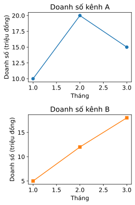
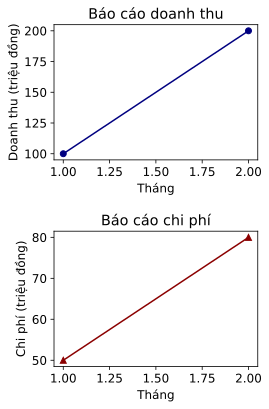
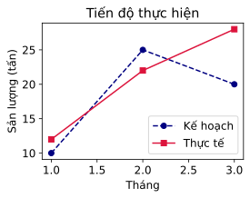
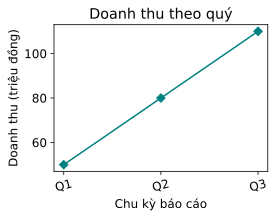
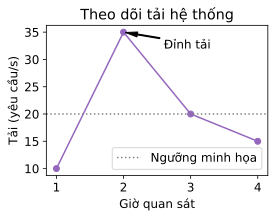
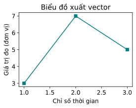
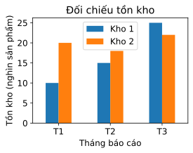
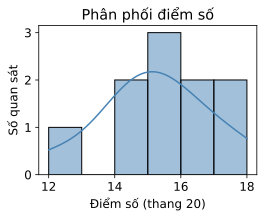
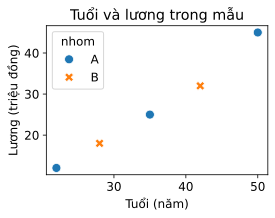
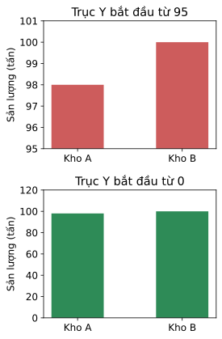

<div class="lecture-notes-content">

Một bảng dữ liệu chứa hàng chục nghìn con số có thể ẩn giấu những tri thức vô giá, nhưng bộ não con người không được tiến hóa để đọc hiểu các ma trận số học khô khốc một cách trực quan. Trực quan hóa dữ liệu không đơn thuần là việc vẽ những bức tranh minh họa bắt mắt. Về bản chất khoa học, đây là quá trình **mã hóa thị giác thông tin định lượng (Visual Encoding of Quantitative Information)**, biến các giá trị toán học trừu tượng thành các thuộc tính không gian và hình học mà mắt người có thể tiếp nhận và phân tích tức thì.

Các nghiên cứu kinh điển về nhận thức thị giác (tiêu biểu là công trình của William Cleveland và Robert McGill năm 1984) đã chứng minh rằng: Mắt người phán đoán vị trí trên cùng một thang đo và so sánh chiều dài thanh với độ chính xác cao nhất. Trái lại, việc ước lượng diện tích, góc nghiêng hay độ đậm nhạt của màu sắc thường có sai số nhận thức lớn hơn rất nhiều. Do đó, việc lựa chọn dạng biểu đồ nào hoàn toàn không phụ thuộc vào cảm tính thẩm mỹ cá nhân, mà được quyết định bởi bản chất cấu trúc của dữ liệu và thông điệp phân tích bạn muốn truyền tải.

Bài học này cung cấp nền tảng bài bản về trực quan hóa dữ liệu trong Python bằng kiến trúc hướng đối tượng của Matplotlib. Người học sẽ thực hành vẽ các biểu đồ thống kê với pandas và Seaborn, tìm hiểu cơ chế ước lượng mật độ, và rèn luyện kỹ năng phản biện biểu đồ nhằm bảo đảm tính trung thực của các ấn phẩm phân tích.

---

## 1. Sơ lược về giao diện API của Matplotlib

Thư viện Matplotlib là nền móng của toàn bộ hệ sinh thái trực quan hóa dữ liệu trong Python. Mặc dù Matplotlib cung cấp giao diện toàn cục theo phong cách MATLAB (`plt.plot`), trong môi trường kỹ nghệ dữ liệu chuyên nghiệp và các đường ống tự động hóa, chuẩn mực bắt buộc là sử dụng **giao diện hướng đối tượng (Object-Oriented API)** tường minh.

### 1.1. Kiến trúc Figure và Subplots

Kiến trúc hướng đối tượng phân tách rạch ròi hai thực thể nền tảng:
- **`Figure`**: Đại diện cho toàn bộ khung tranh vật lý, bao gồm kích thước khung hình (tính bằng inch `figsize`), độ phân giải xuất bản (`dpi`), màu nền và toàn bộ các biểu đồ con bên trong.
- **`Axes`**: Đại diện cho một hệ tọa độ cụ thể nằm trên Figure. Một đối tượng Axes sở hữu trục hoành ($X$), trục tung ($Y$), lưới tọa độ, vạch chia (*ticks*), nhãn và toàn bộ các đối tượng hình học (đường nét, cột, điểm phân tán). Một Figure có thể chứa một hoặc nhiều Axes.

Hàm `plt.subplots()` là điểm khởi đầu chuẩn mực để khởi tạo đồng thời cả Figure và lưới các Axes:

```python
import matplotlib
matplotlib.use("Agg")
import matplotlib.pyplot as plt
import numpy as np
import pandas as pd

# Khởi tạo Figure và lưới 2x2 gồm 4 Axes
fig, axes = plt.subplots(2, 2, figsize=(8, 6), sharex=False, sharey=False)

# Vẽ dữ liệu lên từng hệ tọa độ độc lập
axes[0, 0].hist(np.random.standard_normal(200), bins=20, color="#1E93AB", alpha=0.6)
axes[0, 0].set_title("Histogram biến chuẩn")

axes[0, 1].scatter(np.arange(30), np.arange(30) + 3 * np.random.standard_normal(30), color="#D65A31")
axes[0, 1].set_title("Biểu đồ phân tán")

axes[1, 0].plot(np.random.standard_normal(50).cumsum(), color="#393E46", linestyle="--")
axes[1, 0].set_title("Đường ngẫu nhiên")

axes[1, 1].bar(["Nhóm A", "Nhóm B", "Nhóm C"], [15, 28, 19], color="#2E7D32")
axes[1, 1].set_title("So sánh độ lớn")

fig.tight_layout()
plt.close(fig)
```

<!-- worked-example bai-12-truc-quan-hoa-co-ban-worked-1 -->

::: example Khởi tạo hệ thống lưới tọa độ con độc lập với subplots

Khi đối chiếu doanh số giữa hai kênh bán hàng trên cùng một báo cáo, việc vẽ chung hai chuỗi số liệu có thang đo khác biệt lên một đồ thị đơn lẻ thường gây khó theo dõi. Ta sử dụng plt.subplots(2, 1) để tạo khung hình chung chứa hai hệ trục tọa độ con xếp chồng theo chiều dọc, giúp người đọc quan sát thuận tiện trên thiết bị di động.

```python
import matplotlib.pyplot as plt

plt.rcParams.update({"font.size": 12})
fig, axes = plt.subplots(2, 1, figsize=(4, 6))

thang = [1, 2, 3]
doanh_so_a = [10, 20, 15]
doanh_so_b = [5, 12, 18]

axes[0].plot(thang, doanh_so_a, color="tab:blue", marker="o")
axes[0].set_title("Doanh số kênh A")
axes[0].set_xlabel("Tháng")
axes[0].set_ylabel("Doanh số (triệu đồng)")

axes[1].plot(thang, doanh_so_b, color="tab:orange", marker="s")
axes[1].set_title("Doanh số kênh B")
axes[1].set_xlabel("Tháng")
axes[1].set_ylabel("Doanh số (triệu đồng)")

fig.tight_layout()
print("Tổng doanh số kênh A:", sum(doanh_so_a))
print("Tổng doanh số kênh B:", sum(doanh_so_b))
plt.show()
```

Kết quả khi chạy đoạn mã trên:

```text
Tổng doanh số kênh A: 45
Tổng doanh số kênh B: 35
```



`plt.subplots(2, 1)` tạo một `Figure` có hai hệ trục `Axes` xếp dọc. `axes[0]` dùng cho kênh A và `axes[1]` dùng cho kênh B. `figsize=(4, 6)` quy định kích thước hình theo inch, không phải số điểm ảnh.

`plot` nhận danh sách tháng và doanh số theo cùng thứ tự. Các lệnh `set_title`, `set_xlabel` và `set_ylabel` chỉ tác động tới hệ trục đang gọi. Hai biểu đồ có thể có thang tung khác nhau, nên cần đọc vạch số khi so sánh độ cao.

Tổng doanh số ba tháng là 45 triệu đồng ở kênh A và 35 triệu đồng ở kênh B. `tight_layout()` điều chỉnh khoảng trống, còn `show()` yêu cầu môi trường hiển thị hình. Trong notebook, hình thường hiện dưới ô mã. Khi chạy tệp Python, cách hiện cửa sổ còn phụ thuộc môi trường đồ họa.

:::

<!-- /worked-example -->

### 1.2. Căn chỉnh khoảng cách với `subplots_adjust` và `tight_layout`

Mặc định, Matplotlib để lại các khoảng trống nhất định xung quanh các biểu đồ con. Phương thức `fig.tight_layout()` tự động căn chỉnh lề để các nhãn trục không bị đè lên nhau. Khi cần tinh chỉnh thủ công khoảng cách giữa các khung vẽ, ta sử dụng:
```python
fig.subplots_adjust(left=0.1, right=0.95, bottom=0.1, top=0.9, wspace=0.3, hspace=0.3)
```
Trong đó, `wspace` và `hspace` kiểm soát tỷ lệ khoảng cách theo chiều ngang và chiều dọc giữa các Axes.

<!-- worked-example bai-12-truc-quan-hoa-co-ban-worked-2 -->

::: example Căn chỉnh khoảng cách đệm giữa các trục tọa độ con với tight_layout

Khi sắp xếp nhiều biểu đồ con theo chiều dọc trong cùng một Figure, tiêu đề của biểu đồ bên dưới thường có xu hướng chạm sát vào nhãn trục hoành của biểu đồ phía trên. Ta sử dụng phương thức fig.tight_layout với tham số khoảng cách pad để tự động điều chỉnh lề và ngăn chặn sự tiếp xúc giữa các thành phần chữ.

```python
import matplotlib.pyplot as plt

plt.rcParams.update({"font.size": 12})
fig, axes = plt.subplots(2, 1, figsize=(4, 6))

thang = [1, 2]
doanh_thu = [100, 200]
chi_phi = [50, 80]

axes[0].plot(thang, doanh_thu, color="navy", marker="o")
axes[0].set_title("Báo cáo doanh thu")
axes[0].set_xlabel("Tháng")
axes[0].set_ylabel("Doanh thu (triệu đồng)")

axes[1].plot(thang, chi_phi, color="darkred", marker="^")
axes[1].set_title("Báo cáo chi phí")
axes[1].set_xlabel("Tháng")
axes[1].set_ylabel("Chi phí (triệu đồng)")

fig.tight_layout(pad=1.5)
print("Mức tăng doanh thu:", doanh_thu[1] - doanh_thu[0])
print("Mức tăng chi phí:", chi_phi[1] - chi_phi[0])
plt.show()
```

Kết quả khi chạy đoạn mã trên:

```text
Mức tăng doanh thu: 100
Mức tăng chi phí: 30
```



Mỗi biểu đồ có tiêu đề và nhãn riêng nên cần đủ chỗ giữa hai hệ trục. `fig.tight_layout(pad=1.5)` điều chỉnh vị trí các hệ trục dựa trên phần chữ mà Matplotlib đo được.

`pad` là khoảng đệm tính theo kích thước phông chữ. Tăng nó tạo thêm khoảng trống quanh các nhãn, đồng thời có thể làm vùng vẽ nhỏ đi trong cùng một Figure. Có thể dùng `subplots_adjust(hspace=...)` khi muốn điều khiển trực tiếp khoảng cách dọc.

Đây là cách căn tự động, không bảo đảm mọi chú thích ngoài lề đều vừa trong mọi bố cục. Sau khi thêm chú giải hoặc thanh màu, cần xem lại hình được xuất. Dữ liệu minh họa cho doanh thu tăng 100 và chi phí tăng 30 triệu đồng giữa hai tháng.

:::

<!-- /worked-example -->

### 1.3. Màu sắc, điểm đánh dấu và kiểu đường nét

Khi vẽ biểu đồ đường hoặc đồ thị điểm, các tham số định dạng thẩm mỹ bao gồm:
- `color`: Tên màu chuẩn (`"red"`, `"teal"`), chữ cái viết tắt (`"k"` cho màu đen, `"b"` cho màu xanh dương), hoặc mã màu Hex (`"#1E93AB"`).
- `linestyle`: Kiểu nét vẽ (`"-"` nét liền, `"--"` nét đứt, `":"` nét chấm, `"-."` nét gạch chấm).
- `marker`: Ký hiệu điểm đánh dấu (`"o"` hình tròn, `"s"` hình vuông, `"^"` hình tam giác, `"x"` dấu nhân).
- `alpha`: Độ trong suốt từ $0{,}0$ (trong suốt hoàn toàn) đến $1{,}0$ (đặc hoàn toàn), vũ khí chủ lực để xử lý hiện tượng chồng lấn điểm (*Overplotting*).

<!-- worked-example bai-12-truc-quan-hoa-co-ban-worked-3 -->

::: example Tùy biến phong cách đường nét, màu sắc và điểm đánh dấu trên trục

Để phân biệt trực quan giữa chuỗi số liệu kế hoạch dự kiến và kết quả thực tế đạt được, việc chỉ dựa vào màu sắc đơn thuần sẽ gây khó khăn cho người đọc khi xem qua bản in đen trắng. Ta kết hợp đường nét đứt kèm điểm tròn cho kế hoạch và đường nét liền kèm điểm vuông cho thực tế.

```python
import matplotlib.pyplot as plt

plt.rcParams.update({"font.size": 12})
fig, ax = plt.subplots(figsize=(4, 3.2))

thang = [1, 2, 3]
ke_hoach = [10, 25, 20]
thuc_te = [12, 22, 28]

ax.plot(
    thang, ke_hoach, color="navy", linestyle="--",
    marker="o", label="Kế hoạch"
)
ax.plot(
    thang, thuc_te, color="crimson", linestyle="-",
    marker="s", label="Thực tế"
)
ax.set_title("Tiến độ thực hiện")
ax.set_xlabel("Tháng")
ax.set_ylabel("Sản lượng (tấn)")
ax.legend()

fig.tight_layout()
chenh_lech = [t - k for k, t in zip(ke_hoach, thuc_te)]
print("Chênh lệch thực tế so với kế hoạch:", chenh_lech)
plt.show()
```

Kết quả khi chạy đoạn mã trên:

```text
Chênh lệch thực tế so với kế hoạch: [2, -3, 8]
```



Hai đường lần lượt biểu diễn kế hoạch và thực tế qua ba tháng. `color` chọn màu, `linestyle="--"` tạo nét đứt, còn `marker="o"` đánh dấu từng mốc bằng hình tròn. Đường thực tế dùng nét liền và hình vuông.

Tham số `label` đặt tên cho mỗi đường. `ax.legend()` đọc các nhãn đó để tạo chú giải. Khác biệt về nét và hình điểm giúp phân biệt hai chuỗi ngay cả khi màu khó nhận ra.

Lấy thực tế trừ kế hoạch cho các mức chênh 2, -3 và 8 tấn. Dấu âm ở tháng hai thể hiện sản lượng thấp hơn kế hoạch. Một thay đổi về màu hay nét không đổi số liệu, nên cần đối chiếu điểm với trục và chú giải.

:::

<!-- /worked-example -->

### 1.4. Vạch chia, nhãn và chú giải (Ticks, Labels, and Legends)

Để một biểu đồ có thể tự đứng được mà không cần người thuyết minh, mọi trục tọa độ đều phải được ghi nhãn rõ ràng kèm đơn vị đo lường:
- `ax.set_xticks()` và `ax.set_xticklabels()`: Định vị các mốc vạch chia và gán nhãn văn bản (hỗ trợ tham số `rotation=30` khi nhãn quá dài).
- `ax.set_xlabel()`, `ax.set_ylabel()`: Tên đại lượng và đơn vị đo lường.
- `ax.set_title()`: Tiêu đề nêu bật thông điệp phân tích của biểu đồ.
- `ax.legend(loc="best")`: Thêm hộp chú giải giải thích ý nghĩa của từng đường vẽ dựa trên tham số `label` đã gán.

<!-- worked-example bai-12-truc-quan-hoa-co-ban-worked-4 -->

::: example Kiểm soát vị trí vạch chia tọa độ và nhãn chu kỳ quý với set_xticks

Khi trục hoành đại diện cho các mốc quý kinh doanh liên tiếp, Matplotlib mặc định có thể hiển thị các số thập phân như 0.5 hoặc 1.5 không mang ý nghĩa thực tế. Ta cố định danh sách vạch chia bằng set_xticks và thay thế bằng chuỗi ký tự định danh quý với set_xticklabels kết hợp góc xoay phù hợp.

```python
import matplotlib.pyplot as plt

plt.rcParams.update({"font.size": 12})
fig, ax = plt.subplots(figsize=(4, 3.2))

vi_tri = [0, 1, 2]
doanh_thu = [50, 80, 110]
nhan_quy = ["Q1", "Q2", "Q3"]

ax.plot(vi_tri, doanh_thu, color="teal", marker="D")
ax.set_xticks(vi_tri)
ax.set_xticklabels(nhan_quy, rotation=15)
ax.set_title("Doanh thu theo quý")
ax.set_xlabel("Chu kỳ báo cáo")
ax.set_ylabel("Doanh thu (triệu đồng)")

fig.tight_layout()
tb_doanh_thu = sum(doanh_thu) / len(doanh_thu)
print(f"Doanh thu trung bình: {tb_doanh_thu:.1f}")
plt.show()
```

Kết quả khi chạy đoạn mã trên:

```text
Doanh thu trung bình: 80.0
```



Dữ liệu được vẽ tại vị trí số 0, 1 và 2. `set_xticks(vi_tri)` chọn đúng ba vị trí đó, còn `set_xticklabels(nhan_quy)` gán tên quý theo cùng thứ tự. Nếu chỉ đổi chữ mà không cố định vị trí, nhãn có thể không khớp các mốc mong muốn.

`rotation=15` xoay nhãn 15 độ. Tham số này chỉ đổi cách hiển thị chữ, không đổi tọa độ dữ liệu. Với nhãn ngắn Q1, Q2, Q3, để ngang cũng có thể đọc rõ.

Ba giá trị 50, 80 và 110 có trung bình 80 triệu đồng. Nhãn trục tung cho biết đơn vị này. Tên Q1 không tự mang thông tin năm, nên cần bổ sung năm trong tiêu đề hoặc dữ liệu nếu báo cáo gồm nhiều năm.

:::

<!-- /worked-example -->

### 1.5. Chú thích và vẽ hình học trên Subplot

Bên cạnh các đường vẽ chính, việc dẫn dắt ánh nhìn của người đọc đến các sự kiện đặc biệt (như mốc khủng hoảng kinh tế hoặc điểm bão hòa) được thực hiện bằng chú thích:
- `ax.text(x, y, chuoi)`: Vẽ chuỗi văn bản tại tọa độ $(x, y)$.
- `ax.annotate()`: Vẽ đoạn văn bản kèm theo mũi tên chỉ trực tiếp vào điểm dữ liệu quan trọng:

```python
fig, ax = plt.subplots(figsize=(6, 3.5))
ax.plot([1, 2, 3, 4, 5], [10, 14, 25, 18, 12], marker="o", color="#1E93AB")

# Chỉ mũi tên vào đỉnh cực đại:
ax.annotate(
    "Đỉnh doanh thu",
    xy=(3, 25),
    xytext=(3.5, 23),
    arrowprops=dict(facecolor="black", shrink=0.08, width=1.5, headwidth=6)
)
ax.set_ylim(bottom=0)
plt.close(fig)
```

Ngoài ra, ta có thể bổ sung các hình học trực quan như đường thẳng tham chiếu ngang/dọc (`ax.axhline()`, `ax.axvline()`) hoặc các mảng hình học từ `matplotlib.patches` (như `Rectangle`, `Circle`) thông qua phương thức `ax.add_patch()`.

<!-- worked-example bai-12-truc-quan-hoa-co-ban-worked-5 -->

::: example Tạo mũi tên chú thích điểm cực trị bằng annotate và kẻ đường ngưỡng axhline

Trong biểu đồ theo dõi tải lượng xử lý, một đỉnh nhọn tăng đột biến cần được làm nổi bật để người vận hành nhận biết ngay lập tức mà không phải tự dò tìm tọa độ. Ta sử dụng phương thức annotate với mũi tên chỉ điểm cực trị kết hợp đường ngưỡng tham chiếu axhline.

```python
import matplotlib.pyplot as plt

plt.rcParams.update({"font.size": 12})
fig, ax = plt.subplots(figsize=(4, 3.2))

gio = [1, 2, 3, 4]
tai = [10, 35, 20, 15]

ax.plot(gio, tai, color="tab:purple", marker="o")
ax.axhline(20, color="gray", linestyle=":", label="Ngưỡng minh họa")
ax.annotate(
    "Đỉnh tải",
    xy=(2, 35),
    xytext=(2.6, 32),
    arrowprops=dict(facecolor="black", shrink=0.05, width=1, headwidth=5)
)

ax.set_title("Theo dõi tải hệ thống")
ax.set_xlabel("Giờ quan sát")
ax.set_ylabel("Tải (yêu cầu/s)")
ax.legend()

fig.tight_layout()
print("Tải cao nhất:", max(tai))
print("Ngưỡng minh họa:", 20)
plt.show()
```

Kết quả khi chạy đoạn mã trên:

```text
Tải cao nhất: 35
Ngưỡng minh họa: 20
```



Đường ngang `axhline(20)` tạo mốc tham chiếu ở giá trị 20 trên trục tung. Đây là ngưỡng được đặt riêng cho ví dụ, chưa phải ngưỡng vận hành được xác nhận từ một hệ thống thực.

`annotate` nhận `xy=(2, 35)` làm điểm mũi tên hướng vào, còn `xytext=(2.6, 32)` làm vị trí đặt chữ. `arrowprops` điều khiển hình mũi tên. Hai cặp tọa độ khác nhau giúp chuyển nhãn ra khỏi điểm đo.

Mức tải lớn nhất là 35 yêu cầu mỗi giây tại giờ thứ hai. Chú thích chỉ rõ điểm đó, còn đường ngang giúp so với 20. Nếu đổi dữ liệu, cần tính lại tọa độ đỉnh thay vì giữ cứng vị trí chú thích.

:::

<!-- /worked-example -->

### 1.6. Xuất bản biểu đồ ra tệp với `savefig`

Phương thức `fig.savefig()` cho phép lưu biểu đồ xuống đĩa cứng với hai họ định dạng chính:
- **Định dạng điểm ảnh (Raster Image - PNG, JPEG)**: Biểu diễn hình ảnh bằng lưới các pixel. Thích hợp cho các biểu đồ chứa hàng triệu điểm dữ liệu phân tán. Cần thiết lập `dpi=300` để bảo đảm độ sắc nét khi in ấn.
- **Định dạng vector (Vector Image - SVG, PDF)**: Biểu diễn hình ảnh bằng các phương trình toán học về đường cong và nét vẽ. Cho phép phóng to thu nhỏ tùy ý mà không bao giờ bị vỡ hạt, lý tưởng cho các bài báo khoa học và tài liệu web.
- Tham số `bbox_inches="tight"`: Tự động cắt bỏ các khoảng trắng thừa ở viền ngoài bức tranh.

<!-- worked-example bai-12-truc-quan-hoa-co-ban-worked-6 -->

::: example Xuất bản hình vẽ định dạng vector SVG vào bộ nhớ đệm với savefig

Khi nhúng đồ thị vào các báo cáo điện tử chất lượng cao, định dạng ảnh điểm thường bị vỡ hạt khi người xem phóng to màn hình. Ta sử dụng phương thức savefig với định dạng vector SVG lưu tạm vào bộ đệm bộ nhớ io.StringIO, giúp bảo toàn độ sắc nét của đường nét và phông chữ.

```python
import io
import matplotlib.pyplot as plt

plt.rcParams.update({"font.size": 12})
fig, ax = plt.subplots(figsize=(4, 3.2))

ax.plot([1, 2, 3], [3, 7, 5], color="teal", marker="s")
ax.set_title("Biểu đồ xuất vector")
ax.set_xlabel("Chỉ số thời gian")
ax.set_ylabel("Giá trị đo (đơn vị)")

fig.tight_layout()

bo_dem = io.StringIO()
fig.savefig(bo_dem, format="svg", bbox_inches="tight")
chuoi_svg = bo_dem.getvalue()

print("Định dạng xuất: SVG")
print("Tiền tố XML:", chuoi_svg[:30].strip())
print("Có thẻ svg:", "<svg" in chuoi_svg)
plt.show()
```

Kết quả khi chạy đoạn mã trên:

```text
Định dạng xuất: SVG
Tiền tố XML: <?xml version="1.0" encoding="
Có thẻ svg: True
```



`fig.savefig` có thể ghi hình vào tệp hoặc một bộ đệm phù hợp. Ở đây, `io.StringIO()` nhận nội dung SVG dưới dạng văn bản và `getvalue()` đọc lại chuỗi XML đã xuất.

`format="svg"` chọn định dạng vector. `bbox_inches="tight"` giới hạn khung xuất theo nội dung hình. Với tệp ảnh PNG, `dpi` ảnh hưởng số điểm ảnh theo kích thước Figure. Với đường và chữ vector trong SVG, tăng `dpi` không làm chúng sắc hơn, nhưng các thành phần raster nhúng vẫn phụ thuộc độ phân giải.

Chuỗi kết quả có phần khai báo XML và thẻ `svg`. Muốn ghi thành tệp, có thể thay bộ đệm bằng `"bieu_do.svg"`. Cần xem lại tệp xuất để kiểm tra nhãn và khoảng lề, vì hình đang hiện trong cửa sổ và hình đã lưu có thể dùng kích thước khác.

:::

<!-- /worked-example -->

### 1.7. Cấu hình giao diện toàn cục với `rcParams`

Để toàn bộ các biểu đồ trong dự án tuân theo một ngôn ngữ thiết kế đồng nhất, Matplotlib cho phép cấu hình các tham số hệ thống thông qua `plt.rcParams.update()`:

```python
plt.rcParams.update({
    "font.size": 10,
    "axes.spines.top": False,
    "axes.spines.right": False,
    "axes.grid": True,
    "grid.alpha": 0.3,
    "figure.autolayout": True
})
```

---

## 2. Vẽ biểu đồ với pandas và Seaborn

Trong khi Matplotlib đóng vai trò là động cơ vẽ cấp thấp, pandas và Seaborn cung cấp các giao diện cấp cao được thiết kế riêng để tương tác trực tiếp với cấu trúc DataFrame.

### 2.1. Vẽ nhanh với pandas `.plot`

Các đối tượng Series và DataFrame tích hợp sẵn thuộc tính `.plot`:
- Biểu đồ đường: Dùng `df.plot(kind="line")` hoặc `df.plot()`.
- Biểu đồ cột: Dùng `s.plot.bar()` (cột đứng) hoặc `s.plot.barh()` (thanh ngang). Tham số `stacked=True` cho phép vẽ biểu đồ cột chồng tích lũy.

```python
df_doanh_so = pd.DataFrame({
    "Chi_nhanh_A": [120, 150, 180],
    "Chi_nhanh_B": [90, 140, 160]
}, index=["Quý 1", "Quý 2", "Quý 3"])

ax = df_doanh_so.plot.bar(figsize=(6, 4), color=["#1E93AB", "#D65A31"])
ax.set_ylabel("Doanh thu (triệu đồng)")
plt.close(ax.get_figure())
```

<!-- worked-example bai-12-truc-quan-hoa-co-ban-worked-7 -->

::: example Trực quan hóa đa cột trực tiếp từ DataFrame với phương thức plot

Trong giai đoạn khám phá dữ liệu ban đầu, việc viết từng dòng lệnh Matplotlib thủ công để đối chiếu tồn kho giữa hai cơ sở qua từng tháng gây chậm tiến độ phân tích. Ta sử dụng phương thức df.plot(kind='bar') của pandas để tự động phân bổ màu sắc cột và chú giải từ chính cấu trúc bảng.

```python
import matplotlib.pyplot as plt
import pandas as pd

plt.rcParams.update({"font.size": 12})
fig, ax = plt.subplots(figsize=(4, 3.2))

df_kho = pd.DataFrame({
    "Kho 1": [10, 15, 25],
    "Kho 2": [20, 18, 22]
}, index=["T1", "T2", "T3"])

df_kho.plot(kind="bar", ax=ax, rot=0)
ax.set_title("Đối chiếu tồn kho")
ax.set_xlabel("Tháng báo cáo")
ax.set_ylabel("Tồn kho (nghìn sản phẩm)")

fig.tight_layout()
print("Tổng tồn kho theo tháng:")
print(df_kho.sum(axis=1))
plt.show()
```

Kết quả khi chạy đoạn mã trên:

```text
Tổng tồn kho theo tháng:
```

<div class="data-worked-table">

| Chỉ mục | Giá trị |
| --- | --- |
| T1 | 30 |
| T2 | 33 |
| T3 | 47 |

</div>



`df_kho.plot(kind="bar", ax=ax)` vẽ bảng vào hệ trục Matplotlib đã tạo. Chỉ mục T1, T2, T3 thành các nhóm trên trục ngang, còn hai cột Kho 1 và Kho 2 thành hai dãy cột có chú giải.

`rot=0` giữ nhãn nhóm nằm ngang. Truyền `ax` giúp tiếp tục dùng `set_title` và các phương thức Matplotlib trên đúng biểu đồ này. Nếu không truyền, pandas có thể tạo hệ trục mới.

Tổng của hai kho theo tháng lần lượt là 30, 33 và 47 nghìn sản phẩm. `sum(axis=1)` cộng theo từng hàng. Trục tung và chú giải cần được giữ khi đưa hình vào báo cáo để người đọc không nhầm giá trị của một kho với tổng hai kho.

:::

<!-- /worked-example -->

### 2.2. Biểu đồ tần suất và ước lượng mật độ nhân (KDE)

- **Histogram**: Dùng `s.plot.hist(bins=20)` chia dữ liệu thành các khoảng và đếm tần số xuất hiện.
- **Biểu đồ mật độ (Density Plot / KDE)**: Dùng `s.plot.kde()` hoặc `sns.kdeplot()` làm mịn phân phối dữ liệu rời rạc thành một đường cong liên tục bằng phương pháp Ước lượng Mật độ Nhân (*Kernel Density Estimation*). Mỗi quan sát thực tế được mô hình hóa bằng một hàm nhân chuẩn hóa thu nhỏ (thường là phân phối Gauss), và đường cong mật độ tổng thể là tổng tích lũy của toàn bộ các hàm nhân này.

Tham số độ rộng băng thông (*bandwidth*, điều khiển bằng `bw_adjust` trong Seaborn) quyết định mức độ làm mịn của đường cong. Băng thông quá hẹp sẽ khiến đường cong gồ ghề và bắt chước nhiễu ngẫu nhiên, trong khi băng thông quá rộng sẽ làm lu mờ các đỉnh phân phối quan trọng:

```python
import seaborn as sns

du_lieu_mau = np.array([1.2, 1.5, 1.8, 3.8, 4.0, 4.2, 4.5, 4.8])
fig, ax = plt.subplots(figsize=(6, 3.5))

# So sánh băng thông chuẩn và băng thông nhạy dao động
sns.kdeplot(du_lieu_mau, bw_adjust=1.0, label="Băng thông chuẩn (bw_adjust=1.0)", color="#1E93AB", ax=ax)
sns.kdeplot(du_lieu_mau, bw_adjust=0.5, label="Băng thông hẹp (bw_adjust=0.5)", color="#D65A31", linestyle="--", ax=ax)
ax.set_title("Ước lượng mật độ nhân với các mức băng thông khác nhau")
ax.legend()
plt.close(fig)
```

<!-- worked-example bai-12-truc-quan-hoa-co-ban-worked-8 -->

::: example Khảo sát phân phối mẫu thực nghiệm và đường mật độ nhân KDE với Seaborn

Để đánh giá hình thái phân phối của điểm số kiểm tra, việc chỉ nhìn vào biểu đồ cột tần suất có thể bị phụ thuộc nhiều vào số lượng khoảng chia. Ta sử dụng hàm sns.histplot với tham số kde=True trong Seaborn để đồng thời quan sát cả số lượng quan sát mẫu và đường cong mật độ trơn liên tục.

```python
import matplotlib.pyplot as plt
import numpy as np
import seaborn as sns

plt.rcParams.update({"font.size": 12})
fig, ax = plt.subplots(figsize=(4, 3.2))

du_lieu = np.array([12, 15, 14, 16, 15, 18, 14, 15, 17, 16])
sns.histplot(du_lieu, kde=True, ax=ax, color="steelblue", bins=6)

ax.set_title("Phân phối điểm số")
ax.set_xlabel("Điểm số (thang 20)")
ax.set_ylabel("Số quan sát")

fig.tight_layout()
tb_mau = float(np.mean(du_lieu))
dlc_mau = float(np.std(du_lieu, ddof=1))
print(f"Trung bình mẫu: {tb_mau:.2f}")
print(f"Độ lệch chuẩn mẫu: {dlc_mau:.2f}")
plt.show()
```

Kết quả khi chạy đoạn mã trên:

```text
Trung bình mẫu: 15.20
Độ lệch chuẩn mẫu: 1.69
```



`sns.histplot` chia khoảng rồi đếm số điểm trong mỗi khoảng. `bins=6` yêu cầu sáu khoảng cho mẫu này. Thay số khoảng hoặc vị trí biên có thể làm hình các cột khác đi dù dữ liệu không đổi.

`kde=True` thêm đường ước lượng mật độ nhân và Seaborn điều chỉnh thang để đặt cùng histogram đếm. Độ rộng dải quyết định mức làm mượt, có thể cấu hình qua `kde_kws={"bw_adjust": ...}`. Đường cong là ước lượng từ mẫu, không phải phân phối tổng thể đã biết.

Đoạn mã cũng in trung bình và độ lệch chuẩn mẫu với `ddof=1` để đối chiếu. Chỉ có mười quan sát, nên các đỉnh nhỏ của đường KDE chưa đủ để kết luận tồn tại những nhóm điểm riêng biệt.

:::

<!-- /worked-example -->

### 2.3. Biểu đồ phân tán, đồ thị hồi quy và ma trận tương quan

- `sns.scatterplot(x="bien_x", y="bien_y", hue="nhom", data=df)`: Thể hiện mối quan hệ giữa hai biến số thực, hỗ trợ phân biệt các nhóm đối tượng bằng kênh màu sắc `hue`.
- `sns.regplot()`: Tự động ước lượng và vẽ đường hồi quy tuyến tính đi kèm dải tin cậy $95\%$ (*Confidence Interval Band*), giúp đánh giá trực quan hướng vận động và độ chặt chẽ của mối liên hệ giữa hai biến số.
- `sns.boxplot()`: Biểu diễn phân phối định lượng qua các tứ phân vị và nhận diện giá trị ngoại lai, kết hợp tham số `hue` để phân rã thêm một chiều phân loại phụ.

```python
df_tips = pd.DataFrame({
    "ngay": ["Thứ 5", "Thứ 5", "Thứ 6", "Thứ 6", "Thứ 7", "Thứ 7", "CN", "CN"],
    "tong_hoa_don": [18.5, 25.0, 22.0, 30.5, 35.0, 42.0, 38.0, 48.5],
    "thoi_gian": ["Trưa", "Tối", "Trưa", "Tối", "Tối", "Tối", "Trưa", "Tối"]
})

fig, ax = plt.subplots(figsize=(6, 4))
sns.boxplot(data=df_tips, x="ngay", y="tong_hoa_don", hue="thoi_gian", palette="Set2", ax=ax)
ax.set_title("Phân bố hóa đơn theo ngày và thời gian với kênh màu sắc hue")
ax.set_ylabel("Tổng hóa đơn (USD)")
plt.close(fig)
```

- `sns.heatmap()`: Trực quan hóa ma trận số học hoặc ma trận hệ số tương quan bằng bản đồ nhiệt màu, hiển thị trực tiếp giá trị số trên từng ô qua tham số `annot=True`:

```python
df_tuong_quan = pd.DataFrame({
    "Doanh_thu": [100, 150, 200, 250, 300],
    "Chi_phi_QC": [10, 18, 25, 32, 40],
    "So_don_hang": [50, 70, 95, 110, 130]
})
ma_tran_corr = df_tuong_quan.corr()

fig, ax = plt.subplots(figsize=(5, 4))
sns.heatmap(ma_tran_corr, annot=True, cmap="Blues", fmt=".2f", vmin=-1, vmax=1, ax=ax)
ax.set_title("Ma trận tương quan với Seaborn Heatmap")
plt.close(fig)
```

<!-- worked-example bai-12-truc-quan-hoa-co-ban-worked-9 -->

::: example Biểu diễn tương quan giữa độ tuổi và thu nhập phân nhóm theo phòng ban

Khi khảo sát mối liên hệ giữa độ tuổi và thu nhập, việc chỉ nhìn vào biểu đồ phân tán chung sẽ bỏ qua sự phân hóa giữa các nhóm nghiệp vụ. Ta sử dụng sns.scatterplot với tham số hue='nhom' để mã hóa màu sắc theo từng phòng ban, giúp nhận diện rõ sự phân bố của các điểm quan sát cắt ngang.

```python
import matplotlib.pyplot as plt
import pandas as pd
import seaborn as sns

plt.rcParams.update({"font.size": 12})
fig, ax = plt.subplots(figsize=(4, 3.2))

df_ns = pd.DataFrame({
    "tuoi": [22, 28, 35, 42, 50],
    "luong": [12, 18, 25, 32, 45],
    "nhom": ["A", "B", "A", "B", "A"]
})

sns.scatterplot(
    data=df_ns, x="tuoi", y="luong", hue="nhom",
    style="nhom", s=80, ax=ax
)
ax.set_title("Tuổi và lương trong mẫu")
ax.set_xlabel("Tuổi (năm)")
ax.set_ylabel("Lương (triệu đồng)")

fig.tight_layout()
tb_luong = df_ns.groupby("nhom")["luong"].mean().round(2)
print("Lương trung bình theo nhóm:")
print(tb_luong)
plt.show()
```

Kết quả khi chạy đoạn mã trên:

```text
Lương trung bình theo nhóm:
```

<div class="data-worked-table">

| nhom | luong |
| --- | --- |
| A | 27.33 |
| B | 25.0 |

</div>



Mỗi điểm biểu diễn một người trong bảng minh họa. `x="tuoi"` và `y="luong"` lấy tọa độ từ hai cột, còn `hue="nhom"` chọn màu theo nhóm A hoặc B.

`style="nhom"` đồng thời chọn hình ký hiệu, giúp phân biệt nhóm ngoài yếu tố màu. `s=80` điều khiển diện tích điểm. Nó không phải biến số từ dữ liệu trong ví dụ này.

Lương trung bình là khoảng 27.33 triệu đồng ở nhóm A và 25.00 triệu đồng ở nhóm B. Các điểm cho thấy quan hệ tuổi và lương của năm người, không theo dõi một người qua thời gian. Vì vậy, chưa thể đọc độ dốc giữa các điểm thành tốc độ tăng lương của một cá nhân.

:::

<!-- /worked-example -->

### 2.4. Lưới biểu đồ khía cạnh với `FacetGrid` và `catplot`

Khi tập dữ liệu chứa nhiều chiều phân loại, việc nhồi nhét tất cả vào một biểu đồ duy nhất sẽ gây quá tải thị giác (*Visual Clutter*). Seaborn giải quyết bài toán này bằng kỹ thuật lưới biểu đồ khía cạnh:
- `sns.catplot(x=..., y=..., hue=..., data=..., kind="box"|"violin"|"bar")`: Trực quan hóa dữ liệu phân loại với các kiểu hiển thị đa dạng như biểu đồ hộp (*Boxplot*) hay biểu đồ vĩ cầm (*Violin plot*).
- `sns.FacetGrid`: Tạo một ma trận gồm nhiều biểu đồ nhỏ (*Small Multiples*), trong đó mỗi biểu đồ con khảo sát cùng một mối quan hệ nhưng trên một phân khúc dữ liệu riêng biệt:

```python
df_khao_sat = pd.DataFrame({
    "chi_phi": [15, 22, 40, 18, 35, 50, 12, 28],
    "tien_tip": [2.5, 3.0, 6.0, 2.8, 5.0, 8.5, 1.8, 4.2],
    "buoi": ["Trưa", "Tối", "Tối", "Trưa", "Tối", "Tối", "Trưa", "Tối"],
    "gioi_tinh": ["Nam", "Nữ", "Nam", "Nữ", "Nam", "Nữ", "Nam", "Nữ"]
})

g = sns.FacetGrid(df_khao_sat, col="buoi", row="gioi_tinh", margin_titles=True)
g.map(sns.scatterplot, "chi_phi", "tien_tip", color="#1E93AB")
plt.close(g.fig)
```

---

## 3. Phản biện biểu đồ và nguyên tắc trung thực thị giác

Trực quan hóa dữ liệu có vai trò định hướng nhận thức quan trọng. Một biểu đồ được thiết kế sai lệch có thể phóng đại những chênh lệch nhỏ, hoặc ngược lại che giấu đi những biến động đáng lưu tâm trong dữ liệu.

### 3.1. Đọc tỷ lệ và cách tổ chức trục trên biểu đồ {#_3-1-phan-bien-ba-cam-bay-truc-quan-hoa-kinh-đien}

#### Cắt cụt trục tung của biểu đồ cột (Truncated Y-axis) {#cam-bay-1-cat-cut-truc-tung-cua-bieu-đo-cot-truncated-y-axis}
- **Cơ chế**: Khi nhìn vào biểu đồ cột hoặc thanh ngang, mắt người tự động mã hóa độ lớn dựa trên **chiều dài hình học của thanh** so với đường cơ sở (*baseline*).
- **Hệ quả**: Nếu tỷ lệ của hai đơn vị là $94\%$ và $98\%$, nhưng người vẽ cắt cụt trục tung bắt đầu từ mốc $90\%$: Thanh thứ hai sẽ có chiều dài hiển thị là $98 - 90 = 8$ đơn vị, gấp đôi thanh thứ nhất ($94 - 90 = 4$ đơn vị). Người đọc dễ lầm tưởng rằng đơn vị thứ hai vượt trội gấp đôi, trong khi khoảng cách thực tế chỉ là $4$ điểm phần trăm.
- **Nguyên tắc trực quan**: Đối với biểu đồ cột và thanh ngang, trục đo chiều dài bắt buộc phải xuất phát từ mốc $0$ để bảo toàn tỷ lệ trực quan:

```python
df_so_sanh = pd.DataFrame({
    "don_vi": ["Đơn vị A", "Đơn vị B"],
    "ty_le": [94.0, 98.0]
})

fig, (ax1, ax2) = plt.subplots(1, 2, figsize=(8, 3.5))

# Biểu đồ sai lệch: Trục tung bị cắt cụt từ 90 làm méo mó trực quan
ax1.bar(df_so_sanh["don_vi"], df_so_sanh["ty_le"], color=["#1E93AB", "#D65A31"])
ax1.set_ylim(bottom=90, top=100)
ax1.set_title("Trục tung cắt cụt (Phóng đại chênh lệch)")
ax1.set_ylabel("Tỷ lệ (%)")

# Biểu đồ chuẩn mực: Trục tung bắt đầu từ 0 bảo toàn tỷ lệ chiều dài
ax2.bar(df_so_sanh["don_vi"], df_so_sanh["ty_le"], color=["#1E93AB", "#D65A31"])
ax2.set_ylim(bottom=0, top=100)
ax2.set_title("Trục tung từ 0 (Trung thực)")
ax2.set_ylabel("Tỷ lệ (%)")

fig.tight_layout()
plt.close(fig)
```

<!-- worked-example bai-12-truc-quan-hoa-co-ban-worked-10 -->

::: example Đối chiếu tác động của việc cắt cụt trục tung và phục hồi tỷ lệ trung thực

Khi so sánh sản lượng giữa hai kho hàng đạt 98 và 100 tấn, việc cắt cụt trục tung bắt đầu từ 95 sẽ làm biến dạng thị giác về tỷ lệ tương đối giữa hai cột. Ta đặt hai biểu đồ cạnh nhau theo chiều dọc: Biểu đồ phía trên bị cắt cụt trục tung và biểu đồ phía dưới xuất phát từ mốc 0 để người đọc trực tiếp nhận biết sự sai lệch tỷ lệ.

```python
import matplotlib.pyplot as plt

plt.rcParams.update({"font.size": 12})
fig, axes = plt.subplots(2, 1, figsize=(4, 6))

kho = ["Kho A", "Kho B"]
san_luong = [98, 100]

axes[0].bar(kho, san_luong, color="indianred", width=0.5)
axes[0].set_ylim(95, 101)
axes[0].set_title("Trục Y bắt đầu từ 95")
axes[0].set_ylabel("Sản lượng (tấn)")

axes[1].bar(kho, san_luong, color="seagreen", width=0.5)
axes[1].set_ylim(0, 120)
axes[1].set_title("Trục Y bắt đầu từ 0")
axes[1].set_ylabel("Sản lượng (tấn)")

fig.tight_layout()
chenh_lech_pt = (san_luong[1] - san_luong[0]) / san_luong[0] * 100
ti_le_chieu_cao = (san_luong[1] - 95) / (san_luong[0] - 95)
print(f"Mức tăng tương đối: {chenh_lech_pt:.2f}%")
print(f"Tỷ lệ chiều cao khi cắt trục: {ti_le_chieu_cao:.2f}")
plt.show()
```

Kết quả khi chạy đoạn mã trên:

```text
Mức tăng tương đối: 2.04%
Tỷ lệ chiều cao khi cắt trục: 1.67
```



Hai biểu đồ dùng cùng sản lượng 98 và 100 tấn. Ở hình trên, `set_ylim(95, 101)` chỉ hiện phần cột từ 95 trở lên. Chiều cao nhìn thấy là 3 và 5, nên tỷ lệ thành `5/3`, khoảng 1.67.

Chênh lệch thật là 2 tấn, tương ứng mức tăng `(100 - 98) / 98`, khoảng 2.04%. Hình dưới bắt đầu trục ở 0 nên chiều cao cột giữ tỷ lệ với giá trị gốc. Điều này giúp đọc mức chênh mà không phóng đại phần nhìn thấy.

Biểu đồ cột dùng chiều dài thanh để biểu diễn độ lớn nên mốc 0 có vai trò trực tiếp. Biểu đồ đường lại dùng vị trí điểm và có thể phóng to một miền trục để khảo sát dao động nhỏ. Trong cả hai trường hợp cần giữ nhãn, vạch số và nêu rõ đại lượng đang so sánh.

:::

<!-- /worked-example -->

#### Hai trục tung trên cùng biểu đồ (Dual Y-axis) {#cam-bay-2-cam-bay-truc-tung-kep-dual-y-axis}
- **Cơ chế**: Đặt hai biến số có thang đo và đơn vị hoàn toàn khác nhau lên cùng một biểu đồ đường với hai trục tung bên trái và bên phải.
- **Hệ quả**: Người vẽ có thể tùy tiện co giãn khoảng giá trị của hai trục tung để ép hai đường cong chạy song song hoặc cắt nhau tại bất kỳ điểm nào, ngụy tạo mối tương quan hình thức giữa hai biến số vốn không liên quan.
- **Giải pháp**: Thay vì dùng trục kép, hãy vẽ hai biểu đồ con nằm xếp chồng theo chiều dọc (*Stacked Subplots*) có chung trục hoành thời gian, hoặc chuyển đổi các đại lượng về dạng chỉ số tăng trưởng tương đối (phần trăm thay đổi so với mốc cơ sở).

#### Biểu đồ tròn quá nhiều lát và đồ thị 3D giả lập {#cam-bay-3-bieu-đo-tron-qua-nhieu-lat-va-đo-thi-3d-gia-lap}
- **Cơ chế**: Biểu đồ tròn mã hóa dữ liệu bằng góc ở tâm và diện tích hình quạt. Khi biểu đồ tròn có nhiều lát cắt hoặc các lát có kích thước gần tương đồng, mắt người rất khó so sánh chính xác góc và diện tích hình quạt. Đặc biệt, việc lạm dụng hiệu ứng 3D làm biến dạng góc nghiêng: Các lát cắt nằm ở phía trước góc nhìn phối cảnh sẽ bị phóng đại nhân tạo, trong khi các lát cắt ở phía sau bị thu nhỏ lại.
- **Giải pháp**: Luôn thay thế biểu đồ tròn phức tạp bằng một biểu đồ thanh ngang được sắp xếp thứ tự giảm dần.

### 3.2. Tỷ lệ dữ liệu trên mực in

Trong tác phẩm *The Visual Display of Quantitative Information*, Edward Tufte giới thiệu khái niệm **Tỷ lệ dữ liệu trên mực in (Data-to-Ink Ratio)**. Khái niệm này biểu thị tỷ lệ giữa lượng mực dùng để truyền tải thông tin dữ liệu cốt lõi so với tổng lượng mực tạo nên toàn bộ biểu đồ. Một biểu đồ được thiết kế hiệu quả cần tối ưu hóa tỷ lệ này bằng cách:
- Loại bỏ các chi tiết trang trí rườm rà không mang thông tin (*Chartjunk*), chẳng hạn như bóng đổ 3D, họa tiết hoa văn không cần thiết, và đường viền khung tranh dày đặc.
- Tiết chế độ đậm của các đường lưới tọa độ (*Gridlines*): Đường lưới chỉ đóng vai trò hỗ trợ đọc số liệu, không được phép lấn át các đường biểu diễn dữ liệu chính.

### 3.3. Bản đồ phân vùng địa lý và ảnh hưởng của diện tích {#_3-3-ban-đo-phan-vung-đia-ly-choropleth-maps-va-cam-bay-dien-tich}

Bản đồ Choropleth tô màu các vùng địa lý (như tỉnh thành, quốc gia) theo một chỉ số định lượng (chẳng hạn thu nhập bình quân, tỷ lệ thất nghiệp hoặc mật độ dân số). Quy trình kỹ thuật kết hợp cấu trúc hình học không gian (GeoJSON hoặc Shapefile) với bảng dữ liệu thống kê thông qua phương thức ghép nối dữ liệu.

Tuy nhiên, bản đồ Choropleth cần được đọc cẩn trọng trước **Cạm bẫy diện tích địa lý (Geographic Area Trap)**:
- Trên bản đồ, những khu vực có diện tích đất đai rộng lớn (như vùng rừng núi hoặc hoang mạc) sẽ chiếm trọn thị giác của người xem nhờ diện tích mảng màu rất lớn.
- Ngược lại, các trung tâm đô thị đông dân cư và có đóng góp kinh tế trọng yếu lại chỉ là những chấm nhỏ li ti khó nhìn thấy.
- **Nguyên tắc nhận thức**: Diện tích đất đai không đồng nghĩa với tầm quan trọng của dữ liệu. Cần cân nhắc sử dụng bản đồ bong bóng (*Bubble Map*) hoặc bản đồ biến dạng diện tích (*Cartogram*) khi nghiên cứu các chỉ số gắn liền với dân số.

### 3.4. Trực quan hóa tương tác với Plotly Express

Biểu đồ tĩnh tạo bởi Matplotlib và Seaborn phù hợp cho các báo cáo dạng in ấn và tài liệu học thuật. Trong khi đó, các thư viện trực quan hóa tương tác như Plotly Express cung cấp trải nghiệm khám phá linh hoạt trên môi trường web:
- **Khám phá chi tiết (Hover tooltips)**: Người dùng có thể rê chuột lên từng điểm dữ liệu để đọc chính xác tọa độ, nhãn định danh và các thuộc tính phụ trợ mà không làm rối mắt bức tranh tổng thể.
- **Thao tác động (Zoom & Pan)**: Cho phép phóng to vào các cụm dữ liệu dày đặc và di chuyển qua lại giữa các khoảng thời gian.
- **Lựa chọn công cụ**: Sử dụng biểu đồ tĩnh khi cần cố định bố cục trang in và xuất bản định dạng vector, còn sử dụng biểu đồ tương tác trong các bảng điều khiển nghiệp vụ (*Dashboards*) để người dùng có thể lọc và phóng to theo nhu cầu.

---

## 4. Tổng kết

1. **Tuân thủ kiến trúc hướng đối tượng**: Khởi tạo `fig, ax = plt.subplots()` tường minh để phân định ranh giới giữa khung tranh `Figure` và hệ tọa độ `Axes`, giúp kiểm soát chặt chẽ bố cục nhiều thành phần.
2. **Khai thác Seaborn cho đồ họa thống kê**: Sử dụng `catplot` và `FacetGrid` để phân rã dữ liệu nhiều chiều thành các biểu đồ con trực quan, tránh nhồi nhét quá tải thị giác.
3. **Bảo đảm tính chuẩn mực của biểu đồ cột**: Không cắt cụt trục tung của biểu đồ cột và thanh ngang, trục đo chiều dài cần xuất phát từ mốc $0$ để bảo toàn tỷ lệ trực quan.
4. **Cảnh giác trước cạm bẫy trực quan**: Tránh sử dụng trục tung kép gây ngụy tạo tương quan, đồng thời hạn chế biểu đồ tròn quá nhiều lát và các hiệu ứng 3D làm sai lệch nhận thức hình học.
5. **Tối ưu hóa tỷ lệ dữ liệu trên mực in**: Giảm bớt các chi tiết trang trí rườm rà (*Chartjunk*) và tiết chế độ đậm của đường lưới nhằm làm nổi bật tín hiệu phân tích cốt lõi.
6. **Nhận thức ranh giới của bản đồ Choropleth**: Phân biệt rạch ròi giữa diện tích lãnh thổ địa lý với mật độ dân số hoặc quy mô kinh tế của vùng dữ liệu.

---

## Tài liệu tham khảo

- Wes McKinney, *Python for Data Analysis* (tái bản lần 3): [Chương 9: Plotting and Visualization](https://wesmckinney.com/book/plotting-and-visualization).
- Tài liệu chính thức Matplotlib: [Quick start guide & Artist tutorial](https://matplotlib.org/stable/users/explain/quick_start.html).
- Tài liệu chính thức Seaborn: [Statistical data visualization](https://seaborn.pydata.org/tutorial.html).
- Edward R. Tufte, *The Visual Display of Quantitative Information*, Graphics Press, 2001.
- William S. Cleveland & Robert McGill, *Graphical Perception: Theory, Experimentation, and Application to the Development of Graphical Methods*, Journal of the American Statistical Association, 1984.
- Hệ thống bài tập được chuyển thể từ học liệu mở của: [Khóa học Lập trình xử lý dữ liệu (UET)](https://courses.iaidev.com/programming-for-data-processing/2627-1/) theo giấy phép [Creative Commons Attribution-NonCommercial-ShareAlike 4.0 International (CC BY-NC-SA 4.0)](https://github.com/uet-iai-course/programming-for-data-processing/blob/main/LICENSE).

- IAI, [Lập trình xử lý dữ liệu, học liệu và notebook](https://courses.iaidev.com/programming-for-data-processing/2627-1/). Các đề thực hành đã được biên tập cách diễn đạt và bổ sung lời giải, giữ [CC BY-NC-SA 4.0](https://creativecommons.org/licenses/by-nc-sa/4.0/). [Giấy phép học liệu](https://github.com/uet-iai-course/programming-for-data-processing/blob/main/LICENSE).

</div>

<div class="lecture-exercises-content" aria-label="Bài tập của chương">


<!--@include: ../../../raw_materials/xu-ly-du-lieu/practice/visual-reading.md-->


<!-- data-labs:start -->
<section class="data-lab-set" data-lab="lab-12">

<!--@include: ../../../raw_materials/xu-ly-du-lieu/labs/lab-12.md-->

</section>

<section class="data-lab-set" data-lab="lab-13">

<!--@include: ../../../raw_materials/xu-ly-du-lieu/labs/lab-13.md-->

</section>

<!-- data-labs:end -->

## Tài liệu tham khảo

- Wes McKinney, *Python for Data Analysis* (tái bản lần 3): [Chương 9: Plotting and Visualization](https://wesmckinney.com/book/plotting-and-visualization).
- Tài liệu chính thức Matplotlib: [Quick start guide & Artist tutorial](https://matplotlib.org/stable/users/explain/quick_start.html).
- Tài liệu chính thức Seaborn: [Statistical data visualization](https://seaborn.pydata.org/tutorial.html).
- Edward R. Tufte, *The Visual Display of Quantitative Information*, Graphics Press, 2001.
- William S. Cleveland & Robert McGill, *Graphical Perception: Theory, Experimentation, and Application to the Development of Graphical Methods*, Journal of the American Statistical Association, 1984.
- Hệ thống bài tập được chuyển thể từ học liệu mở của: [Khóa học Lập trình xử lý dữ liệu (UET)](https://courses.iaidev.com/programming-for-data-processing/2627-1/) theo giấy phép [Creative Commons Attribution-NonCommercial-ShareAlike 4.0 International (CC BY-NC-SA 4.0)](https://github.com/uet-iai-course/programming-for-data-processing/blob/main/LICENSE).

- IAI, [Lập trình xử lý dữ liệu, học liệu và notebook](https://courses.iaidev.com/programming-for-data-processing/2627-1/). Các đề thực hành đã được biên tập cách diễn đạt và bổ sung lời giải, giữ [CC BY-NC-SA 4.0](https://creativecommons.org/licenses/by-nc-sa/4.0/). [Giấy phép học liệu](https://github.com/uet-iai-course/programming-for-data-processing/blob/main/LICENSE).

- IAI. [Notebook thực hành](https://github.com/uet-iai-notebook-labs-2026/notebook-labs-template) và [học liệu thực hành 2627-1](https://courses.iaidev.com/programming-for-data-processing/2627-1/). Các yêu cầu kỹ thuật được đối chiếu, biên tập và bổ sung lời giải cùng dữ liệu minh họa. Phần thích nghi từ học liệu IAI áp dụng giấy phép [CC BY-NC-SA 4.0](https://creativecommons.org/licenses/by-nc-sa/4.0/).

</div>
