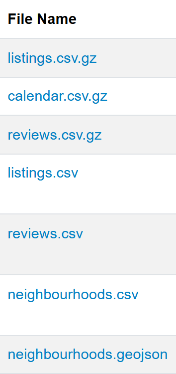
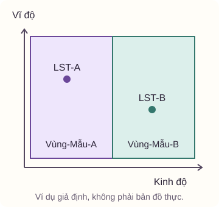

<script setup>
import ProjectSections from '../../../src/features/course-project/components/ProjectSections.vue'
import ProjectCities from '../../../src/features/course-project/components/ProjectCities.vue'
</script>

<ProjectSections active="brief" />

# Đề bài tập lớn: Phân tích thị trường Airbnb

Một bên đặt hàng, chẳng hạn chính quyền thành phố hoặc hiệp hội du lịch, cần hiểu thị trường cho thuê chỗ ở tại một thành phố. Họ muốn biết giá cả khác nhau giữa các khu vực ra sao, thị trường thay đổi thế nào qua các lần thu thập dữ liệu, và khách đang khen hoặc phàn nàn về điều gì. Nhóm của bạn sẽ xây dựng một chương trình để đi từ các tệp dữ liệu đến những câu trả lời có bằng chứng.

Sản phẩm gồm mã nguồn chạy lại được và một báo cáo giải thích quá trình xử lý, kết quả, cùng giới hạn của các kết luận. Người khác phải có thể làm theo hướng dẫn, chạy chương trình và tạo lại các tệp kết quả. Việc chỉ lưu sẵn hình hoặc output trong notebook chưa đáp ứng yêu cầu đó.

Đây là bài tập lớn Inside Airbnb của học phần Lập trình xử lý dữ liệu, mã UET.DSE2049, học kì 1 năm học 2026–2027, thuộc Viện Trí tuệ nhân tạo, Trường Đại học Công nghệ, ĐHQGHN. Bài tập lớn và vấn đáp chiếm **60% điểm học phần**. Các mốc, danh sách dữ liệu và điều kiện bàn giao trong trang này được đối chiếu với [đề bài chính thức](https://courses.iaidev.com/programming-for-data-processing/2627-1/projects/project_airbnb.html).

Ngoài đề chung, nhóm còn có thể được giao một bảng hướng dẫn kèm danh sách mã dữ liệu và mẫu đánh giá. [Mục 15](#doi-chieu-ghi-chu) giải thích cách đọc các phần này và dùng chúng để lấy đúng dữ liệu của nhóm. Các bảng minh họa trong mục đó đều dùng dữ liệu giả định.

Nếu đang chuẩn bị tải dữ liệu, có thể đến ngay phần [phân biệt bảy loại tệp và cách nối các bảng](#cac-tep-du-lieu), rồi quay lại các bước QA và KPI sau khi hiểu đầu vào.

## 1. Cần hoàn thành những việc gì?

Nhóm cần hoàn thành các việc sau như những phần liên kết của cùng một sản phẩm:

1. Xác định người sẽ sử dụng báo cáo và câu hỏi họ cần trả lời.
2. Tải dữ liệu của thành phố được phân công tại đủ bốn mốc bắt buộc, bằng chương trình.
3. Khảo sát dữ liệu, đề xuất quy tắc phát hiện và xử lý vấn đề chất lượng, rồi ghi lại tác động của các quy tắc.
4. Tính 5–8 chỉ số phù hợp với người sử dụng báo cáo. Các chỉ số phải bao quát góc độ khu vực, thời gian và kết quả phân tích bằng LLM.
5. Dùng LLM để chuyển một mẫu đánh giá của khách thành dữ liệu có cấu trúc. So sánh với một phương pháp không dùng LLM và tự đo chất lượng bằng ít nhất 100 đánh giá được gán nhãn tay.
6. Tạo hình thể hiện các góc độ không gian, thời gian và LLM. Hình phải được chương trình sinh ra.
7. Viết báo cáo PDF tối đa 10 trang và chuẩn bị kho mã có thể chạy toàn bộ quy trình bằng một lệnh.
8. Ghi nhận trung thực việc dùng AI, nộp đúng mốc và chuẩn bị để mỗi thành viên giải thích được toàn bộ sản phẩm.

Phần dưới giải thích từng việc, các tệp cần có và những quyết định nhóm phải tự đưa ra. Các ví dụ giúp làm rõ yêu cầu, không thay cho một phương án bắt buộc áp dụng với mọi thành phố.

### Nếu hôm nay mới bắt đầu, nên làm việc gì trước?

Trước tiên, ghi lại thành phố và bốn snapshot được giao, xác nhận các thông báo bổ sung của giảng viên, rồi tạo repo và môi trường làm việc. Tiếp đó, thử tải và mở một bộ dữ liệu nhỏ để biết các tệp có cột gì và một hàng có ý nghĩa gì. Mục tiêu của buổi đầu là đọc được dữ liệu và hiểu đầu vào, chưa cần viết ngay toàn bộ chương trình.

Khi một bước chạy được, lưu kết quả và nối nó với bước tiếp theo. Bảng dưới là cách chia việc để bắt đầu, không phải một lịch nộp hoặc phương án cài đặt mới của đề:

| Bước chuẩn bị | Dấu hiệu cho thấy đã có thể chuyển sang bước tiếp |
| --- | --- |
| Chốt đầu vào và mục tiêu | Có thành phố, ngày snapshot, người đọc báo cáo và danh sách điều còn phải xác nhận. |
| Dựng môi trường và đọc thử dữ liệu | Gọi đúng Python của dự án, đọc được tệp, nêu được các cột khóa và ý nghĩa một hàng. |
| Viết chức năng tải dữ liệu | Truyền cấu hình vào chương trình, tải được đúng tệp và lưu vào thư mục của đúng snapshot. |
| Khảo sát rồi thử quy tắc QA | Mỗi quy tắc tìm được những hàng cụ thể, có lý do và hành động rõ, ghi được tác động. |
| Tính thử các KPI từ dữ liệu sau QA | Đối chiếu được ít nhất một phép tính trên mẫu nhỏ và giải thích được đơn vị, mẫu số. |
| Chuẩn bị review, nhãn tay và hai phương pháp | Giữ liên kết từ văn bản đến nhãn tay, dự đoán baseline và dự đoán LLM để chấm cùng các trường hợp. |
| Nối các bước, sinh hình và hoàn thiện báo cáo | Một lệnh đọc cấu hình, chạy các phần cần thiết và tạo ra các tệp đã mô tả trong README. |

Một bước hoàn thành khi kết quả đáp ứng yêu cầu. Chẳng hạn, tải được một tệp nhưng nhầm ngày snapshot thì đầu vào vẫn sai, dù chương trình không báo lỗi. Phần thực hành sau sẽ minh họa một cách xây toàn bộ quy trình, còn tại đây nhóm cần hiểu công việc và cách tự xác nhận kết quả của từng bước.

## 2. Những từ cần hiểu trước khi bắt đầu

| Thuật ngữ | Hiểu trong bài tập này |
| --- | --- |
| Listing | Một mục đăng chỗ ở cho thuê trên Airbnb. Mã listing giúp nhận diện chỗ ở qua các bảng hoặc lần thu thập. |
| Host | Chủ tài khoản đăng chỗ ở. Một host có thể quản lý nhiều listing. Đếm host và đếm listing là hai việc khác nhau. |
| Snapshot, hay mốc chụp | Bộ dữ liệu được thu thập tại một ngày cụ thể. Bốn snapshot là bốn lần quan sát thị trường, không phải bốn quý có số liệu đầy đủ theo từng ngày. |
| QA | Kiểm soát chất lượng dữ liệu. Nhóm xác định dữ liệu có vấn đề gì, phát hiện bằng điều kiện nào và xử lý ra sao. |
| KPI | Chỉ số được chọn để trả lời một câu hỏi phân tích. Mỗi chỉ số cần có công thức, đơn vị và đối tượng được tính. |
| Pipeline, hay quy trình xử lý | Chuỗi công việc được chương trình thực hiện, từ tải dữ liệu đến xuất kết quả. Đầu ra của bước trước được dùng cho bước sau. |
| Tệp cấu hình | Tệp chứa lựa chọn như thành phố, các mốc dữ liệu và tham số phân tích. Đổi lựa chọn trong tệp này giúp chạy lại mà không sửa mã chương trình. |
| LLM | Mô hình ngôn ngữ lớn, được gọi qua API để đọc văn bản đánh giá và trích xuất thông tin. |
| API và khóa API | API là cách một chương trình gửi yêu cầu đến dịch vụ khác và nhận phản hồi. Khóa API là thông tin xác thực để dịch vụ nhận biết tài khoản gọi, cần được giữ bí mật. |
| Baseline, hay phương pháp đối chứng | Cách làm không dùng LLM để giải cùng nhiệm vụ. Kết quả của nó giúp đánh giá LLM có mang lại lợi ích trên dữ liệu đang xét hay không. |
| Nhãn tay | Kết quả do người đọc đánh giá và gán nhãn theo hướng dẫn thống nhất. Đây là dữ liệu tham chiếu để đo chất lượng của hai phương pháp. |
| Cache, hay kết quả lưu lại | Kết quả xử lý đã ghi ra tệp để tái sử dụng. Khi dùng lại kết quả LLM, cần xét cả nội dung đánh giá, mô hình và prompt, không chỉ mã review. |
| Tái lập kết quả | Chạy lại trên cùng đầu vào và môi trường đã ghi nhận để tạo lại các kết quả cần đối chiếu. Với LLM, còn phải lưu thông tin mô hình, prompt và tham số liên quan. |

## 3. Nhóm, người sử dụng báo cáo và kho mã

### 3.1. Nhận thành phố và xác định mục tiêu phân tích

Mỗi nhóm có 4–5 sinh viên và được giao một thành phố riêng, không trùng nhóm khác. Phân công chính thức được đăng trên Canvas Portal từ đầu kỳ. Nhóm cần kiểm tra đúng thành phố của mình trước khi tải dữ liệu.

Nhóm tự chọn bên đặt hàng phân tích và ghi rõ trong báo cáo. Đó có thể là chính quyền thành phố, một quỹ đầu tư hoặc hiệp hội du lịch. Việc chọn ai đọc báo cáo sẽ ảnh hưởng đến chỉ số cần tính và cách diễn giải.

Chẳng hạn, người muốn hiểu sự phân bố chỗ ở giữa các khu vực sẽ cần kết quả khác với người muốn biết các phàn nàn của khách tập trung ở đâu. Đây là ví dụ để hiểu vai trò của người sử dụng báo cáo. Nhóm phải tự chọn mục tiêu phù hợp và giải thích vì sao các kết quả của mình phục vụ mục tiêu đó.

Mỗi thành viên phải hiểu mã nguồn, số liệu và các quyết định của cả nhóm. Chia việc giúp tổ chức quá trình làm, nhưng không giới hạn trách nhiệm giải thích vào phần một người đã trực tiếp viết.

### 3.2. Tạo và sử dụng GitHub repo

Tạo một kho mã GitHub riêng tư và mời đủ thành viên cùng tài khoản giảng viên. Tên gợi ý là `2627-LTXLDL-Airbnb-<TenNhom>`. Điền liên kết repo vào bảng tính được yêu cầu trong môn học.

Git lưu lịch sử thay đổi của các tệp. Một commit là một mốc ghi nhận thay đổi trong lịch sử đó. Push đưa các commit từ máy cá nhân lên GitHub. Nhóm cần commit và push đều đặn từ đầu kỳ để có lịch sử làm việc, thay vì chỉ đưa một bản cuối lên repo.

Trước mỗi commit, xem lại danh sách tệp được đưa vào. `data/raw/`, `.venv/`, `.env` và mọi tệp chứa khóa API phải nằm trong `.gitignore`. Tệp `.gitignore` chỉ hướng dẫn Git bỏ qua những tệp chưa được theo dõi. Nếu một bí mật đã bị commit, thêm tên vào `.gitignore` không xóa được bí mật khỏi lịch sử.

## 4. Các mốc nộp và cách ghi nhận bản cuối

Đề quy định hạn lúc **23:59 Chủ nhật**, xét theo thời gian commit trên GitHub. Giữ nguyên cách xác định hạn của môn và đối chiếu thông báo chính thức nếu có thay đổi lịch.

| Mốc | Thời điểm được công bố | Nhóm cần hoàn thành |
| --- | --- | --- |
| Mốc 1 | 23:59 Chủ nhật 20/09/2026, tuần 2 | Lập nhóm, tạo repo, nhận thành phố và điền liên kết repo vào bảng tính. Mốc này không cần tag. |
| Mốc 2 | 23:59 Chủ nhật 22/11/2026, tuần 11 | Nộp bản cuối bằng tag `final`. Báo cáo phải ghi mã commit của bản nộp. |
| Mốc 3 | Theo lịch thi của Trường | Vấn đáp khoảng 20 phút cho mỗi nhóm, hỏi riêng từng thành viên. |

Tag là tên gắn với một commit cụ thể để xác định bản bàn giao. Sau khi đã commit và push bản cuối, tại đúng commit muốn nộp, tạo rồi đẩy tag:

```bash
git tag final
git push origin final
```

Tên tag không thay cho việc kiểm tra nội dung bản nộp. Nhóm cần bảo đảm tag chỉ đến đúng commit, các tệp cần bàn giao đã có trên GitHub và mã commit ghi trong PDF trùng với bản đó. Không tự di chuyển một tag đã nộp nếu chưa có hướng dẫn của giảng viên.

## 5. Dữ liệu phải dùng và cách hiểu bốn mốc chụp

### 5.1. Bốn loại tệp

Dữ liệu đến từ [Inside Airbnb](https://insideairbnb.com/get-the-data/), được đề ghi giấy phép CC BY 4.0. Báo cáo cần ghi nguồn và ngày của từng snapshot. Nhóm phải tự khảo sát cấu trúc, kiểu dữ liệu và các điểm bất thường của từng bản chụp, rồi ghi nhận trong QA.

| Tệp trong bộ dữ liệu | Vai trò cần hiểu |
| --- | --- |
| `data/listings.csv.gz` | Thông tin các chỗ ở. Đây là bảng phục vụ nhiều phân tích về giá, loại chỗ ở, host hoặc khu vực, tùy cột thực có trong snapshot. |
| `data/calendar.csv.gz` | Thông tin lịch theo ngày của chỗ ở, phục vụ các phân tích thời gian khi nhóm hiểu đúng cột và phạm vi quan sát. |
| `data/reviews.csv.gz` | Đánh giá văn bản của khách. Đây là đầu vào của phần LLM. |
| `visualisations/neighbourhoods.geojson` | Ranh giới các khu vực, dùng để nối thông tin thống kê với dữ liệu không gian và tạo hình phù hợp. |

Đuôi `.gz` cho biết tệp đã được nén. Nó không làm thay đổi ý nghĩa các cột CSV. GeoJSON là định dạng chứa hình học, chẳng hạn đường bao của một khu vực, cùng thuộc tính của đối tượng địa lý.

CSV là tệp văn bản biểu diễn bảng, thường dùng dấu phẩy để ngăn cột. Trước khi đọc, cần xem hàng tiêu đề và quy tắc của tệp. Không suy ý nghĩa một cột chỉ từ việc chương trình đọc được nó thành số hay chuỗi.

### Trên trang Inside Airbnb có bảy tệp, cần phân biệt thế nào? {#cac-tep-du-lieu}

Tại [Get the Data](https://insideairbnb.com/get-the-data/), mỗi khối thành phố và ngày chụp có các liên kết tải. Bốn loại tệp trong bảng trên là đầu vào được đề nêu. Ngoài chúng, trang còn có ba tệp tổng hợp để hỗ trợ khám phá và trực quan hóa. Không chọn tệp chỉ theo phần tên giống nhau.

| Tên liên kết tải | Vai trò và cách chọn cho bài tập lớn |
| --- | --- |
| `listings.csv.gz` | Bảng listing chi tiết trong thư mục `data/`, dùng khảo sát thông tin chỗ ở và tính chỉ số. |
| `calendar.csv.gz` | Bảng lịch chi tiết trong `data/`, một listing có thể xuất hiện ở nhiều ngày. |
| `reviews.csv.gz` | Bảng review chi tiết trong `data/`, có văn bản bình luận để dùng cho LLM. |
| `listings.csv` | Bảng listing tổng hợp trong `visualisations/`, ít cột hơn bản chi tiết. Không phải chỉ là bản chi tiết đã bỏ nén. |
| `reviews.csv` | Bảng review tổng hợp trong `visualisations/`, phục vụ phân tích thời gian. Bản đã kiểm tra chỉ có mã listing và ngày, không có nội dung bình luận. |
| `neighbourhoods.csv` | Danh sách tên hoặc nhóm khu vực trong `visualisations/`. Có tên khu vực không có nghĩa đã có đường bao để vẽ bản đồ. |
| `neighbourhoods.geojson` | Hình học ranh giới và thuộc tính khu vực trong `visualisations/`, dùng cho bản đồ và liên kết thông tin không gian. |



Ảnh chụp riêng cột tên tệp trên [Inside Airbnb](https://insideairbnb.com/get-the-data/). Có hai liên kết listings và hai liên kết reviews, nên cần phân biệt cả đuôi tệp lẫn thư mục. Vai trò của từng tệp được giải thích trong bảng trên.

Các mô tả dưới đây được đối chiếu [Data Dictionary của Inside Airbnb](https://docs.google.com/spreadsheets/d/1iWCNJcSutYqpULSQHlNyGInUvHg2BoUGoNRIGa6Szc4/edit) và đọc thử cấu trúc các tệp Santiago ngày 23/09/2026. Đây là một lần kiểm tra cấu trúc, không thay đổi bốn snapshot bắt buộc của đề. Các cột có thể thay đổi theo phiên bản, nên script phải kiểm tra lại tệp nhóm được giao.

#### `listings.csv.gz`: Thông tin một chỗ ở trong một snapshot

Mỗi hàng mô tả một listing được ghi nhận trong lần thu thập đó. Các nhóm cột có thể gặp gồm:

- Nhận diện và nguồn thu thập: `id`, `listing_url`, `scrape_id`, `last_scraped`.
- Chủ tài khoản: Các cột như `host_id` và thông tin liên quan đến host. Một host có thể có nhiều listing.
- Vị trí: `latitude`, `longitude`, `neighbourhood_cleansed` và cột nhóm khu vực nếu có.
- Đặc điểm: `room_type`, `property_type`, `accommodates`, `bedrooms`, `beds`, `amenities`.
- Giá và điều kiện lưu trú: `price`, `minimum_nights`, `maximum_nights` cùng các trường liên quan tùy phiên bản.
- Thống kê review và lịch: Chẳng hạn `number_of_reviews`, `review_scores_rating`, `availability_365` nếu có trong snapshot.

`number_of_reviews` là số lượng đánh giá tổng hợp, không chứa văn bản bình luận để đưa vào LLM. `amenities` là danh sách tiện nghi, có thể được lưu như văn bản biểu diễn JSON. Cần đọc đúng cấu trúc danh sách, vì dấu phẩy có thể nằm ngay trong tên một tiện nghi.

Một listing là một mục đăng, có thể cho thuê cả chỗ ở hoặc chỉ một phòng. Vì vậy, số listing không tự đồng nghĩa với số căn nhà vật lý riêng biệt. Trước khi đếm hoặc chọn mẫu, xác định rõ đang xét listing, host hay căn nhà.

Từ điển nguồn mô tả giá theo tiền tệ địa phương. Ký hiệu tiền trong chuỗi xuất ra không đủ để kết luận đó là USD. Cần xác nhận loại tiền của thành phố, cách đọc giá và ý nghĩa các trường giá trong đúng snapshot.

#### `calendar.csv.gz`: Một chỗ ở tại một ngày trong lịch

Một hàng thường gắn với cặp `listing_id` và `date`. Tệp Santiago đã kiểm tra có các cột `listing_id`, `date`, `available`, `minimum_nights`, `maximum_nights`. Nó **không có cột `price`**. Vì vậy, không được viết chương trình mặc định mọi bản calendar đều có giá theo ngày chỉ vì ghi chú hoặc một snapshot cũ có nhắc đến.

`date` là ngày trên lịch lưu trú, còn ngày nằm trong URL là ngày snapshot. Inside Airbnb mô tả lịch thu thập cho khoảng một năm phía trước, không phải nhật ký xác nhận mọi giao dịch đã xảy ra trong năm vừa qua. Độ dài và độ đầy đủ thực tế cần được kiểm tra trong từng tệp.

`available` thường biểu diễn trạng thái còn trống bằng `t` hoặc `f`. Theo [mô tả giới hạn dữ liệu của Inside Airbnb](https://insideairbnb.com/data-assumptions/), không còn trống có thể do đã được đặt hoặc do host khóa lịch. Không biến mọi giá trị `f` thành một lượt đặt phòng hoặc doanh thu đã thu được.

Calendar có thể lớn vì lặp lại nhiều ngày cho nhiều listing. Hãy đọc thử một phần, chỉ chọn cột cần dùng hoặc xử lý theo khối nếu bộ nhớ không đủ. Tệp nén nhỏ trên đĩa không chứng minh DataFrame sau đọc sẽ nhỏ. Không cần nạp cả bốn snapshot vào RAM cùng lúc mới có thể phân tích.

#### `reviews.csv.gz`: Một đánh giá văn bản của khách

Các cột đã kiểm tra là `listing_id`, `id`, `date`, `reviewer_id`, `reviewer_name`, `comments`. Trong bảng này, `id` là mã review, không phải mã listing. `listing_id` mới là trường dùng để nối sang `listings.id`.

`comments` chứa nội dung để trích xuất cảm xúc, khía cạnh và ngôn ngữ. `date` là ngày của review. Một listing có nhiều review và cùng một review có thể xuất hiện lại trong snapshot khác. Nếu muốn đếm review duy nhất qua nhiều snapshot, cần xác định khóa và phạm vi trước khi tổng hợp.

Không dùng `reviewer_name` để đoán cảm xúc hoặc ngôn ngữ. Khi tạo mẫu cho LLM và gán nhãn tay, giữ mã review cùng nội dung cần phân tích. Các trường nhận diện cá nhân không phục vụ nhiệm vụ cần được xem xét theo chính sách dữ liệu trước khi gửi ra dịch vụ ngoài.

#### `listings.csv`, `reviews.csv` và `neighbourhoods.csv`: Các bảng tổng hợp

`listings.csv` đã kiểm tra có những cột thuận tiện cho biểu đồ như mã listing, vị trí, loại phòng, giá và một số thống kê review/lịch. Nó không có đầy đủ các trường của `listings.csv.gz`. Cần quay về bản chi tiết khi thiết kế QA hoặc KPI đòi những cột chưa có trong bản tổng hợp.

`reviews.csv` đã kiểm tra chỉ có `listing_id` và `date`. Nó giúp đếm review theo thời gian, nhưng không có `comments` để phân tích văn bản và không có `id` review để dùng thay trực tiếp tập review chi tiết. Hai hàng cùng listing và cùng ngày chưa chắc là một review trùng nhau.

`neighbourhoods.csv` đã kiểm tra có `neighbourhood_group` và `neighbourhood`. Bảng này giúp xem các tên khu vực, nhưng không chứa các chuỗi tọa độ tạo nên đường biên. Muốn vẽ hình khu vực phải đọc tệp GeoJSON.

#### `neighbourhoods.geojson`: Đường bao để vẽ khu vực trên bản đồ

GeoJSON là JSON có cấu trúc mô tả đối tượng địa lý. Tệp được kiểm tra có kiểu ngoài cùng là `FeatureCollection`, nghĩa là một tập các đối tượng. Danh sách `features` chứa các `Feature`. Mỗi Feature có hai phần cần phân biệt:

- `properties` chứa thuộc tính, chẳng hạn `neighbourhood` và `neighbourhood_group`, để nhận diện khu vực.
- `geometry` chứa loại hình và tọa độ đường bao. `Polygon` biểu diễn một vùng đa giác, còn `MultiPolygon` cho phép một khu vực gồm nhiều phần đa giác tách rời. Đa giác cũng có thể có các vòng bên trong biểu diễn phần rỗng.

Trong GeoJSON theo [RFC 7946](https://datatracker.ietf.org/doc/html/rfc7946), cặp tọa độ được viết theo thứ tự kinh độ trước, vĩ độ sau. Khi dùng dữ liệu listing để tạo điểm, cũng phải giữ đúng `longitude` rồi `latitude`. Đảo thứ tự có thể đặt điểm sai vị trí hoặc làm thao tác không gian sai.

Để vẽ bản đồ KPI, trước hết tính một bảng có một hàng cho mỗi khu vực. Sau đó ghép tên hoặc mã khu vực của bảng KPI với trường tương ứng trong `properties`, rồi tô màu các hình theo chỉ số. Phải kiểm tra tên không khớp, giá trị thiếu và quan hệ nối, vì ghép theo thứ tự dòng không bảo đảm đúng khu vực.

Điểm tọa độ của một listing khác với đường bao khu vực. Nếu muốn tự xác định listing nằm trong vùng nào, cần thao tác xét điểm thuộc đa giác và quy tắc cho điểm nằm ở biên. Không tự coi một hàng GeoJSON là một listing hoặc coi `analysis_area` là mã có sẵn trong GeoJSON.

Inside Airbnb cũng nêu rằng vị trí listing được làm mờ để bảo vệ địa chỉ thật. Vì vậy, không diễn giải các điểm đó như tọa độ cửa nhà chính xác, đặc biệt khi kết luận về listing ở sát ranh giới một khu vực.

#### Nối các tệp theo đối tượng, không theo vị trí hàng

| Mục đích | Khóa và phạm vi cần kiểm tra |
| --- | --- |
| Bổ sung thông tin listing cho review | `reviews.listing_id` nối với `listings.id` trong snapshot tương ứng. |
| Bổ sung thông tin listing cho lịch | `calendar.listing_id` nối với `listings.id`. Lịch vẫn có nhiều hàng ngày cho một listing. |
| Theo dõi listing qua snapshot | Giữ `id` cùng ngày snapshot, không xóa mọi lần xuất hiện lặp của `id`. |
| Tính KPI khu vực rồi vẽ bản đồ | Khóa nhóm trong bảng KPI phải khớp trường khu vực đã kiểm tra trong `properties` của GeoJSON. |

Không nối đồng thời toàn bộ lịch ngày với toàn bộ review chỉ bằng `listing_id` rồi đếm hàng kết quả. Mỗi ngày có thể bị lặp với mỗi review của cùng listing. Hãy tổng hợp từng bảng về đúng đơn vị cần phân tích trước khi ghép kết quả.

#### Đọc tệp nén và lưu từng snapshot

Có thể đọc trực tiếp `.csv.gz` bằng `gzip` của Python hoặc `read_csv` có xử lý nén. Không cần giải nén ra một tệp CSV trung gian chỉ để đọc. Khi dùng Python chuẩn, mở nội dung giải nén ở chế độ văn bản và đưa vào `csv.reader` hoặc `csv.DictReader` để xử lý đúng dấu phẩy và dấu ngoặc kép trong văn bản.

Có thể tra cú pháp đọc nén trong [Python gzip](https://docs.python.org/3/library/gzip.html) hoặc [pandas.read_csv](https://pandas.pydata.org/docs/reference/api/pandas.read_csv.html). Biết định dạng tệp giúp chọn đúng cách đọc, không buộc nhóm phải dùng một trong hai thư viện này làm công cụ xử lý chính.

Một cách lưu dễ đối chiếu là tạo thư mục riêng theo thành phố và snapshot trong `data/raw/`, rồi giữ phần `data/` và `visualisations/` như trên máy chủ. Chẳng hạn, bên trong thư mục của một snapshot có `data/listings.csv.gz` và `visualisations/listings.csv`. Nhờ vậy, hai loại tệp không bị nhầm tên hoặc ghi đè.

GeoJSON cũng có URL theo snapshot. Không giả định ranh giới giữa các mốc giống hệt nhau chỉ vì chúng cùng tên. Cách đơn giản để giữ dấu vết là lưu hoặc ghi nhận tệp GeoJSON gắn với từng mốc được dùng. Nếu tái sử dụng một bản, cần xác minh sự tương thích và ghi rõ lựa chọn đó.

Khi chọn dữ liệu trên web, kiểm tra đủ ba phần: Thành phố, ngày chụp và thư mục `data/` hay `visualisations/`. Nếu ngày bắt buộc không còn hiện ở phần tải mới nhất, xem mục dữ liệu lưu trữ hoặc xác nhận lại nguồn với giảng viên, không âm thầm dùng ngày mới thay thế.

Trước khi nối hoặc tổng hợp, cần xác định một hàng của từng bảng đại diện cho điều gì. Listing, listing tại một ngày lịch và một review là những đơn vị khác nhau. Nếu ghép một listing với nhiều review rồi tính trung bình giá trên bảng sau ghép, các listing có nhiều review có thể được tính lặp nhiều lần.

Trạng thái không còn trống trong lịch không tự chứng minh một giao dịch đặt phòng đã xảy ra. Chủ nhà cũng có thể khóa lịch vì lý do khác. Nhóm cần đọc mô tả dữ liệu trước khi gọi một tỷ lệ từ lịch là tỷ lệ đặt phòng thực tế.

### 5.2. Dùng đúng thành phố và đủ bốn mốc

Mỗi thành phố có bốn ngày chụp bắt buộc bên dưới, cách nhau khoảng một quý. Nhóm không tự thay bằng bốn ngày khác cho tiện tải. Với thành phố được đánh dấu có dữ liệu hằng tháng, có thể bổ sung các snapshot khác, nhưng vẫn phải có đủ bốn mốc bắt buộc.

<ProjectCities />

Một mã listing xuất hiện ở nhiều snapshot không mặc nhiên là dòng thừa. Đó có thể là cùng một chỗ ở được quan sát tại nhiều thời điểm. Tương tự, một review có thể được lặp lại trong nhiều tệp snapshot vì các tệp chứa lịch sử đánh giá. Cần phân biệt quan sát lặp hợp lệ với việc đếm lại cùng một sự kiện.

`neighbourhood_cleansed` thường dùng để phân biệt khu vực bên trong thành phố, không phải cột tên thành phố. Ý nghĩa chính xác và mức độ đầy đủ vẫn phải khảo sát trên dữ liệu được giao. Nếu có thêm cột `analysis_area`, cần giữ rõ đó là vùng phân tích được tạo ra theo quy tắc riêng, chưa chắc trùng khu vực có sẵn trong dữ liệu.

Mã định danh cũng khác với index của DataFrame. `id` hoặc `listing_id` dùng để nhận diện chỗ ở theo quy ước của bảng, còn index là nhãn hàng. Index mặc định có thể là dãy số thứ tự, nhưng cũng có thể được đặt bằng một cột dữ liệu. Thao tác `reset_index()` không sửa được một phép nối dùng sai khóa và không tạo ra danh tính mới cho chỗ ở.

Không coi ngày chụp là ngày phát sinh mọi review hoặc mọi dòng lịch bên trong tệp. Cũng không nối bốn snapshot rồi tuyên bố đã quan sát đầy đủ mọi ngày giữa các mốc. Phạm vi thời gian phải được xác định từ ý nghĩa của các cột và việc thu thập thực tế.

### 5.3. Dựng địa chỉ tải bằng cấu hình

Địa chỉ có phần chung là máy chủ `https://data.insideairbnb.com`. Phần còn lại gồm quốc gia, vùng, thành phố, ngày snapshot và tên tệp. Hai dạng đường dẫn là:

```text
<country>/<region>/<city>/<YYYY-MM-DD>/data/<bảng>.csv.gz
<country>/<region>/<city>/<YYYY-MM-DD>/visualisations/neighbourhoods.geojson
```

Ở đây, `<bảng>` lần lượt là `listings`, `calendar` hoặc `reviews`. Thêm dấu `/` giữa địa chỉ máy chủ và đường dẫn tương ứng để có URL đầy đủ. Giá trị `data_root` trong cấu hình chính là phần `<country>/<region>/<city>`, cần giữ đúng như danh sách thành phố, kể cả ký tự có dấu nếu có.

Script tải phải tải đủ dữ liệu cho bốn mốc và kiểm tra tệp có tồn tại, đọc được, có các cột khóa cần dùng. Chỉ thấy mã HTTP thành công hoặc một tệp trên ổ đĩa chưa đủ để xác nhận đó là đúng bảng và đúng snapshot.

Giữ dữ liệu tải nguyên trạng trong `data/raw/` để còn đối chiếu khi sửa quy tắc. Không commit thư mục này. Dữ liệu đã xử lý nằm ở `data/processed/` và chỉ commit khi đáp ứng giới hạn dưới 50 MB được đề nêu. Nếu dữ liệu xử lý lớn, chương trình và hướng dẫn phải cho phép tạo lại.

## 6. “Chạy bằng một lệnh” nghĩa là gì?

Sau khi cài môi trường theo `README.md`, người sử dụng chạy một lệnh để chương trình thực hiện các bước và ghi kết quả. Đề minh họa cách gọi sau:

```bash
python run_pipeline.py --config configs/lisbon.yaml
```

`run_pipeline.py` là chương trình điều phối. `--config` cho biết sẽ đọc lựa chọn từ tệp nào. `configs/lisbon.yaml` là một tệp cấu hình ví dụ, không có nghĩa mọi nhóm phải làm Lisbon hoặc phải dùng đúng tên chương trình đó. Có thể tổ chức bằng Makefile hoặc cách tương đương, miễn đáp ứng việc chạy toàn quy trình bằng một lệnh đã ghi rõ.

Ví dụ dùng YAML để lưu cấu hình, nhưng đề không quy định chỉ được dùng định dạng này. Dù chọn cách lưu nào, nhóm vẫn cần tài liệu hướng dẫn rõ để người chấm thay tham số và chạy chương trình.

Một cách đọc luồng công việc là:

```text
Đọc cấu hình
→ Tải và xác minh đầu vào
→ Khảo sát, áp dụng QA và ghi tác động
→ Chuẩn bị mẫu review, phân tích và đánh giá LLM
→ Tính KPI, gồm KPI dùng kết quả LLM
→ Sinh hình và xuất các tệp kết quả
```

Thứ tự chi tiết có thể khác theo thiết kế của nhóm. Điều cần giữ là bước nào cần đầu vào nào, kết quả được lưu ở đâu và một lệnh có thể điều phối đầy đủ những phần bắt buộc. Không yêu cầu người chấm phải tự mở notebook rồi đoán nên chạy các ô theo thứ tự nào.

Thành phố, snapshot và các tham số phải đọc từ cấu hình, không được ghi cố định trong nhiều chỗ của mã. Khi người chấm đổi một snapshot trong cấu hình, chương trình phải dùng giá trị mới thay vì tiếp tục đọc tệp hoặc nhãn ngày cũ.

### Việc người chấm sẽ thực hiện

Giảng viên dùng một bộ test chung cho mọi nhóm. Họ dựng môi trường theo README, chạy một lệnh với snapshot do họ chọn rồi kiểm tra các tệp đầu ra. Snapshot đó có thể là một mốc nhóm chưa xử lý trước, chỉ thay trong cấu hình.

Phần LLM sẽ được gọi lại thật lúc test bằng khóa API do giảng viên đặt trong biến môi trường. Vì vậy, chương trình phải đọc đúng tên biến đã hướng dẫn và làm việc với khóa được cung cấp hợp lệ cho dịch vụ, không phụ thuộc khóa riêng của thành viên nhóm.

Trang đề chưa ấn định một tên biến khóa chung cho mọi cách cài đặt. Nhóm cần chọn tên phù hợp với thư viện gọi dịch vụ, dùng nhất quán trong mã và `.env.example`, rồi ghi đúng tên ấy trong README. Nếu sau đó bộ test chung quy định tên khác, cập nhật cách nhận khóa theo hướng dẫn chấm. Không tự coi một tên biến ví dụ là quy định mới của môn.

Kết quả lưu lại và tùy chọn `--skip-llm` có thể giúp phát triển hoặc chạy lại một số bước. Chúng không thay thế khả năng thực thi phần LLM thật khi người chấm yêu cầu. Chương trình cũng phải cho biết lần chạy nào dùng cache và lần nào gọi dịch vụ.

Chọn dùng cache mặc định hay chỉ dùng khi có tùy chọn là quyết định thiết kế cần ghi trong README. `--skip-llm` nghĩa là không thực hiện bước gọi LLM trong lần chạy đó, không tự tạo ra kết quả mới. Nếu các bước sau cần kết quả chưa có trong cache, phải báo rõ điều còn thiếu thay vì âm thầm xuất chỉ số giả hoặc coi tập kết quả rỗng là đã phân tích xong.

## 7. QA: Phải phát hiện và xử lý vấn đề dữ liệu ra sao?

QA không chỉ là gọi `dropna()` rồi lưu một bảng mới. Nhóm tự đề xuất các quy tắc phù hợp với dữ liệu và mục tiêu phân tích. Mỗi quy tắc phải có tên, điều kiện phát hiện, lý do và hành động xử lý. Đề ưu tiên gắn cờ để giữ lại dấu vết trước khi quyết định sửa hoặc loại bỏ.

### 7.1. Những dạng vấn đề tối thiểu cần xét

- Giá trị thiếu: Phân biệt thiếu dữ liệu với số 0 có ý nghĩa. Nêu cột nào thiếu, thiếu bao nhiêu và việc thiếu ảnh hưởng chỉ số nào.
- Ngoại lai: Một giá trị rất lớn hoặc rất nhỏ cần được xem xét theo đơn vị và ngữ cảnh. Ngoại lai không tự động là lỗi phải xóa.
- Trùng lặp trong một snapshot: Xác định khóa và đơn vị quan sát trước khi quyết định hai hàng có thực sự trùng hay không.
- Trùng giữa các snapshot: Nhận diện cùng một thực thể hoặc cùng một sự kiện xuất hiện nhiều lần, tránh xóa nhầm lịch sử hoặc đếm lặp review.
- Sai kiểu: Ví dụ giá được lưu dưới dạng văn bản. Cần ghi quy tắc chuyển đổi và nhận diện những chuỗi không đọc được, thay vì âm thầm biến mọi lỗi thành 0.
- Danh mục không thống nhất: Cùng một loại chỗ ở hoặc khu vực có thể khác cách viết. Cần đối chiếu và ghi quy tắc chuẩn hóa, không tự gộp hai nhãn chỉ vì trông gần giống nhau.

Khi nói một cột đã “sạch”, nhóm cần chỉ ra điều kiện đã kiểm tra. Một chương trình chạy không báo lỗi vẫn có thể dùng sai đơn vị tiền tệ, nối sai khóa hoặc lấy sai mẫu số.

### 7.2. Viết một quy tắc để người khác hiểu được

Với mỗi quy tắc, giải thích đủ bốn ý:

1. Tên quy tắc gọi đúng vấn đề cần phát hiện.
2. Điều kiện có thể áp dụng bằng chương trình lên cột hoặc hàng xác định.
3. Lý do cho biết vì sao trường hợp đó cần xem xét trong bài toán này.
4. Hành động mô tả việc gắn cờ, chuẩn hóa, giữ lại, điền thiếu hoặc loại hàng và điều kiện thực hiện.

Nếu đề xuất ngưỡng giá, nhóm phải nêu tiền tệ và cơ sở chọn ngưỡng. Không lấy một con số ở cấu hình minh họa làm chuẩn chung cho mọi thành phố. Nếu loại một nhóm hàng, cần giải thích những hàng đó sẽ không còn tham gia chỉ số nào.

### 7.3. Ghi tác động vào báo cáo QA

Tệp bắt buộc là `reports/qa_report.csv`. Tệp này phải ghi tác động của QA, gồm số dòng và KPI trước, sau xử lý. Để đọc được các con số, nên kèm tên quy tắc, snapshot, đối tượng bị tác động và mô tả hành động.

Các cột bổ sung đó là gợi ý tổ chức, không phải một schema CSV đã được giảng viên ấn định. Kết quả cần trả lời được các câu hỏi cụ thể: Quy tắc nào tác động bao nhiêu hàng, vì sao áp dụng và chỉ số đã thay đổi thế nào?

Việc QA đứng trước bước tính KPI không tạo ra vòng lặp bắt buộc trong chương trình. Có thể giữ dữ liệu hoặc thông tin cần thiết trước và sau xử lý, ghi số dòng khi áp dụng quy tắc, rồi hoàn thiện các cột so sánh KPI sau khi tính được chúng. `qa_report.csv` là tệp báo cáo cần có ở đầu ra, không có nghĩa hàm trong `qa.py` phải điền xong mọi chỉ số ngay lập tức.

Khi so sánh một KPI, dùng cùng định nghĩa, đơn vị và phạm vi trên hai trạng thái dữ liệu. Với KPI cần kết quả LLM, chỉ hoàn thiện so sánh sau khi có các đầu vào liên quan. Nêu rõ phần nào của chênh lệch đến từ QA và phần nào đến từ việc đổi mẫu hoặc cách trích xuất, không gộp chúng thành một tác động duy nhất.

Nếu một KPI chưa xác định được trên dữ liệu trước xử lý, ghi tình trạng đó cùng lý do. Không tự điền 0 hoặc bỏ yêu cầu báo cáo tác động lên KPI. Đề chưa quy định một mẫu chi tiết cho mọi chỉ số trước, sau, nên nhóm cần chọn cách thể hiện có thể giải thích và đối chiếu khi hướng dẫn chấm được công bố.

Giữ mối liên hệ giữa dữ liệu thô, cờ QA và dữ liệu dùng tính KPI để có thể giải thích một giá trị trong báo cáo bắt nguồn từ đâu. Nếu các quy tắc chồng lấn, cần nói rõ số hàng theo từng quy tắc không nhất thiết cộng lại thành tổng số hàng bị loại.

## 8. KPI: Chọn và tính 5–8 chỉ số có ý nghĩa

Nhóm phải có 5–8 KPI gắn với bên sử dụng báo cáo. Đề không cho một danh sách chỉ số cố định để sao chép. Mỗi chỉ số phải ghi tên, mục tiêu, công thức, đơn vị và được tính sau QA. Với giá hoặc đại lượng tiền tệ, phải ghi rõ loại tiền.

Trước khi viết công thức, xác định chỉ số nói về đối tượng nào. Trung bình trên listing, trên host, trên review và trên ngày có thể cho kết quả khác nhau. Một chỉ số có mẫu số chưa được giải thích sẽ khó diễn giải, dù phép tính không lỗi.

### Các góc độ bắt buộc phải có

- Theo khu vực: Có KPI phân tích theo `neighbourhood_cleansed`. Khi gắn với GeoJSON, cần kiểm tra các mã hoặc tên khu vực có khớp giữa hai phía hay không.
- Theo thời gian: Có KPI phản ánh sự thay đổi hoặc khác biệt theo thời gian. Phải phân biệt so sánh các snapshot với phân tích lịch sử sự kiện bên trong một snapshot.
- Dùng kết quả LLM: Có ít nhất một KPI được tính từ kết quả trích xuất review bằng LLM.

Các góc độ có thể cùng xuất hiện trong một chỉ số, nhưng bản thiết kế phải cho thấy chúng đã được bao quát. Đề không bắt nhóm thêm một lượng chỉ số cố định ngoài khoảng 5–8 chỉ để mỗi góc độ nằm ở một bảng riêng.

Tệp KPI được xuất ở `data/processed/kpi_*.csv`. Dấu `*` chỉ phần tên thay đổi theo nhóm chỉ số hoặc phạm vi kết quả. Cần để người đọc xác định được snapshot, khu vực, chỉ số và đơn vị từ tệp hoặc từ điển dữ liệu đi kèm.

Nếu dùng tỷ lệ, ghi rõ tử số và mẫu số. Nếu chỉ phân tích một mẫu review, không tự gọi tỷ lệ trong mẫu là tỷ lệ đã đo trên toàn bộ khách hoặc toàn bộ thành phố. Khi các mốc có phạm vi thu thập khác nhau, cần giải thích khả năng so sánh trước khi kết luận tăng hay giảm.

## 9. Phần LLM bắt buộc: Đọc review và tự đo chất lượng

### 9.1. LLM cần trả về thông tin gì?

LLM nhận một mẫu review và chuyển nội dung văn bản thành thông tin có cấu trúc. Với mỗi đánh giá được xử lý, cần trích xuất:

- Cảm xúc theo ba nhãn `positive`, `mixed`, `negative`, tương ứng tích cực, có cả ý tích cực và tiêu cực, hoặc tiêu cực.
- Các khía cạnh được khen hoặc chê, chẳng hạn nội dung liên quan vị trí, sạch sẽ hay tiếng ồn, tùy hệ nhãn nhóm thiết kế.
- Ngôn ngữ của đánh giá.

“Có cấu trúc” nghĩa là kết quả có các trường nhất quán để chương trình đọc và tổng hợp, không chỉ là một đoạn nhận xét tự do. Nhóm cần giữ mã review hoặc cách liên kết rõ ràng với văn bản đầu vào để kiểm tra lại từng kết quả.

Đề không bắt buộc mọi nhóm dùng cùng một schema JSON. Tuy nhiên, nhóm phải giải thích các trường, giá trị hợp lệ và cách xử lý phản hồi thiếu trường, sai kiểu hoặc không đúng nhãn. Không coi một phản hồi đọc được bằng JSON là bằng chứng nội dung của nó đúng.

JSON là cách biểu diễn dữ liệu bằng các trường tên và giá trị, có thể chứa danh sách hoặc các đối tượng lồng nhau. Schema là quy tắc mô tả những trường cần có và kiểu giá trị được chấp nhận. Nhờ quy tắc này, chương trình biết phải đọc và kiểm tra kết quả LLM thế nào.

### 9.2. Dùng dịch vụ nào và chọn mẫu ra sao?

Công cụ được hướng dẫn là Gemini API gói miễn phí. Có thể dùng nhà cung cấp khác nếu nhóm tự chịu chi phí và ghi rõ trong `AI_USAGE.md`. Gói miễn phí vẫn có điều kiện và hạn mức, nên cần xem tài liệu dịch vụ tại thời điểm thực hiện.

Cỡ mẫu và cách chọn mẫu trong đề chung do nhóm quyết định rồi giải thích. Đề không bắt xử lý tất cả review bằng LLM và không ấn định mẫu phải có 3.000 phần tử. Con số 3.000 chỉ xuất hiện trong cấu hình minh họa. Nếu bảng giao dữ liệu đã chỉ rõ các review cần xử lý, phải dùng đúng tập được giao theo hướng dẫn đi kèm.

Khi chọn mẫu, cần nói nhóm chọn từ snapshot nào, lọc trùng ra sao và các review đó đại diện cho phạm vi nào. Nếu chỉ lấy review mới nhất hoặc review của một khu vực, cần nêu giới hạn đó trước khi diễn giải KPI.

### 9.3. Tạo ít nhất 100 nhãn tay

Nhóm phải chuẩn bị **ít nhất 100 đánh giá được gán nhãn tay**. Tệp nhãn tham chiếu nằm trong `data/samples/`, giữ được mã review và nhãn để đối chiếu với dự đoán.

Trước khi gán, nên viết hướng dẫn ngắn để các thành viên hiểu thống nhất một nhãn được dùng khi nào. Khi một review vừa khen phòng sạch vừa phàn nàn tiếng ồn, cần có quy tắc quyết định nhãn cảm xúc và cách ghi nhận các khía cạnh. Đây là công việc thiết kế cách đánh giá, không thể thay bằng việc chép nhãn do chính LLM tạo ra.

Đề không ấn định số người gán nhãn hay một thuật toán lấy mẫu bắt buộc. Có thể đọc chéo một phần nhãn để phát hiện cách hiểu khác nhau. Nếu dùng một phần dữ liệu để sửa prompt hoặc điều chỉnh phương pháp, nên tách phần đó khỏi phần đánh giá cuối và ghi cách chia để tránh báo cáo chất lượng quá lạc quan.

Để bắt đầu gán nhãn, xuất một bảng giữ mã review, văn bản và các cột nhãn còn trống, rồi đọc từng review để điền theo hướng dẫn đã thống nhất. Sau khi hoàn thành, kiểm tra mã trùng, ô nhãn thiếu và các nhãn ngoài danh sách đã chọn. Tệp này là dữ liệu tham chiếu, khác tệp dự đoán do LLM sinh ra.

Nếu không hiểu ngôn ngữ của review, không đoán nhãn hoặc lấy chính câu trả lời LLM đang chấm làm nhãn chuẩn. Có thể trao đổi cách gán với người hiểu ngôn ngữ đó, hoặc lựa chọn phạm vi mẫu mà nhóm có thể đọc và giải thích. Nếu có tập review được giao cố định, cần xác nhận cách xử lý trường hợp ngoại ngữ với giảng viên trước khi đổi tập. Dùng công cụ dịch để hỗ trợ cũng phải khai báo và kiểm tra lại ý nghĩa.

### 9.4. Có một phương pháp đối chứng không dùng LLM

Phương pháp đối chứng thực hiện cùng nhiệm vụ trên dữ liệu cần so sánh. Chẳng hạn, nhóm có thể xây quy tắc từ khóa nếu phù hợp, nhưng đề không bắt buộc baseline phải là từ khóa. Điều bắt buộc là có một cách không dùng LLM và đo chất lượng của nó.

Hai phương pháp cần được đối chiếu với nhãn tay theo cùng cách đánh giá để con số có ý nghĩa. Nếu mỗi phương pháp được chấm trên một tập review khác nhau hoặc một bộ nhãn khác nhau, khó xác định chênh lệch đến từ phương pháp hay dữ liệu.

Cần ghi rõ đầu ra nào được đem so sánh. Nếu đang so cảm xúc, cả baseline và LLM phải được chấm bằng cùng bộ nhãn cảm xúc. Không so accuracy cảm xúc của baseline với F1 khía cạnh của LLM rồi kết luận một phương pháp tốt hơn.

LLM vẫn phải trích xuất đủ cảm xúc, khía cạnh khen/chê và ngôn ngữ như đề nêu. Đề công khai chưa mô tả hết cách chấm đối chứng cho từng trường, nên không tự kết luận baseline chỉ cần cảm xúc, hoặc mọi trường đều có một cách tính điểm giống nhau. Nhóm cần mô tả rõ phạm vi đánh giá và đối chiếu hướng dẫn chấm bổ sung khi có.

### 9.5. Báo cáo accuracy và F1 cho cả hai phương pháp

Accuracy là tỷ lệ dự đoán đúng trên số trường hợp đã chấm. Ví dụ dùng để diễn giải một phép đo phải nêu rõ đang đo nhãn cảm xúc, ngôn ngữ hay một đầu ra khác. Không gọi một tỷ lệ chung là chất lượng của mọi phần trích xuất nếu chỉ chấm một trường.

Để tính accuracy, đếm số dự đoán trùng nhãn tham chiếu rồi chia cho số review được chấm. Khi trình bày dạng phần trăm, nhân tỷ lệ đó với 100. Bảng kết quả cần cho thấy riêng LLM và baseline, tập review đã dùng và đầu ra đang được đánh giá.

F1 kết hợp precision và recall. Khi xét một nhãn cụ thể, precision trả lời trong các trường hợp được dự đoán có nhãn ấy thì bao nhiêu là đúng. Recall trả lời trong các trường hợp thực sự mang nhãn ấy thì mô hình tìm được bao nhiêu. F1 cao đòi hỏi cả hai khía cạnh tương đối tốt.

Đề yêu cầu báo cáo accuracy/F1 của cả LLM và phương pháp đối chứng, kèm phân tích lỗi. Với nhiều nhãn, phải ghi cách tính F1, chẳng hạn trung bình đều theo lớp hoặc cách khác mà nhóm lựa chọn. Không tự đổi yêu cầu này thành việc chỉ công bố một con số accuracy.

Phân tích lỗi cần trở lại review cụ thể: Phương pháp dự đoán gì, nhãn tham chiếu là gì và sự khác nhau có thể đến từ đâu? Nếu hướng dẫn gán nhãn còn mơ hồ, cần thừa nhận giới hạn đó thay vì quy mọi sai lệch cho mô hình.

Ngôn ngữ, cảm xúc và các khía cạnh khen/chê có cấu trúc nhãn khác nhau. Nếu đo cả ba, cần giải thích cách xác định đúng, sai cho từng đầu ra. Đề chưa quy định một cách tính F1 duy nhất cho mọi phần, nên nhóm phải ghi lựa chọn của mình thay vì để người đọc tự đoán.

Với danh sách khía cạnh, một review có thể mang nhiều nhãn. Có hai câu hỏi đo khác nhau. Một cách xét dự đoán có khớp nguyên cả danh sách nhãn hay không. Cách khác đếm nhãn đúng, nhãn dự đoán thừa và nhãn bị bỏ sót. Không gọi hai cách đó là cùng một phép đo.

Ví dụ nhỏ chỉ để hiểu cách chấm: Nhãn tay của một review là “sạch sẽ” và “vị trí”, còn mô hình dự đoán “sạch sẽ” và “tiếng ồn”. Mô hình có một nhãn đúng (“sạch sẽ”), một nhãn thừa (“tiếng ồn”) và bỏ sót một nhãn (“vị trí”). Khi gộp các nhãn đúng, thừa và thiếu của review này, precision và recall đều bằng một nửa, F1 bằng 0,5. Nếu yêu cầu khớp cả danh sách, trường hợp này bị tính sai hoàn toàn.

Trên nhiều review, cách tính micro cộng các lần đúng, thừa và bỏ sót trước khi tính điểm. Cách tính macro tính điểm cho từng nhãn rồi lấy trung bình đều. Nhóm không bắt buộc chọn cùng một cách trong mọi tình huống, nhưng phải ghi cách đã dùng, xử lý nhãn không xuất hiện ra sao và áp dụng nhất quán cho cả hai phương pháp. Có thể đối chiếu cách tính với [tài liệu F1](https://scikit-learn.org/stable/modules/generated/sklearn.metrics.f1_score.html) và [accuracy](https://scikit-learn.org/stable/modules/generated/sklearn.metrics.accuracy_score.html).

### 9.6. Chi phí, cache và đưa kết quả vào phân tích

Nhóm phải ước tính chi phí nếu xử lý hết review của thành phố. Cần dựa trên số review, lượng đầu vào/đầu ra dự kiến, cách gọi và mức giá của dịch vụ đang dùng. Phải ghi các giả thiết của ước tính. Yêu cầu ước tính không đồng nghĩa với yêu cầu thực sự gọi API cho toàn bộ thành phố.

Đây là dự toán cần trình bày trong báo cáo. Có thể dùng thông tin về số token đầu vào và đầu ra của mẫu đã xử lý để giải thích cơ sở tính chi phí, đồng thời ghi ngày tra bảng giá. Token là đơn vị mô hình dùng để đếm lượng văn bản, không nhất thiết tương ứng với một từ. Nhà cung cấp có thể áp dụng mức giá khác nhau cho token gửi vào và token được tạo ra.

Lưu kết quả LLM có thể giảm thời gian và số lần gọi khi phát triển. Để tránh dùng lại nhầm, nên nhận diện cache theo review, nội dung đầu vào, mô hình và phiên bản prompt hoặc cấu hình liên quan. Khi đổi cách trích xuất, kết quả cũ có thể không còn phù hợp.

Phải có **ít nhất một KPI và một hình sử dụng kết quả LLM**. Chỉ chạy LLM rồi để tệp kết quả nằm riêng chưa đáp ứng yêu cầu tích hợp. Hình và chỉ số phải góp phần trả lời mục tiêu phân tích đã chọn, đồng thời nêu rõ chúng dựa trên mẫu và chất lượng đã đo.

## 10. Hình và báo cáo kỹ thuật cần thể hiện điều gì?

### 10.1. Sinh hình bằng chương trình

Trực quan hóa phải bao quát không gian, thời gian và kết quả LLM. Nhóm tự chọn loại hình phù hợp với câu hỏi. Có thể dùng bản đồ khi cần thể hiện vị trí, nhưng lựa chọn biểu đồ phải xuất phát từ điều cần so sánh và dữ liệu thực có.

Hình được chương trình xuất vào `figures/`. Chạy lại quy trình phải tạo lại được hình với dữ liệu và cấu hình đã chỉ định. Chú thích cần cho biết chỉ số, đơn vị, phạm vi thời gian và nhóm đối tượng để người đọc hiểu con số đang nói về điều gì.

Đề không ấn định một số hình cố định ngoài yêu cầu có ít nhất một hình từ LLM. Nhóm cần đủ hình để phục vụ các góc độ bắt buộc và báo cáo, tránh hiểu một số lượng tự đề xuất là mức tối thiểu của giảng viên.

### 10.2. Báo cáo PDF tối đa 10 trang

Báo cáo kỹ thuật là PDF đặt trong `reports/`, chẳng hạn `reports/report.pdf`, tối đa 10 trang. Định dạng chi tiết sẽ được công bố sau. Không tự đặt thêm font, cỡ chữ, mẫu bìa hoặc cách tính phụ lục rồi gọi đó là quy định đã có của môn.

Một bố cục có thể dùng để chuẩn bị bản nháp gồm mục tiêu và người sử dụng, dữ liệu, QA, KPI, phần LLM và đánh giá, các kết quả chính, giới hạn và kết luận. Đây là gợi ý tổ chức nội dung, cần điều chỉnh khi format chính thức được công bố.

Báo cáo cần giúp người đọc nối được kết luận với con số, con số với tệp đầu ra và tệp với cách tính. Ghi rõ nguồn dữ liệu, ngày snapshot, tiền tệ, lựa chọn xử lý và mã commit bản nộp. Tránh biến báo cáo thành danh sách ảnh mà người đọc phải tự đoán ý nghĩa.

## 11. Các tệp phải bàn giao và cách tổ chức repo

### 11.1. Môi trường có thể dựng lại

Đề yêu cầu Python 3, nhưng cho phép tự chọn thư viện. Không bắt buộc dùng pandas. Chọn công cụ nào cũng phải hiểu cách hoạt động, giải thích được và kiểm chứng kết quả.

- `.python-version` chứa một dòng ghi phiên bản Python đã chạy thử, theo dạng `3.x.y`.
- `requirements.txt` ghim các phiên bản gói bằng `==`, đủ để chạy toàn quy trình. Có thể dùng lockfile tương đương.
- `README.md` ghi cách cài môi trường, lệnh chạy, tên biến môi trường chứa khóa API và các tệp đầu ra để đối chiếu.
- `.env.example` chỉ ghi tên biến hoặc giá trị mẫu không phải bí mật. Khóa thật đặt trong biến môi trường hoặc công cụ quản lý bí mật thích hợp, không commit.

Tệp `.python-version` chỉ ghi nhận phiên bản, không tự cài hoặc thay Python. Tương tự, một danh sách thư viện thiếu gói cần thiết sẽ không đủ để người chấm dựng lại môi trường, dù máy người viết đã có sẵn gói đó.

Ghim phiên bản nghĩa là chỉ rõ phiên bản sẽ cài, thay vì luôn lấy bản mới nhất. Lockfile là tệp do công cụ quản lý môi trường tạo để ghi lại bộ phiên bản đã chọn, thường gồm cả các gói phụ thuộc. Nhóm chỉ cần chọn một cách quản lý đáp ứng yêu cầu và hướng dẫn cách sử dụng trong README.

### 11.2. Cây thư mục và vai trò của từng phần

```text
.
├── configs/
│   └── <city>.yaml
├── data/
│   ├── raw/
│   ├── processed/
│   └── samples/
├── src/
│   ├── download.py
│   ├── qa.py
│   ├── kpi.py
│   ├── llm.py
│   ├── baseline.py
│   ├── evaluate.py
│   └── viz.py
├── figures/
├── reports/
├── notebooks/
├── run_pipeline.py
├── .python-version
├── .env.example
├── .gitignore
├── AI_USAGE.md
├── README.md
└── requirements.txt
```

Trong cây này, tên các mô-đun `.py` là gợi ý phân chia công việc, không phải yêu cầu phải đặt đúng mọi tên. Vai trò cần có được hiểu như sau:

| Nơi lưu hoặc chương trình | Nội dung, trách nhiệm |
| --- | --- |
| `configs/<city>.yaml` | Lưu thành phố, đường dẫn dữ liệu, danh sách snapshot và tham số QA, KPI, LLM. |
| `data/raw/` | Dữ liệu tải nguyên trạng do script tạo. Không commit. |
| `data/processed/` | Dữ liệu sau QA, các tệp `kpi_*.csv` và kết quả LLM đã lưu. Chỉ commit khi dưới 50 MB. |
| `data/samples/` | Mẫu nhỏ dùng thử và tệp nhãn tay tối thiểu 100 đánh giá, có `review_id` và nhãn tham chiếu. |
| `src/download.py` | Tải và kiểm tra tính toàn vẹn của các tệp đầu vào. |
| `src/qa.py` | Thực hiện quy tắc chất lượng dữ liệu và xuất báo cáo tác động. |
| `src/kpi.py` | Tính các chỉ số đã xác định. |
| `src/llm.py` | Trích xuất thông tin bằng LLM, quản lý cache và cách bỏ qua bước gọi khi phù hợp. |
| `src/baseline.py` | Thực hiện phương pháp đối chứng không dùng LLM. |
| `src/evaluate.py` | Đối chiếu dự đoán với nhãn tay và tính các thước đo đã chọn. |
| `src/viz.py` | Sinh hình và ghi vào `figures/`. |
| `figures/` | Các hình được chương trình tạo. |
| `reports/` | Báo cáo PDF, `qa_report.csv` và từ điển dữ liệu giải thích các cột, đơn vị, ý nghĩa. |
| `notebooks/` | Notebook khảo sát nếu có. Đây không phải chương trình điều phối chính của bài nộp. |
| `run_pipeline.py` hoặc Makefile | Gọi các bước theo thứ tự và truyền cấu hình để chạy toàn quy trình bằng một lệnh. |

Từ điển dữ liệu giúp một người chưa viết chương trình hiểu một cột nghĩa là gì, đo bằng đơn vị nào và mã nào dùng để nối. Đề nêu cần có nội dung này, không ấn định một tên tệp duy nhất cho nó.

Có thể đặt từ điển dữ liệu ở một tệp riêng trong `reports/` và ghi đường dẫn trong README để tiện tra cứu. Đây là gợi ý sắp xếp. Nó không tự tạo ra ngoại lệ về số trang hoặc phụ lục của PDF khi format chính thức chưa được công bố.

### 11.3. Đọc đúng cấu hình minh họa

Đề đưa ví dụ cấu hình Santiago sau. Mọi ngưỡng, cỡ mẫu và lựa chọn trong ví dụ cần được nhóm xem xét lại theo dữ liệu của mình:

```yaml
city: santiago
data_root: chile/rm/santiago
currency: CLP
snapshots:
  - 2025-09-27
  - 2025-12-29
  - 2026-03-30
  - 2026-06-29

qa:
  price_max_clp: 5000000
  min_nights_cap: 365
  dedupe_keys: [id, last_scraped]

kpi:
  area_col: neighbourhood_cleansed

llm:
  provider: gemini
  sample_size: 3000
  aspects:
    - vị trí
    - sạch sẽ
    - chủ nhà
    - giá trị
    - tiện nghi
    - độ ồn
    - an toàn
  cache: data/processed/llm_cache.jsonl

seed: 42
```

Đây là định dạng YAML. Một dòng gán tên cho một giá trị, phần thụt vào nhóm các lựa chọn cùng chủ đề, còn dấu `-` biểu diễn phần tử của một danh sách. Tệp cấu hình chỉ chứa lựa chọn, chương trình Python phải đọc tệp rồi thực hiện công việc tương ứng.

`currency` ghi loại tiền để diễn giải giá. Trong ví dụ Santiago, `CLP` là mã đồng peso Chile. Các khóa dưới `qa` là ví dụ nơi đặt tham số cho quy tắc, không chứng minh ngưỡng giá 5.000.000 CLP hoặc số đêm 365 là đúng cho mọi bài. `dedupe_keys` chỉ ra các cột dự định dùng nhận diện trùng, nhưng nhóm vẫn phải kiểm tra chúng có phù hợp với đơn vị quan sát hay không.

`area_col` cho biết cột dùng phân nhóm khu vực. `provider` là nhà cung cấp LLM. `aspects` liệt kê những khía cạnh muốn trích xuất. `cache` là nơi ghi kết quả đã lưu, còn `seed` giúp tái lập những thao tác ngẫu nhiên có hỗ trợ tham số này. Cố định seed không bảo đảm mẫu đại diện và không buộc mọi dịch vụ LLM trả cùng một kết quả.

Những con số và tên lựa chọn trong cấu hình không phải một phương án thực hành đã hoàn thành. Nhóm cần tự thiết kế, chạy thử và giải thích. Ví dụ thực hành của trang sẽ được xây dựng riêng ở phần 2.

## 12. Dùng AI, khai báo và bảo vệ thông tin

Khi làm ở nhà, bài tập lớn ở chế độ mở. Nhóm được dùng AI nhưng phải hiểu nội dung mình nộp, kiểm chứng kết quả và khai báo trung thực. Buổi vấn đáp ở chế độ đóng, không được dùng AI để trả lời thay.

Tệp `AI_USAGE.md` bắt buộc nằm ở gốc repo và được cập nhật trong quá trình làm. Cần nêu:

1. Công cụ đã dùng và công việc được hỗ trợ.
2. Các prompt then chốt. Mẫu trong đề gợi ý ghi 5–10 prompt, kèm bước xử lý và tệp liên quan, không phải sao chép mọi tin nhắn vào báo cáo.
3. Những chỗ AI thực sự làm sai và cách nhóm phát hiện.
4. Cách nhóm đối chiếu, chạy thử hoặc tính lại kết quả.

Không bịa ví dụ AI sai để điền cho đủ mục. Nếu một phần chưa phát hiện sai lệch, ghi nhận trung thực phạm vi đã xem xét và cách đã kiểm tra. Khai báo đầy đủ không làm bị trừ điểm vì đã dùng AI. Giấu hoặc khai man việc sử dụng vi phạm chính sách của môn.

Không commit khóa API. Chương trình đọc khóa từ biến môi trường theo tên ghi trong README. Khi chấm, giảng viên dùng khóa của họ. Việc chương trình chỉ chạy được vì có khóa ghi sẵn trong mã của nhóm là không phù hợp với yêu cầu bàn giao.

Khi gửi dữ liệu qua công cụ AI, cần tuân thủ [chính sách AI của học phần](https://courses.iaidev.com/programming-for-data-processing/2627-1/ai-policy.html), gồm các quy định liên quan dữ liệu cá nhân và thông tin nhạy cảm. Giấy phép của dữ liệu và quyền sử dụng công cụ không thay cho việc xem xét dữ liệu nào được đưa ra ngoài.

## 13. Cách đánh giá và buổi vấn đáp

Buổi vấn đáp kéo dài khoảng 20 phút cho mỗi nhóm. Không có phần thuyết trình mở đầu. Giảng viên hỏi riêng từng người, có thể chọn bất kỳ đoạn mã hoặc con số nào trong sản phẩm nhóm đã nộp.

Điểm nhóm là mức trần, sau đó được điều chỉnh theo vấn đáp của từng thành viên. Nếu không giải thích được phần được hỏi, cá nhân có thể bị trừ điểm dù phần đó do người khác viết. Vì vậy, mỗi người cần hiểu toàn bộ quá trình và các quyết định quan trọng, không chỉ nhớ chức năng tệp mình phụ trách.

Bốn nhóm tiêu chí được công bố là:

- Thiết kế và tái lập quy trình.
- Lưu trữ và thao tác dữ liệu.
- Trực quan hóa và phát hiện từ phân tích.
- Làm việc nhóm, đạo đức và minh bạch AI.

Điểm nhóm chấm theo thang 10. Trọng số chi tiết và mô tả các mức điểm sẽ được công bố dần. Không có căn cứ tự phân chia phần trăm cho bốn tiêu chí hoặc suy rằng một bộ ngưỡng kỹ thuật đã được ấn định sẵn.

Phần LLM còn được đánh giá trên bộ nhãn tay của nhóm. Bên cạnh việc chương trình chạy được, nhóm phải giải thích chất lượng trích xuất, cách đo và các trường hợp kết quả chưa đáng tin cậy. Dùng AI trong buổi vấn đáp là vi phạm chế độ đóng.

## 14. Tự đối chiếu trước khi bàn giao

Danh sách này giúp kiểm tra các yêu cầu của đề, không thay bộ test hoặc rubric chính thức:

- [ ] Repo riêng tư có đủ thành viên và giảng viên, liên kết đã được điền, lịch sử commit được cập nhật.
- [ ] Thành phố đúng phân công và đã tải đủ bốn snapshot bắt buộc bằng script.
- [ ] Các bảng và dữ liệu ranh giới khu vực được xử lý theo vai trò đã khảo sát. Nguồn và ngày snapshot có trong báo cáo.
- [ ] Dữ liệu thô nằm ở `data/raw/` và không được commit. Các tệp xử lý được commit đáp ứng giới hạn kích thước.
- [ ] QA bao gồm thiếu, ngoại lai, trùng trong và giữa snapshot, sai kiểu và danh mục lệch. Quy tắc có tên, điều kiện, lý do và hành động.
- [ ] `reports/qa_report.csv` cho thấy tác động lên số dòng và KPI trước, sau QA.
- [ ] Có 5–8 KPI, mỗi KPI có mục tiêu, công thức, đơn vị, tiền tệ khi cần và đầu ra `kpi_*.csv`.
- [ ] Có phân tích theo khu vực và thời gian, ít nhất một KPI và một hình dùng kết quả LLM.
- [ ] LLM trích xuất cảm xúc, khía cạnh khen/chê và ngôn ngữ với đầu ra có cấu trúc.
- [ ] Có phương pháp đối chứng không dùng LLM và ít nhất 100 nhãn tay để đánh giá.
- [ ] Đã báo cáo accuracy/F1 của cả hai phương pháp, phân tích lỗi và ước tính chi phí xử lý toàn bộ review của thành phố.
- [ ] Hình tự động sinh vào `figures/`. PDF trong `reports/` không quá 10 trang và ghi đúng mã commit bản nộp.
- [ ] Có từ điển dữ liệu, `README.md`, `.python-version`, tệp khóa phiên bản thư viện hoặc `requirements.txt`, `.env.example`, `.gitignore` và `AI_USAGE.md`.
- [ ] Clone repo vào thư mục mới, dựng môi trường theo README và chạy một lệnh tạo lại được số liệu, hình để đối chiếu.
- [ ] Chương trình đọc khóa API từ biến môi trường và vẫn thực hiện được phần LLM khi được yêu cầu gọi thật.
- [ ] Thử đổi cấu hình snapshot để phát hiện những đường dẫn hoặc ngày còn bị ghi cố định trong mã.
- [ ] Tag `final` trỏ đúng bản muốn nộp và đã được đẩy lên GitHub đúng hạn.
- [ ] Từng thành viên giải thích được lựa chọn QA, công thức KPI, cách đánh giá LLM và các con số trong báo cáo.

Clone là tạo một bản sao repo từ GitHub về máy, gồm mã nguồn và lịch sử Git. Việc clone vào thư mục mới và tạo lại kết quả là yêu cầu tự kiểm của đề. Thử thêm một snapshot khác là cách chuẩn bị hữu ích cho tình huống bộ test chung đổi mốc, không phải một mốc nộp thứ tư.

## 15. Đọc và sử dụng thông tin được giao cho nhóm {#doi-chieu-ghi-chu}

Đề chung cho biết sản phẩm cần hoàn thành. Bảng giao dữ liệu cho biết nhóm phải làm trên phần dữ liệu nào. Khi nhận bảng, cần đọc hướng dẫn trước, tìm đúng phần của nhóm, rồi mới tải và lọc dữ liệu. Một tệp tải từ Inside Airbnb thường chứa dữ liệu của cả thành phố, chưa phải ngay tập dữ liệu được giao.

Phần này dùng các mã giả định như `LST-A`, `RV-A` và `Vùng-Mẫu-A` để minh họa. Khi làm bài, hãy thay chúng bằng các mã trong bảng được giao. Các mã minh họa không dùng để tìm dữ liệu thật trên Inside Airbnb.

### 15.1. Những phần cần tìm trong bảng giao dữ liệu

Thông tin của nhóm có thể được chia thành nhiều trang tính. Hãy tìm theo nội dung và hướng dẫn đi kèm, vì tên trang tính hoặc vị trí cột có thể thay đổi.

| Phần thông tin | Nhóm dùng để làm gì? |
| --- | --- |
| Hướng dẫn sử dụng dữ liệu | Đọc cách tải, cách lọc, phạm vi phân tích và các điều kiện cần đối chiếu sau khi lọc. |
| Thành viên và thông tin nhận diện nhóm | Xác định đúng lớp, nhóm và phần dữ liệu được giao. Thông tin cá nhân không phải đầu vào để tính KPI thị trường. |
| Phân công dữ liệu | Lấy thành phố, quốc gia, tiền tệ, mã bộ dữ liệu, các ngày snapshot và địa chỉ tải gốc để đưa vào cấu hình. |
| Danh sách chỗ ở | Lấy các mã listing được phép đưa vào phân tích và mã vùng đi kèm nếu đã được giao sẵn. |
| Danh sách review và cột đánh dấu | Lấy đúng review cần giữ, phân biệt tập chạy LLM với tập phải gán nhãn tay. |
| Vùng phân tích | Đọc mã vùng và phạm vi không gian để kiểm tra, tổng hợp hoặc vẽ kết quả theo vùng. |

Nếu số thứ tự nhóm được dùng lại ở nhiều lớp, lọc chỉ theo số nhóm sẽ lấy lẫn dữ liệu. Cần xác định đồng thời lớp và nhóm, rồi đối chiếu mã bộ dữ liệu giữa các phần. Mã bộ dữ liệu giúp nhận diện phần được giao, còn `listing_id` và `review_id` dùng để tìm bản ghi trong các tệp Airbnb. Chúng có vai trò khác nhau.

Nên giữ một bản đầu vào của nhóm ở trạng thái ban đầu và ghi ngày nhận. Khi cần thêm cột hoặc làm sạch, tạo bản làm việc riêng để còn đối chiếu. Không đưa danh sách thành viên hoặc dữ liệu của nhóm khác vào các tệp kết quả công khai.

### 15.2. Chuyển thông tin phân công thành cấu hình

Trước khi viết bước tải, cần xác định được thành phố, tiền tệ, các mốc chụp và URL gốc. Kiểm tra URL gốc đã chứa phần nào để ghép đúng đường dẫn. Không nối thêm thành phố lần nữa nếu nó đã có trong URL, hoặc để thiếu dấu `/` giữa ngày và tên thư mục.

Hai đường dẫn sau chỉ thể hiện cấu trúc, không phải liên kết tải thật:

```text
<URL gốc>/<ngày snapshot>/data/listings.csv.gz
<URL gốc>/<ngày snapshot>/visualisations/neighbourhoods.geojson
```

Các bảng phải được lấy từ đúng bộ Inside Airbnb được chỉ định. Tải tệp công khai từ Inside Airbnb khác với tự thu thập dữ liệu từ trang đặt phòng `airbnb.com`. Hãy dùng nguồn được giao và ghi nguồn trong báo cáo.

Nếu hướng dẫn riêng giới hạn phân tích giá ở một snapshot, phải giữ giới hạn đó trong cấu hình, KPI và chú thích hình. Chẳng hạn, khi chỉ được dùng giá ở mốc cuối, không lấy giá của các mốc trước để vẽ xu hướng giá. Tiền tệ cũng phải lấy từ thông tin phân công, không đoán từ quốc gia hoặc tự đổi sang đồng tiền khác.

Yêu cầu phân tích theo thời gian vẫn có thể được đáp ứng bằng chỉ số khác phù hợp, chẳng hạn tỷ lệ listing chưa có review ở từng snapshot. Trước khi chọn, cần xác định chỉ số đó phục vụ mục tiêu báo cáo và có thể so sánh giữa các mốc.

### 15.3. Dùng danh sách mã để lấy đúng các hàng được giao

Danh sách mã là danh sách để chọn hàng, chưa chứa đủ thông tin phân tích. Nhóm vẫn phải tải các tệp chi tiết rồi tìm những hàng có mã tương ứng. Ví dụ giả định một phần danh sách chỗ ở như sau:

| Mã listing | Vùng phân tích được giao |
| --- | --- |
| `LST-A` | `Vùng-Mẫu-A` |
| `LST-B` | `Vùng-Mẫu-B` |

Với bảng này, cách dùng mã trong ba tệp khác nhau:

- Trong listings, chọn hàng có cột `id` thuộc danh sách listing được giao. Sau đó ghép vùng phân tích theo mã listing.
- Trong calendar, chọn hàng có `listing_id` thuộc cùng danh sách. Một listing có nhiều hàng lịch, vì mỗi hàng còn gắn với một ngày. Không lọc cột `date` bằng đúng ngày snapshot nếu hướng dẫn yêu cầu giữ lịch của nhiều ngày.
- Trong reviews, chọn theo mã review đã được giao bằng cách đối chiếu với cột `id` của bảng review chi tiết. Đồng thời xác nhận `listing_id` của review khớp chỗ ở tương ứng trong danh sách.

Chỉ lọc reviews theo `listing_id` có thể giữ cả những review không được giao. Chỉ lọc theo vị trí hàng cũng không đúng, vì thứ tự có thể đổi khi tải lại hoặc sắp xếp. Phải dùng đúng loại mã cho đúng bảng.

Nên đọc các cột mã dưới dạng chuỗi ký tự để giữ nguyên từng chữ số và định dạng. Nếu đổi một mã dài sang số thực và bị làm tròn, chương trình có thể không tìm được đúng bản ghi. Với tệp bảng tính, cần kiểm tra giá trị thật lưu trong ô, thay vì chỉ nhìn cách hiển thị rút gọn.

Lặp lại việc đối chiếu ở từng snapshot. Nếu hướng dẫn yêu cầu cùng một tập listing qua các mốc, dùng lại danh sách mã được giao, thay vì tự chọn một tập khác ở mỗi lần tải. Nếu mã nào không tìm thấy, ghi lại mã, bảng và snapshot liên quan để xác minh. Không âm thầm bỏ mã đó khỏi mọi mốc để các tập trông có vẻ khớp nhau.

### 15.4. Phân biệt mẫu chạy LLM với mẫu gán nhãn tay

Một review có thể được giữ để phân tích chung nhưng không nằm trong mẫu LLM. Trong mẫu LLM, một phần review còn được đánh dấu để người trong nhóm gán nhãn tay. Các cột đánh dấu vì thế cho biết những công việc khác nhau.

Ví dụ giả định dưới đây dùng dấu `x` để minh họa. Khi làm thật, đọc đúng quy ước đánh dấu trong bảng được giao.

| Review trong ví dụ | Việc cần thực hiện |
| --- | --- |
| `RV-A`, thuộc `LST-A`, được đánh dấu ở cả hai cột | Chạy LLM và đọc để gán nhãn tay. Dùng kết quả nhãn tay làm tham chiếu khi chấm. |
| `RV-B`, thuộc `LST-B`, chỉ được đánh dấu ở cột mẫu LLM | Chạy LLM. Không tự coi kết quả LLM là nhãn tay. |
| `RV-C`, thuộc `LST-A`, không được đánh dấu ở hai cột | Giữ nếu thuộc danh sách review cần phân tích, nhưng không tự đưa vào hai mẫu đã được ấn định. |

Nếu bảng chỉ đánh dấu những review cần gán nhãn, nhóm vẫn phải đọc văn bản và tự điền cảm xúc, khía cạnh và ngôn ngữ theo hướng dẫn. Dấu `x` chỉ chọn trường hợp cần làm, không phải đáp án của trường hợp đó.

Nếu tập nhãn tay được giao là một phần của mẫu LLM, cần kiểm tra quan hệ này sau khi lọc. Khi phát hiện một review được chọn để chấm tay nhưng không có trong mẫu LLM, phải xem lại cách đọc cột đánh dấu và hướng dẫn. Không tự đổi dấu trong bảng gốc để che sự khác nhau.

Một review có thể xuất hiện lại trong nhiều snapshot. Nếu đó là cùng một review, không đếm mỗi lần xuất hiện thành một nhãn tay độc lập hoặc đưa bản sao sang cả tập điều chỉnh và tập đánh giá. Với kết quả dùng lại, vẫn phải đối chiếu nội dung và cấu hình trích xuất, không chỉ nhìn mã.

Đề chung yêu cầu ít nhất 100 nhãn tay và cho nhóm giải thích cách chọn mẫu LLM. Nếu đã được giao một mẫu cụ thể, hãy thực hiện đúng mẫu đó theo hướng dẫn đi kèm. Không bỏ tập được giao để tự chọn các review dễ đọc hơn.

### 15.5. Dùng mã vùng và hiểu ranh giới vùng

Vùng phân tích có thể được giao bằng mã kèm các giới hạn kinh độ, vĩ độ. Khi vùng được mô tả bằng một hình chữ nhật, hai cặp giới hạn cho biết phần bản đồ từ kinh độ nhỏ nhất đến lớn nhất và từ vĩ độ nhỏ nhất đến lớn nhất. Đây là phạm vi do cách chia vùng xác định, không mặc nhiên là quận, phường hoặc ranh giới hành chính.



`LST-A` nằm trong `Vùng-Mẫu-A`, còn `LST-B` nằm trong `Vùng-Mẫu-B`. Trục ngang là kinh độ, trục dọc là vĩ độ. Hình không dùng tọa độ thật và không quy định cách chia vùng của bài tập.

Nếu danh sách listing đã có cột `analysis_area`, hãy ghép mã vùng đó vào dữ liệu theo `listing_id`. Không tự chia lại các vùng hoặc đổi mã theo cách thuận tiện hơn. Nếu cần đối chiếu với bảng vùng, phải giữ cả thành phố và mã vùng khi mã có thể được dùng lại ở nhiều thành phố.

Tọa độ và ranh giới giúp kiểm tra sự phù hợp hoặc vẽ kết quả. Với điểm nằm đúng đường biên, cần đọc quy tắc gán vùng của bộ dữ liệu. Không tự đặt cách xử lý biên rồi coi đó là quy định đã được giao. Nếu mã vùng đã có sẵn nhưng phép kiểm tra tọa độ cho kết quả khác, ghi rõ trường hợp để xác minh trước khi thay mã.

Giữ riêng `analysis_area` và `neighbourhood_cleansed`. Một cột có thể là vùng do bộ bài tập chia, còn cột kia là khu vực trong dữ liệu Inside Airbnb. Yêu cầu phân tích theo `neighbourhood_cleansed` của đề chung không tự biến mất khi nhận thêm vùng phân tích.

Tệp GeoJSON của Inside Airbnb cũng không tự trở thành ranh giới của các vùng tự chia. Trước khi vẽ, xác định rõ bản đồ đang thể hiện khu vực nào và phép ghép bảng nào được dùng. Hai vùng có cùng tên hoặc mã nhìn giống nhau chưa đủ để kết luận chúng là cùng một đối tượng.

### 15.6. Đối chiếu kết quả lọc trước khi chạy QA

Hướng dẫn riêng có thể cho số lượng mong đợi theo bảng, snapshot, loại phòng hoặc vùng, cùng một số điều kiện về giá trị thiếu. Đây là những điều kiện để xác nhận đã lấy đúng đầu vào. Chúng khác với quy tắc QA do nhóm tự đề xuất sau khi khảo sát.

Sau khi lọc, cần đối chiếu:

- Danh sách mã tìm thấy với danh sách được giao, gồm cả mã còn thiếu và hàng trùng.
- Số hàng và số mã phân biệt của từng bảng tại từng snapshot. Nhiều hàng calendar của một listing là bình thường nếu chúng thuộc các ngày khác nhau.
- Số lượng theo loại phòng, vùng và các điều kiện đầu vào khác được hướng dẫn nêu rõ.
- Mẫu LLM, mẫu nhãn tay và mối liên hệ giữa review với listing.
- Kiểu dữ liệu của mã, tiền tệ, ngày snapshot và phạm vi ngày trong calendar.

Nếu kết quả không khớp, kiểm tra lại lớp và nhóm đã chọn, tệp tải, snapshot, cột mã và cách đọc mã. Một số nguyên nhân khác cần xác minh là thiếu bản ghi ở nguồn hoặc thay đổi bộ dữ liệu. Không xóa review, đổi loại phòng, điền giá hay tạo hàng giả chỉ để đạt số lượng mong đợi.

Hãy ghi kết quả đối chiếu trước khi làm sạch. Chẳng hạn, nếu bộ giao nêu trước một lượng giá bị thiếu, việc điền giá ngay rồi mới đếm sẽ xóa mất thông tin cần đối chiếu. Sau khi xác nhận đầu vào, nhóm mới áp dụng QA và ghi rõ tác động trước, sau như mục 7 yêu cầu.

Tệp calendar có thể lớn hơn nhiều so với phần nhóm cần giữ. Có thể đọc theo khối, chỉ lấy cột cần thiết và lọc theo danh sách listing ngay trong từng khối. Cách đọc này giúp giảm lượng dữ liệu giữ trong bộ nhớ, nhưng vẫn phải xử lý đủ các khối cần thiết.

### 15.7. Những yêu cầu vẫn phải hoàn thành sau khi có đầu vào

Nhận được danh sách mã không có nghĩa đã nhận sẵn dữ liệu sạch, KPI, nhãn cảm xúc hoặc lời giải. Sau khi lấy đúng dữ liệu, nhóm vẫn phải đề xuất QA, chọn KPI, làm phần LLM và baseline, chấm bằng nhãn tay, sinh hình và viết báo cáo.

Mỗi quyết định cần gắn với phạm vi thực sự đã phân tích. Nếu chỉ làm trên tập listing được giao, báo cáo phải nói rõ điều đó, thay vì gọi kết quả là số đo đầy đủ của cả thành phố. Nếu chỉ dùng giá tại một mốc, chỉ số giá phải ghi đúng mốc ấy.

Kết quả đối chứng cũng phải được báo cáo trung thực. Đề chung không quy định LLM bắt buộc thắng baseline. Cần đo cả hai trên cùng nhiệm vụ và tập tham chiếu, rồi giải thích các lỗi đã quan sát được.

Cuối cùng, giữ khả năng chạy lại theo yêu cầu chấm. Đề công khai nêu việc có thể đổi snapshot bằng cấu hình. Nếu hướng dẫn riêng còn yêu cầu đổi thành phố, cần đọc rõ các danh sách mã, vùng và tiền tệ đi kèm đầu vào mới. Không mang tập mã của thành phố cũ sang thành phố mới.

Python không tự đọc mọi tệp `.env`. Nếu chọn lưu cấu hình cục bộ trong tệp này, phải có cách nạp giá trị vào môi trường chạy và vẫn nhận được khóa API của người chấm như README đã hướng dẫn. Quy định không commit dữ liệu thô không có nghĩa repo phải thiếu mọi thư mục dữ liệu. Cấu trúc bàn giao vẫn có `data/samples/` và phần dữ liệu xử lý đáp ứng giới hạn đã nêu.


## Tài liệu tham khảo

- [Đề bài tập lớn Inside Airbnb, học kì 1 năm học 2026–2027](https://courses.iaidev.com/programming-for-data-processing/2627-1/projects/project_airbnb.html).
- [Chính sách sử dụng AI của học phần](https://courses.iaidev.com/programming-for-data-processing/2627-1/ai-policy.html).
- [Inside Airbnb: Các bộ dữ liệu công khai](https://insideairbnb.com/get-the-data/).
- [Inside Airbnb: Từ điển trường dữ liệu](https://docs.google.com/spreadsheets/d/1iWCNJcSutYqpULSQHlNyGInUvHg2BoUGoNRIGa6Szc4/edit).
- [Inside Airbnb: Các giả thiết và giới hạn của dữ liệu](https://insideairbnb.com/data-assumptions/).
- [RFC 7946: Định dạng GeoJSON](https://datatracker.ietf.org/doc/html/rfc7946).
- [Ghi chú về các bước thực hiện bài tập lớn](https://docs.google.com/document/d/17hqvglaYTn27vNw7siVPxpMGhL6goMkDngQfSOMF8NY/edit?tab=t.0).

Đối chiếu đề và chính sách ngày 19/10/2026. Các nội dung được ghi là sẽ công bố sau, như format báo cáo và trọng số rubric, cần tiếp tục theo dõi thông báo của học phần.
