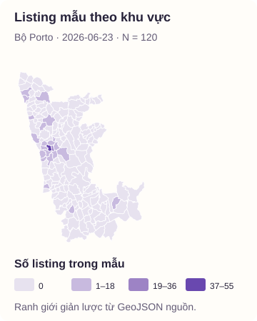
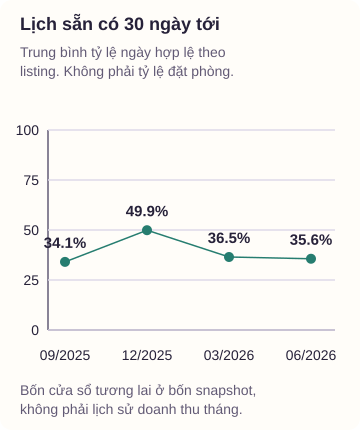
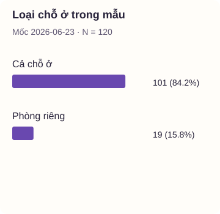
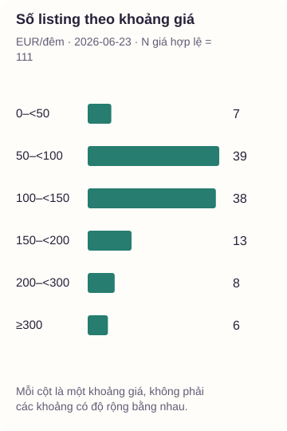
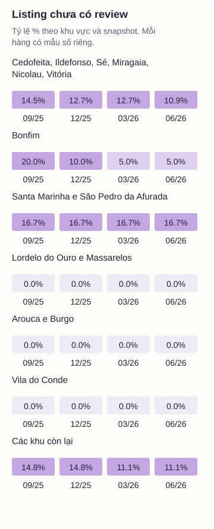

## 6. Kết quả thực hành trên Porto

Lượt chạy ngày 19/10/2026 đã đọc đủ bốn snapshot, chọn **120 listing**, tạo 480 hàng listing theo mốc và xử lý 13.842 hàng lịch trong các cửa sổ đã chọn. Baseline đã chạy trên 300 review duy nhất.

Ở mốc 23/06/2026, mẫu có 101 listing cho thuê cả chỗ ở, tương ứng **84,17%**. Trung vị giá chào là **109,55 EUR/đêm**, tính trên 111 listing đủ điều kiện. Đây là kết quả của mẫu, không phải số đo toàn thị trường Porto.

[Tải bảng KPI](/materials/xu-ly-du-lieu/airbnb/kpi-porto.csv) · [Xem URL và checksum nguồn](/materials/xu-ly-du-lieu/airbnb/nguon-porto.json) · [Tải báo cáo PDF](/materials/xu-ly-du-lieu/airbnb/bao-cao-porto.pdf)

### Bắt đầu từ hai hình để đọc kết quả

Bản đồ cho biết mẫu phân bố ở đâu. Hình lịch cho biết lượng ngày còn sẵn trong những cửa sổ tương lai khác nhau. Không đọc đường nối bốn điểm thành mùa vụ đã được chứng minh hoặc tỷ lệ đặt phòng thực tế.

::: details Ba hình còn lại để đối chiếu loại chỗ ở, giá và review

:::

### Từ kết quả trở lại cách làm

Giữ cùng 120 listing qua bốn mốc giúp so sánh cùng đối tượng. Số listing cố định bằng 120 là hệ quả thiết kế mẫu, không chứng minh nguồn cung thành phố đứng yên. Tỷ lệ chưa có review giảm từ 14,17% xuống 9,17% trong mẫu, nhưng cũng không tự chứng minh khách hài lòng hơn.

QA của lượt chạy giữ các listing khi chúng còn dùng được cho phép đếm. Tính giá dùng riêng tập giá hợp lệ và công bố N. Chương trình không cần xóa giá cao, không bù ngày lịch và không nhân review lặp thành nhiều ý kiến mới.

::: details Phạm vi của lần chạy và cách hoàn thiện nhánh LLM

Lượt công bố này chạy dữ liệu, KPI, năm hình và baseline, chưa gọi API LLM. Mẫu nhãn người vẫn để trống, nên không công bố accuracy/F1 hoặc tỷ lệ cảm xúc của LLM. Mã gọi API, kiểm phản hồi, cache và chấm nhãn đã được chuẩn bị để chạy theo README sau khi có đầu vào tương ứng.

Mức sẵn có tính trên các ngày có trạng thái hợp lệ của từng listing. Độ phủ từng cửa sổ được ghi trong bảng KPI. Những số này mô tả lịch công khai quan sát được, không phải giao dịch thuê phòng.

:::
